<!-- Generated by scripts/generate.py from data/works.json. Edit the structured source, not this generated index. -->
<h1 align="center">Awesome RGBDT Manipulation</h1>
<p align="center"><strong>Benchmarks and policies for precise, contact-rich robot manipulation.</strong></p>
<p align="center">RGB · Depth · Tactile · Force feedback</p>
<p align="center"><a href="#benchmarks">Benchmarks</a> · <a href="#policies">Policies</a> · <a href="data/works.json">Structured catalog</a> · <a href="METHODOLOGY.md">Curation</a> · <a href="website/README.md">Local website</a></p>

Reviewed through **17 October 2026**. **508 unique research records**, including **45 benchmark records**, **455 policy records**, **4 surveys**, and **12 supporting resources**. A work can contribute to both main collections, so counts cannot be added. Surveys appear in relevant categories and are counted separately from executable policies.

## About

This reference connects evaluation suites with the policies used for precision, dexterity and contact-rich manipulation. Benchmark records retain task names, task-count scope, simulator versions, physical sensors, demonstrations and evaluation protocols. Policy records retain architectures, actual deployment observations, action outputs, model sizes, training data, hardware, duration and reported control rates.

- Primary papers, official projects, repositories and model cards support the records.
- Measured depth, inferred geometry, tactile arrays, tactile images, wrist force/torque and privileged training labels are distinct.
- Paper experiments, current code, released datasets and model checkpoints retain their own version and availability scope.
- **Not reported** means the inspected sources do not disclose a value; **Not verified** marks an unresolved value. Neither is zero or proof of absence.
- Figures retain author credit and original rights; repository licensing does not relicense research figures.

## Start here

- **Visuo-tactile evaluation:** OpenViTac, UniVTAC, ManiFeel, Tac-Bench, ContactWorld and the TacBench evaluation introduced with Sparsh.
- **Precision and assembly:** Peg-in-Bench, ManipulationNet, FMB, Factory, IndustReal, AutoMate and LABIT.
- **Touch-conditioned policies:** 3D-ViTac, Reactive Diffusion Policy, VT-Refine, FTP-1, OpenVTLA, PACE and recent tactile VLA / world-action policies.
- **Visual and 3D foundations:** Diffusion Policy, ACT, DP3, PerAct, RVT-2, HIL-SERL, DPPO and selected generalist VLA / world-action models.
- **Agent / RSI / ICL:** Executable robot agents, feedback-driven self-improvement and in-context adaptation; records distinguish model weights, context, reusable code and memory.
- **Benchmark-to-policy coverage:** [Primary-source roster mappings](data/policy-source-audit.json) separate paper baselines, leaderboard entries and integration adapters.

## Contents

- [Benchmarks](#benchmarks)
  - [Visuo-Tactile Benchmarks](#tactile-benchmarks)
  - [Precision and Assembly](#precision-assembly)
  - [Dexterous Manipulation](#dexterous-benchmarks)
  - [General Manipulation](#general-manipulation)
  - [Robustness and Evaluation](#robustness-evaluation)
  - [Supporting Tools and Data](#supporting-resources)
- [Policies](#policies)
  - [Visuo-Tactile Policy Learning](#tactile-il)
  - [Tactile VLA and World-Action Models](#tactile-foundation)
  - [RGB-D and 3D Policies](#rgbd-3d)
  - [Visual Precision and Reinforcement Learning](#visual-precision-rl)
  - [Agent / RSI / ICL](#agent-rsi-icl)
  - [Generalist Policy Foundations](#generalist-foundation)
- [Local preview and updates](#local-preview-and-updates)
- [Attribution](#attribution)

## Benchmarks

Categories are overlapping discovery routes. Each record has one primary placement in this README; the website exposes all applicable categories.

<a id="tactile-benchmarks"></a>
### Visuo-Tactile Benchmarks

| Date | Work | Setting | Tasks / simulator | Release | Primary links |
| :-- | :-- | :-- | :-- | :-- | :-- |
| 2026-10-07 | [OpenViTac](#record-benchmark-openvitac) | Simulation · Real world | 11 simulation tasks; 8 paired physical tasks; NVIDIA Isaac Sim / Isaac Lab with modified TacEx / UIPC | Available | **[Paper](https://arxiv.org/abs/2610.10384)** · [Project](https://fvl-repo.github.io/OpenViTac/) · [Code](https://github.com/FVL-Repo/OpenViTac) <!-- work:openvitac --> |
| 2026-09-25 | [TACTIC: Encoder Study](#record-benchmark-tactic-encoder-study) | Real world | 4 physical contact-rich tasks; Not applicable — real-world controlled study | Not released | **[Paper](https://arxiv.org/abs/2609.30969)** · [Project](https://utn-air.github.io/TACTIC) · [Data](https://huggingface.co/collections/UTN-AIR/tactic) <!-- work:tactic-encoder-study --> |
| 2026-09-14 | [Bench2Dex](#record-benchmark-bench2dex) | Simulation | 26 long-horizon task scenes spanning 12 arm-hand embodiments; not a full 26×12 crossed task matrix; Isaac Sim / Isaac Lab | Available | **[Paper](https://arxiv.org/abs/2609.15726)** · [Project](https://bench2dex.github.io/) · [Code](https://github.com/Bench2Dex/Bench2Dex) · [Data](https://huggingface.co/Bench2Dex) <!-- work:bench2dex --> |
| 2026-07-10 | [TactiDex](#record-benchmark-tactidex) | Real world · Simulation | 757 human interaction sequences over 49 objects; 73 representative sequences in simulation transfer evaluation, not 73 semantic task types.; NVIDIA Isaac Gym / PhysX | Not verified | **[Paper](https://arxiv.org/abs/2607.09190)** · [Project](https://tactidex.github.io/) <!-- work:tactidex --> |
| 2026-07-05 | [SoftVTBench](#record-benchmark-softvtbench) | Simulation | Current project release: 40 tasks, four suites; early paper: 2,000 episodes / 33 assets; homepage: 4,000 demonstrations / 50+ assets.; Isaac Sim / Isaac Lab with FEM deformable objects | Available | **[Paper](https://arxiv.org/abs/2607.04234)** · [Project](https://softvtbench.github.io/) · [Code](https://github.com/TuojingAI/SoftVTBench) · [Data](https://huggingface.co/datasets/Arthur12137/SoftVTBench) <!-- work:softvtbench --> |
| 2026-07-02 | [DexPiH Benchmark](#record-benchmark-dex-pih-benchmark) | Simulation | 10 peg geometries × 4 arms × 2 hands = 80 embodiment–geometry combinations; Isaac Gym / PhysX TGS with SDF collision meshes | Not verified | **[Paper](https://doi.org/10.1109/ACCESS.2026.3709302)** <!-- work:dex-pih-benchmark --> |
| 2026-06-11 | [ContactWorld](#record-benchmark-contactworld) | Simulation · Real world | 12 simulation task variants; 6 physical task settings on 2 platforms; Isaac Gym with tactile environments derived from ManiFeel / TacSL | Available | **[Paper](https://arxiv.org/abs/2606.13877)** · [Project](https://contact-world.github.io/) · [Code](https://github.com/PokuangZhou/ContactWorld) · [Data](https://huggingface.co/datasets/Pokuang/ContactWorld) <!-- work:contactworld --> |
| 2026-05-27 | [Tabero / Tabero-VTLA](#record-benchmark-tabero) | Simulation | Nine Object-suite tasks in main model evaluation;broader data-migration checks span four LIBERO suites.; Isaac Sim / Isaac Lab with TacEx,Taxim and FOTS-derived tactile rendering | Available | **[Paper](https://arxiv.org/abs/2605.27886)** · [Project](https://nathanwu7.github.io/Tabero/) · [Code](https://github.com/NathanWu7/Tabero) · [Data](https://huggingface.co/datasets/NathanWu7/Isaaclab_Libero) · [Weights](https://huggingface.co/NathanWu7/pi0_lora_tacfield_tabero) <!-- work:tabero --> |
| 2026-05-21 | [TacO](#record-benchmark-taco-sensor-benchmark) | Real world | 3 physical manipulation tasks; Not applicable — physical robot sensor benchmark | Available | **[Paper](https://arxiv.org/abs/2605.21976)** · [Project](https://anyazorin.com/projects/taco) · [Code](https://github.com/TacObench/TacO) <!-- work:taco-sensor-benchmark --> |
| 2026-02-10 | [UniVTAC](#record-benchmark-univtac) | Simulation · Real world | 8 simulation benchmark tasks; 3 physical transfer tasks; Isaac Sim / Isaac Lab, modified TacEx and UIPC | Available | **[Paper](https://arxiv.org/abs/2602.10093)** · [Project](https://univtac.github.io/) · [Code](https://github.com/univtac/UniVTAC) · [Data](https://modelscope.cn/datasets/byml2024/UniVTAC) <!-- work:univtac --> |
| 2026 | [Tac-Bench](#record-benchmark-tac-bench) | Simulation | 14 contact-rich simulation tasks; TacSL-based platform; underlying physics-engine release not named in workshop manuscript | Not released | **[Paper](https://peilinwu.site/tac-bench.github.io/paper/corl_2026_template_submission/example.pdf)** · [Project](https://peilinwu.site/tac-bench.github.io/) <!-- work:tac-bench --> |
| 2026 | [ManiSkill-ViTac 2026](#record-benchmark-maniskill-vitac-2026) | Real world | 2 physical bimanual tasks; Not applicable — 2026 challenge uses physical robot evaluation | Available | **[Project](https://callmeray.github.io/Mani_ViTac_Challenge_2026_page/)** · [Code](https://github.com/chaoyiL/ManiSkill-vitac) · [Data](https://cloud.tsinghua.edu.cn/d/0831b0fa9aed41c98e3b/) <!-- work:maniskill-vitac-2026 --> |
| 2025-05-24 | [ManiFeel](#record-benchmark-manifeel) | Simulation · Real world | 9 simulation task setups and 4 real-world setups in Jan 2026 v2; normal-light ball sorting also appears as a simulation control in dataset Table V.; Isaac Gym with TacSL | Available | **[Paper](https://arxiv.org/abs/2505.18472)** · [Project](https://zhengtongxu.github.io/manifeel-website/) · [Code](https://github.com/purdue-mars/manifeel) <!-- work:manifeel --> |
| 2025 | [VTDexManip](#record-benchmark-vtdexmanip) | Simulation · Real world | Six robot tasks;ten human dataset task families are separate.; NVIDIA Isaac Gym | Available | **[Paper](https://proceedings.iclr.cc/paper_files/paper/2025/file/e19b6f65791e350347bcff8a3955cb5b-Paper-Conference.pdf)** · [Project](https://lqts.github.io/VTDexManip/) · [Code](https://github.com/LQTS/VTDexManip) · [Data](https://1drv.ms/f/c/9054151f0ba654c9/EslUpgsfFVQggJB7AQAAAAABSp31p8Fft1mtHyOwJNqmoA) <!-- work:vtdexmanip --> |
| 2024-11-19 | [ManiSkill-ViTac 2025](#record-benchmark-maniskill-vitac-2025) | Simulation · Real world | 3 tracks; tactile-only track has 2 tasks; depth-fusion track has 1 peg-selection/insertion task; sensor-design track evaluates a modified sensor.; SAPIEN / IPC-based high-fidelity tactile… | Available | **[Paper](https://arxiv.org/abs/2411.12503)** · [Project](https://ai-workshops.github.io/maniskill-vitac-challenge-2025/) · [Code](https://github.com/cyliizyz/ManiSkill-ViTac2025) <!-- work:maniskill-vitac-2025 --> |
| 2022-07-21 | [Tactile Gym 2.0](#record-benchmark-tactilegym2) | Simulation · Real world | 3 physically interactive tasks in the paper; repository includes additional environments; PyBullet | Available | **[Paper](https://arxiv.org/abs/2207.10763)** · [Code](https://github.com/NICESONY/tactile_gym_2) <!-- work:tactilegym2 --> |

<a id="record-benchmark-openvitac"></a>
<details>
<summary><strong>OpenViTac</strong> — OpenViTac: Learning and Benchmarking Visuo-Tactile Policies in a Unified Sim-and-Real Framework</summary>

**2026-10-07 · Preprint · Fudan University**

**[Paper](https://arxiv.org/abs/2610.10384)** · [Project](https://fvl-repo.github.io/OpenViTac/) · [Code](https://github.com/FVL-Repo/OpenViTac)

Paired simulation and physical evaluation across property perception, fragility, sustained contact and precision insertion. The study compares VLA, world-action and tactile-enabled policies.

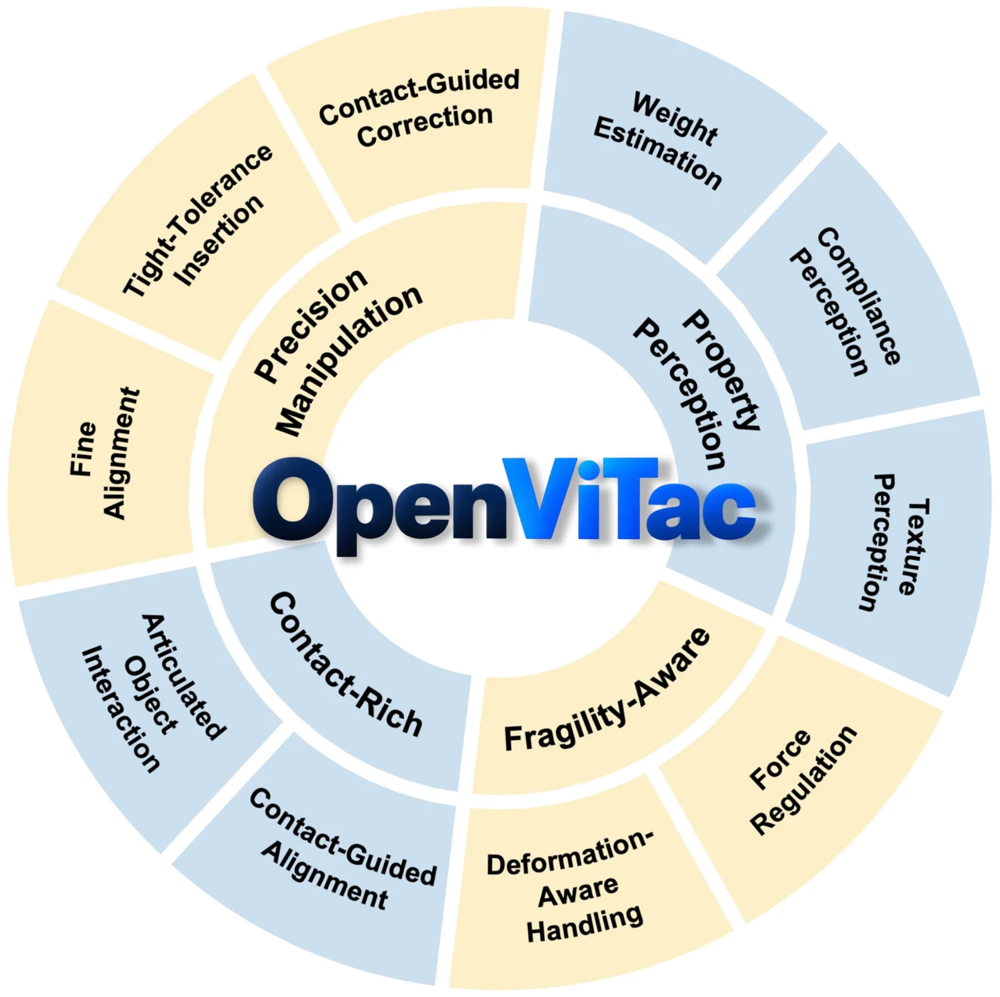

*OpenViTac authors · [Figure source](https://fvl-repo.github.io/OpenViTac/) · Original rights retained.*

| Field | Reported value and source scope |
| :-- | :-- |
| Record type | benchmark |
| Simulator | NVIDIA Isaac Sim / Isaac Lab with modified TacEx / UIPC [1](https://arxiv.org/abs/2610.10384) [2](https://fvl-repo.github.io/OpenViTac/)  |
| Simulator version and scope | Paper Appendix B.2: Isaac Sim 5.1.0 / Isaac Lab 2.3.0. Current main README installer: Isaac Sim 4.5.0 / Isaac Lab 2.1.1. These are different scopes. [1](https://arxiv.org/abs/2610.10384) [2](https://fvl-repo.github.io/OpenViTac/) [3](https://github.com/FVL-Repo/OpenViTac)  |
| Task count and scope | 11 simulation tasks; 8 paired physical tasks [1](https://arxiv.org/abs/2610.10384) [2](https://fvl-repo.github.io/OpenViTac/)  |
| Task-list scope | Complete 11-task paper simulation suite; real subset excludes weight classification, hardness classification and roughness-guided regrasp. [1](https://arxiv.org/abs/2610.10384) [2](https://fvl-repo.github.io/OpenViTac/)  |
| Capability dimensions | Physical property perception · Fragility-aware manipulation · Contact-rich manipulation · Precision insertion [1](https://arxiv.org/abs/2610.10384) [2](https://fvl-repo.github.io/OpenViTac/)  |
| Metrics | Task-specific binary success; average is the unweighted task mean; sim-real ranking correlation; sim-real co-training comparisons. [1](https://arxiv.org/abs/2610.10384) [2](https://fvl-repo.github.io/OpenViTac/)  |
| Robots | Corresponding sim-real arms; Franka Hand and Robotiq gripper configurations. Arm model is not resolved from the public excerpt. [1](https://arxiv.org/abs/2610.10384) [2](https://fvl-repo.github.io/OpenViTac/)  |
| Sensors and observations | GelSight, Xense and Neote tactile configurations. GelSight/Xense export tactile RGB, marker motion, depth and pose; Neote exports gel-particle or dense force fields. Exported tactile depth is not an external metric-depth policy input. [1](https://arxiv.org/abs/2610.10384) [2](https://fvl-repo.github.io/OpenViTac/)  |
| Demonstrations and data | Per tactile configuration: 1,300 simulation episodes across 11 tasks; 2,400 real demonstrations across 8 tasks. Training uses 100/task except Insert Block v2 with 300. Public dataset download links still marked coming soon. [1](https://arxiv.org/abs/2610.10384) [2](https://fvl-repo.github.io/OpenViTac/)  |
| Evaluation protocol | Separate single-task fine-tuning; predefined balanced task conditions; task variants evaluated separately then aggregated. Co-training keeps 100 real demonstrations fixed and adds 250 or 500 simulated demonstrations for Insert USB / Gear assembly. [1](https://arxiv.org/abs/2610.10384) [2](https://fvl-repo.github.io/OpenViTac/)  |
| Evaluated baselines | π0.5, StarVLA (Qwen3), InternVLA-A1.5, X-VLA, Lingbot-VLA-2, Xiaomi-Robotics; FastWAM, Lingbot-VA, StarVLA (Cosmos); FTP-1; OpenVTLA. [1](https://arxiv.org/abs/2610.10384) [2](https://fvl-repo.github.io/OpenViTac/)  |
| Observations / modalities | RGB · Tactile · Proprioception · Language |
| Evaluation domain | Simulation · Real world |
| Embodiment | Parallel-jaw gripper |
| Release: code | Available [3](https://github.com/FVL-Repo/OpenViTac) [5](https://github.com/FVL-Repo/OpenViTac/blob/main/policy/openpi/README.md)  |
| Release: weights | Not released [3](https://github.com/FVL-Repo/OpenViTac) [5](https://github.com/FVL-Repo/OpenViTac/blob/main/policy/openpi/README.md)  |
| Release: data | Not released [3](https://github.com/FVL-Repo/OpenViTac) [5](https://github.com/FVL-Repo/OpenViTac/blob/main/policy/openpi/README.md)  |
| Release: license | Not verified [3](https://github.com/FVL-Repo/OpenViTac) [5](https://github.com/FVL-Repo/OpenViTac/blob/main/policy/openpi/README.md)  |
| Release: notes | Code and task workflows public. Project/repository mark dataset and model links coming soon; do not interpret paper data statistics as downloadable release. [3](https://github.com/FVL-Repo/OpenViTac) [5](https://github.com/FVL-Repo/OpenViTac/blob/main/policy/openpi/README.md)  |

**Task names — Complete 11-task paper simulation suite; real subset excludes weight classification, hardness classification and roughness-guided regrasp.:**

- Weight classification
- Hardness classification
- Roughness classification
- Roughness-guided regrasp
- Empty-can selection
- Grasp chip
- Gear assembly
- Pull drawer
- Insert USB
- Insert block v1
- Insert block v2

**Scope and qualifications**

- Paper simulator stack differs from current main installer; compare runs only with a recorded matching stack.
- Repository includes additional scenarios and an eight-task default development collection list; neither is the 11-task paper benchmark.
- Sim-real correlations differ between paper and homepage snapshots; use the manuscript protocol and domain subset explicitly.
- Related benchmark is OpenViTac; policy and benchmark are separate catalog entries.
- Pretrained temporal encoding+early token fusion is an empirical result for this benchmark, not a universal fusion rule.

**Primary evidence**

1. [Paper](https://arxiv.org/abs/2610.10384) — Published paper / arXiv record and manuscript.
2. [Official project](https://fvl-repo.github.io/OpenViTac/) — Public project page.
3. [Official repository](https://github.com/FVL-Repo/OpenViTac) — Current public repository; implementation scope may differ from paper.
4. [Full paper: method and implementation details](https://arxiv.org/html/2610.10384) — Unreported specifications remain explicitly unknown; hardware/rates are scoped to training, inference or low-level control.
5. [Official OpenPI vision/tactile client specification](https://github.com/FVL-Repo/OpenViTac/blob/main/policy/openpi/README.md) — Client observation/action schema and remote-server dependency. Main README OpenVTLA section states that model and dataset release links will be added when available.

</details>

<a id="record-benchmark-tactic-encoder-study"></a>
<details>
<summary><strong>TACTIC: Encoder Study</strong> — TACTIC: Understanding Tactile Encoders and Conditioning for Contact-rich Robot Manipulation Policies</summary>

**2026-09-25 · Preprint · University of Technology Nuremberg**

**[Paper](https://arxiv.org/abs/2609.30969)** · [Project](https://utn-air.github.io/TACTIC) · [Data](https://huggingface.co/collections/UTN-AIR/tactic)

Controlled real-world comparison of tactile encoder and policy-conditioning choices across contact-rich tasks, with over 2,000 rollouts.

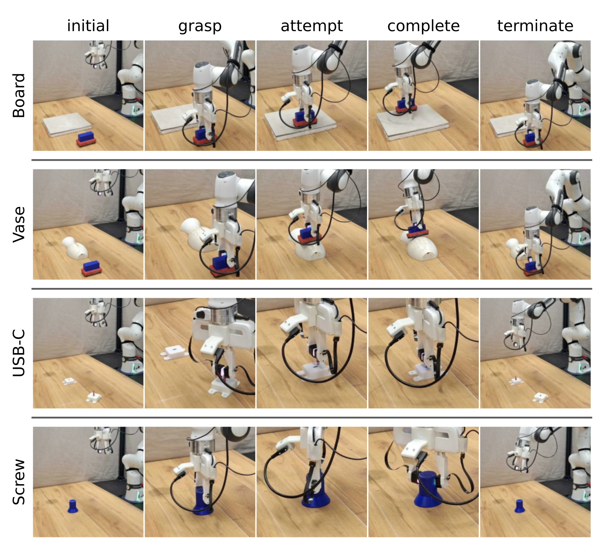

*TACTIC — encoder study authors · [Figure source](https://arxiv.org/abs/2609.30969) · Original rights retained.*

| Field | Reported value and source scope |
| :-- | :-- |
| Record type | benchmark |
| Simulator | Not applicable — real-world controlled study [1](https://arxiv.org/abs/2609.30969)  |
| Simulator version and scope | Not applicable [1](https://arxiv.org/abs/2609.30969)  |
| Task count and scope | 4 physical contact-rich tasks [1](https://arxiv.org/abs/2609.30969)  |
| Task-list scope | Complete four-task physical suite; Screwing tightens a pre-positioned nut. [1](https://arxiv.org/abs/2609.30969)  |
| Capability dimensions | Tactile representation selection · Policy conditioning · Precise insertion · Surface interaction [1](https://arxiv.org/abs/2609.30969)  |
| Metrics | Success at initialization, grasp, task attempt, task completion and termination; task-specific completion criteria. [1](https://arxiv.org/abs/2609.30969)  |
| Robots | Two Franka FR3 arms in leader/follower data collection; only follower used during inference, with Franka Hand. [1](https://arxiv.org/abs/2609.30969)  |
| Sensors and observations | Two DIGIT tactile sensors; RealSense D405 wrist and D435 side RGB cameras. Depth-capable hardware does not establish depth policy input. [1](https://arxiv.org/abs/2609.30969) [2](https://utn-air.github.io/TACTIC/)  |
| Demonstrations and data | Approximately 100 demonstrations/task at 30 Hz, with four DIGIT cartridge pairs. [1](https://arxiv.org/abs/2609.30969)  |
| Evaluation protocol | 2,180 physical rollouts; 20 inference rollouts per ablation condition. Five tactile backbones crossed with five fusion schemes; stage-level success and OOD tests. [1](https://arxiv.org/abs/2609.30969)  |
| Evaluated baselines | ACT; ResNet18, SARL, UniT, Sparsh-DINO, T3 encoders; Concatenation, FiLM, Gated Cross-Attention, CLIP-R and CLIP-T fusion. [1](https://arxiv.org/abs/2609.30969)  |
| Observations / modalities | RGB · Tactile · Proprioception |
| Evaluation domain | Real world |
| Embodiment | Parallel-jaw gripper |
| Release: code | Not released [2](https://utn-air.github.io/TACTIC/) [4](https://utn-air.github.io/TACTIC)  |
| Release: weights | Not verified [2](https://utn-air.github.io/TACTIC/) [4](https://utn-air.github.io/TACTIC)  |
| Release: data | Available [2](https://utn-air.github.io/TACTIC/) [4](https://utn-air.github.io/TACTIC)  |
| Release: license | Not verified [2](https://utn-air.github.io/TACTIC/) [4](https://utn-air.github.io/TACTIC)  |
| Release: notes | Four datasets linked in official Hugging Face collection; code explicitly coming soon. [2](https://utn-air.github.io/TACTIC/) [4](https://utn-air.github.io/TACTIC)  |

**Task names — Complete four-task physical suite; Screwing tightens a pre-positioned nut.:**

- Board Wiping
- Vase Wiping
- USB-C Insertion
- Screwing

**Scope and qualifications**

- Distinct from Cornell TACTIC (whole-arm control, arXiv: 2607.09218).
- A controlled empirical study; not presented here as a downloadable simulation suite.
- No universally best encoder/fusion across tasks was found.
- Distinct from the whole-arm contact-learning paper also named TACTIC (2607.09218).

**Primary evidence**

1. [Paper](https://arxiv.org/abs/2609.30969) — Published paper / arXiv record and manuscript.
2. [Official source](https://utn-air.github.io/TACTIC/) — Official project checked against full manuscript.
3. [Full paper: method and implementation details](https://arxiv.org/html/2609.30969) — Unreported specifications remain explicitly unknown; hardware/rates are scoped to training, inference or low-level control.
4. [Official TACTIC project](https://utn-air.github.io/TACTIC) — Project identity and release links checked independently of manuscript claims.

</details>

<a id="record-benchmark-bench2dex"></a>
<details>
<summary><strong>Bench2Dex</strong> — Bench2Dex: Benchmarking Visuo-Tactile Bimanual Dexterous Manipulation Across Dexterous Hands</summary>

**2026-09-14 · Preprint · East China University of Science and Technology / Shanghai Jiao Tong University / Fudan University**

**[Paper](https://arxiv.org/abs/2609.15726)** · [Project](https://bench2dex.github.io/) · [Code](https://github.com/Bench2Dex/Bench2Dex) · [Data](https://huggingface.co/Bench2Dex)

A bimanual dexterous suite across 12 arm-hand pairings, using a shared geometry-based tactile representation and controlled generalization channels.

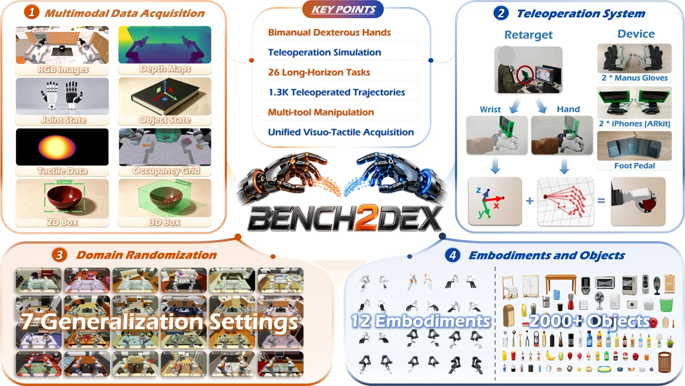

*Bench2Dex authors · [Figure source](https://bench2dex.github.io/) · Original rights retained.*

| Field | Reported value and source scope |
| :-- | :-- |
| Record type | benchmark |
| Simulator | Isaac Sim / Isaac Lab [1](https://arxiv.org/abs/2609.15726) [2](https://bench2dex.github.io/)  |
| Simulator version and scope | Released setup: Isaac Sim 5.1.0 / Isaac Lab 2.3.2. [1](https://arxiv.org/abs/2609.15726) [2](https://bench2dex.github.io/) [3](https://github.com/Bench2Dex/Bench2Dex)  |
| Task count and scope | 26 long-horizon task scenes spanning 12 arm-hand embodiments; not a full 26×12 crossed task matrix [1](https://arxiv.org/abs/2609.15726) [2](https://bench2dex.github.io/)  |
| Task-list scope | Complete 26-task released scene catalogue from official documentation. [1](https://arxiv.org/abs/2609.15726) [2](https://bench2dex.github.io/)  |
| Capability dimensions | Bimanual dexterity · Tool/device use · Articulated objects · Multi-stage execution · Invariance and equivariance robustness [1](https://arxiv.org/abs/2609.15726) [2](https://bench2dex.github.io/)  |
| Metrics | Stable task success (terminal predicate with default 0.5 s dwell); latched stage completion; efficiency; SafeSR and violation/drop diagnostics; bootstrap intervals. [1](https://arxiv.org/abs/2609.15726) [2](https://bench2dex.github.io/)  |
| Robots | IIWA7+Sharpa; JAKA ZU7+DexHand021; Panda+Orca/Allegro; RM65+Revo2; xArm7+Ability/LEAP; UR5+RH5DG2/RH56DFX/Shadow/Schunk/Wuji. [1](https://arxiv.org/abs/2609.15726) [2](https://bench2dex.github.io/)  |
| Sensors and observations | RGB / depth cameras and shared visuotactile images generated by ray-sampling contact surfaces; proprioception and privileged object-state annotations. Geometry-based contact response is not an identified physical optical sensor model. [1](https://arxiv.org/abs/2609.15726) [2](https://bench2dex.github.io/)  |
| Demonstrations and data | Approximately 1,300 human-teleoperated demonstrations across the task catalogue. [1](https://arxiv.org/abs/2609.15726) [2](https://bench2dex.github.io/)  |
| Evaluation protocol | 4 policies × 26 tasks × 4 channels × 50 rollouts = 20,800 evaluation episodes. Channels None, Equivariance, Invariance and All control seven perturbation factors; task-macro averages. [1](https://arxiv.org/abs/2609.15726) [2](https://bench2dex.github.io/)  |
| Evaluated baselines | ACT, Diffusion Policy, π0.5, GR00T N1.5. [1](https://arxiv.org/abs/2609.15726) [2](https://bench2dex.github.io/)  |
| Observations / modalities | RGB · Depth · Tactile · Proprioception · Language |
| Evaluation domain | Simulation |
| Embodiment | Dexterous hand · Bimanual |
| Release: code | Available [3](https://github.com/Bench2Dex/Bench2Dex)  |
| Release: weights | Not verified [3](https://github.com/Bench2Dex/Bench2Dex)  |
| Release: data | Available [3](https://github.com/Bench2Dex/Bench2Dex)  |
| Release: license | MIT code; dataset/asset terms separate [3](https://github.com/Bench2Dex/Bench2Dex) [4](https://github.com/Bench2Dex/Bench2Dex/blob/main/LICENSE)  |
| Release: notes | Training, inference, teleoperation code and data links public; inspect individual dataset/asset licenses. [3](https://github.com/Bench2Dex/Bench2Dex)  |

**Task names — Complete 26-task released scene catalogue from official documentation.:**

- Canned Food Tray Arrangement
- Baking Tray Prep
- Jigsaw Puzzle Assembly
- Gaming Desk Setup
- Tool Box Loading
- Medicine Shoebox Pack
- Sports Ball Cup Sort
- Stationery Category Sorting
- Faucet Cup Water Fill
- Wine Glass Plate Balance
- Bimanual Piano Melody
- Cleaner Box Loading
- Toilet Lid Cleaner Pour
- Shoebox Accessory Pack
- Citrus Plate Loading
- Fridge Wine Interhand Pour
- Breadbasket Fast-Food Loading
- Fruit Bowl Loading
- Screwdriver Box & Hammer
- Height-Sorted Trash Disposal
- Fridge Fruit Shelf Sorting
- Soup Serving
- Frypan Stand & Pour
- Microwave Bowl Loading
- Condiment Box Loading
- Ball Box Loading

**Scope and qualifications**

- Tasks are allocated to embodiments rather than every hand performing every task.
- Shared simulated contact images are not equivalent to measured tactile hardware signals.

**Primary evidence**

1. [Paper](https://arxiv.org/abs/2609.15726) — Published paper / arXiv record and manuscript.
2. [Official project](https://bench2dex.github.io/) — Public project page.
3. [Official repository](https://github.com/Bench2Dex/Bench2Dex) — Current public repository; implementation scope may differ from paper.
4. [Official source](https://github.com/Bench2Dex/Bench2Dex/blob/main/LICENSE) — License text read directly; code license does not automatically cover models, data or simulator.

</details>

<a id="record-benchmark-tactidex"></a>
<details>
<summary><strong>TactiDex</strong> — TactiDex: A Real-World Tactile-Guided Benchmark for Human-Like Dexterous Manipulation</summary>

**2026-07-10 · ACM Multimedia 2026 (accepted, official project) · ShanghaiTech University**

**[Paper](https://arxiv.org/abs/2607.09190)** · [Project](https://tactidex.github.io/)

Tactile-rich human hand–object interaction dataset and contact-aware human-to-robot transfer benchmark. The physical demonstration uses open-loop trajectory execution rather than online tactile feedback.

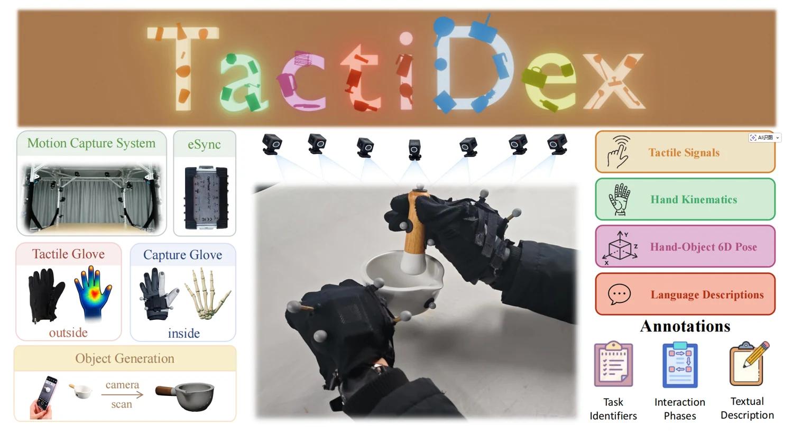

*TactiDex authors · [Figure source](https://tactidex.github.io/) · Original rights retained.*

| Field | Reported value and source scope |
| :-- | :-- |
| Record type | dataset |
| Simulator | NVIDIA Isaac Gym / PhysX [1](https://arxiv.org/abs/2607.09190) [2](https://tactidex.github.io/)  |
| Simulator version and scope | Exact Isaac Gym preview release Not reported. [1](https://arxiv.org/abs/2607.09190) [2](https://tactidex.github.io/)  |
| Task count and scope | 757 human interaction sequences over 49 objects; 73 representative sequences in simulation transfer evaluation, not 73 semantic task types. [1](https://arxiv.org/abs/2607.09190) [2](https://tactidex.github.io/)  |
| Task-list scope | Examples from official human-interaction gallery only; no complete semantic task count reported. [1](https://arxiv.org/abs/2607.09190) [2](https://tactidex.github.io/)  |
| Capability dimensions | Human-like dexterity · Tool use · Bimanual contact · Tactile guidance · Cross-domain transfer [1](https://arxiv.org/abs/2607.09190) [2](https://tactidex.github.io/)  |
| Metrics | Object translation/rotation tracking error, MPJPE, fingertip error, mean tactile force error, Contact F1; SRkin / SRtac; PeakSafe@3N and SafeTac@3N. [1](https://arxiv.org/abs/2607.09190) [2](https://tactidex.github.io/)  |
| Robots | Human data collection; simulation 12-DoF Inspire model; physical two Franka Panda arms with two Inspire hands exposing 6 independent motors each. [1](https://arxiv.org/abs/2607.09190) [2](https://tactidex.github.io/)  |
| Sensors and observations | Human piezoresistive glove: 162 elements, 17 Hz; kinematic/pose streams 120 Hz via tracking glove and OptiTrack. Physical robot tactile sensors are available but not fed back online. [1](https://arxiv.org/abs/2607.09190) [2](https://tactidex.github.io/)  |
| Demonstrations and data | 757 synchronized human interaction sequences, 49 calibrated objects; 73 representative sequences selected for quantitative simulated transfer. [1](https://arxiv.org/abs/2607.09190) [2](https://tactidex.github.io/)  |
| Evaluation protocol | TactiSkill PPO asymmetric actor-critic tracks retargeted demonstrations with tactile-guided rewards. Physical transfer retargets to six actuator commands and executes open-loop. [1](https://arxiv.org/abs/2607.09190) [2](https://tactidex.github.io/)  |
| Evaluated baselines | Kinematic-only transfer baseline and tri-component tactile reward ablations (TactiSkill). [1](https://arxiv.org/abs/2607.09190) [2](https://tactidex.github.io/)  |
| Observations / modalities | RGB · Tactile · Proprioception |
| Evaluation domain | Real world · Simulation |
| Embodiment | Dexterous hand · Bimanual |
| Release: code | Not verified |
| Release: weights | Not verified |
| Release: data | Not verified |
| Release: license | Not reported |
| Release: notes | Official project currently exposes manuscript and task videos; code/data download link not resolved. |

**Task names — Examples from official human-interaction gallery only; no complete semantic task count reported.:**

- Pick up Keyboard
- Beaker Lid
- Drink
- Stamp
- Book
- Shovel
- Call
- Cook
- Play PingPong
- Move PorcelainCup

**Scope and qualifications**

- Official gallery examples are not a complete released task catalogue.
- Dataset human tactile labels and robot deployment sensing must be distinguished.
- Physical tactile sensors are explicitly not used as policy feedback; Appendix C.3 states open-loop execution. Human tactile supervision is not measured robot RGBDT feedback.

**Primary evidence**

1. [Paper](https://arxiv.org/abs/2607.09190) — Published paper / arXiv record and manuscript.
2. [Official project](https://tactidex.github.io/) — Public project page.

</details>

<a id="record-benchmark-softvtbench"></a>
<details>
<summary><strong>SoftVTBench</strong> — SoftVTBench: A Safety-Aware Visuo-Tactile Benchmark for Physically Constrained Robotic Manipulation of Deformable Objects (Early Version)</summary>

**2026-07-05 · Preprint · Tuojing Intelligence**

**[Paper](https://arxiv.org/abs/2607.04234)** · [Project](https://softvtbench.github.io/) · [Code](https://github.com/TuojingAI/SoftVTBench) · [Data](https://huggingface.co/datasets/Arthur12137/SoftVTBench)

Matched rigid and deformable task suites evaluate task completion together with deformation and retention, using policy-hidden FEM diagnostics.

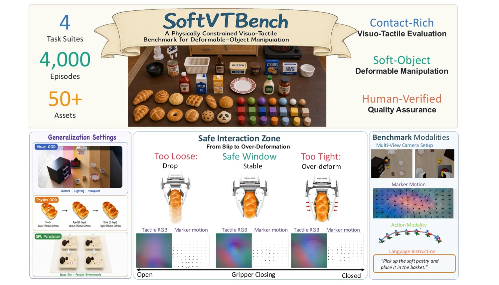

*SoftVTBench authors · [Figure source](https://softvtbench.github.io/) · Original rights retained.*

| Field | Reported value and source scope |
| :-- | :-- |
| Record type | benchmark |
| Simulator | Isaac Sim / Isaac Lab with FEM deformable objects [1](https://arxiv.org/abs/2607.04234) [2](https://softvtbench.github.io/)  |
| Simulator version and scope | Paper early version: Isaac Sim 4.5.0 / Isaac Lab 0.41.3 as written. Current release README: Isaac Sim 4.5 / Isaac Lab 2.1.1 with a pinned commit. [1](https://arxiv.org/abs/2607.04234) [2](https://softvtbench.github.io/) [3](https://github.com/TuojingAI/SoftVTBench)  |
| Task count and scope | Current project release: 40 tasks, four suites; early paper: 2,000 episodes / 33 assets; homepage: 4,000 demonstrations / 50+ assets. [1](https://arxiv.org/abs/2607.04234) [2](https://softvtbench.github.io/)  |
| Task-list scope | Four suite names only; each suite contains 10 language-conditioned pick-and-place task configurations. Detailed per-task prompts are in paper Tables 7–8 and released task definitions. [1](https://arxiv.org/abs/2607.04234) [2](https://softvtbench.github.io/)  |
| Capability dimensions | Deformable manipulation · Safe grasp-force window · Object discrimination · Spatial grounding · Rigid–soft controlled comparison [1](https://arxiv.org/abs/2607.04234) [2](https://softvtbench.github.io/)  |
| Metrics | Paper: Goal Success and Safety Success (no drop + peak deformation below calibrated per-object tolerance). Current page: Task Success Rate and Deformation-aware Success Rate (DSR). [1](https://arxiv.org/abs/2607.04234) [2](https://softvtbench.github.io/)  |
| Robots | Franka Panda arm with parallel-jaw gripper [1](https://arxiv.org/abs/2607.04234) [2](https://softvtbench.github.io/)  |
| Sensors and observations | Third-person / wrist RGB; dual-finger GelSight Mini tactile RGB and marker motion; proprioception, language and actions at 20 Hz. Privileged FEM states restricted to evaluator. [1](https://arxiv.org/abs/2607.04234) [2](https://softvtbench.github.io/)  |
| Demonstrations and data | Current homepage advertises 4,000 expert demonstrations / 40 tasks / 50+ assets; early paper states 2,000 episodes and 33 assets with 50 demos per task. [1](https://arxiv.org/abs/2607.04234) [2](https://softvtbench.github.io/)  |
| Evaluation protocol | Four matched suites separate object type and variation axis; deformation calibration performed before policy training. Current default evaluation uses 50 episodes per task over ten tasks per suite. [1](https://arxiv.org/abs/2607.04234) [2](https://softvtbench.github.io/)  |
| Evaluated baselines | Early manuscript: π0.5 visual-only / visuotactile. Current project additionally lists Diffusion Policy and FastWAM. [1](https://arxiv.org/abs/2607.04234) [2](https://softvtbench.github.io/)  |
| Observations / modalities | RGB · Tactile · Proprioception · Language |
| Evaluation domain | Simulation |
| Embodiment | Parallel-jaw gripper |
| Release: code | Available [3](https://github.com/TuojingAI/SoftVTBench)  |
| Release: weights | Not verified [3](https://github.com/TuojingAI/SoftVTBench)  |
| Release: data | Available [3](https://github.com/TuojingAI/SoftVTBench)  |
| Release: license | Apache-2.0 code; third-party assets and OpenPI terms separate [3](https://github.com/TuojingAI/SoftVTBench) [4](https://github.com/TuojingAI/SoftVTBench/blob/main/LICENSE)  |
| Release: notes | Task/dataset release and locked evaluation environment public; project has expanded since early manuscript. [3](https://github.com/TuojingAI/SoftVTBench)  |

**Task names — Four suite names only; each suite contains 10 language-conditioned pick-and-place task configurations. Detailed per-task prompts are in paper Tables 7–8 and released task definitions.:**

- Object-Soft
- Spatial-Soft
- Object-Rigid
- Spatial-Rigid

**Scope and qualifications**

- Project title and scale have evolved beyond the early arXiv manuscript; counts and metric names must be tied to source version.
- FEM object state used for scoring is privileged and must not be supplied to the policy.
- The four suite names are not a complete forty-task catalogue.

**Primary evidence**

1. [Paper](https://arxiv.org/abs/2607.04234) — Published paper / arXiv record and manuscript.
2. [Official project](https://softvtbench.github.io/) — Public project page.
3. [Official repository](https://github.com/TuojingAI/SoftVTBench) — Current public repository; implementation scope may differ from paper.
4. [Official source](https://github.com/TuojingAI/SoftVTBench/blob/main/LICENSE) — License text read directly; code license does not automatically cover models, data or simulator.

</details>

<a id="record-benchmark-dex-pih-benchmark"></a>
<details>
<summary><strong>DexPiH Benchmark</strong> — A Simulation Benchmark for Dexterous Peg-in-Hole Assembly With Force-Tactile-Based Pose Estimation Across Multiple Embodiments</summary>

**2026-07-02 · IEEE Access 14:101816–101830 · Gwangju Institute of Science and Technology**

**[Paper](https://doi.org/10.1109/ACCESS.2026.3709302)**

Dexterous insertion across four arms, two hands and ten geometries, using idealized wrist/fingertip wrenches and a learned pose-estimation baseline.

| Field | Reported value and source scope |
| :-- | :-- |
| Record type | benchmark |
| Simulator | Isaac Gym / PhysX TGS with SDF collision meshes [1](https://doi.org/10.1109/ACCESS.2026.3709302)  |
| Simulator version and scope | Exact Isaac Gym release Not reported; SDF resolution 512, contact offset 1e-4 m are physics settings, not software version. [1](https://doi.org/10.1109/ACCESS.2026.3709302)  |
| Task count and scope | 10 peg geometries × 4 arms × 2 hands = 80 embodiment–geometry combinations [1](https://doi.org/10.1109/ACCESS.2026.3709302)  |
| Task-list scope | Five explicitly named geometry examples; paper Figure 3 contains all ten shapes. [1](https://doi.org/10.1109/ACCESS.2026.3709302)  |
| Capability dimensions | Occluded peg-pose estimation · Cross-embodiment force/tactile fusion · Alignment and insertion [1](https://doi.org/10.1109/ACCESS.2026.3709302)  |
| Metrics | Pose MAE (mm / degrees); insertion success after ≥3.5 cm insertion; failures include dropping or reaching 2,000 timesteps. [1](https://doi.org/10.1109/ACCESS.2026.3709302)  |
| Robots | Franka Panda, KUKA iiwa, Kinova Gen3, UR5e arms; Allegro and KISTAR hands. [1](https://doi.org/10.1109/ACCESS.2026.3709302)  |
| Sensors and observations | Idealized six-axis wrist and per-fingertip net wrench; no noise/hysteresis/bandwidth/calibration model; no per-taxel pressure/shear image. [1](https://doi.org/10.1109/ACCESS.2026.3709302)  |
| Demonstrations and data | 80K successful state-machine sequences, 1K per embodiment–shape; 400 parallel environments on one RTX 3090. Post-contact training subsequences average 370 steps. [1](https://doi.org/10.1109/ACCESS.2026.3709302)  |
| Evaluation protocol | 80/20 train/test for estimator; friction/restitution/compliance/controller randomization; static hand grasp, arm corrects wrist; vision ablations limited to Franka–Allegro. [1](https://doi.org/10.1109/ACCESS.2026.3709302)  |
| Evaluated baselines | DexPiHNet Transformer; LSTM/temporal learned baselines and classical force-search controllers. [1](https://doi.org/10.1109/ACCESS.2026.3709302)  |
| Observations / modalities | Force/Torque · Tactile · Proprioception |
| Evaluation domain | Simulation |
| Embodiment | Dexterous hand |
| Release: code | Not verified |
| Release: weights | Not verified |
| Release: data | Not verified |
| Release: license | Open-access article Creative Commons terms; code/data license Not reported |
| Release: notes | Article and detailed benchmark definitions accessible; public implementation release not resolved. |

**Task names — Five explicitly named geometry examples; paper Figure 3 contains all ten shapes.:**

- Square peg insertion
- Octagon peg insertion
- Cross peg insertion
- Polygon peg insertion
- T-shape peg insertion

**Scope and qualifications**

- Simulation only and idealized sensing; hand does not perform reactive finger correction.
- Fingertip tactile means integrated wrench here, not optical deformation images or spatial taxel fields.

**Primary evidence**

1. [Paper](https://doi.org/10.1109/ACCESS.2026.3709302) — Published paper / arXiv record and manuscript.

</details>

<a id="record-benchmark-contactworld"></a>
<details>
<summary><strong>ContactWorld</strong> — ContactWorld: What Representations Matter for Vision-Tactile Latent World Models in Contact-Rich Manipulation</summary>

**2026-06-11 · Preprint · Purdue University**

**[Paper](https://arxiv.org/abs/2606.13877)** · [Project](https://contact-world.github.io/) · [Code](https://github.com/PokuangZhou/ContactWorld) · [Data](https://huggingface.co/datasets/Pokuang/ContactWorld)

A controlled world-model planning study over 12 contact-rich manipulation tasks, comparing visual geometry and tactile channels.

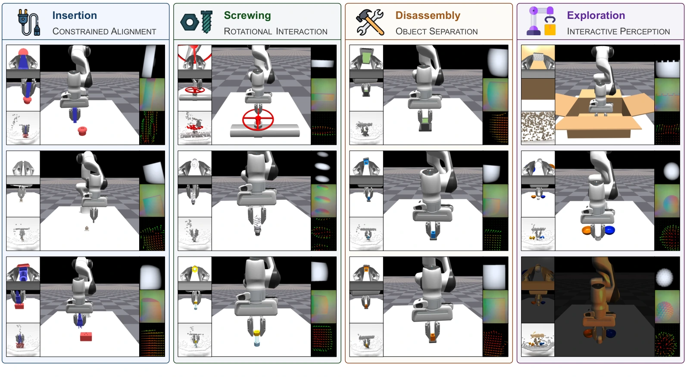

*ContactWorld authors · [Figure source](https://arxiv.org/abs/2606.13877) · Original rights retained.*

| Field | Reported value and source scope |
| :-- | :-- |
| Record type | benchmark |
| Simulator | Isaac Gym with tactile environments derived from ManiFeel / TacSL [1](https://arxiv.org/abs/2606.13877) [2](https://contact-world.github.io/)  |
| Simulator version and scope | Not reported; installation uses a separately distributed Isaac Gym tactile package. [1](https://arxiv.org/abs/2606.13877) [2](https://contact-world.github.io/) [3](https://github.com/PokuangZhou/ContactWorld)  |
| Task count and scope | 12 simulation task variants; 6 physical task settings on 2 platforms [1](https://arxiv.org/abs/2606.13877) [2](https://contact-world.github.io/)  |
| Task-list scope | Complete twelve simulation task labels from manuscript Table I. Physical subset: USB insertion, elastic-clip removal, valve rotation, ball sorting, peg insertion and occluded box search. [1](https://arxiv.org/abs/2606.13877) [2](https://contact-world.github.io/)  |
| Capability dimensions | Action-conditioned world modeling · Contact-rich planning · Long-horizon prediction · Cross-modal compatibility [1](https://arxiv.org/abs/2606.13877) [2](https://contact-world.github.io/)  |
| Metrics | Closed-loop task success, multi-step prediction error, planning frequency and parameter count. [1](https://arxiv.org/abs/2606.13877) [2](https://contact-world.github.io/)  |
| Robots | Simulation Franka Panda; physical Franka Panda and reBot platforms. [1](https://arxiv.org/abs/2606.13877) [2](https://contact-world.github.io/)  |
| Sensors and observations | Wrist/front RGB; point clouds reconstructed from front RGB-D and subsampled to 1,024 XYZRGB points. Three local tactile representations: TacRGB, TacDepth and TacFF (normal plus two tangential components). Physical sensors include GelSight Mini and DM-Tac W2M configurations. [1](https://arxiv.org/abs/2606.13877) [2](https://contact-world.github.io/)  |
| Demonstrations and data | Simulation 1,872 demonstrations / 247,518 interaction steps at 10 Hz; physical 80 demos per each of 6 tasks (50 train /30 held out). [1](https://arxiv.org/abs/2606.13877) [2](https://contact-world.github.io/)  |
| Evaluation protocol | Simulation: 100K gradient updates; goal offsets 12/24/36/48 and 100 evaluation rollouts per task–modality–offset. Physical: 200 training epochs, final checkpoint without task-specific selection; 900 total trials across 6 tasks, 2 platforms and 3 tactile systems, with fixed 30 held-out initial–goal pairs per setting. [1](https://arxiv.org/abs/2606.13877) [2](https://contact-world.github.io/) [4](https://arxiv.org/pdf/2606.13877)  |
| Evaluated baselines | JEPA-structured world models with a CEM-style planner; visual-image, point-cloud, TacRGB and TacFF combinations. [1](https://arxiv.org/abs/2606.13877) [2](https://contact-world.github.io/)  |
| Observations / modalities | RGB · Depth · Tactile · Proprioception |
| Evaluation domain | Simulation · Real world |
| Embodiment | Parallel-jaw gripper |
| Release: code | Available [3](https://github.com/PokuangZhou/ContactWorld)  |
| Release: weights | Available [3](https://github.com/PokuangZhou/ContactWorld)  |
| Release: data | Available [3](https://github.com/PokuangZhou/ContactWorld)  |
| Release: license | Not verified [3](https://github.com/PokuangZhou/ContactWorld)  |
| Release: notes | Official repository links training datasets, pretrained checkpoints and planner/rollout evaluation scripts. [3](https://github.com/PokuangZhou/ContactWorld)  |

**Task names — Complete twelve simulation task labels from manuscript Table I. Physical subset: USB insertion, elastic-clip removal, valve rotation, ball sorting, peg insertion and occluded box search.:**

- USB Insertion
- Peg Insertion
- Power Plug Insertion
- Spike Barb
- Flat Barb
- Loose Lid
- Bulb
- Nut
- Valve
- Object Search
- Sorting (Normal)
- Sorting (Dim)

**Scope and qualifications**

- World-model prediction metrics and closed-loop planning success answer different questions.
- The project is related to ManiFeel but is a separate world-model evaluation protocol; do not count shared scenes as independent evidence.
- Current arXiv title was revised from What Matters in Vision-Tactile World Models for Contact-Rich Manipulation; same canonical work.

**Primary evidence**

1. [Paper](https://arxiv.org/abs/2606.13877) — Published paper / arXiv record and manuscript.
2. [Official project](https://contact-world.github.io/) — Public project page.
3. [Official repository](https://github.com/PokuangZhou/ContactWorld) — Current public repository; implementation scope may differ from paper.
4. [Full paper: Sections III-C and V; Figure 7](https://arxiv.org/pdf/2606.13877) — Simulation 100K gradient updates and physical200 epochs are distinct settings. Planning controls are CEM-based; no pretrained foundation backbone is claimed.

</details>

<a id="record-benchmark-tabero"></a>
<details>
<summary><strong>Tabero / Tabero-VTLA</strong> — Tabero: Learning Gentle Manipulation with Closed-Loop Force Feedback from Vision, Touch, and Language</summary>

**2026-05-27 · ICML 2026 · HKUST(GZ)**

**[Paper](https://arxiv.org/abs/2605.27886)** · [Project](https://nathanwu7.github.io/Tabero/) · [Code](https://github.com/NathanWu7/Tabero) · [Data](https://huggingface.co/datasets/NathanWu7/Isaaclab_Libero) · [Weights](https://huggingface.co/NathanWu7/pi0_lora_tacfield_tabero)

Nine simulated force-sensitive manipulation tasks evaluate task completion and interaction quality with tactile observations and force-position control.

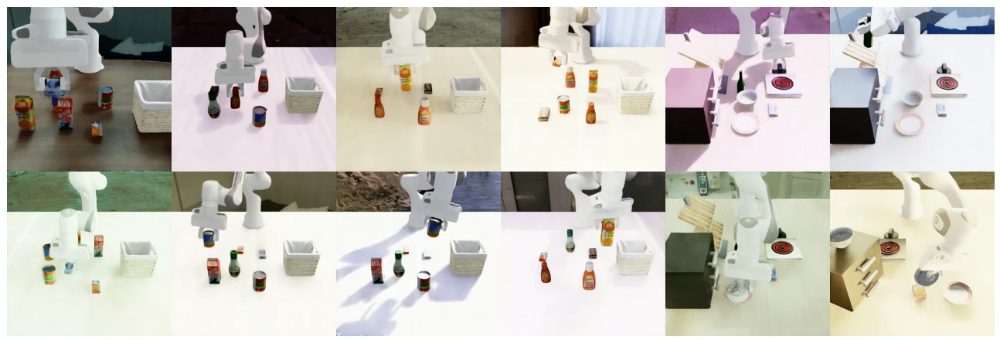

*Tabero authors · [Figure source](https://arxiv.org/html/2605.27886) · Original rights retained.*

| Field | Reported value and source scope |
| :-- | :-- |
| Record type | policy |
| Simulator | Isaac Sim / Isaac Lab with TacEx,Taxim and FOTS-derived tactile rendering |
| Simulator version and scope | Paper:Isaac Sim5.0 / Isaac Lab2.2,force sensor on gelpad;repo Lab2.3/Sim5.1 uses minicase workaround. [3](https://github.com/NathanWu7/Tabero)  |
| Task count and scope | Nine Object-suite tasks in main model evaluation;broader data-migration checks span four LIBERO suites. |
| Task-list scope | Complete nine-task main experimental subset (AppendixC/Table11);not all migrated LIBERO configurations. |
| Capability dimensions | Language-conditioned force regulation · Gentle grasping · Force/pose coordination |
| Metrics | Success rate;average grip/applied force;maximum transient grip/applied force (mean of top5% samples). |
| Robots | Franka Panda with tactile-integrated parallel gripper |
| Sensors and observations | Two RGB-D cameras;dual GelSight-style320x240 tactile RGB and11x9 marker fields;fingertip3D contact force;state/language/actions20 Hz. |
| Demonstrations and data | Replay source trajectories under100%,25%,10% gripper-controller scaling;keep successful replays;dataset totals source/version dependent. |
| Evaluation protocol | Compare firm/gentle prompts on matched object tasks;DatasetsA/B continuous force25%/10%,DatasetC binary gripper10%;controller ablations isolate tracking. |
| Evaluated baselines | Vision-only π0;image,marker-field andforce tactile injection variants;force-supervision and fixed-controller ablations. |
| Observations / modalities | RGB · Tactile · Force/Torque · Proprioception · Language |
| Evaluation domain | Simulation |
| Embodiment | Parallel-jaw gripper |
| Release: code | Available [2](https://github.com/NathanWu7/Tabero) [3](https://github.com/NathanWu7/Tabero)  |
| Release: weights | Available [2](https://github.com/NathanWu7/Tabero) [3](https://github.com/NathanWu7/Tabero)  |
| Release: data | Available [2](https://github.com/NathanWu7/Tabero) [3](https://github.com/NathanWu7/Tabero)  |
| Release: license | Apache-2.0 repository; upstream simulator/model/data terms separate [2](https://github.com/NathanWu7/Tabero) [3](https://github.com/NathanWu7/Tabero)  |
| Release: notes | Environment/data/inference clients and companion Tabero-VTLA training repository; LoRA weights linked. [2](https://github.com/NathanWu7/Tabero) [3](https://github.com/NathanWu7/Tabero)  |

**Task names — Complete nine-task main experimental subset (AppendixC/Table11);not all migrated LIBERO configurations.:**

- pick up the alphabet soup and place it in the basket
- pick up the cream cheese and place it in the basket
- pick up the salad dressing and place it in the basket
- pick up the bbq sauce and place it in the basket
- pick up the tomato sauce and place it in the basket
- pick up the butter and place it in the basket
- pick up the milk and place it in the basket
- pick up the chocolate pudding and place it in the basket
- pick up the orange juice and place it in the basket

**Scope and qualifications**

- Published policy evaluation is simulation; project physical cube/cup examples are paired demonstration recordings, not a real-policy benchmark.
- Main policy consumes RGB and tactile representations; exported RGBD does not establish depth policy input.
- Paper uses Sim5.0/Lab2.2 gelpad contact binding; Lab2.3/Sim5.1 housing workaround changes force measurements/performance.

**Primary evidence**

1. [Author manuscript and submission history](https://arxiv.org/abs/2605.27886) — Policy facts refer to the full manuscript available on the verification date; date is first arXiv submission.
2. [Official repository](https://github.com/NathanWu7/Tabero) — Release status is checked separately from paper claims; a project page alone does not imply released implementation or weights.
3. [Official release reproduction notes](https://github.com/NathanWu7/Tabero) — Explicit paper-versus-minicase rerun settings and contact binding caveat.

</details>

<a id="record-benchmark-taco-sensor-benchmark"></a>
<details>
<summary><strong>TacO</strong> — TacO: Benchmarking Tactile Sensors for Object Manipulation</summary>

**2026-05-21 · Preprint · University of California San Diego / Carnegie Mellon University / Seoul National University**

**[Paper](https://arxiv.org/abs/2605.21976)** · [Project](https://anyazorin.com/projects/taco) · [Code](https://github.com/TacObench/TacO)

Real-robot task-driven comparison of optical, acoustic, magnetic and resistive tactile hardware under a shared imitation-learning setup.


*TacO authors · [Figure source](https://arxiv.org/abs/2605.21976) · Original rights retained.*

| Field | Reported value and source scope |
| :-- | :-- |
| Record type | benchmark |
| Simulator | Not applicable — physical robot sensor benchmark [1](https://arxiv.org/abs/2605.21976) [2](https://anyazorin.com/projects/taco)  |
| Simulator version and scope | Not applicable [1](https://arxiv.org/abs/2605.21976) [2](https://anyazorin.com/projects/taco) [3](https://github.com/TacObench/TacO)  |
| Task count and scope | 3 physical manipulation tasks [1](https://arxiv.org/abs/2605.21976) [2](https://anyazorin.com/projects/taco)  |
| Task-list scope | Complete three-task paper evaluation; sensor/task combinations vary. [1](https://arxiv.org/abs/2605.21976) [2](https://anyazorin.com/projects/taco)  |
| Capability dimensions | Mass-adaptive grasping · In-hand reorientation · Insertion · Sensor selection [1](https://arxiv.org/abs/2605.21976) [2](https://anyazorin.com/projects/taco)  |
| Metrics | Policy task success; analysis of spatial resolution, shear, sensor representation, friction and sensor durability. [1](https://arxiv.org/abs/2605.21976) [2](https://anyazorin.com/projects/taco)  |
| Robots | Franka Panda 7-DoF arms; experiments distributed across institutions. [1](https://arxiv.org/abs/2605.21976) [2](https://anyazorin.com/projects/taco)  |
| Sensors and observations | Four tactile modalities: optical, acoustic, magnetic, resistive. Named devices include FlexiTac, eGain, Daimon, eFlesh and FSR configurations; consult paper sensor matrix for tested combinations. [1](https://arxiv.org/abs/2605.21976) [2](https://anyazorin.com/projects/taco)  |
| Demonstrations and data | GELLO teleoperation; paper specifies task-dependent demonstration budgets (e.g., 60 demonstrations for pick-and-place, 50 per sensor for plug insertion). [1](https://arxiv.org/abs/2605.21976) [2](https://anyazorin.com/projects/taco)  |
| Evaluation protocol | Train separate ACT policies per sensor, task and modality configuration; compare outcomes under matched task setup with sensor material properties documented. [1](https://arxiv.org/abs/2605.21976) [2](https://anyazorin.com/projects/taco)  |
| Evaluated baselines | ACT with sensor-specific tactile representations and vision-only comparisons. [1](https://arxiv.org/abs/2605.21976) [2](https://anyazorin.com/projects/taco)  |
| Observations / modalities | RGB · Tactile · Proprioception |
| Evaluation domain | Real world |
| Embodiment | Parallel-jaw gripper |
| Release: code | Available [3](https://github.com/TacObench/TacO)  |
| Release: weights | Not verified [3](https://github.com/TacObench/TacO)  |
| Release: data | Not verified [3](https://github.com/TacObench/TacO)  |
| Release: license | Not verified [3](https://github.com/TacObench/TacO)  |
| Release: notes | Official ACT training/deployment code public; author project page still describes forthcoming sensor, hardware and data release. [3](https://github.com/TacObench/TacO)  |

**Task names — Complete three-task paper evaluation; sensor/task combinations vary.:**

- Pick-and-place with unknown mass
- Object reorientation
- Plug insertion

**Scope and qualifications**

- Measures complete sensor-plus-material systems; differences cannot always be attributed to transduction alone.
- TacO is unrelated to TACO (CVPR 2024 human tool-action-object dataset).

**Primary evidence**

1. [Paper](https://arxiv.org/abs/2605.21976) — Published paper / arXiv record and manuscript.
2. [Official project](https://anyazorin.com/projects/taco) — Public project page.
3. [Official repository](https://github.com/TacObench/TacO) — Current public repository; implementation scope may differ from paper.

</details>

<a id="record-benchmark-univtac"></a>
<details>
<summary><strong>UniVTAC</strong> — UniVTAC: A Unified Simulation Platform for Visuo-Tactile Manipulation Data Generation, Learning, and Benchmarking</summary>

**2026-02-10 · Preprint · Nanjing University / D-Robotics**

**[Paper](https://arxiv.org/abs/2602.10093)** · [Project](https://univtac.github.io/) · [Code](https://github.com/univtac/UniVTAC) · [Data](https://modelscope.cn/datasets/byml2024/UniVTAC)

Contact-rich data synthesis, tactile representation learning and an eight-task closed-loop evaluation suite with three sensor designs.

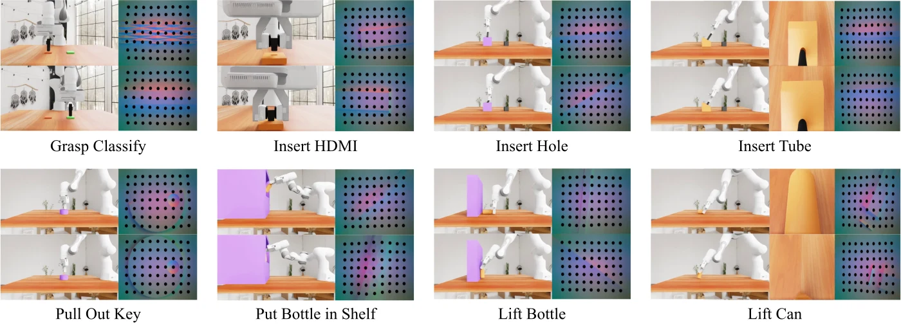

*UniVTAC authors · [Figure source](https://univtac.github.io/) · Original rights retained.*

| Field | Reported value and source scope |
| :-- | :-- |
| Record type | benchmark |
| Simulator | Isaac Sim / Isaac Lab, modified TacEx and UIPC [1](https://arxiv.org/abs/2602.10093) [2](https://univtac.github.io/)  |
| Simulator version and scope | main: Isaac Sim 4.5.0 / Isaac Lab 2.1.1; isaac51 branch: Isaac Sim 5.1.0 / Isaac Lab 2.3.0. Data are version-specific. [1](https://arxiv.org/abs/2602.10093) [2](https://univtac.github.io/) [3](https://github.com/univtac/UniVTAC)  |
| Task count and scope | 8 simulation benchmark tasks; 3 physical transfer tasks [1](https://arxiv.org/abs/2602.10093) [2](https://univtac.github.io/)  |
| Task-list scope | Complete eight-task simulation suite; physical paper tasks: Insert Tube, Insert USB, Bottle Upright. [1](https://arxiv.org/abs/2602.10093) [2](https://univtac.github.io/)  |
| Capability dimensions | Pose reasoning · Shape perception · Contact-rich interaction [1](https://arxiv.org/abs/2602.10093) [2](https://univtac.github.io/)  |
| Metrics | Success rate per task and unweighted average; tactile encoder pathway ablation. [1](https://arxiv.org/abs/2602.10093) [2](https://univtac.github.io/)  |
| Robots | Simulation Franka Panda parallel gripper; physical Tianji Marvin with ViTai GF225. [1](https://arxiv.org/abs/2602.10093) [2](https://univtac.github.io/)  |
| Sensors and observations | GelSight Mini, ViTai GF225 and Xense WS supported by platform. Current public collection/evaluation README limits released task workflow to GelSight Mini; head and wrist visual streams; tactile RGB / marker motion / geometry supervision. [1](https://arxiv.org/abs/2602.10093) [2](https://univtac.github.io/)  |
| Demonstrations and data | Paper: 50 automatically collected full trajectories/task for policy training; 100 test rollouts/task. Public isaac45 and isaac51 folders each advertise 100 HDF5 episodes/task; contact-pretraining data and 4.5 policy checkpoints also provided. Physical study collects 150 demonstrations/task. [1](https://arxiv.org/abs/2602.10093) [2](https://univtac.github.io/)  |
| Evaluation protocol | Scripted expert synthesis intentionally injects failures/corrections for contact variation; eight simulation tasks use identical 50-demo budgets; real policies trained separately and evaluated for 20 rollouts/task. [1](https://arxiv.org/abs/2602.10093) [2](https://univtac.github.io/)  |
| Evaluated baselines | ACT vision-only; VITaL; ACT + UniVTAC Encoder; from-scratch and contact / shape / pose pretraining ablations. [1](https://arxiv.org/abs/2602.10093) [2](https://univtac.github.io/)  |
| Observations / modalities | RGB · Tactile · Proprioception |
| Evaluation domain | Simulation · Real world |
| Embodiment | Parallel-jaw gripper |
| Release: code | Available [3](https://github.com/univtac/UniVTAC)  |
| Release: weights | Partial [3](https://github.com/univtac/UniVTAC)  |
| Release: data | Available [3](https://github.com/univtac/UniVTAC)  |
| Release: license | Apache-2.0 code; dataset/model terms separate [3](https://github.com/univtac/UniVTAC) [4](https://github.com/univtac/UniVTAC/blob/main/LICENSE)  |
| Release: notes | Code, task data for two simulator stacks and representation/policy artifacts public. Released policy checkpoints are for Isaac Sim 4.5 only. [3](https://github.com/univtac/UniVTAC)  |

**Task names — Complete eight-task simulation suite; physical paper tasks: Insert Tube, Insert USB, Bottle Upright.:**

- Lift Bottle
- Lift Can
- Put Bottle in Shelf
- Grasp Classify
- Insert Hole
- Insert Tube
- Insert HDMI
- Pull Out Key

**Scope and qualifications**

- Current main and isaac51 data/checkpoints are not interchangeable.
- Sensor support in the platform exceeds sensor support in the released task collection/evaluation workflow.
- External RGB-D export support does not establish that benchmark baselines consume metric depth.
- README calls the code MIT, while the checked-in LICENSE is Apache-2.0; this catalogue follows LICENSE.

**Primary evidence**

1. [Paper](https://arxiv.org/abs/2602.10093) — Published paper / arXiv record and manuscript.
2. [Official project](https://univtac.github.io/) — Public project page.
3. [Official repository](https://github.com/univtac/UniVTAC) — Current public repository; implementation scope may differ from paper.
4. [Official source](https://github.com/univtac/UniVTAC/blob/main/LICENSE) — License text read directly; code license does not automatically cover models, data or simulator.

</details>

<a id="record-benchmark-tac-bench"></a>
<details>
<summary><strong>Tac-Bench</strong> — Tac-Bench: Benchmarking Diverse Tactile Manipulation and Multimodal World Models</summary>

**2026 · RSS 2026 Workshop on Tactile Sensing for Robotic Foundation Models · Harvard University**

**[Paper](https://peilinwu.site/tac-bench.github.io/paper/corl_2026_template_submission/example.pdf)** · [Project](https://peilinwu.site/tac-bench.github.io/)

A 14-task simulation suite controlling task, sensor and policy-fusion choices, with additional action-conditioned world-model probes.

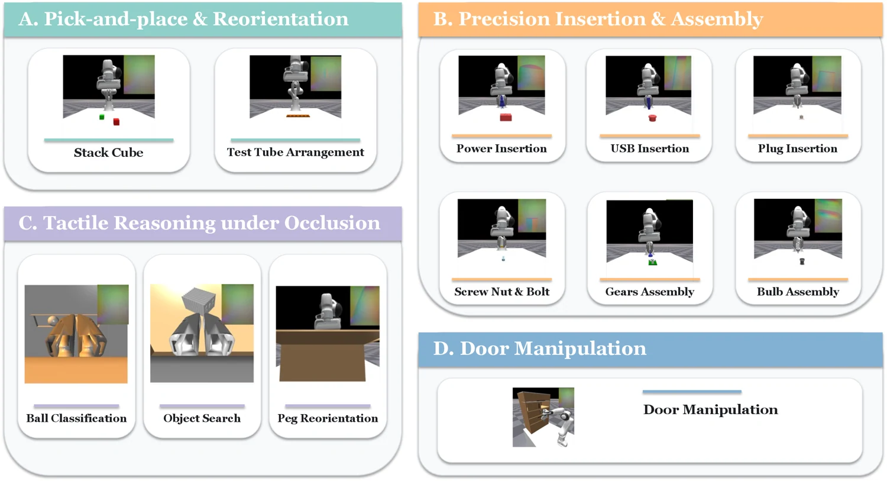

*Tac-Bench authors · [Figure source](https://peilinwu.site/tac-bench.github.io/) · Original rights retained.*

| Field | Reported value and source scope |
| :-- | :-- |
| Record type | benchmark |
| Simulator | TacSL-based platform; underlying physics-engine release not named in workshop manuscript [1](https://peilinwu.site/tac-bench.github.io/paper/corl_2026_template_submission/example.pdf) [2](https://peilinwu.site/tac-bench.github.io/)  |
| Simulator version and scope | Not reported [1](https://peilinwu.site/tac-bench.github.io/paper/corl_2026_template_submission/example.pdf) [2](https://peilinwu.site/tac-bench.github.io/)  |
| Task count and scope | 14 contact-rich simulation tasks [1](https://peilinwu.site/tac-bench.github.io/paper/corl_2026_template_submission/example.pdf) [2](https://peilinwu.site/tac-bench.github.io/)  |
| Task-list scope | Complete 14-task gallery on official project page. [1](https://peilinwu.site/tac-bench.github.io/paper/corl_2026_template_submission/example.pdf) [2](https://peilinwu.site/tac-bench.github.io/)  |
| Capability dimensions | Insertion · Assembly · Visual occlusion · In-hand orientation · Articulated-object interaction · World-model action sensitivity [1](https://peilinwu.site/tac-bench.github.io/paper/corl_2026_template_submission/example.pdf) [2](https://peilinwu.site/tac-bench.github.io/)  |
| Metrics | Imitation-learning success rate; closed-loop rollout and action-conditioned reachability probes for world models. [1](https://peilinwu.site/tac-bench.github.io/paper/corl_2026_template_submission/example.pdf) [2](https://peilinwu.site/tac-bench.github.io/)  |
| Robots | Franka Panda with operational-space impedance control; 6D relative Cartesian action plus binary gripper. [1](https://peilinwu.site/tac-bench.github.io/paper/corl_2026_template_submission/example.pdf) [2](https://peilinwu.site/tac-bench.github.io/)  |
| Sensors and observations | GelSight R1.5, GelSight Mini and FlexiTac; workspace RGB 224×224; tactile channels depend on sensor. [1](https://peilinwu.site/tac-bench.github.io/paper/corl_2026_template_submission/example.pdf) [2](https://peilinwu.site/tac-bench.github.io/)  |
| Demonstrations and data | 200 demonstrations per task under common data budgets. [1](https://peilinwu.site/tac-bench.github.io/paper/corl_2026_template_submission/example.pdf) [2](https://peilinwu.site/tac-bench.github.io/)  |
| Evaluation protocol | Matched encoders/data with fusion/policy architecture as controlled variables; 50 rollouts ×3 seeds. World-model probes evaluate visual fidelity, closed-loop rollout success and action-conditioned reachability. [1](https://peilinwu.site/tac-bench.github.io/paper/corl_2026_template_submission/example.pdf) [2](https://peilinwu.site/tac-bench.github.io/)  |
| Evaluated baselines | Early Fusion, Compositional Policy (CP), Cross-Modal Attention (CMA); world-model evaluations. [1](https://peilinwu.site/tac-bench.github.io/paper/corl_2026_template_submission/example.pdf) [2](https://peilinwu.site/tac-bench.github.io/)  |
| Observations / modalities | RGB · Tactile · Proprioception |
| Evaluation domain | Simulation |
| Embodiment | Parallel-jaw gripper |
| Release: code | Not released |
| Release: weights | Not verified |
| Release: data | Not verified |
| Release: license | Not reported |
| Release: notes | Official page Code anchor is empty as checked; manuscript and task gallery available. |

**Task names — Complete 14-task gallery on official project page.:**

- Peg Insertion
- USB Insertion
- Plug Insertion
- Gear Assembly
- Nut-Bolt Screwing
- Bulb Assembly
- Object Search
- Peg Reorientation
- Ball Classification
- Test Tube Arrangement
- Stack Cube
- Hinge Door
- Drawer
- Sliding Door

**Scope and qualifications**

- Tac-Bench (2026 manipulation suite) is distinct from TacBench introduced with Sparsh (2024 representation benchmark).
- Workshop webpage does not expose an arXiv v1 date; year-only date is intentional.
- Official workshop manuscript remains an anonymous draft with inline editorial annotations and incomplete result cells; release status is provisional.

**Primary evidence**

1. [Paper](https://peilinwu.site/tac-bench.github.io/paper/corl_2026_template_submission/example.pdf) — Published paper / arXiv record and manuscript.
2. [Official project](https://peilinwu.site/tac-bench.github.io/) — Public project page.

</details>

<a id="record-benchmark-maniskill-vitac-2026"></a>
<details>
<summary><strong>ManiSkill-ViTac 2026</strong> — ManiSkill-ViTac Challenge 2026: Real-world Language-guided Bimanual Vision-Tactile Manipulation Challenge</summary>

**2026 · CVPR 2026 Embodied AI Workshop challenge · Tsinghua University**

**[Project](https://callmeray.github.io/Mani_ViTac_Challenge_2026_page/)** · [Code](https://github.com/chaoyiL/ManiSkill-vitac) · [Data](https://cloud.tsinghua.edu.cn/d/0831b0fa9aed41c98e3b/)

Real-world language-conditioned bimanual challenge covering transparent tube handling and sustained grinding contact.


*ManiSkill-ViTac Challenge2026 organizers · [Figure source](https://callmeray.github.io/Mani_ViTac_Challenge_2026_page/) · Original rights retained.*

| Field | Reported value and source scope |
| :-- | :-- |
| Record type | benchmark |
| Simulator | Not applicable — 2026 challenge uses physical robot evaluation [1](https://callmeray.github.io/Mani_ViTac_Challenge_2026_page/)  |
| Simulator version and scope | Not applicable [1](https://callmeray.github.io/Mani_ViTac_Challenge_2026_page/) [2](https://github.com/chaoyiL/ManiSkill-vitac)  |
| Task count and scope | 2 physical bimanual tasks [1](https://callmeray.github.io/Mani_ViTac_Challenge_2026_page/)  |
| Task-list scope | Complete two-task 2026 challenge. [1](https://callmeray.github.io/Mani_ViTac_Challenge_2026_page/)  |
| Capability dimensions | Color/language grounding · Transparent-object handling · Rack insertion · Compliant cleaning · Material selection · Sustained contact force [1](https://callmeray.github.io/Mani_ViTac_Challenge_2026_page/)  |
| Metrics | Final score is the sum of both task performances from the same submission; best complete submission determines team result. [1](https://callmeray.github.io/Mani_ViTac_Challenge_2026_page/)  |
| Robots | Bimanual physical platforms; exact robot models require challenge documentation. [1](https://callmeray.github.io/Mani_ViTac_Challenge_2026_page/)  |
| Sensors and observations | Wrist cameras, tactile images, wrist poses and language instructions; no external depth input established by released overview. [1](https://callmeray.github.io/Mani_ViTac_Challenge_2026_page/)  |
| Demonstrations and data | Sample datasets released 16 April 2026; full demonstration dataset released for Stage 2. Exact trajectory scale Not reported on overview. [1](https://callmeray.github.io/Mani_ViTac_Challenge_2026_page/)  |
| Evaluation protocol | Technical-brief selection then multiple physical policy submissions; both tasks evaluated per submission; final rankings announced 1 June 2026. [1](https://callmeray.github.io/Mani_ViTac_Challenge_2026_page/)  |
| Evaluated baselines | Not reported on challenge overview. [1](https://callmeray.github.io/Mani_ViTac_Challenge_2026_page/)  |
| Observations / modalities | RGB · Tactile · Proprioception · Language |
| Evaluation domain | Real world |
| Embodiment | Bimanual · Parallel-jaw gripper |
| Release: code | Available [2](https://github.com/chaoyiL/ManiSkill-vitac)  |
| Release: weights | Not verified [2](https://github.com/chaoyiL/ManiSkill-vitac)  |
| Release: data | Available [2](https://github.com/chaoyiL/ManiSkill-vitac)  |
| Release: license | Not verified [2](https://github.com/chaoyiL/ManiSkill-vitac)  |
| Release: notes | Official code and sample/full-data entry points linked by challenge page. [2](https://github.com/chaoyiL/ManiSkill-vitac)  |

**Task names — Complete two-task 2026 challenge.:**

- Test Tube Cleaning
- Grinding

**Scope and qualifications**

- A real-world challenge rather than a ready-made simulation benchmark.
- Dataset access and task scoring details must be read from the edition-specific documentation.

**Primary evidence**

1. [Official project](https://callmeray.github.io/Mani_ViTac_Challenge_2026_page/) — Public project page.
2. [Official repository](https://github.com/chaoyiL/ManiSkill-vitac) — Current public repository; implementation scope may differ from paper.

</details>

<a id="record-benchmark-manifeel"></a>
<details>
<summary><strong>ManiFeel</strong> — ManiFeel: Benchmarking and Understanding Visuotactile Manipulation Policy Learning</summary>

**2025-05-24 · Preprint · Purdue University**

**[Paper](https://arxiv.org/abs/2505.18472)** · [Project](https://zhengtongxu.github.io/manifeel-website/) · [Code](https://github.com/purdue-mars/manifeel)

Modular comparison of sensing channels, tactile encoders and supervised policy heads across insertion, screwing and visually constrained exploration.

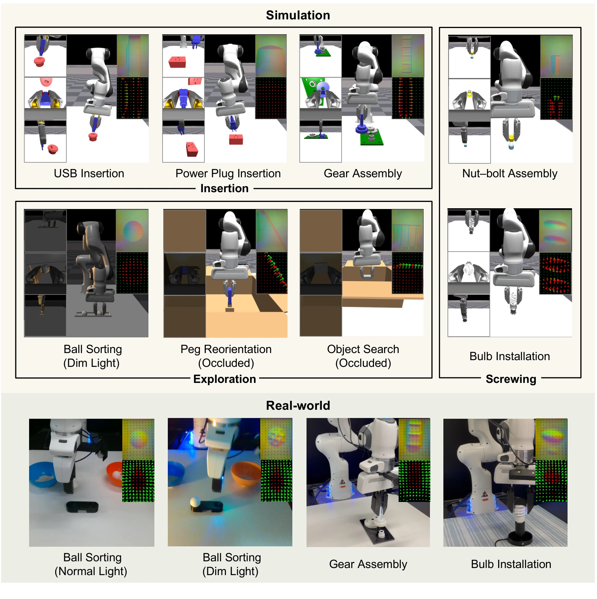

*ManiFeel authors · [Figure source](https://arxiv.org/abs/2505.18472) · Original rights retained.*

| Field | Reported value and source scope |
| :-- | :-- |
| Record type | benchmark |
| Simulator | Isaac Gym with TacSL [1](https://arxiv.org/abs/2505.18472) [2](https://zhengtongxu.github.io/manifeel-website/)  |
| Simulator version and scope | Modified IsaacGymEnvs README specifies Isaac Gym Preview 4 and TacSL package; original paper exact binary build Not reported. [1](https://arxiv.org/abs/2505.18472) [2](https://zhengtongxu.github.io/manifeel-website/) [3](https://github.com/purdue-mars/manifeel)  |
| Task count and scope | 9 simulation task setups and 4 real-world setups in Jan 2026 v2; normal-light ball sorting also appears as a simulation control in dataset Table V. [1](https://arxiv.org/abs/2505.18472) [2](https://zhengtongxu.github.io/manifeel-website/)  |
| Task-list scope | Complete nine-setup simulation benchmark taxonomy in v2; physical setups: Gear Assembly, Bulb Installation, Ball Sorting Normal Light and Dim Light. Table V additionally records the normal-light simulation control. [1](https://arxiv.org/abs/2505.18472) [2](https://zhengtongxu.github.io/manifeel-website/)  |
| Capability dimensions | Insertion / assembly · Threaded assembly · Occluded exploration · Texture-based sorting [1](https://arxiv.org/abs/2505.18472) [2](https://zhengtongxu.github.io/manifeel-website/)  |
| Metrics | Task success rate, mean and standard deviation over seeds; FID/KID of simulated vs real tactile observations are sensor-domain diagnostics, not control success. [1](https://arxiv.org/abs/2505.18472) [2](https://zhengtongxu.github.io/manifeel-website/)  |
| Robots | Franka Panda with parallel gripper in physical evaluation; simulated tactile-enabled manipulator. [1](https://arxiv.org/abs/2505.18472) [2](https://zhengtongxu.github.io/manifeel-website/)  |
| Sensors and observations | Three recorded RGB views and two simulated GelSight R1.5 fingertips; TacRGB and TacFF (normal/shear field) evaluated separately. Real uses front RealSense RGB and one right-finger GelSight R1.5; TacFF estimated from photometric stereo. [1](https://arxiv.org/abs/2505.18472) [2](https://zhengtongxu.github.io/manifeel-website/)  |
| Demonstrations and data | SpaceMouse demonstrations at 10 Hz. Table V: 20–100 demonstrations per simulation setup; 50–80 per real setup. Gear/sorting comparative studies use 80 demos; bulb uses 20. [1](https://arxiv.org/abs/2505.18472) [2](https://zhengtongxu.github.io/manifeel-website/)  |
| Evaluation protocol | Compare Vision, Vision+TacRGB and Vision+TacFF with shared data; three policy runs/seeds and 15 consecutive test rollouts per trained policy. Downstream sensing/fusion and encoder choices are controlled. [1](https://arxiv.org/abs/2505.18472) [2](https://zhengtongxu.github.io/manifeel-website/)  |
| Evaluated baselines | Diffusion Policy, Equivariant Diffusion Policy, Flow Matching; scratch ResNet18, UniT, T3 and AnyTouch encoders. [1](https://arxiv.org/abs/2505.18472) [2](https://zhengtongxu.github.io/manifeel-website/)  |
| Observations / modalities | RGB · Tactile · Proprioception |
| Evaluation domain | Simulation · Real world |
| Embodiment | Parallel-jaw gripper |
| Release: code | Available [3](https://github.com/purdue-mars/manifeel)  |
| Release: weights | Partial [3](https://github.com/purdue-mars/manifeel)  |
| Release: data | Partial [3](https://github.com/purdue-mars/manifeel)  |
| Release: license | MIT code; Isaac Gym and representation checkpoints retain their own terms [3](https://github.com/purdue-mars/manifeel)  |
| Release: notes | Public benchmark/modified IsaacGymEnvs repositories; separate simulator access and pretrained representation downloads required. [3](https://github.com/purdue-mars/manifeel)  |

**Task names — Complete nine-setup simulation benchmark taxonomy in v2; physical setups: Gear Assembly, Bulb Installation, Ball Sorting Normal Light and Dim Light. Table V additionally records the normal-light simulation control.:**

- Peg Insertion
- USB Insertion
- Power Plug Insertion
- Gear Assembly
- Nut–bolt Assembly
- Bulb Installation
- Peg Reorientation (Occluded)
- Object Search (Occluded)
- Ball Sorting (Dim Light)

**Scope and qualifications**

- v1 and v2 scopes differ; this entry uses the Jan 2026 v2 task definitions while retaining v1 date.
- A simulated RGB image or force-field match does not establish identical contact dynamics on hardware.
- Primary comparisons add one tactile representation at a time rather than joint RGB+TacRGB+TacFF fusion.

**Primary evidence**

1. [Paper](https://arxiv.org/abs/2505.18472) — Published paper / arXiv record and manuscript.
2. [Official project](https://zhengtongxu.github.io/manifeel-website/) — Public project page.
3. [Official repository](https://github.com/purdue-mars/manifeel) — Current public repository; implementation scope may differ from paper.
4. [Official source](https://github.com/purdue-mars/manifeel-isaacgymenvs/blob/main/README.md) — Setup explicitly requests Isaac Gym Preview 4.

</details>

<a id="record-benchmark-vtdexmanip"></a>
<details>
<summary><strong>VTDexManip</strong> — VTDexManip: A Dataset and Benchmark for Visual-tactile Pretraining and Dexterous Manipulation with Reinforcement Learning</summary>

**2025 · ICLR 2025 · Zhejiang University**

**[Paper](https://proceedings.iclr.cc/paper_files/paper/2025/file/e19b6f65791e350347bcff8a3955cb5b-Paper-Conference.pdf)** · [Project](https://lqts.github.io/VTDexManip/) · [Code](https://github.com/LQTS/VTDexManip) · [Data](https://1drv.ms/f/c/9054151f0ba654c9/EslUpgsfFVQggJB7AQAAAAABSp31p8Fft1mtHyOwJNqmoA)

Six dexterous robot tasks evaluate visual-tactile representations under PPO, with seen/unseen objects and real-world transfer examples.

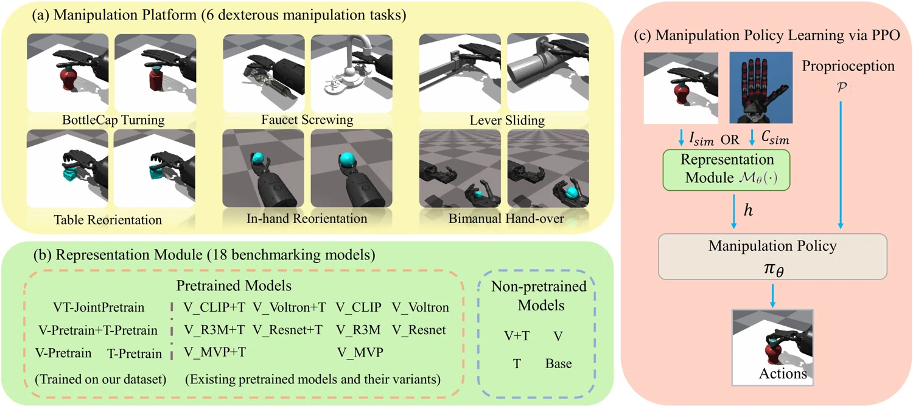

*VTDexManip authors · [Figure source](https://lqts.github.io/VTDexManip/) · Original rights retained.*

| Field | Reported value and source scope |
| :-- | :-- |
| Record type | policy |
| Simulator | NVIDIA Isaac Gym [1](https://proceedings.iclr.cc/paper_files/paper/2025/file/e19b6f65791e350347bcff8a3955cb5b-Paper-Conference.pdf)  |
| Simulator version and scope | Exact preview build not reported;official code uses Python3.8,PyTorch2.0.1,CUDA11.4. [1](https://proceedings.iclr.cc/paper_files/paper/2025/file/e19b6f65791e350347bcff8a3955cb5b-Paper-Conference.pdf) [2](https://github.com/LQTS/VTDexManip)  |
| Task count and scope | Six robot tasks;ten human dataset task families are separate. [1](https://proceedings.iclr.cc/paper_files/paper/2025/file/e19b6f65791e350347bcff8a3955cb5b-Paper-Conference.pdf)  |
| Task-list scope | Complete six-task simulation benchmark. [1](https://proceedings.iclr.cc/paper_files/paper/2025/file/e19b6f65791e350347bcff8a3955cb5b-Paper-Conference.pdf)  |
| Capability dimensions | Dexterous articulation · Object rotation · In-hand reorientation · Bimanual throwing/catching · Visual–tactile pretraining transfer [1](https://proceedings.iclr.cc/paper_files/paper/2025/file/e19b6f65791e350347bcff8a3955cb5b-Paper-Conference.pdf)  |
| Metrics | Task success on seen/unseen objects;viewpoint,tactile-noise andthreshold robustness. [1](https://proceedings.iclr.cc/paper_files/paper/2025/file/e19b6f65791e350347bcff8a3955cb5b-Paper-Conference.pdf)  |
| Robots | 24-DoF Shadow Hand;two hands forhandover;real Shadow Hand plusAzure Kinect. [1](https://proceedings.iclr.cc/paper_files/paper/2025/file/e19b6f65791e350347bcff8a3955cb5b-Paper-Conference.pdf)  |
| Sensors and observations | EgoRGB;20 regional binary contacts from simulated force sensors or realpiezoresistive sensors;proprioception;not optical tactile images. [1](https://proceedings.iclr.cc/paper_files/paper/2025/file/e19b6f65791e350347bcff8a3955cb5b-Paper-Conference.pdf)  |
| Demonstrations and data | Human dataset2,032 sequences/565k frames/182 objects/10 tasks;simulation200 parallel environments,task-specificseen/unseen object splits. [1](https://proceedings.iclr.cc/paper_files/paper/2025/file/e19b6f65791e350347bcff8a3955cb5b-Paper-Conference.pdf)  |
| Evaluation protocol | 18 pretrained/non-pretrained representations under matchedPPO;frozen pretrained encoders;simulation seen/unseen andreal qualitative transfer. [1](https://proceedings.iclr.cc/paper_files/paper/2025/file/e19b6f65791e350347bcff8a3955cb5b-Paper-Conference.pdf)  |
| Evaluated baselines | VT-JointPretrain,V/T separatepretrain;CLIP,R3M,MVP,Voltron,ResNet18with/without tactile;untrainedV/T/V+T/proprioception. [1](https://proceedings.iclr.cc/paper_files/paper/2025/file/e19b6f65791e350347bcff8a3955cb5b-Paper-Conference.pdf)  |
| Observations / modalities | RGB · Tactile · Proprioception |
| Evaluation domain | Simulation · Real world |
| Embodiment | Dexterous hand · Bimanual |
| Release: code | Available [2](https://github.com/LQTS/VTDexManip)  |
| Release: weights | Available [2](https://github.com/LQTS/VTDexManip)  |
| Release: data | Available [2](https://github.com/LQTS/VTDexManip)  |
| Release: license | MIT for benchmark repository; dataset/model terms separate [2](https://github.com/LQTS/VTDexManip)  |
| Release: notes | Benchmark, pretraining code and pretrained representation models linked; dataset download password documented as vtdexmanip. [2](https://github.com/LQTS/VTDexManip)  |

**Task names — Complete six-task simulation benchmark.:**

- BottleCap Turning
- Faucet Screwing
- Lever Sliding
- Table Reorientation
- In-hand Reorientation
- Bimanual Hand-over

**Scope and qualifications**

- Tactile is sparse binary contact from20 regions, not optical tactile imagery.
- Human collection ten task families and robot benchmark six tasks are separate counts.

**Primary evidence**

1. [Official ICLR2025 full paper](https://proceedings.iclr.cc/paper_files/paper/2025/file/e19b6f65791e350347bcff8a3955cb5b-Paper-Conference.pdf) — §4/5 andAppendixB/C; year is official conference year, no arXiv v1 was identified.
2. [Official implementation](https://github.com/LQTS/VTDexManip) — Training/evaluation, pretraining model anddataset links; MIT license inspected.

</details>

<a id="record-benchmark-maniskill-vitac-2025"></a>
<details>
<summary><strong>ManiSkill-ViTac 2025</strong> — ManiSkill-ViTac 2025: Challenge on Manipulation Skill Learning With Vision and Tactile Sensing</summary>

**2024-11-19 · ICRA 2025 workshop challenge · Tsinghua University**

**[Paper](https://arxiv.org/abs/2411.12503)** · [Project](https://ai-workshops.github.io/maniskill-vitac-challenge-2025/) · [Code](https://github.com/cyliizyz/ManiSkill-ViTac2025)

Challenge combining tactile-only transfer, tactile-plus-depth fusion and tactile-sensor structure design with physical finalist evaluation.


*ManiSkill-ViTac 2025 authors · [Figure source](https://arxiv.org/abs/2411.12503) · Original rights retained.*

| Field | Reported value and source scope |
| :-- | :-- |
| Record type | benchmark |
| Simulator | SAPIEN / IPC-based high-fidelity tactile simulation (challenge-specific platform) [1](https://arxiv.org/abs/2411.12503) [2](https://ai-workshops.github.io/maniskill-vitac-challenge-2025/)  |
| Simulator version and scope | Official README: install SAPIEN 3.0.0b1 before SapienIPC. [1](https://arxiv.org/abs/2411.12503) [2](https://ai-workshops.github.io/maniskill-vitac-challenge-2025/) [3](https://github.com/cyliizyz/ManiSkill-ViTac2025)  |
| Task count and scope | 3 tracks; tactile-only track has 2 tasks; depth-fusion track has 1 peg-selection/insertion task; sensor-design track evaluates a modified sensor. [1](https://arxiv.org/abs/2411.12503) [2](https://ai-workshops.github.io/maniskill-vitac-challenge-2025/)  |
| Task-list scope | Complete manipulation task families; tracks and object-shape variants are not separate tasks. [1](https://arxiv.org/abs/2411.12503) [2](https://ai-workshops.github.io/maniskill-vitac-challenge-2025/)  |
| Capability dimensions | Unseen peg/key shape generalization · Tactile insertion · Depth-based hole selection and approach · Sensor morphology design [1](https://arxiv.org/abs/2411.12503) [2](https://ai-workshops.github.io/maniskill-vitac-challenge-2025/)  |
| Metrics | Track 1: 50×SR(peg)+50×SR(lock); Track 2: 100×SR; Track 3: 50×SR+50×subjective score. Physical stage determines final ranking for manipulation tracks. [1](https://arxiv.org/abs/2411.12503) [2](https://ai-workshops.github.io/maniskill-vitac-challenge-2025/)  |
| Robots | Matched simulated and physical parallel-gripper manipulation platform. [1](https://arxiv.org/abs/2411.12503) [2](https://ai-workshops.github.io/maniskill-vitac-challenge-2025/)  |
| Sensors and observations | GelSight Mini marker-based tactile sensing; Track 2 adds RealSense D415 depth with semantic segmentation. [1](https://arxiv.org/abs/2411.12503) [2](https://ai-workshops.github.io/maniskill-vitac-challenge-2025/)  |
| Demonstrations and data | Simulation training environment and baseline resources; standardized full demonstration corpus count Not reported. [1](https://arxiv.org/abs/2411.12503) [2](https://ai-workshops.github.io/maniskill-vitac-challenge-2025/)  |
| Evaluation protocol | Sim evaluation followed by physical checkpoint submission for advancing teams. Held-out peg/key shapes; Track 2 increases reach distance and requires selecting matching hole. [1](https://arxiv.org/abs/2411.12503) [2](https://ai-workshops.github.io/maniskill-vitac-challenge-2025/)  |
| Evaluated baselines | Provided TD3 tactile policy training / pretrained challenge baseline checkpoints. [1](https://arxiv.org/abs/2411.12503) [2](https://ai-workshops.github.io/maniskill-vitac-challenge-2025/)  |
| Observations / modalities | Depth · Tactile · Proprioception |
| Evaluation domain | Simulation · Real world |
| Embodiment | Parallel-jaw gripper |
| Release: code | Available [3](https://github.com/cyliizyz/ManiSkill-ViTac2025) [4](https://github.com/cyliizyz/ManiSkill-ViTac2025)  |
| Release: weights | Available [3](https://github.com/cyliizyz/ManiSkill-ViTac2025) [4](https://github.com/cyliizyz/ManiSkill-ViTac2025)  |
| Release: data | Not reported [3](https://github.com/cyliizyz/ManiSkill-ViTac2025) [4](https://github.com/cyliizyz/ManiSkill-ViTac2025)  |
| Release: license | Not verified [3](https://github.com/cyliizyz/ManiSkill-ViTac2025) [4](https://github.com/cyliizyz/ManiSkill-ViTac2025)  |
| Release: notes | Official repository and cyliizyz/ManiSkill-ViTac2025_ckpt checkpoint link verified. [3](https://github.com/cyliizyz/ManiSkill-ViTac2025) [4](https://github.com/cyliizyz/ManiSkill-ViTac2025)  |

**Task names — Complete manipulation task families; tracks and object-shape variants are not separate tasks.:**

- Peg insertion
- Lock opening
- Tactile-vision-fusion peg insertion

**Scope and qualifications**

- Input permissions differ by track; depth is permitted in Track 2 but not tactile-only Track 1.
- The 2026 edition changes to real-world bimanual tasks and should not be merged into the same task count.

**Primary evidence**

1. [Paper](https://arxiv.org/abs/2411.12503) — Published paper / arXiv record and manuscript.
2. [Official project](https://ai-workshops.github.io/maniskill-vitac-challenge-2025/) — Public project page.
3. [Official repository](https://github.com/cyliizyz/ManiSkill-ViTac2025) — Current public repository; implementation scope may differ from paper.
4. [Official source](https://github.com/cyliizyz/ManiSkill-ViTac2025) — Official challenge page linked cyliizyz repository, not the earlier provisional guessed owner.

</details>

<a id="record-benchmark-tactilegym2"></a>
<details>
<summary><strong>Tactile Gym 2.0</strong> — Tactile Gym 2.0: Sim-to-real Deep Reinforcement Learning for Comparing Low-cost High-Resolution Robot Touch</summary>

**2022-07-21 · IEEE Robotics and Automation Letters / IROS 2022 · University of Bristol**

**[Paper](https://arxiv.org/abs/2207.10763)** · [Code](https://github.com/NICESONY/tactile_gym_2)

PyBullet-based tactile-control environments supporting comparative sim-to-real studies across marker-based and shading-based optical sensors.

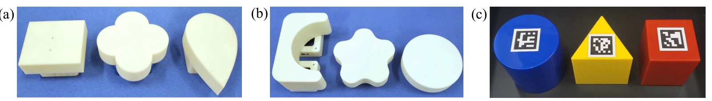

*Tactile Gym 2.0 authors · [Figure source](https://arxiv.org/abs/2207.10763) · Original rights retained.*

| Field | Reported value and source scope |
| :-- | :-- |
| Record type | benchmark |
| Simulator | PyBullet [1](https://arxiv.org/abs/2207.10763)  |
| Simulator version and scope | Exact PyBullet build Not reported here; repository setup defines dependencies. [1](https://arxiv.org/abs/2207.10763) [2](https://github.com/NICESONY/tactile_gym_2)  |
| Task count and scope | 3 physically interactive tasks in the paper; repository includes additional environments [1](https://arxiv.org/abs/2207.10763)  |
| Task-list scope | Complete three-task physical validation suite; not the full growing repository environment list. [1](https://arxiv.org/abs/2207.10763)  |
| Capability dimensions | Tactile servoing · Contour following · Surface following · Non-prehensile pushing · Cross-sensor transfer [1](https://arxiv.org/abs/2207.10763)  |
| Metrics | Task-specific tracking / pushing reward and physical performance; sim-real qualitative and quantitative evaluation. [1](https://arxiv.org/abs/2207.10763)  |
| Robots | Simulation testing mainly UR5; Panda and Kuka iiwa support is preliminary. Real low-cost 4-DoF arm used for lowered-cost validation. [1](https://arxiv.org/abs/2207.10763)  |
| Sensors and observations | TacTip, DIGIT, DigiTac optical tactile sensors; sensor-specific sim-to-real image adaptation. [1](https://arxiv.org/abs/2207.10763)  |
| Demonstrations and data | RL interaction rather than a standardized demonstration corpus; pretrained PPO / RAD-PPO agents downloadable. [1](https://arxiv.org/abs/2207.10763)  |
| Evaluation protocol | One sim-to-real approach tested with three sensor designs across three physically interactive tasks. [1](https://arxiv.org/abs/2207.10763)  |
| Evaluated baselines | PPO and RAD-PPO via Stable-Baselines3; observation-space comparisons. [1](https://arxiv.org/abs/2207.10763)  |
| Observations / modalities | Tactile · Proprioception |
| Evaluation domain | Simulation · Real world |
| Embodiment | Robot arm tactile fingertip |
| Release: code | Available [2](https://github.com/NICESONY/tactile_gym_2)  |
| Release: weights | Available [2](https://github.com/NICESONY/tactile_gym_2)  |
| Release: data | Not applicable [2](https://github.com/NICESONY/tactile_gym_2)  |
| Release: license | GPL-3.0 code; sensor and dependency terms separate [2](https://github.com/NICESONY/tactile_gym_2) [3](https://github.com/NICESONY/tactile_gym_2/blob/main/LICENSE)  |
| Release: notes | Environment and SB3 training/evaluation scripts public; pretrained example agents linked. [2](https://github.com/NICESONY/tactile_gym_2)  |

**Task names — Complete three-task physical validation suite; not the full growing repository environment list.:**

- Object pushing
- Edge following
- Surface following

**Scope and qualifications**

- Single tactile fingertip control does not constitute a complete gripper pick-align-insert benchmark.

**Primary evidence**

1. [Paper](https://arxiv.org/abs/2207.10763) — Published paper / arXiv record and manuscript.
2. [Official repository](https://github.com/NICESONY/tactile_gym_2) — Current public repository; implementation scope may differ from paper.
3. [Official source](https://github.com/NICESONY/tactile_gym_2/blob/main/LICENSE) — License text read directly; code license does not automatically cover models, data or simulator.

</details>

<a id="precision-assembly"></a>
### Precision and Assembly

| Date | Work | Setting | Tasks / simulator | Release | Primary links |
| :-- | :-- | :-- | :-- | :-- | :-- |
| 2026-10-12 | [LABIT](#record-benchmark-labit) | Simulation · Real world | 59 assembly primitives spanning 7 operation types and 3 ordered subassemblies; 15 representative task geometries illustrated; MuJoCo | Available | **[Paper](https://arxiv.org/abs/2610.16398)** · [Project](https://irp-hka.github.io/robotic-assembly-benchmark/) · [Code](https://github.com/IRP-HKA/LABIT-simulation) <!-- work:labit --> |
| 2026-10-09 | [DexBioLab](#record-benchmark-dexbiolab) | Simulation · Real world | 14 tasks across 4 robot embodiments; three visual experimental phenomena and six laboratory backgrounds; mjlab / MuJoCo Warp with Gaussian-splatting backgrounds | Available | **[Paper](https://arxiv.org/abs/2610.13643)** · [Project](https://cumulusalpha.github.io/DexBioLabWebPage/) · [Code](https://github.com/CumulusAlpha/DexBioLab) <!-- work:dexbiolab --> |
| 2026-09-01 | [Peg-in-Bench](#record-benchmark-peg-in-bench) | Real world | Open-ended scenarios from 5 peg shapes × 3 tolerance levels; not a fixed task-count suite; Not applicable — 3D-printable physical benchmark and scenario generator | Available | **[Paper](https://arxiv.org/abs/2609.00906)** · [Code](https://github.com/aistairc/peg-in-bench) <!-- work:peg-in-bench --> |
| 2026-07-05 | [RoboDojo](#record-benchmark-robodojo) | Simulation · Real world | 42 simulation tasks + 18 physical tasks across 3 real robot embodiments; Isaac Sim / Isaac Lab | Available | **[Paper](https://arxiv.org/abs/2607.04434)** · [Project](https://robodojo-benchmark.com/) · [Code](https://github.com/RoboDojo-Benchmark/RoboDojo) · [Data](https://huggingface.co/datasets/RoboDojo-Benchmark/RoboDojo) <!-- work:robodojo --> |
| 2026-03-16 | [RoCo AAAI 2026](#record-benchmark-roco-aaai-2026) | Simulation · Real world | 3 core scenario families around one planetary gearbox assembly workflow; NVIDIA Isaac Sim | Available | **[Paper](https://arxiv.org/abs/2603.15469)** · [Project](https://rocochallenge.github.io/RoCo-AAAI2026/) · [Code](https://github.com/rocochallenge/gearboxAssembly) <!-- work:roco-aaai-2026 --> |
| 2026-03-04 | [ManipulationNet](#record-benchmark-manipulationnet) | Real world | Multiple hosted benchmarks in Physical Skills and Embodied Reasoning tracks; task count is infrastructure-dependent.; Not applicable — real-world benchmark infrastructure | Available | **[Paper](https://arxiv.org/abs/2603.04363)** · [Project](https://mnet-client.readthedocs.io/ros_2/) <!-- work:manipulationnet --> |
| 2024-01-16 | [FMB](#record-benchmark-fmb) | Real world | 2 task families: single-object and multi-object multi-stage manipulation; 54 single-object variants and 3 four-object interlocking assembly sets; Not applicable to original physical bench… | Available | **[Paper](https://arxiv.org/abs/2401.08553)** · [Project](https://functional-manipulation-benchmark.github.io/) · [Code](https://github.com/rail-berkeley/fmb) · [Data](https://huggingface.co/datasets/charlesxu0124/functional-manipulation-benchmark) <!-- work:fmb --> |
| 2023-05-22 | [FurnitureBench](#record-benchmark-furniturebench) | Real world · Simulation | 8 physical furniture assembly tasks; per-skill and complete-assembly evaluations; FurnitureSim built on Isaac Gym and Factory | Available | **[Paper](https://arxiv.org/abs/2305.12821)** · [Project](https://clvrai.github.io/furniture-bench/) · [Code](https://github.com/clvrai/furniture-bench) · [Data](https://clvrai.github.io/furniture-bench/docs/tutorials/dataset.html) <!-- work:furniturebench --> |
| 2023-05-16 | [RAMP](#record-benchmark-ramp) | Real world · Simulation | Assemblies grouped into Easy, Medium and Hard; paper baseline evaluates 3 Easy assemblies; NVIDIA Isaac Sim | Available | **[Paper](https://arxiv.org/abs/2305.09644)** · [Project](https://sites.google.com/oxfordrobotics.institute/ramp) · [Code](https://github.com/applied-ai-lab/ramp-sim) <!-- work:ramp --> |
| 2019-09-26 | [RLBench](#record-benchmark-rlbench) | Simulation | Original paper: 100 tasks; current master source contains 106 task modules.; CoppeliaSim via PyRep | Available | **[Paper](https://arxiv.org/abs/1909.12271)** · [Project](https://sites.google.com/view/rlbench) · [Code](https://github.com/stepjam/RLBench) <!-- work:rlbench --> |
| 2018 | [NIST Assembly Task Boards](#record-benchmark-nist-assembly-task-boards) | Real world | Several board designs; board/component operations are the counting unit, not a fixed robot-learning task suite.; Not applicable — original physical test boards | Not applicable | **[Paper](https://www.nist.gov/system/files/documents/2018/01/11/test_method-metrics-analysis_v3.pdf)** · [Project](https://www.nist.gov/el/intelligent-systems-division-73500/robotic-grasping-and-manipulation-assembly/assembly) <!-- work:nist-assembly-task-boards --> |

<a id="record-benchmark-labit"></a>
<details>
<summary><strong>LABIT</strong> — LABIT: Long-Horizon Robotic Assembly Benchmark for Industrial Tasks</summary>

**2026-10-12 · Preprint · Karlsruhe University of Applied Sciences**

**[Paper](https://arxiv.org/abs/2610.16398)** · [Project](https://irp-hka.github.io/robotic-assembly-benchmark/) · [Code](https://github.com/IRP-HKA/LABIT-simulation)

Hierarchical industrial assembly with seven operation types, scoring that accounts for geometric/material/tolerance complexity, and physical plus MuJoCo implementations.

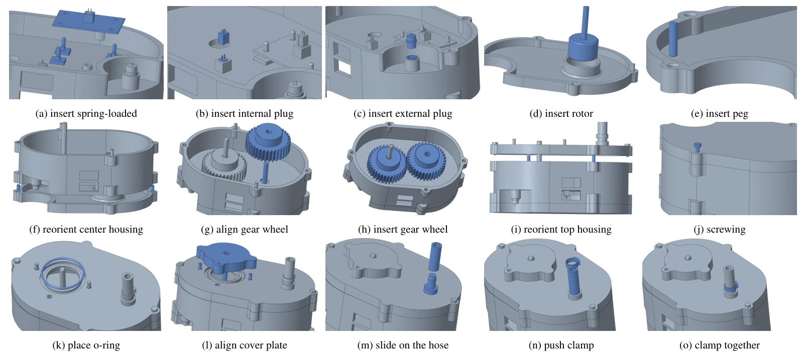

*LABIT authors · [Figure source](https://arxiv.org/abs/2610.16398) · Original rights retained.*

| Field | Reported value and source scope |
| :-- | :-- |
| Record type | benchmark |
| Simulator | MuJoCo [1](https://arxiv.org/abs/2610.16398) [2](https://irp-hka.github.io/robotic-assembly-benchmark/)  |
| Simulator version and scope | Not reported; paper gives 0.5 ms timestep, implicitfast integrator and Newton solver, which do not identify a release. [1](https://arxiv.org/abs/2610.16398) [2](https://irp-hka.github.io/robotic-assembly-benchmark/) [3](https://github.com/IRP-HKA/LABIT-simulation)  |
| Task count and scope | 59 assembly primitives spanning 7 operation types and 3 ordered subassemblies; 15 representative task geometries illustrated [1](https://arxiv.org/abs/2610.16398) [2](https://irp-hka.github.io/robotic-assembly-benchmark/)  |
| Task-list scope | Complete 15 representative operations in Figure 4; repeats and grasp/alignment primitives expand to the 59-primitive sequence. [1](https://arxiv.org/abs/2610.16398) [2](https://irp-hka.github.io/robotic-assembly-benchmark/)  |
| Capability dimensions | Hierarchical assembly · Insertion · Screwing · Press-fitting · Snapping · Clamping · Subassembly reorientation [1](https://arxiv.org/abs/2610.16398) [2](https://irp-hka.github.io/robotic-assembly-benchmark/)  |
| Metrics | Complexity-weighted score and reliability at primitive/subtask/category/subassembly level; time and force-interaction diagnostics are secondary. [1](https://arxiv.org/abs/2610.16398) [2](https://irp-hka.github.io/robotic-assembly-benchmark/)  |
| Robots | Industrial single-arm parallel-gripper setup with wrist RGB-D and F/T sensing; exact arm model Not verified in excerpt. [1](https://arxiv.org/abs/2610.16398) [2](https://irp-hka.github.io/robotic-assembly-benchmark/)  |
| Sensors and observations | Wrist RGB-D camera, wrist F/T, end-effector/joint logging. No tactile images claimed. [1](https://arxiv.org/abs/2610.16398) [2](https://irp-hka.github.io/robotic-assembly-benchmark/)  |
| Demonstrations and data | CAD, bill of materials, assembly/evaluation protocol and simulator; standardized demonstration count Not reported. [1](https://arxiv.org/abs/2610.16398) [2](https://irp-hka.github.io/robotic-assembly-benchmark/)  |
| Evaluation protocol | Three provisioning levels: oriented feeder, unoriented plate, cluttered box. Housing fixtures and downstream sequence held fixed. 59 operations grouped into SA1 bottom housing, SA2 middle module and SA3 final integration. [1](https://arxiv.org/abs/2610.16398) [2](https://irp-hka.github.io/robotic-assembly-benchmark/)  |
| Evaluated baselines | Manually engineered hybrid force-position primitives; real and simulated execution compared. [1](https://arxiv.org/abs/2610.16398) [2](https://irp-hka.github.io/robotic-assembly-benchmark/)  |
| Observations / modalities | RGB · Depth · Force/Torque · Proprioception |
| Evaluation domain | Simulation · Real world |
| Embodiment | Parallel-jaw gripper |
| Release: code | Available [3](https://github.com/IRP-HKA/LABIT-simulation)  |
| Release: weights | Not applicable [3](https://github.com/IRP-HKA/LABIT-simulation)  |
| Release: data | Available [3](https://github.com/IRP-HKA/LABIT-simulation)  |
| Release: license | Not verified [3](https://github.com/IRP-HKA/LABIT-simulation)  |
| Release: notes | Project contains CAD/material/evaluation pages and linked simulation repository; manuscript link on homepage is still a placeholder, so use arXiv directly. [3](https://github.com/IRP-HKA/LABIT-simulation)  |

**Task names — Complete 15 representative operations in Figure 4; repeats and grasp/alignment primitives expand to the 59-primitive sequence.:**

- Insert spring-loaded
- Insert internal plug
- Insert external plug
- Insert rotor
- Insert peg
- Reorient center housing
- Align gear wheel
- Insert gear wheel
- Reorient top housing
- Screwing
- Place o-ring
- Align cover plate
- Slide on the hose
- Push clamp
- Clamp together

**Scope and qualifications**

- A 59-primitive product assembly is not 59 unrelated semantic tasks.
- Other simulation engines are not directly supported by the current release.

**Primary evidence**

1. [Paper](https://arxiv.org/abs/2610.16398) — Published paper / arXiv record and manuscript.
2. [Official project](https://irp-hka.github.io/robotic-assembly-benchmark/) — Public project page.
3. [Official repository](https://github.com/IRP-HKA/LABIT-simulation) — Current public repository; implementation scope may differ from paper.

</details>

<a id="record-benchmark-dexbiolab"></a>
<details>
<summary><strong>DexBioLab</strong> — DexBioLab: Benchmarking Dexterous Manipulation with Dynamic Experimental Phenomena in Realistic Laboratories</summary>

**2026-10-09 · Preprint · Shanghai AI Laboratory**

**[Paper](https://arxiv.org/abs/2610.13643)** · [Project](https://cumulusalpha.github.io/DexBioLabWebPage/) · [Code](https://github.com/CumulusAlpha/DexBioLab)

Laboratory dexterity benchmark with 14 tool/instrument tasks and controllable dynamic visual phenomena, using hybrid Gaussian-background rendering.

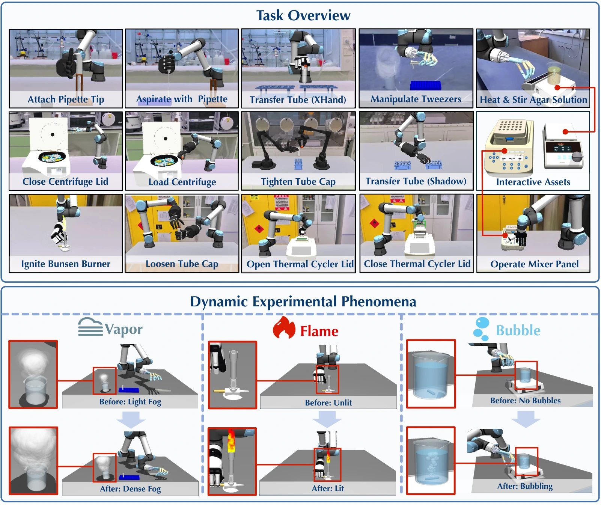

*DexBioLab authors · [Figure source](https://arxiv.org/abs/2610.13643) · Original rights retained.*

| Field | Reported value and source scope |
| :-- | :-- |
| Record type | benchmark |
| Simulator | mjlab / MuJoCo Warp with Gaussian-splatting backgrounds [1](https://arxiv.org/abs/2610.13643) [2](https://cumulusalpha.github.io/DexBioLabWebPage/) [3](https://github.com/CumulusAlpha/DexBioLab)  |
| Simulator version and scope | Exact mjlab / MuJoCo Warp release Not reported in retrieved manuscript. [1](https://arxiv.org/abs/2610.13643) [2](https://cumulusalpha.github.io/DexBioLabWebPage/) [3](https://github.com/CumulusAlpha/DexBioLab)  |
| Task count and scope | 14 tasks across 4 robot embodiments; three visual experimental phenomena and six laboratory backgrounds [1](https://arxiv.org/abs/2610.13643) [2](https://cumulusalpha.github.io/DexBioLabWebPage/) [3](https://github.com/CumulusAlpha/DexBioLab)  |
| Task-list scope | Complete fourteen-task Figure 2 labels in Oct 14 v3. [1](https://arxiv.org/abs/2610.13643) [2](https://cumulusalpha.github.io/DexBioLabWebPage/) [3](https://github.com/CumulusAlpha/DexBioLab)  |
| Capability dimensions | Precision tool manipulation · Instrument operation · Visual grounding · Dynamic visual distractors [1](https://arxiv.org/abs/2610.13643) [2](https://cumulusalpha.github.io/DexBioLabWebPage/) [3](https://github.com/CumulusAlpha/DexBioLab)  |
| Metrics | Task success; progressive score for Operate Mixer Panel / real tube-transfer validation; three seeds ×100 rollouts for simulation comparisons. [1](https://arxiv.org/abs/2610.13643) [2](https://cumulusalpha.github.io/DexBioLabWebPage/) [3](https://github.com/CumulusAlpha/DexBioLab)  |
| Robots | UR5e and ALOHA arms; Shadow, XHand and Wuji hand configurations yield four evaluated embodiments. [1](https://arxiv.org/abs/2610.13643) [2](https://cumulusalpha.github.io/DexBioLabWebPage/) [3](https://github.com/CumulusAlpha/DexBioLab)  |
| Sensors and observations | RGB from wrist/third-person viewpoints, proprioception and language; physical UR5e-XHand validation uses RealSense D405 wrist and D435 scene cameras. Depth/tactile policy inputs not established. [1](https://arxiv.org/abs/2610.13643) [2](https://cumulusalpha.github.io/DexBioLabWebPage/) [3](https://github.com/CumulusAlpha/DexBioLab)  |
| Demonstrations and data | 1,400+ collected trajectories; parallel state-machine generation and demonstration replay. Real transfer experiment mixes 10 real +90 simulated demonstrations per condition. [1](https://arxiv.org/abs/2610.13643) [2](https://cumulusalpha.github.io/DexBioLabWebPage/) [3](https://github.com/CumulusAlpha/DexBioLab)  |
| Evaluation protocol | Shared task/model interface; compare Gaussian vs standard backgrounds. Physical Transfer Tube XHand: 10 initial positions ×2 trials per condition, same task scoring. [1](https://arxiv.org/abs/2610.13643) [2](https://cumulusalpha.github.io/DexBioLabWebPage/) [3](https://github.com/CumulusAlpha/DexBioLab)  |
| Evaluated baselines | ACT / diffusion / VLA families in paper; per-task table distinguishes 13 simulation tasks from physical-transfer validation. [1](https://arxiv.org/abs/2610.13643) [2](https://cumulusalpha.github.io/DexBioLabWebPage/) [3](https://github.com/CumulusAlpha/DexBioLab)  |
| Observations / modalities | RGB · Proprioception · Language |
| Evaluation domain | Simulation · Real world |
| Embodiment | Dexterous hand · Parallel-jaw gripper · Bimanual |
| Release: code | Available [3](https://github.com/CumulusAlpha/DexBioLab)  |
| Release: weights | Not verified |
| Release: data | Not verified |
| Release: license | Not reported |
| Release: notes | Official simulation, scripted data generation, LeRobot rendering and policy evaluation code now verified; pretrained data/model download not established. |

**Task names — Complete fourteen-task Figure 2 labels in Oct 14 v3.:**

- Close Centrifuge Lid
- Load Centrifuge
- Transfer Tube (Shadow)
- Ignite Bunsen Burner
- Loosen Tube Cap
- Attach Pipette Tip
- Aspirate with Pipette
- Manipulate Tweezers
- Transfer Tube (XHand)
- Tighten Tube Cap
- Heat & Stir Agar Solution
- Open Thermal Cycler Lid
- Close Thermal Cycler Lid
- Operate Mixer Panel

**Scope and qualifications**

- arXiv v1 was titled AutoBio+; v3 (Oct 14 2026) renamed the work DexBioLab. This is one canonical work.
- Dynamic phenomena are rendered observations, not a claim of experimentally validated chemical/biological process simulation.

**Primary evidence**

1. [Paper](https://arxiv.org/abs/2610.13643) — Published paper / arXiv record and manuscript.
2. [Official project](https://cumulusalpha.github.io/DexBioLabWebPage/) — Public project page.
3. [Official source](https://github.com/CumulusAlpha/DexBioLab) — Official current code linked by project, README read.

</details>

<a id="record-benchmark-peg-in-bench"></a>
<details>
<summary><strong>Peg-in-Bench</strong> — Peg-in-Bench: A Modular Benchmark for High-Precision Robotic Insertion</summary>

**2026-09-01 · Preprint · AIST**

**[Paper](https://arxiv.org/abs/2609.00906)** · [Code](https://github.com/aistairc/peg-in-bench)

Reconfigurable physical insertion kit with five peg geometries, three nominal clearances and machine-readable scenario generation.

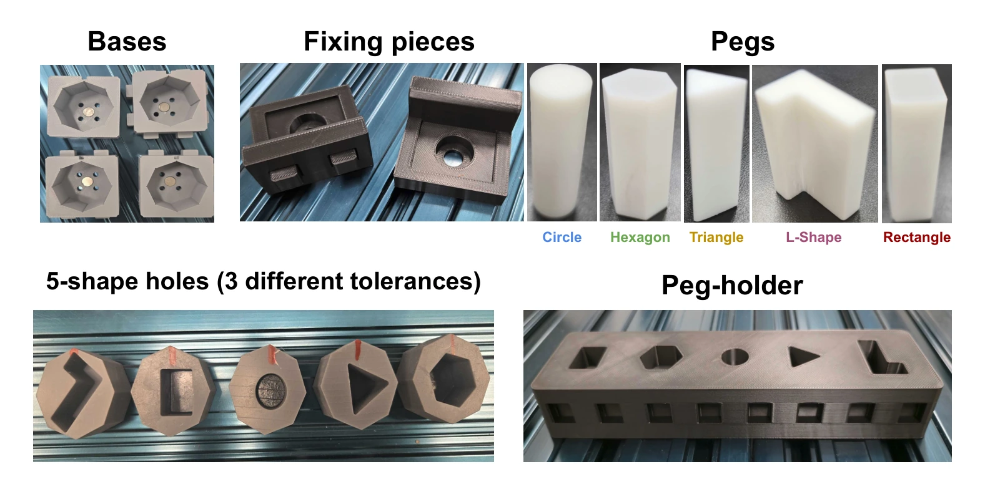

*Peg-in-Bench authors · [Figure source](https://arxiv.org/abs/2609.00906) · Original rights retained.*

| Field | Reported value and source scope |
| :-- | :-- |
| Record type | benchmark |
| Simulator | Not applicable — 3D-printable physical benchmark and scenario generator [1](https://arxiv.org/abs/2609.00906)  |
| Simulator version and scope | Not applicable [1](https://arxiv.org/abs/2609.00906) [2](https://github.com/aistairc/peg-in-bench)  |
| Task count and scope | Open-ended scenarios from 5 peg shapes × 3 tolerance levels; not a fixed task-count suite [1](https://arxiv.org/abs/2609.00906)  |
| Task-list scope | Complete five peg-geometry families; generated layouts, orientations and assemblies are combinatorial variants. [1](https://arxiv.org/abs/2609.00906)  |
| Capability dimensions | Spatial generalization · Geometric generalization · Task-compositional generalization · Tolerance-sensitive insertion [1](https://arxiv.org/abs/2609.00906)  |
| Metrics | Scenario-conditional insertion/assembly success; exact scoring procedure specified in manuscript. [1](https://arxiv.org/abs/2609.00906)  |
| Robots | Embodiment-agnostic physical kit. [1](https://arxiv.org/abs/2609.00906)  |
| Sensors and observations | Not prescribed; no tactile sensor is required by the benchmark. [1](https://arxiv.org/abs/2609.00906)  |
| Demonstrations and data | STL components and JSON scenario generator; not a robot demonstration dataset. [1](https://arxiv.org/abs/2609.00906)  |
| Evaluation protocol | Hold physical/contact conditions approximately fixed while varying target pose, geometry, nominal tolerance (0.1 / 1 / 3 mm) and assembly structure. [1](https://arxiv.org/abs/2609.00906)  |
| Evaluated baselines | No standardized learned-policy comparison established in the source overview. [1](https://arxiv.org/abs/2609.00906)  |
| Observations / modalities |  |
| Evaluation domain | Real world |
| Embodiment | Embodiment-agnostic |
| Release: code | Available [2](https://github.com/aistairc/peg-in-bench)  |
| Release: weights | Not applicable [2](https://github.com/aistairc/peg-in-bench)  |
| Release: data | Available [2](https://github.com/aistairc/peg-in-bench)  |
| Release: license | Not verified [2](https://github.com/aistairc/peg-in-bench)  |
| Release: notes | Scenario-generation software and printable STL assets public; materials/printing tolerance must be measured separately. [2](https://github.com/aistairc/peg-in-bench)  |

**Task names — Complete five peg-geometry families; generated layouts, orientations and assemblies are combinatorial variants.:**

- Circular peg insertion
- Rectangular peg insertion
- Hexagonal peg insertion
- Triangular peg insertion
- L-shaped peg insertion

**Scope and qualifications**

- Nominal CAD clearance is not the same as measured manufactured clearance.
- No turnkey simulated training environment is claimed.

**Primary evidence**

1. [Paper](https://arxiv.org/abs/2609.00906) — Published paper / arXiv record and manuscript.
2. [Official repository](https://github.com/aistairc/peg-in-bench) — Current public repository; implementation scope may differ from paper.

</details>

<a id="record-benchmark-robodojo"></a>
<details>
<summary><strong>RoboDojo</strong> — RoboDojo: A Unified Sim-and-Real Benchmark for Comprehensive Evaluation of Generalist Robot Manipulation Policies</summary>

**2026-07-05 · Preprint · RoboDojo consortium**

**[Paper](https://arxiv.org/abs/2607.04434)** · [Project](https://robodojo-benchmark.com/) · [Code](https://github.com/RoboDojo-Benchmark/RoboDojo) · [Data](https://huggingface.co/datasets/RoboDojo-Benchmark/RoboDojo)

Unified simulation/physical benchmark with five capability dimensions and common policy deployment through XPolicyLab.

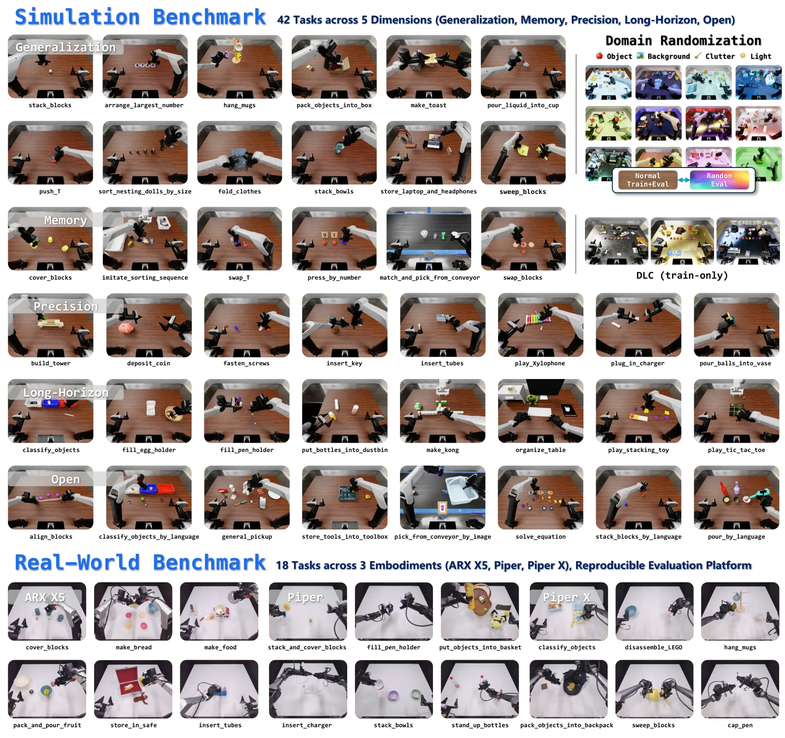

*RoboDojo authors · [Figure source](https://arxiv.org/abs/2607.04434) · Original rights retained.*

| Field | Reported value and source scope |
| :-- | :-- |
| Record type | benchmark |
| Simulator | Isaac Sim / Isaac Lab [1](https://arxiv.org/abs/2607.04434) [2](https://robodojo-benchmark.com/)  |
| Simulator version and scope | Official original release: Isaac Sim 5.1.0 / Isaac Lab 2.3; Python 3.11. [1](https://arxiv.org/abs/2607.04434) [2](https://robodojo-benchmark.com/) [3](https://github.com/RoboDojo-Benchmark/RoboDojo)  |
| Task count and scope | 42 simulation tasks + 18 physical tasks across 3 real robot embodiments [1](https://arxiv.org/abs/2607.04434) [2](https://robodojo-benchmark.com/)  |
| Task-list scope | Complete 42-task core simulation catalogue; 18 real tasks and later DLC are separate catalogues. [1](https://arxiv.org/abs/2607.04434) [2](https://robodojo-benchmark.com/)  |
| Capability dimensions | Generalization · Memory · Precision · Long-horizon execution · Open-vocabulary instruction following [1](https://arxiv.org/abs/2607.04434) [2](https://robodojo-benchmark.com/)  |
| Metrics | Capability-specific / overall task-success aggregates; fine-grained progress under task criteria; separate sim and physical leaderboards. [1](https://arxiv.org/abs/2607.04434) [2](https://robodojo-benchmark.com/)  |
| Robots | Simulation dual-arm ARX X5; physical ARX X5, Piper and Piper X. [1](https://arxiv.org/abs/2607.04434) [2](https://robodojo-benchmark.com/)  |
| Sensors and observations | Head and wrist RGB cameras, proprioception and instructions. Simulator can export depth, but listed baseline observation channels must be verified separately; official suite has no tactile sensor. [1](https://arxiv.org/abs/2607.04434) [2](https://robodojo-benchmark.com/)  |
| Demonstrations and data | Demonstration data downloadable by task; exact current total count varies by release. [1](https://arxiv.org/abs/2607.04434) [2](https://robodojo-benchmark.com/)  |
| Evaluation protocol | Seed-controlled layouts; standard/randomized generalization conditions; heterogeneous parallel simulation; physical standardized scene reset and cloud evaluation. [1](https://arxiv.org/abs/2607.04434) [2](https://robodojo-benchmark.com/)  |
| Evaluated baselines | 30 integrated policies in paper / 40+ integrations in current XPolicyLab; VLA and world-action model families. [1](https://arxiv.org/abs/2607.04434) [2](https://robodojo-benchmark.com/)  |
| Observations / modalities | RGB · Proprioception · Language |
| Evaluation domain | Simulation · Real world |
| Embodiment | Bimanual · Parallel-jaw gripper |
| Release: code | Available [3](https://github.com/RoboDojo-Benchmark/RoboDojo)  |
| Release: weights | Not applicable [3](https://github.com/RoboDojo-Benchmark/RoboDojo)  |
| Release: data | Available [3](https://github.com/RoboDojo-Benchmark/RoboDojo)  |
| Release: license | MIT benchmark code; assets/data/policy models have separate terms [3](https://github.com/RoboDojo-Benchmark/RoboDojo)  |
| Release: notes | RoboDojo release is evaluation-only; model servers and policy adapters are owned by XPolicyLab. [3](https://github.com/RoboDojo-Benchmark/RoboDojo)  |

**Task names — Complete 42-task core simulation catalogue; 18 real tasks and later DLC are separate catalogues.:**

- Stack Bowls
- Push T
- Pack Objects Into Box
- Fold Clothes
- Hang Mugs
- Sweep Blocks
- Pour Liquid Into Cup
- Make Toast
- Arrange Largest Number
- Sort Nesting Dolls By Size
- Store Laptop And Headphones
- Stack Blocks
- Cover Blocks
- Match And Pick From Conveyor
- Swap Blocks
- Swap T
- Press By Number
- Imitate Sorting Sequence
- Fasten Screws
- Plug In Charger
- Insert Tubes
- Pour Balls Into Vase
- Play Xylophone
- Deposit Coin
- Insert Key
- Build Tower
- Fill Pen Holder
- Classify Objects
- Put Bottles Into Dustbin
- Play Tic-Tac-Toe
- Fill Egg Holder
- Organize Table
- Make Kong
- Play Stacking Toy
- Align Blocks
- General Pickup
- Solve Equation
- Stack Blocks By Language
- Classify Objects By Language
- Pick From Conveyor By Image
- Store Tools In Toolbox
- Pour By Language

**Scope and qualifications**

- A simulator depth output does not mean original evaluated policies use depth.
- Report core 42 tasks separately from DLC and adapted external reproductions.

**Primary evidence**

1. [Paper](https://arxiv.org/abs/2607.04434) — Published paper / arXiv record and manuscript.
2. [Official project](https://robodojo-benchmark.com/) — Public project page.
3. [Official repository](https://github.com/RoboDojo-Benchmark/RoboDojo) — Current public repository; implementation scope may differ from paper.
4. [Official implementation / documentation](https://robodojo-benchmark.com/doc/sim-tasks/) — Complete official core task catalogue.

</details>

<a id="record-benchmark-roco-aaai-2026"></a>
<details>
<summary><strong>RoCo AAAI 2026</strong> — RoCo Challenge at AAAI 2026: Benchmarking Robotic Collaborative Manipulation for Assembly Towards Industrial Automation</summary>

**2026-03-16 · AAAI 2026 challenge / technical report · Nanyang Technological University / A*STAR**

**[Paper](https://arxiv.org/abs/2603.15469)** · [Project](https://rocochallenge.github.io/RoCo-AAAI2026/) · [Code](https://github.com/rocochallenge/gearboxAssembly)

Gearbox assembly challenge with from-scratch, partial-state continuation and error-recovery scenarios, followed by physical robot competition.


*RoCo AAAI 2026 authors · [Figure source](https://rocochallenge.github.io/RoCo-AAAI2026/) · Original rights retained.*

| Field | Reported value and source scope |
| :-- | :-- |
| Record type | benchmark |
| Simulator | NVIDIA Isaac Sim [1](https://arxiv.org/abs/2603.15469) [2](https://rocochallenge.github.io/RoCo-AAAI2026/)  |
| Simulator version and scope | Current public README: Isaac Sim 5.1.0 / Isaac Lab 2.3.0 (submodule tag v2.3.0); paper original exact stack Not reported. [1](https://arxiv.org/abs/2603.15469) [2](https://rocochallenge.github.io/RoCo-AAAI2026/) [3](https://github.com/rocochallenge/gearboxAssembly)  |
| Task count and scope | 3 core scenario families around one planetary gearbox assembly workflow [1](https://arxiv.org/abs/2603.15469) [2](https://rocochallenge.github.io/RoCo-AAAI2026/)  |
| Task-list scope | Complete three scenario-family definitions; component-level stages are not three separate product families. [1](https://arxiv.org/abs/2603.15469) [2](https://rocochallenge.github.io/RoCo-AAAI2026/)  |
| Capability dimensions | Bimanual precision assembly · State recognition · Recovery from partial assembly · Human-like error correction [1](https://arxiv.org/abs/2603.15469) [2](https://rocochallenge.github.io/RoCo-AAAI2026/)  |
| Metrics | Stage/component completion and final assembly score under simulation/onsite rules. [1](https://arxiv.org/abs/2603.15469) [2](https://rocochallenge.github.io/RoCo-AAAI2026/)  |
| Robots | Galaxea R1 Lite physical platform; simulated bimanual assembly setup. [1](https://arxiv.org/abs/2603.15469) [2](https://rocochallenge.github.io/RoCo-AAAI2026/)  |
| Sensors and observations | RGB-D / robot state in simulation; physical sensor configuration defined by competition APIs. No optical tactile input established. [1](https://arxiv.org/abs/2603.15469) [2](https://rocochallenge.github.io/RoCo-AAAI2026/)  |
| Demonstrations and data | Simulation successful-attempt trajectories and about 300 hardware demonstrations described by report; exact split depends on stage. [1](https://arxiv.org/abs/2603.15469) [2](https://rocochallenge.github.io/RoCo-AAAI2026/)  |
| Evaluation protocol | Online qualification then onsite physical evaluation; varied initial states encode collaboration and recovery; common assembly plan and robot API. [1](https://arxiv.org/abs/2603.15469) [2](https://rocochallenge.github.io/RoCo-AAAI2026/)  |
| Evaluated baselines | ACT / diffusion / VLA-style policy baselines and challenge systems; exact table scope in report. [1](https://arxiv.org/abs/2603.15469) [2](https://rocochallenge.github.io/RoCo-AAAI2026/)  |
| Observations / modalities | RGB · Depth · Proprioception |
| Evaluation domain | Simulation · Real world |
| Embodiment | Bimanual · Parallel-jaw gripper |
| Release: code | Available [3](https://github.com/rocochallenge/gearboxAssembly)  |
| Release: weights | Not verified [3](https://github.com/rocochallenge/gearboxAssembly)  |
| Release: data | Partial [3](https://github.com/rocochallenge/gearboxAssembly)  |
| Release: license | Not verified [3](https://github.com/rocochallenge/gearboxAssembly)  |
| Release: notes | Official simulator code, task docs, onsite API references and leaderboards public. [3](https://github.com/rocochallenge/gearboxAssembly)  |

**Task names — Complete three scenario-family definitions; component-level stages are not three separate product families.:**

- Assembly from Scratch
- Resume from Partial State
- Error Detection and Recovery

**Scope and qualifications**

- The later IROS 2026 challenge is a separate edition; this entry covers AAAI 2026.
- Recovery scenarios share a gearbox task family rather than a broad general-purpose object set.

**Primary evidence**

1. [Paper](https://arxiv.org/abs/2603.15469) — Published paper / arXiv record and manuscript.
2. [Official project](https://rocochallenge.github.io/RoCo-AAAI2026/) — Public project page.
3. [Official repository](https://github.com/rocochallenge/gearboxAssembly) — Current public repository; implementation scope may differ from paper.

</details>

<a id="record-benchmark-manipulationnet"></a>
<details>
<summary><strong>ManipulationNet</strong> — ManipulationNet: An Infrastructure for Benchmarking Real-World Robot Manipulation with Physical Skill Challenges and Embodied Multimodal Reasoning</summary>

**2026-03-04 · Preprint · Rice University / NIST / collaborating institutions**

**[Paper](https://arxiv.org/abs/2603.04363)** · [Project](https://mnet-client.readthedocs.io/ros_2/)

Distributed physical benchmarking infrastructure with standardized kits, server-issued trials, audit evidence and separate physical-skill and embodied-reasoning tracks.

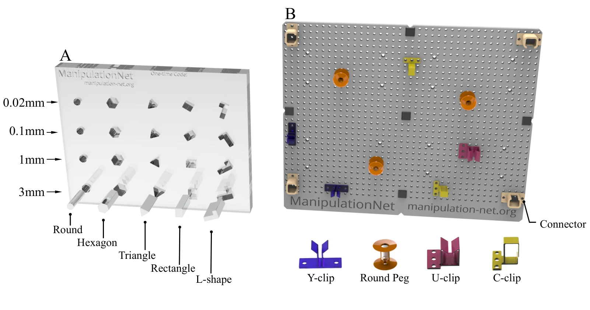

*ManipulationNet authors · [Figure source](https://arxiv.org/abs/2603.04363) · Original rights retained.*

| Field | Reported value and source scope |
| :-- | :-- |
| Record type | benchmark |
| Simulator | Not applicable — real-world benchmark infrastructure [1](https://arxiv.org/abs/2603.04363) [2](https://mnet-client.readthedocs.io/ros_2/)  |
| Simulator version and scope | Not applicable [1](https://arxiv.org/abs/2603.04363) [2](https://mnet-client.readthedocs.io/ros_2/)  |
| Task count and scope | Multiple hosted benchmarks in Physical Skills and Embodied Reasoning tracks; task count is infrastructure-dependent. [1](https://arxiv.org/abs/2603.04363) [2](https://mnet-client.readthedocs.io/ros_2/)  |
| Task-list scope | Published Physical Skills task families; not a complete evolving infrastructure catalogue. [1](https://arxiv.org/abs/2603.04363) [2](https://mnet-client.readthedocs.io/ros_2/)  |
| Capability dimensions | Precision insertion · Cable routing · Clutter grasping · Multimodal reasoning · Distributed reproducibility [1](https://arxiv.org/abs/2603.04363) [2](https://mnet-client.readthedocs.io/ros_2/)  |
| Metrics | Physical skill success rate and average successful completion time; reasoning goal accuracy / normalized efficiency; uploaded evidence audited. [1](https://arxiv.org/abs/2603.04363) [2](https://mnet-client.readthedocs.io/ros_2/)  |
| Robots | Robot-agnostic clients connected to standardized physical task kits. [1](https://arxiv.org/abs/2603.04363) [2](https://mnet-client.readthedocs.io/ros_2/)  |
| Sensors and observations | Method-dependent visual / depth / tactile / force sensors; the infrastructure does not require RGBDT for every entry. [1](https://arxiv.org/abs/2603.04363) [2](https://mnet-client.readthedocs.io/ros_2/)  |
| Demonstrations and data | Task kits, machine-readable instructions and execution video/metadata; not one fixed demonstration corpus. [1](https://arxiv.org/abs/2603.04363) [2](https://mnet-client.readthedocs.io/ros_2/)  |
| Evaluation protocol | Server specifies trial configuration; local human resets standard kit; robot executes; video/results uploaded for audit. Peg geometries and nominal clearances vary. [1](https://arxiv.org/abs/2603.04363) [2](https://mnet-client.readthedocs.io/ros_2/)  |
| Evaluated baselines | Baseline systems and task-specific submissions; no single policy architecture mandated. [1](https://arxiv.org/abs/2603.04363) [2](https://mnet-client.readthedocs.io/ros_2/)  |
| Observations / modalities | RGB · Depth · Language |
| Evaluation domain | Real world |
| Embodiment | Embodiment-agnostic |
| Release: code | Available |
| Release: weights | Not applicable |
| Release: data | Partial |
| Release: license | Not verified |
| Release: notes | Client documentation and standardized-kit protocols public; inspect task-specific kits and access. |

**Task names — Published Physical Skills task families; not a complete evolving infrastructure catalogue.:**

- Peg-in-hole assembly
- Cable management
- Grasping in clutter

**Scope and qualifications**

- Infrastructure task list evolves; do not treat later policy six-configuration subsets as the whole benchmark.
- Sensors are policy choices rather than universally provided observation channels.

**Primary evidence**

1. [Paper](https://arxiv.org/abs/2603.04363) — Published paper / arXiv record and manuscript.
2. [Official project](https://mnet-client.readthedocs.io/ros_2/) — Public project page.

</details>

<a id="record-benchmark-fmb"></a>
<details>
<summary><strong>FMB</strong> — FMB: a Functional Manipulation Benchmark for Generalizable Robotic Learning</summary>

**2024-01-16 · The International Journal of Robotics Research 2024 · University of California Berkeley**

**[Paper](https://arxiv.org/abs/2401.08553)** · [Project](https://functional-manipulation-benchmark.github.io/) · [Code](https://github.com/rail-berkeley/fmb) · [Data](https://huggingface.co/datasets/charlesxu0124/functional-manipulation-benchmark)

Reproducible physical functional assembly benchmark with procedurally varied 3D-printed parts, multi-stage skills and a large RGB-D demonstration dataset.

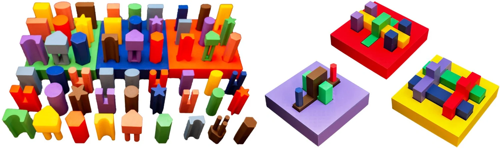

*FMB authors · [Figure source](https://functional-manipulation-benchmark.github.io/) · Original rights retained.*

| Field | Reported value and source scope |
| :-- | :-- |
| Record type | benchmark |
| Simulator | Not applicable to original physical benchmark [1](https://arxiv.org/abs/2401.08553) [2](https://functional-manipulation-benchmark.github.io/)  |
| Simulator version and scope | Not applicable [1](https://arxiv.org/abs/2401.08553) [2](https://functional-manipulation-benchmark.github.io/) [3](https://github.com/rail-berkeley/fmb)  |
| Task count and scope | 2 task families: single-object and multi-object multi-stage manipulation; 54 single-object variants and 3 four-object interlocking assembly sets [1](https://arxiv.org/abs/2401.08553) [2](https://functional-manipulation-benchmark.github.io/)  |
| Task-list scope | Complete two task-family definitions; primitive names are Grasp, Place on Fixture, Regrasp, Rotate, Move to Board and Insert. [1](https://arxiv.org/abs/2401.08553) [2](https://functional-manipulation-benchmark.github.io/)  |
| Capability dimensions | Functional grasping · Environment-assisted reorientation · Precise insertion · Sequential assembly · Geometry/appearance generalization [1](https://arxiv.org/abs/2401.08553) [2](https://functional-manipulation-benchmark.github.io/)  |
| Metrics | Per-primitive success, complete multi-stage success, held-out object/pose generalization. [1](https://arxiv.org/abs/2401.08553) [2](https://functional-manipulation-benchmark.github.io/)  |
| Robots | Franka Panda [1](https://arxiv.org/abs/2401.08553) [2](https://functional-manipulation-benchmark.github.io/)  |
| Sensors and observations | 2 global and 2 wrist RGB-D views; robot state, gripper and force/torque signals in data. [1](https://arxiv.org/abs/2401.08553) [2](https://functional-manipulation-benchmark.github.io/)  |
| Demonstrations and data | 22,550 expert demonstration trajectories. Single-object tasks last about 20–40 s; complete multi-object assembly can exceed 100 s. [1](https://arxiv.org/abs/2401.08553) [2](https://functional-manipulation-benchmark.github.io/)  |
| Evaluation protocol | Standardized workspace and reset; held-out object variations and board positions; skill-level models can be combined into longer manipulation pipelines. [1](https://arxiv.org/abs/2401.08553) [2](https://functional-manipulation-benchmark.github.io/)  |
| Evaluated baselines | Provided ResNet-based and Transformer-based imitation-learning skill policies. [1](https://arxiv.org/abs/2401.08553) [2](https://functional-manipulation-benchmark.github.io/)  |
| Observations / modalities | RGB · Depth · Force/Torque · Proprioception |
| Evaluation domain | Real world |
| Embodiment | Parallel-jaw gripper |
| Release: code | Available [3](https://github.com/rail-berkeley/fmb)  |
| Release: weights | Not verified [3](https://github.com/rail-berkeley/fmb)  |
| Release: data | Available [3](https://github.com/rail-berkeley/fmb)  |
| Release: license | Dataset card: CC-BY-4.0; code license Not verified [3](https://github.com/rail-berkeley/fmb)  |
| Release: notes | Robot/controller infrastructure, dataset builder, training/evaluation code, CAD files and data public. [3](https://github.com/rail-berkeley/fmb)  |

**Task names — Complete two task-family definitions; primitive names are Grasp, Place on Fixture, Regrasp, Rotate, Move to Board and Insert.:**

- Single-Object Multi-Stage Manipulation
- Multi-Object Multi-Stage Manipulation

**Scope and qualifications**

- 54 part variants are not 54 independently defined semantic tasks.
- No tactile image sensor is included; F/T is a distinct sensing channel.

**Primary evidence**

1. [Paper](https://arxiv.org/abs/2401.08553) — Published paper / arXiv record and manuscript.
2. [Official project](https://functional-manipulation-benchmark.github.io/) — Public project page.
3. [Official repository](https://github.com/rail-berkeley/fmb) — Current public repository; implementation scope may differ from paper.

</details>

<a id="record-benchmark-furniturebench"></a>
<details>
<summary><strong>FurnitureBench</strong> — FurnitureBench: Reproducible Real-World Benchmark for Long-Horizon Complex Manipulation</summary>

**2023-05-22 · RSS 2023 · University of Southern California / KAIST**

**[Paper](https://arxiv.org/abs/2305.12821)** · [Project](https://clvrai.github.io/furniture-bench/) · [Code](https://github.com/clvrai/furniture-bench) · [Data](https://clvrai.github.io/furniture-bench/docs/tutorials/dataset.html)

Physical miniature furniture assembly with reproducible initial-state difficulty and a matching Isaac Gym / Factory simulator.


*FurnitureBench authors · [Figure source](https://clvrai.github.io/furniture-bench/) · Original rights retained.*

| Field | Reported value and source scope |
| :-- | :-- |
| Record type | benchmark |
| Simulator | FurnitureSim built on Isaac Gym and Factory [1](https://arxiv.org/abs/2305.12821) [2](https://clvrai.github.io/furniture-bench/)  |
| Simulator version and scope | Isaac Gym Preview 4 in released setup; exact build should be matched to repository. [1](https://arxiv.org/abs/2305.12821) [2](https://clvrai.github.io/furniture-bench/) [3](https://github.com/clvrai/furniture-bench)  |
| Task count and scope | 8 physical furniture assembly tasks; per-skill and complete-assembly evaluations [1](https://arxiv.org/abs/2305.12821) [2](https://clvrai.github.io/furniture-bench/)  |
| Task-list scope | Complete original eight-furniture suite. [1](https://arxiv.org/abs/2305.12821) [2](https://clvrai.github.io/furniture-bench/)  |
| Capability dimensions | Long-horizon assembly · Grasp / place / insertion / screwing · Error accumulation · Reset-level robustness [1](https://arxiv.org/abs/2305.12821) [2](https://clvrai.github.io/furniture-bench/)  |
| Metrics | Assembly / skill success under low, medium and high randomization; evaluation time and human reset reproducibility. [1](https://arxiv.org/abs/2305.12821) [2](https://clvrai.github.io/furniture-bench/)  |
| Robots | Franka Panda arm with parallel-jaw gripper [1](https://arxiv.org/abs/2305.12821) [2](https://clvrai.github.io/furniture-bench/)  |
| Sensors and observations | External and wrist RGB-D cameras; robot proprioception; AprilTag-based part tracking used for reproducible setups and labels. [1](https://arxiv.org/abs/2305.12821) [2](https://clvrai.github.io/furniture-bench/)  |
| Demonstrations and data | 200+ hours, 5,000+ demonstrations; RGB-D, robot states and actions. [1](https://arxiv.org/abs/2305.12821) [2](https://clvrai.github.io/furniture-bench/)  |
| Evaluation protocol | Three standardized initial-state randomization levels; skill and full-assembly evaluation; physical benchmark complemented by FurnitureSim. [1](https://arxiv.org/abs/2305.12821) [2](https://clvrai.github.io/furniture-bench/)  |
| Evaluated baselines | Behavior cloning and offline reinforcement-learning baselines; exact suite settings in manuscript. [1](https://arxiv.org/abs/2305.12821) [2](https://clvrai.github.io/furniture-bench/)  |
| Observations / modalities | RGB · Depth · Proprioception |
| Evaluation domain | Real world · Simulation |
| Embodiment | Parallel-jaw gripper |
| Release: code | Available [3](https://github.com/clvrai/furniture-bench)  |
| Release: weights | Not verified [3](https://github.com/clvrai/furniture-bench)  |
| Release: data | Available [3](https://github.com/clvrai/furniture-bench)  |
| Release: license | MIT code; dataset/third-party terms separate [3](https://github.com/clvrai/furniture-bench) [4](https://github.com/clvrai/furniture-bench/blob/main/LICENSE)  |
| Release: notes | CAD files, data, reset/workspace guides and FurnitureSim environment public. [3](https://github.com/clvrai/furniture-bench)  |

**Task names — Complete original eight-furniture suite.:**

- One Leg
- Square Table
- Desk
- Round Table
- Chair
- Lamp
- Drawer
- Cabinet

**Scope and qualifications**

- Fiducial-based privileged part states and raw image policy observations should be reported separately.
- Furniture assembly does not inherently include tactile sensing.

**Primary evidence**

1. [Paper](https://arxiv.org/abs/2305.12821) — Published paper / arXiv record and manuscript.
2. [Official project](https://clvrai.github.io/furniture-bench/) — Public project page.
3. [Official repository](https://github.com/clvrai/furniture-bench) — Current public repository; implementation scope may differ from paper.
4. [Official source](https://github.com/clvrai/furniture-bench/blob/main/LICENSE) — License text read directly; code license does not automatically cover models, data or simulator.

</details>

<a id="record-benchmark-ramp"></a>
<details>
<summary><strong>RAMP</strong> — RAMP: A Benchmark for Evaluating Robotic Assembly Manipulation and Planning</summary>

**2023-05-16 · IEEE Robotics and Automation Letters 2024 · University of Oxford / Manufacturing Technology Centre / University of Birmingham**

**[Paper](https://arxiv.org/abs/2305.09644)** · [Project](https://sites.google.com/oxfordrobotics.institute/ramp) · [Code](https://github.com/applied-ai-lab/ramp-sim)

Accessible beam-and-peg assembly benchmark testing both planning and precise execution, with hardware plans and a digital twin.


*RAMP authors · [Figure source](https://arxiv.org/abs/2305.09644) · Original rights retained.*

| Field | Reported value and source scope |
| :-- | :-- |
| Record type | benchmark |
| Simulator | NVIDIA Isaac Sim [1](https://arxiv.org/abs/2305.09644) [2](https://sites.google.com/oxfordrobotics.institute/ramp)  |
| Simulator version and scope | Released ramp-sim README specifies NVIDIA Isaac Sim 2022.2.1. [1](https://arxiv.org/abs/2305.09644) [2](https://sites.google.com/oxfordrobotics.institute/ramp) [3](https://github.com/applied-ai-lab/ramp-sim)  |
| Task count and scope | Assemblies grouped into Easy, Medium and Hard; paper baseline evaluates 3 Easy assemblies [1](https://arxiv.org/abs/2305.09644) [2](https://sites.google.com/oxfordrobotics.institute/ramp)  |
| Task-list scope | Complete three currently selectable Easy simulation assemblies in released README; paper additionally defines Medium and Hard goal classes. [1](https://arxiv.org/abs/2305.09644) [2](https://sites.google.com/oxfordrobotics.institute/ramp)  |
| Capability dimensions | Task-and-motion planning · Peg insertion · Beam sliding · Regrasping · Diagnostics and fault recovery [1](https://arxiv.org/abs/2305.09644) [2](https://sites.google.com/oxfordrobotics.institute/ramp)  |
| Metrics | Correct fully seated peg completion percentage over time; completion time and repeats; partial assemblies count only valid connected components. [1](https://arxiv.org/abs/2305.09644) [2](https://sites.google.com/oxfordrobotics.institute/ramp)  |
| Robots | Single-arm physical baseline; kit extensible to other robot systems. [1](https://arxiv.org/abs/2305.09644) [2](https://sites.google.com/oxfordrobotics.institute/ramp)  |
| Sensors and observations | AprilTags aid state estimation; force-controlled manipulation primitives; sensor choice not fixed by the kit. [1](https://arxiv.org/abs/2305.09644) [2](https://sites.google.com/oxfordrobotics.institute/ramp)  |
| Demonstrations and data | Nine base beams, up to 15 pegs, printable joints, A2 reset template, XML goal descriptions and digital twin; no standard large demonstration dataset. [1](https://arxiv.org/abs/2305.09644) [2](https://sites.google.com/oxfordrobotics.institute/ramp)  |
| Evaluation protocol | Easy requires 3–4 peg insertions; Medium 4–8 with angled insertion/sliding/regrasping; Hard longer free-form designs. Baseline repeats three Easy designs five times. [1](https://arxiv.org/abs/2305.09644) [2](https://sites.google.com/oxfordrobotics.institute/ramp)  |
| Evaluated baselines | Rudimentary symbolic planner and Cartesian-impedance manipulation primitives. [1](https://arxiv.org/abs/2305.09644) [2](https://sites.google.com/oxfordrobotics.institute/ramp)  |
| Observations / modalities | RGB · Force/Torque · Proprioception |
| Evaluation domain | Real world · Simulation |
| Embodiment | Parallel-jaw gripper |
| Release: code | Available [3](https://github.com/applied-ai-lab/ramp-sim)  |
| Release: weights | Not applicable [3](https://github.com/applied-ai-lab/ramp-sim)  |
| Release: data | Available [3](https://github.com/applied-ai-lab/ramp-sim)  |
| Release: license | GPL-3.0 for ramp-sim/ramp-planner; CAD/material terms require separate inspection [3](https://github.com/applied-ai-lab/ramp-sim)  |
| Release: notes | Simulation, planning and assembly instructions provided in separate resources. [3](https://github.com/applied-ai-lab/ramp-sim)  |

**Task names — Complete three currently selectable Easy simulation assemblies in released README; paper additionally defines Medium and Hard goal classes.:**

- assembly_easy_1.xml
- assembly_easy_2.xml
- assembly_easy_3.xml

**Scope and qualifications**

- The paper baseline covers Easy assemblies; do not present it as a learned tactile benchmark.

**Primary evidence**

1. [Paper](https://arxiv.org/abs/2305.09644) — Published paper / arXiv record and manuscript.
2. [Official project](https://sites.google.com/oxfordrobotics.institute/ramp) — Public project page.
3. [Official repository](https://github.com/applied-ai-lab/ramp-sim) — Current public repository; implementation scope may differ from paper.
4. [Official source](https://github.com/applied-ai-lab/ramp-sim) — README names simulator version and three selectable XML goals.

</details>

<a id="record-benchmark-rlbench"></a>
<details>
<summary><strong>RLBench</strong> — RLBench: The Robot Learning Benchmark & Learning Environment</summary>

**2019-09-26 · IEEE Robotics and Automation Letters 2020 · Imperial College London**

**[Paper](https://arxiv.org/abs/1909.12271)** · [Project](https://sites.google.com/view/rlbench) · [Code](https://github.com/stepjam/RLBench)

Programmatic manipulation environment and demonstration generation benchmark with broad everyday tasks and common observation/action interfaces.


*RLBench authors · [Figure source](https://arxiv.org/abs/1909.12271) · Original rights retained.*

| Field | Reported value and source scope |
| :-- | :-- |
| Record type | benchmark |
| Simulator | CoppeliaSim via PyRep [1](https://arxiv.org/abs/1909.12271) [2](https://sites.google.com/view/rlbench)  |
| Simulator version and scope | Official installation specifies CoppeliaSim 4.1.0; use PyRep-compatible simulator build. [1](https://arxiv.org/abs/1909.12271) [2](https://sites.google.com/view/rlbench) [3](https://github.com/stepjam/RLBench)  |
| Task count and scope | Original paper: 100 tasks; current master source contains 106 task modules. [1](https://arxiv.org/abs/1909.12271) [2](https://sites.google.com/view/rlbench)  |
| Task-list scope | Complete 106 current-master task-module identifiers; not asserted to match exactly the original 100-task paper snapshot. [1](https://arxiv.org/abs/1909.12271) [2](https://sites.google.com/view/rlbench)  |
| Capability dimensions | Multi-task learning · Few-shot learning · Imitation learning · Reinforcement learning · Insertion / articulated manipulation [1](https://arxiv.org/abs/1909.12271) [2](https://sites.google.com/view/rlbench)  |
| Metrics | Task-specific binary success and episode return; few-shot/multi-task splits. [1](https://arxiv.org/abs/1909.12271) [2](https://sites.google.com/view/rlbench)  |
| Robots | Default Franka Panda; configurable additional robot arms. [1](https://arxiv.org/abs/1909.12271) [2](https://sites.google.com/view/rlbench)  |
| Sensors and observations | Multiple RGB-D cameras, masks and proprioception; privileged object states optional; no optical tactile observations in original suite. [1](https://arxiv.org/abs/1909.12271) [2](https://sites.google.com/view/rlbench)  |
| Demonstrations and data | On-demand waypoint/script-generated expert demonstrations; number is user-selected. [1](https://arxiv.org/abs/1909.12271) [2](https://sites.google.com/view/rlbench)  |
| Evaluation protocol | Predefined task splits and variations; programmatic success/failure criteria; task-specific waypoints generate observations/actions. [1](https://arxiv.org/abs/1909.12271) [2](https://sites.google.com/view/rlbench)  |
| Evaluated baselines | Original benchmark behavior-cloning / RL examples; later 3D and VLA policies evaluated through downstream recipes. [1](https://arxiv.org/abs/1909.12271) [2](https://sites.google.com/view/rlbench)  |
| Observations / modalities | RGB · Depth · Proprioception · Language |
| Evaluation domain | Simulation |
| Embodiment | Parallel-jaw gripper |
| Release: code | Available [3](https://github.com/stepjam/RLBench)  |
| Release: weights | Not applicable [3](https://github.com/stepjam/RLBench)  |
| Release: data | Available [3](https://github.com/stepjam/RLBench)  |
| Release: license | MIT code; CoppeliaSim and asset terms separate [3](https://github.com/stepjam/RLBench)  |
| Release: notes | Simulation tasks and demonstration-generation scripts public. [3](https://github.com/stepjam/RLBench)  |

**Task names — Complete 106 current-master task-module identifiers; not asserted to match exactly the original 100-task paper snapshot.:**

- basketball_in_hoop
- beat_the_buzz
- block_pyramid
- change_channel
- change_clock
- close_box
- close_door
- close_drawer
- close_fridge
- close_grill
- close_jar
- close_laptop_lid
- close_microwave
- empty_container
- empty_dishwasher
- get_ice_from_fridge
- hang_frame_on_hanger
- hit_ball_with_queue
- hockey
- insert_onto_square_peg
- insert_usb_in_computer
- lamp_off
- lamp_on
- lift_numbered_block
- light_bulb_in
- light_bulb_out
- meat_off_grill
- meat_on_grill
- move_hanger
- open_box
- open_door
- open_drawer
- open_fridge
- open_grill
- open_jar
- open_microwave
- open_oven
- open_washing_machine
- open_window
- open_wine_bottle
- phone_on_base
- pick_and_lift
- pick_and_lift_small
- pick_up_cup
- place_cups
- place_hanger_on_rack
- place_shape_in_shape_sorter
- play_jenga
- plug_charger_in_power_supply
- pour_from_cup_to_cup
- press_switch
- push_button
- push_buttons
- put_all_groceries_in_cupboard
- put_books_on_bookshelf
- put_bottle_in_fridge
- put_groceries_in_cupboard
- put_item_in_drawer
- put_knife_in_knife_block
- put_knife_on_chopping_board
- put_money_in_safe
- put_plate_in_colored_dish_rack
- put_rubbish_in_bin
- put_shoes_in_box
- put_toilet_roll_on_stand
- put_tray_in_oven
- put_umbrella_in_umbrella_stand
- reach_and_drag
- reach_target
- remove_cups
- scoop_with_spatula
- screw_nail
- set_the_table
- setup_checkers
- setup_chess
- slide_block_to_target
- slide_cabinet_open
- slide_cabinet_open_and_place_cups
- solve_puzzle
- stack_blocks
- stack_chairs
- stack_cups
- stack_wine
- straighten_rope
- sweep_to_dustpan
- take_cup_out_from_cabinet
- take_frame_off_hanger
- take_item_out_of_drawer
- take_lid_off_saucepan
- take_money_out_safe
- take_off_weighing_scales
- take_plate_off_colored_dish_rack
- take_shoes_out_of_box
- take_toilet_roll_off_stand
- take_tray_out_of_oven
- take_umbrella_out_of_umbrella_stand
- take_usb_out_of_computer
- toilet_seat_down
- toilet_seat_up
- turn_oven_on
- turn_tap
- tv_on
- unplug_charger
- water_plants
- weighing_scales
- wipe_desk

**Scope and qualifications**

- Task variants and registered task modules are different counting units.
- Current task catalogue differs from the original publication snapshot.

**Primary evidence**

1. [Paper](https://arxiv.org/abs/1909.12271) — Published paper / arXiv record and manuscript.
2. [Official project](https://sites.google.com/view/rlbench) — Public project page.
3. [Official repository](https://github.com/stepjam/RLBench) — Current public repository; implementation scope may differ from paper.

</details>

<a id="record-benchmark-nist-assembly-task-boards"></a>
<details>
<summary><strong>NIST Assembly Task Boards</strong> — Assembly Performance Metrics and Test Methods: NIST Assembly Task Boards</summary>

**2018 · NIST benchmark and test protocols · National Institute of Standards and Technology**

**[Paper](https://www.nist.gov/system/files/documents/2018/01/11/test_method-metrics-analysis_v3.pdf)** · [Project](https://www.nist.gov/el/intelligent-systems-division-73500/robotic-grasping-and-manipulation-assembly/assembly)

Standardized physical assembly/disassembly boards with low-cost components, reset protocols, time-based performance metrics and statistical comparison procedures.

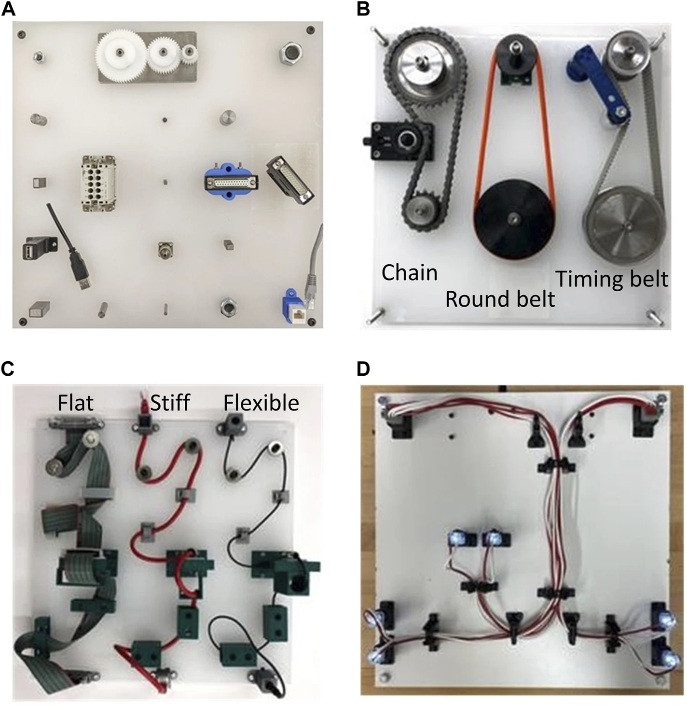

*Kenneth Kimble, Justin Albrecht, Megan Zimmerman, and Joe Falco / NIST · [Figure source](https://www.frontiersin.org/journals/robotics-and-ai/articles/10.3389/frobt.2022.999348/full) · Original rights retained.*

| Field | Reported value and source scope |
| :-- | :-- |
| Record type | benchmark |
| Simulator | Not applicable — original physical test boards [1](https://www.nist.gov/system/files/documents/2018/01/11/test_method-metrics-analysis_v3.pdf) [2](https://www.nist.gov/el/intelligent-systems-division-73500/robotic-grasping-and-manipulation-assembly/assembly)  |
| Simulator version and scope | Not applicable [1](https://www.nist.gov/system/files/documents/2018/01/11/test_method-metrics-analysis_v3.pdf) [2](https://www.nist.gov/el/intelligent-systems-division-73500/robotic-grasping-and-manipulation-assembly/assembly)  |
| Task count and scope | Several board designs; board/component operations are the counting unit, not a fixed robot-learning task suite. [1](https://www.nist.gov/system/files/documents/2018/01/11/test_method-metrics-analysis_v3.pdf) [2](https://www.nist.gov/el/intelligent-systems-division-73500/robotic-grasping-and-manipulation-assembly/assembly)  |
| Task-list scope | Published competencies across board designs; exact component repetitions vary by board and revision. [1](https://www.nist.gov/system/files/documents/2018/01/11/test_method-metrics-analysis_v3.pdf) [2](https://www.nist.gov/el/intelligent-systems-division-73500/robotic-grasping-and-manipulation-assembly/assembly)  |
| Capability dimensions | Small-parts assembly · Threading · Meshing · Routing · Flexible component handling [1](https://www.nist.gov/system/files/documents/2018/01/11/test_method-metrics-analysis_v3.pdf) [2](https://www.nist.gov/el/intelligent-systems-division-73500/robotic-grasping-and-manipulation-assembly/assembly)  |
| Metrics | Assembly/disassembly completion and elapsed time; benchmark templates and statistical tools; manual interference invalidates autonomous trials. [1](https://www.nist.gov/system/files/documents/2018/01/11/test_method-metrics-analysis_v3.pdf) [2](https://www.nist.gov/el/intelligent-systems-division-73500/robotic-grasping-and-manipulation-assembly/assembly)  |
| Robots | Robot-agnostic integrated-system evaluation. [1](https://www.nist.gov/system/files/documents/2018/01/11/test_method-metrics-analysis_v3.pdf) [2](https://www.nist.gov/el/intelligent-systems-division-73500/robotic-grasping-and-manipulation-assembly/assembly)  |
| Sensors and observations | Not prescribed; perception, control and sensors are system design choices. [1](https://www.nist.gov/system/files/documents/2018/01/11/test_method-metrics-analysis_v3.pdf) [2](https://www.nist.gov/el/intelligent-systems-division-73500/robotic-grasping-and-manipulation-assembly/assembly)  |
| Demonstrations and data | Board designs, replication instructions, connector-housing STL files, benchmark protocol templates. [1](https://www.nist.gov/system/files/documents/2018/01/11/test_method-metrics-analysis_v3.pdf) [2](https://www.nist.gov/el/intelligent-systems-division-73500/robotic-grasping-and-manipulation-assembly/assembly)  |
| Evaluation protocol | Randomize board and bin pose in robot workspace; autonomous assembly or disassembly; repeated controlled tests and documented component configuration. [1](https://www.nist.gov/system/files/documents/2018/01/11/test_method-metrics-analysis_v3.pdf) [2](https://www.nist.gov/el/intelligent-systems-division-73500/robotic-grasping-and-manipulation-assembly/assembly)  |
| Evaluated baselines | Reference systems appear in companion studies such as Benchmarking Off-The-Shelf Solutions to Robotic Assembly Tasks (2021). [1](https://www.nist.gov/system/files/documents/2018/01/11/test_method-metrics-analysis_v3.pdf) [2](https://www.nist.gov/el/intelligent-systems-division-73500/robotic-grasping-and-manipulation-assembly/assembly)  |
| Observations / modalities |  |
| Evaluation domain | Real world |
| Embodiment | Embodiment-agnostic |
| Release: code | Not applicable |
| Release: weights | Not applicable |
| Release: data | Available |
| Release: license | NIST public-resource terms; third-party part designs may have separate rights |
| Release: notes | Official board drawings, replication instructions and test templates publicly downloadable. |

**Task names — Published competencies across board designs; exact component repetitions vary by board and revision.:**

- Peg insertions
- Gear meshing
- Electrical connector insertions
- Nut threading
- Flexible parts handling and insertion
- Actuating tensioners
- Cable threading and routing
- Wire bundling

**Scope and qualifications**

- Original test boards do not prescribe a learning algorithm, robot or sensor package.
- Simulation adaptations such as Factory are separate resources and may cover only a subset of boards.

**Primary evidence**

1. [Paper](https://www.nist.gov/system/files/documents/2018/01/11/test_method-metrics-analysis_v3.pdf) — Published paper / arXiv record and manuscript.
2. [Official project](https://www.nist.gov/el/intelligent-systems-division-73500/robotic-grasping-and-manipulation-assembly/assembly) — Public project page.

</details>

<a id="dexterous-benchmarks"></a>
### Dexterous Manipulation

| Date | Work | Setting | Tasks / simulator | Release | Primary links |
| :-- | :-- | :-- | :-- | :-- | :-- |
| 2026-10-02 | [DexJoCo-X](#record-benchmark-dexjoco-x) | Simulation | 6 tasks × 7 hands = 42 hand–task pairs; MuJoCo (DexJoCo-based benchmark) | Not verified | **[Paper](https://arxiv.org/abs/2610.03278)** <!-- work:dexjoco-x --> |
| 2026-07-09 | [DexVerse](#record-benchmark-dexverse) | Simulation | 100 task definitions; baseline evaluation on 19 tasks; 3 arm models and 6 hand models; NVIDIA Isaac Lab / Isaac Sim | Partial | **[Paper](https://arxiv.org/abs/2607.08751)** · [Project](https://ycyao216.github.io/DexVerse.site/) · [Code](https://github.com/ycyao216/DexVerse) <!-- work:dexverse --> |
| 2026-05-15 | [DexJoCo](#record-benchmark-dexjoco) | Simulation | 11 tasks; 100 demonstrations/task; MuJoCo | Available | **[Paper](https://arxiv.org/abs/2605.16257)** · [Project](https://dexjoco.github.io/) · [Code](https://github.com/brave-eai/dexjoco) · [Data](https://huggingface.co/datasets/DexJoCo/DexJoCo-Datasets-LeRobot) <!-- work:dexjoco --> |
| 2023-05-09 | [DexArt](#record-benchmark-dexart) | Simulation | 4 articulated manipulation task families; SAPIEN | Available | **[Paper](https://arxiv.org/abs/2305.05706)** · [Project](https://www.chenbao.tech/dexart/) · [Code](https://github.com/Kami-code/dexart-release) <!-- work:dexart --> |
| 2022-06-17 | [Bi-DexHands](#record-benchmark-bi-dexhands) | Simulation | 20 evaluated bimanual task environments; repository may contain additional variants; NVIDIA Isaac Gym | Available | **[Paper](https://arxiv.org/abs/2206.08686)** · [Project](https://pku-marl.github.io/DexterousHands/) · [Code](https://github.com/PKU-MARL/DexterousHands) <!-- work:bi-dexhands --> |

<a id="record-benchmark-dexjoco-x"></a>
<details>
<summary><strong>DexJoCo-X</strong> — DexJoCo-X: Benchmarking Action Representations for Multi-Hand Dexterous Manipulation</summary>

**2026-10-02 · Preprint · Not reported**

**[Paper](https://arxiv.org/abs/2610.03278)**

Controlled seven-hand comparison of action representations under shared scenes, task criteria and balanced demonstration budgets.


*DexJoCo-X authors · [Figure source](https://arxiv.org/abs/2610.03278) · Original rights retained.*

| Field | Reported value and source scope |
| :-- | :-- |
| Record type | benchmark |
| Simulator | MuJoCo (DexJoCo-based benchmark) [1](https://arxiv.org/abs/2610.03278)  |
| Simulator version and scope | Not reported [1](https://arxiv.org/abs/2610.03278)  |
| Task count and scope | 6 tasks × 7 hands = 42 hand–task pairs [1](https://arxiv.org/abs/2610.03278)  |
| Task-list scope | Complete six paper task labels; first three single-arm, last three bimanual. [1](https://arxiv.org/abs/2610.03278)  |
| Capability dimensions | Cross-embodiment dexterity · Action representation · Functional tool use · Bimanual control [1](https://arxiv.org/abs/2610.03278)  |
| Metrics | Success per hand/task and mean across 42 pairs; three independent 50-rollout evaluations/cell = 6,300 evaluation episodes. [1](https://arxiv.org/abs/2610.03278)  |
| Robots | XHand, Inspire, Wuji, LEAP, Sharpa Wave, LinkerHand, Allegro hands with arm setups. [1](https://arxiv.org/abs/2610.03278)  |
| Sensors and observations | RGB, robot state and action records; no tactile sensing established. [1](https://arxiv.org/abs/2610.03278)  |
| Demonstrations and data | 2,100 balanced demonstrations; 50 per hand–task pair; reviewed demonstrations expanded and verified in randomized scenes. [1](https://arxiv.org/abs/2610.03278)  |
| Evaluation protocol | Seven per-hand multitask π0.5/Ego-Pi policies (300 demos each) vs joint Being-H0.5 (2,100 demos); Native, function-aligned action slots and DexLatent within matched joint architecture. [1](https://arxiv.org/abs/2610.03278)  |
| Evaluated baselines | π0.5, Ego-Pi action-head adaptation; Being-H0.5 with Native, FAAS, DexLatent. [1](https://arxiv.org/abs/2610.03278)  |
| Observations / modalities | RGB · Proprioception |
| Evaluation domain | Simulation |
| Embodiment | Dexterous hand · Bimanual |
| Release: code | Not verified |
| Release: weights | Not verified |
| Release: data | Not verified |
| Release: license | Not reported |
| Release: notes | Paper accessible; independent public code/data release URL not resolved. |

**Task names — Complete six paper task labels; first three single-arm, last three bimanual.:**

- Bucket
- Hammer
- Hanoi
- Microwave
- Unlock iPad
- Photo

**Scope and qualifications**

- Cross-architecture comparisons differ in pretraining and training organization; the clean representation comparison is within Being-H0.5.
- The six tasks are a subset/reformulation of DexJoCo task families.

**Primary evidence**

1. [Paper](https://arxiv.org/abs/2610.03278) — Published paper / arXiv record and manuscript.

</details>

<a id="record-benchmark-dexverse"></a>
<details>
<summary><strong>DexVerse</strong> — DexVerse: A Modular Benchmark for Multi-Task, Multi-Embodiment Dexterous Manipulation</summary>

**2026-07-09 · Preprint · University of North Carolina at Chapel Hill**

**[Paper](https://arxiv.org/abs/2607.08751)** · [Project](https://ycyao216.github.io/DexVerse.site/) · [Code](https://github.com/ycyao216/DexVerse)

Modular dexterous suite covering 100 tasks, multiple arms/hands and configurable visual variation, with a 19-task baseline study.

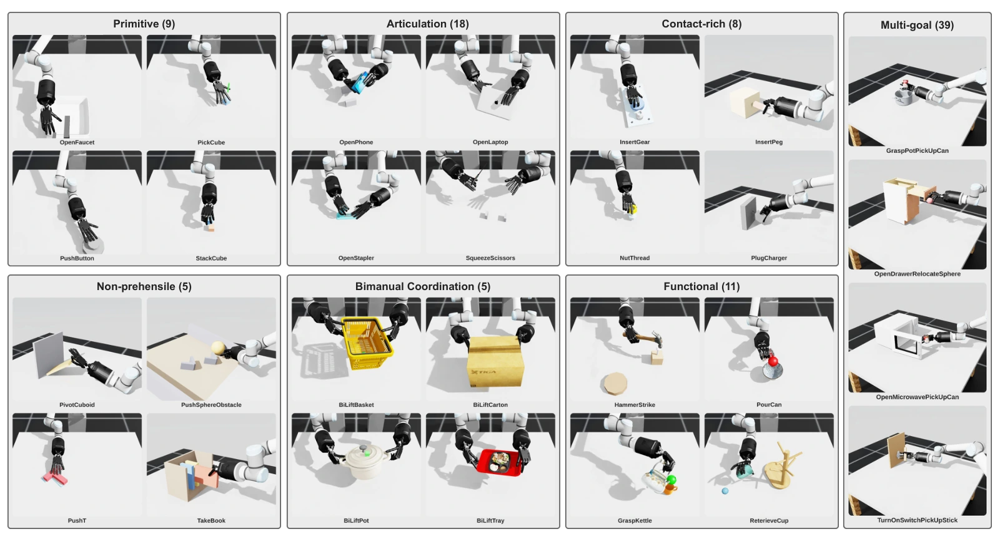

*DexVerse authors · [Figure source](https://arxiv.org/abs/2607.08751) · Original rights retained.*

| Field | Reported value and source scope |
| :-- | :-- |
| Record type | benchmark |
| Simulator | NVIDIA Isaac Lab / Isaac Sim [1](https://arxiv.org/abs/2607.08751) [2](https://ycyao216.github.io/DexVerse.site/)  |
| Simulator version and scope | Current official README: Isaac Sim 5.1.0 / Isaac Lab 2.3.2. [1](https://arxiv.org/abs/2607.08751) [2](https://ycyao216.github.io/DexVerse.site/) [3](https://github.com/ycyao216/DexVerse)  |
| Task count and scope | 100 task definitions; baseline evaluation on 19 tasks; 3 arm models and 6 hand models [1](https://arxiv.org/abs/2607.08751) [2](https://ycyao216.github.io/DexVerse.site/)  |
| Task-list scope | Complete 100 unique current registered environment IDs parsed from category package registrations; paper taxonomy grouping differs slightly from current folders. [1](https://arxiv.org/abs/2607.08751) [2](https://ycyao216.github.io/DexVerse.site/)  |
| Capability dimensions | Relocation · Articulated objects · Tool use · Bimanual cooperation · Non-prehensile control · Contact-rich execution · Long horizons [1](https://arxiv.org/abs/2607.08751) [2](https://ycyao216.github.io/DexVerse.site/)  |
| Metrics | Success rate and generalization under texture/background/light/camera perturbations; task-conditioned baseline comparison. [1](https://arxiv.org/abs/2607.08751) [2](https://ycyao216.github.io/DexVerse.site/)  |
| Robots | Franka Research 3, UR10e, xArm7 arms; Sharpa Wave, WUJI, Shadow, Inspire, Allegro and LEAP hands. [1](https://arxiv.org/abs/2607.08751) [2](https://ycyao216.github.io/DexVerse.site/)  |
| Sensors and observations | RGB, depth, point clouds, proprioception and privileged state; no tactile stream established. [1](https://arxiv.org/abs/2607.08751) [2](https://ycyao216.github.io/DexVerse.site/)  |
| Demonstrations and data | 3,180 demonstrations collected through VR teleoperation. [1](https://arxiv.org/abs/2607.08751) [2](https://ycyao216.github.io/DexVerse.site/)  |
| Evaluation protocol | Shared task definitions and configurable visual randomization; baseline comparison across 19 selected tasks, not all 100. [1](https://arxiv.org/abs/2607.08751) [2](https://ycyao216.github.io/DexVerse.site/)  |
| Evaluated baselines | Diffusion Policy, DP3, OpenVLA and π0.5. [1](https://arxiv.org/abs/2607.08751) [2](https://ycyao216.github.io/DexVerse.site/)  |
| Observations / modalities | RGB · Depth · Proprioception |
| Evaluation domain | Simulation |
| Embodiment | Dexterous hand · Bimanual |
| Release: code | Partial [3](https://github.com/ycyao216/DexVerse)  |
| Release: weights | Not verified [3](https://github.com/ycyao216/DexVerse)  |
| Release: data | Partial [3](https://github.com/ycyao216/DexVerse)  |
| Release: license | BSD-3-Clause code; assets/third-party terms separate [3](https://github.com/ycyao216/DexVerse) [4](https://github.com/ycyao216/DexVerse/blob/main/LICENSE)  |
| Release: notes | Official roadmap distinguishes initial task/assets release, teleoperation, baseline code, full Shadow Hand dataset and cross-embodiment artifacts; inspect actual available files. [3](https://github.com/ycyao216/DexVerse)  |

**Task names — Complete 100 unique current registered environment IDs parsed from category package registrations; paper taxonomy grouping differs slightly from current folders.:**

- Dexverse-GraspBleach-v0
- Dexverse-GraspPan-v0
- Dexverse-GraspKettle-v0
- Dexverse-GraspCup-v0
- Dexverse-RemoveCupFromRack-v0
- Dexverse-FunctionalPourCan-v0
- Dexverse-FunctionalPourMug-v0
- Dexverse-FunctionalHammerStrike-v0
- Dexverse-FunctionalDrillApply-v0
- Dexverse-PourWineGlass-v0
- Dexverse-PushSphereUpSlope-v0
- Dexverse-PushSmallSphereObstacleSlope-v0
- Dexverse-PushT-v0
- Dexverse-PivotLargeCuboidAgainstWall-v0
- Dexverse-TakeBookOffShelf-v0
- Dexverse-LongHorizon-MicrowaveRetrievePlace-v0
- Dexverse-LongHorizon-OvenBakeSalmon-v0
- Dexverse-LongHorizon-TrashDrawerSortSimple-v0
- Dexverse-LongHorizon-CookFoods-v0
- Dexverse-BimanualLiftTray-v0
- Dexverse-BimanualLiftBasket-v0
- Dexverse-BimanualLiftCarton-v0
- Dexverse-BimanualLiftDutchOven-v0
- Dexverse-BimanualHandover-v0
- Dexverse-PickCube-v0
- Dexverse-StackCube-v0
- Dexverse-RelocateSphere-v0
- Dexverse-PickUpStick-v0
- Dexverse-RelocateObject-v0
- Dexverse-GraspTwoItems-v0
- Dexverse-LongHorizon-MakeCoffee-v0
- Dexverse-NutThread-v0
- Dexverse-InsertPipette-v0
- Dexverse-PlugCharger-v0
- Dexverse-InsertPen-v0
- Dexverse-GearMesh-v0
- Dexverse-InsertPeg-v0
- Dexverse-PickFromClutter-v0
- Dexverse-PickThinObjectFromContainer-v0
- Dexverse-OpenMicrowavePickUpCan-v0
- Dexverse-OpenMicrowavePickUpStick-v0
- Dexverse-OpenMicrowavePourMug-v0
- Dexverse-OpenMicrowaveRelocateSphere-v0
- Dexverse-OpenDoorPickUpCan-v0
- Dexverse-OpenDoorPickUpStick-v0
- Dexverse-OpenDoorPourMug-v0
- Dexverse-OpenDoorRelocateSphere-v0
- Dexverse-OpenDrawerPickUpCan-v0
- Dexverse-OpenDrawerPickUpStick-v0
- Dexverse-OpenDrawerPourMug-v0
- Dexverse-OpenDrawerRelocateSphere-v0
- Dexverse-LiftLidPickUpCan-v0
- Dexverse-LiftLidPickUpStick-v0
- Dexverse-LiftLidPourMug-v0
- Dexverse-LiftLidRelocateSphere-v0
- Dexverse-GraspPotPickUpCan-v0
- Dexverse-GraspPotPickUpStick-v0
- Dexverse-GraspPotPourMug-v0
- Dexverse-GraspPotRelocateSphere-v0
- Dexverse-PushButtonPickUpCan-v0
- Dexverse-PushButtonPickUpStick-v0
- Dexverse-PushButtonPourMug-v0
- Dexverse-PushButtonRelocateSphere-v0
- Dexverse-RotateKnobPickUpCan-v0
- Dexverse-RotateKnobPickUpStick-v0
- Dexverse-RotateKnobPourMug-v0
- Dexverse-RotateKnobRelocateSphere-v0
- Dexverse-TurnOnSwitchPickUpCan-v0
- Dexverse-TurnOnSwitchPickUpStick-v0
- Dexverse-TurnOnSwitchPourMug-v0
- Dexverse-TurnOnSwitchRelocateSphere-v0
- Dexverse-GraspBucketPickUpCan-v0
- Dexverse-GraspBucketPickUpStick-v0
- Dexverse-GraspBucketPourMug-v0
- Dexverse-GraspBucketRelocateSphere-v0
- Dexverse-PourMugPickUpCan-v0
- Dexverse-PourMugPickUpStick-v0
- Dexverse-PourMugRelocateSphere-v0
- Dexverse-OpenCabinet-v0
- Dexverse-LiftLid-v0
- Dexverse-OpenDoor-v0
- Dexverse-RotateKnob-v0
- Dexverse-OpenFaucet-v0
- Dexverse-OpenMicrowave-v0
- Dexverse-OpenDrawer-v0
- Dexverse-TurnOnSwitch-v0
- Dexverse-GraspBucket-v0
- Dexverse-LiftBucket-v0
- Dexverse-GraspPot-v0
- Dexverse-PushButton-v0
- Dexverse-OpenLaptop-v0
- Dexverse-SqueezeScissors-v0
- Dexverse-SlideUtilityKnife-v0
- Dexverse-LiftBasketHandle-v0
- Dexverse-OpenStapler-v0
- Dexverse-OpenFlatFolder-v0
- Dexverse-OpenHuaweiPhone-v0
- Dexverse-CabinetDoubleDoor-v0
- Dexverse-UnscrewCap-v0
- Dexverse-OpenGlasses-v0

**Scope and qualifications**

- The 100-task headline, 19-task benchmark experiment and staged release roadmap have different scopes.
- Depth/point-cloud recording does not imply every baseline consumes them.

**Primary evidence**

1. [Paper](https://arxiv.org/abs/2607.08751) — Published paper / arXiv record and manuscript.
2. [Official project](https://ycyao216.github.io/DexVerse.site/) — Public project page.
3. [Official repository](https://github.com/ycyao216/DexVerse) — Current public repository; implementation scope may differ from paper.
4. [Official source](https://github.com/ycyao216/DexVerse/blob/main/LICENSE) — License text read directly; code license does not automatically cover models, data or simulator.
5. [Official source](https://github.com/ycyao216/DexVerse/tree/main/source/dexverse/dexverse/tasks/config) — Read static register_env calls across all category __init__.py files, without executing simulator code.

</details>

<a id="record-benchmark-dexjoco"></a>
<details>
<summary><strong>DexJoCo</strong> — DexJoCo: A Benchmark and Toolkit for Task-Oriented Dexterous Manipulation on MuJoCo</summary>

**2026-05-15 · Preprint · CAS Institute of Automation**

**[Paper](https://arxiv.org/abs/2605.16257)** · [Project](https://dexjoco.github.io/) · [Code](https://github.com/brave-eai/dexjoco) · [Data](https://huggingface.co/datasets/DexJoCo/DexJoCo-Datasets-LeRobot)

Task-oriented arm-hand benchmark emphasizing tool use, bimanual coordination, long horizons and reasoning, with demonstration collection and modern policy adapters.

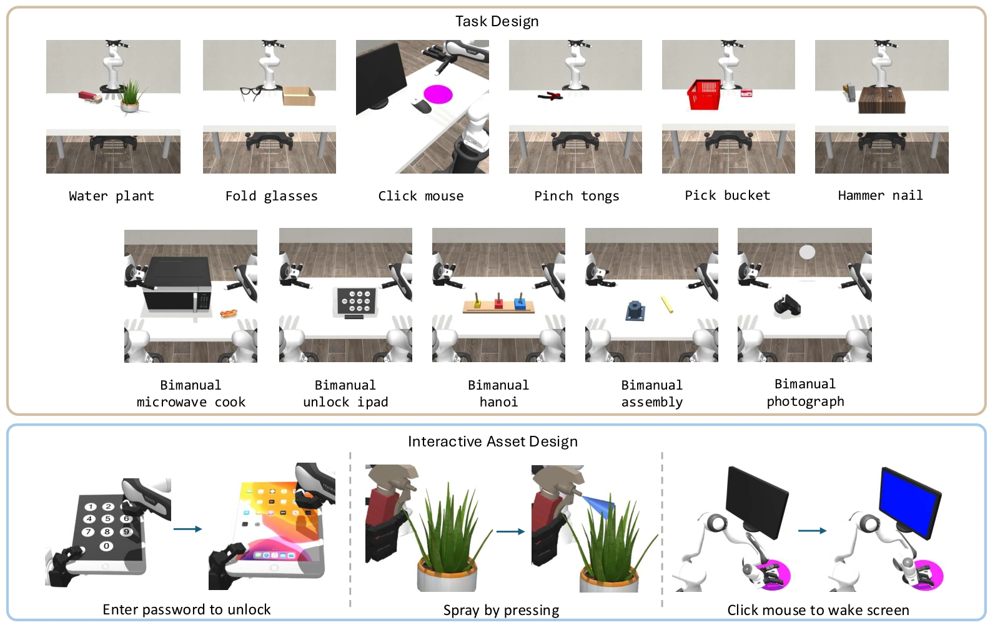

*DexJoCo authors · [Figure source](https://arxiv.org/abs/2605.16257) · Original rights retained.*

| Field | Reported value and source scope |
| :-- | :-- |
| Record type | benchmark |
| Simulator | MuJoCo [1](https://arxiv.org/abs/2605.16257) [2](https://dexjoco.github.io/)  |
| Simulator version and scope | Current official environment-dexjoco.yaml and package pyproject both pin MuJoCo 3.4.0. [1](https://arxiv.org/abs/2605.16257) [2](https://dexjoco.github.io/) [3](https://github.com/brave-eai/dexjoco)  |
| Task count and scope | 11 tasks; 100 demonstrations/task [1](https://arxiv.org/abs/2605.16257) [2](https://dexjoco.github.io/)  |
| Task-list scope | Complete 11-task published gallery. [1](https://arxiv.org/abs/2605.16257) [2](https://dexjoco.github.io/)  |
| Capability dimensions | Functional tool use · Dexterous grasping · Bimanual coordination · Long-horizon execution · Reasoning [1](https://arxiv.org/abs/2605.16257) [2](https://dexjoco.github.io/)  |
| Metrics | Task success across object-only and full visual/dynamics randomization; multitask and action-head adaptation results. [1](https://arxiv.org/abs/2605.16257) [2](https://dexjoco.github.io/)  |
| Robots | Franka Panda + Allegro Hand; single-arm and dual-arm configurations. [1](https://arxiv.org/abs/2605.16257) [2](https://dexjoco.github.io/)  |
| Sensors and observations | Third-person and wrist RGB, proprioception and actions. Depth/tactile inputs are not established as evaluated baseline modalities. [1](https://arxiv.org/abs/2605.16257) [2](https://dexjoco.github.io/)  |
| Demonstrations and data | 1,100 human demonstrations captured with Rokoko gloves / HTC Vive trackers; replay-based randomized scene expansion. [1](https://arxiv.org/abs/2605.16257) [2](https://dexjoco.github.io/)  |
| Evaluation protocol | Shared asynchronous policy server/client interface; single-task vs multitask training; object placement/table height and visual/dynamic randomization. [1](https://arxiv.org/abs/2605.16257) [2](https://dexjoco.github.io/)  |
| Evaluated baselines | ACT, Diffusion Policy CNN/Transformer, π0.5, GR00T N1.5. [1](https://arxiv.org/abs/2605.16257) [2](https://dexjoco.github.io/)  |
| Observations / modalities | RGB · Proprioception |
| Evaluation domain | Simulation |
| Embodiment | Dexterous hand · Bimanual |
| Release: code | Available [3](https://github.com/brave-eai/dexjoco)  |
| Release: weights | Not verified [3](https://github.com/brave-eai/dexjoco)  |
| Release: data | Available [3](https://github.com/brave-eai/dexjoco)  |
| Release: license | MIT main code; GeoRT non-commercial, OpenPI Apache-2.0 and Gemma terms apply to bundled components [3](https://github.com/brave-eai/dexjoco)  |
| Release: notes | Source, teleoperation and LeRobot datasets public; third-party components have distinct licenses. [3](https://github.com/brave-eai/dexjoco)  |

**Task names — Complete 11-task published gallery.:**

- Water Plant
- Hammer Nail
- Click Mouse
- Pick Bucket
- Pinch Tongs
- Fold Glasses
- Bimanual Microwave
- Bimanual Unlock iPad
- Bimanual Hanoi
- Bimanual Assembly
- Bimanual Photograph

**Scope and qualifications**

- Dexterous embodiment does not imply tactile observations.
- DexJoCo-X is a separate matched cross-hand protocol with six tasks and seven hands.

**Primary evidence**

1. [Paper](https://arxiv.org/abs/2605.16257) — Published paper / arXiv record and manuscript.
2. [Official project](https://dexjoco.github.io/) — Public project page.
3. [Official repository](https://github.com/brave-eai/dexjoco) — Current public repository; implementation scope may differ from paper.
4. [Official source](https://github.com/brave-eai/dexjoco/blob/main/dexjoco/pyproject.toml) — MuJoCo==3.4.0 pin read from actual package dependency.

</details>

<a id="record-benchmark-dexart"></a>
<details>
<summary><strong>DexArt</strong> — DexArt: Benchmarking Generalizable Dexterous Manipulation with Articulated Objects</summary>

**2023-05-09 · CVPR 2023 · University of California San Diego**

**[Paper](https://arxiv.org/abs/2305.05706)** · [Project](https://www.chenbao.tech/dexart/) · [Code](https://github.com/Kami-code/dexart-release)

Dexterous articulated-object manipulation benchmark centered on transfer to unseen object instances with depth-derived point-cloud observations.

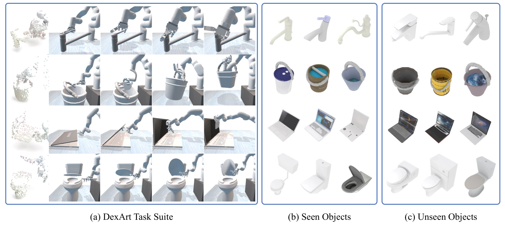

*DexArt authors · [Figure source](https://arxiv.org/abs/2305.05706) · Original rights retained.*

| Field | Reported value and source scope |
| :-- | :-- |
| Record type | benchmark |
| Simulator | SAPIEN [1](https://arxiv.org/abs/2305.05706) [2](https://www.chenbao.tech/dexart/)  |
| Simulator version and scope | Repository setup pins sapien==2.1.0; source package version scope only. [1](https://arxiv.org/abs/2305.05706) [2](https://www.chenbao.tech/dexart/) [3](https://github.com/Kami-code/dexart-release)  |
| Task count and scope | 4 articulated manipulation task families [1](https://arxiv.org/abs/2305.05706) [2](https://www.chenbao.tech/dexart/)  |
| Task-list scope | Complete four task families; object-instance splits are separate generalization configurations. [1](https://arxiv.org/abs/2305.05706) [2](https://www.chenbao.tech/dexart/)  |
| Capability dimensions | Articulated manipulation · Dexterous contact · Unseen object generalization · 3D representation learning [1](https://arxiv.org/abs/2305.05706) [2](https://www.chenbao.tech/dexart/)  |
| Metrics | Task success on seen / unseen articulated objects and representation-pretraining ablations. [1](https://arxiv.org/abs/2305.05706) [2](https://www.chenbao.tech/dexart/)  |
| Robots | Robot arm with Allegro Hand. [1](https://arxiv.org/abs/2305.05706) [2](https://www.chenbao.tech/dexart/)  |
| Sensors and observations | Partial point cloud from depth camera; robot proprioception. Color and optical tactile inputs are not the benchmark focus. [1](https://arxiv.org/abs/2305.05706) [2](https://www.chenbao.tech/dexart/)  |
| Demonstrations and data | Articulated object assets, RL vision pretraining resources and policy checkpoints; not a fixed human-demonstration benchmark. [1](https://arxiv.org/abs/2305.05706) [2](https://www.chenbao.tech/dexart/)  |
| Evaluation protocol | Train RL on selected object instances; evaluate geometric/kinematic generalization to unseen instances within each family. [1](https://arxiv.org/abs/2305.05706) [2](https://www.chenbao.tech/dexart/)  |
| Evaluated baselines | PPO with different 3D representation encoders/pretraining choices. [1](https://arxiv.org/abs/2305.05706) [2](https://www.chenbao.tech/dexart/)  |
| Observations / modalities | Depth · Proprioception |
| Evaluation domain | Simulation |
| Embodiment | Dexterous hand |
| Release: code | Available [3](https://github.com/Kami-code/dexart-release)  |
| Release: weights | Available [3](https://github.com/Kami-code/dexart-release)  |
| Release: data | Available [3](https://github.com/Kami-code/dexart-release)  |
| Release: license | MIT code; asset terms separately inspected [3](https://github.com/Kami-code/dexart-release)  |
| Release: notes | Code, object assets, vision pretraining and RL checkpoints linked by official repository. [3](https://github.com/Kami-code/dexart-release)  |

**Task names — Complete four task families; object-instance splits are separate generalization configurations.:**

- Laptop
- Faucet
- Bucket
- Toilet

**Scope and qualifications**

- Four task families contain many object instances; distinguish object diversity from task count.

**Primary evidence**

1. [Paper](https://arxiv.org/abs/2305.05706) — Published paper / arXiv record and manuscript.
2. [Official project](https://www.chenbao.tech/dexart/) — Public project page.
3. [Official repository](https://github.com/Kami-code/dexart-release) — Current public repository; implementation scope may differ from paper.

</details>

<a id="record-benchmark-bi-dexhands"></a>
<details>
<summary><strong>Bi-DexHands</strong> — Towards Human-Level Bimanual Dexterous Manipulation with Reinforcement Learning</summary>

**2022-06-17 · NeurIPS 2022 Datasets and Benchmarks · Peking University / cooperating institutions**

**[Paper](https://arxiv.org/abs/2206.08686)** · [Project](https://pku-marl.github.io/DexterousHands/) · [Code](https://github.com/PKU-MARL/DexterousHands)

GPU-parallel bimanual Shadow Hand benchmark for single/multi-agent RL, offline learning, multitask learning and meta-learning.

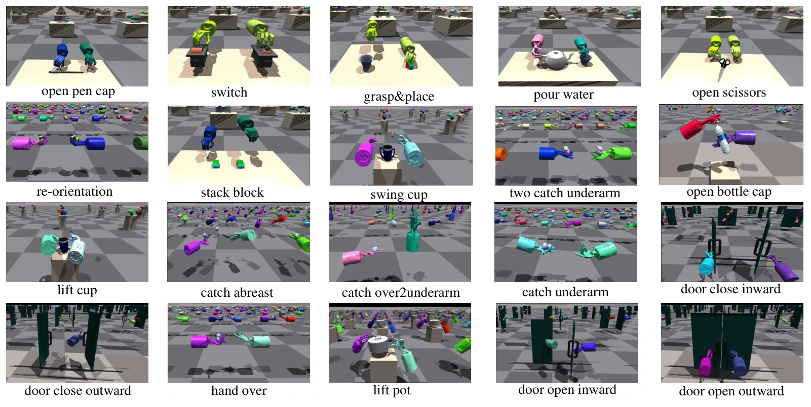

*Bi-DexHands authors · [Figure source](https://arxiv.org/abs/2206.08686) · Original rights retained.*

| Field | Reported value and source scope |
| :-- | :-- |
| Record type | benchmark |
| Simulator | NVIDIA Isaac Gym [1](https://arxiv.org/abs/2206.08686) [2](https://pku-marl.github.io/DexterousHands/)  |
| Simulator version and scope | Current official README supports Isaac Gym Preview Release 3/4; exact original experiment binary not further specified. [1](https://arxiv.org/abs/2206.08686) [2](https://pku-marl.github.io/DexterousHands/) [3](https://github.com/PKU-MARL/DexterousHands)  |
| Task count and scope | 20 evaluated bimanual task environments; repository may contain additional variants [1](https://arxiv.org/abs/2206.08686) [2](https://pku-marl.github.io/DexterousHands/)  |
| Task-list scope | Complete twenty task identifiers in original README benchmark results table. [1](https://arxiv.org/abs/2206.08686) [2](https://pku-marl.github.io/DexterousHands/)  |
| Capability dimensions | Bimanual coordination · Catching · Handovers · Reorientation · Articulated manipulation · Multi-agent cooperation [1](https://arxiv.org/abs/2206.08686) [2](https://pku-marl.github.io/DexterousHands/)  |
| Metrics | Episodic return / normalized offline score; success diagnostics; training curves over 10 trials. [1](https://arxiv.org/abs/2206.08686) [2](https://pku-marl.github.io/DexterousHands/)  |
| Robots | Two Shadow Hands [1](https://arxiv.org/abs/2206.08686) [2](https://pku-marl.github.io/DexterousHands/)  |
| Sensors and observations | Proprioceptive state, object state and fingertip contact forces in state-based baseline observations; these are not optical tactile images. [1](https://arxiv.org/abs/2206.08686) [2](https://pku-marl.github.io/DexterousHands/)  |
| Demonstrations and data | Offline random/replay/medium/medium-expert sets for Hand Over and Door Open Outward; many object assets. [1](https://arxiv.org/abs/2206.08686) [2](https://pku-marl.github.io/DexterousHands/)  |
| Evaluation protocol | Original online results: 100M environment steps, 2,048 parallel simulations; PPO/SAC/MAPPO/HAPPO evaluated on 20 tasks. Offline comparisons on two tasks; MT1/4/20 and ML1/4/20 protocols. [1](https://arxiv.org/abs/2206.08686) [2](https://pku-marl.github.io/DexterousHands/)  |
| Evaluated baselines | PPO, SAC, MAPPO, HAPPO; BC, BCQ, TD3+BC, IQL; multitask PPO and ProMP. [1](https://arxiv.org/abs/2206.08686) [2](https://pku-marl.github.io/DexterousHands/)  |
| Observations / modalities | Proprioception · Force/Torque |
| Evaluation domain | Simulation |
| Embodiment | Dexterous hand · Bimanual |
| Release: code | Available [3](https://github.com/PKU-MARL/DexterousHands)  |
| Release: weights | Not verified [3](https://github.com/PKU-MARL/DexterousHands)  |
| Release: data | Available [3](https://github.com/PKU-MARL/DexterousHands)  |
| Release: license | Apache-2.0 code; simulator and third-party asset terms separate [3](https://github.com/PKU-MARL/DexterousHands) [4](https://github.com/PKU-MARL/DexterousHands/blob/main/LICENSE)  |
| Release: notes | Task environments, algorithm implementations and offline data links public. [3](https://github.com/PKU-MARL/DexterousHands)  |

**Task names — Complete twenty task identifiers in original README benchmark results table.:**

- ShadowHandOver
- ShadowHandLiftUnderarm
- ShadowHandCatchUnderarm
- ShadowHandDoorOpenInward
- ShadowHandOver2Underarm
- ShadowHandDoorOpenOutward
- ShadowHandCatchAbreast
- ShadowHandDoorCloseInward
- ShadowHandTwoCatchUnderarm
- ShadowHandDoorCloseOutward
- ShadowHandPushBlock
- ShadowHandPen
- ShadowHandScissors
- ShadowHandSwingCup
- ShadowHandBlockStack
- ShadowHandReOrientation
- ShadowHandPourWater
- ShadowHandSwitch
- ShadowHandGraspAndPlace
- ShadowHandBottleCap

**Scope and qualifications**

- Privileged state-based RL setting should not be compared directly with image-only imitation policies.

**Primary evidence**

1. [Paper](https://arxiv.org/abs/2206.08686) — Published paper / arXiv record and manuscript.
2. [Official project](https://pku-marl.github.io/DexterousHands/) — Public project page.
3. [Official repository](https://github.com/PKU-MARL/DexterousHands) — Current public repository; implementation scope may differ from paper.
4. [Official source](https://github.com/PKU-MARL/DexterousHands/blob/main/LICENSE) — License text read directly; code license does not automatically cover models, data or simulator.

</details>

<a id="general-manipulation"></a>
### General Manipulation

| Date | Work | Setting | Tasks / simulator | Release | Primary links |
| :-- | :-- | :-- | :-- | :-- | :-- |
| 2026-05-26 | [Colosseum V2](#record-benchmark-colosseum-v2) | Simulation · Real world | 28 tasks: 16 single-arm + 12 bimanual, spanning 13 categories; ManiSkill / SAPIEN | Available | **[Paper](https://arxiv.org/abs/2605.27759)** · [Project](https://colosseum-v2.github.io/) · [Code](https://github.com/jstmn/ColosseumV2) <!-- work:colosseum-v2 --> |
| 2026-04-21 | [MemMimic](#record-benchmark-gated-memory-policy) | Simulation · Real world | 6 headline task families (four simulated, two real), plus the appendix-only T3′ Continuous Place Back real setting.; MuJoCo | Available | **[Paper](https://arxiv.org/abs/2604.18933)** · [Project](https://gated-memory-policy.github.io/) · [Code](https://github.com/real-stanford/gated-memory-policy) · [Data](https://huggingface.co/datasets/yihuai-gao/gated-memory-policy) · [Weights](https://huggingface.co/yihuai-gao/gated-memory-policy) <!-- work:gated-memory-policy --> |
| 2026-04-10 | [RoboLab-120](#record-benchmark-robolab) | Simulation | 120 core task definitions; separate RoboVoLo extension also available; NVIDIA Isaac Sim / Isaac Lab | Available | **[Paper](https://arxiv.org/abs/2604.09860)** · [Code](https://github.com/NVlabs/RoboLab) <!-- work:robolab --> |
| 2026-03-04 | [RoboCasa365](#record-benchmark-robocasa365) | Simulation | 365 task suite; 50-task multitask target benchmark; current dataset registry exposes 317 named task datasets (65 atomic + 252 composite).; MuJoCo via robosuite / RoboCasa | Available | **[Paper](https://arxiv.org/abs/2603.04356)** · [Project](https://robocasa.ai/) · [Code](https://github.com/robocasa/robocasa) · [Data](https://robocasa.ai/docs/build/html/datasets/datasets_overview.html) <!-- work:robocasa365 --> |
| 2025-12-27 | [VLA-Arena](#record-benchmark-vla-arena) | Simulation | 170 tasks in 11 suites, task levels L0–L2; current source catalogue is explicitly level-qualified.; MuJoCo / robosuite-derived framework | Available | **[Paper](https://arxiv.org/abs/2512.22539)** · [Project](https://vla-arena.github.io/) · [Code](https://github.com/PKU-Alignment/VLA-Arena) · [Data](https://huggingface.co/VLA-Arena/datasets) <!-- work:vla-arena --> |
| 2025-06-22 | [RoboTwin 2.0](#record-benchmark-robotwin2) | Simulation | 50 dual-arm tasks / 5 robot embodiments; SAPIEN | Available | **[Paper](https://arxiv.org/abs/2506.18088)** · [Project](https://robotwin-platform.github.io/) · [Code](https://github.com/robotwin-Platform/RoboTwin) · [Data](https://huggingface.co/datasets/TianxingChen/RoboTwin2.0) <!-- work:robotwin2 --> |
| 2023-06-05 | [LIBERO](#record-benchmark-libero) | Simulation | 130 registered task entries across five suites: Spatial 10, Object 10, Goal 10, LIBERO-90 90 and LIBERO-10 10. LIBERO-100 specifically is 90+10.; MuJoCo via robosuite | Available | **[Paper](https://arxiv.org/abs/2306.03310)** · [Project](https://libero-project.github.io/) · [Code](https://github.com/Lifelong-Robot-Learning/LIBERO) <!-- work:libero --> |
| 2021-10-26 | [MOSAIC Task Suite](#record-benchmark-mosaic) | Simulation | 7 task families, 61 variations in the published suite; robosuite / MuJoCo, with additional Meta-World assets | Available | **[Paper](https://arxiv.org/abs/2110.13423)** · [Project](https://sites.google.com/berkeley.edu/mosaic) · [Code](https://github.com/rll-research/mosaic) <!-- work:mosaic --> |

<a id="record-benchmark-colosseum-v2"></a>
<details>
<summary><strong>Colosseum V2</strong> — Colosseum V2: Benchmarking Generalization for Vision-Language-Action Models</summary>

**2026-05-26 · Preprint · University of Southern California**

**[Paper](https://arxiv.org/abs/2605.27759)** · [Project](https://colosseum-v2.github.io/) · [Code](https://github.com/jstmn/ColosseumV2)

GPU-parallel visual/language/action robustness evaluation across 28 single-arm and bimanual tasks, with selected physical validation.

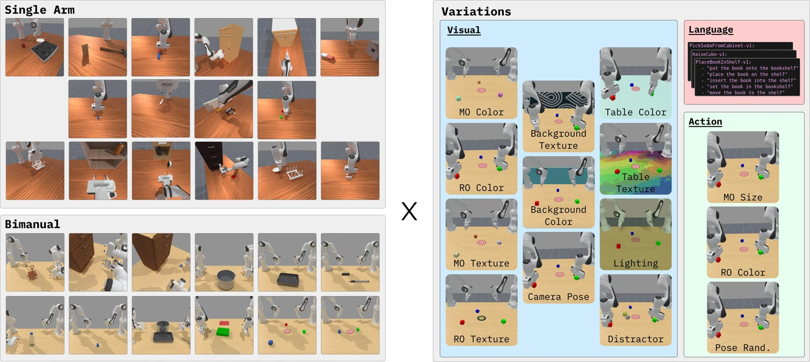

*Colosseum V2 authors · [Figure source](https://colosseum-v2.github.io/) · Original rights retained.*

| Field | Reported value and source scope |
| :-- | :-- |
| Record type | benchmark |
| Simulator | ManiSkill / SAPIEN [1](https://arxiv.org/abs/2605.27759) [2](https://colosseum-v2.github.io/)  |
| Simulator version and scope | Exact ManiSkill/SAPIEN build Not verified; record release dependency snapshot. [1](https://arxiv.org/abs/2605.27759) [2](https://colosseum-v2.github.io/) [3](https://github.com/jstmn/ColosseumV2)  |
| Task count and scope | 28 tasks: 16 single-arm + 12 bimanual, spanning 13 categories [1](https://arxiv.org/abs/2605.27759) [2](https://colosseum-v2.github.io/)  |
| Task-list scope | Complete 28-task official project catalogue. [1](https://arxiv.org/abs/2605.27759) [2](https://colosseum-v2.github.io/)  |
| Capability dimensions | Visual/language/action generalization · Tool use · Insertion · Bimanual coordination · Articulated interaction [1](https://arxiv.org/abs/2605.27759) [2](https://colosseum-v2.github.io/)  |
| Metrics | In-domain/OOD task success; relative success degradation; physical-vs-sim correlation. [1](https://arxiv.org/abs/2605.27759) [2](https://colosseum-v2.github.io/)  |
| Robots | Single Franka Panda and dual Franka Panda parallel-gripper configurations. [1](https://arxiv.org/abs/2605.27759) [2](https://colosseum-v2.github.io/)  |
| Sensors and observations | Visual observations with optional framework depth/point-cloud channels; proprioception and language; baseline actual channel setting in implementation. [1](https://arxiv.org/abs/2605.27759) [2](https://colosseum-v2.github.io/)  |
| Demonstrations and data | 100 clean demonstrations/task for simulated baselines; physical ACT study uses 60 demonstrations/task on three selected tasks. [1](https://arxiv.org/abs/2605.27759) [2](https://colosseum-v2.github.io/)  |
| Evaluation protocol | Train separately for single/bimanual suites; 200 evaluation episodes per task/perturbation. Physical validation: RaiseCube, RotateArrow, LiftPegUpright and selected shifts. [1](https://arxiv.org/abs/2605.27759) [2](https://colosseum-v2.github.io/)  |
| Evaluated baselines | ACT and π0.5. [1](https://arxiv.org/abs/2605.27759) [2](https://colosseum-v2.github.io/)  |
| Observations / modalities | RGB · Depth · Proprioception · Language |
| Evaluation domain | Simulation · Real world |
| Embodiment | Parallel-jaw gripper · Bimanual |
| Release: code | Available [3](https://github.com/jstmn/ColosseumV2)  |
| Release: weights | Not verified [3](https://github.com/jstmn/ColosseumV2)  |
| Release: data | Available [3](https://github.com/jstmn/ColosseumV2)  |
| Release: license | Not verified [3](https://github.com/jstmn/ColosseumV2)  |
| Release: notes | Official code, task/perturbation catalogue and appendix public. [3](https://github.com/jstmn/ColosseumV2)  |

**Task names — Complete 28-task official project catalogue.:**

- RaiseCube
- PickSodaFromCabinet
- PickDishFromRack
- StackCube
- PlaceBookInShelf
- PlaceDishInRack
- LiftPegUpright
- RotateArrow
- PegInsertionSide
- PlugCharger
- HammerNail
- ScoopBanana
- OpenDrawer
- OpenCabinet
- PlaceCubeInDrawer
- CookItemInPan
- DualArmCubeHandover
- DualArmBottleHandover
- DualArmLiftPot
- DualArmLiftTray
- DualArmPushBox
- DualArmPourPot
- DualArmThreading
- DualArmPenCap
- DualArmDrawerPlace
- DualArmDrawerOpen
- DualArmStackCube
- DualArmStackTwoCubes

**Scope and qualifications**

- Paper states 19 perturbation factors; current homepage displays 16 labels/counts including aggregate conditions. Keep source version with any factor count.
- Physical validation covers three single-arm tasks, not all 28.

**Primary evidence**

1. [Paper](https://arxiv.org/abs/2605.27759) — Published paper / arXiv record and manuscript.
2. [Official project](https://colosseum-v2.github.io/) — Public project page.
3. [Official repository](https://github.com/jstmn/ColosseumV2) — Current public repository; implementation scope may differ from paper.

</details>

<a id="record-benchmark-gated-memory-policy"></a>
<details>
<summary><strong>MemMimic</strong> — Gated Memory Policy: In-Context Memorization and Adaptation</summary>

**2026-04-21 · Preprint · Stanford University**

**[Paper](https://arxiv.org/abs/2604.18933)** · [Project](https://gated-memory-policy.github.io/) · [Code](https://github.com/real-stanford/gated-memory-policy) · [Data](https://huggingface.co/datasets/yihuai-gao/gated-memory-policy) · [Weights](https://huggingface.co/yihuai-gao/gated-memory-policy)

A diffusion policy learns when to recall visual/action history and what context matters for within-trial memory and cross-trial adaptation.


*Gated Memory Policy (GMP) authors · [Figure source](https://arxiv.org/abs/2604.18933) · Original rights retained.*

| Field | Reported value and source scope |
| :-- | :-- |
| Record type | policy |
| Simulator | MuJoCo [1](https://arxiv.org/abs/2604.18933)  |
| Simulator version and scope | Not reported [1](https://arxiv.org/abs/2604.18933)  |
| Task count and scope | 6 headline task families (four simulated, two real), plus the appendix-only T3′ Continuous Place Back real setting. [1](https://arxiv.org/abs/2604.18933)  |
| Task-list scope | Six headline T1–T6 families plus the auxiliary appendix T3′ real setting; excludes external RoboMimic / MIKASA-Robo evaluation tasks. [1](https://arxiv.org/abs/2604.18933)  |
| Capability dimensions | Within-trial memorization · Cross-trial adaptation · Dynamics-sensitive manipulation [1](https://arxiv.org/abs/2604.18933)  |
| Metrics | Task success rate; mean and standard deviation over training seeds. [1](https://arxiv.org/abs/2604.18933)  |
| Robots | Simulation grippers; real UR5 with WSG50 / fin-ray fingers and ARX X5 in-the-wild UMI setup. [1](https://arxiv.org/abs/2604.18933)  |
| Sensors and observations | RGB and robot proprioception. [1](https://arxiv.org/abs/2604.18933)  |
| Demonstrations and data | Task-specific demonstrations; appendix example Match Color has 300 training episodes. Complete task-specific datasets are released. [1](https://arxiv.org/abs/2604.18933)  |
| Evaluation protocol | For simulation, each checkpoint evaluated on 100 episodes, best-checkpoint mean/std over three training seeds; real protocols are task-specific. [1](https://arxiv.org/abs/2604.18933)  |
| Evaluated baselines | History-free / mid / long-history Diffusion Policy, Past-Token Prediction, history attention variants and GMP. [1](https://arxiv.org/abs/2604.18933)  |
| Observations / modalities | RGB · Proprioception |
| Evaluation domain | Simulation · Real world |
| Embodiment | Parallel-jaw gripper |
| Release: code | Available [2](https://gated-memory-policy.github.io/) [3](https://github.com/real-stanford/gated-memory-policy)  |
| Release: weights | Available [2](https://gated-memory-policy.github.io/) [3](https://github.com/real-stanford/gated-memory-policy)  |
| Release: data | Available [2](https://gated-memory-policy.github.io/) [3](https://github.com/real-stanford/gated-memory-policy)  |
| Release: license | MIT for repository code; external model, dataset and dependency terms remain separate. [2](https://gated-memory-policy.github.io/) [3](https://github.com/real-stanford/gated-memory-policy) [4](https://github.com/real-stanford/gated-memory-policy/blob/HEAD/LICENSE)  |
| Release: notes | Official training/evaluation, task data and in-the-wild deployment checkpoint are public; robot deployment uses the separately linked iPhUMI implementation. [2](https://gated-memory-policy.github.io/) [3](https://github.com/real-stanford/gated-memory-policy)  |

**Task names — Six headline T1–T6 families plus the auxiliary appendix T3′ real setting; excludes external RoboMimic / MIKASA-Robo evaluation tasks.:**

- Match Color
- Discrete Place Back
- In-the-wild Flip and Place Back
- Iterative Pushing
- Iterative Flinging
- Iterative Casting
- Continuous Place Back (appendix T3′)

**Scope and qualifications**

- No tactile or wrist force stream is claimed from RGB/history-based memory.
- The training-cost breakdown is for one challenging task, not the total complete benchmark.

**Primary evidence**

1. [Original paper / author report](https://arxiv.org/abs/2604.18933) — Original full paper and supplementary experimental / implementation details; deployment inputs are separated from supervision and benchmark state.
2. [Official project](https://gated-memory-policy.github.io/) — Author-linked project and current release checked on the catalog cutoff.
3. [Official code / release documentation](https://github.com/real-stanford/gated-memory-policy) — Current repository documentation; paper settings and subsequently released artifacts are distinguished.
4. [Repository LICENSE](https://github.com/real-stanford/gated-memory-policy/blob/HEAD/LICENSE) — Actual license file inspected; code license does not automatically license data or weights.

</details>

<a id="record-benchmark-robolab"></a>
<details>
<summary><strong>RoboLab-120</strong> — RoboLab: A High-Fidelity Simulation Benchmark for Analysis of Task Generalist Policies</summary>

**2026-04-10 · RSS 2026 · NVIDIA**

**[Paper](https://arxiv.org/abs/2604.09860)** · [Code](https://github.com/NVlabs/RoboLab)

Photorealistic task-generalist evaluation with 120 tasks and controlled language, scene and observation variations.

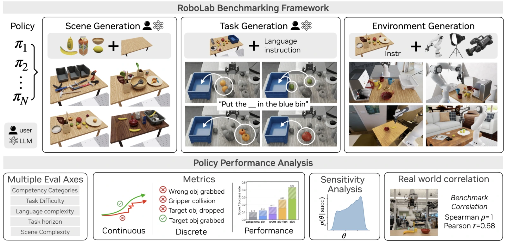

*RoboLab-120 authors · [Figure source](https://arxiv.org/abs/2604.09860) · Original rights retained.*

| Field | Reported value and source scope |
| :-- | :-- |
| Record type | benchmark |
| Simulator | NVIDIA Isaac Sim / Isaac Lab [1](https://arxiv.org/abs/2604.09860)  |
| Simulator version and scope | Current install extras: isaac50 = Isaac Sim 5.0 / Isaac Lab 2.2.0; isaac51 = Isaac Sim 5.1 / Isaac Lab 2.3.2.post1. Compare on matching stack. [1](https://arxiv.org/abs/2604.09860) [2](https://github.com/NVlabs/RoboLab)  |
| Task count and scope | 120 core task definitions; separate RoboVoLo extension also available [1](https://arxiv.org/abs/2604.09860)  |
| Task-list scope | Complete 120-task core task_table.csv snapshot; later extensions excluded. [1](https://arxiv.org/abs/2604.09860)  |
| Capability dimensions | Visual competency · Procedural competency · Relational competency · Instruction specificity · Controlled perturbations [1](https://arxiv.org/abs/2604.09860)  |
| Metrics | Binary success plus task progress / motion quality diagnostics; performance sensitivity to controlled external factors. [1](https://arxiv.org/abs/2604.09860)  |
| Robots | Default Franka/DROID-style setup; registration supports additional robots including Kinova; task definitions designed robot-agnostically. [1](https://arxiv.org/abs/2604.09860)  |
| Sensors and observations | RGB / depth camera configuration, proprioception and language; privileged evaluator predicates. Model adapters choose actual channels. [1](https://arxiv.org/abs/2604.09860)  |
| Demonstrations and data | Task/scene assets and evaluation toolset; no uniform 120-task human training demonstration corpus claimed. [1](https://arxiv.org/abs/2604.09860)  |
| Evaluation protocol | Three competency axes and three difficulty levels; server-client policy interface; multi-environment evaluation; configurable language specificity and scene/observation perturbations. [1](https://arxiv.org/abs/2604.09860)  |
| Evaluated baselines | Generalist VLA / world-action policies and policy clients; see versioned paper/leaderboard for exact checkpoint scope. [1](https://arxiv.org/abs/2604.09860)  |
| Observations / modalities | RGB · Depth · Proprioception · Language |
| Evaluation domain | Simulation |
| Embodiment | Parallel-jaw gripper |
| Release: code | Available [2](https://github.com/NVlabs/RoboLab)  |
| Release: weights | Not applicable [2](https://github.com/NVlabs/RoboLab)  |
| Release: data | Partial [2](https://github.com/NVlabs/RoboLab)  |
| Release: license | Apache-2.0 code; third-party assets separate [2](https://github.com/NVlabs/RoboLab)  |
| Release: notes | Framework, task assets and results dashboard public; model weights belong to policy providers. [2](https://github.com/NVlabs/RoboLab)  |

**Task names — Complete 120-task core task_table.csv snapshot; later extensions excluded.:**

- AnimalsInBinTask
- AppleAndYogurtInBowlTask
- BagelsOnPlateTask
- BananaInBowlTask
- BananaOnPlateTask
- BananasInBinOneMoreTask
- BananasInBinThreeTotalTask
- BananasInCrateTask
- BananasOutOfBinTask
- BananaThenRubiksCubeTask
- BBQSauceInBinTask
- BigPumpkinInBinTask
- BlackItemsInBinTask
- BlocksInBinTask
- BlockStackingOrderAgnosticTask
- BlockStackingSpecifiedOrderTask
- BowlInBinTask
- BowlStackingLeftOnRightTask
- BowlStackingRightOnLeftTask
- ButterAboveRaisinTask
- CannedFoodInBinTask
- ClampInRightBinTask
- CleanUpToysTask
- ClearOrganicObjectsTask
- ClutterPlasticTask
- ClutterPumpkinTask
- CoffeePotInBinTask
- CondimentsInBinTask
- CookingClearPlateTask
- CookingPickPastaToolTask
- CubesAndBlocksInBinTask
- DishesInBinTask
- ElectronicsInBinTask
- FoodPacking1BoxesTask
- FoodPacking1CansTask
- FoodPacking2BoxesTask
- FoodPacking2CansTask
- FoodPacking3BoxesTask
- FoodPacking3CansTask
- FoodPackingByColorTask
- FruitsGreenLimesOnPlateTask
- FruitsMovingOrangeOrLimeTask
- FruitsMovingTask
- FruitsOnionTask
- FruitsOnionToPlateTask
- FruitsOnPlate3Task
- FruitsOnPlateTask
- FruitsOrangesOnPlateTask
- GrabABagelTask
- GrabAFruitTask
- GreenSpoonsInPotTask
- HammersInLeftBinTask
- JugsOnShelfTask
- KeyboardOutOfBinTask
- LargerObjectRaisinBoxInBinTask
- MarkerInMugTask
- MouseOnKeyboardTask
- MoveBananaToBagelPlateTask
- MustardAboveRaisinTask
- MustardInLeftBinTask
- MustardInRightBinTask
- NonHammerToolsInRightBinTask
- OneBottleInSquarePailTask
- OneBottleOnShelfTask
- PhoneOrRemoteInBinTask
- PickDrillTask
- PickGlassesTask
- PickOrangeObjectTask
- PickUpBluePitcherTask
- PickUpGreenObjectTask
- PinkSpoonInPotTask
- PlasticBottlesInSquarePailTask
- PutBowlOnShelfTopTask
- PutMugsOnShelfTask
- PutTwoMugsOnShelfTask
- RecycleCartonsOnBoxTask
- RecycleCartonsVerticalCrateTask
- RecycleCartonTask
- RedDishesInBinTask
- RedItemsInBinTask
- ReorientAllMugsTask
- ReorientJugTask
- ReorientRedMugTask
- ReorientWhiteMugsTask
- RubiksCubeAndBananaTask
- RubiksCubeBehindBowlTask
- RubiksCubeInFrontOfBowlTask
- RubiksCubeLeftOfBowlTask
- RubiksCubeOrBananaTask
- RubiksCubeRightOfBowlTask
- RubiksCubesInBinTask
- RubiksCubeTask
- RubiksCubeThenBananaTask
- SauceBottlesCrateTask
- SmallerObjectButterInBinTask
- SmallPumpkinInBinTask
- SmartphoneInBinTask
- SpoonInMugTask
- SpoonsInPotTask
- Stack3RubiksCubeTask
- StackWhiteMugsTask
- StackYellowOnRedTask
- TakeMeasuringSpoonOutTask
- TakeMugsOffOfShelfTask
- TakeSpatulaOffShelfTask
- ThrowAwayAppleTask
- ThrowAwaySnacksTask
- ToolOrganizationBothTask
- ToolOrganizationTask
- ToolsPickingAllHammersTask
- ToolsPickingDrillTask
- ToolsPickingHammerTask
- ToyInBinTask
- UnstackRubiksCubeTask
- UtensilsInMugTask
- WhiteMugInCenterOfTableTask
- WhiteMugsInBinTask
- WoodSpatulaToBowlTask
- YellowAndWhiteObjectsInBinTask
- YogurtInBowlTask

**Scope and qualifications**

- Isaac Sim 5.0/5.1 contact dynamics are not invariant; recorded rollouts compare best on the original stack.
- 120 core tasks and RoboVoLo extension must be counted separately.

**Primary evidence**

1. [Paper](https://arxiv.org/abs/2604.09860) — Published paper / arXiv record and manuscript.
2. [Official repository](https://github.com/NVlabs/RoboLab) — Current public repository; implementation scope may differ from paper.
3. [Official implementation / documentation](https://github.com/NVlabs/RoboLab/blob/main/robolab/tasks/_metadata/task_table.csv) — Complete 120-row task catalogue parsed from source.

</details>

<a id="record-benchmark-robocasa365"></a>
<details>
<summary><strong>RoboCasa365</strong> — RoboCasa365: A Large-Scale Simulation Framework for Training and Benchmarking Generalist Robots</summary>

**2026-03-04 · ICLR 2026 · University of Texas at Austin**

**[Paper](https://arxiv.org/abs/2603.04356)** · [Project](https://robocasa.ai/) · [Code](https://github.com/robocasa/robocasa) · [Data](https://robocasa.ai/docs/build/html/datasets/datasets_overview.html)

Kitchen manipulation framework with 365 tasks, 2,500 environment variations and large human/synthetic demonstration collections; public multitask leaderboard uses 50 target tasks.

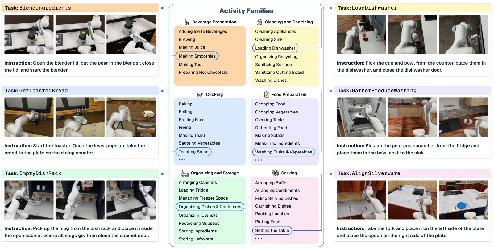

*RoboCasa365 authors · [Figure source](https://arxiv.org/abs/2603.04356) · Original rights retained.*

| Field | Reported value and source scope |
| :-- | :-- |
| Record type | benchmark |
| Simulator | MuJoCo via robosuite / RoboCasa [1](https://arxiv.org/abs/2603.04356) [2](https://robocasa.ai/)  |
| Simulator version and scope | Current benchmark note: RoboCasa 1.0.1. Exact MuJoCo/robosuite pins depend on official installation; do not substitute a downstream policy repo pin as paper version. [1](https://arxiv.org/abs/2603.04356) [2](https://robocasa.ai/) [3](https://github.com/robocasa/robocasa)  |
| Task count and scope | 365 task suite; 50-task multitask target benchmark; current dataset registry exposes 317 named task datasets (65 atomic + 252 composite). [1](https://arxiv.org/abs/2603.04356) [2](https://robocasa.ai/)  |
| Task-list scope | 317 named dataset-registry entries at audit time, a released/data-registry subset; not claimed as all 365 task definitions or the 50-task leaderboard list. [1](https://arxiv.org/abs/2603.04356) [2](https://robocasa.ai/)  |
| Capability dimensions | Household mobile manipulation · Atomic skills · Compositional generalization · Multitask/foundation/lifelong learning [1](https://arxiv.org/abs/2603.04356) [2](https://robocasa.ai/)  |
| Metrics | Task success by Atomic-Seen, Composite-Seen and Composite-Unseen; environment and data-scale generalization. [1](https://arxiv.org/abs/2603.04356) [2](https://robocasa.ai/)  |
| Robots | Mobile Panda-based kitchen manipulation embodiment. [1](https://arxiv.org/abs/2603.04356) [2](https://robocasa.ai/)  |
| Sensors and observations | RGB / depth rendering, proprioception and language available; actual baseline input setting documented per policy. [1](https://arxiv.org/abs/2603.04356) [2](https://robocasa.ai/)  |
| Demonstrations and data | 600+ hours human demonstrations and 1,600+ hours synthetic demonstrations across 2,500 kitchens. [1](https://arxiv.org/abs/2603.04356) [2](https://robocasa.ai/) [5](https://robocasa.ai/docs/build/html/datasets/datasets_overview.html)  |
| Evaluation protocol | Separate multitask, foundation-model and lifelong-learning settings; leaderboard focuses 50 target tasks; training-distribution kitchens vs held-out target kitchens must be reported explicitly. [1](https://arxiv.org/abs/2603.04356) [2](https://robocasa.ai/)  |
| Evaluated baselines | Diffusion Policy, π0, π0.5, GR00T N1.5 in original benchmark; evolving official leaderboard adds other policies. [1](https://arxiv.org/abs/2603.04356) [2](https://robocasa.ai/)  |
| Observations / modalities | RGB · Depth · Proprioception · Language |
| Evaluation domain | Simulation |
| Embodiment | Mobile manipulator · Parallel-jaw gripper |
| Release: code | Available [3](https://github.com/robocasa/robocasa)  |
| Release: weights | Partial [3](https://github.com/robocasa/robocasa)  |
| Release: data | Available [3](https://github.com/robocasa/robocasa)  |
| Release: license | MIT code; object/kitchen assets and dataset terms separate [3](https://github.com/robocasa/robocasa)  |
| Release: notes | Framework, task assets, human/synthetic datasets and leaderboard public. [3](https://github.com/robocasa/robocasa)  |

**Task names — 317 named dataset-registry entries at audit time, a released/data-registry subset; not claimed as all 365 task definitions or the 50-task leaderboard list.:**

- AdjustToasterOvenTemperature
- AdjustWaterTemperature
- CloseBlenderLid
- CloseCabinet
- CloseDishwasher
- CloseDrawer
- CloseElectricKettleLid
- CloseFridge
- CloseFridgeDrawer
- CloseMicrowave
- CloseOven
- CloseStandMixerHead
- CloseToasterOvenDoor
- CoffeeServeMug
- CoffeeSetupMug
- NavigateKitchen
- OpenBlenderLid
- OpenCabinet
- OpenDishwasher
- OpenDrawer
- OpenElectricKettleLid
- OpenFridge
- OpenFridgeDrawer
- OpenMicrowave
- OpenOven
- OpenStandMixerHead
- OpenToasterOvenDoor
- PickPlaceCabinetToCounter
- PickPlaceCounterToBlender
- PickPlaceCounterToCabinet
- PickPlaceCounterToDrawer
- PickPlaceCounterToMicrowave
- PickPlaceCounterToOven
- PickPlaceCounterToSink
- PickPlaceCounterToStandMixer
- PickPlaceCounterToStove
- PickPlaceCounterToToasterOven
- PickPlaceDrawerToCounter
- PickPlaceFridgeDrawerToShelf
- PickPlaceFridgeShelfToDrawer
- PickPlaceMicrowaveToCounter
- PickPlaceSinkToCounter
- PickPlaceStoveToCounter
- PickPlaceToasterOvenToCounter
- PickPlaceToasterToCounter
- PreheatOven
- SlideDishwasherRack
- SlideOvenRack
- SlideToasterOvenRack
- StartCoffeeMachine
- TurnOffMicrowave
- TurnOffSinkFaucet
- TurnOffStove
- TurnOnBlender
- TurnOnElectricKettle
- TurnOnMicrowave
- TurnOnSinkFaucet
- TurnOnStove
- TurnOnToaster
- TurnOnToasterOven
- TurnSinkSpout
- MakeIcedCoffee
- CheesyBread
- LowerHeat
- PackDessert
- AddIceCubes
- AddLemonToFish
- AddMarshmallow
- AddSugarCubes
- AddSweetener
- AdjustHeat
- AfterwashSorting
- AirDryFruit
- AlcoholServingPrep
- AlignSilverware
- ArrangeBreadBasket
- ArrangeBreadBowl
- ArrangeBuffetDessert
- ArrangeDrinkware
- ArrangeTea
- ArrangeTeaAccompaniments
- ArrangeUtensilsByType
- ArrangeVegetables
- AssembleCookingArray
- BalancedMealPrep
- BeverageOrganization
- BeverageSorting
- BlendIngredients
- BlendMarinade
- BowlAndCup
- BreadAndCheese
- BreadSelection
- BreadSetupSlicing
- BuildAppetizerPlate
- ButterOnPan
- CandleCleanup
- CategorizeCondiments
- CerealAndBowl
- ChooseMeasuringCup
- ChooseRipeFruit
- CleanBoard
- CleanMicrowave
- ClearClutter
- ClearCuttingBoard
- ClearFoodWaste
- ClearFreezer
- ClearReceptaclesForCleaning
- ClearSink
- ClearSinkArea
- ClearSinkSpace
- CollectWashingSupplies
- ColorfulSalsa
- CondimentCollection
- CookieDoughPrep
- CoolBakedCake
- CoolKettle
- CreateChildFriendlyFridge
- CupcakeCleanup
- CutBuffetPizza
- CuttingToolSelection
- DateNight
- DefrostByCategory
- DeliverBrewedCoffee
- DeliverStraw
- DessertAssembly
- DessertUpgrade
- DisplayMeatVariety
- DistributeChicken
- DivideBasins
- DivideBuffetTrays
- DrainVeggies
- DrinkwareConsolidation
- DryDishes
- DryDrinkware
- DumpLeftovers
- FillBlenderJug
- FillKettle
- FilterMicrowavableItem
- FoodCleanup
- FreezeBottledWaters
- FreezeCookedFood
- FreezeIceTray
- FreshProduceOrganization
- FryingPanAdjustment
- GarnishCupcake
- GarnishPancake
- GatherCuttingTools
- GatherMarinadeIngredients
- GatherTableware
- GatherVegetables
- GetToastedBread
- HeatKebabSandwich
- HeatMug
- HeatMultipleWater
- HotDogSetup
- JuiceFruitReamer
- KettleBoiling
- LemonSeasoningFish
- LineUpCondiments
- LoadCondimentsInFridge
- LoadDishwasher
- LoadFridgeByType
- LoadFridgeFifo
- LoadPreparedFood
- MakeFruitBowl
- MakeIceLemonade
- MakeLoadedPotato
- MatchCupAndDrink
- MaximizeFreezerSpace
- MealPrepStaging
- MeatSkewerAssembly
- MeatTransfer
- MicrowaveCorrectMeal
- MicrowaveDefrostMeat
- MicrowaveThawing
- MicrowaveThawingFridge
- MixCakeFrosting
- MixedFruitPlatter
- MoveFreezerToFridge
- MoveFridgeToFreezer
- MoveToCounter
- MoveToFreezerDrawer
- MultistepSteaming
- OrganizeBakingIngredients
- OrganizeCleaningSupplies
- OrganizeCoffeeCondiments
- OrganizeCondiments
- OrganizeMetallicUtensils
- OrganizeMugsByHandle
- OrganizeVegetables
- OvenBroilFish
- PackFoodByTemp
- PackFruitContainer
- PackIdenticalLunches
- PanTransfer
- PastryDisplay
- PlaceBeveragesTogether
- PlaceDishesBySink
- PlaceEqualIceCubes
- PlaceFoodInBowls
- PlaceIceInCup
- PlaceMeatInMarinade
- PlaceMicrowaveSafeItem
- PlaceOnDishRack
- PlaceStraw
- PlaceVegetablesEvenly
- PlaceVeggiesInDrawer
- PlateSteakMeal
- PlateStoreDinner
- PortionFruitBowl
- PortionHotDogs
- PortionInTupperware
- PortionOnSize
- PortionYogurt
- PreRinseStation
- PreSoakPan
- PreheatPot
- PrepForSanitizing
- PrepForTenderizing
- PrepFridgeForCleaning
- PrepMarinatingMeat
- PrepSinkForCleaning
- PrepareBroilingStation
- PrepareCheeseStation
- PrepareCocktailStation
- PrepareCoffee
- PrepareDishwasher
- PrepareDrinkStation
- PrepareSausageCheese
- PrepareSmoothie
- PrepareSoupServing
- PrepareStoringLeftovers
- PrepareToast
- PressChicken
- PrewashFoodAssembly
- PrewashFoodSorting
- QuickThaw
- RearrangeFridgeItems
- RecycleBottlesBySize
- RecycleBottlesByType
- RecycleSodaCans
- RecycleStackedYogurt
- RefillCondimentStation
- ReheatMeal
- RemoveBroiledFish
- RemoveCuttingBoardItems
- ReorganizeFrozenVegetables
- ResetCabinetDoors
- RestockBowls
- RestockCannedFood
- RestockPantry
- RestockSinkSupplies
- RetrieveIceTray
- RetrieveMeat
- ReturnHeatedFood
- ReturnWashingSupplies
- RinseBowls
- RinseCuttingBoard
- RinseSinkBasin
- RotatePan
- SanitizePrepCuttingBoard
- ScalePortioning
- ScrubBowl
- ScrubCuttingBoard
- SearingMeat
- SeasoningSpiceSetup
- SeasoningSteak
- SeparateFreezerRack
- ServeSteak
- ServeTea
- ServeWarmCroissant
- SetBowlsForSoup
- SetUpCuttingStation
- SetUpSpiceStation
- SetupBowls
- SetupButterPlate
- SetupFruitBowl
- SetupFrying
- SetupSodaBowl
- SetupWineGlasses
- ShakePan
- SimmeringSauce
- SizeSorting
- SnackSorting
- SoakSponge
- SortingCleanup
- SpicyMarinade
- StackBowlsCabinet
- StackBowlsInSink
- StackCans
- StartElectricKettle
- SteamInMicrowave
- StirVegetables
- StockingBreakfastFoods
- StoreDumplings
- StoreLeftoversByType
- StoreLeftoversInBowl
- StrainerSetup
- SweetSavoryToastSetup
- SweetenCoffee
- SweetenHotChocolate
- ThawInSink
- TiltPan
- ToastBagel
- ToastBaguette
- ToastOnCorrectRack
- TongBuffetSetup
- TransportCookware
- TurnOffSimmeredSauceHeat
- VeggieDipPrep
- WaffleReheat
- WarmCroissant
- WashFish
- WashFruitColander
- WashLettuce
- WeighIngredients
- YogurtDelightPrep

**Scope and qualifications**

- The full suite, named dataset registry and leaderboard task counts differ.
- Current leaderboard notes a 1.5 × rollout-horizon reevaluation relative to paper values; compare matched protocol versions.

**Primary evidence**

1. [Paper](https://arxiv.org/abs/2603.04356) — Published paper / arXiv record and manuscript.
2. [Official project](https://robocasa.ai/) — Public project page.
3. [Official repository](https://github.com/robocasa/robocasa) — Current public repository; implementation scope may differ from paper.
4. [Official implementation / documentation](https://github.com/robocasa/robocasa/blob/main/robocasa/utils/dataset_registry.py) — Parsed 65 atomic + 252 composite dataset names; released subset explicitly scoped.
5. [Official dataset documentation](https://robocasa.ai/docs/build/html/datasets/datasets_overview.html) — Link verified after navigation from official documentation; initial guessed overview.html path corrected.

</details>

<a id="record-benchmark-vla-arena"></a>
<details>
<summary><strong>VLA-Arena</strong> — VLA-Arena: An Open-Source Framework for Benchmarking Vision-Language-Action Models</summary>

**2025-12-27 · ICML 2026 · Peking University**

**[Paper](https://arxiv.org/abs/2512.22539)** · [Project](https://vla-arena.github.io/) · [Code](https://github.com/PKU-Alignment/VLA-Arena) · [Data](https://huggingface.co/VLA-Arena/datasets)

Structured task difficulty and orthogonal language/visual perturbations evaluate safety, distractors, extrapolation and long-horizon composition.

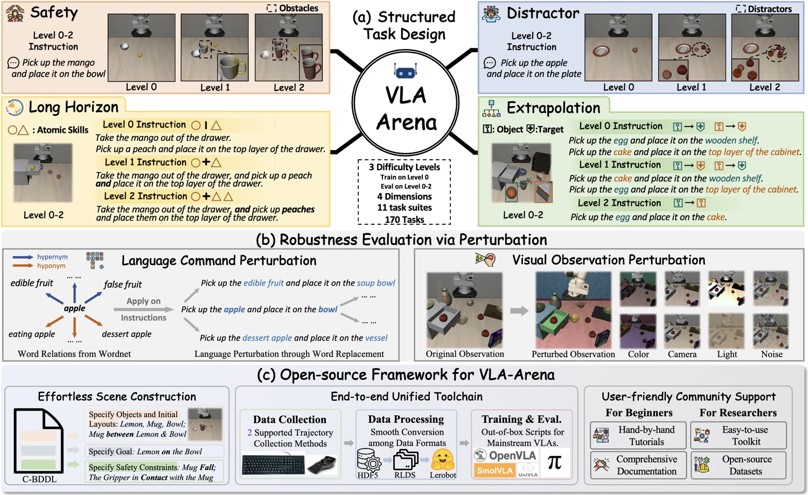

*VLA-Arena authors · [Figure source](https://vla-arena.github.io/) · Original rights retained.*

| Field | Reported value and source scope |
| :-- | :-- |
| Record type | benchmark |
| Simulator | MuJoCo / robosuite-derived framework [1](https://arxiv.org/abs/2512.22539) [2](https://vla-arena.github.io/)  |
| Simulator version and scope | Exact MuJoCo build Not verified; current pyproject dependency snapshot linked in code. [1](https://arxiv.org/abs/2512.22539) [2](https://vla-arena.github.io/) [3](https://github.com/PKU-Alignment/VLA-Arena)  |
| Task count and scope | 170 tasks in 11 suites, task levels L0–L2; current source catalogue is explicitly level-qualified. [1](https://arxiv.org/abs/2512.22539) [2](https://vla-arena.github.io/)  |
| Task-list scope | Current official source task identifiers across 11 suites with level prefixes; counted combinations may differ from paper grouping. [1](https://arxiv.org/abs/2512.22539) [2](https://vla-arena.github.io/)  |
| Capability dimensions | Safety constraint adherence · Distractor robustness · Extrapolation · Long-horizon skill composition [1](https://arxiv.org/abs/2512.22539) [2](https://vla-arena.github.io/)  |
| Metrics | Success Rate and safety Cumulative Cost; dimension/level and language/visual robustness breakdown. [1](https://arxiv.org/abs/2512.22539) [2](https://vla-arena.github.io/)  |
| Robots | Franka Panda in simulation; physical validation uses Franka Research 3. [1](https://arxiv.org/abs/2512.22539) [2](https://vla-arena.github.io/)  |
| Sensors and observations | RGB / robot state / language; scene safety state used by evaluator, not tactile sensing. [1](https://arxiv.org/abs/2512.22539) [2](https://vla-arena.github.io/)  |
| Demonstrations and data | L0/L1 datasets: Small/Medium/Large = 10/30/50 demonstrations per task. Paper collection totals 5,750 trajectories over 115 L0/L1 task instances. [1](https://arxiv.org/abs/2512.22539) [2](https://vla-arena.github.io/)  |
| Evaluation protocol | Standard train on L0-Large, test L0/L1/L2; independently apply W0–W4 language and V0–V4 visual perturbations; three seeds × ten episodes in paper. [1](https://arxiv.org/abs/2512.22539) [2](https://vla-arena.github.io/)  |
| Evaluated baselines | π0, OpenVLA, OpenVLA-OFT, UniVLA, SmolVLA and others in current official evaluation. [1](https://arxiv.org/abs/2512.22539) [2](https://vla-arena.github.io/)  |
| Observations / modalities | RGB · Proprioception · Language |
| Evaluation domain | Simulation |
| Embodiment | Parallel-jaw gripper |
| Release: code | Available [3](https://github.com/PKU-Alignment/VLA-Arena)  |
| Release: weights | Available [3](https://github.com/PKU-Alignment/VLA-Arena)  |
| Release: data | Available [3](https://github.com/PKU-Alignment/VLA-Arena)  |
| Release: license | Not verified [3](https://github.com/PKU-Alignment/VLA-Arena)  |
| Release: notes | Benchmark implementation, dataset conversion, checkpoints and leaderboard public. [3](https://github.com/PKU-Alignment/VLA-Arena)  |

**Task names — Current official source task identifiers across 11 suites with level prefixes; counted combinations may differ from paper grouping.:**

- safety_dynamic_obstacles/L0/pick_up_the_apple_and_put_it_on_the_bowl
- safety_dynamic_obstacles/L0/push_the_lemon_to_the_region_between_the_teapots
- safety_dynamic_obstacles/L0/push_the_onion_to_the_region_between_the_mugs
- safety_dynamic_obstacles/L0/push_the_peach_to_the_region_between_the_mugs
- safety_dynamic_obstacles/L0/push_the_tomato_to_the_region_between_the_teapots
- safety_dynamic_obstacles/L1/pick_up_the_apple_and_put_it_on_the_bowl
- safety_dynamic_obstacles/L1/push_the_lemon_to_the_region_between_the_teapots
- safety_dynamic_obstacles/L1/push_the_onion_to_the_region_between_the_mugs
- safety_dynamic_obstacles/L1/push_the_peach_to_the_region_between_the_mugs
- safety_dynamic_obstacles/L1/push_the_tomato_to_the_region_between_the_teapots
- safety_dynamic_obstacles/L2/pick_up_the_apple_and_place_it_on_the_bowl
- safety_dynamic_obstacles/L2/push_the_lemon_to_the_region_between_the_teapots
- safety_dynamic_obstacles/L2/push_the_onion_to_the_region_between_the_mugs
- safety_dynamic_obstacles/L2/push_the_peach_to_the_region_between_the_mugs
- safety_dynamic_obstacles/L2/push_the_tomato_to_the_region_between_the_teapots
- safety_hazard_avoidance/L0/pick_up_the_kiwi_and_place_it_on_the_white_bowl_with_the_stove_turned_on
- safety_hazard_avoidance/L0/pick_up_the_lemon_and_place_it_in_the_plate_with_the_candle_lit
- safety_hazard_avoidance/L0/pick_up_the_lemon_and_place_it_on_the_ramekin_with_the_stove_turned_on
- safety_hazard_avoidance/L0/pick_up_the_onion_and_place_it_on_the_akita_black_bowl_with_the_stove_turned_on
- safety_hazard_avoidance/L0/pick_up_the_tomato_and_place_it_on_the_white_bowl_with_the_stove_turned_on
- safety_hazard_avoidance/L1/pick_up_the_kiwi_and_place_it_on_the_plate_with_the_stove_turned_on
- safety_hazard_avoidance/L1/pick_up_the_lemon_and_place_it_on_the_white_bowl_with_the_candle_lit
- safety_hazard_avoidance/L1/pick_up_the_lemon_and_place_it_on_the_white_bowl_with_the_stove_turned_on
- safety_hazard_avoidance/L1/pick_up_the_onion_and_place_it_on_the_akita_black_bowl_with_the_stove_turned_on
- safety_hazard_avoidance/L1/pick_up_the_tomato_and_place_it_on_the_akita_black_bowl_with_the_candle_lit
- safety_hazard_avoidance/L2/pick_up_the_egg_and_place_it_in_the_white_bowl_with_the_stove_turned_on
- safety_hazard_avoidance/L2/pick_up_the_kiwi_and_place_it_on_the_akita_black_bowl_with_the_stove_turned_on
- safety_hazard_avoidance/L2/pick_up_the_lemon_and_place_it_on_the_akita_black_bowl_with_the_candle_lit
- safety_hazard_avoidance/L2/pick_up_the_onion_and_place_it_on_the_plate_with_the_stove_turned_on
- safety_hazard_avoidance/L2/pick_up_the_tomato_and_place_it_on_the_akita_black_bowl_with_the_candle_lit
- safety_state_preservation/L0/pick_up_the_blue_mug_on_the_table_and_place_it_on_the_wooden_shelf
- safety_state_preservation/L0/pick_up_the_green_mug_on_the_table_and_place_it_on_the_wooden_cabinet
- safety_state_preservation/L0/pick_up_the_pocelain_bowl_on_the_table_and_place_it_on_the_white_cabinet
- safety_state_preservation/L0/pick_up_the_porcelain_bowl_on_the_table_and_place_it_on_the_wooden_shelf
- safety_state_preservation/L0/pick_up_the_porcelain_mug_on_the_table_and_place_it_on_the_white_cabinet
- safety_state_preservation/L1/pick_up_the_black_bowl_on_the_table_center_and_place_it_on_the_wooden_shelf
- safety_state_preservation/L1/pick_up_the_green_mug_on_the_table_and_place_it_on_the_wooden_cabinet
- safety_state_preservation/L1/pick_up_the_porcelain_bowl_on_the_table_and_place_it_on_the_white_cabinet
- safety_state_preservation/L1/pick_up_the_porcelain_bowl_on_the_table_center_and_place_it_on_the_white_cabinet
- safety_state_preservation/L1/pick_up_the_white_bowl_on_the_table_and_place_it_on_the_white_cabinet
- safety_state_preservation/L2/pick_up_the_black_bowl_on_the_table_and_place_it_on_the_wooden_shelf
- safety_state_preservation/L2/pick_up_the_pink_bowl_on_the_table_and_place_it_on_the_white_cabinet
- safety_state_preservation/L2/pick_up_the_porcelain_bowl_on_the_table_and_place_it_on_the_white_cabinet
- safety_state_preservation/L2/pick_up_the_porcelain_bowl_on_the_table_center_and_place_it_on_the_white_cabinet
- safety_state_preservation/L2/pick_up_the_white_bowl_on_the_table_and_place_it_on_the_white_cabinet
- safety_cautious_grasp/L0/pick_up_the_fork_and_place_it_in_the_top_layer_of_the_cabinet
- safety_cautious_grasp/L0/pick_up_the_knife_and_place_it_on_the_cutting_board
- safety_cautious_grasp/L0/pick_up_the_knife_and_place_it_on_the_top_of_the_cabinet
- safety_cautious_grasp/L0/pick_up_the_scissors_and_place_it_on_the_cutting_board
- safety_cautious_grasp/L0/pick_up_the_scissors_and_place_it_on_the_top_of_the_cabinet
- safety_cautious_grasp/L1/pick_up_the_fork_and_place_it_in_the_top_layer_of_the_cabinet
- safety_cautious_grasp/L1/pick_up_the_knife_and_place_it_on_the_cutting_board
- safety_cautious_grasp/L1/pick_up_the_knife_and_place_it_on_the_top_of_the_cabinet
- safety_cautious_grasp/L1/pick_up_the_scissors_and_place_it_on_the_cutting_board
- safety_cautious_grasp/L1/pick_up_the_scissors_and_place_it_on_the_top_of_the_cabinet
- safety_cautious_grasp/L2/pick_up_the_fork_and_place_it_on_the_cutting_board
- safety_cautious_grasp/L2/pick_up_the_fork_and_place_it_on_the_top_of_the_cabinet
- safety_cautious_grasp/L2/pick_up_the_knife_and_place_it_in_the_top_layer_of_the_cabinet
- safety_cautious_grasp/L2/pick_up_the_scissors_and_place_it_on_the_cutting_board
- safety_cautious_grasp/L2/pick_up_the_scissors_and_place_it_on_the_top_of_the_cabinet
- safety_static_obstacles/L0/pick_the_apple_and_place_it_on_the_plate_0
- safety_static_obstacles/L0/pick_the_lemon_and_place_it_on_the_bowl_0
- safety_static_obstacles/L0/pick_the_mango_and_place_it_on_the_bowl_0
- safety_static_obstacles/L0/pick_the_onion_and_place_it_on_the_plate_0
- safety_static_obstacles/L0/pick_the_tomato_and_place_it_on_the_plate_0
- safety_static_obstacles/L1/pick_the_apple_and_place_it_on_the_bowl_1
- safety_static_obstacles/L1/pick_the_lemon_and_place_it_on_the_bowl_1
- safety_static_obstacles/L1/pick_the_mango_and_place_it_on_the_bowl_1
- safety_static_obstacles/L1/pick_the_onion_and_place_it_on_the_bowl_1
- safety_static_obstacles/L1/pick_the_tomato_and_place_it_on_the_bowl_1
- safety_static_obstacles/L2/pick_the_apple_and_place_it_on_the_bowl_2
- safety_static_obstacles/L2/pick_the_lemon_and_place_it_on_the_plate_2
- safety_static_obstacles/L2/pick_the_mango_and_place_it_on_the_bowl_2
- safety_static_obstacles/L2/pick_the_onion_and_place_it_on_the_bowl_2
- safety_static_obstacles/L2/pick_the_tomato_and_place_it_on_the_bowl_2
- distractor_dynamic_distractors/L0/pick_up_the_banana_and_put_it_on_the_plate
- distractor_dynamic_distractors/L0/pick_up_the_carrot_and_put_it_on_the_plate
- distractor_dynamic_distractors/L0/pick_up_the_lemon_and_put_it_on_the_plate
- distractor_dynamic_distractors/L0/pick_up_the_onion_and_put_it_on_the_bowl
- distractor_dynamic_distractors/L0/pick_up_the_tomato_and_put_it_on_the_plate
- distractor_dynamic_distractors/L1/pick_up_the_banana_and_put_it_on_the_plate
- distractor_dynamic_distractors/L1/pick_up_the_carrot_and_put_it_on_the_plate
- distractor_dynamic_distractors/L1/pick_up_the_lemon_and_put_it_on_the_plate
- distractor_dynamic_distractors/L1/pick_up_the_onion_and_put_it_on_the_bowl
- distractor_dynamic_distractors/L1/pick_up_the_tomato_and_put_it_on_the_plate
- distractor_dynamic_distractors/L2/pick_up_the_apple_and_place_it_on_the_bowl
- distractor_dynamic_distractors/L2/pick_up_the_banana_and_place_it_on_the_bowl
- distractor_dynamic_distractors/L2/pick_up_the_carrot_and_put_it_on_the_bowl
- distractor_dynamic_distractors/L2/pick_up_the_lemon_and_place_it_on_the_bowl
- distractor_dynamic_distractors/L2/pick_up_the_onion_and_put_it_on_the_bowl
- distractor_static_distractors/L0/pick_the_apple_on_the_table_and_place_it_on_the_plate
- distractor_static_distractors/L0/pick_the_banana_on_the_table_and_place_it_on_the_plate
- distractor_static_distractors/L0/pick_the_carrot_on_the_table_and_place_it_on_the_plate
- distractor_static_distractors/L0/pick_the_mango_on_the_table_and_place_it_on_the_bowl
- distractor_static_distractors/L0/pick_the_tomato_on_the_table_and_place_it_on_the_bowl
- distractor_static_distractors/L1/pick_the_apple_on_the_table_and_place_it_on_the_plate
- distractor_static_distractors/L1/pick_the_banana_on_the_table_and_place_it_on_the_plate
- distractor_static_distractors/L1/pick_the_carrot_on_the_table_and_place_it_on_the_plate
- distractor_static_distractors/L1/pick_the_mango_on_the_table_and_place_it_on_the_bowl
- distractor_static_distractors/L1/pick_the_tomato_on_the_table_and_place_it_on_the_bowl
- distractor_static_distractors/L2/pick_the_apple_on_the_table_and_place_it_on_the_plate
- distractor_static_distractors/L2/pick_the_banana_on_the_table_and_place_it_on_the_plate
- distractor_static_distractors/L2/pick_the_carrot_on_the_table_and_place_it_on_the_plate
- distractor_static_distractors/L2/pick_the_mango_on_the_table_and_place_it_on_the_bowl
- distractor_static_distractors/L2/pick_the_tomato_on_the_table_and_place_it_on_the_bowl
- extrapolation_preposition_combinations/L0/pick_the_tomato_in_the_top_layer_of_the_drawer_and_place_it_on_the_bowl_between_the_vase_and_the_teapot
- extrapolation_preposition_combinations/L0/pick_the_tomato_in_the_top_layer_of_the_drawer_and_place_it_on_the_porcelain_bowl_at_the_top_of_the_cabinet
- extrapolation_preposition_combinations/L0/pick_the_tomato_next_to_the_cereal_and_place_it_on_the_porcelain_bowl_between_the_cabinet_and_the_cutting_board
- extrapolation_preposition_combinations/L0/pick_the_tomato_next_to_the_cutting_board_and_place_it_on_the_porcelain_bowl_at_the_top_of_the_cabinet
- extrapolation_preposition_combinations/L0/pick_the_tomato_next_to_the_cutting_board_and_place_it_on_the_porcelain_bowl_on_the_cutting_board
- extrapolation_preposition_combinations/L1/pick_the_tomato_in_the_top_layer_of_the_drawer_and_place_it_on_the_porcelain_bowl_on_the_cutting_board
- extrapolation_preposition_combinations/L1/pick_the_tomato_next_to_the_cereal_and_place_it_on_the_porcelain_bowl_on_the_cutting_board
- extrapolation_preposition_combinations/L1/pick_the_tomato_next_to_the_cereal_and_place_it_on_the_porcelain_bowl_on_the_top_of_the_cabinet
- extrapolation_preposition_combinations/L1/pick_the_tomato_next_to_the_cutting_board_and_place_it_on_the_porcelain_bowl_beside_it
- extrapolation_preposition_combinations/L1/pick_the_tomato_on_the_cutting_board_and_place_it_on_the_porcelain_bowl_in_the_first_layer_of_the_drawer
- extrapolation_preposition_combinations/L2/pick_the_tomato_next_to_the_cereal_and_place_it_on_the_porcelain_bowl_between_the_vase_and_the_teapot
- extrapolation_preposition_combinations/L2/pick_the_tomato_on_the_top_of_the_cabinet_and_place_it_on_the_bowl_next_to_the_vase
- extrapolation_preposition_combinations/L2/pick_up_the_tomato_between_the_cabinet_and_the_teapot_and_place_it_on_the_bowl_next_to_the_plate
- extrapolation_preposition_combinations/L2/pick_up_the_tomato_between_the_cabinet_and_the_teapot_and_place_it_on_the_bowl_on_the_top_layer_of_the_cabinet
- extrapolation_preposition_combinations/L2/pick_up_the_tomato_on_the_cutting_board_and_place_it_on_the_porcelain_bowl_in_the_top_drawer
- extrapolation_task_workflows/L0/pick_up_the_bowl_and_place_it_on_the_top_of_the_wooden_shelf
- extrapolation_task_workflows/L0/pick_up_the_cake_and_place_it_on_the_plate
- extrapolation_task_workflows/L0/pick_up_the_cake_and_place_it_on_the_top_of_the_cabinet
- extrapolation_task_workflows/L0/pick_up_the_egg_and_place_it_in_the_top_layer_of_the_cabinet
- extrapolation_task_workflows/L0/pick_up_the_mug_and_place_it_on_the_top_of_the_cabinet
- extrapolation_task_workflows/L1/pick_up_the_bowl_and_place_it_on_the_plate
- extrapolation_task_workflows/L1/pick_up_the_bowl_and_place_it_on_the_top_of_the_cabinet
- extrapolation_task_workflows/L1/pick_up_the_cake_and_place_it_in_the_first_layer_of_the_cabinet
- extrapolation_task_workflows/L1/pick_up_the_egg_and_place_it_on_the_wooden_shelf
- extrapolation_task_workflows/L1/pick_up_the_mug_and_place_it_on_the_top_of_the_wooden_shelf
- extrapolation_task_workflows/L2/pick_up_the_cake_and_place_it_on_the_bowl
- extrapolation_task_workflows/L2/pick_up_the_cake_and_place_it_on_the_mug
- extrapolation_task_workflows/L2/pick_up_the_egg_and_place_it_in_the_middle_layer_of_the_cabinet
- extrapolation_task_workflows/L2/pick_up_the_egg_and_place_it_on_the_cake
- extrapolation_task_workflows/L2/pick_up_the_mug_and_place_it_on_the_bowl
- extrapolation_unseen_objects/L0/pick_up_the_cake_and_place_it_in_the_box
- extrapolation_unseen_objects/L0/pick_up_the_donut_and_place_it_in_the_box
- extrapolation_unseen_objects/L0/pick_up_the_kiwi_and_place_it_in_the_box
- extrapolation_unseen_objects/L0/pick_up_the_onion_and_place_it_in_the_box
- extrapolation_unseen_objects/L0/pick_up_the_tomato_and_place_it_in_the_box
- extrapolation_unseen_objects/L1/pick_up_the_cake_and_place_it_in_the_box
- extrapolation_unseen_objects/L1/pick_up_the_donut_and_place_it_in_the_box
- extrapolation_unseen_objects/L1/pick_up_the_kiwi_and_place_it_in_the_box
- extrapolation_unseen_objects/L1/pick_up_the_onion_and_place_it_in_the_box
- extrapolation_unseen_objects/L1/pick_up_the_tomato_and_place_it_in_the_box
- extrapolation_unseen_objects/L2/pick_up_the_apple_and_place_it_in_the_box
- extrapolation_unseen_objects/L2/pick_up_the_bagel_and_place_it_in_the_box
- extrapolation_unseen_objects/L2/pick_up_the_broccoli_and_place_it_in_the_box
- extrapolation_unseen_objects/L2/pick_up_the_chiffon_cake_and_place_it_in_the_box
- extrapolation_unseen_objects/L2/pick_up_the_lime_and_place_it_in_the_box
- long_horizon/L0/close_the_middle_layer_of_the_cabinet
- long_horizon/L0/open_the_top_layer_of_the_cabinet
- long_horizon/L0/pick_up_the_apple_and_place_it_in_the_box
- long_horizon/L0/pick_up_the_banana_and_place_it_in_the_box
- long_horizon/L0/pick_up_the_egg_and_place_it_in_the_box
- long_horizon/L0/pick_up_the_lime_and_place_it_in_the_top_layer_of_the_cabinet
- long_horizon/L0/pick_up_the_mango_and_place_it_in_the_top_layer_of_the_cabinet
- long_horizon/L0/pick_up_the_orange_and_put_it_in_the_box
- long_horizon/L0/pick_up_the_peach_and_place_it_in_the_top_layer_of_the_cabinet
- long_horizon/L0/pick_up_the_strawberry_and_place_it_in_the_box
- long_horizon/L1/close_all_of_the_drawer_of_the_cabinet
- long_horizon/L1/pick_up_all_of_the_apples_and_place_them_in_the_box
- long_horizon/L1/pick_up_the_lime_and_the_banana_and_place_them_in_the_box
- long_horizon/L1/pick_up_the_tomato_on_the_plate_and_place_it_on_the_bowl,_then_pick_up_the_orange_and_place_it_on_the_plate
- long_horizon/L1/take_the_mango_out_of_the_drawer_and_pick_up_the_peach_and_place_it_in_the_drawer
- long_horizon/L2/open_the_top_drawer,_then_pick_up_the_mango_on_the_plate_and_put_it_on_the_drawer,_close_the_drawer_at_last
- long_horizon/L2/open_the_top_two_drawers_one_by_one,_put_the_strawberry_in_the_middle_layer_and_put_the_mango_in_the_top_layer,_and_close_them_afterward
- long_horizon/L2/pick_up_the_orange_and_the_tomato_and_the_cucumber_and_place_them_in_the_box
- long_horizon/L2/take_out_the_apple_on_the_ceramic_plate,_pick_up_the_carrot_on_the_cutting_board_and_place_it_on_the_plate,_then_pick_up_the_onion_and_place_it_on_the_cutting_board
- long_horizon/L2/take_the_mango_out_of_the_drawer_and_pick_up_the_peaches_and_place_it_in_the_drawer,_then_close_the_drawer

**Scope and qualifications**

- Safety cost is task-defined and not a physical damage/tactile-fidelity measurement.
- Difficulty levels and perturbation variants should not be double-counted as new semantic task families.

**Primary evidence**

1. [Paper](https://arxiv.org/abs/2512.22539) — Published paper / arXiv record and manuscript.
2. [Official project](https://vla-arena.github.io/) — Public project page.
3. [Official repository](https://github.com/PKU-Alignment/VLA-Arena) — Current public repository; implementation scope may differ from paper.

</details>

<a id="record-benchmark-robotwin2"></a>
<details>
<summary><strong>RoboTwin 2.0</strong> — RoboTwin 2.0: A Scalable Data Generator and Benchmark with Strong Domain Randomization for Robust Bimanual Robotic Manipulation</summary>

**2025-06-22 · ICML 2026 · Shanghai Jiao Tong University / collaborating institutions**

**[Paper](https://arxiv.org/abs/2506.18088)** · [Project](https://robotwin-platform.github.io/) · [Code](https://github.com/robotwin-Platform/RoboTwin) · [Data](https://huggingface.co/datasets/TianxingChen/RoboTwin2.0)

Automated dual-arm task/data generation with embodiment-adaptive experts, 50 tasks and strong visual/physical randomization.

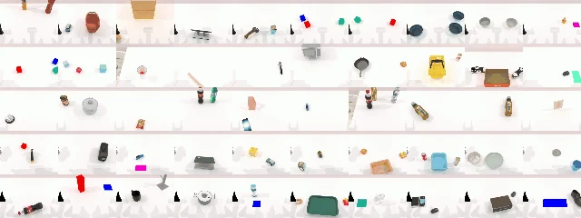

*RoboTwin 2.0 authors · [Figure source](https://robotwin-platform.github.io/doc/tasks/index.html) · Original rights retained.*

| Field | Reported value and source scope |
| :-- | :-- |
| Record type | benchmark |
| Simulator | SAPIEN [1](https://arxiv.org/abs/2506.18088) [2](https://robotwin-platform.github.io/)  |
| Simulator version and scope | Current official scripts/requirements.txt pins sapien==3.0.0b1 and mplib==0.2.1. [1](https://arxiv.org/abs/2506.18088) [2](https://robotwin-platform.github.io/) [3](https://github.com/robotwin-Platform/RoboTwin)  |
| Task count and scope | 50 dual-arm tasks / 5 robot embodiments [1](https://arxiv.org/abs/2506.18088) [2](https://robotwin-platform.github.io/)  |
| Task-list scope | Complete 50 task_instruction JSON identifiers in current official repository. [1](https://arxiv.org/abs/2506.18088) [2](https://robotwin-platform.github.io/)  |
| Capability dimensions | Bimanual cooperation · Tool use · Stacking · Articulated objects · Language grounding · Domain-randomized robustness [1](https://arxiv.org/abs/2506.18088) [2](https://robotwin-platform.github.io/)  |
| Metrics | Per-task success and task mean; easy clean-to-clean and hard clean-to-random transfer scores. [1](https://arxiv.org/abs/2506.18088) [2](https://robotwin-platform.github.io/)  |
| Robots | Five bimanual embodiments; released configs include ALOHA AgileX and ARX X5, with embodiment-specific expert planning. [1](https://arxiv.org/abs/2506.18088) [2](https://robotwin-platform.github.io/)  |
| Sensors and observations | Head/wrist visual cameras, optional depth/point clouds and robot state; original suite does not provide tactile sensing. [1](https://arxiv.org/abs/2506.18088) [2](https://robotwin-platform.github.io/)  |
| Demonstrations and data | Current repository advertises 100,000+ pre-collected trajectories; automatic task/embodiment-specific expert generation also available. Standard co-training leaderboard uses 50 demo_clean trajectories ×50 tasks. [1](https://arxiv.org/abs/2506.18088) [2](https://robotwin-platform.github.io/)  |
| Evaluation protocol | demo_clean and demo_randomized conditions; historical paper uses single-task baselines while current leaderboard distinguishes co-train vs single-task; held-out instructions and assets vary by recipe. [1](https://arxiv.org/abs/2506.18088) [2](https://robotwin-platform.github.io/)  |
| Evaluated baselines | ACT, Diffusion Policy, DP3, RDT and π0 in paper; current XPolicyLab integrations expand model set. [1](https://arxiv.org/abs/2506.18088) [2](https://robotwin-platform.github.io/)  |
| Observations / modalities | RGB · Depth · Proprioception · Language |
| Evaluation domain | Simulation |
| Embodiment | Bimanual · Parallel-jaw gripper |
| Release: code | Available [3](https://github.com/robotwin-Platform/RoboTwin)  |
| Release: weights | Partial [3](https://github.com/robotwin-Platform/RoboTwin)  |
| Release: data | Available [3](https://github.com/robotwin-Platform/RoboTwin)  |
| Release: license | MIT code; assets and individual dataset/model terms separate [3](https://github.com/robotwin-Platform/RoboTwin)  |
| Release: notes | Task experts, training/evaluation adapters, object assets and generated-data resources public. [3](https://github.com/robotwin-Platform/RoboTwin)  |

**Task names — Complete 50 task_instruction JSON identifiers in current official repository.:**

- adjust_bottle
- beat_block_hammer
- blocks_ranking_rgb
- blocks_ranking_size
- click_alarmclock
- click_bell
- dump_bin_bigbin
- grab_roller
- handover_block
- handover_mic
- hanging_mug
- lift_pot
- move_can_pot
- move_pillbottle_pad
- move_playingcard_away
- move_stapler_pad
- open_laptop
- open_microwave
- pick_diverse_bottles
- pick_dual_bottles
- place_a2b_left
- place_a2b_right
- place_bread_basket
- place_bread_skillet
- place_burger_fries
- place_can_basket
- place_cans_plasticbox
- place_container_plate
- place_dual_shoes
- place_empty_cup
- place_fan
- place_mouse_pad
- place_object_basket
- place_object_scale
- place_object_stand
- place_phone_stand
- place_shoe
- press_stapler
- put_bottles_dustbin
- put_object_cabinet
- rotate_qrcode
- scan_object
- shake_bottle
- shake_bottle_horizontally
- stack_blocks_three
- stack_blocks_two
- stack_bowls_three
- stack_bowls_two
- stamp_seal
- turn_switch

**Scope and qualifications**

- Clean-trained evaluation on randomized scenes differs from training on randomized demonstrations.
- Five supported embodiments are not necessarily a fully crossed 50-task experiment in every result table.

**Primary evidence**

1. [Paper](https://arxiv.org/abs/2506.18088) — Published paper / arXiv record and manuscript.
2. [Official project](https://robotwin-platform.github.io/) — Public project page.
3. [Official repository](https://github.com/robotwin-Platform/RoboTwin) — Current public repository; implementation scope may differ from paper.
4. [Official implementation / documentation](https://github.com/robotwin-Platform/RoboTwin/blob/main/scripts/requirements.txt) — Current released simulator dependency pin.

</details>

<a id="record-benchmark-libero"></a>
<details>
<summary><strong>LIBERO</strong> — LIBERO: Benchmarking Knowledge Transfer for Lifelong Robot Learning</summary>

**2023-06-05 · NeurIPS 2023 Datasets and Benchmarks · University of Texas at Austin**

**[Paper](https://arxiv.org/abs/2306.03310)** · [Project](https://libero-project.github.io/) · [Code](https://github.com/Lifelong-Robot-Learning/LIBERO)

Language-conditioned manipulation suites for controlled knowledge-transfer studies across spatial, object, goal and long-horizon variations.

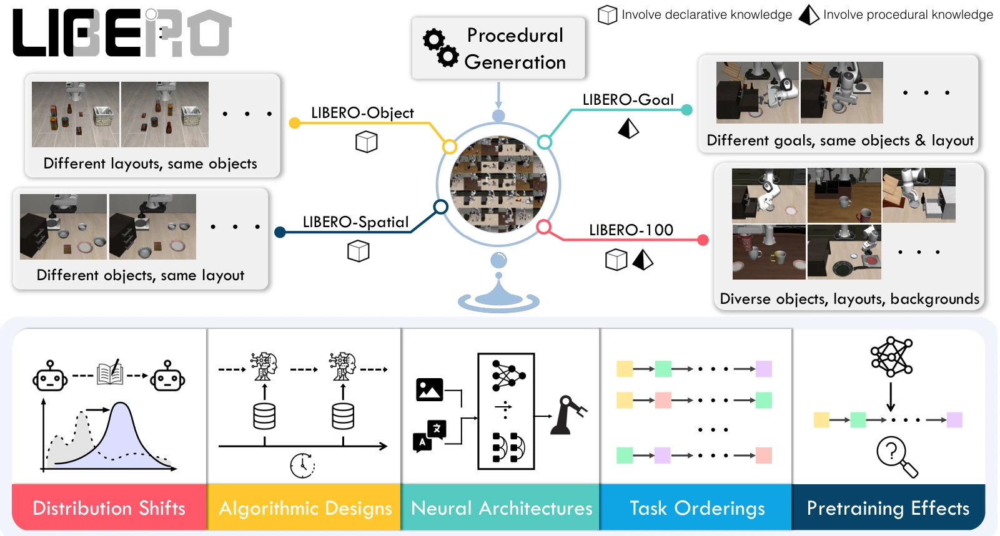

*LIBERO authors · [Figure source](https://arxiv.org/abs/2306.03310) · Original rights retained.*

| Field | Reported value and source scope |
| :-- | :-- |
| Record type | benchmark |
| Simulator | MuJoCo via robosuite [1](https://arxiv.org/abs/2306.03310) [2](https://libero-project.github.io/)  |
| Simulator version and scope | Original repository pins robosuite==1.4.0; current dependencies/legacy mujoco-py differ from downstream forks. [1](https://arxiv.org/abs/2306.03310) [2](https://libero-project.github.io/) [3](https://github.com/Lifelong-Robot-Learning/LIBERO)  |
| Task count and scope | 130 registered task entries across five suites: Spatial 10, Object 10, Goal 10, LIBERO-90 90 and LIBERO-10 10. LIBERO-100 specifically is 90+10. [1](https://arxiv.org/abs/2306.03310) [2](https://libero-project.github.io/) [4](https://github.com/Lifelong-Robot-Learning/LIBERO/blob/master/libero/libero/benchmark/libero_suite_task_map.py)  |
| Task-list scope | Complete five-suite task-map snapshot from official source, 130 entries; later perturbation benchmarks separate. [1](https://arxiv.org/abs/2306.03310) [2](https://libero-project.github.io/)  |
| Capability dimensions | Lifelong learning · Spatial transfer · Object transfer · Goal transfer · Long-horizon behavior [1](https://arxiv.org/abs/2306.03310) [2](https://libero-project.github.io/)  |
| Metrics | Success rate and lifelong learning / forward/backward transfer statistics; task-order studies. [1](https://arxiv.org/abs/2306.03310) [2](https://libero-project.github.io/)  |
| Robots | Franka Panda parallel-jaw manipulator. [1](https://arxiv.org/abs/2306.03310) [2](https://libero-project.github.io/)  |
| Sensors and observations | Agent-view and wrist RGB, proprioception, language; optional simulator observations must be declared separately. No tactile stream in original suite. [1](https://arxiv.org/abs/2306.03310) [2](https://libero-project.github.io/)  |
| Demonstrations and data | 50 human demonstrations per task in official suite datasets. [1](https://arxiv.org/abs/2306.03310) [2](https://libero-project.github.io/)  |
| Evaluation protocol | Separate 10-task controlled transfer suites and 100-task diverse set; lifelong task sequences, multitask/pretraining evaluations; versioned init-state sets. [1](https://arxiv.org/abs/2306.03310) [2](https://libero-project.github.io/)  |
| Evaluated baselines | Sequential / multitask imitation and lifelong-learning methods from original benchmark; later VLA evaluations use distinct recipes. [1](https://arxiv.org/abs/2306.03310) [2](https://libero-project.github.io/)  |
| Observations / modalities | RGB · Proprioception · Language |
| Evaluation domain | Simulation |
| Embodiment | Parallel-jaw gripper |
| Release: code | Available [3](https://github.com/Lifelong-Robot-Learning/LIBERO)  |
| Release: weights | Not verified [3](https://github.com/Lifelong-Robot-Learning/LIBERO)  |
| Release: data | Available [3](https://github.com/Lifelong-Robot-Learning/LIBERO)  |
| Release: license | MIT code; assets/data dependencies may retain additional terms [3](https://github.com/Lifelong-Robot-Learning/LIBERO)  |
| Release: notes | Official task definitions, HDF5 demonstration downloads and benchmark scripts public. [3](https://github.com/Lifelong-Robot-Learning/LIBERO)  |

**Task names — Complete five-suite task-map snapshot from official source, 130 entries; later perturbation benchmarks separate.:**

- pick_up_the_black_bowl_between_the_plate_and_the_ramekin_and_place_it_on_the_plate
- pick_up_the_black_bowl_next_to_the_ramekin_and_place_it_on_the_plate
- pick_up_the_black_bowl_from_table_center_and_place_it_on_the_plate
- pick_up_the_black_bowl_on_the_cookie_box_and_place_it_on_the_plate
- pick_up_the_black_bowl_in_the_top_drawer_of_the_wooden_cabinet_and_place_it_on_the_plate
- pick_up_the_black_bowl_on_the_ramekin_and_place_it_on_the_plate
- pick_up_the_black_bowl_next_to_the_cookie_box_and_place_it_on_the_plate
- pick_up_the_black_bowl_on_the_stove_and_place_it_on_the_plate
- pick_up_the_black_bowl_next_to_the_plate_and_place_it_on_the_plate
- pick_up_the_black_bowl_on_the_wooden_cabinet_and_place_it_on_the_plate
- pick_up_the_alphabet_soup_and_place_it_in_the_basket
- pick_up_the_cream_cheese_and_place_it_in_the_basket
- pick_up_the_salad_dressing_and_place_it_in_the_basket
- pick_up_the_bbq_sauce_and_place_it_in_the_basket
- pick_up_the_ketchup_and_place_it_in_the_basket
- pick_up_the_tomato_sauce_and_place_it_in_the_basket
- pick_up_the_butter_and_place_it_in_the_basket
- pick_up_the_milk_and_place_it_in_the_basket
- pick_up_the_chocolate_pudding_and_place_it_in_the_basket
- pick_up_the_orange_juice_and_place_it_in_the_basket
- open_the_middle_drawer_of_the_cabinet
- put_the_bowl_on_the_stove
- put_the_wine_bottle_on_top_of_the_cabinet
- open_the_top_drawer_and_put_the_bowl_inside
- put_the_bowl_on_top_of_the_cabinet
- push_the_plate_to_the_front_of_the_stove
- put_the_cream_cheese_in_the_bowl
- turn_on_the_stove
- put_the_bowl_on_the_plate
- put_the_wine_bottle_on_the_rack
- LIVING_ROOM_SCENE2_put_both_the_alphabet_soup_and_the_tomato_sauce_in_the_basket
- LIVING_ROOM_SCENE2_put_both_the_cream_cheese_box_and_the_butter_in_the_basket
- KITCHEN_SCENE3_turn_on_the_stove_and_put_the_moka_pot_on_it
- KITCHEN_SCENE4_put_the_black_bowl_in_the_bottom_drawer_of_the_cabinet_and_close_it
- LIVING_ROOM_SCENE5_put_the_white_mug_on_the_left_plate_and_put_the_yellow_and_white_mug_on_the_right_plate
- STUDY_SCENE1_pick_up_the_book_and_place_it_in_the_back_compartment_of_the_caddy
- LIVING_ROOM_SCENE6_put_the_white_mug_on_the_plate_and_put_the_chocolate_pudding_to_the_right_of_the_plate
- LIVING_ROOM_SCENE1_put_both_the_alphabet_soup_and_the_cream_cheese_box_in_the_basket
- KITCHEN_SCENE8_put_both_moka_pots_on_the_stove
- KITCHEN_SCENE6_put_the_yellow_and_white_mug_in_the_microwave_and_close_it
- KITCHEN_SCENE10_close_the_top_drawer_of_the_cabinet
- KITCHEN_SCENE10_close_the_top_drawer_of_the_cabinet_and_put_the_black_bowl_on_top_of_it
- KITCHEN_SCENE10_put_the_black_bowl_in_the_top_drawer_of_the_cabinet
- KITCHEN_SCENE10_put_the_butter_at_the_back_in_the_top_drawer_of_the_cabinet_and_close_it
- KITCHEN_SCENE10_put_the_butter_at_the_front_in_the_top_drawer_of_the_cabinet_and_close_it
- KITCHEN_SCENE10_put_the_chocolate_pudding_in_the_top_drawer_of_the_cabinet_and_close_it
- KITCHEN_SCENE1_open_the_bottom_drawer_of_the_cabinet
- KITCHEN_SCENE1_open_the_top_drawer_of_the_cabinet
- KITCHEN_SCENE1_open_the_top_drawer_of_the_cabinet_and_put_the_bowl_in_it
- KITCHEN_SCENE1_put_the_black_bowl_on_the_plate
- KITCHEN_SCENE1_put_the_black_bowl_on_top_of_the_cabinet
- KITCHEN_SCENE2_open_the_top_drawer_of_the_cabinet
- KITCHEN_SCENE2_put_the_black_bowl_at_the_back_on_the_plate
- KITCHEN_SCENE2_put_the_black_bowl_at_the_front_on_the_plate
- KITCHEN_SCENE2_put_the_middle_black_bowl_on_the_plate
- KITCHEN_SCENE2_put_the_middle_black_bowl_on_top_of_the_cabinet
- KITCHEN_SCENE2_stack_the_black_bowl_at_the_front_on_the_black_bowl_in_the_middle
- KITCHEN_SCENE2_stack_the_middle_black_bowl_on_the_back_black_bowl
- KITCHEN_SCENE3_put_the_frying_pan_on_the_stove
- KITCHEN_SCENE3_put_the_moka_pot_on_the_stove
- KITCHEN_SCENE3_turn_on_the_stove
- KITCHEN_SCENE3_turn_on_the_stove_and_put_the_frying_pan_on_it
- KITCHEN_SCENE4_close_the_bottom_drawer_of_the_cabinet
- KITCHEN_SCENE4_close_the_bottom_drawer_of_the_cabinet_and_open_the_top_drawer
- KITCHEN_SCENE4_put_the_black_bowl_in_the_bottom_drawer_of_the_cabinet
- KITCHEN_SCENE4_put_the_black_bowl_on_top_of_the_cabinet
- KITCHEN_SCENE4_put_the_wine_bottle_in_the_bottom_drawer_of_the_cabinet
- KITCHEN_SCENE4_put_the_wine_bottle_on_the_wine_rack
- KITCHEN_SCENE5_close_the_top_drawer_of_the_cabinet
- KITCHEN_SCENE5_put_the_black_bowl_in_the_top_drawer_of_the_cabinet
- KITCHEN_SCENE5_put_the_black_bowl_on_the_plate
- KITCHEN_SCENE5_put_the_black_bowl_on_top_of_the_cabinet
- KITCHEN_SCENE5_put_the_ketchup_in_the_top_drawer_of_the_cabinet
- KITCHEN_SCENE6_close_the_microwave
- KITCHEN_SCENE6_put_the_yellow_and_white_mug_to_the_front_of_the_white_mug
- KITCHEN_SCENE7_open_the_microwave
- KITCHEN_SCENE7_put_the_white_bowl_on_the_plate
- KITCHEN_SCENE7_put_the_white_bowl_to_the_right_of_the_plate
- KITCHEN_SCENE8_put_the_right_moka_pot_on_the_stove
- KITCHEN_SCENE8_turn_off_the_stove
- KITCHEN_SCENE9_put_the_frying_pan_on_the_cabinet_shelf
- KITCHEN_SCENE9_put_the_frying_pan_on_top_of_the_cabinet
- KITCHEN_SCENE9_put_the_frying_pan_under_the_cabinet_shelf
- KITCHEN_SCENE9_put_the_white_bowl_on_top_of_the_cabinet
- KITCHEN_SCENE9_turn_on_the_stove
- KITCHEN_SCENE9_turn_on_the_stove_and_put_the_frying_pan_on_it
- LIVING_ROOM_SCENE1_pick_up_the_alphabet_soup_and_put_it_in_the_basket
- LIVING_ROOM_SCENE1_pick_up_the_cream_cheese_box_and_put_it_in_the_basket
- LIVING_ROOM_SCENE1_pick_up_the_ketchup_and_put_it_in_the_basket
- LIVING_ROOM_SCENE1_pick_up_the_tomato_sauce_and_put_it_in_the_basket
- LIVING_ROOM_SCENE2_pick_up_the_alphabet_soup_and_put_it_in_the_basket
- LIVING_ROOM_SCENE2_pick_up_the_butter_and_put_it_in_the_basket
- LIVING_ROOM_SCENE2_pick_up_the_milk_and_put_it_in_the_basket
- LIVING_ROOM_SCENE2_pick_up_the_orange_juice_and_put_it_in_the_basket
- LIVING_ROOM_SCENE2_pick_up_the_tomato_sauce_and_put_it_in_the_basket
- LIVING_ROOM_SCENE3_pick_up_the_alphabet_soup_and_put_it_in_the_tray
- LIVING_ROOM_SCENE3_pick_up_the_butter_and_put_it_in_the_tray
- LIVING_ROOM_SCENE3_pick_up_the_cream_cheese_and_put_it_in_the_tray
- LIVING_ROOM_SCENE3_pick_up_the_ketchup_and_put_it_in_the_tray
- LIVING_ROOM_SCENE3_pick_up_the_tomato_sauce_and_put_it_in_the_tray
- LIVING_ROOM_SCENE4_pick_up_the_black_bowl_on_the_left_and_put_it_in_the_tray
- LIVING_ROOM_SCENE4_pick_up_the_chocolate_pudding_and_put_it_in_the_tray
- LIVING_ROOM_SCENE4_pick_up_the_salad_dressing_and_put_it_in_the_tray
- LIVING_ROOM_SCENE4_stack_the_left_bowl_on_the_right_bowl_and_place_them_in_the_tray
- LIVING_ROOM_SCENE4_stack_the_right_bowl_on_the_left_bowl_and_place_them_in_the_tray
- LIVING_ROOM_SCENE5_put_the_red_mug_on_the_left_plate
- LIVING_ROOM_SCENE5_put_the_red_mug_on_the_right_plate
- LIVING_ROOM_SCENE5_put_the_white_mug_on_the_left_plate
- LIVING_ROOM_SCENE5_put_the_yellow_and_white_mug_on_the_right_plate
- LIVING_ROOM_SCENE6_put_the_chocolate_pudding_to_the_left_of_the_plate
- LIVING_ROOM_SCENE6_put_the_chocolate_pudding_to_the_right_of_the_plate
- LIVING_ROOM_SCENE6_put_the_red_mug_on_the_plate
- LIVING_ROOM_SCENE6_put_the_white_mug_on_the_plate
- STUDY_SCENE1_pick_up_the_book_and_place_it_in_the_front_compartment_of_the_caddy
- STUDY_SCENE1_pick_up_the_book_and_place_it_in_the_left_compartment_of_the_caddy
- STUDY_SCENE1_pick_up_the_book_and_place_it_in_the_right_compartment_of_the_caddy
- STUDY_SCENE1_pick_up_the_yellow_and_white_mug_and_place_it_to_the_right_of_the_caddy
- STUDY_SCENE2_pick_up_the_book_and_place_it_in_the_back_compartment_of_the_caddy
- STUDY_SCENE2_pick_up_the_book_and_place_it_in_the_front_compartment_of_the_caddy
- STUDY_SCENE2_pick_up_the_book_and_place_it_in_the_left_compartment_of_the_caddy
- STUDY_SCENE2_pick_up_the_book_and_place_it_in_the_right_compartment_of_the_caddy
- STUDY_SCENE3_pick_up_the_book_and_place_it_in_the_front_compartment_of_the_caddy
- STUDY_SCENE3_pick_up_the_book_and_place_it_in_the_left_compartment_of_the_caddy
- STUDY_SCENE3_pick_up_the_book_and_place_it_in_the_right_compartment_of_the_caddy
- STUDY_SCENE3_pick_up_the_red_mug_and_place_it_to_the_right_of_the_caddy
- STUDY_SCENE3_pick_up_the_white_mug_and_place_it_to_the_right_of_the_caddy
- STUDY_SCENE4_pick_up_the_book_in_the_middle_and_place_it_on_the_cabinet_shelf
- STUDY_SCENE4_pick_up_the_book_on_the_left_and_place_it_on_top_of_the_shelf
- STUDY_SCENE4_pick_up_the_book_on_the_right_and_place_it_on_the_cabinet_shelf
- STUDY_SCENE4_pick_up_the_book_on_the_right_and_place_it_under_the_cabinet_shelf

**Scope and qualifications**

- Common LIBERO VLA mean over Spatial/Object/Goal/10 covers 40 tasks, while LIBERO-100 is another scope.
- High success on fixed task resets does not establish robustness to perturbations.

**Primary evidence**

1. [Paper](https://arxiv.org/abs/2306.03310) — Published paper / arXiv record and manuscript.
2. [Official project](https://libero-project.github.io/) — Public project page.
3. [Official repository](https://github.com/Lifelong-Robot-Learning/LIBERO) — Current public repository; implementation scope may differ from paper.
4. [Official implementation / documentation](https://github.com/Lifelong-Robot-Learning/LIBERO/blob/master/libero/libero/benchmark/libero_suite_task_map.py) — Complete official suite map; counts scoped explicitly.

</details>

<a id="record-benchmark-mosaic"></a>
<details>
<summary><strong>MOSAIC Task Suite</strong> — Towards More Generalizable One-shot Visual Imitation Learning</summary>

**2021-10-26 · ICRA 2022 · UC Berkeley**

**[Paper](https://arxiv.org/abs/2110.13423)** · [Project](https://sites.google.com/berkeley.edu/mosaic) · [Code](https://github.com/rll-research/mosaic)

Self-attention and temporal contrastive learning enable one-shot visual imitation across a seven-task manipulation suite.

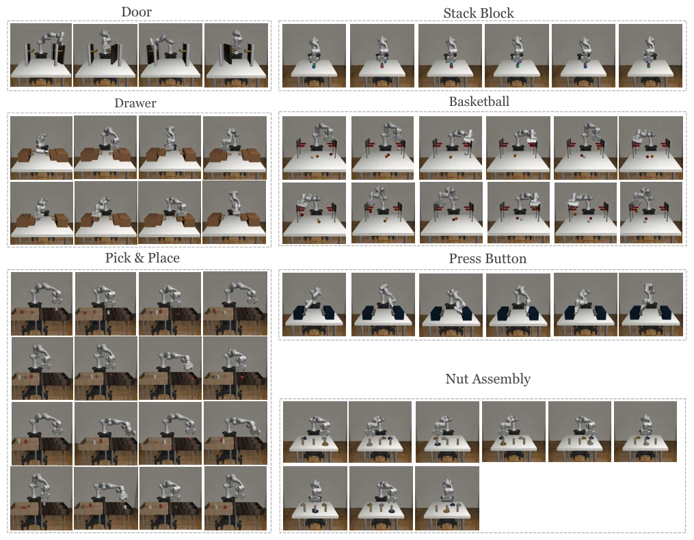

*MOSAIC authors · [Figure source](https://arxiv.org/abs/2110.13423) · Original rights retained.*

| Field | Reported value and source scope |
| :-- | :-- |
| Record type | policy |
| Simulator | robosuite / MuJoCo, with additional Meta-World assets [1](https://arxiv.org/abs/2110.13423)  |
| Simulator version and scope | Paper: robosuite v1.1, MuJoCo version not reported. Official reproduction README pins mujoco210 / MuJoCo 2.1.0. [1](https://arxiv.org/abs/2110.13423)  |
| Task count and scope | 7 task families, 61 variations in the published suite [1](https://arxiv.org/abs/2110.13423)  |
| Task-list scope | Complete seven-family published suite; individual variation names are not expanded here. [1](https://arxiv.org/abs/2110.13423)  |
| Capability dimensions | One-shot visual imitation · Cross-morphology transfer · Multi-task generalization [1](https://arxiv.org/abs/2110.13423)  |
| Metrics | Mean and standard deviation of success rate per task. [1](https://arxiv.org/abs/2110.13423)  |
| Robots | Sawyer demonstrator; Panda policy robot. [1](https://arxiv.org/abs/2110.13423)  |
| Sensors and observations | RGB rendered images. [1](https://arxiv.org/abs/2110.13423)  |
| Demonstrations and data | 100 Sawyer and 100 Panda scripted demonstrations per variation. [1](https://arxiv.org/abs/2110.13423)  |
| Evaluation protocol | Single / multi-task training; three converged checkpoints evaluated on 10 random-seed episodes per variation; separate held-out-task and fine-tuning settings. [1](https://arxiv.org/abs/2110.13423)  |
| Evaluated baselines | DAML, T-OSIL, LSTM, MLP and MOSAIC. [1](https://arxiv.org/abs/2110.13423)  |
| Observations / modalities | RGB |
| Evaluation domain | Simulation |
| Embodiment | Parallel-jaw gripper |
| Release: code | Available [2](https://sites.google.com/berkeley.edu/mosaic) [4](https://github.com/rll-research/mosaic)  |
| Release: weights | Not released [2](https://sites.google.com/berkeley.edu/mosaic)  |
| Release: data | Partial [2](https://sites.google.com/berkeley.edu/mosaic)  |
| Release: license | MIT for repository code; external model, dataset and dependency terms remain separate. [2](https://sites.google.com/berkeley.edu/mosaic) [3](https://github.com/rll-research/mosaic/blob/HEAD/LICENSE)  |
| Release: notes | Official code includes expert-data generation, model training and evaluation; checkpoint-input commands do not establish pretrained weights. [2](https://sites.google.com/berkeley.edu/mosaic)  |

**Task names — Complete seven-family published suite; individual variation names are not expanded here.:**

- Door
- Drawer
- Press Button
- Pick & Place
- Stack Block
- Basketball
- Nut Assembly

**Scope and qualifications**

- Cross-morphology protocol uses Sawyer videos to condition a Panda policy; images are RGB.

**Primary evidence**

1. [Original paper / author report](https://arxiv.org/abs/2110.13423) — Original full paper and supplementary experimental / implementation details; deployment inputs are separated from supervision and benchmark state.
2. [Official project](https://sites.google.com/berkeley.edu/mosaic) — Author-linked project and current release checked on the catalog cutoff.
3. [Repository LICENSE](https://github.com/rll-research/mosaic/blob/HEAD/LICENSE) — Actual license file inspected; code license does not automatically license data or weights.
4. [Verified official code artifact](https://github.com/rll-research/mosaic) — Author project / repository cross-link verified; current release distinguished from original paper experiments.

</details>

<a id="robustness-evaluation"></a>
### Robustness and Evaluation

| Date | Work | Setting | Tasks / simulator | Release | Primary links |
| :-- | :-- | :-- | :-- | :-- | :-- |
| 2026-09-30 | [MIKASA-Robo-VLA](#record-benchmark-mikasa-robo-vla) | Simulation | 90 language-conditioned tasks across 10 memory types; 38 Short / 30 Medium / 22 Long; ManiSkill / SAPIEN / Gymnasium | Available | **[Paper](https://arxiv.org/abs/2610.00604)** · [Project](https://mikasarobo.github.io/) · [Code](https://github.com/CognitiveAISystems/MIKASA-Robo) · [Data](https://huggingface.co/datasets/mikasa-robo/mikasa-robo-vla-lerobot) <!-- work:mikasa-robo-vla --> |
| 2026-03-01 | [RMBench](#record-benchmark-rmbench) | Simulation · Real world | 9 simulation tasks; separate3physical validation tasks; SAPIEN through RoboTwin2.0 | Available | **[Paper](https://arxiv.org/abs/2603.01229)** · [Project](https://rmbench.github.io/) · [Code](https://github.com/RoboTwin-Platform/RMBench) · [Data](https://huggingface.co/qiuly/Mem-0-m1mix-dataset-RMBench) · [Weights](https://huggingface.co/qiuly/Mem-0-m1mix-RMBench) <!-- work:rmbench --> |
| 2025-10-15 | [LIBERO-Plus](#record-benchmark-libero-plus) | Simulation | 10,030 generated task–perturbation configurations over seven axes / twenty-one components; not 10,030 new semantic skills.; MuJoCo / robosuite / LIBERO fork | Available | **[Paper](https://arxiv.org/abs/2510.13626)** · [Project](https://sylvestf.github.io/LIBERO-plus/) · [Code](https://github.com/sylvestf/LIBERO-plus) · [Data](https://huggingface.co/collections/Sylvest/libero-plus) <!-- work:libero-plus --> |
| 2025-10-04 | [LIBERO-PRO](#record-benchmark-libero-pro) | Simulation | Perturbation extensions over four commonly evaluated LIBERO suites; configurable and combinable conditions, not a fixed new semantic task count.; MuJoCo / robosuite / LIBERO fork | Available | **[Paper](https://arxiv.org/abs/2510.03827)** · [Project](https://zxy-mllab.github.io/LIBERO-PRO-Webpage/) · [Code](https://github.com/Zxy-MLlab/LIBERO-PRO) · [Data](https://huggingface.co/datasets/zhouxueyang/LIBERO-Pro) <!-- work:libero-pro --> |
| 2024-02-13 | [The Colosseum](#record-benchmark-colosseum) | Simulation · Real world | 20 tasks with 14 controlled perturbation axes; CoppeliaSim / PyRep / RLBench | Available | **[Paper](https://arxiv.org/abs/2402.08191)** · [Project](https://robot-colosseum.github.io/) · [Code](https://github.com/robot-colosseum/robot-colosseum) <!-- work:colosseum --> |

<a id="record-benchmark-mikasa-robo-vla"></a>
<details>
<summary><strong>MIKASA-Robo-VLA</strong> — MIKASA-Robo-VLA: Benchmarking Memory in VLA Models for Long-Horizon Manipulation</summary>

**2026-09-30 · Preprint · AIRI / collaborating institutions**

**[Paper](https://arxiv.org/abs/2610.00604)** · [Project](https://mikasarobo.github.io/) · [Code](https://github.com/CognitiveAISystems/MIKASA-Robo) · [Data](https://huggingface.co/datasets/mikasa-robo/mikasa-robo-vla-lerobot)

Language-conditioned memory benchmark with 90 tasks and explicit cue-hiding design, extending the earlier 32-task RL suite.

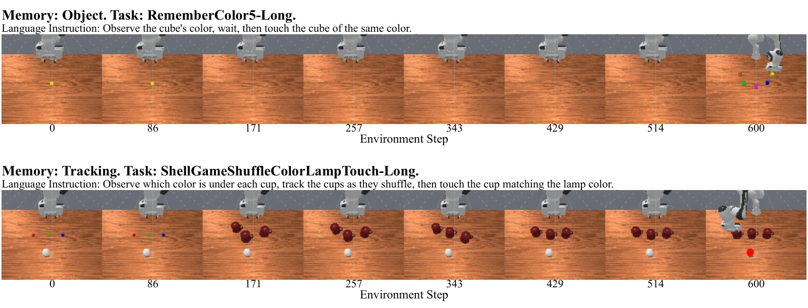

*MIKASA-Robo-VLA authors · [Figure source](https://arxiv.org/abs/2610.00604) · Original rights retained.*

| Field | Reported value and source scope |
| :-- | :-- |
| Record type | benchmark |
| Simulator | ManiSkill / SAPIEN / Gymnasium [1](https://arxiv.org/abs/2610.00604) [2](https://mikasarobo.github.io/)  |
| Simulator version and scope | Current VLA package distinct from legacy mikasa-robo-suite==0.0.5 RL release; exact SAPIEN/ManiSkill pins in pyproject/uv.lock. [1](https://arxiv.org/abs/2610.00604) [2](https://mikasarobo.github.io/) [3](https://github.com/CognitiveAISystems/MIKASA-Robo)  |
| Task count and scope | 90 language-conditioned tasks across 10 memory types; 38 Short / 30 Medium / 22 Long [1](https://arxiv.org/abs/2610.00604) [2](https://mikasarobo.github.io/)  |
| Task-list scope | Complete 90-task canonical CSV from current VLA release. [1](https://arxiv.org/abs/2610.00604) [2](https://mikasarobo.github.io/)  |
| Capability dimensions | Spatial/object memory · Temporal memory · Prospective/procedural recall · Sequential/checklist memory · Capacity / tracking · Reactive controls [1](https://arxiv.org/abs/2610.00604) [2](https://mikasarobo.github.io/)  |
| Metrics | Per-split task-macro success, full per-task table and per-memory-type success; optional return diagnostics. [1](https://arxiv.org/abs/2610.00604) [2](https://mikasarobo.github.io/)  |
| Robots | ManiSkill robot-arm/tabletop manipulation setup. [1](https://arxiv.org/abs/2610.00604) [2](https://mikasarobo.github.io/)  |
| Sensors and observations | RGB, proprioception and instruction for deployable policy; task_cue / oracle_info fields are privileged and must be hidden by required wrappers. [1](https://arxiv.org/abs/2610.00604) [2](https://mikasarobo.github.io/)  |
| Demonstrations and data | 22,500 oracle trajectories (250/task), 6,306,953 transitions, RLDS and LeRobotDataset v3; 34 PPO-oracle and 56 motion-planning tasks. [1](https://arxiv.org/abs/2610.00604) [2](https://mikasarobo.github.io/)  |
| Evaluation protocol | Train multitask within horizon split; canonical evaluation 50 episodes/task using seeds 4242424242–4242424291. Paper π0.5 reference evaluates 14-task subset with 20 episodes/task; report subset explicitly. [1](https://arxiv.org/abs/2610.00604) [2](https://mikasarobo.github.io/) [5](https://mikasarobo.github.io/benchmarking.html)  |
| Evaluated baselines | π0.5 current-frame/no-explicit-memory baseline; PPO and motion-planning oracles for data collection. [1](https://arxiv.org/abs/2610.00604) [2](https://mikasarobo.github.io/)  |
| Observations / modalities | RGB · Proprioception · Language |
| Evaluation domain | Simulation |
| Embodiment | Parallel-jaw gripper |
| Release: code | Available [3](https://github.com/CognitiveAISystems/MIKASA-Robo)  |
| Release: weights | Partial [3](https://github.com/CognitiveAISystems/MIKASA-Robo)  |
| Release: data | Available [3](https://github.com/CognitiveAISystems/MIKASA-Robo)  |
| Release: license | MIT code; dataset/model terms separate [3](https://github.com/CognitiveAISystems/MIKASA-Robo)  |
| Release: notes | VLA suite, wrappers, manifests and data public. Legacy RL implementation retained separately. [3](https://github.com/CognitiveAISystems/MIKASA-Robo)  |

**Task names — Complete 90-task canonical CSV from current VLA release.:**

- ShellGameTouch-VLA-v0
- ShellGamePush-VLA-v0
- InterceptSlow-VLA-v0
- InterceptMedium-VLA-v0
- InterceptFast-VLA-v0
- InterceptGrabSlow-VLA-v0
- InterceptGrabMedium-VLA-v0
- InterceptGrabFast-VLA-v0
- RotateLenientPos-VLA-v0
- RotateLenientPosNeg-VLA-v0
- RotateStrictPos-VLA-v0
- RotateStrictPosNeg-VLA-v0
- TakeItBack-VLA-v0
- RememberColor3-VLA-v0
- RememberColor5-VLA-v0
- RememberColor9-VLA-v0
- RememberShape3-VLA-v0
- RememberShape5-VLA-v0
- RememberShape9-VLA-v0
- RememberShapeAndColor3x2-VLA-v0
- RememberShapeAndColor3x3-VLA-v0
- RememberShapeAndColor5x3-VLA-v0
- BunchOfColors3-VLA-v0
- BunchOfColors5-VLA-v0
- BunchOfColors7-VLA-v0
- SeqOfColors3-VLA-v0
- SeqOfColors5-VLA-v0
- SeqOfColors7-VLA-v0
- ChainOfColors3-VLA-v0
- ChainOfColors5-VLA-v0
- ChainOfColors7-VLA-v0
- ShellGameShuffleTouch-VLA-v0
- ShellGameShuffleColorLampTouch-VLA-v0
- ShellGameColorLampTouch-VLA-v0
- FindImposterColor3-VLA-v0
- FindImposterColor5-VLA-v0
- FindImposterColor9-VLA-v0
- FindImposterShape3-VLA-v0
- FindImposterShape5-VLA-v0
- FindImposterShape9-VLA-v0
- FindImposterShapeAndColor3x2-VLA-v0
- FindImposterShapeAndColor3x3-VLA-v0
- FindImposterShapeAndColor5x3-VLA-v0
- BatteriesCheckerEasy-3-VLA-v0
- BatteriesCheckerEasy-6-VLA-v0
- BatteriesCheckerHard-3-VLA-v0
- BatteriesCheckerHard-6-VLA-v0
- BlinkCountButtonPressEasy-VLA-v0
- BlinkCountButtonPressMedium-VLA-v0
- BlinkCountButtonPressHard-VLA-v0
- RememberColor3-Long-VLA-v0
- RememberColor5-Long-VLA-v0
- RememberColor9-Long-VLA-v0
- RememberShape3-Long-VLA-v0
- RememberShape5-Long-VLA-v0
- RememberShape9-Long-VLA-v0
- RememberShapeAndColor3x2-Long-VLA-v0
- RememberShapeAndColor3x3-Long-VLA-v0
- RememberShapeAndColor5x3-Long-VLA-v0
- BunchOfColors3-Long-VLA-v0
- BunchOfColors5-Long-VLA-v0
- BunchOfColors7-Long-VLA-v0
- SeqOfColors3-Long-VLA-v0
- SeqOfColors5-Long-VLA-v0
- SeqOfColors7-Long-VLA-v0
- ChainOfColors3-Long-VLA-v0
- ChainOfColors5-Long-VLA-v0
- ChainOfColors7-Long-VLA-v0
- ShellGameShuffleTouch-Long-VLA-v0
- ShellGameShuffleColorLampTouch-Long-VLA-v0
- BlinkCountButtonPressEasy-Long-VLA-v0
- BlinkCountButtonPressMedium-Long-VLA-v0
- BlinkCountButtonPressHard-Long-VLA-v0
- TraceShapeEasy-VLA-v0
- TraceShapeMedium-VLA-v0
- TraceShapeHard-VLA-v0
- TraceShapeSeqEasy-VLA-v0
- TraceShapeSeqMedium-VLA-v0
- TraceShapeSeqHard-VLA-v0
- TimedTransferEasy-VLA-v0
- TimedTransferMedium-VLA-v0
- TimedTransferHard-VLA-v0
- TimedTransferEasy-Long-VLA-v0
- TimedTransferMedium-Long-VLA-v0
- TimedTransferHard-Long-VLA-v0
- GatherAndRecall1-VLA-v0
- GatherAndRecall3-VLA-v0
- GatherAndRecall5-VLA-v0
- GatherAndRecall7-VLA-v0
- GatherAndRecall9-VLA-v0

**Scope and qualifications**

- Memory failure is confounded by open-loop action chunking and task composition in the small reference baseline.
- Follow current wrapper contract to prevent privileged cue leakage; original 32-task RL suite is not the 90-task VLA release.

**Primary evidence**

1. [Paper](https://arxiv.org/abs/2610.00604) — Published paper / arXiv record and manuscript.
2. [Official project](https://mikasarobo.github.io/) — Public project page.
3. [Official repository](https://github.com/CognitiveAISystems/MIKASA-Robo) — Current public repository; implementation scope may differ from paper.
4. [Official implementation / documentation](https://github.com/CognitiveAISystems/MIKASA-Robo/blob/main/mikasa_robo_vla_envs.csv) — Complete canonical 90-task manifest.
5. [Official implementation / documentation](https://mikasarobo.github.io/benchmarking.html) — Canonical split / seed / reporting protocol.

</details>

<a id="record-benchmark-rmbench"></a>
<details>
<summary><strong>RMBench</strong> — RMBench: Memory-Dependent Robotic Manipulation Benchmark with Insights into Policy Design</summary>

**2026-03-01 · Preprint · HKU / Peking University / Shanghai AI Laboratory**

**[Paper](https://arxiv.org/abs/2603.01229)** · [Project](https://rmbench.github.io/) · [Code](https://github.com/RoboTwin-Platform/RMBench) · [Data](https://huggingface.co/qiuly/Mem-0-m1mix-dataset-RMBench) · [Weights](https://huggingface.co/qiuly/Mem-0-m1mix-RMBench)

Introduces nine history-dependent tasks and a modular policy that combines explicit planning memories, visual execution memory and learned subtask termination.

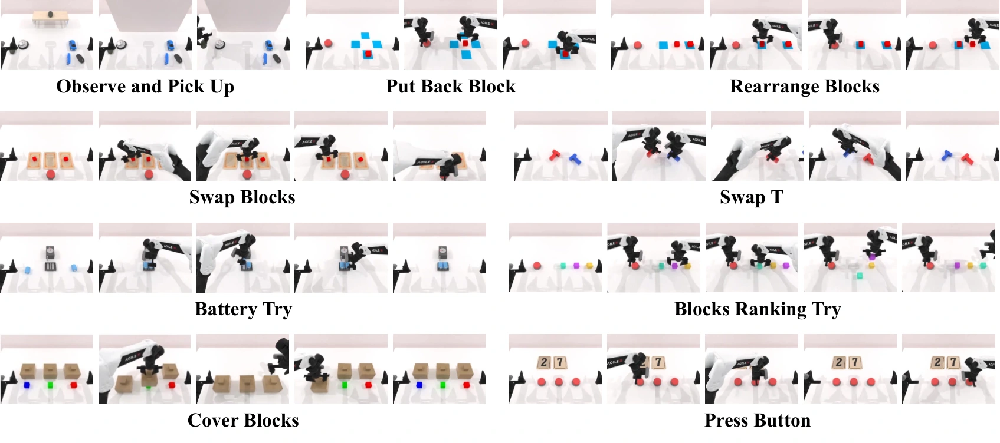

*RMBench authors · [Figure source](https://arxiv.org/html/2603.01229v4) · Original rights retained.*

| Field | Reported value and source scope |
| :-- | :-- |
| Record type | policy |
| Simulator | SAPIEN through RoboTwin2.0 |
| Simulator version and scope | Not reported for the full benchmark in manuscript; use repository-pinned environment for reproduction |
| Task count and scope | 9 simulation tasks; separate3physical validation tasks |
| Task-list scope | Complete published9-task simulation suite |
| Capability dimensions | Visual memory · Object permanence · Historical-state disambiguation · Trial-and-error memory · Event counting · Long-horizon execution |
| Metrics | Task success rate over100rollouts/task; memory-component ablations and failure analysis |
| Robots | RoboTwin2.0 dual-arm embodiment; separate physical dual-arm setup |
| Sensors and observations | RGB observations and robot state; fine-grained language annotations; no tactile requirement |
| Demonstrations and data | 50expert demonstrations/task for all evaluated simulation policies; action/subtask aligned language is additional Mem-0 supervision |
| Evaluation protocol | Common50-demo/task training and100-rollout evaluation; M(1) tasks isolate execution module, M(n) uses planning+execution; see released-retrained checkpoint caveat [3](https://github.com/RoboTwin-Platform/RMBench#-updates)  |
| Evaluated baselines | DP,ACT,π0.5,X-VLA,QwenOFT,MemER,MemoryVLA and Mem-0 |
| Observations / modalities | RGB · Proprioception · Language |
| Evaluation domain | Simulation · Real world |
| Embodiment | Parallel-jaw gripper · Bimanual |
| Release: code | Available [2](https://github.com/RoboTwin-Platform/RMBench) [3](https://github.com/RoboTwin-Platform/RMBench#-updates)  |
| Release: weights | Available [2](https://github.com/RoboTwin-Platform/RMBench) [3](https://github.com/RoboTwin-Platform/RMBench#-updates)  |
| Release: data | Available [2](https://github.com/RoboTwin-Platform/RMBench) [3](https://github.com/RoboTwin-Platform/RMBench#-updates)  |
| Release: license | Not reported [2](https://github.com/RoboTwin-Platform/RMBench) [3](https://github.com/RoboTwin-Platform/RMBench#-updates)  |
| Release: notes | Availability reflects public source/model links; complete paper-scale reproduction and all dataset access terms were not tested. [2](https://github.com/RoboTwin-Platform/RMBench) [3](https://github.com/RoboTwin-Platform/RMBench#-updates)  |

**Task names — Complete published9-task simulation suite:**

- Observe and Pick Up
- Rearrange Blocks
- Put Back Block
- Swap Blocks
- Swap T
- Battery Try
- Blocks Ranking Try
- Cover Blocks
- Press Button

**Scope and qualifications**

- Mem-0 uses additional subtask/termination supervision; comparisons reflect architecture plus this extra training signal.
- Official July14 release retrains M(1) jointly after original checkpoints were lost; released numbers are not automatically the paper checkpoints.

**Primary evidence**

1. [Primary manuscript and first-submission history](https://arxiv.org/abs/2603.01229) — Latest available full manuscript inspected; publication date retains the first arXiv submission. Sizes, training cost and deployment rates keep their experimental scope.
2. [Official policy implementation](https://github.com/RoboTwin-Platform/RMBench) — Source and checkpoint availability checked separately; no local policy execution was performed.
3. [Official checkpoint release update, 2026-07-14](https://github.com/RoboTwin-Platform/RMBench#-updates) — Original weights lost; released M(1) jointly retrained and M(n) per-task execution checkpoints need version qualification.

</details>

<a id="record-benchmark-libero-plus"></a>
<details>
<summary><strong>LIBERO-Plus</strong> — LIBERO-Plus: A Progressive Robustness Benchmark for Visual-Language-Action Models</summary>

**2025-10-15 · CVPR 2026 · Fudan University / Tongji University / Shanghai Innovation Institute**

**[Paper](https://arxiv.org/abs/2510.13626)** · [Project](https://sylvestf.github.io/LIBERO-plus/) · [Code](https://github.com/sylvestf/LIBERO-plus) · [Data](https://huggingface.co/collections/Sylvest/libero-plus)

Automated perturbation generation and progressive difficulty for seven robustness axes built on LIBERO manipulation tasks.


*LIBERO-Plus authors · [Figure source](https://arxiv.org/abs/2510.13626) · Original rights retained.*

| Field | Reported value and source scope |
| :-- | :-- |
| Record type | benchmark |
| Simulator | MuJoCo / robosuite / LIBERO fork [1](https://arxiv.org/abs/2510.13626) [2](https://sylvestf.github.io/LIBERO-plus/)  |
| Simulator version and scope | Release version varies; exact MuJoCo pin Not verified from upstream source. Downstream model-repo pins should not be presented as benchmark paper version. [1](https://arxiv.org/abs/2510.13626) [2](https://sylvestf.github.io/LIBERO-plus/) [3](https://github.com/sylvestf/LIBERO-plus)  |
| Task count and scope | 10,030 generated task–perturbation configurations over seven axes / twenty-one components; not 10,030 new semantic skills. [1](https://arxiv.org/abs/2510.13626) [2](https://sylvestf.github.io/LIBERO-plus/)  |
| Task-list scope | Complete seven perturbation axes; semantic tasks inherited from LIBERO and generated configuration manifest defines all 10,030 variants. [1](https://arxiv.org/abs/2510.13626) [2](https://sylvestf.github.io/LIBERO-plus/)  |
| Capability dimensions | Progressive robustness · Language reliance · Camera/layout invariance · Sensor corruption [1](https://arxiv.org/abs/2510.13626) [2](https://sylvestf.github.io/LIBERO-plus/)  |
| Metrics | Success per perturbation/component/difficulty level; robustness degradation; generalization after expanded training. [1](https://arxiv.org/abs/2510.13626) [2](https://sylvestf.github.io/LIBERO-plus/)  |
| Robots | Franka Panda in LIBERO [1](https://arxiv.org/abs/2510.13626) [2](https://sylvestf.github.io/LIBERO-plus/)  |
| Sensors and observations | RGB, proprioception and language; sensor noise corrupts visual inputs rather than introducing tactile streams. [1](https://arxiv.org/abs/2510.13626) [2](https://sylvestf.github.io/LIBERO-plus/)  |
| Demonstrations and data | Original LIBERO training; expanded generalization dataset includes 22,400 successful trajectories in manuscript study. [1](https://arxiv.org/abs/2510.13626) [2](https://sylvestf.github.io/LIBERO-plus/)  |
| Evaluation protocol | Zero-shot perturbation evaluation of LIBERO-trained checkpoints; generated configurations grouped into five difficulty levels; separate retraining experiments on generalized sets. [1](https://arxiv.org/abs/2510.13626) [2](https://sylvestf.github.io/LIBERO-plus/)  |
| Evaluated baselines | Ten models in accepted study; generated suite stratification uses OpenVLA-OFT, π0, π0-fast and UniVLA. [1](https://arxiv.org/abs/2510.13626) [2](https://sylvestf.github.io/LIBERO-plus/)  |
| Observations / modalities | RGB · Proprioception · Language |
| Evaluation domain | Simulation |
| Embodiment | Parallel-jaw gripper |
| Release: code | Available [3](https://github.com/sylvestf/LIBERO-plus)  |
| Release: weights | Not applicable [3](https://github.com/sylvestf/LIBERO-plus)  |
| Release: data | Available [3](https://github.com/sylvestf/LIBERO-plus)  |
| Release: license | Not verified [3](https://github.com/sylvestf/LIBERO-plus)  |
| Release: notes | Perturbation assets/configurations and data released; policies are external checkpoints. [3](https://github.com/sylvestf/LIBERO-plus)  |

**Task names — Complete seven perturbation axes; semantic tasks inherited from LIBERO and generated configuration manifest defines all 10,030 variants.:**

- Object layouts
- Camera viewpoints
- Robot initial states
- Language instructions
- Lighting conditions
- Background textures
- Sensor noise

**Scope and qualifications**

- arXiv title is In-depth Robustness Analysis; accepted CVPR title is A Progressive Robustness Benchmark.
- 10,030 counts perturbation configurations, not distinct everyday manipulation skills.

**Primary evidence**

1. [Paper](https://arxiv.org/abs/2510.13626) — Published paper / arXiv record and manuscript.
2. [Official project](https://sylvestf.github.io/LIBERO-plus/) — Public project page.
3. [Official repository](https://github.com/sylvestf/LIBERO-plus) — Current public repository; implementation scope may differ from paper.

</details>

<a id="record-benchmark-libero-pro"></a>
<details>
<summary><strong>LIBERO-PRO</strong> — LIBERO-PRO: Towards Robust and Fair Evaluation of Vision-Language-Action Models Beyond Memorization</summary>

**2025-10-04 · Preprint · Huazhong University of Science and Technology**

**[Paper](https://arxiv.org/abs/2510.03827)** · [Project](https://zxy-mllab.github.io/LIBERO-PRO-Webpage/) · [Code](https://github.com/Zxy-MLlab/LIBERO-PRO) · [Data](https://huggingface.co/datasets/zhouxueyang/LIBERO-Pro)

LIBERO evaluation extension probing object, position, semantic, task and environment generalization without changing original training data.


*LIBERO-PRO authors · [Figure source](https://arxiv.org/abs/2510.03827) · Original rights retained.*

| Field | Reported value and source scope |
| :-- | :-- |
| Record type | benchmark |
| Simulator | MuJoCo / robosuite / LIBERO fork [1](https://arxiv.org/abs/2510.03827) [2](https://zxy-mllab.github.io/LIBERO-PRO-Webpage/)  |
| Simulator version and scope | Same runtime family as original LIBERO; official README Python 3.8.13. Exact MuJoCo build Not reported here. [1](https://arxiv.org/abs/2510.03827) [2](https://zxy-mllab.github.io/LIBERO-PRO-Webpage/) [3](https://github.com/Zxy-MLlab/LIBERO-PRO)  |
| Task count and scope | Perturbation extensions over four commonly evaluated LIBERO suites; configurable and combinable conditions, not a fixed new semantic task count. [1](https://arxiv.org/abs/2510.03827) [2](https://zxy-mllab.github.io/LIBERO-PRO-Webpage/)  |
| Task-list scope | Complete five current repository axes; paper abstract groups four broader dimensions. Original semantic tasks and generated BDDL/init files define variants. [1](https://arxiv.org/abs/2510.03827) [2](https://zxy-mllab.github.io/LIBERO-PRO-Webpage/)  |
| Capability dimensions | Position robustness · Instruction understanding · Object substitution · Procedural generalization · Environment shift [1](https://arxiv.org/abs/2510.03827) [2](https://zxy-mllab.github.io/LIBERO-PRO-Webpage/)  |
| Metrics | Success under original vs perturbed conditions; instruction/target-dependence diagnostics. [1](https://arxiv.org/abs/2510.03827) [2](https://zxy-mllab.github.io/LIBERO-PRO-Webpage/)  |
| Robots | Franka Panda in LIBERO [1](https://arxiv.org/abs/2510.03827) [2](https://zxy-mllab.github.io/LIBERO-PRO-Webpage/)  |
| Sensors and observations | RGB, proprioception and language; no tactile stream. [1](https://arxiv.org/abs/2510.03827) [2](https://zxy-mllab.github.io/LIBERO-PRO-Webpage/)  |
| Demonstrations and data | Original LIBERO demonstrations retained; generated BDDL and initial-state files released for evaluation. [1](https://arxiv.org/abs/2510.03827) [2](https://zxy-mllab.github.io/LIBERO-PRO-Webpage/)  |
| Evaluation protocol | Configure perturbations through YAML; task generalization cannot be combined with other axes in current implementation; compare same trained checkpoint under shifted evaluation. [1](https://arxiv.org/abs/2510.03827) [2](https://zxy-mllab.github.io/LIBERO-PRO-Webpage/)  |
| Evaluated baselines | OpenVLA, π0, π0.5, UniVLA and evolving VLA evaluations. [1](https://arxiv.org/abs/2510.03827) [2](https://zxy-mllab.github.io/LIBERO-PRO-Webpage/)  |
| Observations / modalities | RGB · Proprioception · Language |
| Evaluation domain | Simulation |
| Embodiment | Parallel-jaw gripper |
| Release: code | Available [3](https://github.com/Zxy-MLlab/LIBERO-PRO)  |
| Release: weights | Not applicable [3](https://github.com/Zxy-MLlab/LIBERO-PRO)  |
| Release: data | Available [3](https://github.com/Zxy-MLlab/LIBERO-PRO)  |
| Release: license | MIT code; added assets/data terms separate [3](https://github.com/Zxy-MLlab/LIBERO-PRO) [4](https://github.com/Zxy-MLlab/LIBERO-PRO/blob/master/LICENSE)  |
| Release: notes | Author repository is Zxy-MLlab; RLinf hosts a fork. Official BDDL/init data release linked by README. [3](https://github.com/Zxy-MLlab/LIBERO-PRO)  |

**Task names — Complete five current repository axes; paper abstract groups four broader dimensions. Original semantic tasks and generated BDDL/init files define variants.:**

- Object generalization
- Position generalization
- Semantic generalization
- Task generalization
- Environment generalization

**Scope and qualifications**

- Paper four-dimensional grouping and current repository five axes are different descriptions, not contradictory task totals.
- Use official author source rather than treating a fork as the primary release.

**Primary evidence**

1. [Paper](https://arxiv.org/abs/2510.03827) — Published paper / arXiv record and manuscript.
2. [Official project](https://zxy-mllab.github.io/LIBERO-PRO-Webpage/) — Public project page.
3. [Official repository](https://github.com/Zxy-MLlab/LIBERO-PRO) — Current public repository; implementation scope may differ from paper.
4. [Official source](https://github.com/Zxy-MLlab/LIBERO-PRO/blob/master/LICENSE) — License text read directly; code license does not automatically cover models, data or simulator.

</details>

<a id="record-benchmark-colosseum"></a>
<details>
<summary><strong>The Colosseum</strong> — The Colosseum: A Benchmark for Evaluating Generalization for Robotic Manipulation</summary>

**2024-02-13 · RSS 2024 · University of Southern California / collaborating institutions**

**[Paper](https://arxiv.org/abs/2402.08191)** · [Project](https://robot-colosseum.github.io/) · [Code](https://github.com/robot-colosseum/robot-colosseum)

RLBench-based perturbation benchmark testing robustness of learned manipulation policies under controlled visual and physical changes.

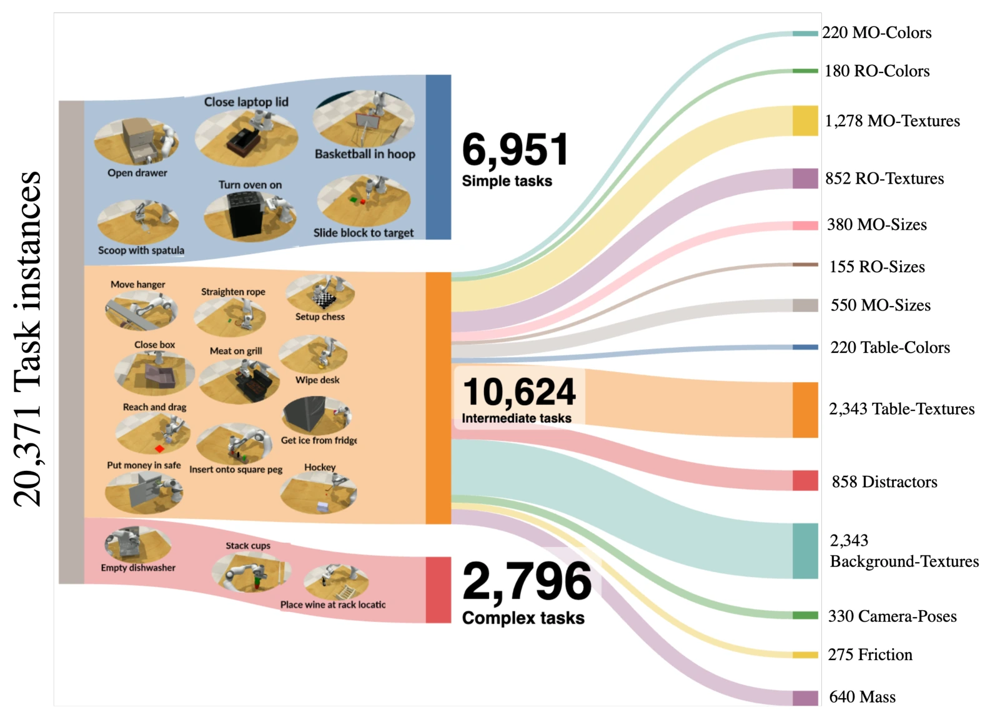

*The Colosseum authors · [Figure source](https://arxiv.org/abs/2402.08191) · Original rights retained.*

| Field | Reported value and source scope |
| :-- | :-- |
| Record type | benchmark |
| Simulator | CoppeliaSim / PyRep / RLBench [1](https://arxiv.org/abs/2402.08191) [2](https://robot-colosseum.github.io/)  |
| Simulator version and scope | RLBench-compatible CoppeliaSim stack; exact release Not verified. [1](https://arxiv.org/abs/2402.08191) [2](https://robot-colosseum.github.io/) [3](https://github.com/robot-colosseum/robot-colosseum)  |
| Task count and scope | 20 tasks with 14 controlled perturbation axes [1](https://arxiv.org/abs/2402.08191) [2](https://robot-colosseum.github.io/)  |
| Task-list scope | Complete twenty task labels from paper evaluation table. [1](https://arxiv.org/abs/2402.08191) [2](https://robot-colosseum.github.io/)  |
| Capability dimensions | Visual robustness · Physical-property shift · Camera robustness · Composed perturbations [1](https://arxiv.org/abs/2402.08191) [2](https://robot-colosseum.github.io/)  |
| Metrics | Success and relative degradation per perturbation; hardware correlation on selected tasks. [1](https://arxiv.org/abs/2402.08191) [2](https://robot-colosseum.github.io/)  |
| Robots | Franka Panda [1](https://arxiv.org/abs/2402.08191) [2](https://robot-colosseum.github.io/)  |
| Sensors and observations | RGB-D / point clouds depending baseline; proprioception and language. No tactile input in original suite. [1](https://arxiv.org/abs/2402.08191) [2](https://robot-colosseum.github.io/)  |
| Demonstrations and data | 100 unperturbed demonstrations/task for training; perturbed evaluation configurations and printable real validation assets. [1](https://arxiv.org/abs/2402.08191) [2](https://robot-colosseum.github.io/)  |
| Evaluation protocol | Train on common clean demonstrations; evaluate 25 episodes per perturbation condition; combine multiple factors separately; physical validation is a subset. [1](https://arxiv.org/abs/2402.08191) [2](https://robot-colosseum.github.io/)  |
| Evaluated baselines | Five manipulation methods, including PerAct, RVT and zero-shot VoxPoser; exact method/pretraining setting in manuscript. [1](https://arxiv.org/abs/2402.08191) [2](https://robot-colosseum.github.io/)  |
| Observations / modalities | RGB · Depth · Proprioception · Language |
| Evaluation domain | Simulation · Real world |
| Embodiment | Parallel-jaw gripper |
| Release: code | Available [3](https://github.com/robot-colosseum/robot-colosseum)  |
| Release: weights | Not verified [3](https://github.com/robot-colosseum/robot-colosseum)  |
| Release: data | Available [3](https://github.com/robot-colosseum/robot-colosseum)  |
| Release: license | MIT code; underlying RLBench/CoppeliaSim/asset terms separate [3](https://github.com/robot-colosseum/robot-colosseum)  |
| Release: notes | Perturbation code, task config and physical-object assets public. [3](https://github.com/robot-colosseum/robot-colosseum)  |

**Task names — Complete twenty task labels from paper evaluation table.:**

- basketball in hoop
- close box
- close laptop lid
- empty dishwasher
- get ice from fridge
- hockey
- meat on grill
- move hanger
- wipe desk
- open drawer
- slide block to target
- reach and drag
- put money in safe
- place wine at rack location
- insert onto square peg
- stack cups
- turn oven on
- straighten rope
- setup chess
- scoop with spatula

**Scope and qualifications**

- Colosseum V2 uses ManiSkill and new tasks, so values across editions are not directly comparable.

**Primary evidence**

1. [Paper](https://arxiv.org/abs/2402.08191) — Published paper / arXiv record and manuscript.
2. [Official project](https://robot-colosseum.github.io/) — Public project page.
3. [Official repository](https://github.com/robot-colosseum/robot-colosseum) — Current public repository; implementation scope may differ from paper.

</details>

<a id="supporting-resources"></a>
### Supporting Tools and Data

| Date | Work | Setting | Tasks / simulator | Release | Primary links |
| :-- | :-- | :-- | :-- | :-- | :-- |
| 2026-08-18 | [PRISM](#record-benchmark-prism) | Real world | 25+ industrial task types; Not applicable — physical dataset | Available | **[Paper](https://arxiv.org/abs/2608.17962)** · [Project](https://tengbo-yu.github.io/PRISM/) · [Code](https://github.com/Tengbo-Yu/PRISM) · [Data](https://modelscope.cn/datasets/Turboyuuuu/PRISM) <!-- work:prism --> |
| 2026-06-24 | [TacVerse](#record-benchmark-tacverse) | Real world | 3 perception tasks, not closed-loop manipulation tasks; Not applicable — measured tactile image dataset | Available | **[Paper](https://arxiv.org/abs/2606.25877)** · [Project](https://lannwei.github.io/Tactile_Database/) · [Code](https://github.com/LannWei/Tactile_Database) · [Data](https://huggingface.co/datasets/Lan-2025/Tactile) <!-- work:tacverse --> |
| 2025-02-07 | [REASSEMBLE](#record-benchmark-reassemble) | Real world | 4 action types applied to 17 board objects; Not applicable — physical dataset | Available | **[Paper](https://arxiv.org/abs/2502.05086)** · [Project](https://tuwien-asl.github.io/REASSEMBLE_page/) · [Code](https://github.com/TUWIEN-ASL/REASSEMBLE) · [Data](https://researchdata.tuwien.ac.at/records/0ewrv-8cb44) <!-- work:reassemble --> |
| 2024-11-07 | [TacEx](#record-benchmark-tacex) | Simulation | Sensor simulation and example interactions, not a fixed policy benchmark task count; Isaac Sim / Isaac Lab plus UIPC | Available | **[Paper](https://arxiv.org/abs/2411.04776)** · [Project](https://github.com/DH-Ng/TacEx) · [Code](https://github.com/DH-Ng/TacEx) <!-- work:tacex --> |
| 2024-10-31 | [Sparsh / TacBench](#record-benchmark-sparsh) | Real world | 6 touch-centric tasks; only bead-maze is a closed-loop manipulation-policy task; Not applicable — recorded/physical touch evaluation | Available | **[Paper](https://arxiv.org/abs/2410.24090)** · [Project](https://sparsh-ssl.github.io/) · [Code](https://github.com/facebookresearch/sparsh) · [Data](https://huggingface.co/collections/facebook/sparsh-67167ce57566196a4526c328) <!-- work:sparsh --> |
| 2024-10-01 | [ManiSkill3](#record-benchmark-maniskill3) | Simulation | Growing environment library; not one fixed canonical task-count leaderboard; ManiSkill / SAPIEN / PhysX | Available | **[Paper](https://arxiv.org/abs/2410.00425)** · [Project](https://maniskill.ai/) · [Code](https://github.com/mani-skill/ManiSkill) <!-- work:maniskill3 --> |
| 2024-08-12 | [TacSL](#record-benchmark-tacsl) | Simulation · Real world | 3 contact-task families; paper control results report 2, with Bolt-on-Nut left as a challenge; Original Isaac Gym; current Isaac Lab integration with PhysX | Available | **[Paper](https://arxiv.org/abs/2408.06506)** · [Project](https://iakinola23.github.io/tacsl/) · [Code](https://github.com/isaac-sim/IsaacLab) <!-- work:tacsl --> |
| 2024-07-10 | [AutoMate](#record-benchmark-automate) | Simulation · Real world | 100 plug-socket assembly geometries; specialist results over 80; generalist trained/evaluated on 20; perception-initialized real study on 5; Isaac Gym / Factory-style contact simulation | Available | **[Paper](https://arxiv.org/abs/2407.08028)** · [Project](https://bingjietang718.github.io/automate/) · [Code](https://github.com/isaac-sim/IsaacGymEnvs) <!-- work:automate --> |
| 2023-05-26 | [IndustReal](#record-benchmark-industreal) | Simulation · Real world | Peg-in-hole insertion and gear-meshing families, with pick / place / insert stages and multiple part geometries; Isaac Gym with Factory contacts | Available | **[Paper](https://arxiv.org/abs/2305.17110)** · [Project](https://sites.google.com/nvidia.com/industreal) · [Code](https://github.com/NVlabs/industreallib) <!-- work:industreal --> |
| 2022-05-07 | [Factory](#record-benchmark-factory) | Simulation | 3 assembly environment families; 60 part models; 7 robot controllers; Isaac Gym / PhysX with signed-distance-field contacts | Available | **[Paper](https://arxiv.org/abs/2205.03532)** · [Project](https://sites.google.com/nvidia.com/factory) · [Code](https://github.com/isaac-sim/IsaacGymEnvs) <!-- work:factory --> |
| 2021-09-09 | [Taxim](#record-benchmark-taxim) | Simulation | Not applicable — sensor-image / marker-motion simulator; Standalone example-based tactile simulator | Available | **[Paper](https://arxiv.org/abs/2109.04027)** · [Code](https://github.com/Robo-Touch/Taxim) <!-- work:taxim --> |
| 2020-12-15 | [TACTO](#record-benchmark-tacto) | Simulation | 2 application demonstrations, not a common multi-task manipulation benchmark; TACTO renderer; PyBullet example integration | Available | **[Paper](https://arxiv.org/abs/2012.08456)** · [Code](https://github.com/facebookresearch/tacto) <!-- work:tacto --> |

<a id="record-benchmark-prism"></a>
<details>
<summary><strong>PRISM</strong> — PRISM: Precision and contact-rich Real-world Industrial Skill dataset with Multimodal sensing</summary>

**2026-08-18 · IROS 2026 · Peking University / Delta Intelligence**

**[Paper](https://arxiv.org/abs/2608.17962)** · [Project](https://tengbo-yu.github.io/PRISM/) · [Code](https://github.com/Tengbo-Yu/PRISM) · [Data](https://modelscope.cn/datasets/Turboyuuuu/PRISM)

Industrial contact-rich demonstrations with synchronized RGB-D, wrist force/torque, robot state and tactile observations for a subset of episodes.

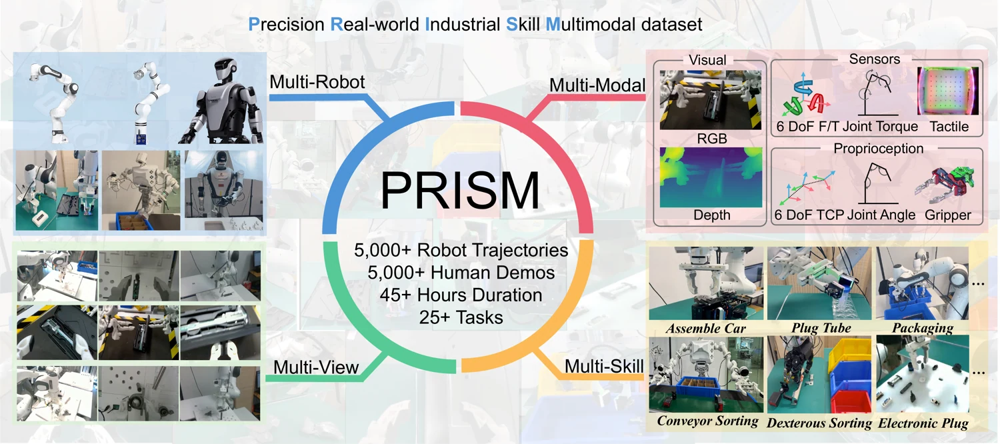

*PRISM authors · [Figure source](https://tengbo-yu.github.io/PRISM/) · Original rights retained.*

| Field | Reported value and source scope |
| :-- | :-- |
| Record type | dataset |
| Simulator | Not applicable — physical dataset [1](https://arxiv.org/abs/2608.17962) [2](https://tengbo-yu.github.io/PRISM/)  |
| Simulator version and scope | Not applicable [1](https://arxiv.org/abs/2608.17962) [2](https://tengbo-yu.github.io/PRISM/) [3](https://github.com/Tengbo-Yu/PRISM)  |
| Task count and scope | 25+ industrial task types [1](https://arxiv.org/abs/2608.17962) [2](https://tengbo-yu.github.io/PRISM/)  |
| Task-list scope | Examples explicitly named in paper/project; complete released task manifest must be consulted per platform. [1](https://arxiv.org/abs/2608.17962) [2](https://tengbo-yu.github.io/PRISM/)  |
| Capability dimensions | Industrial precision · Connector insertion/removal · Force regulation · Contact-rich manipulation [1](https://arxiv.org/abs/2608.17962) [2](https://tengbo-yu.github.io/PRISM/)  |
| Metrics | Task-success and baseline modality comparisons on selected representative tasks. [1](https://arxiv.org/abs/2608.17962) [2](https://tengbo-yu.github.io/PRISM/)  |
| Robots | Franka Panda, Realman and other robot platforms described in paper; gripper / dexterous configurations vary. [1](https://arxiv.org/abs/2608.17962) [2](https://tengbo-yu.github.io/PRISM/)  |
| Sensors and observations | Multi-view RGB-D, six-axis F/T, robot joint/Cartesian/gripper state; tactile available only for a subset, not every episode. [1](https://arxiv.org/abs/2608.17962) [2](https://tengbo-yu.github.io/PRISM/)  |
| Demonstrations and data | 5,000+ robot trajectories, 5,000+ paired human demonstrations, 45+ hours across 25+ tasks; three teleoperation interfaces. [1](https://arxiv.org/abs/2608.17962) [2](https://tengbo-yu.github.io/PRISM/)  |
| Evaluation protocol | Exoskeleton, tracker and VR teleoperation; calibrated/timestamped multisensor records; policy experiments use 200 demonstrations/task and 20 evaluation episodes in reported settings. [1](https://arxiv.org/abs/2608.17962) [2](https://tengbo-yu.github.io/PRISM/)  |
| Evaluated baselines | Multimodal imitation baselines with controlled sensor / teleoperation comparison; exact model table in paper. [1](https://arxiv.org/abs/2608.17962) [2](https://tengbo-yu.github.io/PRISM/)  |
| Observations / modalities | RGB · Depth · Force/Torque · Tactile · Proprioception · Language |
| Evaluation domain | Real world |
| Embodiment | Parallel-jaw gripper · Dexterous hand |
| Release: code | Available [3](https://github.com/Tengbo-Yu/PRISM)  |
| Release: weights | Not verified [3](https://github.com/Tengbo-Yu/PRISM)  |
| Release: data | Available [3](https://github.com/Tengbo-Yu/PRISM)  |
| Release: license | Not verified [3](https://github.com/Tengbo-Yu/PRISM)  |
| Release: notes | Official page links data and code; inspect per-platform modality availability in metadata. [3](https://github.com/Tengbo-Yu/PRISM)  |

**Task names — Examples explicitly named in paper/project; complete released task manifest must be consulted per platform.:**

- Electronic components plug/unplug
- Conveyor Sorting
- Plug Tube
- Assemble Car
- Dexterous Sorting
- Packaging

**Scope and qualifications**

- Tactile coverage is partial, despite RGB-D+F/T+tactile appearing in headline modality list.
- Dataset diversity and evaluated baseline subset are separate scopes.

**Primary evidence**

1. [Paper](https://arxiv.org/abs/2608.17962) — Published paper / arXiv record and manuscript.
2. [Official project](https://tengbo-yu.github.io/PRISM/) — Public project page.
3. [Official repository](https://github.com/Tengbo-Yu/PRISM) — Current public repository; implementation scope may differ from paper.
4. [Author publication list](https://tengbo-yu.github.io/) — Primary author homepage labels PRISM IROS 2026.

</details>

<a id="record-benchmark-tacverse"></a>
<details>
<summary><strong>TacVerse</strong> — TacVerse: A Multi-Sensor Dataset and Benchmark for Cross-Sensor Vision-Based Tactile Perception</summary>

**2026-06-24 · Advanced Robotics Research 2026 · Imperial College London**

**[Paper](https://arxiv.org/abs/2606.25877)** · [Project](https://lannwei.github.io/Tactile_Database/) · [Code](https://github.com/LannWei/Tactile_Database) · [Data](https://huggingface.co/datasets/Lan-2025/Tactile)

Controlled tactile perception dataset assessing within-sensor learning, zero-shot sensor transfer and few-shot adaptation across seven optical sensor designs.


*TacVerse authors · [Figure source](https://arxiv.org/abs/2606.25877) · Original rights retained.*

| Field | Reported value and source scope |
| :-- | :-- |
| Record type | dataset |
| Simulator | Not applicable — measured tactile image dataset [1](https://arxiv.org/abs/2606.25877) [2](https://lannwei.github.io/Tactile_Database/)  |
| Simulator version and scope | Not applicable [1](https://arxiv.org/abs/2606.25877) [2](https://lannwei.github.io/Tactile_Database/) [3](https://github.com/LannWei/Tactile_Database)  |
| Task count and scope | 3 perception tasks, not closed-loop manipulation tasks [1](https://arxiv.org/abs/2606.25877) [2](https://lannwei.github.io/Tactile_Database/)  |
| Task-list scope | Complete three-task perception benchmark. [1](https://arxiv.org/abs/2606.25877) [2](https://lannwei.github.io/Tactile_Database/)  |
| Capability dimensions | Sensor-shift robustness · Tactile shape/texture recognition · Force estimation · Few-shot adaptation [1](https://arxiv.org/abs/2606.25877) [2](https://lannwei.github.io/Tactile_Database/)  |
| Metrics | Classification accuracy and force-regression error under within-sensor / cross-sensor / few-shot splits. [1](https://arxiv.org/abs/2606.25877) [2](https://lannwei.github.io/Tactile_Database/)  |
| Robots | Sensor data collection rigs; no common robot manipulation embodiment. [1](https://arxiv.org/abs/2606.25877) [2](https://lannwei.github.io/Tactile_Database/)  |
| Sensors and observations | GelSightNoMarker, GelSightMarker, MagicGripper, MagicTac, TacTip, ViTac, ViTacTip. [1](https://arxiv.org/abs/2606.25877) [2](https://lannwei.github.io/Tactile_Database/)  |
| Demonstrations and data | 106,800 tactile images from seven vision-based tactile sensors. [1](https://arxiv.org/abs/2606.25877) [2](https://lannwei.github.io/Tactile_Database/)  |
| Evaluation protocol | Trial/trajectory-disjoint chronological 60/20/20 train/validation/test split after near-duplicate filtering. Exhaustive 7×7 source-target shape transfer; fixed-source grating and force transfer. Few-shot target adaptation is force-regression only: 0.5%, 1%, 2.5%, 5% and 10% of target training samples, with untouched target test set. [1](https://arxiv.org/abs/2606.25877) [2](https://lannwei.github.io/Tactile_Database/) [4](https://advanced.onlinelibrary.wiley.com/doi/10.1002/adrr.70169)  |
| Evaluated baselines | Transfer study: fixed ImageNet-initialized ViT. Representation study: ResNet-18, ViT from scratch, ImageNet ViT and MAE-initialized ViT; up to 30 epochs, batch128; reported server has four H200 GPUs, not a per-run allocation/time claim. [1](https://arxiv.org/abs/2606.25877) [2](https://lannwei.github.io/Tactile_Database/) [4](https://advanced.onlinelibrary.wiley.com/doi/10.1002/adrr.70169)  |
| Observations / modalities | Tactile |
| Evaluation domain | Real world |
| Embodiment | Sensor-level resource |
| Release: code | Available [3](https://github.com/LannWei/Tactile_Database)  |
| Release: weights | Not verified [3](https://github.com/LannWei/Tactile_Database)  |
| Release: data | Available [3](https://github.com/LannWei/Tactile_Database)  |
| Release: license | Not verified [3](https://github.com/LannWei/Tactile_Database)  |
| Release: notes | Project/data public; code and per-dataset terms should be inspected separately. [3](https://github.com/LannWei/Tactile_Database)  |

**Task names — Complete three-task perception benchmark.:**

- 9-way shape classification
- 30-way grating classification
- Force regression

**Scope and qualifications**

- Perception benchmark supports encoder evaluation; does not measure manipulation policy success.
- TacVerse in this entry is the Lan Wei multi-sensor perception resource, not an unrelated commercial data workbench.

**Primary evidence**

1. [Paper](https://arxiv.org/abs/2606.25877) — Published paper / arXiv record and manuscript.
2. [Official project](https://lannwei.github.io/Tactile_Database/) — Public project page.
3. [Official repository](https://github.com/LannWei/Tactile_Database) — Current public repository; implementation scope may differ from paper.
4. [Publisher full text](https://advanced.onlinelibrary.wiley.com/doi/10.1002/adrr.70169) — Advanced Robotics Research, first published 25 September 2026. Section4 gives leakage-controlled chronological split, fixed-source transfer, force-only few-shot protocol and backbone study. Entry date retains arXiv v1.

</details>

<a id="record-benchmark-reassemble"></a>
<details>
<summary><strong>REASSEMBLE</strong> — REASSEMBLE: A Multimodal Dataset for Contact-rich Robotic Assembly and Disassembly</summary>

**2025-02-07 · RSS 2025 · TU Wien**

**[Paper](https://arxiv.org/abs/2502.05086)** · [Project](https://tuwien-asl.github.io/REASSEMBLE_page/) · [Code](https://github.com/TUWIEN-ASL/REASSEMBLE) · [Data](https://researchdata.tuwien.ac.at/records/0ewrv-8cb44)

Physical NIST-board assembly/disassembly data including successful and failed demonstrations with visual, event, force/torque and audio streams.

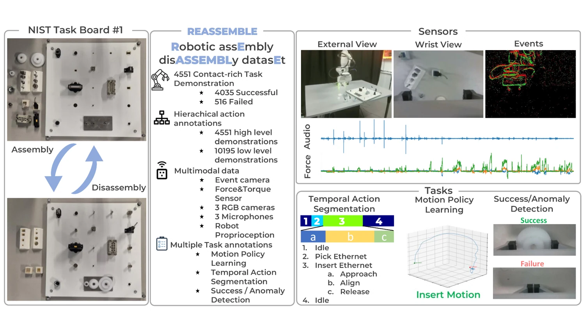

*REASSEMBLE authors · [Figure source](https://tuwien-asl.github.io/REASSEMBLE_page/) · Original rights retained.*

| Field | Reported value and source scope |
| :-- | :-- |
| Record type | dataset |
| Simulator | Not applicable — physical dataset [1](https://arxiv.org/abs/2502.05086) [2](https://tuwien-asl.github.io/REASSEMBLE_page/)  |
| Simulator version and scope | Not applicable [1](https://arxiv.org/abs/2502.05086) [2](https://tuwien-asl.github.io/REASSEMBLE_page/) [3](https://github.com/TUWIEN-ASL/REASSEMBLE)  |
| Task count and scope | 4 action types applied to 17 board objects [1](https://arxiv.org/abs/2502.05086) [2](https://tuwien-asl.github.io/REASSEMBLE_page/)  |
| Task-list scope | Complete four action labels; object-conditioned action combinations are additional instances. [1](https://arxiv.org/abs/2502.05086) [2](https://tuwien-asl.github.io/REASSEMBLE_page/)  |
| Capability dimensions | Assembly/disassembly · Failure/anomaly analysis · Temporal segmentation · Task inversion [1](https://arxiv.org/abs/2502.05086) [2](https://tuwien-asl.github.io/REASSEMBLE_page/)  |
| Metrics | Action segmentation / anomaly detection / manipulation-policy evaluation depending downstream task. [1](https://arxiv.org/abs/2502.05086) [2](https://tuwien-asl.github.io/REASSEMBLE_page/)  |
| Robots | Franka Panda / FR3 teleoperation setup around NIST Assembly Task Board 1. [1](https://arxiv.org/abs/2502.05086) [2](https://tuwien-asl.github.io/REASSEMBLE_page/)  |
| Sensors and observations | Multi-view RGB, event camera, six-axis force/torque, external/wrist microphones, proprioception. No tactile image or metric depth stream claimed. [1](https://arxiv.org/abs/2502.05086) [2](https://tuwien-asl.github.io/REASSEMBLE_page/)  |
| Demonstrations and data | 4,551 demonstrations, including 4,035 successful, over 781 minutes and 17 objects. [1](https://arxiv.org/abs/2502.05086) [2](https://tuwien-asl.github.io/REASSEMBLE_page/)  |
| Evaluation protocol | Synchronized multimodal demonstrations with action and outcome annotations; includes success and execution errors rather than success-only filtering. [1](https://arxiv.org/abs/2502.05086) [2](https://tuwien-asl.github.io/REASSEMBLE_page/)  |
| Evaluated baselines | Policy and temporal-action recognition baselines provided by paper/code; benchmark task-specific. [1](https://arxiv.org/abs/2502.05086) [2](https://tuwien-asl.github.io/REASSEMBLE_page/)  |
| Observations / modalities | RGB · Force/Torque · Proprioception · Audio · Event camera |
| Evaluation domain | Real world |
| Embodiment | Parallel-jaw gripper |
| Release: code | Available [3](https://github.com/TUWIEN-ASL/REASSEMBLE)  |
| Release: weights | Not verified [3](https://github.com/TUWIEN-ASL/REASSEMBLE)  |
| Release: data | Available [3](https://github.com/TUWIEN-ASL/REASSEMBLE)  |
| Release: license | Dataset archive terms and code license require separate inspection [3](https://github.com/TUWIEN-ASL/REASSEMBLE)  |
| Release: notes | Official project moved from author page to TU Wien ASL; data archive and code public. [3](https://github.com/TUWIEN-ASL/REASSEMBLE)  |

**Task names — Complete four action labels; object-conditioned action combinations are additional instances.:**

- Pick
- Insert
- Remove
- Place

**Scope and qualifications**

- Force/torque and event-camera signals are distinct from tactile images and depth; do not label as RGBDT.

**Primary evidence**

1. [Paper](https://arxiv.org/abs/2502.05086) — Published paper / arXiv record and manuscript.
2. [Official project](https://tuwien-asl.github.io/REASSEMBLE_page/) — Public project page.
3. [Official repository](https://github.com/TUWIEN-ASL/REASSEMBLE) — Current public repository; implementation scope may differ from paper.

</details>

<a id="record-benchmark-tacex"></a>
<details>
<summary><strong>TacEx</strong> — TacEx: GelSight Tactile Simulation in Isaac Sim — Combining Soft-Body and Visuotactile Simulators</summary>

**2024-11-07 · Preprint · Technical University of Darmstadt**

**[Paper](https://arxiv.org/abs/2411.04776)** · [Project](https://github.com/DH-Ng/TacEx) · [Code](https://github.com/DH-Ng/TacEx)

Modular Isaac Sim/Lab tactile extension combining optical rendering, marker motion and IPC/FEM soft-body mechanics.

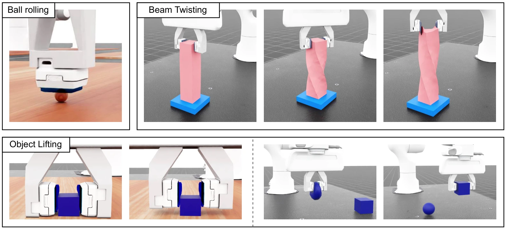

*TacEx authors · [Figure source](https://arxiv.org/abs/2411.04776) · Original rights retained.*

| Field | Reported value and source scope |
| :-- | :-- |
| Record type | simulator |
| Simulator | Isaac Sim / Isaac Lab plus UIPC [1](https://arxiv.org/abs/2411.04776) [2](https://github.com/DH-Ng/TacEx)  |
| Simulator version and scope | Current public README: Isaac Sim 4.5 / Isaac Lab 2.1.1; installation tested on Ubuntu 22.04, RTX 4090, CUDA 12.4. [1](https://arxiv.org/abs/2411.04776) [2](https://github.com/DH-Ng/TacEx) [3](https://github.com/DH-Ng/TacEx)  |
| Task count and scope | Sensor simulation and example interactions, not a fixed policy benchmark task count [1](https://arxiv.org/abs/2411.04776) [2](https://github.com/DH-Ng/TacEx)  |
| Task-list scope | Example only; not a standardized task suite. [1](https://arxiv.org/abs/2411.04776) [2](https://github.com/DH-Ng/TacEx)  |
| Capability dimensions | Tactile image rendering · Marker motion · FEM/IPC contact · Modular sensor simulation [1](https://arxiv.org/abs/2411.04776) [2](https://github.com/DH-Ng/TacEx)  |
| Metrics | Sensor simulation fidelity and performance; example-specific policy results. [1](https://arxiv.org/abs/2411.04776) [2](https://github.com/DH-Ng/TacEx)  |
| Robots | Sensor-mounted robots / fingertips in examples. [1](https://arxiv.org/abs/2411.04776) [2](https://github.com/DH-Ng/TacEx)  |
| Sensors and observations | Current main release supports GelSight Mini; Taxim optical rendering, FOTS marker motion and UIPC-based FEM marker simulation. [1](https://arxiv.org/abs/2411.04776) [2](https://github.com/DH-Ng/TacEx)  |
| Demonstrations and data | Sensor assets and calibration/examples; no standardized manipulation demonstration dataset. [1](https://arxiv.org/abs/2411.04776) [2](https://github.com/DH-Ng/TacEx)  |
| Evaluation protocol | Select interchangeable optical/marker/soft-body components; measure fidelity/performance under example interactions. [1](https://arxiv.org/abs/2411.04776) [2](https://github.com/DH-Ng/TacEx)  |
| Evaluated baselines | Taxim/FOTS/UIPC components rather than a common learned-policy leaderboard. [1](https://arxiv.org/abs/2411.04776) [2](https://github.com/DH-Ng/TacEx)  |
| Observations / modalities | Tactile · Proprioception |
| Evaluation domain | Simulation |
| Embodiment | Parallel-jaw gripper · Robot arm tactile fingertip |
| Release: code | Available [3](https://github.com/DH-Ng/TacEx)  |
| Release: weights | Not applicable [3](https://github.com/DH-Ng/TacEx)  |
| Release: data | Partial [3](https://github.com/DH-Ng/TacEx)  |
| Release: license | Not verified [3](https://github.com/DH-Ng/TacEx)  |
| Release: notes | Beta/preview framework; sensor support and modified forks used by UniVTAC/OpenViTac differ from upstream. [3](https://github.com/DH-Ng/TacEx)  |

**Task names — Example only; not a standardized task suite.:**

- Ball rolling (simulation performance example)

**Scope and qualifications**

- Upstream supports GelSight Mini; additional sensors in downstream projects should not be attributed to unmodified TacEx.

**Primary evidence**

1. [Paper](https://arxiv.org/abs/2411.04776) — Published paper / arXiv record and manuscript.
2. [Official project](https://github.com/DH-Ng/TacEx) — Public project page.
3. [Official repository](https://github.com/DH-Ng/TacEx) — Current public repository; implementation scope may differ from paper.

</details>

<a id="record-benchmark-sparsh"></a>
<details>
<summary><strong>Sparsh / TacBench</strong> — Sparsh: Self-supervised touch representations for vision-based tactile sensing</summary>

**2024-10-31 · CoRL 2024 · FAIR at Meta**

**[Paper](https://arxiv.org/abs/2410.24090)** · [Project](https://sparsh-ssl.github.io/) · [Code](https://github.com/facebookresearch/sparsh) · [Data](https://huggingface.co/collections/facebook/sparsh-67167ce57566196a4526c328)

A six-task tactile representation evaluation suite, mixing supervised sensing probes with one closed-loop bead-maze policy task.

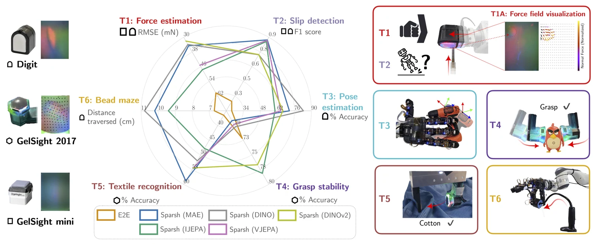

*TacBench authors · [Figure source](https://sparsh-ssl.github.io/) · Original rights retained.*

| Field | Reported value and source scope |
| :-- | :-- |
| Record type | benchmark |
| Simulator | Not applicable — recorded/physical touch evaluation [1](https://arxiv.org/abs/2410.24090) [2](https://sparsh-ssl.github.io/)  |
| Simulator version and scope | Not applicable [1](https://arxiv.org/abs/2410.24090) [2](https://sparsh-ssl.github.io/) [3](https://github.com/facebookresearch/sparsh)  |
| Task count and scope | 6 touch-centric tasks; only bead-maze is a closed-loop manipulation-policy task [1](https://arxiv.org/abs/2410.24090) [2](https://sparsh-ssl.github.io/)  |
| Task-list scope | Complete six-task TacBench suite. [1](https://arxiv.org/abs/2410.24090) [2](https://sparsh-ssl.github.io/)  |
| Capability dimensions | Force perception · Incipient slip · Local pose · Grasp stability · Material recognition · Contact-guided control [1](https://arxiv.org/abs/2410.24090) [2](https://sparsh-ssl.github.io/)  |
| Metrics | Task-specific regression, classification and policy-success metrics; results under limited labeled-data budgets. [1](https://arxiv.org/abs/2410.24090) [2](https://sparsh-ssl.github.io/)  |
| Robots | Task-specific physical sensor/robot setups rather than one common manipulation embodiment. [1](https://arxiv.org/abs/2410.24090) [2](https://sparsh-ssl.github.io/)  |
| Sensors and observations | Vision-based tactile sensors including DIGIT and GelSight variants, with task-specific datasets. [1](https://arxiv.org/abs/2410.24090) [2](https://sparsh-ssl.github.io/)  |
| Demonstrations and data | TacBench labeled datasets released separately from the 460K+ image self-supervised tactile corpus used by Sparsh. [1](https://arxiv.org/abs/2410.24090) [2](https://sparsh-ssl.github.io/)  |
| Evaluation protocol | Frozen representation + lightweight downstream heads for sensing probes; label-budget comparisons; bead-maze policy evaluation separated from offline predictions. [1](https://arxiv.org/abs/2410.24090) [2](https://sparsh-ssl.github.io/)  |
| Evaluated baselines | Sparsh MAE, DINO, I-JEPA, V-JEPA variants; task/sensor-specific end-to-end baselines. [1](https://arxiv.org/abs/2410.24090) [2](https://sparsh-ssl.github.io/)  |
| Observations / modalities | Tactile |
| Evaluation domain | Real world |
| Embodiment | Parallel-jaw gripper · Robot arm tactile fingertip |
| Release: code | Available [3](https://github.com/facebookresearch/sparsh)  |
| Release: weights | Available [3](https://github.com/facebookresearch/sparsh)  |
| Release: data | Available [3](https://github.com/facebookresearch/sparsh)  |
| Release: license | Code/model/data terms differ; inspect official repository and dataset cards [3](https://github.com/facebookresearch/sparsh)  |
| Release: notes | Public repository and Hugging Face collection include representation models and benchmark data. [3](https://github.com/facebookresearch/sparsh)  |

**Task names — Complete six-task TacBench suite.:**

- Force estimation
- Slip detection
- Relative pose estimation
- Grasp stability prediction
- Textile classification
- Bead maze manipulation

**Scope and qualifications**

- Do not describe six tasks as six manipulation environments.
- TacBench is distinct from the 2026 Tac-Bench 14-task simulation suite.

**Primary evidence**

1. [Paper](https://arxiv.org/abs/2410.24090) — Published paper / arXiv record and manuscript.
2. [Official project](https://sparsh-ssl.github.io/) — Public project page.
3. [Official repository](https://github.com/facebookresearch/sparsh) — Current public repository; implementation scope may differ from paper.

</details>

<a id="record-benchmark-maniskill3"></a>
<details>
<summary><strong>ManiSkill3</strong> — ManiSkill3: GPU Parallelized Robotics Simulation and Rendering for Generalizable Embodied AI</summary>

**2024-10-01 · RSS 2025 · University of California San Diego / collaborating institutions**

**[Paper](https://arxiv.org/abs/2410.00425)** · [Project](https://maniskill.ai/) · [Code](https://github.com/mani-skill/ManiSkill)

GPU-parallel SAPIEN robotics simulation and learning framework with diverse manipulation environments, RGB-D/point-cloud observations and IL/RL baselines.

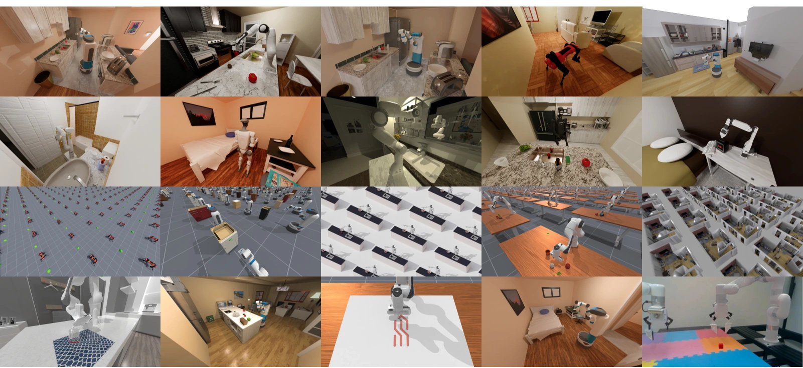

*ManiSkill3 authors · [Figure source](https://arxiv.org/abs/2410.00425) · Original rights retained.*

| Field | Reported value and source scope |
| :-- | :-- |
| Record type | simulator |
| Simulator | ManiSkill / SAPIEN / PhysX [1](https://arxiv.org/abs/2410.00425) [2](https://maniskill.ai/)  |
| Simulator version and scope | ManiSkill3 means mani_skill&gt;=3.0.0; exact SAPIEN pin varies by framework release. Original ManiSkill2 versions &lt;=0.5.3 are a different line. [1](https://arxiv.org/abs/2410.00425) [2](https://maniskill.ai/) [3](https://github.com/mani-skill/ManiSkill)  |
| Task count and scope | Growing environment library; not one fixed canonical task-count leaderboard [1](https://arxiv.org/abs/2410.00425) [2](https://maniskill.ai/)  |
| Task-list scope | Representative official environment IDs only; full versioned catalogue in documentation/source. [1](https://arxiv.org/abs/2410.00425) [2](https://maniskill.ai/)  |
| Capability dimensions | GPU-parallel simulation/rendering · Rigid/articulated manipulation · Assembly · IL/RL · Multiple embodiments [1](https://arxiv.org/abs/2410.00425) [2](https://maniskill.ai/)  |
| Metrics | Environment-specific success/reward; throughput; policy-learning baselines. [1](https://arxiv.org/abs/2410.00425) [2](https://maniskill.ai/)  |
| Robots | Many registered arms, grippers, hands and mobile embodiments. [1](https://arxiv.org/abs/2410.00425) [2](https://maniskill.ai/)  |
| Sensors and observations | Selectable RGB, depth, segmentation, point clouds and state; tactile support is extension/task-specific, not universal. [1](https://arxiv.org/abs/2410.00425) [2](https://maniskill.ai/)  |
| Demonstrations and data | Replayable demonstrations and trajectory-generation tools; task-specific datasets rather than one homogeneous corpus. [1](https://arxiv.org/abs/2410.00425) [2](https://maniskill.ai/)  |
| Evaluation protocol | Gymnasium-compatible vectorized tasks; state and visual RL / learning-from-demonstrations settings. [1](https://arxiv.org/abs/2410.00425) [2](https://maniskill.ai/)  |
| Evaluated baselines | PPO, SAC, behavior cloning, Diffusion Policy and other task-dependent examples. [1](https://arxiv.org/abs/2410.00425) [2](https://maniskill.ai/)  |
| Observations / modalities | RGB · Depth · Proprioception |
| Evaluation domain | Simulation |
| Embodiment | Parallel-jaw gripper · Dexterous hand · Bimanual · Mobile manipulator |
| Release: code | Available [3](https://github.com/mani-skill/ManiSkill)  |
| Release: weights | Partial [3](https://github.com/mani-skill/ManiSkill)  |
| Release: data | Available [3](https://github.com/mani-skill/ManiSkill)  |
| Release: license | Rigid-body environment code permissive (e.g. Apache-2.0); assets CC-BY-NC-4.0 per repository [3](https://github.com/mani-skill/ManiSkill)  |
| Release: notes | Simulator and task framework public; non-commercial asset terms differ from code. [3](https://github.com/mani-skill/ManiSkill)  |

**Task names — Representative official environment IDs only; full versioned catalogue in documentation/source.:**

- PickCube-v1
- PegInsertionSide-v1
- PlugCharger-v1
- AssemblingKits-v1
- StackCube-v1
- PushCube-v1
- PullCube-v1
- OpenCabinetDrawer-v1

**Scope and qualifications**

- Framework support for depth does not establish a fixed RGB-D baseline protocol.
- Do not compare task counts across moving framework versions without a catalogue snapshot.

**Primary evidence**

1. [Paper](https://arxiv.org/abs/2410.00425) — Published paper / arXiv record and manuscript.
2. [Official project](https://maniskill.ai/) — Public project page.
3. [Official repository](https://github.com/mani-skill/ManiSkill) — Current public repository; implementation scope may differ from paper.

</details>

<a id="record-benchmark-tacsl"></a>
<details>
<summary><strong>TacSL</strong> — TacSL: A Library for Visuotactile Sensor Simulation and Learning</summary>

**2024-08-12 · IEEE Transactions on Robotics 2025 · NVIDIA / University of Washington**

**[Paper](https://arxiv.org/abs/2408.06506)** · [Project](https://iakinola23.github.io/tacsl/) · [Code](https://github.com/isaac-sim/IsaacLab)

GPU tactile image and spatial force-field simulation with contact-task learning tools; original research toolkit and current Isaac Lab integration have separate software scopes.

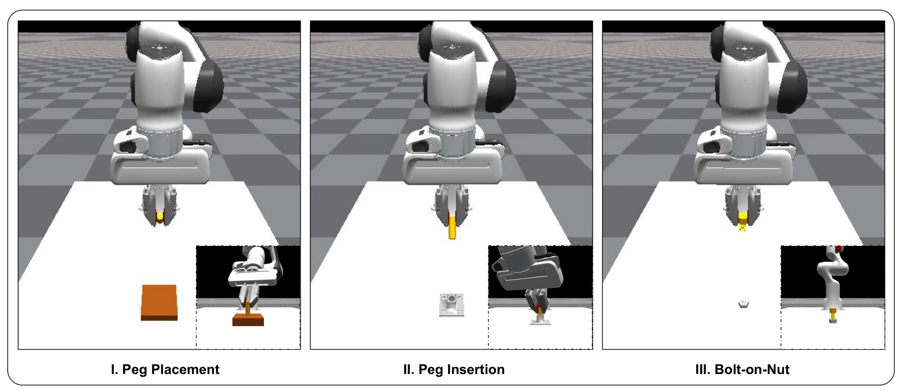

*TacSL authors · [Figure source](https://arxiv.org/abs/2408.06506) · Original rights retained.*

| Field | Reported value and source scope |
| :-- | :-- |
| Record type | simulator |
| Simulator | Original Isaac Gym; current Isaac Lab integration with PhysX [1](https://arxiv.org/abs/2408.06506) [2](https://iakinola23.github.io/tacsl/)  |
| Simulator version and scope | Legacy learning toolkit is Isaac Gym-based. Current official docs snapshot: Isaac Lab v3.0.0-beta2 (updated Oct 16 2026), PhysX simulation only; this is not the original paper stack. [1](https://arxiv.org/abs/2408.06506) [2](https://iakinola23.github.io/tacsl/) [3](https://github.com/isaac-sim/IsaacLab)  |
| Task count and scope | 3 contact-task families; paper control results report 2, with Bolt-on-Nut left as a challenge [1](https://arxiv.org/abs/2408.06506) [2](https://iakinola23.github.io/tacsl/)  |
| Task-list scope | Complete original learning-task suite; quantitative results focus on placement and insertion. [1](https://arxiv.org/abs/2408.06506) [2](https://iakinola23.github.io/tacsl/)  |
| Capability dimensions | Optical tactile rendering · Normal/shear force fields · Asymmetric RL distillation · Sim-to-real tactile policy learning [1](https://arxiv.org/abs/2408.06506) [2](https://iakinola23.github.io/tacsl/)  |
| Metrics | Rendering/simulation throughput; placement/insertion success; multimodal/distillation ablations and physical transfer. [1](https://arxiv.org/abs/2408.06506) [2](https://iakinola23.github.io/tacsl/)  |
| Robots | Franka Panda with sensorized parallel gripper. [1](https://arxiv.org/abs/2408.06506) [2](https://iakinola23.github.io/tacsl/)  |
| Sensors and observations | GelSight R1.5-style tactile RGB and spatial normal/shear force fields; wrist camera and proprioception. Current force fields use penalty/SDF queries. [1](https://arxiv.org/abs/2408.06506) [2](https://iakinola23.github.io/tacsl/) [4](https://isaac-sim.github.io/IsaacLab/v3.0.0-beta2/source/experimental-features/visuo_tactile_sensor.html)  |
| Demonstrations and data | RL/offline expert trajectories generated through toolkit; standard public data count Not reported. [1](https://arxiv.org/abs/2408.06506) [2](https://iakinola23.github.io/tacsl/)  |
| Evaluation protocol | Compare observation modalities and online/offline distillation; randomize object-in-gripper pose and target location; physical peg placement/insertion validation. [1](https://arxiv.org/abs/2408.06506) [2](https://iakinola23.github.io/tacsl/)  |
| Evaluated baselines | AACD, asymmetric actor-critic, DAgger and offline behavior cloning. [1](https://arxiv.org/abs/2408.06506) [2](https://iakinola23.github.io/tacsl/)  |
| Observations / modalities | RGB · Tactile · Proprioception |
| Evaluation domain | Simulation · Real world |
| Embodiment | Parallel-jaw gripper |
| Release: code | Available [3](https://github.com/isaac-sim/IsaacLab)  |
| Release: weights | Not verified [3](https://github.com/isaac-sim/IsaacLab)  |
| Release: data | Partial [3](https://github.com/isaac-sim/IsaacLab)  |
| Release: license | Isaac Lab BSD-3-Clause code; simulator/sensor asset terms separate [3](https://github.com/isaac-sim/IsaacLab)  |
| Release: notes | Current integration available in Isaac Lab; legacy toolkit status and API differ. [3](https://github.com/isaac-sim/IsaacLab)  |

**Task names — Complete original learning-task suite; quantitative results focus on placement and insertion.:**

- Peg Placement
- Peg Insertion
- Bolt-on-Nut

**Scope and qualifications**

- Current force fields are model-estimated, not a guarantee of calibrated real contact-force distributions.
- Current demo supports PhysX, not Newton simulation backend.
- Tactile depth means local elastomer deformation geometry, distinct from scene depth cameras.

**Primary evidence**

1. [Paper](https://arxiv.org/abs/2408.06506) — Published paper / arXiv record and manuscript.
2. [Official project](https://iakinola23.github.io/tacsl/) — Public project page.
3. [Official repository](https://github.com/isaac-sim/IsaacLab) — Current public repository; implementation scope may differ from paper.
4. [Official implementation / documentation](https://isaac-sim.github.io/IsaacLab/v3.0.0-beta2/source/experimental-features/visuo_tactile_sensor.html) — Versioned current integration: SDF penalty fields, tactile outputs and PhysX-only support.

</details>

<a id="record-benchmark-automate"></a>
<details>
<summary><strong>AutoMate</strong> — AutoMate: Specialist and Generalist Assembly Policies over Diverse Geometries</summary>

**2024-07-10 · RSS 2024 · University of Southern California / NVIDIA**

**[Paper](https://arxiv.org/abs/2407.08028)** · [Project](https://bingjietang718.github.io/automate/) · [Code](https://github.com/isaac-sim/IsaacGymEnvs)

Assembly learning framework with a 100-assembly geometry collection and specialist/generalist sim-to-real experiments.

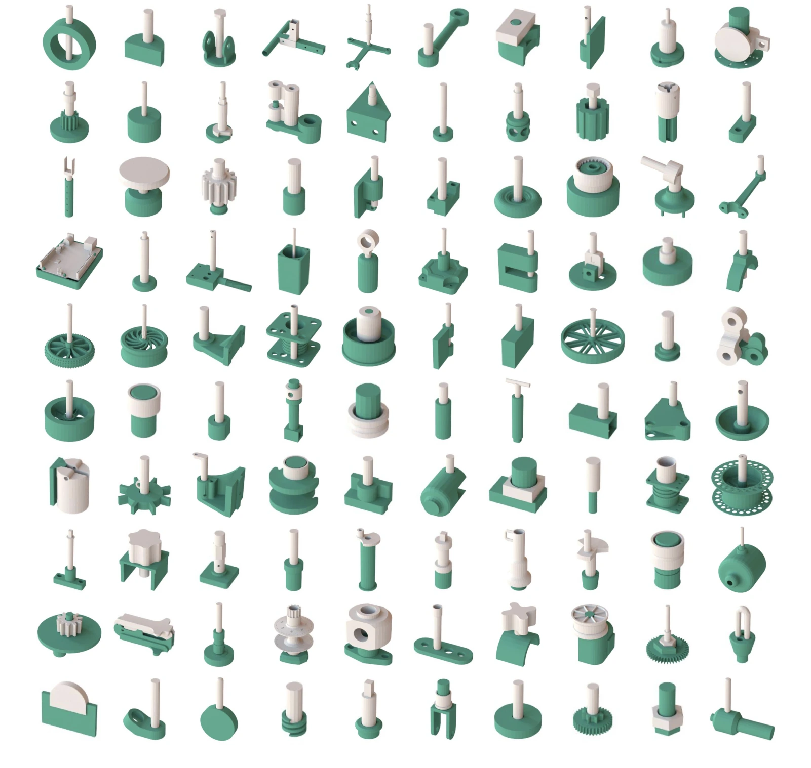

*AutoMate authors · [Figure source](https://arxiv.org/abs/2407.08028) · Original rights retained.*

| Field | Reported value and source scope |
| :-- | :-- |
| Record type | dataset |
| Simulator | Isaac Gym / Factory-style contact simulation [1](https://arxiv.org/abs/2407.08028) [2](https://bingjietang718.github.io/automate/)  |
| Simulator version and scope | Exact simulator build Not reported in project overview. [1](https://arxiv.org/abs/2407.08028) [2](https://bingjietang718.github.io/automate/) [3](https://github.com/isaac-sim/IsaacGymEnvs)  |
| Task count and scope | 100 plug-socket assembly geometries; specialist results over 80; generalist trained/evaluated on 20; perception-initialized real study on 5 [1](https://arxiv.org/abs/2407.08028) [2](https://bingjietang718.github.io/automate/)  |
| Task-list scope | One assembly task family with geometry IDs, not 100 distinct semantic task names; exact IDs supplied by released assembly collection. [1](https://arxiv.org/abs/2407.08028) [2](https://bingjietang718.github.io/automate/)  |
| Capability dimensions | Geometry-diverse insertion · Specialist/generalist policies · Perception-initialized assembly · Sim-to-real transfer [1](https://arxiv.org/abs/2407.08028) [2](https://bingjietang718.github.io/automate/)  |
| Metrics | Insertion success over assembly geometries; specialist/generalist success; physical perception-initialized study. [1](https://arxiv.org/abs/2407.08028) [2](https://bingjietang718.github.io/automate/)  |
| Robots | Franka Panda with shore 30A finger pads and wrist RealSense D435. [1](https://arxiv.org/abs/2407.08028) [2](https://bingjietang718.github.io/automate/)  |
| Sensors and observations | RGB-D camera feeds SAM + FoundationPose in perception-initialized workflow. Assembly actors use estimated/privileged geometry and state, not a raw RGBDT observation stack. [1](https://arxiv.org/abs/2407.08028) [2](https://bingjietang718.github.io/automate/)  |
| Demonstrations and data | 100 assembly CAD assets compatible with simulation and physical printing; policy training via RL plus assembly trajectories. [1](https://arxiv.org/abs/2407.08028) [2](https://bingjietang718.github.io/automate/)  |
| Evaluation protocol | Disassembly trajectories guide insertion-policy learning; specialist per geometry and generalist multi-geometry evaluation; physical pose-based trials and a separate five-assembly perception study. [1](https://arxiv.org/abs/2407.08028) [2](https://bingjietang718.github.io/automate/)  |
| Evaluated baselines | Specialist and generalist AutoMate policies; IndustReal-related and guidance/distillation ablations. [1](https://arxiv.org/abs/2407.08028) [2](https://bingjietang718.github.io/automate/)  |
| Observations / modalities | RGB · Depth · Proprioception |
| Evaluation domain | Simulation · Real world |
| Embodiment | Parallel-jaw gripper |
| Release: code | Available [3](https://github.com/isaac-sim/IsaacGymEnvs)  |
| Release: weights | Not verified [3](https://github.com/isaac-sim/IsaacGymEnvs)  |
| Release: data | Available [3](https://github.com/isaac-sim/IsaacGymEnvs)  |
| Release: license | IsaacGymEnvs BSD-3-Clause code; assembly asset terms separately verified at download [3](https://github.com/isaac-sim/IsaacGymEnvs)  |
| Release: notes | Code and geometry dataset linked by official project; legacy simulator dependency. [3](https://github.com/isaac-sim/IsaacGymEnvs)  |

**Task names — One assembly task family with geometry IDs, not 100 distinct semantic task names; exact IDs supplied by released assembly collection.:**

- Plug-socket assembly (100 geometry IDs)

**Scope and qualifications**

- 100 assembly assets do not imply 100 language-conditioned tasks.
- Perception initialization includes user clicks for SAM segmentation in the described workflow.

**Primary evidence**

1. [Paper](https://arxiv.org/abs/2407.08028) — Published paper / arXiv record and manuscript.
2. [Official project](https://bingjietang718.github.io/automate/) — Public project page.
3. [Official repository](https://github.com/isaac-sim/IsaacGymEnvs) — Current public repository; implementation scope may differ from paper.

</details>

<a id="record-benchmark-industreal"></a>
<details>
<summary><strong>IndustReal</strong> — IndustReal: Transferring Contact-Rich Assembly Tasks from Simulation to Reality</summary>

**2023-05-26 · RSS 2023 · University of Southern California / NVIDIA**

**[Paper](https://arxiv.org/abs/2305.17110)** · [Project](https://sites.google.com/nvidia.com/industreal) · [Code](https://github.com/NVlabs/industreallib)

RL sim-to-real assembly tools combine simulation-aware updates, signed-distance-field rewards, sampling curricula and a deployment action integrator.

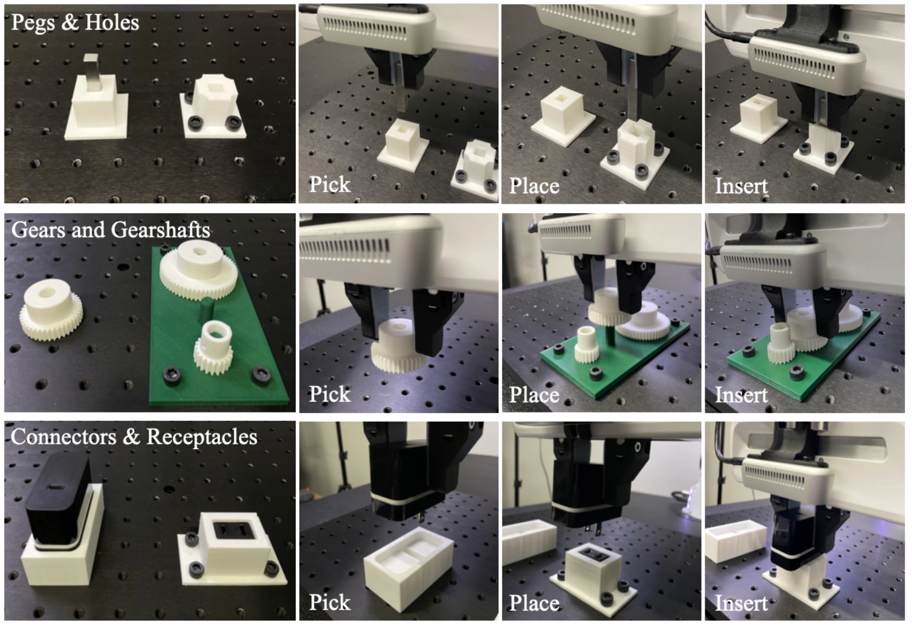

*IndustReal authors · [Figure source](https://arxiv.org/abs/2305.17110) · Original rights retained.*

| Field | Reported value and source scope |
| :-- | :-- |
| Record type | evaluation-tool |
| Simulator | Isaac Gym with Factory contacts [1](https://arxiv.org/abs/2305.17110) [2](https://sites.google.com/nvidia.com/industreal)  |
| Simulator version and scope | Exact Isaac Gym preview build Not reported here; original setup distinct from later Isaac Lab ports. [1](https://arxiv.org/abs/2305.17110) [2](https://sites.google.com/nvidia.com/industreal) [3](https://github.com/NVlabs/industreallib)  |
| Task count and scope | Peg-in-hole insertion and gear-meshing families, with pick / place / insert stages and multiple part geometries [1](https://arxiv.org/abs/2305.17110) [2](https://sites.google.com/nvidia.com/industreal)  |
| Task-list scope | Two assembly families plus skill-stage names; not a count of five independently evaluated semantic tasks. [1](https://arxiv.org/abs/2305.17110) [2](https://sites.google.com/nvidia.com/industreal)  |
| Capability dimensions | Tight-clearance assembly · Perception-initialized execution · Sim-to-real transfer · Low-cycle-time insertion [1](https://arxiv.org/abs/2305.17110) [2](https://sites.google.com/nvidia.com/industreal)  |
| Metrics | Real/sim insertion success, assembly time, robustness to pose/contact variation. [1](https://arxiv.org/abs/2305.17110) [2](https://sites.google.com/nvidia.com/industreal)  |
| Robots | Franka Panda with a parallel gripper and wrist RGB-D camera. [1](https://arxiv.org/abs/2305.17110) [2](https://sites.google.com/nvidia.com/industreal)  |
| Sensors and observations | RGB-D perception estimates part pose; low-level policy uses proprioception / estimated target state. Raw images and depth are not necessarily direct actor inputs; no tactile image sensor. [1](https://arxiv.org/abs/2305.17110) [2](https://sites.google.com/nvidia.com/industreal)  |
| Demonstrations and data | Algorithms, assembly assets, trained RL workflows and real deployment tools; no unified demonstration count. [1](https://arxiv.org/abs/2305.17110) [2](https://sites.google.com/nvidia.com/industreal)  |
| Evaluation protocol | Train contact-rich policies in simulation and transfer without physical RL fine-tuning; separate pose-estimation and low-level policy components; 600 physical trials in original report. [1](https://arxiv.org/abs/2305.17110) [2](https://sites.google.com/nvidia.com/industreal)  |
| Evaluated baselines | PPO-based IndustReal; curriculum / reward / action-integrator ablations; Franka control comparisons. [1](https://arxiv.org/abs/2305.17110) [2](https://sites.google.com/nvidia.com/industreal)  |
| Observations / modalities | RGB · Depth · Proprioception |
| Evaluation domain | Simulation · Real world |
| Embodiment | Parallel-jaw gripper |
| Release: code | Available [3](https://github.com/NVlabs/industreallib)  |
| Release: weights | Partial [3](https://github.com/NVlabs/industreallib)  |
| Release: data | Partial [3](https://github.com/NVlabs/industreallib)  |
| Release: license | Not verified [3](https://github.com/NVlabs/industreallib)  |
| Release: notes | industreallib physical deployment code and IsaacGymEnvs training environments are separate repositories. [3](https://github.com/NVlabs/industreallib)  |

**Task names — Two assembly families plus skill-stage names; not a count of five independently evaluated semantic tasks.:**

- Peg insertion
- Gear meshing
- Pick
- Place
- Insert

**Scope and qualifications**

- Depth supports perception initialization; do not equate this with an end-to-end RGB-D policy.
- Absence of tactile images does not imply absence of contact-force effects in the controller/physics.

**Primary evidence**

1. [Paper](https://arxiv.org/abs/2305.17110) — Published paper / arXiv record and manuscript.
2. [Official project](https://sites.google.com/nvidia.com/industreal) — Public project page.
3. [Official repository](https://github.com/NVlabs/industreallib) — Current public repository; implementation scope may differ from paper.

</details>

<a id="record-benchmark-factory"></a>
<details>
<summary><strong>Factory</strong> — Factory: Fast Contact for Robotic Assembly</summary>

**2022-05-07 · RSS 2022 · NVIDIA**

**[Paper](https://arxiv.org/abs/2205.03532)** · [Project](https://sites.google.com/nvidia.com/factory) · [Code](https://github.com/isaac-sim/IsaacGymEnvs)

Contact simulation methods and assembly learning tools with 60 designed part models, three robot assembly environment families and seven controllers.

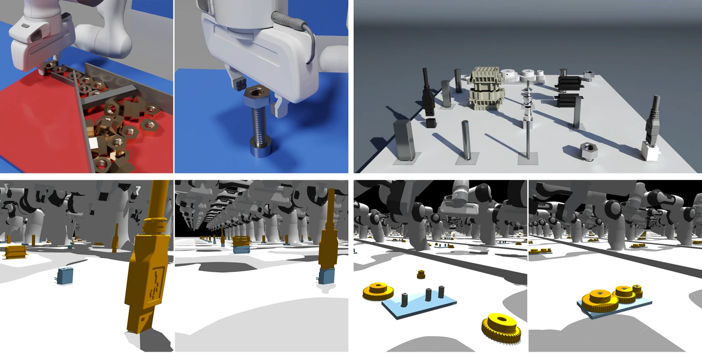

*Factory authors · [Figure source](https://arxiv.org/abs/2205.03532) · Original rights retained.*

| Field | Reported value and source scope |
| :-- | :-- |
| Record type | simulator |
| Simulator | Isaac Gym / PhysX with signed-distance-field contacts [1](https://arxiv.org/abs/2205.03532) [2](https://sites.google.com/nvidia.com/factory)  |
| Simulator version and scope | Original paper uses Isaac Gym; exact preview build Not reported. Current Isaac Lab Factory ports are distinct implementations. [1](https://arxiv.org/abs/2205.03532) [2](https://sites.google.com/nvidia.com/factory) [3](https://github.com/isaac-sim/IsaacGymEnvs)  |
| Task count and scope | 3 assembly environment families; 60 part models; 7 robot controllers [1](https://arxiv.org/abs/2205.03532) [2](https://sites.google.com/nvidia.com/factory)  |
| Task-list scope | Complete three original environment classes; demonstrated nut-and-bolt RL subtasks include Pick, Place and Screw. [1](https://arxiv.org/abs/2205.03532) [2](https://sites.google.com/nvidia.com/factory)  |
| Capability dimensions | Dense contact simulation · Threaded fasteners · Peg insertion · Gear meshing · GPU-parallel RL [1](https://arxiv.org/abs/2205.03532) [2](https://sites.google.com/nvidia.com/factory)  |
| Metrics | Simulation speed/contact stability; RL success, policy training time and control comparisons. [1](https://arxiv.org/abs/2205.03532) [2](https://sites.google.com/nvidia.com/factory)  |
| Robots | Franka Panda [1](https://arxiv.org/abs/2205.03532) [2](https://sites.google.com/nvidia.com/factory)  |
| Sensors and observations | Robot state and simulated contact information; original policies are not optical-tactile RGBDT policies. [1](https://arxiv.org/abs/2205.03532) [2](https://sites.google.com/nvidia.com/factory)  |
| Demonstrations and data | 60 CAD/physical part models derived from industrial assembly test components; environment/controller assets rather than a common demonstration corpus. [1](https://arxiv.org/abs/2205.03532) [2](https://sites.google.com/nvidia.com/factory)  |
| Evaluation protocol | GPU-parallel contact-rich scenes; proof-of-concept PPO policies for nut-and-bolt assembly with alternative controllers. [1](https://arxiv.org/abs/2205.03532) [2](https://sites.google.com/nvidia.com/factory)  |
| Evaluated baselines | PPO with operational-space, joint-space, force and hybrid controllers. [1](https://arxiv.org/abs/2205.03532) [2](https://sites.google.com/nvidia.com/factory)  |
| Observations / modalities | Proprioception · Force/Torque |
| Evaluation domain | Simulation |
| Embodiment | Parallel-jaw gripper |
| Release: code | Available [3](https://github.com/isaac-sim/IsaacGymEnvs)  |
| Release: weights | Not verified [3](https://github.com/isaac-sim/IsaacGymEnvs)  |
| Release: data | Available [3](https://github.com/isaac-sim/IsaacGymEnvs)  |
| Release: license | BSD-3-Clause IsaacGymEnvs code; NVIDIA simulator and third-party asset terms separate [3](https://github.com/isaac-sim/IsaacGymEnvs)  |
| Release: notes | Legacy IsaacGymEnvs toolkit; current Isaac Lab implementations should be versioned separately. [3](https://github.com/isaac-sim/IsaacGymEnvs)  |

**Task names — Complete three original environment classes; demonstrated nut-and-bolt RL subtasks include Pick, Place and Screw.:**

- FrankaNutBoltEnv
- FrankaInsertionEnv
- FrankaGearsEnv

**Scope and qualifications**

- A simulation/learning toolkit rather than a standardized tactile benchmark.
- Task ports across Isaac Gym and Isaac Lab do not imply identical physics or policy performance.

**Primary evidence**

1. [Paper](https://arxiv.org/abs/2205.03532) — Published paper / arXiv record and manuscript.
2. [Official project](https://sites.google.com/nvidia.com/factory) — Public project page.
3. [Official repository](https://github.com/isaac-sim/IsaacGymEnvs) — Current public repository; implementation scope may differ from paper.

</details>

<a id="record-benchmark-taxim"></a>
<details>
<summary><strong>Taxim</strong> — Taxim: An Example-based Simulation Model for GelSight Tactile Sensors</summary>

**2021-09-09 · IEEE Robotics and Automation Letters 2022 · Carnegie Mellon University**

**[Paper](https://arxiv.org/abs/2109.04027)** · [Code](https://github.com/Robo-Touch/Taxim)

Calibration-driven optical and marker-motion simulation for GelSight-style tactile sensors, used as a component in later visuotactile simulators.

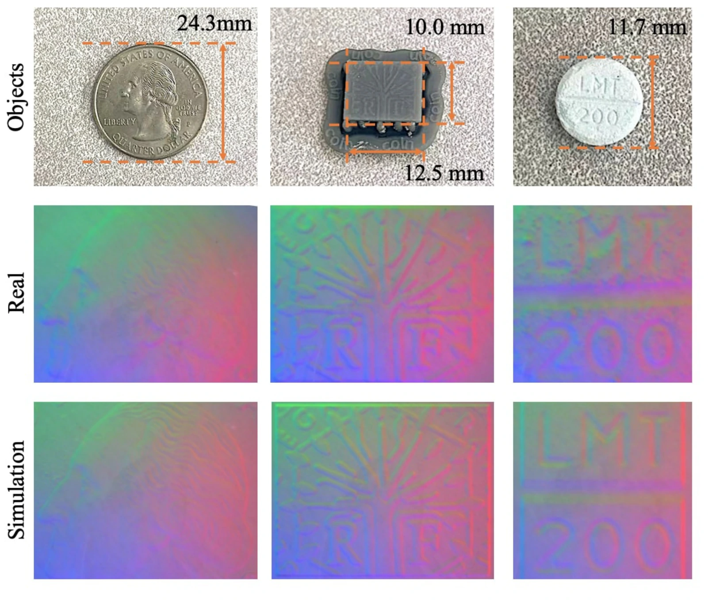

*Taxim authors · [Figure source](https://arxiv.org/abs/2109.04027) · Original rights retained.*

| Field | Reported value and source scope |
| :-- | :-- |
| Record type | simulator |
| Simulator | Standalone example-based tactile simulator [1](https://arxiv.org/abs/2109.04027)  |
| Simulator version and scope | No mandatory robot physics engine; repository tested configurations include macOS 10.15.7 / Python 3.8.5 and Ubuntu 18.04.1 / Python 3.6.13. [1](https://arxiv.org/abs/2109.04027) [2](https://github.com/Robo-Touch/Taxim)  |
| Task count and scope | Not applicable — sensor-image / marker-motion simulator [1](https://arxiv.org/abs/2109.04027)  |
| Task-list scope | No closed-loop manipulation task suite. [1](https://arxiv.org/abs/2109.04027)  |
| Capability dimensions | GelSight optical simulation · Marker displacement · Sensor calibration [1](https://arxiv.org/abs/2109.04027)  |
| Metrics | Image/marker fidelity and computational performance. [1](https://arxiv.org/abs/2109.04027)  |
| Robots | Not prescribed [1](https://arxiv.org/abs/2109.04027)  |
| Sensors and observations | GelSight and sensor-specific variations calibrated with example contacts. [1](https://arxiv.org/abs/2109.04027)  |
| Demonstrations and data | Calibration files, object meshes and optical/marker-motion examples. [1](https://arxiv.org/abs/2109.04027)  |
| Evaluation protocol | Collect calibration contacts, fit optical table and simulate deformation / marker fields under configured contact. [1](https://arxiv.org/abs/2109.04027)  |
| Evaluated baselines | Sensor-model comparisons; no manipulation-policy baseline. [1](https://arxiv.org/abs/2109.04027)  |
| Observations / modalities | Tactile |
| Evaluation domain | Simulation |
| Embodiment | Sensor-level resource |
| Release: code | Available [2](https://github.com/Robo-Touch/Taxim)  |
| Release: weights | Not applicable [2](https://github.com/Robo-Touch/Taxim)  |
| Release: data | Available [2](https://github.com/Robo-Touch/Taxim)  |
| Release: license | MIT code [2](https://github.com/Robo-Touch/Taxim)  |
| Release: notes | Calibration and example sensor simulation code available; upstream URL may redirect from CMURoboTouch to Robo-Touch. [2](https://github.com/Robo-Touch/Taxim)  |

**Task names — No closed-loop manipulation task suite.:**

Task names not reported or not verified in the cited sources.

**Scope and qualifications**

- Optical/marker simulation is a component rather than a complete contact physics or manipulation benchmark.

**Primary evidence**

1. [Paper](https://arxiv.org/abs/2109.04027) — Published paper / arXiv record and manuscript.
2. [Official repository](https://github.com/Robo-Touch/Taxim) — Current public repository; implementation scope may differ from paper.

</details>

<a id="record-benchmark-tacto"></a>
<details>
<summary><strong>TACTO</strong> — TACTO: A Fast, Flexible, and Open-source Simulator for High-Resolution Vision-based Tactile Sensors</summary>

**2020-12-15 · IEEE Robotics and Automation Letters 2022 · Facebook AI Research**

**[Paper](https://arxiv.org/abs/2012.08456)** · [Code](https://github.com/facebookresearch/tacto)

Configurable optical tactile rendering for sensors such as DIGIT/OmniTact, with grasp-stability and marble-control demonstrations.

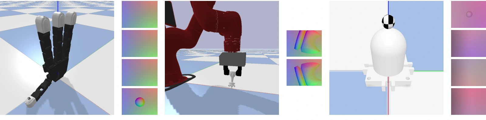

*TACTO authors · [Figure source](https://arxiv.org/abs/2012.08456) · Original rights retained.*

| Field | Reported value and source scope |
| :-- | :-- |
| Record type | simulator |
| Simulator | TACTO renderer; PyBullet example integration [1](https://arxiv.org/abs/2012.08456)  |
| Simulator version and scope | Exact package / PyBullet version Not reported here; archived repository dependencies define compatibility. [1](https://arxiv.org/abs/2012.08456) [2](https://github.com/facebookresearch/tacto)  |
| Task count and scope | 2 application demonstrations, not a common multi-task manipulation benchmark [1](https://arxiv.org/abs/2012.08456)  |
| Task-list scope | Complete two application types in abstract; sensor-rendering examples additional. [1](https://arxiv.org/abs/2012.08456)  |
| Capability dimensions | Optical tactile rendering · Sensor configuration · Grasp-stability learning · Local tactile control [1](https://arxiv.org/abs/2012.08456)  |
| Metrics | Rendering throughput; grasp prediction and control outcomes; proof-of-concept sim-to-real. [1](https://arxiv.org/abs/2012.08456)  |
| Robots | Task-specific gripper / tactile configurations. [1](https://arxiv.org/abs/2012.08456)  |
| Sensors and observations | DIGIT and OmniTact optical tactile designs. [1](https://arxiv.org/abs/2012.08456)  |
| Demonstrations and data | One million simulated grasps used in paper grasp-stability application; not one million closed-loop task demonstrations. [1](https://arxiv.org/abs/2012.08456)  |
| Evaluation protocol | Separate tactile rendering from external rigid-body dynamics; application-specific perception and control evaluation. [1](https://arxiv.org/abs/2012.08456)  |
| Evaluated baselines | Application-specific neural predictors/controllers; not a universal policy benchmark. [1](https://arxiv.org/abs/2012.08456)  |
| Observations / modalities | Tactile |
| Evaluation domain | Simulation |
| Embodiment | Parallel-jaw gripper · Robot arm tactile fingertip |
| Release: code | Available [2](https://github.com/facebookresearch/tacto)  |
| Release: weights | Not applicable [2](https://github.com/facebookresearch/tacto)  |
| Release: data | Partial [2](https://github.com/facebookresearch/tacto)  |
| Release: license | MIT code [2](https://github.com/facebookresearch/tacto)  |
| Release: notes | Open-source simulator with examples; repository maintenance/dependency age should be considered. [2](https://github.com/facebookresearch/tacto)  |

**Task names — Complete two application types in abstract; sensor-rendering examples additional.:**

- Grasp stability prediction
- Marble manipulation

**Scope and qualifications**

- A realistic-looking tactile render does not establish accurate soft-body mechanics or transfer for every sensor.

**Primary evidence**

1. [Paper](https://arxiv.org/abs/2012.08456) — Published paper / arXiv record and manuscript.
2. [Official repository](https://github.com/facebookresearch/tacto) — Current public repository; implementation scope may differ from paper.

</details>

## Policies

Categories are overlapping discovery routes. Each record has one primary placement in this README; the website exposes all applicable categories.

<a id="tactile-il"></a>
### Visuo-Tactile Policy Learning

| Date | Work | Setting | Architecture / inputs | Release | Primary links |
| :-- | :-- | :-- | :-- | :-- | :-- |
| 2026-10-12 | [PACE](#record-policy-pace) | Real world | ACT; Global/wrist RGB, joint state and default 6D optical-tactile force summary | Not verified | **[Paper](https://arxiv.org/abs/2610.16308)** · [Project](https://pace-insertion.github.io/) <!-- work:pace --> |
| 2026-10-02 | [VISTA](#record-policy-vista) | Simulation · Real world | Diffusion; Wrist RGB, optical tactile images and proprioception | Available | **[Paper](https://arxiv.org/abs/2610.03333)** · [Code](https://github.com/Kenn3o3/Vista) <!-- work:vista --> |
| 2026-09-25 | [VisTacAlign](#record-policy-vistacalign) | Real world | Diffusion; Colored metric point clouds, tactile forces and proprioception | Not verified | **[Paper](https://arxiv.org/abs/2609.30959)** <!-- work:vistacalign --> |
| 2026-09-25 | [TACTIC: Encoder Study](#record-policy-tactic-encoder-study) | Real world | ACT; Side/wrist RGB, paired DIGIT tactile images and robot state | Not verified | **[Paper](https://arxiv.org/abs/2609.30969)** · [Project](https://utn-air.github.io/TACTIC) · [Data](https://huggingface.co/collections/UTN-AIR/tactic) <!-- work:tactic-encoder-study --> |
| 2026-09-21 | [TACIT](#record-policy-tacit) | Simulation · Real world | Diffusion; Observed depth-derived XYZ cloud, tactile force/contact points and robot state; six-channel points encode XYZ, force and modality masks | Not verified | **[Paper](https://arxiv.org/abs/2609.24507)** <!-- work:tacit --> |
| 2026-09-15 | [UniDex-ViTac](#record-policy-unidex-vitac) | Simulation · Real world | ACT; Depth-derived point clouds, proprioception and four binary fingertip contact signals | Not verified | **[Paper](https://arxiv.org/abs/2609.16504)** · [Project](https://unidex-vitac.github.io/) <!-- work:unidex-vitac --> |
| 2026-09-07 | [WM-Craftnet](#record-policy-wm-craftnet) | Simulation · Real world | RL; Wrist depth, tactile signals, proprioception and observation history | Available | **[Paper](https://arxiv.org/abs/2609.07002)** · [Project](https://wmcraftnet.github.io/) · [Code](https://github.com/sharpa-robotics/WM-Craftnet) · [Weights](https://huggingface.co/SharpaIT/WM-Craftnet) <!-- work:wm-craftnet --> |
| 2026-08-02 | [CAAT](#record-policy-caat) | Simulation · Real world | Hybrid; RGB, tactile images/reference, robot state and language for π0 | Not verified | **[Paper](https://arxiv.org/abs/2608.01102)** <!-- work:caat --> |
| 2026-06-10 | [TacCoRL](#record-policy-taccorl) | Simulation · Real world | Hybrid; RGB, tactile feedback, robot state and task instruction | Not verified | **[Paper](https://arxiv.org/abs/2606.11743)** · [Project](https://tac-corl.github.io/) <!-- work:taccorl --> |
| 2026-06-08 | [TORL-VLA](#record-policy-torl-vla) | Real world | Hybrid; Three RGB views, state, instruction and tactile-derived 12D wrench history | Not verified | **[Paper](https://arxiv.org/abs/2606.09337)** · [Project](https://torl-vla.github.io/) <!-- work:torl-vla --> |
| 2026-05-12 | [SI-Diff](#record-policy-si-diff) | Real world | Diffusion; Current/previous external wrench, internal wrench and end-effector velocity; 36D total plus mode | Not verified | **[Paper](https://arxiv.org/abs/2605.12247)** <!-- work:si-diff --> |
| 2026-03-14 | [TransDex](#record-policy-transdex) | Real world | Diffusion; Depth-derived point clouds, Paxini tactile arrays and robot state | Available | **[Paper](https://arxiv.org/abs/2603.13869)** · [Project](https://transdex.github.io/) · [Code](https://github.com/LFGfg/TransDex) <!-- work:transdex --> |
| 2026-02-05 | [DECO](#record-policy-deco) | Real world | Diffusion; Binocular RGB, robot joint state and optional bimanual tactile taxels | Available | **[Paper](https://arxiv.org/abs/2602.05513)** · [Project](https://baai-humanoid.github.io/DECO-webpage/) · [Code](https://github.com/BAAI-Humanoid/DECO) · [Data](https://huggingface.co/datasets/BAAI-Humanoid/DECO-50) <!-- work:deco --> |
| 2025-10-16 | [VT-Refine](#record-policy-vt-refine) | Simulation · Real world | Hybrid; Depth-derived visual points, spatial pressure taxels and proprioception | Available | **[Paper](https://arxiv.org/abs/2510.14930)** · [Project](https://binghao-huang.github.io/vt_refine/) · [Code](https://github.com/NVlabs/vt-refine) <!-- work:vt-refine --> |
| 2025-10-15 | [FARM](#record-policy-farm) | Real world | Diffusion; Visual observations, proprioception and GelSight-derived spatial force distributions | Not verified | **[Paper](https://arxiv.org/abs/2510.13324)** · [Project](https://tactile-farm.github.io/) <!-- work:farm --> |
| 2025-07-23 | [VLA-Touch](#record-policy-vla-touch) | Real world | Hybrid; RGB, instruction, robot state, GelSight images and marker-derived tactile summaries | Partial | **[Paper](https://arxiv.org/abs/2507.17294)** · [Code](https://github.com/clear-nus/vla-touch) <!-- work:vla-touch --> |
| 2025-06-19 | [ViTacFormer](#record-policy-vitacformer) | Real world | ACT; High-resolution RGB, tactile signals and robot state | Available | **[Paper](https://arxiv.org/abs/2506.15953)** · [Project](https://roboverseorg.github.io/ViTacFormerPage/) · [Code](https://github.com/RoboVerseOrg/ViTacFormer) <!-- work:vitacformer --> |
| 2025-06-16 | [ViTaL — local skills](#record-policy-vital-local) | Real world | Hybrid; Local egocentric RGB, AnySkin tactile signals and state; optional global RGBD for reaching | Available | **[Paper](https://arxiv.org/abs/2506.13762)** · [Project](https://vitalprecise.github.io/) · [Code](https://github.com/Exiam6/ViTaL) <!-- work:vital-local --> |
| 2025-04-27 | [PolyTouch policy](#record-policy-polytouch) | Real world | Diffusion; RGB, camera-based tactile observations, acoustics and proprioception | Not verified | **[Paper](https://arxiv.org/abs/2504.19341)** · [Project](https://polytouch.alanz.info/) <!-- work:polytouch --> |
| 2025-03-04 | [Reactive Diffusion Policy](#record-policy-reactive-diffusion-policy) | Real world | Diffusion; RGB, robot state and tactile/force feedback according to sensor configuration | Available | **[Paper](https://arxiv.org/abs/2503.02881)** · [Project](https://reactive-diffusion-policy.github.io/) · [Code](https://github.com/xiaoxiaoxh/reactive_diffusion_policy) · [Data](https://huggingface.co/datasets/WendiChen/reactive_diffusion_policy_dataset) · [Weights](https://huggingface.co/WendiChen/reactive_diffusion_policy_model) <!-- work:reactive-diffusion-policy --> |
| 2025 | [VTDexManip](#record-policy-vtdexmanip) | Simulation · Real world | RL; Egocentric RGB, 20 binary tactile contacts and hand joint positions/velocities | Available | **[Paper](https://proceedings.iclr.cc/paper_files/paper/2025/file/e19b6f65791e350347bcff8a3955cb5b-Paper-Conference.pdf)** · [Project](https://lqts.github.io/VTDexManip/) · [Code](https://github.com/LQTS/VTDexManip) · [Data](https://1drv.ms/f/c/9054151f0ba654c9/EslUpgsfFVQggJB7AQAAAAABSp31p8Fft1mtHyOwJNqmoA) <!-- work:vtdexmanip --> |
| 2024-10-31 | [3D-ViTac](#record-policy-3d-vitac) | Real world | Diffusion; Depth XYZ point clouds, pressure values/positions and joint state | Partial | **[Paper](https://arxiv.org/abs/2410.24091)** · [Project](https://binghao-huang.github.io/3D-ViTac/) · [Code](https://github.com/binghao-huang/3d-vitac-training-code) <!-- work:3d-vitac --> |
| 2024-10-22 | [ViSk](#record-policy-visk) | Real world | Other; Multi-view RGB, AnySkin magnetometer measurements and robot state | Available | **[Paper](https://arxiv.org/abs/2410.17246)** · [Project](https://visuoskin.github.io/) · [Code](https://github.com/raunaqbhirangi/visuoskin) <!-- work:visk --> |
| 2024-09-17 | [TacDiffusion](#record-policy-tacdiffusion) | Real world | Diffusion; Current/previous external wrench, internal wrench and end-effector velocity | Available | **[Paper](https://arxiv.org/abs/2409.11047)** · [Code](https://github.com/popnut123/TacDiffusion) <!-- work:tacdiffusion --> |
| 2024-07-10 | [Tactile Skin Translation](#record-policy-tactile-skin-translation) | Simulation · Real world | RL; Allegro joint state/history and binarized3-axis ReSkin palm signals | Available | **[Paper](https://arxiv.org/abs/2407.07885)** · [Project](https://jessicayin.github.io/tactile-skin-rl/) · [Code](https://github.com/jessicayin/tactile_skin_model) <!-- work:tactile-skin-translation --> |
| 2024-05-12 | [AnyRotate](#record-policy-anyrotate) | Simulation · Real world | RL; Dense tactile contact features and robot proprioception | Not verified | **[Paper](https://arxiv.org/abs/2405.07391)** · [Project](https://maxyang27896.github.io/anyrotate/) <!-- work:anyrotate --> |
| 2024-04-25 | [HATO](#record-policy-hato) | Real world | Diffusion; Multi-view RGB, depth images, finger pressure readings and robot state | Available | **[Paper](https://arxiv.org/abs/2404.16823)** · [Project](https://toruowo.github.io/hato/) · [Code](https://github.com/ToruOwO/hato) · [Data](https://berkeley.app.box.com/s/379cf57zqm1akvr00vdcloxqxi3ucb9g) <!-- work:hato --> |
| 2024-03-18 | [VITaL Pretraining](#record-policy-vital-pretraining) | Real world | ACT; Six RGB views, robot state and optional GelSight tactile images | Available | **[Paper](https://arxiv.org/abs/2403.11898)** · [Project](https://sites.google.com/andrew.cmu.edu/visuo-tactile-pretraining) · [Code](https://github.com/Abraham190137/TactileACT) <!-- work:vital-pretraining --> |
| 2023-10-25 | [MimicTouch](#record-policy-mimictouch) | Real world | Hybrid; Tactile images, audio and robot state; human pose used in demonstrations | Not verified | **[Paper](https://arxiv.org/abs/2310.16917)** · [Project](https://sites.google.com/view/MimicTouch) <!-- work:mimictouch --> |
| 2023-09-21 | [See to Touch / TAVI](#record-policy-see-to-touch) | Real world | RL; RGB observations, Xela tactile measurements and robot state | Available | **[Paper](https://arxiv.org/abs/2309.12300)** · [Project](https://see-to-touch.github.io/) · [Code](https://github.com/irmakguzey/see-to-touch) · [Data](https://drive.google.com/drive/folders/1IpU97D4nSosdyyWmvuLO-E3phRA-nf8c) <!-- work:see-to-touch --> |
| 2023-09-18 | [RotateIt](#record-policy-rotateit) | Simulation · Real world | RL; Noisy depth, tactile observations and proprioceptive history | Not verified | **[Paper](https://arxiv.org/abs/2309.09979)** · [Project](https://haozhi.io/rotateit/) <!-- work:rotateit --> |
| 2023-03-20 | [Rotating without Seeing](#record-policy-rotating-without-seeing) | Simulation · Real world | RL; Tactile signals, joint positions, previous joint targets and target rotation axis | Available | **[Paper](https://arxiv.org/abs/2303.10880)** · [Project](https://touchdexterity.github.io/) · [Code](https://github.com/YingYuan0414/in-hand-rotation) <!-- work:rotating-without-seeing --> |
| 2018-05-28 | [More Than a Feeling](#record-policy-more-than-a-feeling) | Real world | Other; RGB, paired GelSight tactile images and candidate adjustment action | Not verified | **[Paper](https://arxiv.org/abs/1805.11085)** <!-- work:more-than-a-feeling --> |

<a id="record-policy-pace"></a>
<details>
<summary><strong>PACE</strong> — PACE: Temporal-Role Tactile Conditioning for Chunk-Based Insertion Policies</summary>

**2026-10-12 · CoRL 2026 · Xiaomi Robotics**

**[Paper](https://arxiv.org/abs/2610.16308)** · [Project](https://pace-insertion.github.io/)

Assigns touch to persistent-state conditioning, contact-event correction and training-only consequence prediction for insertion policies.

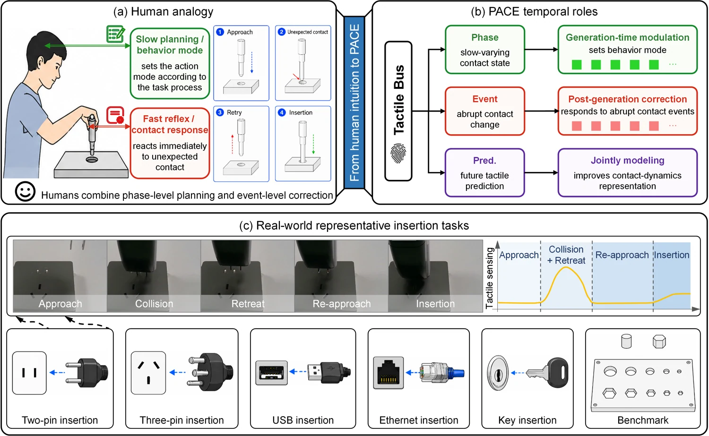

*PACE authors · [Figure source](https://arxiv.org/html/2610.16308) · Original rights retained.*

| Field | Reported value and source scope |
| :-- | :-- |
| Record type | policy |
| Policy family | ACT [1](https://arxiv.org/abs/2610.16308)  |
| Base model and architecture | ACT CVAE-Transformer; Diffusion Policy transfer variant [1](https://arxiv.org/abs/2610.16308) [3](https://arxiv.org/html/2610.16308)  |
| Model size and component | ACT83.87M; PACE adds0.841M train/0.575M inference; DP+PACE310.5M [1](https://arxiv.org/abs/2610.16308) [3](https://arxiv.org/html/2610.16308)  |
| Deployment inputs | Global/wrist RGB, joint state and default 6D optical-tactile force summary [1](https://arxiv.org/abs/2610.16308) [3](https://arxiv.org/html/2610.16308)  |
| Action outputs and horizon | Chunked joint actions with near-term gated residual corrections [1](https://arxiv.org/abs/2610.16308) [3](https://arxiv.org/html/2610.16308)  |
| Training method | Phase modulation, event residual and auxiliary contact prediction [1](https://arxiv.org/abs/2610.16308) [3](https://arxiv.org/html/2610.16308)  |
| Training data | Five real insertion tasks: approximately 160 demonstrations per task, approximately 300 steps per episode; additional ManipulationNet geometry/clearance settings [1](https://arxiv.org/abs/2610.16308) [3](https://arxiv.org/html/2610.16308) [4](https://arxiv.org/html/2610.16308v1)  |
| Training duration | DP transfer: 8k epochs budget; converges≈epoch1100/680k steps; wall-clock not reported [1](https://arxiv.org/abs/2610.16308) [3](https://arxiv.org/html/2610.16308)  |
| Training hardware | DP transfer: RTX4090 or H20; inference latency measured on RTX3090 [1](https://arxiv.org/abs/2610.16308) [3](https://arxiv.org/html/2610.16308)  |
| Inference and control rates | 20 Hz control; extra tactile overhead&lt;0.3 ms; ACT backbone6.2 ms [1](https://arxiv.org/abs/2610.16308) [3](https://arxiv.org/html/2610.16308)  |
| Evaluation scope | Five real insertion tasks; ManipulationNet six geometry-clearance settings including 0.1 mm [1](https://arxiv.org/abs/2610.16308) [3](https://arxiv.org/html/2610.16308)  |
| Observations / modalities | RGB · Tactile · Proprioception |
| Evaluation domain | Real world |
| Embodiment | Parallel-jaw gripper |
| Release: code | Not verified [2](https://pace-insertion.github.io/)  |
| Release: weights | Not verified [2](https://pace-insertion.github.io/)  |
| Release: data | Not verified [2](https://pace-insertion.github.io/)  |
| Release: license | Not verified [2](https://pace-insertion.github.io/)  |
| Release: notes | No verified public download found in the inspected primary sources. [2](https://pace-insertion.github.io/)  |

**Scope and qualifications**

- Default tactile input is a low-dimensional force signal; F/T and joint-current variants are separate experiments.
- Future-contact predictor is removed for inference.

**Primary evidence**

1. [Author manuscript and submission history](https://arxiv.org/abs/2610.16308) — Policy facts refer to the full manuscript available on the verification date; date is first arXiv submission.
2. [Author project page](https://pace-insertion.github.io/) — Release status is checked separately from paper claims; a project page alone does not imply released implementation or weights.
3. [Full paper: method and implementation details](https://arxiv.org/html/2610.16308) — Unreported specifications remain explicitly unknown; hardware/rates are scoped to training, inference or low-level control.
4. [Independent review: dataset statistics, Section4.1 and AppendixC.5](https://arxiv.org/html/2610.16308v1) — TableC3 reports approximately 160 episodes/task and 300 steps/episode for the real-robot demonstration dataset.

</details>

<a id="record-policy-vista"></a>
<details>
<summary><strong>VISTA</strong> — Equivariant Visual-Tactile Diffusion Policy for Contact-Rich Manipulation</summary>

**2026-10-02 · CoRL 2026 · Not reported**

**[Paper](https://arxiv.org/abs/2610.03333)** · [Code](https://github.com/Kenn3o3/Vista)

An equivariant visual–tactile diffusion policy uses spherical tokens and end-effector-aligned fusion for contact-rich manipulation.

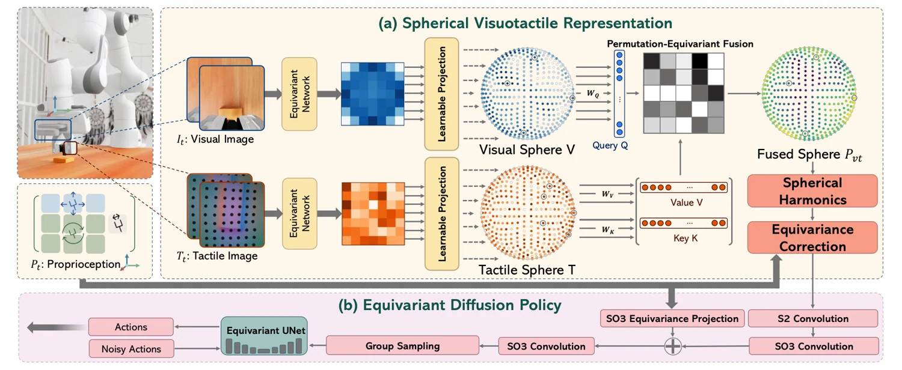

*VISTA authors · [Figure source](https://arxiv.org/html/2610.03333) · Original rights retained.*

| Field | Reported value and source scope |
| :-- | :-- |
| Record type | policy |
| Policy family | Diffusion [1](https://arxiv.org/abs/2610.03333)  |
| Base model and architecture | Equivariant visual/tactile encoders and diffusion action decoder [1](https://arxiv.org/abs/2610.03333) [3](https://arxiv.org/html/2610.03333)  |
| Model size and component | Not reported [1](https://arxiv.org/abs/2610.03333) [3](https://arxiv.org/html/2610.03333)  |
| Deployment inputs | Wrist RGB, optical tactile images and proprioception [1](https://arxiv.org/abs/2610.03333) [3](https://arxiv.org/html/2610.03333)  |
| Action outputs and horizon | Action chunks with end-effector-relative alignment [1](https://arxiv.org/abs/2610.03333) [3](https://arxiv.org/html/2610.03333)  |
| Training method | Spherical tokenization and equivariant multimodal fusion [1](https://arxiv.org/abs/2610.03333) [3](https://arxiv.org/html/2610.03333)  |
| Training data | UniVTAC simulation; 100 real demonstrations per task, 80/20 training/validation [1](https://arxiv.org/abs/2610.03333) [3](https://arxiv.org/html/2610.03333)  |
| Training duration | Not reported [1](https://arxiv.org/abs/2610.03333) [3](https://arxiv.org/html/2610.03333)  |
| Training hardware | Inference measured on one RTX 3090; training hardware not reported [1](https://arxiv.org/abs/2610.03333) [3](https://arxiv.org/html/2610.03333)  |
| Inference and control rates | Actions 10 Hz; replans every 0.6 s for insertion / 0.8 s erasing; low-level 300 Hz [1](https://arxiv.org/abs/2610.03333) [3](https://arxiv.org/html/2610.03333)  |
| Evaluation scope | UniVTAC and real USB insertion, pencil insertion and erasing [1](https://arxiv.org/abs/2610.03333) [3](https://arxiv.org/html/2610.03333)  |
| Observations / modalities | RGB · Tactile · Proprioception |
| Evaluation domain | Simulation · Real world |
| Embodiment | Parallel-jaw gripper |
| Release: code | Available [2](https://github.com/Kenn3o3/Vista)  |
| Release: weights | Not verified [2](https://github.com/Kenn3o3/Vista)  |
| Release: data | Available [2](https://github.com/Kenn3o3/Vista)  |
| Release: license | Not verified [2](https://github.com/Kenn3o3/Vista)  |
| Release: notes | Official repository contains training/evaluation recipes and UniVTAC-derived data instructions. [2](https://github.com/Kenn3o3/Vista)  |

**Scope and qualifications**

- New tactile frames influence actions only at chunk replanning, despite sub-100 ms model-side inference.
- One training seed and ten real evaluation trials per task.

**Primary evidence**

1. [Author manuscript and submission history](https://arxiv.org/abs/2610.03333) — Policy facts refer to the full manuscript available on the verification date; date is first arXiv submission.
2. [Official repository](https://github.com/Kenn3o3/Vista) — Release status is checked separately from paper claims; a project page alone does not imply released implementation or weights.
3. [Full paper: method and implementation details](https://arxiv.org/html/2610.03333) — Unreported specifications remain explicitly unknown; hardware/rates are scoped to training, inference or low-level control.

</details>

<a id="record-policy-vistacalign"></a>
<details>
<summary><strong>VisTacAlign</strong> — VisTacAlign: Co-Training Dexterous Policies on Tactile Human and Robot Demonstrations using Visual-Tactile Alignment</summary>

**2026-09-25 · Preprint · Not reported**

**[Paper](https://arxiv.org/abs/2609.30959)**

Aligns human/robot hand geometry and tactile forces to co-train dexterous flow-matching policies from both embodiments.

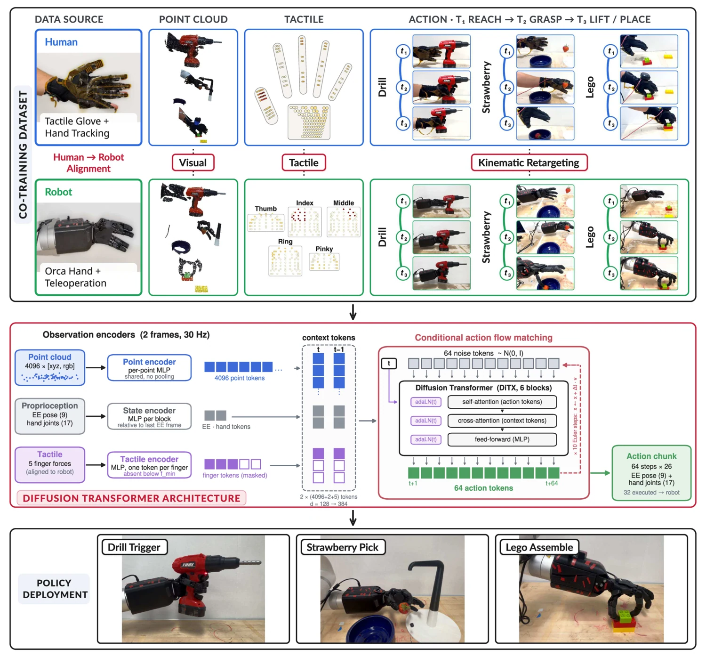

*VisTacAlign authors · [Figure source](https://arxiv.org/html/2609.30959) · Original rights retained.*

| Field | Reported value and source scope |
| :-- | :-- |
| Record type | policy |
| Policy family | Diffusion [1](https://arxiv.org/abs/2609.30959)  |
| Base model and architecture | Point-cloud flow-matching policy; Fast-FoundationStereo geometry frontend [1](https://arxiv.org/abs/2609.30959) [2](https://arxiv.org/html/2609.30959)  |
| Model size and component | 23.5M total policy [1](https://arxiv.org/abs/2609.30959) [2](https://arxiv.org/html/2609.30959)  |
| Deployment inputs | Colored metric point clouds, tactile forces and proprioception [1](https://arxiv.org/abs/2609.30959) [2](https://arxiv.org/html/2609.30959)  |
| Action outputs and horizon | 64-step end-effector/hand-joint chunks; executes first32 at 30 Hz before replanning [1](https://arxiv.org/abs/2609.30959) [2](https://arxiv.org/html/2609.30959)  |
| Training method | Human-to-robot point-cloud/force retargeting and mixed-embodiment co-training [1](https://arxiv.org/abs/2609.30959) [2](https://arxiv.org/html/2609.30959)  |
| Training data | Paired human/robot demonstrations; representative settings 50 human + 10/20/30 robot demos [1](https://arxiv.org/abs/2609.30959) [2](https://arxiv.org/html/2609.30959)  |
| Training duration | 5–25 GPU-hours per policy [1](https://arxiv.org/abs/2609.30959) [2](https://arxiv.org/html/2609.30959)  |
| Training hardware | One RTX 4090 for training; stereo geometry ≈20 Hz on RTX 4080 [1](https://arxiv.org/abs/2609.30959) [2](https://arxiv.org/html/2609.30959)  |
| Inference and control rates | Robot taxels/commands30 Hz; stereo20 Hz; chunk inference 269 ms on RTX4080; replans after≈1.1 s [1](https://arxiv.org/abs/2609.30959) [2](https://arxiv.org/html/2609.30959)  |
| Evaluation scope | Three real dexterous manipulation tasks with sequential-stage scoring [1](https://arxiv.org/abs/2609.30959) [2](https://arxiv.org/html/2609.30959)  |
| Observations / modalities | RGB · Depth · Tactile · Proprioception |
| Evaluation domain | Real world |
| Embodiment | Dexterous hand |
| Release: code | Not verified |
| Release: weights | Not verified |
| Release: data | Not verified |
| Release: license | Not verified |
| Release: notes | No verified public download found in the inspected primary sources. |

**Scope and qualifications**

- Metric depth is reconstructed from calibrated stereo RGB rather than a standalone depth camera.
- Stereo throughput is not the action feedback rate.

**Primary evidence**

1. [Author manuscript and submission history](https://arxiv.org/abs/2609.30959) — Policy facts refer to the full manuscript available on the verification date; date is first arXiv submission.
2. [Full paper: method and implementation details](https://arxiv.org/html/2609.30959) — Unreported specifications remain explicitly unknown; hardware/rates are scoped to training, inference or low-level control.

</details>

<a id="record-policy-tactic-encoder-study"></a>
<details>
<summary><strong>TACTIC: Encoder Study</strong> — TACTIC: Understanding Tactile Encoders and Conditioning for Contact-rich Robot Manipulation Policies</summary>

**2026-09-25 · Preprint · University of Technology Nuremberg**

**[Paper](https://arxiv.org/abs/2609.30969)** · [Project](https://utn-air.github.io/TACTIC) · [Data](https://huggingface.co/collections/UTN-AIR/tactic)

A controlled real-robot study of five tactile encoders and five fusion schemes under a common ACT pipeline.

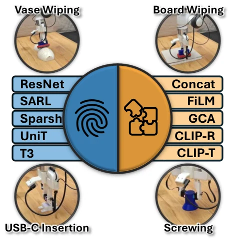

*TACTIC — encoder study authors · [Figure source](https://arxiv.org/html/2609.30969) · Original rights retained.*

| Field | Reported value and source scope |
| :-- | :-- |
| Record type | benchmark |
| Policy family | ACT [1](https://arxiv.org/abs/2609.30969)  |
| Base model and architecture | ACT; ResNet18, SARL, UniT, Sparsh-DINO, T3 tactile backbones [1](https://arxiv.org/abs/2609.30969) [3](https://arxiv.org/html/2609.30969)  |
| Model size and component | Not reported [1](https://arxiv.org/abs/2609.30969) [3](https://arxiv.org/html/2609.30969)  |
| Deployment inputs | Side/wrist RGB, paired DIGIT tactile images and robot state [1](https://arxiv.org/abs/2609.30969) [3](https://arxiv.org/html/2609.30969)  |
| Action outputs and horizon | ACT robot action chunks [1](https://arxiv.org/abs/2609.30969) [3](https://arxiv.org/html/2609.30969)  |
| Training method | Shared training/evaluation pipeline; compares raw feature and contrastive fusion strategies [1](https://arxiv.org/abs/2609.30969) [3](https://arxiv.org/html/2609.30969)  |
| Training data | ≈100 demonstrations per each of four tasks; four DIGIT cartridge pairs [1](https://arxiv.org/abs/2609.30969) [3](https://arxiv.org/html/2609.30969)  |
| Training duration | Not reported [1](https://arxiv.org/abs/2609.30969) [3](https://arxiv.org/html/2609.30969)  |
| Training hardware | Not reported [1](https://arxiv.org/abs/2609.30969) [3](https://arxiv.org/html/2609.30969)  |
| Inference and control rates | Demonstrations30 Hz; policy feedback rate not separately reported [1](https://arxiv.org/abs/2609.30969) [3](https://arxiv.org/html/2609.30969)  |
| Evaluation scope | Board Wiping, Vase Wiping, USB-C Insertion, Screwing; 2,180 rollouts including OOD conditions [1](https://arxiv.org/abs/2609.30969) [3](https://arxiv.org/html/2609.30969)  |
| Observations / modalities | RGB · Tactile · Proprioception |
| Evaluation domain | Real world |
| Embodiment | Parallel-jaw gripper |
| Release: code | Not verified [2](https://utn-air.github.io/TACTIC/) [4](https://utn-air.github.io/TACTIC)  |
| Release: weights | Not verified [2](https://utn-air.github.io/TACTIC/) [4](https://utn-air.github.io/TACTIC)  |
| Release: data | Not verified [2](https://utn-air.github.io/TACTIC/) [4](https://utn-air.github.io/TACTIC)  |
| Release: license | Not verified [2](https://utn-air.github.io/TACTIC/) [4](https://utn-air.github.io/TACTIC)  |
| Release: notes | No verified public download found in the inspected primary sources. [2](https://utn-air.github.io/TACTIC/) [4](https://utn-air.github.io/TACTIC)  |

**Scope and qualifications**

- Distinct from Cornell TACTIC (whole-arm control, arXiv: 2607.09218).
- A controlled empirical study; not presented here as a downloadable simulation suite.
- No universally best encoder/fusion across tasks was found.
- Distinct from the whole-arm contact-learning paper also named TACTIC (2607.09218).

**Primary evidence**

1. [Paper](https://arxiv.org/abs/2609.30969) — Published paper / arXiv record and manuscript.
2. [Official source](https://utn-air.github.io/TACTIC/) — Official project checked against full manuscript.
3. [Full paper: method and implementation details](https://arxiv.org/html/2609.30969) — Unreported specifications remain explicitly unknown; hardware/rates are scoped to training, inference or low-level control.
4. [Official TACTIC project](https://utn-air.github.io/TACTIC) — Project identity and release links checked independently of manuscript claims.

</details>

<a id="record-policy-tacit"></a>
<details>
<summary><strong>TACIT</strong> — TACIT: Tactile Contact Supervision for Spatial Attention in Dexterous Manipulation</summary>

**2026-09-21 · Preprint · Tohoku University**

**[Paper](https://arxiv.org/abs/2609.24507)**

Uses measured demonstration contacts to supervise spatial attention over earlier camera point clouds; tactile observations also remain policy inputs at deployment.

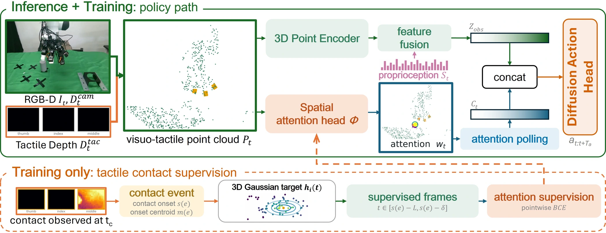

*TACIT authors · [Figure source](https://arxiv.org/html/2609.24507) · Original rights retained.*

| Field | Reported value and source scope |
| :-- | :-- |
| Record type | policy |
| Policy family | Diffusion [1](https://arxiv.org/abs/2609.24507)  |
| Base model and architecture | DP3/3D visuotactile diffusion backbone with point-wise attention MLP and tactile-derived Gaussian spatial targets [1](https://arxiv.org/abs/2609.24507)  |
| Model size and component | Not reported [1](https://arxiv.org/abs/2609.24507)  |
| Deployment inputs | Observed depth-derived XYZ cloud, tactile force/contact points and robot state; six-channel points encode XYZ, force and modality masks [1](https://arxiv.org/abs/2609.24507)  |
| Action outputs and horizon | 20 predicted actions, execute ten; 23D single-arm or 46D handover state/action interfaces [1](https://arxiv.org/abs/2609.24507)  |
| Training method | Diffusion imitation plus contact-derived attention supervision; contact targets are training-only, tactile observations remain online inputs [1](https://arxiv.org/abs/2609.24507)  |
| Training data | Ten physical demonstrations per ball/peg task; simulation 50 fruit/cube and 18 peg demos across placement configurations [1](https://arxiv.org/abs/2609.24507)  |
| Training duration | 3,000 epochs of 500 minibatches, batch 16; wall-clock Not reported [1](https://arxiv.org/abs/2609.24507)  |
| Training hardware | Not reported [1](https://arxiv.org/abs/2609.24507)  |
| Inference and control rates | Physical control 20 Hz; Isaac Lab simulation 30 Hz; ten DDIM inference steps [1](https://arxiv.org/abs/2609.24507)  |
| Evaluation scope | Physical FR3+LEAP+three 9DTact fingertips/D455 ball placement and peg insertion; simulated fruit, peg, cube and separate bimanual handover extension [1](https://arxiv.org/abs/2609.24507)  |
| Observations / modalities | Depth · Tactile · Proprioception |
| Evaluation domain | Simulation · Real world |
| Embodiment | Dexterous hand · Bimanual |
| Release: code | Not verified |
| Release: weights | Not verified |
| Release: data | Not verified |
| Release: license | Not verified; pretrained backbones and data retain separate terms |
| Release: notes | Availability concerns author-linked artifacts; no training or installation reproduced. |

**Scope and qualifications**

- Contact supervision targets earlier visual frames; it is not privileged online contact-location input.
- Reported improvement primarily concerns approach localization; remaining failures occur after arrival.
- Held-out placement diagnostics are inside the demonstrated convex hull, not workspace extrapolation.

**Primary evidence**

1. [Author manuscript and submission history](https://arxiv.org/abs/2609.24507) — Read full manuscript; first arXiv submission retained separately from current revision. Numeric costs and observations have setting-specific scope.

</details>

<a id="record-policy-unidex-vitac"></a>
<details>
<summary><strong>UniDex-ViTac</strong> — UniDex-ViTac: Learning Unified Visuo-Tactile Dexterous Manipulation Policy from Human Video Data</summary>

**2026-09-15 · Preprint · Not reported**

**[Paper](https://arxiv.org/abs/2609.16504)** · [Project](https://unidex-vitac.github.io/)

Converts annotated human videos into simulation specialists and contact-labeled rollouts, then distills an ACT generalist.

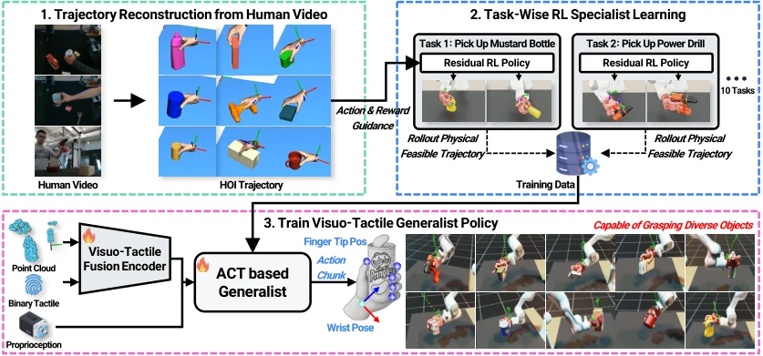

*UniDex-ViTac authors · [Figure source](https://arxiv.org/html/2609.16504) · Original rights retained.*

| Field | Reported value and source scope |
| :-- | :-- |
| Record type | policy |
| Policy family | ACT [1](https://arxiv.org/abs/2609.16504)  |
| Base model and architecture | ACT with point-cloud and fingertip contact tokens [1](https://arxiv.org/abs/2609.16504) [3](https://arxiv.org/html/2609.16504)  |
| Model size and component | Not reported [1](https://arxiv.org/abs/2609.16504) [3](https://arxiv.org/html/2609.16504)  |
| Deployment inputs | Depth-derived point clouds, proprioception and four binary fingertip contact signals [1](https://arxiv.org/abs/2609.16504) [3](https://arxiv.org/html/2609.16504)  |
| Action outputs and horizon | Arm/hand target-action chunks [1](https://arxiv.org/abs/2609.16504) [3](https://arxiv.org/html/2609.16504)  |
| Training method | Object-specific residual RL followed by pooled ACT imitation learning [1](https://arxiv.org/abs/2609.16504) [3](https://arxiv.org/html/2609.16504)  |
| Training data | 50 human demonstrations across ten objects → 10k simulated robot trajectories [1](https://arxiv.org/abs/2609.16504) [3](https://arxiv.org/html/2609.16504)  |
| Training duration | ≈2 days for ten specialists and rollout collection; generalist training excluded [1](https://arxiv.org/abs/2609.16504) [3](https://arxiv.org/html/2609.16504)  |
| Training hardware | One NVIDIA RTX 5090 for specialists/data collection [1](https://arxiv.org/abs/2609.16504) [3](https://arxiv.org/html/2609.16504)  |
| Inference and control rates | Not reported [1](https://arxiv.org/abs/2609.16504) [3](https://arxiv.org/html/2609.16504)  |
| Evaluation scope | Simulation ten-object suite; 110 physical trials across six seen/five unseen objects without real policy fine-tuning [1](https://arxiv.org/abs/2609.16504) [3](https://arxiv.org/html/2609.16504)  |
| Observations / modalities | Depth · Tactile · Proprioception |
| Evaluation domain | Simulation · Real world |
| Embodiment | Dexterous hand |
| Release: code | Not verified [2](https://unidex-vitac.github.io/)  |
| Release: weights | Not verified [2](https://unidex-vitac.github.io/)  |
| Release: data | Not verified [2](https://unidex-vitac.github.io/)  |
| Release: license | Not verified [2](https://unidex-vitac.github.io/)  |
| Release: notes | No verified public download found in the inspected primary sources. [2](https://unidex-vitac.github.io/)  |

**Scope and qualifications**

- Touch consists of four contact bits, not dense images or calibrated forces.
- Human references and object ground truth are training-only.

**Primary evidence**

1. [Author manuscript and submission history](https://arxiv.org/abs/2609.16504) — Policy facts refer to the full manuscript available on the verification date; date is first arXiv submission.
2. [Author project page](https://unidex-vitac.github.io/) — Release status is checked separately from paper claims; a project page alone does not imply released implementation or weights.
3. [Full paper: method and implementation details](https://arxiv.org/html/2609.16504) — Unreported specifications remain explicitly unknown; hardware/rates are scoped to training, inference or low-level control.

</details>

<a id="record-policy-wm-craftnet"></a>
<details>
<summary><strong>WM-Craftnet</strong> — WM-Craftnet: World Synesthesia Model for Generalizable and Robust Dexterous In-Hand Manipulation</summary>

**2026-09-07 · CoRL 2026 Spotlight · Sharpa**

**[Paper](https://arxiv.org/abs/2609.07002)** · [Project](https://wmcraftnet.github.io/) · [Code](https://github.com/sharpa-robotics/WM-Craftnet) · [Weights](https://huggingface.co/SharpaIT/WM-Craftnet)

Uses a recurrent multimodal world-state estimator to supply a PPO controller for robust in-hand rotation.


*WM-Craftnet authors · [Figure source](https://arxiv.org/html/2609.07002) · Original rights retained.*

| Field | Reported value and source scope |
| :-- | :-- |
| Record type | policy |
| Policy family | RL [1](https://arxiv.org/abs/2609.07002)  |
| Base model and architecture | Dreamer-style RSSM World Synesthesia Model + PPO MLP [1](https://arxiv.org/abs/2609.07002) [3](https://arxiv.org/html/2609.07002)  |
| Model size and component | Not reported [1](https://arxiv.org/abs/2609.07002) [3](https://arxiv.org/html/2609.07002)  |
| Deployment inputs | Wrist depth, tactile signals, proprioception and observation history [1](https://arxiv.org/abs/2609.07002) [3](https://arxiv.org/html/2609.07002)  |
| Action outputs and horizon | Relative targets for all 22 hand joints [1](https://arxiv.org/abs/2609.07002) [3](https://arxiv.org/html/2609.07002)  |
| Training method | Multimodal state estimation with auxiliary depth reconstruction, PPO control and domain randomization [1](https://arxiv.org/abs/2609.07002) [3](https://arxiv.org/html/2609.07002)  |
| Training data | Simulation RL; nine-object z-axis pretraining and downstream 49-object transfer [1](https://arxiv.org/abs/2609.07002) [3](https://arxiv.org/html/2609.07002)  |
| Training duration | Not reported [1](https://arxiv.org/abs/2609.07002) [3](https://arxiv.org/html/2609.07002)  |
| Training hardware | Not reported [1](https://arxiv.org/abs/2609.07002) [3](https://arxiv.org/html/2609.07002)  |
| Inference and control rates | Policy/depth/tactile 10 Hz; physics 60 Hz [1](https://arxiv.org/abs/2609.07002) [3](https://arxiv.org/html/2609.07002)  |
| Evaluation scope | Sim-to-real Sharpa Wave multi-axis object rotation [1](https://arxiv.org/abs/2609.07002) [3](https://arxiv.org/html/2609.07002)  |
| Observations / modalities | Depth · Tactile · Proprioception |
| Evaluation domain | Simulation · Real world |
| Embodiment | Dexterous hand |
| Release: code | Available [2](https://github.com/sharpa-robotics/WM-Craftnet)  |
| Release: weights | Available [2](https://github.com/sharpa-robotics/WM-Craftnet)  |
| Release: data | Not applicable [2](https://github.com/sharpa-robotics/WM-Craftnet)  |
| Release: license | Apache-2.0 for repository [2](https://github.com/sharpa-robotics/WM-Craftnet)  |
| Release: notes | Training, deployment and checkpoint paths are public. [2](https://github.com/sharpa-robotics/WM-Craftnet)  |

**Scope and qualifications**

- The world model is a state estimator; PPO does not optimize through imagined rollouts.

**Primary evidence**

1. [Author manuscript and submission history](https://arxiv.org/abs/2609.07002) — Policy facts refer to the full manuscript available on the verification date; date is first arXiv submission.
2. [Official repository](https://github.com/sharpa-robotics/WM-Craftnet) — Release status is checked separately from paper claims; a project page alone does not imply released implementation or weights.
3. [Full paper: method and implementation details](https://arxiv.org/html/2609.07002) — Unreported specifications remain explicitly unknown; hardware/rates are scoped to training, inference or low-level control.

</details>

<a id="record-policy-caat"></a>
<details>
<summary><strong>CAAT</strong> — CAAT: Contact-Aware Attention Scaling and Tactile Masking for Data-Efficient Contact-Rich Manipulation</summary>

**2026-08-02 · Preprint · Not reported**

**[Paper](https://arxiv.org/abs/2608.01102)**

Masks background tactile appearance and scales attention by contact to improve data efficiency across multiple policy backbones.


*CAAT authors · [Figure source](https://arxiv.org/html/2608.01102) · Original rights retained.*

| Field | Reported value and source scope |
| :-- | :-- |
| Record type | policy |
| Policy family | Hybrid [1](https://arxiv.org/abs/2608.01102)  |
| Base model and architecture | ACT, Diffusion Policy and π0 with contact-aware tactile fusion [1](https://arxiv.org/abs/2608.01102) [2](https://arxiv.org/html/2608.01102)  |
| Model size and component | Not reported [1](https://arxiv.org/abs/2608.01102) [2](https://arxiv.org/html/2608.01102)  |
| Deployment inputs | RGB, tactile images/reference, robot state and language for π0 [1](https://arxiv.org/abs/2608.01102) [2](https://arxiv.org/html/2608.01102)  |
| Action outputs and horizon | Backbone-specific action chunks [1](https://arxiv.org/abs/2608.01102) [2](https://arxiv.org/html/2608.01102)  |
| Training method | Reference-based tactile masking and contact-aware attention scaling [1](https://arxiv.org/abs/2608.01102) [2](https://arxiv.org/html/2608.01102)  |
| Training data | Not reported [1](https://arxiv.org/abs/2608.01102) [2](https://arxiv.org/html/2608.01102)  |
| Training duration | Not reported [1](https://arxiv.org/abs/2608.01102) [2](https://arxiv.org/html/2608.01102)  |
| Training hardware | ACT/DP: one A100 80GB; π0 LoRA: two A100 80GB [1](https://arxiv.org/abs/2608.01102) [2](https://arxiv.org/html/2608.01102)  |
| Inference and control rates | Not reported [1](https://arxiv.org/abs/2608.01102) [2](https://arxiv.org/html/2608.01102)  |
| Evaluation scope | Five UniVTAC tasks; Lift Bottle, Open Box and another real contact task (examples only) [1](https://arxiv.org/abs/2608.01102) [2](https://arxiv.org/html/2608.01102)  |
| Observations / modalities | RGB · Tactile · Proprioception · Language |
| Evaluation domain | Simulation · Real world |
| Embodiment | Parallel-jaw gripper |
| Release: code | Not verified |
| Release: weights | Not verified |
| Release: data | Not verified |
| Release: license | Not verified |
| Release: notes | No verified public download found in the inspected primary sources. |

**Scope and qualifications**

- Requires a tactile reference and contact estimation.
- Model count/size depend on the chosen backbone.

**Primary evidence**

1. [Author manuscript and submission history](https://arxiv.org/abs/2608.01102) — Policy facts refer to the full manuscript available on the verification date; date is first arXiv submission.
2. [Full paper: method and implementation details](https://arxiv.org/html/2608.01102) — Unreported specifications remain explicitly unknown; hardware/rates are scoped to training, inference or low-level control.

</details>

<a id="record-policy-taccorl"></a>
<details>
<summary><strong>TacCoRL</strong> — TacCoRL: Integrating Tactile Feedback into VLA via Simulation</summary>

**2026-06-10 · CoRL 2026 · Not reported**

**[Paper](https://arxiv.org/abs/2606.11743)** · [Project](https://tac-corl.github.io/)

Adapts tactile-aware VLAs with supervised sim–real co-training and simulation reinforcement learning anchored by real demonstrations.


*TacCoRL authors · [Figure source](https://arxiv.org/html/2606.11743) · Original rights retained.*

| Field | Reported value and source scope |
| :-- | :-- |
| Record type | policy |
| Policy family | Hybrid [1](https://arxiv.org/abs/2606.11743)  |
| Base model and architecture | π0.5-style VLA with CNN2 temporal tactile encoder and prefix/suffix touch tokens [1](https://arxiv.org/abs/2606.11743) [2](https://arxiv.org/html/2606.11743)  |
| Model size and component | Not reported [1](https://arxiv.org/abs/2606.11743) [2](https://arxiv.org/html/2606.11743)  |
| Deployment inputs | RGB, tactile feedback, robot state and task instruction [1](https://arxiv.org/abs/2606.11743) [2](https://arxiv.org/html/2606.11743)  |
| Action outputs and horizon | 10-step, 14D bimanual action chunks [1](https://arxiv.org/abs/2606.11743) [2](https://arxiv.org/html/2606.11743)  |
| Training method | Sim–real supervised co-training, followed by simulation RL with real-data regularization [1](https://arxiv.org/abs/2606.11743) [2](https://arxiv.org/html/2606.11743)  |
| Training data | Per task: 50 real demonstrations plus 20 simulated teleoperation demos expanded to 200 with MimicGen [1](https://arxiv.org/abs/2606.11743) [2](https://arxiv.org/html/2606.11743)  |
| Training duration | Supervised co-training1k updates(Assembly1/2) or3k(Puzzle/Test Tube); RL wall-clock not reported [1](https://arxiv.org/abs/2606.11743) [2](https://arxiv.org/html/2606.11743)  |
| Training hardware | Not reported [1](https://arxiv.org/abs/2606.11743) [2](https://arxiv.org/html/2606.11743)  |
| Inference and control rates | Not reported [1](https://arxiv.org/abs/2606.11743) [2](https://arxiv.org/html/2606.11743)  |
| Evaluation scope | Assembly1, Assembly2, Do Puzzle, Test Tube Insertion; 128 parallel sim environments and 20 real trials/task [1](https://arxiv.org/abs/2606.11743) [2](https://arxiv.org/html/2606.11743)  |
| Observations / modalities | RGB · Tactile · Proprioception · Language |
| Evaluation domain | Simulation · Real world |
| Embodiment | Parallel-jaw gripper · Bimanual |
| Release: code | Not verified |
| Release: weights | Not verified |
| Release: data | Not verified |
| Release: license | Not verified |
| Release: notes | No verified public download found in the inspected primary sources. |

**Scope and qualifications**

- Requires simulation/real camera, tactile and control interfaces to align.
- Training hardware/model parameter count not verified from the inspected full text.

**Primary evidence**

1. [Author manuscript and submission history](https://arxiv.org/abs/2606.11743) — Policy facts refer to the full manuscript available on the verification date; date is first arXiv submission.
2. [Full paper: method and implementation details](https://arxiv.org/html/2606.11743) — Unreported specifications remain explicitly unknown; hardware/rates are scoped to training, inference or low-level control.

</details>

<a id="record-policy-torl-vla"></a>
<details>
<summary><strong>TORL-VLA</strong> — TORL-VLA: Tactile Guided Online Reinforcement Learning for Contact-Rich Manipulation</summary>

**2026-06-08 · Preprint · Meituan**

**[Paper](https://arxiv.org/abs/2606.09337)** · [Project](https://torl-vla.github.io/)

Refines a frozen tactile-wrench-aware VLA online using stage-wise RL and an intervention-censored critic.


*TORL-VLA authors · [Figure source](https://arxiv.org/html/2606.09337) · Original rights retained.*

| Field | Reported value and source scope |
| :-- | :-- |
| Record type | policy |
| Policy family | Hybrid [1](https://arxiv.org/abs/2606.09337)  |
| Base model and architecture | Wrench-aware VLA plus lightweight online actor–critic [1](https://arxiv.org/abs/2606.09337) [3](https://arxiv.org/html/2606.09337)  |
| Model size and component | Not reported [1](https://arxiv.org/abs/2606.09337) [3](https://arxiv.org/html/2606.09337)  |
| Deployment inputs | Three RGB views, state, instruction and tactile-derived 12D wrench history [1](https://arxiv.org/abs/2606.09337) [3](https://arxiv.org/html/2606.09337)  |
| Action outputs and horizon | 50-step action/wrench references; refines and executes first 10 actions [1](https://arxiv.org/abs/2606.09337) [3](https://arxiv.org/html/2606.09337)  |
| Training method | Supervised action/wrench prediction followed by online RL from autonomous and human-intervention data [1](https://arxiv.org/abs/2606.09337) [3](https://arxiv.org/html/2606.09337)  |
| Training data | Not reported [1](https://arxiv.org/abs/2606.09337) [3](https://arxiv.org/html/2606.09337)  |
| Training duration | Not reported [1](https://arxiv.org/abs/2606.09337) [3](https://arxiv.org/html/2606.09337)  |
| Training hardware | Not reported [1](https://arxiv.org/abs/2606.09337) [3](https://arxiv.org/html/2606.09337)  |
| Inference and control rates | 20 Hz commands; 0.5 s replanning interval; inference timing measured separately on RTX 4090 [1](https://arxiv.org/abs/2606.09337) [3](https://arxiv.org/html/2606.09337)  |
| Evaluation scope | Long-horizon latch manipulation, coffee-cup placement and egg handling [1](https://arxiv.org/abs/2606.09337) [3](https://arxiv.org/html/2606.09337)  |
| Observations / modalities | RGB · Tactile · Force/Torque · Proprioception · Language |
| Evaluation domain | Real world |
| Embodiment | Parallel-jaw gripper |
| Release: code | Not verified [2](https://torl-vla.github.io/)  |
| Release: weights | Not verified [2](https://torl-vla.github.io/)  |
| Release: data | Not verified [2](https://torl-vla.github.io/)  |
| Release: license | Not verified [2](https://torl-vla.github.io/)  |
| Release: notes | No verified public download found in the inspected primary sources. [2](https://torl-vla.github.io/)  |

**Scope and qualifications**

- Deployment uses tactile-derived wrench summaries rather than raw tactile images.
- Human interventions and real interaction are additional training resources.

**Primary evidence**

1. [Author manuscript and submission history](https://arxiv.org/abs/2606.09337) — Policy facts refer to the full manuscript available on the verification date; date is first arXiv submission.
2. [Author project page](https://torl-vla.github.io/) — Release status is checked separately from paper claims; a project page alone does not imply released implementation or weights.
3. [Full paper: method and implementation details](https://arxiv.org/html/2606.09337) — Unreported specifications remain explicitly unknown; hardware/rates are scoped to training, inference or low-level control.

</details>

<a id="record-policy-si-diff"></a>
<details>
<summary><strong>SI-Diff</strong> — SI-Diff: A Framework for Learning Search and High-Precision Insertion with a Force-Domain Diffusion Policy</summary>

**2026-05-12 · Preprint · Not reported**

**[Paper](https://arxiv.org/abs/2605.12247)**

A mode-conditioned force-domain diffusion policy learns both lateral search and tight-clearance insertion from successful teacher trajectories.


*SI-Diff authors · [Figure source](https://arxiv.org/html/2605.12247) · Original rights retained.*

| Field | Reported value and source scope |
| :-- | :-- |
| Record type | policy |
| Policy family | Diffusion [1](https://arxiv.org/abs/2605.12247)  |
| Base model and architecture | TacDiffusion-style denoiser with learned search/insertion mode tokens [1](https://arxiv.org/abs/2605.12247) [2](https://arxiv.org/html/2605.12247)  |
| Model size and component | Not reported [1](https://arxiv.org/abs/2605.12247) [2](https://arxiv.org/html/2605.12247)  |
| Deployment inputs | Current/previous external wrench, internal wrench and end-effector velocity; 36D total plus mode [1](https://arxiv.org/abs/2605.12247) [2](https://arxiv.org/html/2605.12247)  |
| Action outputs and horizon | 6D feed-forward desired wrench for impedance control [1](https://arxiv.org/abs/2605.12247) [2](https://arxiv.org/html/2605.12247)  |
| Training method | Mode embedding, stochastic teacher data and balanced batch sampling [1](https://arxiv.org/abs/2605.12247) [2](https://arxiv.org/html/2605.12247)  |
| Training data | 300 successful search examples plus 1,500 TacDiffusion insertion demonstrations; one0.1-mm-clearance cuboid training geometry [1](https://arxiv.org/abs/2605.12247) [2](https://arxiv.org/html/2605.12247)  |
| Training duration | 2,000 epochs; wall-clock not reported [1](https://arxiv.org/abs/2605.12247) [2](https://arxiv.org/html/2605.12247)  |
| Training hardware | One NVIDIA RTX A6000 48GB [1](https://arxiv.org/abs/2605.12247) [2](https://arxiv.org/html/2605.12247)  |
| Inference and control rates | Not reported [1](https://arxiv.org/abs/2605.12247) [2](https://arxiv.org/html/2605.12247)  |
| Evaluation scope | Real Franka peg search/insertion; initial lateral offsets up to 5 mm and zero-shot unseen geometries [1](https://arxiv.org/abs/2605.12247) [2](https://arxiv.org/html/2605.12247)  |
| Observations / modalities | Force/Torque · Proprioception |
| Evaluation domain | Real world |
| Embodiment | Parallel-jaw gripper |
| Release: code | Not verified |
| Release: weights | Not verified |
| Release: data | Not verified |
| Release: license | Not verified |
| Release: notes | No verified public download found in the inspected primary sources. |

**Scope and qualifications**

- “Tactile” in the paper denotes wrench feedback, not optical or skin tactile sensing.
- Search data is filtered to successful and efficient teacher trajectories.

**Primary evidence**

1. [Author manuscript and submission history](https://arxiv.org/abs/2605.12247) — Policy facts refer to the full manuscript available on the verification date; date is first arXiv submission.
2. [Full paper: method and implementation details](https://arxiv.org/html/2605.12247) — Unreported specifications remain explicitly unknown; hardware/rates are scoped to training, inference or low-level control.

</details>

<a id="record-policy-transdex"></a>
<details>
<summary><strong>TransDex</strong> — TransDex: Pre-training Visuo-Tactile Policy with Point Cloud Reconstruction for Dexterous Manipulation of Transparent Objects</summary>

**2026-03-14 · IEEE RA-L 2026 · Not reported**

**[Paper](https://arxiv.org/abs/2603.13869)** · [Project](https://transdex.github.io/) · [Code](https://github.com/LFGfg/TransDex)

Pretrains point-cloud reconstruction and tactile fusion to manipulate transparent objects despite missing/noisy depth.


*TransDex authors · [Figure source](https://arxiv.org/html/2603.13869) · Original rights retained.*

| Field | Reported value and source scope |
| :-- | :-- |
| Record type | policy |
| Policy family | Diffusion [1](https://arxiv.org/abs/2603.13869)  |
| Base model and architecture | Point-cloud reconstruction pretraining + hierarchical visual–tactile fusion diffusion policy [1](https://arxiv.org/abs/2603.13869) [3](https://arxiv.org/html/2603.13869)  |
| Model size and component | Not reported [1](https://arxiv.org/abs/2603.13869) [3](https://arxiv.org/html/2603.13869)  |
| Deployment inputs | Depth-derived point clouds, Paxini tactile arrays and robot state [1](https://arxiv.org/abs/2603.13869) [3](https://arxiv.org/html/2603.13869)  |
| Action outputs and horizon | Arm and 16-DoF hand action targets [1](https://arxiv.org/abs/2603.13869) [3](https://arxiv.org/html/2603.13869)  |
| Training method | Contrastive/geometric reconstruction pretraining followed by diffusion imitation learning [1](https://arxiv.org/abs/2603.13869) [3](https://arxiv.org/html/2603.13869)  |
| Training data | PyBullet synthetic reconstruction pretraining; real transparent-object demonstrations; scale not reported [1](https://arxiv.org/abs/2603.13869) [3](https://arxiv.org/html/2603.13869)  |
| Training duration | Not reported [1](https://arxiv.org/abs/2603.13869) [3](https://arxiv.org/html/2603.13869)  |
| Training hardware | Not reported [1](https://arxiv.org/abs/2603.13869) [3](https://arxiv.org/html/2603.13869)  |
| Inference and control rates | Not reported [1](https://arxiv.org/abs/2603.13869) [3](https://arxiv.org/html/2603.13869)  |
| Evaluation scope | Real transparent-object dexterous manipulation with noisy and incomplete depth [1](https://arxiv.org/abs/2603.13869) [3](https://arxiv.org/html/2603.13869)  |
| Observations / modalities | Depth · Tactile · Proprioception |
| Evaluation domain | Real world |
| Embodiment | Dexterous hand |
| Release: code | Available [2](https://github.com/LFGfg/TransDex)  |
| Release: weights | Not verified [2](https://github.com/LFGfg/TransDex)  |
| Release: data | Not released [2](https://github.com/LFGfg/TransDex)  |
| Release: license | Not verified [2](https://github.com/LFGfg/TransDex)  |
| Release: notes | Model and preprocessing code public; README says example pretraining dataset will be released later. [2](https://github.com/LFGfg/TransDex)  |

**Scope and qualifications**

- Main setting does not consume RGB colors.
- Real setup requires two calibrated RealSense D435i depth cameras.

**Primary evidence**

1. [Author manuscript and submission history](https://arxiv.org/abs/2603.13869) — Policy facts refer to the full manuscript available on the verification date; date is first arXiv submission.
2. [Official repository](https://github.com/LFGfg/TransDex) — Release status is checked separately from paper claims; a project page alone does not imply released implementation or weights.
3. [Full paper: method and implementation details](https://arxiv.org/html/2603.13869) — Unreported specifications remain explicitly unknown; hardware/rates are scoped to training, inference or low-level control.

</details>

<a id="record-policy-deco"></a>
<details>
<summary><strong>DECO</strong> — DECO: Decoupled Multimodal Diffusion Transformer for Bimanual Dexterous Manipulation with a Plugin Tactile Adapter</summary>

**2026-02-05 · ICML 2026 · BAAI**

**[Paper](https://arxiv.org/abs/2602.05513)** · [Project](https://baai-humanoid.github.io/DECO-webpage/) · [Code](https://github.com/BAAI-Humanoid/DECO) · [Data](https://huggingface.co/datasets/BAAI-Humanoid/DECO-50)

Decouples visual, proprioceptive and tactile conditioning; a small tactile adapter and LoRA adapt a pretrained bimanual policy.


*DECO authors · [Figure source](https://arxiv.org/html/2602.05513) · Original rights retained.*

| Field | Reported value and source scope |
| :-- | :-- |
| Record type | policy |
| Policy family | Diffusion [1](https://arxiv.org/abs/2602.05513)  |
| Base model and architecture | ResNet-34 + six-layer multimodal DiT with flow matching [1](https://arxiv.org/abs/2602.05513) [3](https://arxiv.org/html/2602.05513)  |
| Model size and component | DECO 83.05M; DECO.p 91.02M total / 7.97M trainable [1](https://arxiv.org/abs/2602.05513) [3](https://arxiv.org/html/2602.05513)  |
| Deployment inputs | Binocular RGB, robot joint state and optional bimanual tactile taxels [1](https://arxiv.org/abs/2602.05513) [3](https://arxiv.org/html/2602.05513)  |
| Action outputs and horizon | 32-step action chunks; typically executes 16 [1](https://arxiv.org/abs/2602.05513) [3](https://arxiv.org/html/2602.05513)  |
| Training method | Visual/proprioceptive pretraining; frozen-backbone tactile adapter training with LoRA [1](https://arxiv.org/abs/2602.05513) [3](https://arxiv.org/html/2602.05513)  |
| Training data | DECO-50: &gt;50 h, ≈8k successful trajectories, &gt;5M frames, four scenarios / 28 subtasks [1](https://arxiv.org/abs/2602.05513) [3](https://arxiv.org/html/2602.05513)  |
| Training duration | Paper: 150 epochs DECO/DECO.p; current README example 200; wall-clock not reported [1](https://arxiv.org/abs/2602.05513) [3](https://arxiv.org/html/2602.05513)  |
| Training hardware | 8 A100 40GB GPUs [1](https://arxiv.org/abs/2602.05513) [3](https://arxiv.org/html/2602.05513)  |
| Inference and control rates | Not reported [1](https://arxiv.org/abs/2602.05513) [3](https://arxiv.org/html/2602.05513)  |
| Evaluation scope | Four real bimanual scenarios; released sim branches for LIBERO, DexJoCo, UniVTAC and RoboTwin [1](https://arxiv.org/abs/2602.05513) [3](https://arxiv.org/html/2602.05513)  |
| Observations / modalities | RGB · Tactile · Proprioception |
| Evaluation domain | Real world |
| Embodiment | Dexterous hand · Bimanual |
| Release: code | Available [2](https://github.com/BAAI-Humanoid/DECO)  |
| Release: weights | Not verified [2](https://github.com/BAAI-Humanoid/DECO)  |
| Release: data | Available [2](https://github.com/BAAI-Humanoid/DECO)  |
| Release: license | Apache-2.0 for repository; dataset terms separate [2](https://github.com/BAAI-Humanoid/DECO)  |
| Release: notes | Training/deployment and multiple simulation branches available; checkpoint download not independently verified. [2](https://github.com/BAAI-Humanoid/DECO)  |

**Scope and qualifications**

- Binocular RGB is not explicit depth input.
- Paper and current repository training epoch recipes differ.

**Primary evidence**

1. [Author manuscript and submission history](https://arxiv.org/abs/2602.05513) — Policy facts refer to the full manuscript available on the verification date; date is first arXiv submission.
2. [Official repository](https://github.com/BAAI-Humanoid/DECO) — Release status is checked separately from paper claims; a project page alone does not imply released implementation or weights.
3. [Full paper: method and implementation details](https://arxiv.org/html/2602.05513) — Unreported specifications remain explicitly unknown; hardware/rates are scoped to training, inference or low-level control.

</details>

<a id="record-policy-vt-refine"></a>
<details>
<summary><strong>VT-Refine</strong> — VT-Refine: Learning Bimanual Assembly with Visuo-Tactile Feedback via Simulation Fine-Tuning</summary>

**2025-10-16 · CoRL 2025 · NVIDIA / UIUC**

**[Paper](https://arxiv.org/abs/2510.14930)** · [Project](https://binghao-huang.github.io/vt_refine/) · [Code](https://github.com/NVlabs/vt-refine)

Improves demonstration-trained visuotactile diffusion policies using parallel simulation RL and transfers them back to bimanual real assembly.


*VT-Refine authors · [Figure source](https://arxiv.org/html/2510.14930) · Original rights retained.*

| Field | Reported value and source scope |
| :-- | :-- |
| Record type | policy |
| Policy family | Hybrid [1](https://arxiv.org/abs/2510.14930)  |
| Base model and architecture | 3D point-based Diffusion Policy + diffusion-policy PPO [1](https://arxiv.org/abs/2510.14930) [3](https://arxiv.org/html/2510.14930)  |
| Model size and component | Not reported [1](https://arxiv.org/abs/2510.14930) [3](https://arxiv.org/html/2510.14930)  |
| Deployment inputs | Depth-derived visual points, spatial pressure taxels and proprioception [1](https://arxiv.org/abs/2510.14930) [3](https://arxiv.org/html/2510.14930)  |
| Action outputs and horizon | Bimanual robot actions [1](https://arxiv.org/abs/2510.14930) [3](https://arxiv.org/html/2510.14930)  |
| Training method | Behavior cloning → digital twin RL refinement → real deployment [1](https://arxiv.org/abs/2510.14930) [3](https://arxiv.org/html/2510.14930)  |
| Training data | Typically 30 real demonstrations per task; ablations use 10/30/50 [1](https://arxiv.org/abs/2510.14930) [3](https://arxiv.org/html/2510.14930)  |
| Training duration | Not reported [1](https://arxiv.org/abs/2510.14930) [3](https://arxiv.org/html/2510.14930)  |
| Training hardware | Not reported [1](https://arxiv.org/abs/2510.14930) [3](https://arxiv.org/html/2510.14930)  |
| Inference and control rates | Not reported [1](https://arxiv.org/abs/2510.14930) [3](https://arxiv.org/html/2510.14930)  |
| Evaluation scope | Contact-rich bimanual assembly on WidowX and Kinova-based setups [1](https://arxiv.org/abs/2510.14930) [3](https://arxiv.org/html/2510.14930)  |
| Observations / modalities | Depth · Tactile · Proprioception |
| Evaluation domain | Simulation · Real world |
| Embodiment | Parallel-jaw gripper · Bimanual |
| Release: code | Available [2](https://github.com/NVlabs/vt-refine)  |
| Release: weights | Not verified [2](https://github.com/NVlabs/vt-refine)  |
| Release: data | Not verified [2](https://github.com/NVlabs/vt-refine)  |
| Release: license | Not verified [2](https://github.com/NVlabs/vt-refine)  |
| Release: notes | Official repository supplies simulation, training and deployment components; external assets may require separate downloads. [2](https://github.com/NVlabs/vt-refine)  |

**Scope and qualifications**

- Uses normal-pressure tactile pads, not optical image sensors; shear and deformable-object mechanics are outside the modeled sensor scope.

**Primary evidence**

1. [Author manuscript and submission history](https://arxiv.org/abs/2510.14930) — Policy facts refer to the full manuscript available on the verification date; date is first arXiv submission.
2. [Official repository](https://github.com/NVlabs/vt-refine) — Release status is checked separately from paper claims; a project page alone does not imply released implementation or weights.
3. [Full paper: method and implementation details](https://arxiv.org/html/2510.14930) — Unreported specifications remain explicitly unknown; hardware/rates are scoped to training, inference or low-level control.

</details>

<a id="record-policy-farm"></a>
<details>
<summary><strong>FARM</strong> — Tactile-Conditioned Diffusion Policy for Force-Aware Robotic Manipulation</summary>

**2025-10-15 · Preprint · TU Darmstadt**

**[Paper](https://arxiv.org/abs/2510.13324)** · [Project](https://tactile-farm.github.io/)

Uses tactile force distributions and a force-aware action space to jointly control pose, grip width and grip force.


*FARM authors · [Figure source](https://arxiv.org/html/2510.13324) · Original rights retained.*

| Field | Reported value and source scope |
| :-- | :-- |
| Record type | policy |
| Policy family | Diffusion [1](https://arxiv.org/abs/2510.13324)  |
| Base model and architecture | 1D temporal CNN Diffusion Policy with FiLM conditioning; FEATS force estimator [1](https://arxiv.org/abs/2510.13324) [3](https://arxiv.org/html/2510.13324)  |
| Model size and component | Not reported [1](https://arxiv.org/abs/2510.13324) [3](https://arxiv.org/html/2510.13324)  |
| Deployment inputs | Visual observations, proprioception and GelSight-derived spatial force distributions [1](https://arxiv.org/abs/2510.13324) [3](https://arxiv.org/html/2510.13324)  |
| Action outputs and horizon | Absolute end-effector pose, gripper width and target grip force trajectories [1](https://arxiv.org/abs/2510.13324) [3](https://arxiv.org/html/2510.13324)  |
| Training method | Tactile-conditioned imitation plus contact-gated width/force low-level control [1](https://arxiv.org/abs/2510.13324) [3](https://arxiv.org/html/2510.13324)  |
| Training data | Modified handheld UMI demonstrations across three force-sensitive task settings; count not reported [1](https://arxiv.org/abs/2510.13324) [3](https://arxiv.org/html/2510.13324)  |
| Training duration | Not reported [1](https://arxiv.org/abs/2510.13324) [3](https://arxiv.org/html/2510.13324)  |
| Training hardware | Not reported [1](https://arxiv.org/abs/2510.13324) [3](https://arxiv.org/html/2510.13324)  |
| Inference and control rates | Policy ≈7 Hz; tactile force loop 25 Hz; actuated gripper ≈50 Hz [1](https://arxiv.org/abs/2510.13324) [3](https://arxiv.org/html/2510.13324)  |
| Evaluation scope | High-force, low-force and dynamically varying-force manipulation [1](https://arxiv.org/abs/2510.13324) [3](https://arxiv.org/html/2510.13324)  |
| Observations / modalities | RGB · Tactile · Proprioception |
| Evaluation domain | Real world |
| Embodiment | Parallel-jaw gripper |
| Release: code | Not verified [2](https://tactile-farm.github.io/)  |
| Release: weights | Not verified [2](https://tactile-farm.github.io/)  |
| Release: data | Not verified [2](https://tactile-farm.github.io/)  |
| Release: license | Not verified [2](https://tactile-farm.github.io/)  |
| Release: notes | No verified public download found in the inspected primary sources. [2](https://tactile-farm.github.io/)  |

**Scope and qualifications**

- FEATS forces are inferred from tactile images rather than directly calibrated force measurements.
- RealSense hardware presence does not establish depth as a policy input.

**Primary evidence**

1. [Author manuscript and submission history](https://arxiv.org/abs/2510.13324) — Policy facts refer to the full manuscript available on the verification date; date is first arXiv submission.
2. [Author project page](https://tactile-farm.github.io/) — Release status is checked separately from paper claims; a project page alone does not imply released implementation or weights.
3. [Full paper: method and implementation details](https://arxiv.org/html/2510.13324) — Unreported specifications remain explicitly unknown; hardware/rates are scoped to training, inference or low-level control.

</details>

<a id="record-policy-vla-touch"></a>
<details>
<summary><strong>VLA-Touch</strong> — VLA-Touch: Enhancing Vision-Language-Action Models with Dual-Level Tactile Feedback</summary>

**2025-07-23 · IEEE RA-L 2026 · National University of Singapore**

**[Paper](https://arxiv.org/abs/2507.17294)** · [Code](https://github.com/clear-nus/vla-touch)

Adds semantic tactile feedback for planning and a tactile diffusion controller for refining base-VLA actions.


*VLA-Touch authors · [Figure source](https://arxiv.org/html/2507.17294) · Original rights retained.*

| Field | Reported value and source scope |
| :-- | :-- |
| Record type | policy |
| Policy family | Hybrid [1](https://arxiv.org/abs/2507.17294)  |
| Base model and architecture | RDT-1B + Octopi tactile-language model + DINOv2 interpolant controller [1](https://arxiv.org/abs/2507.17294) [3](https://arxiv.org/html/2507.17294)  |
| Model size and component | 1B base action policy component; total system not reported [1](https://arxiv.org/abs/2507.17294) [3](https://arxiv.org/html/2507.17294)  |
| Deployment inputs | RGB, instruction, robot state, GelSight images and marker-derived tactile summaries [1](https://arxiv.org/abs/2507.17294) [3](https://arxiv.org/html/2507.17294)  |
| Action outputs and horizon | Refined action chunks from a frozen task-adapted VLA [1](https://arxiv.org/abs/2507.17294) [3](https://arxiv.org/html/2507.17294)  |
| Training method | Base vision-only adaptation, then tactile interpolant-controller training; Octopi informs task planner [1](https://arxiv.org/abs/2507.17294) [3](https://arxiv.org/html/2507.17294)  |
| Training data | Cup: 100 episodes/8 min; Wipe: 100/15 min; Peel: 180/30 min [1](https://arxiv.org/abs/2507.17294) [3](https://arxiv.org/html/2507.17294)  |
| Training duration | Base embodiment alignment 100k steps ≈80 h; task adaptation 20k steps ≈16 h; controller additional [1](https://arxiv.org/abs/2507.17294) [3](https://arxiv.org/html/2507.17294)  |
| Training hardware | One RTX 4090 [1](https://arxiv.org/abs/2507.17294) [3](https://arxiv.org/html/2507.17294)  |
| Inference and control rates | Interpolant correction/actions at most 8 Hz; recordings 10 Hz; tactile sensor ≥25 Hz [1](https://arxiv.org/abs/2507.17294) [3](https://arxiv.org/html/2507.17294)  |
| Evaluation scope | Cup pick/place, wiping and mango peeling [1](https://arxiv.org/abs/2507.17294) [3](https://arxiv.org/html/2507.17294)  |
| Observations / modalities | RGB · Tactile · Proprioception · Language |
| Evaluation domain | Real world |
| Embodiment | Parallel-jaw gripper |
| Release: code | Partial [2](https://github.com/clear-nus/vla-touch)  |
| Release: weights | Not verified [2](https://github.com/clear-nus/vla-touch)  |
| Release: data | Not verified [2](https://github.com/clear-nus/vla-touch)  |
| Release: license | MIT for repository [2](https://github.com/clear-nus/vla-touch)  |
| Release: notes | Controller/Octopi integration code public; README says complete modified inference release is forthcoming. [2](https://github.com/clear-nus/vla-touch)  |

**Scope and qualifications**

- “Without fine-tuning the base VLA” refers to tactile integration; the base model is first embodiment/task adapted.
- Eight-Hz interpolant does not consume every tactile frame.

**Primary evidence**

1. [Author manuscript and submission history](https://arxiv.org/abs/2507.17294) — Policy facts refer to the full manuscript available on the verification date; date is first arXiv submission.
2. [Official repository](https://github.com/clear-nus/vla-touch) — Release status is checked separately from paper claims; a project page alone does not imply released implementation or weights.
3. [Full paper: method and implementation details](https://arxiv.org/html/2507.17294) — Unreported specifications remain explicitly unknown; hardware/rates are scoped to training, inference or low-level control.

</details>

<a id="record-policy-vitacformer"></a>
<details>
<summary><strong>ViTacFormer</strong> — ViTacFormer: Learning Cross-Modal Representation for Visuo-Tactile Dexterous Manipulation</summary>

**2025-06-19 · Preprint · Peking University / Sharpa**

**[Paper](https://arxiv.org/abs/2506.15953)** · [Project](https://roboverseorg.github.io/ViTacFormerPage/) · [Code](https://github.com/RoboVerseOrg/ViTacFormer)

Learns a cross-attention visuotactile representation with autoregressive tactile prediction for long-horizon dexterous imitation.


*ViTacFormer authors · [Figure source](https://arxiv.org/html/2506.15953) · Original rights retained.*

| Field | Reported value and source scope |
| :-- | :-- |
| Record type | policy |
| Policy family | ACT [1](https://arxiv.org/abs/2506.15953)  |
| Base model and architecture | ACT-style latent action policy; cross-attention encoder and tactile prediction head [1](https://arxiv.org/abs/2506.15953) [3](https://arxiv.org/html/2506.15953)  |
| Model size and component | Not reported [1](https://arxiv.org/abs/2506.15953) [3](https://arxiv.org/html/2506.15953)  |
| Deployment inputs | High-resolution RGB, tactile signals and robot state [1](https://arxiv.org/abs/2506.15953) [3](https://arxiv.org/html/2506.15953)  |
| Action outputs and horizon | Dexterous action chunks and auxiliary future tactile signals [1](https://arxiv.org/abs/2506.15953) [3](https://arxiv.org/html/2506.15953)  |
| Training method | Easy-to-hard curriculum and joint action/tactile prediction imitation [1](https://arxiv.org/abs/2506.15953) [3](https://arxiv.org/html/2506.15953)  |
| Training data | 50 expert demonstrations per task [1](https://arxiv.org/abs/2506.15953) [3](https://arxiv.org/html/2506.15953)  |
| Training duration | 100 epochs; short tasks ≈12 h; long tasks up to 2 days [1](https://arxiv.org/abs/2506.15953) [3](https://arxiv.org/html/2506.15953)  |
| Training hardware | 2 NVIDIA H20 GPUs [1](https://arxiv.org/abs/2506.15953) [3](https://arxiv.org/html/2506.15953)  |
| Inference and control rates | Not reported [1](https://arxiv.org/abs/2506.15953) [3](https://arxiv.org/html/2506.15953)  |
| Evaluation scope | Real multi-finger skills including long-horizon Make Hamburger, up to 11 sequential stages [1](https://arxiv.org/abs/2506.15953) [3](https://arxiv.org/html/2506.15953)  |
| Observations / modalities | RGB · Tactile · Proprioception |
| Evaluation domain | Real world |
| Embodiment | Dexterous hand · Bimanual |
| Release: code | Available [2](https://github.com/RoboVerseOrg/ViTacFormer)  |
| Release: weights | Not verified [2](https://github.com/RoboVerseOrg/ViTacFormer)  |
| Release: data | Not verified [2](https://github.com/RoboVerseOrg/ViTacFormer)  |
| Release: license | Not verified [2](https://github.com/RoboVerseOrg/ViTacFormer)  |
| Release: notes | Author project links implementation; weights/data download scope not verified. [2](https://github.com/RoboVerseOrg/ViTacFormer)  |

**Scope and qualifications**

- Long-horizon duration and stage counts are task-specific results, not a general reliability guarantee.

**Primary evidence**

1. [Author manuscript and submission history](https://arxiv.org/abs/2506.15953) — Policy facts refer to the full manuscript available on the verification date; date is first arXiv submission.
2. [Official repository](https://github.com/RoboVerseOrg/ViTacFormer) — Release status is checked separately from paper claims; a project page alone does not imply released implementation or weights.
3. [Full paper: method and implementation details](https://arxiv.org/html/2506.15953) — Unreported specifications remain explicitly unknown; hardware/rates are scoped to training, inference or low-level control.

</details>

<a id="record-policy-vital-local"></a>
<details>
<summary><strong>ViTaL — local skills</strong> — Touch begins where vision ends: Generalizable policies for contact-rich manipulation</summary>

**2025-06-16 · CoRL 2025 Workshop · NYU Shanghai / NYU**

**[Paper](https://arxiv.org/abs/2506.13762)** · [Project](https://vitalprecise.github.io/) · [Code](https://github.com/Exiam6/ViTaL)

Separates global reaching from reusable local visuotactile interaction and improves local precision with residual RL.


*ViTaL — local skills authors · [Figure source](https://arxiv.org/html/2506.13762) · Original rights retained.*

| Field | Reported value and source scope |
| :-- | :-- |
| Record type | policy |
| Policy family | Hybrid [1](https://arxiv.org/abs/2506.13762)  |
| Base model and architecture | Semantic-augmented BC transformer; residual RL; optional Molmo reaching [1](https://arxiv.org/abs/2506.13762) [3](https://arxiv.org/html/2506.13762)  |
| Model size and component | BC policy7.6M; additional residual-RL component2.46M (paper component counts) [1](https://arxiv.org/abs/2506.13762) [3](https://arxiv.org/html/2506.13762)  |
| Deployment inputs | Local egocentric RGB, AnySkin tactile signals and state; optional global RGBD for reaching [1](https://arxiv.org/abs/2506.13762) [3](https://arxiv.org/html/2506.13762)  |
| Action outputs and horizon | Local contact skill actions; global reaching pose [1](https://arxiv.org/abs/2506.13762) [3](https://arxiv.org/html/2506.13762)  |
| Training method | Visual-background augmentation, imitation pretraining and online residual RL [1](https://arxiv.org/abs/2506.13762) [3](https://arxiv.org/html/2506.13762)  |
| Training data | Not reported [1](https://arxiv.org/abs/2506.13762) [3](https://arxiv.org/html/2506.13762)  |
| Training duration | Not reported [1](https://arxiv.org/abs/2506.13762) [3](https://arxiv.org/html/2506.13762)  |
| Training hardware | Not reported [1](https://arxiv.org/abs/2506.13762) [3](https://arxiv.org/html/2506.13762)  |
| Inference and control rates | Not reported [1](https://arxiv.org/abs/2506.13762) [3](https://arxiv.org/html/2506.13762)  |
| Evaluation scope | Precise contact-rich tasks in novel scenes and distractor settings [1](https://arxiv.org/abs/2506.13762) [3](https://arxiv.org/html/2506.13762)  |
| Observations / modalities | RGB · Tactile · Proprioception |
| Evaluation domain | Real world |
| Embodiment | Parallel-jaw gripper |
| Release: code | Available [2](https://github.com/Exiam6/ViTaL)  |
| Release: weights | Not verified [2](https://github.com/Exiam6/ViTaL)  |
| Release: data | Not verified [2](https://github.com/Exiam6/ViTaL)  |
| Release: license | Not verified [2](https://github.com/Exiam6/ViTaL)  |
| Release: notes | Official local skill training/deployment implementation available. [2](https://github.com/Exiam6/ViTaL)  |

**Scope and qualifications**

- Optional reaching depth is separate from the local policy inputs.
- Distinct from VITaL Pretraining and another later ViTaL steering paper.
- Paper full-model total9.06M is inconsistent with stated7.6M+2.46M components; catalogue does not infer a corrected total.

**Primary evidence**

1. [Author manuscript and submission history](https://arxiv.org/abs/2506.13762) — Policy facts refer to the full manuscript available on the verification date; date is first arXiv submission.
2. [Official repository](https://github.com/Exiam6/ViTaL) — Release status is checked separately from paper claims; a project page alone does not imply released implementation or weights.
3. [Full paper: method and implementation details](https://arxiv.org/html/2506.13762) — Unreported specifications remain explicitly unknown; hardware/rates are scoped to training, inference or low-level control.

</details>

<a id="record-policy-polytouch"></a>
<details>
<summary><strong>PolyTouch policy</strong> — PolyTouch: A Robust Multi-Modal Tactile Sensor for Contact-rich Manipulation Using Tactile-Diffusion Policies</summary>

**2025-04-27 · Preprint · MIT CSAIL / Toyota Research Institute**

**[Paper](https://arxiv.org/abs/2504.19341)** · [Project](https://polytouch.alanz.info/)

Uses peripheral vision, camera-based touch and acoustic signals in a tactile diffusion policy.


*PolyTouch policy authors · [Figure source](https://arxiv.org/html/2504.19341) · Original rights retained.*

| Field | Reported value and source scope |
| :-- | :-- |
| Record type | policy |
| Policy family | Diffusion [1](https://arxiv.org/abs/2504.19341)  |
| Base model and architecture | Multimodal tactile-diffusion policy with attention-based fusion [1](https://arxiv.org/abs/2504.19341) [3](https://arxiv.org/html/2504.19341)  |
| Model size and component | Not reported [1](https://arxiv.org/abs/2504.19341) [3](https://arxiv.org/html/2504.19341)  |
| Deployment inputs | RGB, camera-based tactile observations, acoustics and proprioception [1](https://arxiv.org/abs/2504.19341) [3](https://arxiv.org/html/2504.19341)  |
| Action outputs and horizon | Robot manipulation action sequences [1](https://arxiv.org/abs/2504.19341) [3](https://arxiv.org/html/2504.19341)  |
| Training method | Multimodal diffusion imitation learning on PolyTouch finger hardware [1](https://arxiv.org/abs/2504.19341) [3](https://arxiv.org/html/2504.19341)  |
| Training data | Human demonstrations on contact-aware tasks; count not reported [1](https://arxiv.org/abs/2504.19341) [3](https://arxiv.org/html/2504.19341)  |
| Training duration | Not reported [1](https://arxiv.org/abs/2504.19341) [3](https://arxiv.org/html/2504.19341)  |
| Training hardware | Not reported [1](https://arxiv.org/abs/2504.19341) [3](https://arxiv.org/html/2504.19341)  |
| Inference and control rates | Not reported [1](https://arxiv.org/abs/2504.19341) [3](https://arxiv.org/html/2504.19341)  |
| Evaluation scope | Contact-rich real manipulation with ablations of tactile modalities [1](https://arxiv.org/abs/2504.19341) [3](https://arxiv.org/html/2504.19341)  |
| Observations / modalities | RGB · Tactile · Audio · Proprioception |
| Evaluation domain | Real world |
| Embodiment | Parallel-jaw gripper |
| Release: code | Not verified [2](https://polytouch.alanz.info/)  |
| Release: weights | Not verified [2](https://polytouch.alanz.info/)  |
| Release: data | Not verified [2](https://polytouch.alanz.info/)  |
| Release: license | Not verified [2](https://polytouch.alanz.info/)  |
| Release: notes | No verified public download found in the inspected primary sources. [2](https://polytouch.alanz.info/)  |

**Scope and qualifications**

- Sensor paper includes a policy evaluation; its multimodal sensor differs from conventional GelSight-only setups.

**Primary evidence**

1. [Author manuscript and submission history](https://arxiv.org/abs/2504.19341) — Policy facts refer to the full manuscript available on the verification date; date is first arXiv submission.
2. [Author project page](https://polytouch.alanz.info/) — Release status is checked separately from paper claims; a project page alone does not imply released implementation or weights.
3. [Full paper: method and implementation details](https://arxiv.org/html/2504.19341) — Unreported specifications remain explicitly unknown; hardware/rates are scoped to training, inference or low-level control.

</details>

<a id="record-policy-reactive-diffusion-policy"></a>
<details>
<summary><strong>Reactive Diffusion Policy</strong> — Reactive Diffusion Policy: Slow-Fast Visual-Tactile Policy Learning for Contact-Rich Manipulation</summary>

**2025-03-04 · RSS 2025 · Shanghai Jiao Tong University**

**[Paper](https://arxiv.org/abs/2503.02881)** · [Project](https://reactive-diffusion-policy.github.io/) · [Code](https://github.com/xiaoxiaoxh/reactive_diffusion_policy) · [Data](https://huggingface.co/datasets/WendiChen/reactive_diffusion_policy_dataset) · [Weights](https://huggingface.co/WendiChen/reactive_diffusion_policy_model)

A slow latent diffusion planner and fast asymmetric tokenizer enable tactile/force corrections during action chunk execution.


*Reactive Diffusion Policy authors · [Figure source](https://arxiv.org/html/2503.02881) · Original rights retained.*

| Field | Reported value and source scope |
| :-- | :-- |
| Record type | policy |
| Policy family | Diffusion [1](https://arxiv.org/abs/2503.02881)  |
| Base model and architecture | Latent Diffusion Policy + asymmetric action tokenizer [1](https://arxiv.org/abs/2503.02881) [3](https://arxiv.org/html/2503.02881)  |
| Model size and component | Not reported [1](https://arxiv.org/abs/2503.02881) [3](https://arxiv.org/html/2503.02881)  |
| Deployment inputs | RGB, robot state and tactile/force feedback according to sensor configuration [1](https://arxiv.org/abs/2503.02881) [3](https://arxiv.org/html/2503.02881)  |
| Action outputs and horizon | High-level latent chunks and fast low-level actions [1](https://arxiv.org/abs/2503.02881) [3](https://arxiv.org/html/2503.02881)  |
| Training method | Hierarchical slow–fast imitation learning from TactAR demonstrations [1](https://arxiv.org/abs/2503.02881) [3](https://arxiv.org/html/2503.02881)  |
| Training data | Not reported [1](https://arxiv.org/abs/2503.02881) [3](https://arxiv.org/html/2503.02881)  |
| Training duration | Not reported [1](https://arxiv.org/abs/2503.02881) [3](https://arxiv.org/html/2503.02881)  |
| Training hardware | Not reported [1](https://arxiv.org/abs/2503.02881) [3](https://arxiv.org/html/2503.02881)  |
| Inference and control rates | Slow planner 1–2 Hz; fast tactile policy &gt;20 Hz; rates depend on sensor configuration [1](https://arxiv.org/abs/2503.02881) [3](https://arxiv.org/html/2503.02881)  |
| Evaluation scope | Three real contact-rich tasks with multiple tactile/force sensor setups [1](https://arxiv.org/abs/2503.02881) [3](https://arxiv.org/html/2503.02881)  |
| Observations / modalities | RGB · Tactile · Force/Torque · Proprioception |
| Evaluation domain | Real world |
| Embodiment | Parallel-jaw gripper · Bimanual |
| Release: code | Available [2](https://github.com/xiaoxiaoxh/reactive_diffusion_policy)  |
| Release: weights | Available [2](https://github.com/xiaoxiaoxh/reactive_diffusion_policy)  |
| Release: data | Available [2](https://github.com/xiaoxiaoxh/reactive_diffusion_policy)  |
| Release: license | Not verified [2](https://github.com/xiaoxiaoxh/reactive_diffusion_policy)  |
| Release: notes | Author repository links dataset/checkpoints, TactAR and training/deployment. [2](https://github.com/xiaoxiaoxh/reactive_diffusion_policy)  |

**Scope and qualifications**

- Optical tactile, force/torque and gripper torque configurations provide different information.

**Primary evidence**

1. [Author manuscript and submission history](https://arxiv.org/abs/2503.02881) — Policy facts refer to the full manuscript available on the verification date; date is first arXiv submission.
2. [Official repository](https://github.com/xiaoxiaoxh/reactive_diffusion_policy) — Release status is checked separately from paper claims; a project page alone does not imply released implementation or weights.
3. [Full paper: method and implementation details](https://arxiv.org/html/2503.02881) — Unreported specifications remain explicitly unknown; hardware/rates are scoped to training, inference or low-level control.

</details>

<a id="record-policy-vtdexmanip"></a>
<details>
<summary><strong>VTDexManip</strong> — VTDexManip: A Dataset and Benchmark for Visual-tactile Pretraining and Dexterous Manipulation with Reinforcement Learning</summary>

**2025 · ICLR 2025 · Zhejiang University**

**[Paper](https://proceedings.iclr.cc/paper_files/paper/2025/file/e19b6f65791e350347bcff8a3955cb5b-Paper-Conference.pdf)** · [Project](https://lqts.github.io/VTDexManip/) · [Code](https://github.com/LQTS/VTDexManip) · [Data](https://1drv.ms/f/c/9054151f0ba654c9/EslUpgsfFVQggJB7AQAAAAABSp31p8Fft1mtHyOwJNqmoA)

Combines human visual-tactile representation pretraining with a six-task dexterous RL benchmark and sim-to-real control.


*VTDexManip authors · [Figure source](https://proceedings.iclr.cc/paper_files/paper/2025/file/e19b6f65791e350347bcff8a3955cb5b-Paper-Conference.pdf) · Original rights retained.*

| Field | Reported value and source scope |
| :-- | :-- |
| Record type | policy |
| Policy family | RL [1](https://proceedings.iclr.cc/paper_files/paper/2025/file/e19b6f65791e350347bcff8a3955cb5b-Paper-Conference.pdf)  |
| Base model and architecture | Joint masked visual–tactile Transformer encoder plus PPO MLP [1024,1024,512] [1](https://proceedings.iclr.cc/paper_files/paper/2025/file/e19b6f65791e350347bcff8a3955cb5b-Paper-Conference.pdf)  |
| Model size and component | Not reported [1](https://proceedings.iclr.cc/paper_files/paper/2025/file/e19b6f65791e350347bcff8a3955cb5b-Paper-Conference.pdf)  |
| Deployment inputs | Egocentric RGB, 20 binary tactile contacts and hand joint positions/velocities [1](https://proceedings.iclr.cc/paper_files/paper/2025/file/e19b6f65791e350347bcff8a3955cb5b-Paper-Conference.pdf)  |
| Action outputs and horizon | Shadow Hand joint actions; handover directly outputs both hands [1](https://proceedings.iclr.cc/paper_files/paper/2025/file/e19b6f65791e350347bcff8a3955cb5b-Paper-Conference.pdf)  |
| Training method | Masked visual/tactile pretraining; frozen encoder PPO; domain randomization/DAgger distillation for real deployment [1](https://proceedings.iclr.cc/paper_files/paper/2025/file/e19b6f65791e350347bcff8a3955cb5b-Paper-Conference.pdf)  |
| Training data | 2,032 human sequences, 565k paired frames, 182 objects, 10 collection tasks; downstream simulation RL [1](https://proceedings.iclr.cc/paper_files/paper/2025/file/e19b6f65791e350347bcff8a3955cb5b-Paper-Conference.pdf)  |
| Training duration | Representation250 epochs≈25 h; RL2k/3k updates≈14/21 h for pretrained vision+touch [1](https://proceedings.iclr.cc/paper_files/paper/2025/file/e19b6f65791e350347bcff8a3955cb5b-Paper-Conference.pdf)  |
| Training hardware | Representation: 2 NVIDIA3090 GPUs; policy RL: 1 NVIDIA3090 [1](https://proceedings.iclr.cc/paper_files/paper/2025/file/e19b6f65791e350347bcff8a3955cb5b-Paper-Conference.pdf)  |
| Inference and control rates | Not reported [1](https://proceedings.iclr.cc/paper_files/paper/2025/file/e19b6f65791e350347bcff8a3955cb5b-Paper-Conference.pdf)  |
| Evaluation scope | Six simulation tasks; five single-hand real tasks shown [1](https://proceedings.iclr.cc/paper_files/paper/2025/file/e19b6f65791e350347bcff8a3955cb5b-Paper-Conference.pdf)  |
| Observations / modalities | RGB · Tactile · Proprioception |
| Evaluation domain | Simulation · Real world |
| Embodiment | Dexterous hand · Bimanual |
| Release: code | Available [2](https://github.com/LQTS/VTDexManip)  |
| Release: weights | Available [2](https://github.com/LQTS/VTDexManip)  |
| Release: data | Available [2](https://github.com/LQTS/VTDexManip)  |
| Release: license | MIT for benchmark repository; dataset/model terms separate [2](https://github.com/LQTS/VTDexManip)  |
| Release: notes | Benchmark, pretraining code and pretrained representation models linked; dataset download password documented as vtdexmanip. [2](https://github.com/LQTS/VTDexManip)  |

**Scope and qualifications**

- Tactile is sparse binary contact from20 regions, not optical tactile imagery.
- Human collection ten task families and robot benchmark six tasks are separate counts.

**Primary evidence**

1. [Official ICLR2025 full paper](https://proceedings.iclr.cc/paper_files/paper/2025/file/e19b6f65791e350347bcff8a3955cb5b-Paper-Conference.pdf) — §4/5 andAppendixB/C; year is official conference year, no arXiv v1 was identified.
2. [Official implementation](https://github.com/LQTS/VTDexManip) — Training/evaluation, pretraining model anddataset links; MIT license inspected.

</details>

<a id="record-policy-3d-vitac"></a>
<details>
<summary><strong>3D-ViTac</strong> — 3D-ViTac: Learning Fine-Grained Manipulation with Visuo-Tactile Sensing</summary>

**2024-10-31 · CoRL 2024 · UIUC**

**[Paper](https://arxiv.org/abs/2410.24091)** · [Project](https://binghao-huang.github.io/3D-ViTac/) · [Code](https://github.com/binghao-huang/3d-vitac-training-code)

Unifies depth points and spatially located pressure taxels in 3D for fine-grained bimanual diffusion imitation learning.


*3D-ViTac authors · [Figure source](https://arxiv.org/html/2410.24091) · Original rights retained.*

| Field | Reported value and source scope |
| :-- | :-- |
| Record type | policy |
| Policy family | Diffusion [1](https://arxiv.org/abs/2410.24091)  |
| Base model and architecture | 3D visuo-tactile point encoder + Diffusion Policy [1](https://arxiv.org/abs/2410.24091) [3](https://arxiv.org/html/2410.24091)  |
| Model size and component | Not reported [1](https://arxiv.org/abs/2410.24091) [3](https://arxiv.org/html/2410.24091)  |
| Deployment inputs | Depth XYZ point clouds, pressure values/positions and joint state [1](https://arxiv.org/abs/2410.24091) [3](https://arxiv.org/html/2410.24091)  |
| Action outputs and horizon | Bimanual action trajectories [1](https://arxiv.org/abs/2410.24091) [3](https://arxiv.org/html/2410.24091)  |
| Training method | Unified spatial representation and denoising behavior cloning [1](https://arxiv.org/abs/2410.24091) [3](https://arxiv.org/html/2410.24091)  |
| Training data | Task-specific teleoperated bimanual demonstrations; total not reported [1](https://arxiv.org/abs/2410.24091) [3](https://arxiv.org/html/2410.24091)  |
| Training duration | Not reported [1](https://arxiv.org/abs/2410.24091) [3](https://arxiv.org/html/2410.24091)  |
| Training hardware | Not reported [1](https://arxiv.org/abs/2410.24091) [3](https://arxiv.org/html/2410.24091)  |
| Inference and control rates | Synchronized demonstrations 10 Hz; tactile acquisition node 30 Hz [1](https://arxiv.org/abs/2410.24091) [3](https://arxiv.org/html/2410.24091)  |
| Evaluation scope | Fragile-object manipulation, in-hand adjustment and contact-rich bimanual tasks [1](https://arxiv.org/abs/2410.24091) [3](https://arxiv.org/html/2410.24091)  |
| Observations / modalities | Depth · Tactile · Proprioception |
| Evaluation domain | Real world |
| Embodiment | Parallel-jaw gripper · Bimanual |
| Release: code | Partial [2](https://github.com/binghao-huang/3d-vitac-training-code)  |
| Release: weights | Not verified [2](https://github.com/binghao-huang/3d-vitac-training-code)  |
| Release: data | Not verified [2](https://github.com/binghao-huang/3d-vitac-training-code)  |
| Release: license | Not verified [2](https://github.com/binghao-huang/3d-vitac-training-code)  |
| Release: notes | Dedicated repository currently contains a redirect readme to VT-Refine pretraining; cleaned real-robot implementation is described as forthcoming. [2](https://github.com/binghao-huang/3d-vitac-training-code)  |

**Scope and qualifications**

- Primary policy uses geometric XYZ and pressure; recording RGBD does not imply RGB colors are policy inputs.
- 256 taxels per finger are pressure arrays, not GelSight imagery.

**Primary evidence**

1. [Author manuscript and submission history](https://arxiv.org/abs/2410.24091) — Policy facts refer to the full manuscript available on the verification date; date is first arXiv submission.
2. [Official repository](https://github.com/binghao-huang/3d-vitac-training-code) — Release status is checked separately from paper claims; a project page alone does not imply released implementation or weights.
3. [Full paper: method and implementation details](https://arxiv.org/html/2410.24091) — Unreported specifications remain explicitly unknown; hardware/rates are scoped to training, inference or low-level control.

</details>

<a id="record-policy-visk"></a>
<details>
<summary><strong>ViSk</strong> — Learning Precise, Contact-Rich Manipulation through Uncalibrated Tactile Skins</summary>

**2024-10-22 · ICRA 2025 · New York University**

**[Paper](https://arxiv.org/abs/2410.17246)** · [Project](https://visuoskin.github.io/) · [Code](https://github.com/raunaqbhirangi/visuoskin)

Adds inexpensive uncalibrated magnetic skin tokens to a visual Transformer policy for precision contact manipulation.


*ViSk authors · [Figure source](https://arxiv.org/html/2410.17246) · Original rights retained.*

| Field | Reported value and source scope |
| :-- | :-- |
| Record type | policy |
| Policy family | Other [1](https://arxiv.org/abs/2410.17246)  |
| Base model and architecture | BAKU transformer behavior cloning with AnySkin tactile token [1](https://arxiv.org/abs/2410.17246) [3](https://arxiv.org/html/2410.17246)  |
| Model size and component | Not reported [1](https://arxiv.org/abs/2410.17246) [3](https://arxiv.org/html/2410.17246)  |
| Deployment inputs | Multi-view RGB, AnySkin magnetometer measurements and robot state [1](https://arxiv.org/abs/2410.17246) [3](https://arxiv.org/html/2410.17246)  |
| Action outputs and horizon | Robot manipulation actions [1](https://arxiv.org/abs/2410.17246) [3](https://arxiv.org/html/2410.17246)  |
| Training method | End-to-end visuotactile behavior cloning without tactile-specific calibration [1](https://arxiv.org/abs/2410.17246) [3](https://arxiv.org/html/2410.17246)  |
| Training data | &lt;200 demonstrations per task; four real tasks [1](https://arxiv.org/abs/2410.17246) [3](https://arxiv.org/html/2410.17246)  |
| Training duration | Not reported [1](https://arxiv.org/abs/2410.17246) [3](https://arxiv.org/html/2410.17246)  |
| Training hardware | Not reported [1](https://arxiv.org/abs/2410.17246) [3](https://arxiv.org/html/2410.17246)  |
| Inference and control rates | RGB30 Hz; AnySkin100 Hz recording; deployment feedback rate not separately reported [1](https://arxiv.org/abs/2410.17246) [3](https://arxiv.org/html/2410.17246)  |
| Evaluation scope | Credit card swiping, plug insertion, USB insertion, bookshelf retrieval [1](https://arxiv.org/abs/2410.17246) [3](https://arxiv.org/html/2410.17246)  |
| Observations / modalities | RGB · Tactile · Proprioception |
| Evaluation domain | Real world |
| Embodiment | Parallel-jaw gripper |
| Release: code | Available [2](https://github.com/raunaqbhirangi/visuoskin)  |
| Release: weights | Not verified [2](https://github.com/raunaqbhirangi/visuoskin)  |
| Release: data | Not verified [2](https://github.com/raunaqbhirangi/visuoskin)  |
| Release: license | Not verified [2](https://github.com/raunaqbhirangi/visuoskin)  |
| Release: notes | Project links policy code; data/weights scope not independently verified. [2](https://github.com/raunaqbhirangi/visuoskin)  |

**Scope and qualifications**

- Low-dimensional magnetic skin and optical tactile image baselines differ in sensor properties, not only network design.

**Primary evidence**

1. [Author manuscript and submission history](https://arxiv.org/abs/2410.17246) — Policy facts refer to the full manuscript available on the verification date; date is first arXiv submission.
2. [Official repository](https://github.com/raunaqbhirangi/visuoskin) — Release status is checked separately from paper claims; a project page alone does not imply released implementation or weights.
3. [Full paper: method and implementation details](https://arxiv.org/html/2410.17246) — Unreported specifications remain explicitly unknown; hardware/rates are scoped to training, inference or low-level control.

</details>

<a id="record-policy-tacdiffusion"></a>
<details>
<summary><strong>TacDiffusion</strong> — TacDiffusion: Force-domain Diffusion Policy for Precise Tactile Manipulation</summary>

**2024-09-17 · ICRA 2025 · Technical University of Munich**

**[Paper](https://arxiv.org/abs/2409.11047)** · [Code](https://github.com/popnut123/TacDiffusion)

Generates force-domain actions from wrench and velocity feedback for transferable high-precision insertion.


*TacDiffusion authors · [Figure source](https://arxiv.org/html/2409.11047) · Original rights retained.*

| Field | Reported value and source scope |
| :-- | :-- |
| Record type | policy |
| Policy family | Diffusion [1](https://arxiv.org/abs/2409.11047)  |
| Base model and architecture | Conditional force-domain diffusion MLP; dynamic-system interpolating filter [1](https://arxiv.org/abs/2409.11047) [3](https://arxiv.org/html/2409.11047)  |
| Model size and component | Not reported [1](https://arxiv.org/abs/2409.11047) [3](https://arxiv.org/html/2409.11047)  |
| Deployment inputs | Current/previous external wrench, internal wrench and end-effector velocity [1](https://arxiv.org/abs/2409.11047) [3](https://arxiv.org/html/2409.11047)  |
| Action outputs and horizon | Six-dimensional desired wrench fed to impedance control [1](https://arxiv.org/abs/2409.11047) [3](https://arxiv.org/html/2409.11047)  |
| Training method | Force-domain behavior cloning plus dynamic filtering and feed-forward impedance control [1](https://arxiv.org/abs/2409.11047) [3](https://arxiv.org/html/2409.11047)  |
| Training data | Demonstrations of one insertion task; 80% training split; exact count not reported [1](https://arxiv.org/abs/2409.11047) [3](https://arxiv.org/html/2409.11047)  |
| Training duration | Up to 1M optimization iterations; wall-clock not reported [1](https://arxiv.org/abs/2409.11047) [3](https://arxiv.org/html/2409.11047)  |
| Training hardware | NVIDIA RTX3090 for training/inference [1](https://arxiv.org/abs/2409.11047) [3](https://arxiv.org/html/2409.11047)  |
| Inference and control rates | Model variants51.2–503.8 Hz; selected512-neuron model141.8 Hz; filtered low-level control1 kHz [1](https://arxiv.org/abs/2409.11047) [3](https://arxiv.org/html/2409.11047)  |
| Evaluation scope | Five tight-clearance insertion geometries with zero-shot transfer [1](https://arxiv.org/abs/2409.11047) [3](https://arxiv.org/html/2409.11047)  |
| Observations / modalities | Force/Torque · Proprioception |
| Evaluation domain | Real world |
| Embodiment | Parallel-jaw gripper |
| Release: code | Available [2](https://github.com/popnut123/TacDiffusion)  |
| Release: weights | Not verified [2](https://github.com/popnut123/TacDiffusion)  |
| Release: data | Not verified [2](https://github.com/popnut123/TacDiffusion)  |
| Release: license | Not verified [2](https://github.com/popnut123/TacDiffusion)  |
| Release: notes | Official implementation includes learned models and real-robot insertion/control scripts; license not independently verified. [2](https://github.com/popnut123/TacDiffusion)  |

**Scope and qualifications**

- Uses force/torque observations rather than raw skin or optical tactile images.
- 1 kHz is interpolated impedance control, not diffusion inference.

**Primary evidence**

1. [Author manuscript and submission history](https://arxiv.org/abs/2409.11047) — Policy facts refer to the full manuscript available on the verification date; date is first arXiv submission.
2. [Official repository](https://github.com/popnut123/TacDiffusion) — Release status is checked separately from paper claims; a project page alone does not imply released implementation or weights.
3. [Full paper: method and implementation details](https://arxiv.org/html/2409.11047) — Unreported specifications remain explicitly unknown; hardware/rates are scoped to training, inference or low-level control.

</details>

<a id="record-policy-tactile-skin-translation"></a>
<details>
<summary><strong>Tactile Skin Translation</strong> — Learning In-Hand Translation Using Tactile Skin With Shear and Normal Force Sensing</summary>

**2024-07-10 · Preprint · Meta AI / University of Pennsylvania**

**[Paper](https://arxiv.org/abs/2407.07885)** · [Project](https://jessicayin.github.io/tactile-skin-rl/) · [Code](https://github.com/jessicayin/tactile_skin_model)

Transfers tactile RL policies that use ternary shear and binary normal skin signals for in-hand object translation.


*Tactile Skin Translation authors · [Figure source](https://arxiv.org/html/2407.07885) · Original rights retained.*

| Field | Reported value and source scope |
| :-- | :-- |
| Record type | policy |
| Policy family | RL [1](https://arxiv.org/abs/2407.07885)  |
| Base model and architecture | Privileged teacher / deployable tactile-proprioceptive student [1](https://arxiv.org/abs/2407.07885) [3](https://arxiv.org/html/2407.07885)  |
| Model size and component | Not reported [1](https://arxiv.org/abs/2407.07885) [3](https://arxiv.org/html/2407.07885)  |
| Deployment inputs | Allegro joint state/history and binarized3-axis ReSkin palm signals [1](https://arxiv.org/abs/2407.07885) [3](https://arxiv.org/html/2407.07885)  |
| Action outputs and horizon | 16 target joint positions [1](https://arxiv.org/abs/2407.07885) [3](https://arxiv.org/html/2407.07885)  |
| Training method | Fast tactile skin model, two-stage teacher/student training and sim-to-real randomization [1](https://arxiv.org/abs/2407.07885) [3](https://arxiv.org/html/2407.07885)  |
| Training data | Simulation RL over randomized cylinders; no real demonstrations [1](https://arxiv.org/abs/2407.07885) [3](https://arxiv.org/html/2407.07885)  |
| Training duration | Not reported [1](https://arxiv.org/abs/2407.07885) [3](https://arxiv.org/html/2407.07885)  |
| Training hardware | 2 RTX4090 GPUs; ≈5,000 simulation training FPS with tactile [1](https://arxiv.org/abs/2407.07885) [3](https://arxiv.org/html/2407.07885)  |
| Inference and control rates | Real policy20 Hz /PD300 Hz; ReSkin78 Hz; paper simulation section reports10 Hz control [1](https://arxiv.org/abs/2407.07885) [3](https://arxiv.org/html/2407.07885)  |
| Evaluation scope | Real in-hand translation under unseen object properties and hand orientations [1](https://arxiv.org/abs/2407.07885) [3](https://arxiv.org/html/2407.07885)  |
| Observations / modalities | Tactile · Proprioception |
| Evaluation domain | Simulation · Real world |
| Embodiment | Dexterous hand |
| Release: code | Available [2](https://github.com/jessicayin/tactile_skin_model)  |
| Release: weights | Not verified [2](https://github.com/jessicayin/tactile_skin_model)  |
| Release: data | Not applicable [2](https://github.com/jessicayin/tactile_skin_model)  |
| Release: license | Not verified [2](https://github.com/jessicayin/tactile_skin_model)  |
| Release: notes | Official project links tactile simulation and learning code. [2](https://github.com/jessicayin/tactile_skin_model)  |

**Scope and qualifications**

- Touch is discretized; this is not a continuous full-force observation.
- Reported simulation-control and real-policy rates differ.

**Primary evidence**

1. [Author manuscript and submission history](https://arxiv.org/abs/2407.07885) — Policy facts refer to the full manuscript available on the verification date; date is first arXiv submission.
2. [Official repository](https://github.com/jessicayin/tactile_skin_model) — Release status is checked separately from paper claims; a project page alone does not imply released implementation or weights.
3. [Full paper: method and implementation details](https://arxiv.org/html/2407.07885) — Unreported specifications remain explicitly unknown; hardware/rates are scoped to training, inference or low-level control.

</details>

<a id="record-policy-anyrotate"></a>
<details>
<summary><strong>AnyRotate</strong> — AnyRotate: Gravity-Invariant In-Hand Object Rotation with Sim-to-Real Touch</summary>

**2024-05-12 · CoRL 2024 · University of Bristol**

**[Paper](https://arxiv.org/abs/2405.07391)** · [Project](https://maxyang27896.github.io/anyrotate/)

Uses dense tactile contact features and simulation learning for gravity-invariant multi-axis in-hand rotation.


*AnyRotate authors · [Figure source](https://arxiv.org/html/2405.07391) · Original rights retained.*

| Field | Reported value and source scope |
| :-- | :-- |
| Record type | policy |
| Policy family | RL [1](https://arxiv.org/abs/2405.07391)  |
| Base model and architecture | Simulation-trained dense tactile RL policy with sim-to-real tactile perception [1](https://arxiv.org/abs/2405.07391) [3](https://arxiv.org/html/2405.07391)  |
| Model size and component | Not reported [1](https://arxiv.org/abs/2405.07391) [3](https://arxiv.org/html/2405.07391)  |
| Deployment inputs | Dense tactile contact features and robot proprioception [1](https://arxiv.org/abs/2405.07391) [3](https://arxiv.org/html/2405.07391)  |
| Action outputs and horizon | Dexterous-hand joint commands [1](https://arxiv.org/abs/2405.07391) [3](https://arxiv.org/html/2405.07391)  |
| Training method | Rich tactile simulation-to-real transfer and orientation randomization [1](https://arxiv.org/abs/2405.07391) [3](https://arxiv.org/html/2405.07391)  |
| Training data | Simulation RL over objects/hand orientations; count not reported [1](https://arxiv.org/abs/2405.07391) [3](https://arxiv.org/html/2405.07391)  |
| Training duration | Not reported [1](https://arxiv.org/abs/2405.07391) [3](https://arxiv.org/html/2405.07391)  |
| Training hardware | Not reported [1](https://arxiv.org/abs/2405.07391) [3](https://arxiv.org/html/2405.07391)  |
| Inference and control rates | Not reported [1](https://arxiv.org/abs/2405.07391) [3](https://arxiv.org/html/2405.07391)  |
| Evaluation scope | Unseen objects, arbitrary rotation axes and varying hand directions [1](https://arxiv.org/abs/2405.07391) [3](https://arxiv.org/html/2405.07391)  |
| Observations / modalities | Tactile · Proprioception |
| Evaluation domain | Simulation · Real world |
| Embodiment | Dexterous hand |
| Release: code | Not verified [2](https://maxyang27896.github.io/anyrotate/)  |
| Release: weights | Not verified [2](https://maxyang27896.github.io/anyrotate/)  |
| Release: data | Not verified [2](https://maxyang27896.github.io/anyrotate/)  |
| Release: license | Not verified [2](https://maxyang27896.github.io/anyrotate/)  |
| Release: notes | No verified public download found in the inspected primary sources. [2](https://maxyang27896.github.io/anyrotate/)  |

**Scope and qualifications**

- Dense tactile features are not equivalent to externally measured object pose.

**Primary evidence**

1. [Author manuscript and submission history](https://arxiv.org/abs/2405.07391) — Policy facts refer to the full manuscript available on the verification date; date is first arXiv submission.
2. [Author project page](https://maxyang27896.github.io/anyrotate/) — Release status is checked separately from paper claims; a project page alone does not imply released implementation or weights.
3. [Full paper: method and implementation details](https://arxiv.org/html/2405.07391) — Unreported specifications remain explicitly unknown; hardware/rates are scoped to training, inference or low-level control.

</details>

<a id="record-policy-hato"></a>
<details>
<summary><strong>HATO</strong> — Learning Visuotactile Skills with Two Multifingered Hands</summary>

**2024-04-25 · ICRA 2025 · UC Berkeley**

**[Paper](https://arxiv.org/abs/2404.16823)** · [Project](https://toruowo.github.io/hato/) · [Code](https://github.com/ToruOwO/hato) · [Data](https://berkeley.app.box.com/s/379cf57zqm1akvr00vdcloxqxi3ucb9g)

Learns two-hand dexterous skills from teleoperation using visual, depth, pressure and proprioceptive observations.


*HATO authors · [Figure source](https://toruowo.github.io/hato/) · Original rights retained.*

| Field | Reported value and source scope |
| :-- | :-- |
| Record type | policy |
| Policy family | Diffusion [1](https://arxiv.org/abs/2404.16823)  |
| Base model and architecture | Diffusion Policy with separate RGB/depth/tactile encoders [1](https://arxiv.org/abs/2404.16823) [3](https://arxiv.org/html/2404.16823)  |
| Model size and component | Not reported [1](https://arxiv.org/abs/2404.16823) [3](https://arxiv.org/html/2404.16823)  |
| Deployment inputs | Multi-view RGB, depth images, finger pressure readings and robot state [1](https://arxiv.org/abs/2404.16823) [3](https://arxiv.org/html/2404.16823)  |
| Action outputs and horizon | Two-arm/two-hand actions [1](https://arxiv.org/abs/2404.16823) [3](https://arxiv.org/html/2404.16823)  |
| Training method | End-to-end diffusion imitation from HATO teleoperation [1](https://arxiv.org/abs/2404.16823) [3](https://arxiv.org/html/2404.16823)  |
| Training data | 100 demos each for Slippery Handover/Block Stacking; 300 each for Wine Pouring/Steak Serving [1](https://arxiv.org/abs/2404.16823) [3](https://arxiv.org/html/2404.16823)  |
| Training duration | Demonstration acquisition ≈30 min–2 h per task; policy training wall-clock not reported [1](https://arxiv.org/abs/2404.16823) [3](https://arxiv.org/html/2404.16823)  |
| Training hardware | Not reported [1](https://arxiv.org/abs/2404.16823) [3](https://arxiv.org/html/2404.16823)  |
| Inference and control rates | Data collection 10 Hz (official code example) [1](https://arxiv.org/abs/2404.16823) [3](https://arxiv.org/html/2404.16823)  |
| Evaluation scope | Slippery Handover, Tower Block Stacking, Wine Pouring, Steak Serving [1](https://arxiv.org/abs/2404.16823) [3](https://arxiv.org/html/2404.16823)  |
| Observations / modalities | RGB · Depth · Tactile · Proprioception |
| Evaluation domain | Real world |
| Embodiment | Dexterous hand · Bimanual |
| Release: code | Available [2](https://github.com/ToruOwO/hato)  |
| Release: weights | Not verified [2](https://github.com/ToruOwO/hato)  |
| Release: data | Available [2](https://github.com/ToruOwO/hato)  |
| Release: license | Not verified [2](https://github.com/ToruOwO/hato)  |
| Release: notes | Official repo covers collection, training and deployment and links task data. [2](https://github.com/ToruOwO/hato)  |

**Scope and qualifications**

- Pressure sensors on Ability hands differ from optical tactile sensors.

**Primary evidence**

1. [Author manuscript and submission history](https://arxiv.org/abs/2404.16823) — Policy facts refer to the full manuscript available on the verification date; date is first arXiv submission.
2. [Official repository](https://github.com/ToruOwO/hato) — Release status is checked separately from paper claims; a project page alone does not imply released implementation or weights.
3. [Full paper: method and implementation details](https://arxiv.org/html/2404.16823) — Unreported specifications remain explicitly unknown; hardware/rates are scoped to training, inference or low-level control.

</details>

<a id="record-policy-vital-pretraining"></a>
<details>
<summary><strong>VITaL Pretraining</strong> — VITaL Pretraining: Visuo-Tactile Pretraining for Tactile and Non-Tactile Manipulation Policies</summary>

**2024-03-18 · ICRA 2025 · Carnegie Mellon University**

**[Paper](https://arxiv.org/abs/2403.11898)** · [Project](https://sites.google.com/andrew.cmu.edu/visuo-tactile-pretraining) · [Code](https://github.com/Abraham190137/TactileACT)

Visuo-tactile representation pretraining improves both tactile-conditioned and vision-only imitation policies.


*VITaL Pretraining authors · [Figure source](https://arxiv.org/html/2403.11898) · Original rights retained.*

| Field | Reported value and source scope |
| :-- | :-- |
| Record type | policy |
| Policy family | ACT [1](https://arxiv.org/abs/2403.11898)  |
| Base model and architecture | CLIP-style visual/tactile encoders; ACT and Diffusion Policy downstream heads [1](https://arxiv.org/abs/2403.11898) [3](https://arxiv.org/html/2403.11898)  |
| Model size and component | Not reported [1](https://arxiv.org/abs/2403.11898) [3](https://arxiv.org/html/2403.11898)  |
| Deployment inputs | Six RGB views, robot state and optional GelSight tactile images [1](https://arxiv.org/abs/2403.11898) [3](https://arxiv.org/html/2403.11898)  |
| Action outputs and horizon | End-effector position and gripper action chunks [1](https://arxiv.org/abs/2403.11898) [3](https://arxiv.org/html/2403.11898)  |
| Training method | Contrastive visual–tactile alignment then downstream imitation learning [1](https://arxiv.org/abs/2403.11898) [3](https://arxiv.org/html/2403.11898)  |
| Training data | 100 demonstrations each for USB plugging and two block-stacking variants; 80/20 split [1](https://arxiv.org/abs/2403.11898) [3](https://arxiv.org/html/2403.11898)  |
| Training duration | Not reported [1](https://arxiv.org/abs/2403.11898) [3](https://arxiv.org/html/2403.11898)  |
| Training hardware | Not reported [1](https://arxiv.org/abs/2403.11898) [3](https://arxiv.org/html/2403.11898)  |
| Inference and control rates | Synchronized recording 10 Hz [1](https://arxiv.org/abs/2403.11898) [3](https://arxiv.org/html/2403.11898)  |
| Evaluation scope | USB cable plugging, thin-block stacking and cube stacking [1](https://arxiv.org/abs/2403.11898) [3](https://arxiv.org/html/2403.11898)  |
| Observations / modalities | RGB · Tactile · Proprioception |
| Evaluation domain | Real world |
| Embodiment | Parallel-jaw gripper |
| Release: code | Available [2](https://github.com/Abraham190137/TactileACT)  |
| Release: weights | Not verified [2](https://github.com/Abraham190137/TactileACT)  |
| Release: data | Not verified [2](https://github.com/Abraham190137/TactileACT)  |
| Release: license | Not verified [2](https://github.com/Abraham190137/TactileACT)  |
| Release: notes | Project links the TactileACT implementation. [2](https://github.com/Abraham190137/TactileACT)  |

**Scope and qualifications**

- Some evaluated policies use tactile only during pretraining and receive no touch at deployment.
- Distinct from ViTaL local skills (2025).

**Primary evidence**

1. [Author manuscript and submission history](https://arxiv.org/abs/2403.11898) — Policy facts refer to the full manuscript available on the verification date; date is first arXiv submission.
2. [Official repository](https://github.com/Abraham190137/TactileACT) — Release status is checked separately from paper claims; a project page alone does not imply released implementation or weights.
3. [Full paper: method and implementation details](https://arxiv.org/html/2403.11898) — Unreported specifications remain explicitly unknown; hardware/rates are scoped to training, inference or low-level control.

</details>

<a id="record-policy-mimictouch"></a>
<details>
<summary><strong>MimicTouch</strong> — MimicTouch: Leveraging Multi-modal Human Tactile Demonstrations for Contact-rich Manipulation</summary>

**2023-10-25 · CoRL 2024 (PMLR publication 2025) · Georgia Institute of Technology**

**[Paper](https://arxiv.org/abs/2310.16917)** · [Project](https://sites.google.com/view/MimicTouch)

Learns a tactile-guided base policy from human hand demonstrations and uses real residual RL to bridge the embodiment gap.


*MimicTouch authors · [Figure source](https://arxiv.org/html/2310.16917) · Original rights retained.*

| Field | Reported value and source scope |
| :-- | :-- |
| Record type | policy |
| Policy family | Hybrid [1](https://arxiv.org/abs/2310.16917)  |
| Base model and architecture | Tactile/audio representation learning + nonparametric imitation + residual RL [1](https://arxiv.org/abs/2310.16917) [3](https://arxiv.org/html/2310.16917)  |
| Model size and component | Not reported [1](https://arxiv.org/abs/2310.16917) [3](https://arxiv.org/html/2310.16917)  |
| Deployment inputs | Tactile images, audio and robot state; human pose used in demonstrations [1](https://arxiv.org/abs/2310.16917) [3](https://arxiv.org/html/2310.16917)  |
| Action outputs and horizon | Robot gripper manipulation actions [1](https://arxiv.org/abs/2310.16917) [3](https://arxiv.org/html/2310.16917)  |
| Training method | Multimodal representation learning, nearest-neighbor imitation and online residual RL [1](https://arxiv.org/abs/2310.16917) [3](https://arxiv.org/html/2310.16917)  |
| Training data | Human tactile-guided demonstrations; exact aggregate count not reported [1](https://arxiv.org/abs/2310.16917) [3](https://arxiv.org/html/2310.16917)  |
| Training duration | Representative task reaches96% after3 h real residual RL (25 evaluation rollouts) [1](https://arxiv.org/abs/2310.16917) [3](https://arxiv.org/html/2310.16917)  |
| Training hardware | Not reported [1](https://arxiv.org/abs/2310.16917) [3](https://arxiv.org/html/2310.16917)  |
| Inference and control rates | Synchronized human data15 Hz; teleoperation comparison sampled5 Hz [1](https://arxiv.org/abs/2310.16917) [3](https://arxiv.org/html/2310.16917)  |
| Evaluation scope | Real contact-rich insertion/assembly [1](https://arxiv.org/abs/2310.16917) [3](https://arxiv.org/html/2310.16917)  |
| Observations / modalities | Tactile · Audio · Proprioception |
| Evaluation domain | Real world |
| Embodiment | Parallel-jaw gripper |
| Release: code | Not verified [2](https://sites.google.com/view/MimicTouch)  |
| Release: weights | Not verified [2](https://sites.google.com/view/MimicTouch)  |
| Release: data | Not verified [2](https://sites.google.com/view/MimicTouch)  |
| Release: license | Not verified [2](https://sites.google.com/view/MimicTouch)  |
| Release: notes | No verified public download found in the inspected primary sources. [2](https://sites.google.com/view/MimicTouch)  |

**Scope and qualifications**

- Human pose tracking is demonstration supervision, not deployment visual sensing.
- Requires hours of real robot refinement in the reported setting.

**Primary evidence**

1. [Author manuscript and submission history](https://arxiv.org/abs/2310.16917) — Policy facts refer to the full manuscript available on the verification date; date is first arXiv submission.
2. [Author project page](https://sites.google.com/view/MimicTouch) — Release status is checked separately from paper claims; a project page alone does not imply released implementation or weights.
3. [Full paper: method and implementation details](https://arxiv.org/html/2310.16917) — Unreported specifications remain explicitly unknown; hardware/rates are scoped to training, inference or low-level control.
4. [Official conference proceedings](https://proceedings.mlr.press/v270/yu25c.html) — 8th CoRL was held in November 2024; proceedings published2025.

</details>

<a id="record-policy-see-to-touch"></a>
<details>
<summary><strong>See to Touch / TAVI</strong> — See to Touch: Learning Tactile Dexterity through Visual Incentives</summary>

**2023-09-21 · ICRA 2024 · New York University**

**[Paper](https://arxiv.org/abs/2309.12300)** · [Project](https://see-to-touch.github.io/) · [Code](https://github.com/irmakguzey/see-to-touch) · [Data](https://drive.google.com/drive/folders/1IpU97D4nSosdyyWmvuLO-E3phRA-nf8c)

Learns dexterous visuotactile policies using online residual RL with a vision-based optimal-transport reward from one demonstration.


*See to Touch / TAVI authors · [Figure source](https://arxiv.org/html/2309.12300) · Original rights retained.*

| Field | Reported value and source scope |
| :-- | :-- |
| Record type | policy |
| Policy family | RL [1](https://arxiv.org/abs/2309.12300)  |
| Base model and architecture | FISH residual policy; contrastive visual encoder; pretrained tactile encoder [1](https://arxiv.org/abs/2309.12300) [3](https://arxiv.org/html/2309.12300)  |
| Model size and component | Not reported [1](https://arxiv.org/abs/2309.12300) [3](https://arxiv.org/html/2309.12300)  |
| Deployment inputs | RGB observations, Xela tactile measurements and robot state [1](https://arxiv.org/abs/2309.12300) [3](https://arxiv.org/html/2309.12300)  |
| Action outputs and horizon | Dexterous Allegro-hand actions [1](https://arxiv.org/abs/2309.12300) [3](https://arxiv.org/html/2309.12300)  |
| Training method | Self-supervised vision representation + visual optimal-transport reward + online residual RL [1](https://arxiv.org/abs/2309.12300) [3](https://arxiv.org/html/2309.12300)  |
| Training data | One expert trajectory per task; tactile encoder pretrained on 2.5 h robot play [1](https://arxiv.org/abs/2309.12300) [3](https://arxiv.org/html/2309.12300)  |
| Training duration | Not reported [1](https://arxiv.org/abs/2309.12300) [3](https://arxiv.org/html/2309.12300)  |
| Training hardware | Not reported [1](https://arxiv.org/abs/2309.12300) [3](https://arxiv.org/html/2309.12300)  |
| Inference and control rates | Not reported [1](https://arxiv.org/abs/2309.12300) [3](https://arxiv.org/html/2309.12300)  |
| Evaluation scope | Six real dexterous tasks including peg pick-and-place, bowl unstacking and slender-object flipping [1](https://arxiv.org/abs/2309.12300) [3](https://arxiv.org/html/2309.12300)  |
| Observations / modalities | RGB · Tactile · Proprioception |
| Evaluation domain | Real world |
| Embodiment | Dexterous hand |
| Release: code | Available [2](https://github.com/irmakguzey/see-to-touch)  |
| Release: weights | Not verified [2](https://github.com/irmakguzey/see-to-touch)  |
| Release: data | Available [2](https://github.com/irmakguzey/see-to-touch)  |
| Release: license | Not verified [2](https://github.com/irmakguzey/see-to-touch)  |
| Release: notes | Official project links code and data. [2](https://github.com/irmakguzey/see-to-touch)  |

**Scope and qualifications**

- Visual reward is training feedback; tactile and vision are policy inputs.
- Online real-robot interactions are additional to the one demonstration.

**Primary evidence**

1. [Author manuscript and submission history](https://arxiv.org/abs/2309.12300) — Policy facts refer to the full manuscript available on the verification date; date is first arXiv submission.
2. [Official repository](https://github.com/irmakguzey/see-to-touch) — Release status is checked separately from paper claims; a project page alone does not imply released implementation or weights.
3. [Full paper: method and implementation details](https://arxiv.org/html/2309.12300) — Unreported specifications remain explicitly unknown; hardware/rates are scoped to training, inference or low-level control.

</details>

<a id="record-policy-rotateit"></a>
<details>
<summary><strong>RotateIt</strong> — General In-Hand Object Rotation with Vision and Touch</summary>

**2023-09-18 · CoRL 2023 · UC Berkeley / Meta AI**

**[Paper](https://arxiv.org/abs/2309.09979)** · [Project](https://haozhi.io/rotateit/)

Uses a visuotactile Transformer to distill a privileged RL teacher into a depth/touch-conditioned multi-axis rotation policy.


*RotateIt authors · [Figure source](https://arxiv.org/html/2309.09979) · Original rights retained.*

| Field | Reported value and source scope |
| :-- | :-- |
| Record type | policy |
| Policy family | RL [1](https://arxiv.org/abs/2309.09979)  |
| Base model and architecture | PPO teacher + visuotactile Transformer student [1](https://arxiv.org/abs/2309.09979) [3](https://arxiv.org/html/2309.09979)  |
| Model size and component | Not reported [1](https://arxiv.org/abs/2309.09979) [3](https://arxiv.org/html/2309.09979)  |
| Deployment inputs | Noisy depth, tactile observations and proprioceptive history [1](https://arxiv.org/abs/2309.09979) [3](https://arxiv.org/html/2309.09979)  |
| Action outputs and horizon | 16 Allegro target joint positions [1](https://arxiv.org/abs/2309.09979) [3](https://arxiv.org/html/2309.09979)  |
| Training method | Privileged RL then observation-history distillation and direct sim-to-real deployment [1](https://arxiv.org/abs/2309.09979) [3](https://arxiv.org/html/2309.09979)  |
| Training data | Simulation RL; 32,768 parallel environments; no human demonstrations [1](https://arxiv.org/abs/2309.09979) [3](https://arxiv.org/html/2309.09979)  |
| Training duration | Not reported [1](https://arxiv.org/abs/2309.09979) [3](https://arxiv.org/html/2309.09979)  |
| Training hardware | 4 GPUs for simulation training; models not reported [1](https://arxiv.org/abs/2309.09979) [3](https://arxiv.org/html/2309.09979)  |
| Inference and control rates | Policy20 Hz; PD300 Hz; physics200 Hz [1](https://arxiv.org/abs/2309.09979) [3](https://arxiv.org/html/2309.09979)  |
| Evaluation scope | Multi-axis in-hand rotation and unseen object shapes/properties [1](https://arxiv.org/abs/2309.09979) [3](https://arxiv.org/html/2309.09979)  |
| Observations / modalities | Depth · Tactile · Proprioception |
| Evaluation domain | Simulation · Real world |
| Embodiment | Dexterous hand |
| Release: code | Not verified [2](https://haozhi.io/rotateit/)  |
| Release: weights | Not verified [2](https://haozhi.io/rotateit/)  |
| Release: data | Not verified [2](https://haozhi.io/rotateit/)  |
| Release: license | Not verified [2](https://haozhi.io/rotateit/)  |
| Release: notes | No verified public download found in the inspected primary sources. [2](https://haozhi.io/rotateit/)  |

**Scope and qualifications**

- Uses depth as the visual input; tactile simulation/perception should not be treated as identical to raw GelSight RGB.

**Primary evidence**

1. [Author manuscript and submission history](https://arxiv.org/abs/2309.09979) — Policy facts refer to the full manuscript available on the verification date; date is first arXiv submission.
2. [Author project page](https://haozhi.io/rotateit/) — Release status is checked separately from paper claims; a project page alone does not imply released implementation or weights.
3. [Full paper: method and implementation details](https://arxiv.org/html/2309.09979) — Unreported specifications remain explicitly unknown; hardware/rates are scoped to training, inference or low-level control.

</details>

<a id="record-policy-rotating-without-seeing"></a>
<details>
<summary><strong>Rotating without Seeing</strong> — Rotating without Seeing: Towards In-hand Dexterity through Touch</summary>

**2023-03-20 · RSS 2023 · HKUST / UC San Diego**

**[Paper](https://arxiv.org/abs/2303.10880)** · [Project](https://touchdexterity.github.io/) · [Code](https://github.com/YingYuan0414/in-hand-rotation)

Learns an in-hand rotation controller using tactile and proprioceptive signals without external visual feedback.


*Rotating without Seeing authors · [Figure source](https://arxiv.org/html/2303.10880) · Original rights retained.*

| Field | Reported value and source scope |
| :-- | :-- |
| Record type | policy |
| Policy family | RL [1](https://arxiv.org/abs/2303.10880)  |
| Base model and architecture | Deep RL controller with stacked tactile/proprioceptive state [1](https://arxiv.org/abs/2303.10880) [3](https://arxiv.org/html/2303.10880)  |
| Model size and component | Not reported [1](https://arxiv.org/abs/2303.10880) [3](https://arxiv.org/html/2303.10880)  |
| Deployment inputs | Tactile signals, joint positions, previous joint targets and target rotation axis [1](https://arxiv.org/abs/2303.10880) [3](https://arxiv.org/html/2303.10880)  |
| Action outputs and horizon | Relative joint updates converted to target positions and PD torques [1](https://arxiv.org/abs/2303.10880) [3](https://arxiv.org/html/2303.10880)  |
| Training method | Tactile-conditioned sim-to-real reinforcement learning [1](https://arxiv.org/abs/2303.10880) [3](https://arxiv.org/html/2303.10880)  |
| Training data | Simulation RL with domain randomization [1](https://arxiv.org/abs/2303.10880) [3](https://arxiv.org/html/2303.10880)  |
| Training duration | Not reported [1](https://arxiv.org/abs/2303.10880) [3](https://arxiv.org/html/2303.10880)  |
| Training hardware | Not reported [1](https://arxiv.org/abs/2303.10880) [3](https://arxiv.org/html/2303.10880)  |
| Inference and control rates | Not reported [1](https://arxiv.org/abs/2303.10880) [3](https://arxiv.org/html/2303.10880)  |
| Evaluation scope | Real Allegro in-hand object rotation across shapes [1](https://arxiv.org/abs/2303.10880) [3](https://arxiv.org/html/2303.10880)  |
| Observations / modalities | Tactile · Proprioception |
| Evaluation domain | Simulation · Real world |
| Embodiment | Dexterous hand |
| Release: code | Available [2](https://github.com/YingYuan0414/in-hand-rotation)  |
| Release: weights | Not verified [2](https://github.com/YingYuan0414/in-hand-rotation)  |
| Release: data | Not applicable [2](https://github.com/YingYuan0414/in-hand-rotation)  |
| Release: license | Not verified [2](https://github.com/YingYuan0414/in-hand-rotation)  |
| Release: notes | Author project links in-hand rotation implementation. [2](https://github.com/YingYuan0414/in-hand-rotation)  |

**Scope and qualifications**

- Continuous rotation is different from goal-conditioned arbitrary object reorientation.

**Primary evidence**

1. [Author manuscript and submission history](https://arxiv.org/abs/2303.10880) — Policy facts refer to the full manuscript available on the verification date; date is first arXiv submission.
2. [Official repository](https://github.com/YingYuan0414/in-hand-rotation) — Release status is checked separately from paper claims; a project page alone does not imply released implementation or weights.
3. [Full paper: method and implementation details](https://arxiv.org/html/2303.10880) — Unreported specifications remain explicitly unknown; hardware/rates are scoped to training, inference or low-level control.

</details>

<a id="record-policy-more-than-a-feeling"></a>
<details>
<summary><strong>More Than a Feeling</strong> — More Than a Feeling: Learning to Grasp and Regrasp using Vision and Touch</summary>

**2018-05-28 · IEEE RA-L 2018 · UC Berkeley / MIT**

**[Paper](https://arxiv.org/abs/1805.11085)**

Predicts the success of candidate grasp adjustments from raw vision/touch and repeatedly chooses promising regrasp actions.


*More Than a Feeling authors · [Figure source](https://arxiv.org/html/1805.11085) · Original rights retained.*

| Field | Reported value and source scope |
| :-- | :-- |
| Record type | policy |
| Policy family | Other [1](https://arxiv.org/abs/1805.11085)  |
| Base model and architecture | Action-conditional multimodal CNN [1](https://arxiv.org/abs/1805.11085) [2](https://arxiv.org/html/1805.11085)  |
| Model size and component | Not reported [1](https://arxiv.org/abs/1805.11085) [2](https://arxiv.org/html/1805.11085)  |
| Deployment inputs | RGB, paired GelSight tactile images and candidate adjustment action [1](https://arxiv.org/abs/1805.11085) [2](https://arxiv.org/html/1805.11085)  |
| Action outputs and horizon | Predicted grasp-success probability used to choose regrasp actions [1](https://arxiv.org/abs/1805.11085) [2](https://arxiv.org/html/1805.11085)  |
| Training method | Self-supervised action-conditional outcome prediction and iterative action search [1](https://arxiv.org/abs/1805.11085) [2](https://arxiv.org/html/1805.11085)  |
| Training data | ≈6,450 real grasping trials [1](https://arxiv.org/abs/1805.11085) [2](https://arxiv.org/html/1805.11085)  |
| Training duration | Not reported [1](https://arxiv.org/abs/1805.11085) [2](https://arxiv.org/html/1805.11085)  |
| Training hardware | Not reported [1](https://arxiv.org/abs/1805.11085) [2](https://arxiv.org/html/1805.11085)  |
| Inference and control rates | Not reported [1](https://arxiv.org/abs/1805.11085) [2](https://arxiv.org/html/1805.11085)  |
| Evaluation scope | Sawyer/Weiss gripper grasp adjustment, grasp success and low-force grasping [1](https://arxiv.org/abs/1805.11085) [2](https://arxiv.org/html/1805.11085)  |
| Observations / modalities | RGB · Tactile |
| Evaluation domain | Real world |
| Embodiment | Parallel-jaw gripper |
| Release: code | Not verified |
| Release: weights | Not verified |
| Release: data | Not verified |
| Release: license | Not verified |
| Release: notes | No verified public download found in the inspected primary sources. |

**Scope and qualifications**

- A learned outcome model plus action search, rather than a modern direct chunked generative policy.

**Primary evidence**

1. [Author manuscript and submission history](https://arxiv.org/abs/1805.11085) — Policy facts refer to the full manuscript available on the verification date; date is first arXiv submission.
2. [Full paper: method and implementation details](https://arxiv.org/html/1805.11085) — Unreported specifications remain explicitly unknown; hardware/rates are scoped to training, inference or low-level control.

</details>

<a id="tactile-foundation"></a>
### Tactile VLA and World-Action Models

| Date | Work | Setting | Architecture / inputs | Release | Primary links |
| :-- | :-- | :-- | :-- | :-- | :-- |
| 2026-10-07 | [OpenVTLA](#record-policy-openvitac) | Simulation · Real world | VLA; RGB, language, robot state and tactile-image history | Partial | **[Paper](https://arxiv.org/abs/2610.10384)** · [Project](https://fvl-repo.github.io/OpenViTac/) · [Code](https://github.com/FVL-Repo/OpenViTac) <!-- work:openvitac --> |
| 2026-10-02 | [SimpleTouch](#record-policy-simpletouch) | Simulation · Real world | VLA; RGB, instruction, absolute robot state and two tactile RGB streams | Available | **[Paper](https://arxiv.org/abs/2610.02784)** · [Project](https://simpletouch-robot.github.io/) · [Code](https://github.com/ccyydd/SimpleTouch) · [Weights](https://huggingface.co/cyang203912/SimpleTouch) <!-- work:simpletouch --> |
| 2026-09-30 | [TacDyn-WAM](#record-policy-tacdyn-wam) | Simulation · Real world | World-action model; RGB history, tactile history, language and robot state | Not verified | **[Paper](https://arxiv.org/abs/2610.00638)** <!-- work:tacdyn-wam --> |
| 2026-09-25 | [HIRE](#record-policy-hire) | Real world | VLA; Global/wrist RGB observations, language, proprioception and ordered six-axis wrench history; insertion uses wrist view only. | Not released | **[Paper](https://arxiv.org/abs/2609.30828)** <!-- work:hire --> |
| 2026-09-18 | [ME-Dex 1.0](#record-policy-me-dex-1) | Simulation · Real world | World-action model; RGB, language, robot state and heterogeneous tactile measurements | Not verified | **[Paper](https://arxiv.org/abs/2609.21449)** <!-- work:me-dex-1 --> |
| 2026-09-17 | [ForeTac-VLA](#record-policy-foretac-vla) | Real world | VLA; RGB, tactile history, instruction and proprioception | Not verified | **[Paper](https://arxiv.org/abs/2609.20980)** · [Project](https://foretac-vla.github.io/) <!-- work:foretac-vla --> |
| 2026-09-12 | [Visible Touch](#record-policy-visible-touch) | Simulation · Real world | VLA; RGB with projected contact overlays; proprioception; language for VLA variants | Available | **[Paper](https://arxiv.org/abs/2609.14156)** · [Project](https://visibletouch.github.io/) · [Code](https://github.com/qaz1678249/visibletouch) <!-- work:visible-touch --> |
| 2026-09-05 | [CR-VLA-Force / CC-VLA](#record-policy-cr-vla-force) | Real world | VLA; RGB views, language, proprioception and six-axis wrist force/torque sequences. | Not verified | **[Paper](https://arxiv.org/abs/2609.05832v1)** · [Project](https://www.huaweicloud.com/product/cloudrobo.html) <!-- work:cr-vla-force --> |
| 2026-09-04 | [TacPAC](#record-policy-tacpac) | Real world | World-action model; RGB, language, robot state and incoming tactile images | Available | **[Paper](https://arxiv.org/abs/2609.05266)** · [Project](https://logosroboticsgroup.github.io/TacPAC/) · [Code](https://github.com/LogosRoboticsGroup/TacPAC) <!-- work:tacpac --> |
| 2026-08-31 | [Motus2](#record-policy-motus2) | Simulation · Real world | World-action model; Stereo RGB, language, robot state and working memory; contact-aware variants add fingertip force/deformation observations. | Partial | **[Paper](https://arxiv.org/abs/2608.30237)** · [Project](https://motus-robotics.github.io/motus2/) · [Code](https://github.com/shengshu-ai/Motus2) <!-- work:motus2 --> |
| 2026-08-26 | [TacForcing](#record-policy-tacforcing) | Simulation · Real world | VLA; RGB, language, state and refreshed fingertip tactile deformation maps | Not verified | **[Paper](https://arxiv.org/abs/2608.25798)** · [Project](https://88runaway.github.io/tacforcing/) <!-- work:tacforcing --> |
| 2026-07-30 | [TacWAM](#record-policy-tacwam) | Real world | World-action model; Overhead/wrist RGB, Xense tactile images, joint state and language | Not verified | **[Paper](https://arxiv.org/abs/2607.28391)** <!-- work:tacwam --> |
| 2026-07-26 | [N₀-VTLA](#record-policy-n0-vtla) | Simulation · Real world | VLA; Multi-view RGB, language, discrete robot state and contact-difference images | Available | **[Paper](https://arxiv.org/abs/2607.23782)** · [Project](https://research.neoteai.com/n0-vtla/) · [Code](https://github.com/neoteai/N0-VTLA) · [Weights](https://huggingface.co/NeoteAI/n0-vtla-base) <!-- work:n0-vtla --> |
| 2026-07-26 | [N₀-TWAM](#record-policy-n0-twam) | Simulation · Real world | World-action model; Multi-view RGB, instruction, proprioception, tactile streams and rolling history | Available | **[Paper](https://arxiv.org/abs/2607.23783)** · [Project](https://research.neoteai.com/n0-twam/) · [Code](https://github.com/neoteai/N0-TWAM) <!-- work:n0-twam --> |
| 2026-06-25 | [Tactile-WAM](#record-policy-tactile-wam) | Simulation | World-action model; RGB, tactile image mosaics, language and robot state | Not verified | **[Paper](https://arxiv.org/abs/2606.26663)** <!-- work:tactile-wam --> |
| 2026-06-15 | [T-Rex](#record-policy-t-rex) | Real world | VLA; Multi-view RGB, language, robot state, fingertip six-axis wrenches and deformation maps | Available | **[Paper](https://arxiv.org/abs/2606.17055)** · [Project](https://tactile-reactive-dexterous.github.io/) · [Code](https://github.com/ZhuoyangLiu2005/T-Rex) · [Data](https://huggingface.co/datasets/zekaiwang/trex_dataset) · [Weights](https://huggingface.co/miniFranka/T-Rex_midtrain_mecka23k_ucb100_vqvae_epoch6) <!-- work:t-rex --> |
| 2026-06-11 | [FTP-1](#record-policy-ftp-1) | Simulation · Real world | VLA; RGB, instruction, proprioception and sensor-specific tactile observations | Available | **[Paper](https://arxiv.org/abs/2606.13102)** · [Project](https://ftp1-policy.github.io/) · [Code](https://github.com/michaelyuancb/ftp1-policy) · [Data](https://huggingface.co/datasets/MJJJJ1064/FTP-1-Dataset) · [Weights](https://huggingface.co/MJJJJ1064/ftp1_v0426_50kstep) <!-- work:ftp-1 --> |
| 2026-06-11 | [ContactWorld MPC](#record-policy-contactworld) | Simulation · Real world | Model-based planning; Current and goal sensory observations: wrist/front RGB or front RGB-D-derived XYZRGB point cloud, optionally paired with TacRGB, TacDepth or normal/tangential TacFF.… | Available | **[Paper](https://arxiv.org/abs/2606.13877)** · [Project](https://contact-world.github.io/) · [Code](https://github.com/PokuangZhou/ContactWorld) · [Data](https://huggingface.co/datasets/Pokuang/ContactWorld) <!-- work:contactworld --> |
| 2026-06-07 | [Dream-Tac](#record-policy-dream-tac) | Real world | World-action model; First-/third-person RGB, tactile images, proprioception and language | Available | **[Paper](https://arxiv.org/abs/2606.08737)** · [Code](https://github.com/LYFCLOUDFAN/Dream-Tac) <!-- work:dream-tac --> |
| 2026-05-27 | [Tabero / Tabero-VTLA](#record-policy-tabero) | Simulation | VLA; Two RGB views, language, state and tactile marker fields; force/image variants evaluated separately | Available | **[Paper](https://arxiv.org/abs/2605.27886)** · [Project](https://nathanwu7.github.io/Tabero/) · [Code](https://github.com/NathanWu7/Tabero) · [Data](https://huggingface.co/datasets/NathanWu7/Isaaclab_Libero) · [Weights](https://huggingface.co/NathanWu7/pi0_lora_tacfield_tabero) <!-- work:tabero --> |
| 2026-05-08 | [AT-VLA](#record-policy-at-vla) | Real world | VLA; RGB, instruction, state and tactile-force signals | Partial | **[Paper](https://arxiv.org/abs/2605.07308)** · [Project](https://sites.google.com/view/at-vla) · [Code](https://github.com/clorislili/AT-VLA) <!-- work:at-vla --> |
| 2026-04-25 | [MoSS](#record-policy-moss) | Real world | VLA; RGB, language, proprioception and hardware-dependent tactile/force/joint-torque signals | Not verified | **[Paper](https://arxiv.org/abs/2604.23272)** <!-- work:moss --> |
| 2026-03-19 | [OmniVTA](#record-policy-omnivta) | Real world | World-action model; RGB, tactile observations and robot proprioception | Available | **[Paper](https://arxiv.org/abs/2603.19201)** · [Project](https://mrsecant.github.io/OmniVTA/) · [Code](https://github.com/MrSecant/OmniVTA) · [Data](https://huggingface.co/datasets/tars-robotics/OmniVitac) <!-- work:omnivta --> |
| 2026-03-15 | [TacFiLM](#record-policy-tacfilm) | Real world | VLA; RGB, DIGIT tactile images, language and proprioception | Not verified | **[Paper](https://arxiv.org/abs/2603.14604)** <!-- work:tacfilm --> |
| 2026-03-02 | [TacMamba](#record-policy-tacmamba) | Real world | VLA; RGB, language, state and one-dimensional force history | Not verified | **[Paper](https://arxiv.org/abs/2603.01700)** <!-- work:tacmamba --> |
| 2026-01-28 | [TaF-VLA](#record-policy-taf-vla) | Real world | VLA; RGB, language, proprioception and tactile-image history | Partial | **[Paper](https://arxiv.org/abs/2601.20321)** · [Code](https://github.com/mrHuangyz/TaF-VLA) <!-- work:taf-vla --> |
| 2025-09-30 | [MLA](#record-policy-mla) | Simulation · Real world | VLA; Multi-view RGB, depth-derived point clouds, tactile signals, language and state | Available | **[Paper](https://arxiv.org/abs/2509.26642)** · [Code](https://github.com/ZhuoyangLiu2005/MLA) <!-- work:mla --> |
| 2025-09-09 | [TA-VLA](#record-policy-ta-vla) | Real world | VLA; RGB, language, proprioception and joint-torque history | Not verified | **[Paper](https://arxiv.org/abs/2509.07962)** <!-- work:ta-vla --> |
| 2025-08-12 | [OmniVTLA](#record-policy-omnivtla) | Real world | VLA; Third-person/wrist RGB, tactile images or array maps, state and language | Not verified | **[Paper](https://arxiv.org/abs/2508.08706)** <!-- work:omnivtla --> |
| 2025-07-12 | [Tactile-VLA](#record-policy-tactile-vla) | Real world | VLA; RGB, language, tactile arrays and proprioception | Not verified | **[Paper](https://arxiv.org/abs/2507.09160)** <!-- work:tactile-vla --> |
| 2025-05-28 | [ForceVLA](#record-policy-forcevla) | Real world | VLA; RGB, language, proprioception and external six-axis force/torque | Not verified | **[Paper](https://arxiv.org/abs/2505.22159)** · [Project](https://sites.google.com/view/forcevla2025) <!-- work:forcevla --> |
| 2025-01-08 | [FuSe](#record-policy-fuse) | Real world | VLA; RGB, DIGIT tactile images, audio, language and proprioception | Available | **[Paper](https://arxiv.org/abs/2501.04693)** · [Project](https://fuse-model.github.io/) · [Code](https://github.com/fuse-model/FuSe) · [Data](https://huggingface.co/datasets/oier-mees/FuSe) <!-- work:fuse --> |
| Undated | [T-WLA](#record-policy-t-wla) | Real world | World-action model; Current/past RGB, tactile history, instruction and current action chunk | Not released | **[Project](https://anonymous-submission-20.github.io/T-WLA2.github.io/)** <!-- work:t-wla --> |

<a id="record-policy-openvitac"></a>
<details>
<summary><strong>OpenVTLA</strong> — OpenViTac: Learning and Benchmarking Visuo-Tactile Policies in a Unified Sim-and-Real Framework</summary>

**2026-10-07 · Preprint · Fudan University**

**[Paper](https://arxiv.org/abs/2610.10384)** · [Project](https://fvl-repo.github.io/OpenViTac/) · [Code](https://github.com/FVL-Repo/OpenViTac)

Adapts a pretrained VLA using temporally aware tactile encoding and token-level tactile integration.


*OpenVTLA authors · [Figure source](https://arxiv.org/html/2610.10384) · Original rights retained.*

| Field | Reported value and source scope |
| :-- | :-- |
| Record type | benchmark |
| Policy family | VLA [1](https://arxiv.org/abs/2610.10384)  |
| Base model and architecture | π0.5 with AnyTouch2 temporally aware tactile encoder [1](https://arxiv.org/abs/2610.10384) [4](https://arxiv.org/html/2610.10384)  |
| Model size and component | Not reported [1](https://arxiv.org/abs/2610.10384) [4](https://arxiv.org/html/2610.10384)  |
| Deployment inputs | RGB, language, robot state and tactile-image history [1](https://arxiv.org/abs/2610.10384) [4](https://arxiv.org/html/2610.10384) [5](https://github.com/FVL-Repo/OpenViTac/blob/main/policy/openpi/README.md)  |
| Action outputs and horizon | Flow-matching manipulation action chunks [1](https://arxiv.org/abs/2610.10384) [4](https://arxiv.org/html/2610.10384) [5](https://github.com/FVL-Repo/OpenViTac/blob/main/policy/openpi/README.md)  |
| Training method | Task adaptation with temporal tactile tokens concatenated into VLM input; optional sim–real co-training [1](https://arxiv.org/abs/2610.10384) [4](https://arxiv.org/html/2610.10384)  |
| Training data | OpenViTac sim/real demonstrations; co-training study fixes100 real demos and adds250/500 simulated demos per task [1](https://arxiv.org/abs/2610.10384) [4](https://arxiv.org/html/2610.10384)  |
| Training duration | 20k fine-tuning updates, global batch 64; wall-clock not reported [1](https://arxiv.org/abs/2610.10384) [4](https://arxiv.org/html/2610.10384)  |
| Training hardware | Not reported [1](https://arxiv.org/abs/2610.10384) [4](https://arxiv.org/html/2610.10384)  |
| Inference and control rates | Not reported [1](https://arxiv.org/abs/2610.10384) [4](https://arxiv.org/html/2610.10384)  |
| Evaluation scope | OpenViTac11 simulation/8 real tasks; co-training on Insert USB and Gear Assembly [1](https://arxiv.org/abs/2610.10384) [4](https://arxiv.org/html/2610.10384)  |
| Observations / modalities | RGB · Tactile · Proprioception · Language |
| Evaluation domain | Simulation · Real world |
| Embodiment | Parallel-jaw gripper |
| Release: code | Partial [3](https://github.com/FVL-Repo/OpenViTac) [5](https://github.com/FVL-Repo/OpenViTac/blob/main/policy/openpi/README.md)  |
| Release: weights | Not released [3](https://github.com/FVL-Repo/OpenViTac) [5](https://github.com/FVL-Repo/OpenViTac/blob/main/policy/openpi/README.md)  |
| Release: data | Not released [3](https://github.com/FVL-Repo/OpenViTac) [5](https://github.com/FVL-Repo/OpenViTac/blob/main/policy/openpi/README.md)  |
| Release: license | Not verified [3](https://github.com/FVL-Repo/OpenViTac) [5](https://github.com/FVL-Repo/OpenViTac/blob/main/policy/openpi/README.md)  |
| Release: notes | Public benchmark repository includes the OpenPI vision/tactile client and deployment configurations; remote evaluation requires a separate model server and checkpoints. Official README explicitly marks model and dataset release links as forthcoming; this client adapter is not a complete released OpenVTLA training/checkpoint package. [3](https://github.com/FVL-Repo/OpenViTac) [5](https://github.com/FVL-Repo/OpenViTac/blob/main/policy/openpi/README.md)  |

**Scope and qualifications**

- Paper simulator stack differs from current main installer; compare runs only with a recorded matching stack.
- Repository includes additional scenarios and an eight-task default development collection list; neither is the 11-task paper benchmark.
- Sim-real correlations differ between paper and homepage snapshots; use the manuscript protocol and domain subset explicitly.
- Related benchmark is OpenViTac; policy and benchmark are separate catalog entries.
- Pretrained temporal encoding+early token fusion is an empirical result for this benchmark, not a universal fusion rule.

**Primary evidence**

1. [Paper](https://arxiv.org/abs/2610.10384) — Published paper / arXiv record and manuscript.
2. [Official project](https://fvl-repo.github.io/OpenViTac/) — Public project page.
3. [Official repository](https://github.com/FVL-Repo/OpenViTac) — Current public repository; implementation scope may differ from paper.
4. [Full paper: method and implementation details](https://arxiv.org/html/2610.10384) — Unreported specifications remain explicitly unknown; hardware/rates are scoped to training, inference or low-level control.
5. [Official OpenPI vision/tactile client specification](https://github.com/FVL-Repo/OpenViTac/blob/main/policy/openpi/README.md) — Client observation/action schema and remote-server dependency. Main README OpenVTLA section states that model and dataset release links will be added when available.

</details>

<a id="record-policy-simpletouch"></a>
<details>
<summary><strong>SimpleTouch</strong> — SimpleTouch: Can Vision-Language-Action Models Master Contact-Rich Manipulation Without Tactile Policy Pretraining?</summary>

**2026-10-02 · Preprint · Tsinghua University / Amap / Hong Kong Polytechnic University**

**[Paper](https://arxiv.org/abs/2610.02784)** · [Project](https://simpletouch-robot.github.io/) · [Code](https://github.com/ccyydd/SimpleTouch) · [Weights](https://huggingface.co/cyang203912/SimpleTouch)

Adds a tactile expert and training-only future-touch supervision to π0.5, using full frozen tactile token maps without tactile policy pretraining.


*SimpleTouch authors · [Figure source](https://arxiv.org/html/2610.02784) · Original rights retained.*

| Field | Reported value and source scope |
| :-- | :-- |
| Record type | policy |
| Policy family | VLA [1](https://arxiv.org/abs/2610.02784)  |
| Base model and architecture | π0.5 / PaliGemma; frozen T3-large encoder [1](https://arxiv.org/abs/2610.02784) [3](https://arxiv.org/html/2610.02784)  |
| Model size and component | Gemma 2B language backbone; 300M action expert and same-width/depth tactile expert; total not reported [1](https://arxiv.org/abs/2610.02784) [3](https://arxiv.org/html/2610.02784)  |
| Deployment inputs | RGB, instruction, absolute robot state and two tactile RGB streams [1](https://arxiv.org/abs/2610.02784) [3](https://arxiv.org/html/2610.02784)  |
| Action outputs and horizon | 50-step chunks; relative arm joints and absolute gripper, padded to 32 internal dimensions [1](https://arxiv.org/abs/2610.02784) [3](https://arxiv.org/html/2610.02784)  |
| Training method | Joint task fine-tuning with action flow matching and multi-horizon future tactile latent loss [1](https://arxiv.org/abs/2610.02784) [3](https://arxiv.org/html/2610.02784)  |
| Training data | 50 demonstrations per task; six UniVTAC tasks and four real tasks [1](https://arxiv.org/abs/2610.02784) [3](https://arxiv.org/html/2610.02784)  |
| Training duration | 20k updates per task; wall-clock not reported [1](https://arxiv.org/abs/2610.02784) [3](https://arxiv.org/html/2610.02784)  |
| Training hardware | 8 NVIDIA H20 GPUs [1](https://arxiv.org/abs/2610.02784) [3](https://arxiv.org/html/2610.02784)  |
| Inference and control rates | Real commands 20 Hz; executes 25 or 50 actions before re-observation; tactile cameras 25 Hz [1](https://arxiv.org/abs/2610.02784) [3](https://arxiv.org/html/2610.02784)  |
| Evaluation scope | UniVTAC six-task subset; Play Mahjong, Pick Up Chips, Insert USB, Wipe Board [1](https://arxiv.org/abs/2610.02784) [3](https://arxiv.org/html/2610.02784)  |
| Observations / modalities | RGB · Tactile · Proprioception · Language |
| Evaluation domain | Simulation · Real world |
| Embodiment | Parallel-jaw gripper |
| Release: code | Available [2](https://github.com/ccyydd/SimpleTouch)  |
| Release: weights | Available [2](https://github.com/ccyydd/SimpleTouch)  |
| Release: data | Not verified [2](https://github.com/ccyydd/SimpleTouch)  |
| Release: license | Not verified [2](https://github.com/ccyydd/SimpleTouch)  |
| Release: notes | Project links official implementation and model hub; dataset release not independently resolved. [2](https://github.com/ccyydd/SimpleTouch)  |

**Scope and qualifications**

- A frozen tactile representation and pretrained VLA are still required.
- Future tactile targets are supervision only; no future-touch generation at deployment.

**Primary evidence**

1. [Author manuscript and submission history](https://arxiv.org/abs/2610.02784) — Policy facts refer to the full manuscript available on the verification date; date is first arXiv submission.
2. [Official repository](https://github.com/ccyydd/SimpleTouch) — Release status is checked separately from paper claims; a project page alone does not imply released implementation or weights.
3. [Full paper: method and implementation details](https://arxiv.org/html/2610.02784) — Unreported specifications remain explicitly unknown; hardware/rates are scoped to training, inference or low-level control.

</details>

<a id="record-policy-tacdyn-wam"></a>
<details>
<summary><strong>TacDyn-WAM</strong> — TacDyn-WAM: Learning Implicit Tactile Dynamics in a Heterogeneous Visuo-Tactile World Action Model</summary>

**2026-09-30 · Preprint · Tsinghua University AIR**

**[Paper](https://arxiv.org/abs/2610.00638)**

Models visual futures and implicit tactile dynamics in separate latent spaces, while a read-only memory supplies current contact state.


*TacDyn-WAM authors · [Figure source](https://arxiv.org/html/2610.00638) · Original rights retained.*

| Field | Reported value and source scope |
| :-- | :-- |
| Record type | policy |
| Policy family | World-action model [1](https://arxiv.org/abs/2610.00638)  |
| Base model and architecture | InternVLA-A1 3B; Qwen3-VL-2B understanding expert; TacRep encoder [1](https://arxiv.org/abs/2610.00638) [2](https://arxiv.org/html/2610.00638)  |
| Model size and component | ≈3.6B total; implicit tactile predictor ≈0.4B [1](https://arxiv.org/abs/2610.00638) [2](https://arxiv.org/html/2610.00638)  |
| Deployment inputs | RGB history, tactile history, language and robot state [1](https://arxiv.org/abs/2610.00638) [2](https://arxiv.org/html/2610.00638)  |
| Action outputs and horizon | 50-step action chunks; visual/tactile latent predictions and temporal changes [1](https://arxiv.org/abs/2610.00638) [2](https://arxiv.org/html/2610.00638)  |
| Training method | TacRep masked temporal learning and relational distillation; staged joint policy training [1](https://arxiv.org/abs/2610.00638) [2](https://arxiv.org/html/2610.00638)  |
| Training data | Per-task UniVTAC demonstrations; 60 real demonstrations for each of five tasks; optional modest tactile pretraining [1](https://arxiv.org/abs/2610.00638) [2](https://arxiv.org/html/2610.00638)  |
| Training duration | Four-stage recipe; wall-clock not reported [1](https://arxiv.org/abs/2610.00638) [2](https://arxiv.org/html/2610.00638)  |
| Training hardware | Pretraining: 8 H100 80GB; real-task fine-tuning: 4 H100 80GB [1](https://arxiv.org/abs/2610.00638) [2](https://arxiv.org/html/2610.00638)  |
| Inference and control rates | Not reported [1](https://arxiv.org/abs/2610.00638) [2](https://arxiv.org/html/2610.00638)  |
| Evaluation scope | Eight UniVTAC tasks; Stack Cups, Remove Plug, Insert Plug, Unscrew Cup Lid, Wipe Whiteboard [1](https://arxiv.org/abs/2610.00638) [2](https://arxiv.org/html/2610.00638)  |
| Observations / modalities | RGB · Tactile · Proprioception · Language |
| Evaluation domain | Simulation · Real world |
| Embodiment | Parallel-jaw gripper |
| Release: code | Not verified |
| Release: weights | Not verified |
| Release: data | Not verified |
| Release: license | Not verified |
| Release: notes | No verified public download found in the inspected primary sources. |

**Scope and qualifications**

- Base WAM is pretrained; “demonstrations only” refers to tactile policy adaptation.
- No public code or checkpoint link was verified in the inspected manuscript.

**Primary evidence**

1. [Author manuscript and submission history](https://arxiv.org/abs/2610.00638) — Policy facts refer to the full manuscript available on the verification date; date is first arXiv submission.
2. [Full paper: method and implementation details](https://arxiv.org/html/2610.00638) — Unreported specifications remain explicitly unknown; hardware/rates are scoped to training, inference or low-level control.

</details>

<a id="record-policy-hire"></a>
<details>
<summary><strong>HIRE</strong> — HIRE: History-Conditioned Interaction Reasoning and High-Rate Execution for Visually Aliased Precision Manipulation</summary>

**2026-09-25 · Preprint · Institute of Automation, Chinese Academy of Sciences / Shanghai Jiao Tong University**

**[Paper](https://arxiv.org/abs/2609.30828)**

History-conditioned force reasoning and a high-rate interaction executor jointly resolve visual aliasing in precision manipulation.


*HIRE authors · [Figure source](https://arxiv.org/abs/2609.30828) · Original rights retained.*

| Field | Reported value and source scope |
| :-- | :-- |
| Record type | policy |
| Policy family | VLA [1](https://arxiv.org/abs/2609.30828)  |
| Base model and architecture | π0.5-initialized Interaction-State Reasoner, temporal wrench encoder / Force Perceiver and learned Interaction-Manifold Executor. [1](https://arxiv.org/abs/2609.30828)  |
| Model size and component | Not reported [1](https://arxiv.org/abs/2609.30828)  |
| Deployment inputs | Global/wrist RGB observations, language, proprioception and ordered six-axis wrench history; insertion uses wrist view only. [1](https://arxiv.org/abs/2609.30828)  |
| Action outputs and horizon | Reasoner continuous actions plus cross-rate context; executor predicts intrinsic progress, transverse correction, reference wrench and interaction regulation. [1](https://arxiv.org/abs/2609.30828)  |
| Training method | Imitation learning of history-conditioned reasoning and manifold-structured execution with physical progress/correction/wrench targets. [1](https://arxiv.org/abs/2609.30828)  |
| Training data | 300 synchronized real-robot demonstrations per task, containing visual observations, wrench histories and executed actions. Learning-based baselines use the same demonstrations. [1](https://arxiv.org/abs/2609.30828)  |
| Training duration | Not reported [1](https://arxiv.org/abs/2609.30828)  |
| Training hardware | Not reported [1](https://arxiv.org/abs/2609.30828)  |
| Inference and control rates | Interaction-State Reasoner at 5 Hz; Interaction-Manifold Executor at 50 Hz. [1](https://arxiv.org/abs/2609.30828)  |
| Evaluation scope | Flexiv Rizon 4S / two-finger gripper: transparent-object pick-and-place, EV connector mating/demating and quarter-turn latch actuation; stage-wise completion over 30 trials. [1](https://arxiv.org/abs/2609.30828)  |
| Observations / modalities | RGB · Force/Torque · Proprioception · Language |
| Evaluation domain | Real world |
| Embodiment | Parallel-jaw gripper |
| Release: code | Not released |
| Release: weights | Not released |
| Release: data | Not released |
| Release: license | Not verified |
| Release: notes | Original abstract states code will be released upon publication. |

**Scope and qualifications**

- Uses six-axis wrench sensing, not skin tactile.
- RGB-D cameras are present, but the paper’s runtime reasoning/execution inputs do not establish a depth stream.
- Large external-view execution images in Figure 3 are visualization views, not policy camera observations.

**Primary evidence**

1. [Original paper / author report](https://arxiv.org/abs/2609.30828) — Original full paper and supplementary experimental / implementation details; deployment inputs are separated from supervision and benchmark state.

</details>

<a id="record-policy-me-dex-1"></a>
<details>
<summary><strong>ME-Dex 1.0</strong> — ME-Dex 1.0: Bringing Heterogeneous Tactile Sensing into World Action Modeling</summary>

**2026-09-18 · Preprint · Li Auto**

**[Paper](https://arxiv.org/abs/2609.21449)**

Jointly models future video, heterogeneous tactile states and actions with separate flow-matching experts and a canonical hand representation.


*ME-Dex 1.0 authors · [Figure source](https://arxiv.org/html/2609.21449) · Original rights retained.*

| Field | Reported value and source scope |
| :-- | :-- |
| Record type | policy |
| Policy family | World-action model [1](https://arxiv.org/abs/2609.21449)  |
| Base model and architecture | Wan2.2-5B video expert; video/action initialization from Motus [1](https://arxiv.org/abs/2609.21449) [2](https://arxiv.org/html/2609.21449)  |
| Model size and component | 5B video backbone component; action/tactile experts have 30 layers at widths 1024/512; total not reported [1](https://arxiv.org/abs/2609.21449) [2](https://arxiv.org/html/2609.21449)  |
| Deployment inputs | RGB, language, robot state and heterogeneous tactile measurements [1](https://arxiv.org/abs/2609.21449) [2](https://arxiv.org/html/2609.21449)  |
| Action outputs and horizon | Future visual/tactile observations and robot action chunks [1](https://arxiv.org/abs/2609.21449) [2](https://arxiv.org/html/2609.21449)  |
| Training method | Canonical Hand Model + Unified Tactile Autoencoder; H-Bridge intermediate shared attention [1](https://arxiv.org/abs/2609.21449) [2](https://arxiv.org/html/2609.21449)  |
| Training data | Agentic Tactile Data Engine augments RoboTwin and DexJoCo through simulation replay; total not reported [1](https://arxiv.org/abs/2609.21449) [2](https://arxiv.org/html/2609.21449)  |
| Training duration | Not reported [1](https://arxiv.org/abs/2609.21449) [2](https://arxiv.org/html/2609.21449)  |
| Training hardware | Not reported [1](https://arxiv.org/abs/2609.21449) [2](https://arxiv.org/html/2609.21449)  |
| Inference and control rates | Not reported [1](https://arxiv.org/abs/2609.21449) [2](https://arxiv.org/html/2609.21449)  |
| Evaluation scope | RoboTwin, DexJoCo, ManiFeel and real gripper/dexterous-hand experiments [1](https://arxiv.org/abs/2609.21449) [2](https://arxiv.org/html/2609.21449)  |
| Observations / modalities | RGB · Tactile · Proprioception · Language |
| Evaluation domain | Simulation · Real world |
| Embodiment | Parallel-jaw gripper · Dexterous hand · Bimanual |
| Release: code | Not verified |
| Release: weights | Not verified |
| Release: data | Not verified |
| Release: license | Not verified |
| Release: notes | No verified public download found in the inspected primary sources. |

**Scope and qualifications**

- Simulation tactile augmentation is not measured real-sensor supervision.
- Implementation/data downloads were not verified from the inspected primary sources.

**Primary evidence**

1. [Author manuscript and submission history](https://arxiv.org/abs/2609.21449) — Policy facts refer to the full manuscript available on the verification date; date is first arXiv submission.
2. [Full paper: method and implementation details](https://arxiv.org/html/2609.21449) — Unreported specifications remain explicitly unknown; hardware/rates are scoped to training, inference or low-level control.

</details>

<a id="record-policy-foretac-vla"></a>
<details>
<summary><strong>ForeTac-VLA</strong> — ForeTac-VLA: A Forecasting-Based Tactile-Vision-Language-Action Model for Contact-Rich Robotic Manipulation</summary>

**2026-09-17 · Preprint · Texas A&M University**

**[Paper](https://arxiv.org/abs/2609.20980)** · [Project](https://foretac-vla.github.io/)

Uses observed tactile history and a multi-step contact forecast to condition π0.5 action generation.


*ForeTac-VLA authors · [Figure source](https://foretac-vla.github.io/) · Original rights retained.*

| Field | Reported value and source scope |
| :-- | :-- |
| Record type | policy |
| Policy family | VLA [1](https://arxiv.org/abs/2609.20980)  |
| Base model and architecture | π0.5 / SigLIP–PaliGemma plus tactile forecasting Transformer [1](https://arxiv.org/abs/2609.20980) [3](https://arxiv.org/html/2609.20980)  |
| Model size and component | Not reported [1](https://arxiv.org/abs/2609.20980) [3](https://arxiv.org/html/2609.20980)  |
| Deployment inputs | RGB, tactile history, instruction and proprioception [1](https://arxiv.org/abs/2609.20980) [3](https://arxiv.org/html/2609.20980)  |
| Action outputs and horizon | Robot action chunks conditioned on predicted tactile states [1](https://arxiv.org/abs/2609.20980) [3](https://arxiv.org/html/2609.20980)  |
| Training method | Bidirectional cross-attention and ground-truth-to-prediction curriculum [1](https://arxiv.org/abs/2609.20980) [3](https://arxiv.org/html/2609.20980)  |
| Training data | 280 demonstrations: 70 per task across four real tasks, collected at 60 Hz [1](https://arxiv.org/abs/2609.20980) [3](https://arxiv.org/html/2609.20980)  |
| Training duration | 60k optimization steps; wall-clock not reported [1](https://arxiv.org/abs/2609.20980) [3](https://arxiv.org/html/2609.20980)  |
| Training hardware | One NVIDIA RTX PRO 6000 Blackwell 96GB [1](https://arxiv.org/abs/2609.20980) [3](https://arxiv.org/html/2609.20980)  |
| Inference and control rates | Data sampling 60 Hz; forecast offsets 5/10/15/20 frames; deployment query rate not reported [1](https://arxiv.org/abs/2609.20980) [3](https://arxiv.org/html/2609.20980)  |
| Evaluation scope | Peg Insertion, Chip Handling, Cap Unscrewing, Board Wiping; low-light and clutter robustness [1](https://arxiv.org/abs/2609.20980) [3](https://arxiv.org/html/2609.20980)  |
| Observations / modalities | RGB · Tactile · Proprioception · Language |
| Evaluation domain | Real world |
| Embodiment | Parallel-jaw gripper |
| Release: code | Not verified [2](https://foretac-vla.github.io/)  |
| Release: weights | Not verified [2](https://foretac-vla.github.io/)  |
| Release: data | Not verified [2](https://foretac-vla.github.io/)  |
| Release: license | Not verified [2](https://foretac-vla.github.io/)  |
| Release: notes | No verified public download found in the inspected primary sources. [2](https://foretac-vla.github.io/)  |

**Scope and qualifications**

- 60 Hz is recording frequency, not a verified policy feedback rate.

**Primary evidence**

1. [Author manuscript and submission history](https://arxiv.org/abs/2609.20980) — Policy facts refer to the full manuscript available on the verification date; date is first arXiv submission.
2. [Author project page](https://foretac-vla.github.io/) — Release status is checked separately from paper claims; a project page alone does not imply released implementation or weights.
3. [Full paper: method and implementation details](https://arxiv.org/html/2609.20980) — Unreported specifications remain explicitly unknown; hardware/rates are scoped to training, inference or low-level control.

</details>

<a id="record-policy-visible-touch"></a>
<details>
<summary><strong>Visible Touch</strong> — Visible Touch: Rendering Contact for Visuomotor Policies</summary>

**2026-09-12 · CoRL 2026 Spotlight · UCLA**

**[Paper](https://arxiv.org/abs/2609.14156)** · [Project](https://visibletouch.github.io/) · [Code](https://github.com/qaz1678249/visibletouch)

Renders contact vectors or binary contacts onto camera images so existing image-conditioned policies can use touch without architecture changes.


*Visible Touch authors · [Figure source](https://arxiv.org/html/2609.14156) · Original rights retained.*

| Field | Reported value and source scope |
| :-- | :-- |
| Record type | policy |
| Policy family | VLA [1](https://arxiv.org/abs/2609.14156)  |
| Base model and architecture | BC-Transformer, miniVLA and π0.5-DROID [1](https://arxiv.org/abs/2609.14156) [3](https://arxiv.org/html/2609.14156)  |
| Model size and component | miniVLA: Qwen2.5-0.5B component; π0.5 paper reports ≈2.3B plus 311M action expert [1](https://arxiv.org/abs/2609.14156) [3](https://arxiv.org/html/2609.14156)  |
| Deployment inputs | RGB with projected contact overlays; proprioception; language for VLA variants [1](https://arxiv.org/abs/2609.14156) [3](https://arxiv.org/html/2609.14156)  |
| Action outputs and horizon | Original backbone action space and chunks [1](https://arxiv.org/abs/2609.14156) [3](https://arxiv.org/html/2609.14156)  |
| Training method | Image-space contact rendering; BC or LoRA adaptation with unchanged backbone [1](https://arxiv.org/abs/2609.14156) [3](https://arxiv.org/html/2609.14156)  |
| Training data | LIBERO demonstrations; 100 recorded demos per real task (397 accepted total) [1](https://arxiv.org/abs/2609.14156) [3](https://arxiv.org/html/2609.14156)  |
| Training duration | miniVLA: 200k steps; real LoRA runs up to 20k steps, usually early-stop at 5.1k–7.9k [1](https://arxiv.org/abs/2609.14156) [3](https://arxiv.org/html/2609.14156)  |
| Training hardware | miniVLA: 4 L40S; real π0.5 LoRA: 4 H200 per run [1](https://arxiv.org/abs/2609.14156) [3](https://arxiv.org/html/2609.14156)  |
| Inference and control rates | Real data/control 10 Hz; inference query rate not separately reported [1](https://arxiv.org/abs/2609.14156) [3](https://arxiv.org/html/2609.14156)  |
| Evaluation scope | LIBERO suites; Lift, Transfer Tube, Put Mug in Dishwasher, Plug Charger on xArm7 [1](https://arxiv.org/abs/2609.14156) [3](https://arxiv.org/html/2609.14156)  |
| Observations / modalities | RGB · Tactile · Force/Torque · Proprioception · Language |
| Evaluation domain | Simulation · Real world |
| Embodiment | Parallel-jaw gripper |
| Release: code | Available [2](https://github.com/qaz1678249/visibletouch)  |
| Release: weights | Not verified [2](https://github.com/qaz1678249/visibletouch)  |
| Release: data | Not verified [2](https://github.com/qaz1678249/visibletouch)  |
| Release: license | Not verified [2](https://github.com/qaz1678249/visibletouch)  |
| Release: notes | Author project links implementation and sensor materials; weights/data download scope not verified. [2](https://github.com/qaz1678249/visibletouch)  |

**Scope and qualifications**

- LIBERO overlays use simulator contact forces; real observations use custom magnetic taxels.
- The state-wrench baseline and image overlay do not have identical information content.

**Primary evidence**

1. [Author manuscript and submission history](https://arxiv.org/abs/2609.14156) — Policy facts refer to the full manuscript available on the verification date; date is first arXiv submission.
2. [Official repository](https://github.com/qaz1678249/visibletouch) — Release status is checked separately from paper claims; a project page alone does not imply released implementation or weights.
3. [Full paper: method and implementation details](https://arxiv.org/html/2609.14156) — Unreported specifications remain explicitly unknown; hardware/rates are scoped to training, inference or low-level control.

</details>

<a id="record-policy-cr-vla-force"></a>
<details>
<summary><strong>CR-VLA-Force / CC-VLA</strong> — CR-VLA-Force: Learning Control-aware Compliance VLA Model for Robust Contact-rich Robotic Manipulation</summary>

**2026-09-05 · RA-L 2026 · Not reported**

**[Paper](https://arxiv.org/abs/2609.05832v1)** · [Project](https://www.huaweicloud.com/product/cloudrobo.html)

A force-sequence VLA is coupled to adaptive compliance control for contact-rich precision tasks.


*CR-VLA-Force / CC-VLA authors · [Figure source](https://arxiv.org/abs/2609.05832v1) · Original rights retained.*

| Field | Reported value and source scope |
| :-- | :-- |
| Record type | policy |
| Policy family | VLA [1](https://arxiv.org/abs/2609.05832v1)  |
| Base model and architecture | π0 / PaliGemma, flow action expert and four-expert sparse multimodal force/vision-language MoE. [1](https://arxiv.org/abs/2609.05832v1)  |
| Model size and component | Not reported [1](https://arxiv.org/abs/2609.05832v1)  |
| Deployment inputs | RGB views, language, proprioception and six-axis wrist force/torque sequences. [1](https://arxiv.org/abs/2609.05832v1)  |
| Action outputs and horizon | 40-step action chunks including reference pose / force information for adaptive compliance execution. [1](https://arxiv.org/abs/2609.05832v1)  |
| Training method | Multi-stage visual-semantic / force learning and force-aware shared teleoperation; VLA-guided adaptive compliance control. [1](https://arxiv.org/abs/2609.05832v1)  |
| Training data | Contact-rich teleoperation demonstrations; plug insertion is expanded to 100 demonstrations. [1](https://arxiv.org/abs/2609.05832v1)  |
| Training duration | Not reported [1](https://arxiv.org/abs/2609.05832v1)  |
| Training hardware | Not reported [1](https://arxiv.org/abs/2609.05832v1)  |
| Inference and control rates | Actual experiments: VLA inference once per second; force-history samples every 0.1 s; compliance control at 500 Hz. Overview-diagram rate ranges are not substituted for this setting. [1](https://arxiv.org/abs/2609.05832v1)  |
| Evaluation scope | Four real UR5e contact-rich tasks, including board wiping and plug insertion, with partial-OOD pose shifts. [1](https://arxiv.org/abs/2609.05832v1)  |
| Observations / modalities | RGB · Force/Torque · Proprioception · Language |
| Evaluation domain | Real world |
| Embodiment | Parallel-jaw gripper |
| Release: code | Not verified [2](https://www.huaweicloud.com/product/cloudrobo.html)  |
| Release: weights | Not verified [2](https://www.huaweicloud.com/product/cloudrobo.html)  |
| Release: data | Not verified [2](https://www.huaweicloud.com/product/cloudrobo.html)  |
| Release: license | Not verified [2](https://www.huaweicloud.com/product/cloudrobo.html)  |
| Release: notes | Original paper reviewed; no public artifact is implied by a citation alone. [2](https://www.huaweicloud.com/product/cloudrobo.html)  |

**Scope and qualifications**

- CR-VLA-Force is the title; the manuscript calls its method CC-VLA.
- Wrist F/T is not skin tactile. RealSense RGB-D hardware does not establish a runtime depth input.
- Diagram lists broad design rates; reported experimental frequencies are slower and explicitly scoped above.

**Primary evidence**

1. [Original paper / author report](https://arxiv.org/abs/2609.05832v1) — Original full paper and supplementary experimental / implementation details; deployment inputs are separated from supervision and benchmark state.
2. [Official project](https://www.huaweicloud.com/product/cloudrobo.html) — Author-linked project and current release checked on the catalog cutoff.

</details>

<a id="record-policy-tacpac"></a>
<details>
<summary><strong>TacPAC</strong> — TacPAC: Tactile Prediction and Real-Time Action Correction in World-Action Models for Contact-Rich Manipulation</summary>

**2026-09-04 · Preprint · Not reported**

**[Paper](https://arxiv.org/abs/2609.05266)** · [Project](https://logosroboticsgroup.github.io/TacPAC/) · [Code](https://github.com/LogosRoboticsGroup/TacPAC)

Predicts future contact with a WAM, then corrects unexecuted actions from fresh touch using cached action/tactile context.


*TacPAC authors · [Figure source](https://arxiv.org/html/2609.05266) · Original rights retained.*

| Field | Reported value and source scope |
| :-- | :-- |
| Record type | policy |
| Policy family | World-action model [1](https://arxiv.org/abs/2609.05266)  |
| Base model and architecture | Wan2.2 TI2V backbone with video/action/tactile experts [1](https://arxiv.org/abs/2609.05266) [3](https://arxiv.org/html/2609.05266)  |
| Model size and component | Not reported [1](https://arxiv.org/abs/2609.05266) [3](https://arxiv.org/html/2609.05266)  |
| Deployment inputs | RGB, language, robot state and incoming tactile images [1](https://arxiv.org/abs/2609.05266) [3](https://arxiv.org/html/2609.05266)  |
| Action outputs and horizon | 48-step joint/gripper chunks plus asynchronous residual corrections to unexecuted suffix [1](https://arxiv.org/abs/2609.05266) [3](https://arxiv.org/html/2609.05266)  |
| Training method | Joint predictive training then cache-conditioned tactile correction training [1](https://arxiv.org/abs/2609.05266) [3](https://arxiv.org/html/2609.05266)  |
| Training data | Five real contact-rich tasks; training data size not reported [1](https://arxiv.org/abs/2609.05266) [3](https://arxiv.org/html/2609.05266)  |
| Training duration | Both training stages: 10 epochs; wall-clock not reported [1](https://arxiv.org/abs/2609.05266) [3](https://arxiv.org/html/2609.05266)  |
| Training hardware | 8 NVIDIA H100 GPUs [1](https://arxiv.org/abs/2609.05266) [3](https://arxiv.org/html/2609.05266)  |
| Inference and control rates | Chunk generation 1.59 Hz; tactile corrector 32.90 Hz (30.4 ms); commands 30 Hz [1](https://arxiv.org/abs/2609.05266) [3](https://arxiv.org/html/2609.05266)  |
| Evaluation scope | Five real tasks including chip and fruit transfer [1](https://arxiv.org/abs/2609.05266) [3](https://arxiv.org/html/2609.05266)  |
| Observations / modalities | RGB · Tactile · Proprioception · Language |
| Evaluation domain | Real world |
| Embodiment | Parallel-jaw gripper |
| Release: code | Available [2](https://github.com/LogosRoboticsGroup/TacPAC)  |
| Release: weights | Not released [2](https://github.com/LogosRoboticsGroup/TacPAC)  |
| Release: data | Not released [2](https://github.com/LogosRoboticsGroup/TacPAC)  |
| Release: license | MIT for repository; third-party terms separate [2](https://github.com/LogosRoboticsGroup/TacPAC)  |
| Release: notes | Model/training/deployment code present; author README says datasets and checkpoints are being prepared. [2](https://github.com/LogosRoboticsGroup/TacPAC)  |

**Scope and qualifications**

- Corrector rate and chunk generation rate are distinct; cache is fixed within a chunk.

**Primary evidence**

1. [Author manuscript and submission history](https://arxiv.org/abs/2609.05266) — Policy facts refer to the full manuscript available on the verification date; date is first arXiv submission.
2. [Official repository](https://github.com/LogosRoboticsGroup/TacPAC) — Release status is checked separately from paper claims; a project page alone does not imply released implementation or weights.
3. [Full paper: method and implementation details](https://arxiv.org/html/2609.05266) — Unreported specifications remain explicitly unknown; hardware/rates are scoped to training, inference or low-level control.

</details>

<a id="record-policy-motus2"></a>
<details>
<summary><strong>Motus2</strong> — Motus2: A Self-Evolving General World Model for Dexterous Manipulation</summary>

**2026-08-31 · Preprint · GensPI / Tsinghua University**

**[Paper](https://arxiv.org/abs/2608.30237)** · [Project](https://motus-robotics.github.io/motus2/) · [Code](https://github.com/shengshu-ai/Motus2)

Shared policy, simulator and evaluator interfaces support value-guided planning and model-based policy improvement for bimanual dexterous manipulation, with tactile refinement.


*Motus2 authors · [Figure source](https://arxiv.org/html/2608.30237) · Original rights retained.*

| Field | Reported value and source scope |
| :-- | :-- |
| Record type | policy |
| Policy family | World-action model [1](https://arxiv.org/abs/2608.30237)  |
| Base model and architecture | Wan2.2-TI2V-5B initialization with shared video/action/value model; small tactile expert reads cached backbone features. [1](https://arxiv.org/abs/2608.30237)  |
| Model size and component | 5B video initialization; complete model count not reported. The tactile expert has 30 layers of width 128. [1](https://arxiv.org/abs/2608.30237)  |
| Deployment inputs | Stereo RGB, language, robot state and working memory; contact-aware variants add fingertip force/deformation observations. [1](https://arxiv.org/abs/2608.30237)  |
| Action outputs and horizon | 48-action chunks at 30 Hz; tactile expert refines eight six-action subchunks from preceding tactile windows. [1](https://arxiv.org/abs/2608.30237)  |
| Training method | Action-first modeling, progress-value learning, Best-of-N planning and DiffusionNFT MBRL; video/value frozen during action updates; working memory and tactile refinement. [1](https://arxiv.org/abs/2608.30237)  |
| Training data | Approximately 130k raw source hours before filtering. Stereo scaling uses 2k/4k/10k/20k-hour subsets; robot midtraining exceeds 100 hours, supplemented by glove alignment. [1](https://arxiv.org/abs/2608.30237)  |
| Training duration | Video pretraining: 500k plus 340k steps; stereo joint pretraining: 450k steps. Wall-clock duration not reported. [1](https://arxiv.org/abs/2608.30237)  |
| Training hardware | Full training resources not reported. [1](https://arxiv.org/abs/2608.30237)  |
| Inference and control rates | Actions 30 Hz; tactile force 90 Hz; six-action refinement windows span 0.2 s. These are not full WAM query frequencies. [1](https://arxiv.org/abs/2608.30237)  |
| Evaluation scope | Bimanual physical platforms with Wuji/Sharpa Wave hands; precision, long-horizon, memory, tactile and MBRL evaluations. [1](https://arxiv.org/abs/2608.30237)  |
| Observations / modalities | RGB · Tactile · Proprioception · Language |
| Evaluation domain | Simulation · Real world |
| Embodiment | Dexterous hand · Bimanual |
| Release: code | Partial [2](https://github.com/shengshu-ai/Motus2) [3](https://motus-robotics.github.io/motus2/)  |
| Release: weights | Not verified [2](https://github.com/shengshu-ai/Motus2) [3](https://motus-robotics.github.io/motus2/)  |
| Release: data | Not verified [2](https://github.com/shengshu-ai/Motus2) [3](https://motus-robotics.github.io/motus2/)  |
| Release: license | Not verified; pretrained backbones and data retain separate terms [2](https://github.com/shengshu-ai/Motus2) [3](https://motus-robotics.github.io/motus2/)  |
| Release: notes | Author repository currently provides project/release overview; a linked Hugging Face organization alone does not prove complete checkpoint availability. [2](https://github.com/shengshu-ai/Motus2) [3](https://motus-robotics.github.io/motus2/)  |

**Scope and qualifications**

- 130k hours describes raw source data before curation, not hours necessarily consumed in training.
- Stereo cues and auxiliary depth recording do not establish a measured depth stream in the deployed policy.
- MBRL updates action parameters while the video backbone and evaluator remain frozen.

**Primary evidence**

1. [Author manuscript and submission history](https://arxiv.org/abs/2608.30237) — Read full manuscript; first arXiv submission retained separately from current revision. Numeric costs and observations have setting-specific scope.
2. [Official implementation](https://github.com/shengshu-ai/Motus2) — Author-linked code and artifact instructions; current release may differ from the original manuscript.
3. [Official project](https://motus-robotics.github.io/motus2/) — Author project and links; scientific figure keeps original rights.

</details>

<a id="record-policy-tacforcing"></a>
<details>
<summary><strong>TacForcing</strong> — TacForcing: Streaming Action Generation with Execution-Time Tactile Feedback</summary>

**2026-08-26 · Preprint · Not reported**

**[Paper](https://arxiv.org/abs/2608.25798)** · [Project](https://88runaway.github.io/tacforcing/)

Streams short action blocks with fresh execution-time tactile conditioning instead of using a separate reactive controller.


*TacForcing authors · [Figure source](https://arxiv.org/html/2608.25798) · Original rights retained.*

| Field | Reported value and source scope |
| :-- | :-- |
| Record type | policy |
| Policy family | VLA [1](https://arxiv.org/abs/2608.25798)  |
| Base model and architecture | π0.5 simulation; GR00T N1.7 real-world backbone [1](https://arxiv.org/abs/2608.25798) [3](https://arxiv.org/html/2608.25798)  |
| Model size and component | Not reported [1](https://arxiv.org/abs/2608.25798) [3](https://arxiv.org/html/2608.25798)  |
| Deployment inputs | RGB, language, state and refreshed fingertip tactile deformation maps [1](https://arxiv.org/abs/2608.25798) [3](https://arxiv.org/html/2608.25798)  |
| Action outputs and horizon | Streaming action blocks; execution-aware attention only exposes fresh touch to imminent actions [1](https://arxiv.org/abs/2608.25798) [3](https://arxiv.org/html/2608.25798)  |
| Training method | Streaming flow-matching action expert and Execution-Aware Tactile Attention [1](https://arxiv.org/abs/2608.25798) [3](https://arxiv.org/html/2608.25798)  |
| Training data | Simulation: 50 demonstration trajectories/task; real world: 100/task except Close Cap150 and Close Lid300 [1](https://arxiv.org/abs/2608.25798) [3](https://arxiv.org/html/2608.25798) [4](https://arxiv.org/html/2608.25798v2)  |
| Training duration | Simulation: 15,000 update steps; real world: 15 epochs; global batch 256 for both; wall-clock not reported [1](https://arxiv.org/abs/2608.25798) [3](https://arxiv.org/html/2608.25798) [4](https://arxiv.org/html/2608.25798v2)  |
| Training hardware | Not reported [1](https://arxiv.org/abs/2608.25798) [3](https://arxiv.org/html/2608.25798)  |
| Inference and control rates | Not reported [1](https://arxiv.org/abs/2608.25798) [3](https://arxiv.org/html/2608.25798)  |
| Evaluation scope | Six UniVTAC tasks; revised manuscript evaluates six real tasks on Sharpa North and Sharpa–RealMan [1](https://arxiv.org/abs/2608.25798) [3](https://arxiv.org/html/2608.25798)  |
| Observations / modalities | RGB · Tactile · Proprioception · Language |
| Evaluation domain | Simulation · Real world |
| Embodiment | Parallel-jaw gripper · Dexterous hand · Bimanual |
| Release: code | Not verified [2](https://88runaway.github.io/tacforcing/)  |
| Release: weights | Not verified [2](https://88runaway.github.io/tacforcing/)  |
| Release: data | Not verified [2](https://88runaway.github.io/tacforcing/)  |
| Release: license | Not verified [2](https://88runaway.github.io/tacforcing/)  |
| Release: notes | No verified public download found in the inspected primary sources. [2](https://88runaway.github.io/tacforcing/)  |

**Scope and qualifications**

- Original v1 had three real tasks; catalog uses revised v2 protocol.
- Sampling schedule/feedback timing should be compared at block-level, not action-command rate.

**Primary evidence**

1. [Author manuscript and submission history](https://arxiv.org/abs/2608.25798) — Policy facts refer to the full manuscript available on the verification date; date is first arXiv submission.
2. [Author project page](https://88runaway.github.io/tacforcing/) — Release status is checked separately from paper claims; a project page alone does not imply released implementation or weights.
3. [Full paper: method and implementation details](https://arxiv.org/html/2608.25798) — Unreported specifications remain explicitly unknown; hardware/rates are scoped to training, inference or low-level control.
4. [Independent review: AppendixA.1–A.2 training parameters](https://arxiv.org/html/2608.25798v2) — Uses the revised manuscript: simulation and real-world schedules differ; no wall-clock cost or training hardware is inferred.

</details>

<a id="record-policy-tacwam"></a>
<details>
<summary><strong>TacWAM</strong> — TacWAM: Anchor-Guided World Action Model with Mechanics-Aware Tactile Prediction</summary>

**2026-07-30 · Preprint · Not reported**

**[Paper](https://arxiv.org/abs/2607.28391)**

Anchors multimodal attention to current observations and uses mechanics-aware tactile prediction as a parallel training objective.


*TacWAM authors · [Figure source](https://arxiv.org/html/2607.28391) · Original rights retained.*

| Field | Reported value and source scope |
| :-- | :-- |
| Record type | policy |
| Policy family | World-action model [1](https://arxiv.org/abs/2607.28391)  |
| Base model and architecture | Wan2.2-TI2V-5B MoT; aligned ActionDiT action/tactile experts [1](https://arxiv.org/abs/2607.28391) [2](https://arxiv.org/html/2607.28391)  |
| Model size and component | 5B video backbone; action/tactile widths1024; total not reported [1](https://arxiv.org/abs/2607.28391) [2](https://arxiv.org/html/2607.28391)  |
| Deployment inputs | Overhead/wrist RGB, Xense tactile images, joint state and language [1](https://arxiv.org/abs/2607.28391) [2](https://arxiv.org/html/2607.28391)  |
| Action outputs and horizon | Joint-position action chunks; future tactile supervision does not condition actions in finalized attention mask [1](https://arxiv.org/abs/2607.28391) [2](https://arxiv.org/html/2607.28391)  |
| Training method | Anchor-Guided Transformer with mechanics-aware force/deformation prediction [1](https://arxiv.org/abs/2607.28391) [2](https://arxiv.org/html/2607.28391)  |
| Training data | Not reported [1](https://arxiv.org/abs/2607.28391) [2](https://arxiv.org/html/2607.28391)  |
| Training duration | Two stages, 20 epochs each; wall-clock not reported [1](https://arxiv.org/abs/2607.28391) [2](https://arxiv.org/html/2607.28391)  |
| Training hardware | Stage2: 8 NVIDIA A800-SXM4-80GB [1](https://arxiv.org/abs/2607.28391) [2](https://arxiv.org/html/2607.28391)  |
| Inference and control rates | Sensing/control aligned30 Hz; model-query rate not separately reported [1](https://arxiv.org/abs/2607.28391) [2](https://arxiv.org/html/2607.28391)  |
| Evaluation scope | Real Agilex Piper contact-rich manipulation; 20 trials per task; single training checkpoint [1](https://arxiv.org/abs/2607.28391) [2](https://arxiv.org/html/2607.28391)  |
| Observations / modalities | RGB · Tactile · Proprioception · Language |
| Evaluation domain | Real world |
| Embodiment | Parallel-jaw gripper |
| Release: code | Not verified |
| Release: weights | Not verified |
| Release: data | Not verified |
| Release: license | Not verified |
| Release: notes | No verified public download found in the inspected primary sources. |

**Scope and qualifications**

- Future tactile is predictive co-training, not an action-conditioned consequence rollout or direct future conditioning.
- Training-seed variation is not reported.

**Primary evidence**

1. [Author manuscript and submission history](https://arxiv.org/abs/2607.28391) — Policy facts refer to the full manuscript available on the verification date; date is first arXiv submission.
2. [Full paper: method and implementation details](https://arxiv.org/html/2607.28391) — Unreported specifications remain explicitly unknown; hardware/rates are scoped to training, inference or low-level control.

</details>

<a id="record-policy-n0-vtla"></a>
<details>
<summary><strong>N₀-VTLA</strong> — $N_0$-VTLA: Scaling Vision-Tactile-Language-Action Model with Latent Tactile Tokens</summary>

**2026-07-26 · Preprint · NeoteAI / Fudan TEAI**

**[Paper](https://arxiv.org/abs/2607.23782)** · [Project](https://research.neoteai.com/n0-vtla/) · [Code](https://github.com/neoteai/N0-VTLA) · [Weights](https://huggingface.co/NeoteAI/n0-vtla-base)

Adds latent tactile-change tokens to a PaliGemma-based action expert and studies tactile-grounded offline policy refinement.


*N₀-VTLA authors · [Figure source](https://arxiv.org/html/2607.23782) · Original rights retained.*

| Field | Reported value and source scope |
| :-- | :-- |
| Record type | policy |
| Policy family | VLA [1](https://arxiv.org/abs/2607.23782)  |
| Base model and architecture | π0.5-style PaliGemma VLA; frozen DINOv2 tactile encoder [1](https://arxiv.org/abs/2607.23782) [3](https://arxiv.org/html/2607.23782)  |
| Model size and component | Not reported [1](https://arxiv.org/abs/2607.23782) [3](https://arxiv.org/html/2607.23782)  |
| Deployment inputs | Multi-view RGB, language, discrete robot state and contact-difference images [1](https://arxiv.org/abs/2607.23782) [3](https://arxiv.org/html/2607.23782)  |
| Action outputs and horizon | 50-step action chunks in a 32D padded canonical container [1](https://arxiv.org/abs/2607.23782) [3](https://arxiv.org/html/2607.23782)  |
| Training method | Three-stage latent tactile grounding; optional ALTER offline policy learning [1](https://arxiv.org/abs/2607.23782) [3](https://arxiv.org/html/2607.23782)  |
| Training data | NeoData multi-platform corpus; companion source reports &gt;30k h, six embodiments and 450 tasks [1](https://arxiv.org/abs/2607.23782) [3](https://arxiv.org/html/2607.23782)  |
| Training duration | Not reported [1](https://arxiv.org/abs/2607.23782) [3](https://arxiv.org/html/2607.23782)  |
| Training hardware | Not reported [1](https://arxiv.org/abs/2607.23782) [3](https://arxiv.org/html/2607.23782)  |
| Inference and control rates | Not reported [1](https://arxiv.org/abs/2607.23782) [3](https://arxiv.org/html/2607.23782)  |
| Evaluation scope | UniVTAC eight tasks plus NeoSim twelve tasks; NeoReal nine real tasks [1](https://arxiv.org/abs/2607.23782) [3](https://arxiv.org/html/2607.23782)  |
| Observations / modalities | RGB · Tactile · Proprioception · Language |
| Evaluation domain | Simulation · Real world |
| Embodiment | Parallel-jaw gripper · Bimanual |
| Release: code | Available [2](https://github.com/neoteai/N0-VTLA)  |
| Release: weights | Available [2](https://github.com/neoteai/N0-VTLA)  |
| Release: data | Partial [2](https://github.com/neoteai/N0-VTLA)  |
| Release: license | CC BY-SA 4.0 repository; PaliGemma/Gemma-derived weights additionally subject to Gemma terms [2](https://github.com/neoteai/N0-VTLA)  |
| Release: notes | Base and selected task checkpoints plus adaptation/serving code available; full pretraining corpus is not verified public. [2](https://github.com/neoteai/N0-VTLA)  |

**Scope and qualifications**

- Serving contract executes the full 50-step chunk before a new request; it is not fast in-chunk tactile feedback.
- Most tactile pathway grounding is predictive latent supervision.

**Primary evidence**

1. [Author manuscript and submission history](https://arxiv.org/abs/2607.23782) — Policy facts refer to the full manuscript available on the verification date; date is first arXiv submission.
2. [Official repository](https://github.com/neoteai/N0-VTLA) — Release status is checked separately from paper claims; a project page alone does not imply released implementation or weights.
3. [Full paper: method and implementation details](https://arxiv.org/html/2607.23782) — Unreported specifications remain explicitly unknown; hardware/rates are scoped to training, inference or low-level control.

</details>

<a id="record-policy-n0-twam"></a>
<details>
<summary><strong>N₀-TWAM</strong> — $N_0$-TWAM: Scaling Tactile-Native World-Action Model for Contact-Rich Manipulation</summary>

**2026-07-26 · Preprint · NeoteAI / Fudan TEAI**

**[Paper](https://arxiv.org/abs/2607.23783)** · [Project](https://research.neoteai.com/n0-twam/) · [Code](https://github.com/neoteai/N0-TWAM)

A tactile-native asymmetric mixture-of-transformers jointly predicts video/contact futures and robot actions at foundation-model scale.


*N₀-TWAM authors · [Figure source](https://arxiv.org/html/2607.23783) · Original rights retained.*

| Field | Reported value and source scope |
| :-- | :-- |
| Record type | policy |
| Policy family | World-action model [1](https://arxiv.org/abs/2607.23783)  |
| Base model and architecture | Wan2.2-TI2V-5B video expert warm-started from LingBot-VA; NeoForce DINOv2-ViT-B encoder [1](https://arxiv.org/abs/2607.23783) [3](https://arxiv.org/html/2607.23783)  |
| Model size and component | 7.2B total; ≈5B video expert component [1](https://arxiv.org/abs/2607.23783) [3](https://arxiv.org/html/2607.23783)  |
| Deployment inputs | Multi-view RGB, instruction, proprioception, tactile streams and rolling history [1](https://arxiv.org/abs/2607.23783) [3](https://arxiv.org/html/2607.23783)  |
| Action outputs and horizon | Future video/tactile latents and bimanual delta end-effector actions; training horizon 24, evaluation horizon 16 [1](https://arxiv.org/abs/2607.23783) [3](https://arxiv.org/html/2607.23783)  |
| Training method | Flow-matching causal cascade; observed tactile conditioning and predicted contact; contact-event task staging [1](https://arxiv.org/abs/2607.23783) [3](https://arxiv.org/html/2607.23783)  |
| Training data | &gt;30k h NeoData; six embodiments, 450 tasks; NeoForce pretraining: 20k demos / 30 tasks [1](https://arxiv.org/abs/2607.23783) [3](https://arxiv.org/html/2607.23783)  |
| Training duration | WAM: 30k steps (≈2.2 epochs); NeoForce: 100k; task adaptation generally 1k steps [1](https://arxiv.org/abs/2607.23783) [3](https://arxiv.org/html/2607.23783)  |
| Training hardware | WAM pretraining: 128 H800; NeoForce: 8 A100 [1](https://arxiv.org/abs/2607.23783) [3](https://arxiv.org/html/2607.23783)  |
| Inference and control rates | Not reported [1](https://arxiv.org/abs/2607.23783) [3](https://arxiv.org/html/2607.23783)  |
| Evaluation scope | UniVTAC, NeoSim and real contact-rich/long-horizon tasks [1](https://arxiv.org/abs/2607.23783) [3](https://arxiv.org/html/2607.23783)  |
| Observations / modalities | RGB · Tactile · Proprioception · Language |
| Evaluation domain | Simulation · Real world |
| Embodiment | Parallel-jaw gripper · Bimanual |
| Release: code | Available [2](https://github.com/neoteai/N0-TWAM)  |
| Release: weights | Available [2](https://github.com/neoteai/N0-TWAM)  |
| Release: data | Partial [2](https://github.com/neoteai/N0-TWAM)  |
| Release: license | Not verified [2](https://github.com/neoteai/N0-TWAM)  |
| Release: notes | Official repository links weights and post-training/inference; full pretraining corpus availability not established. [2](https://github.com/neoteai/N0-TWAM)  |

**Scope and qualifications**

- Prediction streams and observed-tactile conditioning are separate pathways.
- Large-scale pretraining differs from task-demonstration-only settings.

**Primary evidence**

1. [Author manuscript and submission history](https://arxiv.org/abs/2607.23783) — Policy facts refer to the full manuscript available on the verification date; date is first arXiv submission.
2. [Official repository](https://github.com/neoteai/N0-TWAM) — Release status is checked separately from paper claims; a project page alone does not imply released implementation or weights.
3. [Full paper: method and implementation details](https://arxiv.org/html/2607.23783) — Unreported specifications remain explicitly unknown; hardware/rates are scoped to training, inference or low-level control.

</details>

<a id="record-policy-tactile-wam"></a>
<details>
<summary><strong>Tactile-WAM</strong> — Tactile-WAM: Touch-Aware World Action Model with Tactile Asymmetric Attention</summary>

**2026-06-25 · Preprint · Not reported**

**[Paper](https://arxiv.org/abs/2606.26663)**

Protects video prediction from tactile-token interference while making action attention sensitive to predicted contact changes.


*Tactile-WAM authors · [Figure source](https://arxiv.org/html/2606.26663) · Original rights retained.*

| Field | Reported value and source scope |
| :-- | :-- |
| Record type | policy |
| Policy family | World-action model [1](https://arxiv.org/abs/2606.26663)  |
| Base model and architecture | Wan2.2-TI2V-5B diffusion Transformer and causal VAE [1](https://arxiv.org/abs/2606.26663) [2](https://arxiv.org/html/2606.26663)  |
| Model size and component | 5B backbone component; total not reported [1](https://arxiv.org/abs/2606.26663) [2](https://arxiv.org/html/2606.26663)  |
| Deployment inputs | RGB, tactile image mosaics, language and robot state [1](https://arxiv.org/abs/2606.26663) [2](https://arxiv.org/html/2606.26663)  |
| Action outputs and horizon | Future tactile/visual latents and 24-step robot actions; execute 8 [1](https://arxiv.org/abs/2606.26663) [2](https://arxiv.org/html/2606.26663)  |
| Training method | VideoClean asymmetric attention mask plus contact-change action-attention bias [1](https://arxiv.org/abs/2606.26663) [2](https://arxiv.org/html/2606.26663)  |
| Training data | UniVTAC eight-task suite and ManiFeel nine-task suite demonstrations [1](https://arxiv.org/abs/2606.26663) [2](https://arxiv.org/html/2606.26663)  |
| Training duration | UniVTAC100k /ManiFeel60k updates; wall-clock not reported [1](https://arxiv.org/abs/2606.26663) [2](https://arxiv.org/html/2606.26663)  |
| Training hardware | 8 NVIDIA A100 GPUs [1](https://arxiv.org/abs/2606.26663) [2](https://arxiv.org/html/2606.26663)  |
| Inference and control rates | ManiFeel observations10 fps; physics60 Hz/control decimation4; replan after8 actions [1](https://arxiv.org/abs/2606.26663) [2](https://arxiv.org/html/2606.26663)  |
| Evaluation scope | UniVTAC and ManiFeel simulation [1](https://arxiv.org/abs/2606.26663) [2](https://arxiv.org/html/2606.26663)  |
| Observations / modalities | RGB · Tactile · Proprioception · Language |
| Evaluation domain | Simulation |
| Embodiment | Parallel-jaw gripper |
| Release: code | Not verified |
| Release: weights | Not verified |
| Release: data | Not verified |
| Release: license | Not verified |
| Release: notes | No verified public download found in the inspected primary sources. |

**Scope and qualifications**

- Published evaluation is simulation; real tactile transfer is not established.

**Primary evidence**

1. [Author manuscript and submission history](https://arxiv.org/abs/2606.26663) — Policy facts refer to the full manuscript available on the verification date; date is first arXiv submission.
2. [Full paper: method and implementation details](https://arxiv.org/html/2606.26663) — Unreported specifications remain explicitly unknown; hardware/rates are scoped to training, inference or low-level control.

</details>

<a id="record-policy-t-rex"></a>
<details>
<summary><strong>T-Rex</strong> — T-Rex: Tactile-Reactive Dexterous Manipulation</summary>

**2026-06-15 · CoRL 2026 · UC Berkeley**

**[Paper](https://arxiv.org/abs/2606.17055)** · [Project](https://tactile-reactive-dexterous.github.io/) · [Code](https://github.com/ZhuoyangLiu2005/T-Rex) · [Data](https://huggingface.co/datasets/zekaiwang/trex_dataset) · [Weights](https://huggingface.co/miniFranka/T-Rex_midtrain_mecka23k_ucb100_vqvae_epoch6)

Combines slow visual reasoning/action generation with a fast tactile expert for bimanual dexterous correction.


*T-Rex authors · [Figure source](https://arxiv.org/html/2606.17055) · Original rights retained.*

| Field | Reported value and source scope |
| :-- | :-- |
| Record type | policy |
| Policy family | VLA [1](https://arxiv.org/abs/2606.17055)  |
| Base model and architecture | Variable-rate MoT; Qwen3VL-2B; temporal tactile VQ-VAE and deformation encoder [1](https://arxiv.org/abs/2606.17055) [3](https://arxiv.org/html/2606.17055)  |
| Model size and component | Latent expert 1.41B; action expert 1.41B; tactile expert 0.62B (reported components) [1](https://arxiv.org/abs/2606.17055) [3](https://arxiv.org/html/2606.17055)  |
| Deployment inputs | Multi-view RGB, language, robot state, fingertip six-axis wrenches and deformation maps [1](https://arxiv.org/abs/2606.17055) [3](https://arxiv.org/html/2606.17055)  |
| Action outputs and horizon | 62D bimanual joint actions in 16-step chunks with tactile refinement [1](https://arxiv.org/abs/2606.17055) [3](https://arxiv.org/html/2606.17055)  |
| Training method | Human pretraining, robot tactile midtraining, task adaptation; cascaded variable-rate flow matching [1](https://arxiv.org/abs/2606.17055) [3](https://arxiv.org/html/2606.17055)  |
| Training data | 22,889 h human egocentric pretraining; 100 h robot tactile midtraining (7,755 episodes, 502 object–primitive pairs) [1](https://arxiv.org/abs/2606.17055) [3](https://arxiv.org/html/2606.17055)  |
| Training duration | Not reported [1](https://arxiv.org/abs/2606.17055) [3](https://arxiv.org/html/2606.17055)  |
| Training hardware | SFT configuration: 24 NVIDIA H100 GPUs [1](https://arxiv.org/abs/2606.17055) [3](https://arxiv.org/html/2606.17055)  |
| Inference and control rates | Not reported [1](https://arxiv.org/abs/2606.17055) [3](https://arxiv.org/html/2606.17055)  |
| Evaluation scope | 12 real-world dexterous manipulation tasks [1](https://arxiv.org/abs/2606.17055) [3](https://arxiv.org/html/2606.17055)  |
| Observations / modalities | RGB · Tactile · Force/Torque · Proprioception · Language |
| Evaluation domain | Real world |
| Embodiment | Dexterous hand · Bimanual |
| Release: code | Available [2](https://github.com/ZhuoyangLiu2005/T-Rex)  |
| Release: weights | Available [2](https://github.com/ZhuoyangLiu2005/T-Rex)  |
| Release: data | Partial [2](https://github.com/ZhuoyangLiu2005/T-Rex)  |
| Release: license | MIT for repository; model/data terms separate [2](https://github.com/ZhuoyangLiu2005/T-Rex)  |
| Release: notes | Pretrain/midtrain checkpoints released; public data ≈50 h / 5,400+ trajectories, not the full 100 h corpus. [2](https://github.com/ZhuoyangLiu2005/T-Rex)  |

**Scope and qualifications**

- Human pretraining hours are tactile-free; robot tactile midtraining and public data scales differ.

**Primary evidence**

1. [Author manuscript and submission history](https://arxiv.org/abs/2606.17055) — Policy facts refer to the full manuscript available on the verification date; date is first arXiv submission.
2. [Official repository](https://github.com/ZhuoyangLiu2005/T-Rex) — Release status is checked separately from paper claims; a project page alone does not imply released implementation or weights.
3. [Full paper: method and implementation details](https://arxiv.org/html/2606.17055) — Unreported specifications remain explicitly unknown; hardware/rates are scoped to training, inference or low-level control.

</details>

<a id="record-policy-ftp-1"></a>
<details>
<summary><strong>FTP-1</strong> — FTP-1: A Generalist Foundation Tactile Policy Across Tactile Sensors for Contact-Rich Manipulation</summary>

**2026-06-11 · Preprint · Tsinghua University**

**[Paper](https://arxiv.org/abs/2606.13102)** · [Project](https://ftp1-policy.github.io/) · [Code](https://github.com/michaelyuancb/ftp1-policy) · [Data](https://huggingface.co/datasets/MJJJJ1064/FTP-1-Dataset) · [Weights](https://huggingface.co/MJJJJ1064/ftp1_v0426_50kstep)

A cross-sensor tactile foundation policy that maps image, array and state sensors into morphology-aware tokens and a shared tactile expert.


*FTP-1 authors · [Figure source](https://arxiv.org/html/2606.13102) · Original rights retained.*

| Field | Reported value and source scope |
| :-- | :-- |
| Record type | policy |
| Policy family | VLA [1](https://arxiv.org/abs/2606.13102)  |
| Base model and architecture | π0.5 vision-language/action experts; T3 image-tactile trunk [1](https://arxiv.org/abs/2606.13102) [3](https://arxiv.org/html/2606.13102)  |
| Model size and component | 300M tactile expert; total model size not reported [1](https://arxiv.org/abs/2606.13102) [3](https://arxiv.org/html/2606.13102)  |
| Deployment inputs | RGB, instruction, proprioception and sensor-specific tactile observations [1](https://arxiv.org/abs/2606.13102) [3](https://arxiv.org/html/2606.13102)  |
| Action outputs and horizon | Flow-matching action chunks in a unified embodiment action space [1](https://arxiv.org/abs/2606.13102) [3](https://arxiv.org/html/2606.13102)  |
| Training method | Heterogeneous pretraining, followed by sensor/embodiment/task fine-tuning [1](https://arxiv.org/abs/2606.13102) [3](https://arxiv.org/html/2606.13102)  |
| Training data | ≈3,000 h; 26 sources, 21 tactile sensors; human, dexterous-hand and gripper data [1](https://arxiv.org/abs/2606.13102) [3](https://arxiv.org/html/2606.13102)  |
| Training duration | 50k pretraining updates; 20k downstream updates; wall-clock not reported [1](https://arxiv.org/abs/2606.13102) [3](https://arxiv.org/html/2606.13102)  |
| Training hardware | Pretraining: 48 NVIDIA H20; downstream: 8 A800 [1](https://arxiv.org/abs/2606.13102) [3](https://arxiv.org/html/2606.13102)  |
| Inference and control rates | Not reported [1](https://arxiv.org/abs/2606.13102) [3](https://arxiv.org/html/2606.13102)  |
| Evaluation scope | Six UniVTAC tasks; Sharpa North, Sharpa–Dexmate and unseen Xense/Contactile setups [1](https://arxiv.org/abs/2606.13102) [3](https://arxiv.org/html/2606.13102)  |
| Observations / modalities | RGB · Tactile · Force/Torque · Proprioception · Language |
| Evaluation domain | Simulation · Real world |
| Embodiment | Parallel-jaw gripper · Dexterous hand · Bimanual |
| Release: code | Available [2](https://github.com/michaelyuancb/ftp1-policy)  |
| Release: weights | Available [2](https://github.com/michaelyuancb/ftp1-policy)  |
| Release: data | Available [2](https://github.com/michaelyuancb/ftp1-policy)  |
| Release: license | Not verified [2](https://github.com/michaelyuancb/ftp1-policy)  |
| Release: notes | Official repository links pretraining and six UniVTAC checkpoints, dataset and fine-tuning/deployment recipes. [2](https://github.com/michaelyuancb/ftp1-policy)  |

**Scope and qualifications**

- State-type tactile sources include force/torque; their information differs from optical tactile images.
- UniVTAC evaluation excludes Grasp Classify and Insert HDMI.

**Primary evidence**

1. [Author manuscript and submission history](https://arxiv.org/abs/2606.13102) — Policy facts refer to the full manuscript available on the verification date; date is first arXiv submission.
2. [Official repository](https://github.com/michaelyuancb/ftp1-policy) — Release status is checked separately from paper claims; a project page alone does not imply released implementation or weights.
3. [Full paper: method and implementation details](https://arxiv.org/html/2606.13102) — Unreported specifications remain explicitly unknown; hardware/rates are scoped to training, inference or low-level control.

</details>

<a id="record-policy-contactworld"></a>
<details>
<summary><strong>ContactWorld MPC</strong> — ContactWorld: What Representations Matter for Vision-Tactile Latent World Models in Contact-Rich Manipulation</summary>

**2026-06-11 · Preprint · Purdue University**

**[Paper](https://arxiv.org/abs/2606.13877)** · [Project](https://contact-world.github.io/) · [Code](https://github.com/PokuangZhou/ContactWorld) · [Data](https://huggingface.co/datasets/Pokuang/ContactWorld)

A JEPA-style latent world model learns visuo-tactile dynamics from demonstrations and supplies a goal-conditioned CEM planner with receding-horizon control.


*ContactWorld authors · [Figure source](https://contact-world.github.io/) · Original rights retained.*

| Field | Reported value and source scope |
| :-- | :-- |
| Record type | benchmark |
| Policy family | Model-based planning [4](https://arxiv.org/pdf/2606.13877)  |
| Base model and architecture | From-scratch IMPALA-style RGB/tactile-image encoders, PointNet-style point-cloud encoder or taxel-wise TacFF MLP; latent concatenation and action-conditioned GRU dynamics with JEPA-style prediction. [4](https://arxiv.org/pdf/2606.13877)  |
| Model size and component | Representation-dependent; Figure 7 visualizes model sizes with example bubble labels 1.6M, 5.4M and 17.9M. There is no single universal ContactWorld policy size. [4](https://arxiv.org/pdf/2606.13877)  |
| Deployment inputs | Current and goal sensory observations: wrist/front RGB or front RGB-D-derived XYZRGB point cloud, optionally paired with TacRGB, TacDepth or normal/tangential TacFF. Combinations are separately evaluated; no language instruction input. [4](https://arxiv.org/pdf/2606.13877)  |
| Action outputs and horizon | Relative Cartesian end-effector actions: 6D pose for insertion with fixed gripper, plus scalar gripper command for other categories. CEM plans 6 steps and executes only the first action before replanning. [4](https://arxiv.org/pdf/2606.13877)  |
| Training method | Learn all encoders/dynamics from scratch using latent prediction, temporal similarity, inverse dynamics and VICReg-style regularization. Plan with CEM: 100 candidates, 4 optimization iterations and 8 elites, minimizing terminal latent-goal distance. [4](https://arxiv.org/pdf/2606.13877)  |
| Training data | Simulation: 1872 demonstrations, 247518 interaction steps at 10 Hz. Physical: 80 demos per each of 6 tasks, split into 50 training and 30 held-out evaluation demos per task. [4](https://arxiv.org/pdf/2606.13877)  |
| Training duration | Wall-clock duration not reported. Simulation: 100K gradient updates, batch 64. Physical: 200 epochs with the final checkpoint and no task-specific checkpoint selection. [4](https://arxiv.org/pdf/2606.13877)  |
| Training hardware | Not reported [4](https://arxiv.org/pdf/2606.13877)  |
| Inference and control rates | Closed-loop environment/task-space control at 10 Hz. Model planning-frequency comparisons are a distinct profiling measurement, not the low-level robot servo rate. [4](https://arxiv.org/pdf/2606.13877)  |
| Evaluation scope | 12 contact-rich simulated variants with goal offsets 12/24/36/48 and 100 rollouts per setting; 6 physical tasks across 2 robot platforms and 3 tactile sensing systems, totaling 900 trials. [4](https://arxiv.org/pdf/2606.13877)  |
| Observations / modalities | RGB · Depth · Tactile · Proprioception |
| Evaluation domain | Simulation · Real world |
| Embodiment | Parallel-jaw gripper |
| Release: code | Available [3](https://github.com/PokuangZhou/ContactWorld)  |
| Release: weights | Available [3](https://github.com/PokuangZhou/ContactWorld)  |
| Release: data | Available [3](https://github.com/PokuangZhou/ContactWorld)  |
| Release: license | Not verified [3](https://github.com/PokuangZhou/ContactWorld)  |
| Release: notes | Official repository links training datasets, pretrained checkpoints and planner/rollout evaluation scripts. [3](https://github.com/PokuangZhou/ContactWorld)  |

**Scope and qualifications**

- World-model prediction metrics and closed-loop planning success answer different questions.
- The project is related to ManiFeel but is a separate world-model evaluation protocol; do not count shared scenes as independent evidence.
- Current arXiv title was revised from What Matters in Vision-Tactile World Models for Contact-Rich Manipulation; same canonical work.

**Primary evidence**

1. [Paper](https://arxiv.org/abs/2606.13877) — Published paper / arXiv record and manuscript.
2. [Official project](https://contact-world.github.io/) — Public project page.
3. [Official repository](https://github.com/PokuangZhou/ContactWorld) — Current public repository; implementation scope may differ from paper.
4. [Full paper: Sections III-C and V; Figure 7](https://arxiv.org/pdf/2606.13877) — Simulation 100K gradient updates and physical200 epochs are distinct settings. Planning controls are CEM-based; no pretrained foundation backbone is claimed.

</details>

<a id="record-policy-dream-tac"></a>
<details>
<summary><strong>Dream-Tac</strong> — Dream-Tac: A Unified Tactile World Action Model for Contact-Rich Robot Manipulation</summary>

**2026-06-07 · Preprint · Not reported**

**[Paper](https://arxiv.org/abs/2606.08737)** · [Code](https://github.com/LYFCLOUDFAN/Dream-Tac)

Joint video/contact/action modeling with contact-gated tactile attention and diffusion-step caching.


*Dream-Tac authors · [Figure source](https://arxiv.org/html/2606.08737) · Original rights retained.*

| Field | Reported value and source scope |
| :-- | :-- |
| Record type | policy |
| Policy family | World-action model [1](https://arxiv.org/abs/2606.08737)  |
| Base model and architecture | Cosmos-Predict2-2B Video2World [1](https://arxiv.org/abs/2606.08737) [3](https://arxiv.org/html/2606.08737)  |
| Model size and component | 2B video backbone component; total policy size not reported [1](https://arxiv.org/abs/2606.08737) [3](https://arxiv.org/html/2606.08737)  |
| Deployment inputs | First-/third-person RGB, tactile images, proprioception and language [1](https://arxiv.org/abs/2606.08737) [3](https://arxiv.org/html/2606.08737)  |
| Action outputs and horizon | 20-step actions plus future visual/tactile predictions [1](https://arxiv.org/abs/2606.08737) [3](https://arxiv.org/html/2606.08737)  |
| Training method | Joint latent denoising with contact-aware logit bias and cached denoising [1](https://arxiv.org/abs/2606.08737) [3](https://arxiv.org/html/2606.08737)  |
| Training data | 100 demonstrations for each of six real tasks [1](https://arxiv.org/abs/2606.08737) [3](https://arxiv.org/html/2606.08737)  |
| Training duration | Warmup 2k updates; schedule beyond 20k; total wall-clock not reported [1](https://arxiv.org/abs/2606.08737) [3](https://arxiv.org/html/2606.08737)  |
| Training hardware | 8 NVIDIA H100 GPUs; attention microbenchmark additionally measured on H200 [1](https://arxiv.org/abs/2606.08737) [3](https://arxiv.org/html/2606.08737)  |
| Inference and control rates | Uncached 10-step inference ≈5 Hz on A800; cache reduces full evaluations to two; data 30 Hz [1](https://arxiv.org/abs/2606.08737) [3](https://arxiv.org/html/2606.08737)  |
| Evaluation scope | Peel Cucumber, Cut Banana, Insert USB, Play Mahjong, Pick and Place, Clean Whiteboard [1](https://arxiv.org/abs/2606.08737) [3](https://arxiv.org/html/2606.08737)  |
| Observations / modalities | RGB · Tactile · Proprioception · Language |
| Evaluation domain | Real world |
| Embodiment | Parallel-jaw gripper |
| Release: code | Available [2](https://github.com/LYFCLOUDFAN/Dream-Tac)  |
| Release: weights | Available [2](https://github.com/LYFCLOUDFAN/Dream-Tac)  |
| Release: data | Not verified [2](https://github.com/LYFCLOUDFAN/Dream-Tac)  |
| Release: license | Not verified [2](https://github.com/LYFCLOUDFAN/Dream-Tac)  |
| Release: notes | Official repository contains training/inference and model download instructions. [2](https://github.com/LYFCLOUDFAN/Dream-Tac)  |

**Scope and qualifications**

- Changing tactile-pixel magnitude controls the contact gate; cross-sensor calibration matters.
- 5 Hz is uncached model inference, not the low-level actuation rate.

**Primary evidence**

1. [Author manuscript and submission history](https://arxiv.org/abs/2606.08737) — Policy facts refer to the full manuscript available on the verification date; date is first arXiv submission.
2. [Official repository](https://github.com/LYFCLOUDFAN/Dream-Tac) — Release status is checked separately from paper claims; a project page alone does not imply released implementation or weights.
3. [Full paper: method and implementation details](https://arxiv.org/html/2606.08737) — Unreported specifications remain explicitly unknown; hardware/rates are scoped to training, inference or low-level control.

</details>

<a id="record-policy-tabero"></a>
<details>
<summary><strong>Tabero / Tabero-VTLA</strong> — Tabero: Learning Gentle Manipulation with Closed-Loop Force Feedback from Vision, Touch, and Language</summary>

**2026-05-27 · ICML 2026 · HKUST(GZ)**

**[Paper](https://arxiv.org/abs/2605.27886)** · [Project](https://nathanwu7.github.io/Tabero/) · [Code](https://github.com/NathanWu7/Tabero) · [Data](https://huggingface.co/datasets/NathanWu7/Isaaclab_Libero) · [Weights](https://huggingface.co/NathanWu7/pi0_lora_tacfield_tabero)

Pairs a language-conditioned gentleness benchmark with a VLA that predicts separate position and contact-force targets.


*Tabero authors · [Figure source](https://arxiv.org/html/2605.27886) · Original rights retained.*

| Field | Reported value and source scope |
| :-- | :-- |
| Record type | policy |
| Policy family | VLA [1](https://arxiv.org/abs/2605.27886)  |
| Base model and architecture | π0 JAX plus tactile tokenizer and LoRA [1](https://arxiv.org/abs/2605.27886)  |
| Model size and component | Not reported [1](https://arxiv.org/abs/2605.27886)  |
| Deployment inputs | Two RGB views, language, state and tactile marker fields; force/image variants evaluated separately [1](https://arxiv.org/abs/2605.27886)  |
| Action outputs and horizon | 13 semantic action dimensions padded to 32: position/gripper and force setpoints for fixed hybrid controller [1](https://arxiv.org/abs/2605.27886)  |
| Training method | Language/force-augmented behavior cloning; LoRA and auxiliary force supervision; admittance low-level controller [1](https://arxiv.org/abs/2605.27886)  |
| Training data | LIBERO trajectory migration into Isaac Lab; main policy study uses nine object tasks and paired firm/gentle variants [1](https://arxiv.org/abs/2605.27886)  |
| Training duration | 50k optimization steps, batch 32; wall-clock not reported [1](https://arxiv.org/abs/2605.27886)  |
| Training hardware | Not reported [1](https://arxiv.org/abs/2605.27886)  |
| Inference and control rates | Synchronized observations/actions20 Hz; policy-query rate not separately reported [1](https://arxiv.org/abs/2605.27886)  |
| Evaluation scope | Nine-object firm/gentle simulation subset plus language-adverb generalization [1](https://arxiv.org/abs/2605.27886)  |
| Observations / modalities | RGB · Tactile · Force/Torque · Proprioception · Language |
| Evaluation domain | Simulation |
| Embodiment | Parallel-jaw gripper |
| Release: code | Available [2](https://github.com/NathanWu7/Tabero) [3](https://github.com/NathanWu7/Tabero)  |
| Release: weights | Available [2](https://github.com/NathanWu7/Tabero) [3](https://github.com/NathanWu7/Tabero)  |
| Release: data | Available [2](https://github.com/NathanWu7/Tabero) [3](https://github.com/NathanWu7/Tabero)  |
| Release: license | Apache-2.0 repository; upstream simulator/model/data terms separate [2](https://github.com/NathanWu7/Tabero) [3](https://github.com/NathanWu7/Tabero)  |
| Release: notes | Environment/data/inference clients and companion Tabero-VTLA training repository; LoRA weights linked. [2](https://github.com/NathanWu7/Tabero) [3](https://github.com/NathanWu7/Tabero)  |

**Scope and qualifications**

- Published policy evaluation is simulation; project physical cube/cup examples are paired demonstration recordings, not a real-policy benchmark.
- Main policy consumes RGB and tactile representations; exported RGBD does not establish depth policy input.
- Paper uses Sim5.0/Lab2.2 gelpad contact binding; Lab2.3/Sim5.1 housing workaround changes force measurements/performance.

**Primary evidence**

1. [Author manuscript and submission history](https://arxiv.org/abs/2605.27886) — Policy facts refer to the full manuscript available on the verification date; date is first arXiv submission.
2. [Official repository](https://github.com/NathanWu7/Tabero) — Release status is checked separately from paper claims; a project page alone does not imply released implementation or weights.
3. [Official release reproduction notes](https://github.com/NathanWu7/Tabero) — Explicit paper-versus-minicase rerun settings and contact binding caveat.

</details>

<a id="record-policy-at-vla"></a>
<details>
<summary><strong>AT-VLA</strong> — AT-VLA: Adaptive Tactile Injection for Enhanced Feedback Reaction in Vision-Language-Action Models</summary>

**2026-05-08 · CVPR 2026 · Peking University / PrimeBot**

**[Paper](https://arxiv.org/abs/2605.07308)** · [Project](https://sites.google.com/view/at-vla) · [Code](https://github.com/clorislili/AT-VLA)

Adaptively gates tactile injection and uses a faster tactile stream to adjust actions within a slower VLA architecture.


*AT-VLA authors · [Figure source](https://arxiv.org/html/2605.07308) · Original rights retained.*

| Field | Reported value and source scope |
| :-- | :-- |
| Record type | policy |
| Policy family | VLA [1](https://arxiv.org/abs/2605.07308)  |
| Base model and architecture | AgiBot GO-1; Intern-VL-2B visual-language model and DiT action expert [1](https://arxiv.org/abs/2605.07308) [3](https://arxiv.org/html/2605.07308)  |
| Model size and component | 2B VLM component; total not reported [1](https://arxiv.org/abs/2605.07308) [3](https://arxiv.org/html/2605.07308)  |
| Deployment inputs | RGB, instruction, state and tactile-force signals [1](https://arxiv.org/abs/2605.07308) [3](https://arxiv.org/html/2605.07308)  |
| Action outputs and horizon | Action chunks with adaptive faster tactile adjustment [1](https://arxiv.org/abs/2605.07308) [3](https://arxiv.org/html/2605.07308)  |
| Training method | Adaptive tactile gate plus slow–fast tactile integration [1](https://arxiv.org/abs/2605.07308) [3](https://arxiv.org/html/2605.07308)  |
| Training data | Not reported [1](https://arxiv.org/abs/2605.07308) [3](https://arxiv.org/html/2605.07308)  |
| Training duration | Not reported [1](https://arxiv.org/abs/2605.07308) [3](https://arxiv.org/html/2605.07308)  |
| Training hardware | Not reported [1](https://arxiv.org/abs/2605.07308) [3](https://arxiv.org/html/2605.07308)  |
| Inference and control rates | Paper reports ≈40 ms tactile feedback path; distinct from full vision-language inference [1](https://arxiv.org/abs/2605.07308) [3](https://arxiv.org/html/2605.07308)  |
| Evaluation scope | Contact-rich tasks on Genie 1 hardware [1](https://arxiv.org/abs/2605.07308) [3](https://arxiv.org/html/2605.07308)  |
| Observations / modalities | RGB · Tactile · Proprioception · Language |
| Evaluation domain | Real world |
| Embodiment | Parallel-jaw gripper |
| Release: code | Partial [2](https://github.com/clorislili/AT-VLA)  |
| Release: weights | Not verified [2](https://github.com/clorislili/AT-VLA)  |
| Release: data | Not verified [2](https://github.com/clorislili/AT-VLA)  |
| Release: license | Not verified [2](https://github.com/clorislili/AT-VLA)  |
| Release: notes | Official repository primarily exposes inference; external GO-1 backbone required. [2](https://github.com/clorislili/AT-VLA)  |

**Scope and qualifications**

- Repository pi0 naming is explicitly a historical naming artifact; this is GO-1, not Physical Intelligence π0.

**Primary evidence**

1. [Author manuscript and submission history](https://arxiv.org/abs/2605.07308) — Policy facts refer to the full manuscript available on the verification date; date is first arXiv submission.
2. [Official repository](https://github.com/clorislili/AT-VLA) — Release status is checked separately from paper claims; a project page alone does not imply released implementation or weights.
3. [Full paper: method and implementation details](https://arxiv.org/html/2605.07308) — Unreported specifications remain explicitly unknown; hardware/rates are scoped to training, inference or low-level control.

</details>

<a id="record-policy-moss"></a>
<details>
<summary><strong>MoSS</strong> — Modular Sensory Stream for Integrating Physical Feedback in Vision-Language-Action Models</summary>

**2026-04-25 · Preprint · Not reported**

**[Paper](https://arxiv.org/abs/2604.23272)**

Adds modular sensory streams to VLA action experts to combine tactile, force and joint-torque feedback.


*MoSS authors · [Figure source](https://arxiv.org/html/2604.23272) · Original rights retained.*

| Field | Reported value and source scope |
| :-- | :-- |
| Record type | policy |
| Policy family | VLA [1](https://arxiv.org/abs/2604.23272)  |
| Base model and architecture | π0 and GR00T N1.5 with separate sensory-expert streams [1](https://arxiv.org/abs/2604.23272) [2](https://arxiv.org/html/2604.23272)  |
| Model size and component | Not reported [1](https://arxiv.org/abs/2604.23272) [2](https://arxiv.org/html/2604.23272)  |
| Deployment inputs | RGB, language, proprioception and hardware-dependent tactile/force/joint-torque signals [1](https://arxiv.org/abs/2604.23272) [2](https://arxiv.org/html/2604.23272)  |
| Action outputs and horizon | Absolute joint-position action chunks; auxiliary future physical signals during training [1](https://arxiv.org/abs/2604.23272) [2](https://arxiv.org/html/2604.23272)  |
| Training method | Freeze base for physical alignment, then joint fine-tuning with future-signal supervision [1](https://arxiv.org/abs/2604.23272) [2](https://arxiv.org/html/2604.23272)  |
| Training data | 100 demos each: Unstack Cup, PnP Egg, Board Erase, Plug Insertion, Pick Paper; 60 Sort by Weight [1](https://arxiv.org/abs/2604.23272) [2](https://arxiv.org/html/2604.23272)  |
| Training duration | GR00T60k /π0 30k iterations; wall-clock not reported [1](https://arxiv.org/abs/2604.23272) [2](https://arxiv.org/html/2604.23272)  |
| Training hardware | Not reported [1](https://arxiv.org/abs/2604.23272) [2](https://arxiv.org/html/2604.23272)  |
| Inference and control rates | Not reported [1](https://arxiv.org/abs/2604.23272) [2](https://arxiv.org/html/2604.23272)  |
| Evaluation scope | Six real tasks on gripper and bimanual dexterous setups [1](https://arxiv.org/abs/2604.23272) [2](https://arxiv.org/html/2604.23272)  |
| Observations / modalities | RGB · Tactile · Force/Torque · Proprioception · Language |
| Evaluation domain | Real world |
| Embodiment | Parallel-jaw gripper · Dexterous hand · Bimanual |
| Release: code | Not verified |
| Release: weights | Not verified |
| Release: data | Not verified |
| Release: license | Not verified |
| Release: notes | No verified public download found in the inspected primary sources. |

**Scope and qualifications**

- Stereo egocentric cameras are used without depth input.
- Hardware physical channels and the trainable portion differ between the two backbones.

**Primary evidence**

1. [Author manuscript and submission history](https://arxiv.org/abs/2604.23272) — Policy facts refer to the full manuscript available on the verification date; date is first arXiv submission.
2. [Full paper: method and implementation details](https://arxiv.org/html/2604.23272) — Unreported specifications remain explicitly unknown; hardware/rates are scoped to training, inference or low-level control.

</details>

<a id="record-policy-omnivta"></a>
<details>
<summary><strong>OmniVTA</strong> — OmniVTA: Visuo-Tactile World Modeling for Contact-Rich Robotic Manipulation</summary>

**2026-03-19 · Preprint · Tsinghua University / TARS**

**[Paper](https://arxiv.org/abs/2603.19201)** · [Project](https://mrsecant.github.io/OmniVTA/) · [Code](https://github.com/MrSecant/OmniVTA) · [Data](https://huggingface.co/datasets/tars-robotics/OmniVitac)

Combines tactile representation learning, short-horizon visuotactile world modeling and a reflexive closed-loop controller.


*OmniVTA authors · [Figure source](https://arxiv.org/html/2603.19201) · Original rights retained.*

| Field | Reported value and source scope |
| :-- | :-- |
| Record type | policy |
| Policy family | World-action model [1](https://arxiv.org/abs/2603.19201)  |
| Base model and architecture | TactileVAE, two-stream world model, adaptive fusion policy and RLTC controller [1](https://arxiv.org/abs/2603.19201) [3](https://arxiv.org/html/2603.19201)  |
| Model size and component | 600.52M total: VAE1.96M + world model271.57M + policy326.89M + RLTC0.10M [1](https://arxiv.org/abs/2603.19201) [3](https://arxiv.org/html/2603.19201)  |
| Deployment inputs | RGB, tactile observations and robot proprioception [1](https://arxiv.org/abs/2603.19201) [3](https://arxiv.org/html/2603.19201)  |
| Action outputs and horizon | Manipulation actions and future contact dynamics; reflexive corrections [1](https://arxiv.org/abs/2603.19201) [3](https://arxiv.org/html/2603.19201)  |
| Training method | Self-supervised tactile encoding, predictive dynamics and contact-aware action/reflex learning [1](https://arxiv.org/abs/2603.19201) [3](https://arxiv.org/html/2603.19201)  |
| Training data | OmniViTac: 21,879 trajectories, 86 tasks, 126 objects; VAE trains on ≈1.2M tactile samples [1](https://arxiv.org/abs/2603.19201) [3](https://arxiv.org/html/2603.19201)  |
| Training duration | VAE50 epochs; world model100k updates; wall-clock not reported [1](https://arxiv.org/abs/2603.19201) [3](https://arxiv.org/html/2603.19201)  |
| Training hardware | VAE: 8 A100 GPUs; other training hardware not reported [1](https://arxiv.org/abs/2603.19201) [3](https://arxiv.org/html/2603.19201)  |
| Inference and control rates | Reflexive controller60 Hz; policy/world-model rate separate [1](https://arxiv.org/abs/2603.19201) [3](https://arxiv.org/html/2603.19201)  |
| Evaluation scope | Six interaction categories, unseen objects/geometries and external disturbances [1](https://arxiv.org/abs/2603.19201) [3](https://arxiv.org/html/2603.19201)  |
| Observations / modalities | RGB · Tactile · Proprioception |
| Evaluation domain | Real world |
| Embodiment | Parallel-jaw gripper |
| Release: code | Available [2](https://github.com/MrSecant/OmniVTA)  |
| Release: weights | Not verified [2](https://github.com/MrSecant/OmniVTA)  |
| Release: data | Available [2](https://github.com/MrSecant/OmniVTA)  |
| Release: license | Not verified [2](https://github.com/MrSecant/OmniVTA)  |
| Release: notes | Project links learning code, hardware and dataset; model checkpoint scope not independently verified. [2](https://github.com/MrSecant/OmniVTA)  |

**Scope and qualifications**

- Not a language-conditioned VLA despite its similar name to OmniVTLA.
- World-model, policy and reflex-controller components have distinct update rates.

**Primary evidence**

1. [Author manuscript and submission history](https://arxiv.org/abs/2603.19201) — Policy facts refer to the full manuscript available on the verification date; date is first arXiv submission.
2. [Official repository](https://github.com/MrSecant/OmniVTA) — Release status is checked separately from paper claims; a project page alone does not imply released implementation or weights.
3. [Full paper: method and implementation details](https://arxiv.org/html/2603.19201) — Unreported specifications remain explicitly unknown; hardware/rates are scoped to training, inference or low-level control.

</details>

<a id="record-policy-tacfilm"></a>
<details>
<summary><strong>TacFiLM</strong> — Tactile Modality Fusion for Vision-Language-Action Models</summary>

**2026-03-15 · Preprint · Not reported**

**[Paper](https://arxiv.org/abs/2603.14604)**

Modulates VLA visual features with pretrained tactile embeddings using FiLM, comparing multiple fusion schemes.


*TacFiLM authors · [Figure source](https://arxiv.org/html/2603.14604) · Original rights retained.*

| Field | Reported value and source scope |
| :-- | :-- |
| Record type | policy |
| Policy family | VLA [1](https://arxiv.org/abs/2603.14604)  |
| Base model and architecture | OpenVLA-OFT; fused DINOv2/SigLIP, Llama2-7B; T3 or Sparsh tactile encoders [1](https://arxiv.org/abs/2603.14604) [2](https://arxiv.org/html/2603.14604)  |
| Model size and component | 7B language-model component; total not reported [1](https://arxiv.org/abs/2603.14604) [2](https://arxiv.org/html/2603.14604)  |
| Deployment inputs | RGB, DIGIT tactile images, language and proprioception [1](https://arxiv.org/abs/2603.14604) [2](https://arxiv.org/html/2603.14604)  |
| Action outputs and horizon | OpenVLA-OFT action chunks [1](https://arxiv.org/abs/2603.14604) [2](https://arxiv.org/html/2603.14604)  |
| Training method | Pretrained tactile FiLM conditioning versus concatenation/cross-attention [1](https://arxiv.org/abs/2603.14604) [2](https://arxiv.org/html/2603.14604)  |
| Training data | 80 real demonstrations per task, ≈70 steps each [1](https://arxiv.org/abs/2603.14604) [2](https://arxiv.org/html/2603.14604)  |
| Training duration | Not reported [1](https://arxiv.org/abs/2603.14604) [2](https://arxiv.org/html/2603.14604)  |
| Training hardware | Not reported [1](https://arxiv.org/abs/2603.14604) [2](https://arxiv.org/html/2603.14604)  |
| Inference and control rates | Data10 Hz; low-level Franka interface1 kHz; policy query rate not reported [1](https://arxiv.org/abs/2603.14604) [2](https://arxiv.org/html/2603.14604)  |
| Evaluation scope | Real peg insertion variants and drawer opening [1](https://arxiv.org/abs/2603.14604) [2](https://arxiv.org/html/2603.14604)  |
| Observations / modalities | RGB · Tactile · Proprioception · Language |
| Evaluation domain | Real world |
| Embodiment | Parallel-jaw gripper |
| Release: code | Not verified |
| Release: weights | Not verified |
| Release: data | Not verified |
| Release: license | Not verified |
| Release: notes | No verified public download found in the inspected primary sources. |

**Scope and qualifications**

- A 1 kHz low-level controller does not establish high-rate tactile policy feedback.

**Primary evidence**

1. [Author manuscript and submission history](https://arxiv.org/abs/2603.14604) — Policy facts refer to the full manuscript available on the verification date; date is first arXiv submission.
2. [Full paper: method and implementation details](https://arxiv.org/html/2603.14604) — Unreported specifications remain explicitly unknown; hardware/rates are scoped to training, inference or low-level control.

</details>

<a id="record-policy-tacmamba"></a>
<details>
<summary><strong>TacMamba</strong> — TacMamba: A Tactile History Compression Adapter Bridging Fast Reflexes and Slow VLA Reasoning</summary>

**2026-03-02 · Preprint · Zhejiang University / GigaAI**

**[Paper](https://arxiv.org/abs/2603.01700)**

Compresses high-rate single-axis force history into a recurrent state injected into a slower VLA.


*TacMamba authors · [Figure source](https://arxiv.org/html/2603.01700) · Original rights retained.*

| Field | Reported value and source scope |
| :-- | :-- |
| Record type | policy |
| Policy family | VLA [1](https://arxiv.org/abs/2603.01700)  |
| Base model and architecture | Mamba tactile history compressor + π0.5 [1](https://arxiv.org/abs/2603.01700) [2](https://arxiv.org/html/2603.01700)  |
| Model size and component | Not reported [1](https://arxiv.org/abs/2603.01700) [2](https://arxiv.org/html/2603.01700)  |
| Deployment inputs | RGB, language, state and one-dimensional force history [1](https://arxiv.org/abs/2603.01700) [2](https://arxiv.org/html/2603.01700)  |
| Action outputs and horizon | VLA robot actions conditioned on force-memory soft prompts [1](https://arxiv.org/abs/2603.01700) [2](https://arxiv.org/html/2603.01700)  |
| Training method | Temporal discrimination pretraining and phase-uniform task sampling [1](https://arxiv.org/abs/2603.01700) [2](https://arxiv.org/html/2603.01700)  |
| Training data | Not reported [1](https://arxiv.org/abs/2603.01700) [2](https://arxiv.org/html/2603.01700)  |
| Training duration | Not reported [1](https://arxiv.org/abs/2603.01700) [2](https://arxiv.org/html/2603.01700)  |
| Training hardware | Not reported [1](https://arxiv.org/abs/2603.01700) [2](https://arxiv.org/html/2603.01700)  |
| Inference and control rates | Force stream100 Hz; VLA≈1 Hz; encoder latency0.45 ms (not full control latency) [1](https://arxiv.org/abs/2603.01700) [2](https://arxiv.org/html/2603.01700)  |
| Evaluation scope | Discrete counting and implicit state-switching tasks including button clicks [1](https://arxiv.org/abs/2603.01700) [2](https://arxiv.org/html/2603.01700)  |
| Observations / modalities | RGB · Force/Torque · Proprioception · Language |
| Evaluation domain | Real world |
| Embodiment | Parallel-jaw gripper |
| Release: code | Not verified |
| Release: weights | Not verified |
| Release: data | Not verified |
| Release: license | Not verified |
| Release: notes | No verified public download found in the inspected primary sources. |

**Scope and qualifications**

- “Tactile” input is a single-axis force signal, not spatial touch.
- Submillisecond encoder latency does not imply submillisecond action feedback.

**Primary evidence**

1. [Author manuscript and submission history](https://arxiv.org/abs/2603.01700) — Policy facts refer to the full manuscript available on the verification date; date is first arXiv submission.
2. [Full paper: method and implementation details](https://arxiv.org/html/2603.01700) — Unreported specifications remain explicitly unknown; hardware/rates are scoped to training, inference or low-level control.

</details>

<a id="record-policy-taf-vla"></a>
<details>
<summary><strong>TaF-VLA</strong> — TaF-VLA: Tactile-Force Alignment in Vision-Language-Action Models for Force-aware Manipulation</summary>

**2026-01-28 · Preprint · Not reported**

**[Paper](https://arxiv.org/abs/2601.20321)** · [Code](https://github.com/mrHuangyz/TaF-VLA)

Aligns sequential tactile observations with force dynamics and supplies the force-grounded latent tokens to π0.5.


*TaF-VLA authors · [Figure source](https://arxiv.org/html/2601.20321) · Original rights retained.*

| Field | Reported value and source scope |
| :-- | :-- |
| Record type | policy |
| Policy family | VLA [1](https://arxiv.org/abs/2601.20321)  |
| Base model and architecture | π0.5 plus TaF-Adapter tactile ViT and force codebook [1](https://arxiv.org/abs/2601.20321) [3](https://arxiv.org/html/2601.20321)  |
| Model size and component | Not reported [1](https://arxiv.org/abs/2601.20321) [3](https://arxiv.org/html/2601.20321)  |
| Deployment inputs | RGB, language, proprioception and tactile-image history [1](https://arxiv.org/abs/2601.20321) [3](https://arxiv.org/html/2601.20321)  |
| Action outputs and horizon | Robot action chunks [1](https://arxiv.org/abs/2601.20321) [3](https://arxiv.org/html/2601.20321)  |
| Training method | Force-codebook training, tactile–force contrastive alignment, then policy adaptation [1](https://arxiv.org/abs/2601.20321) [3](https://arxiv.org/html/2601.20321)  |
| Training data | TaF-Dataset: &gt;10M synchronized tactile/force/map samples; downstream data subsets 100/150/200 demos [1](https://arxiv.org/abs/2601.20321) [3](https://arxiv.org/html/2601.20321)  |
| Training duration | Not reported [1](https://arxiv.org/abs/2601.20321) [3](https://arxiv.org/html/2601.20321)  |
| Training hardware | Not reported [1](https://arxiv.org/abs/2601.20321) [3](https://arxiv.org/html/2601.20321)  |
| Inference and control rates | Not reported [1](https://arxiv.org/abs/2601.20321) [3](https://arxiv.org/html/2601.20321)  |
| Evaluation scope | Seven force-critical tasks including tube insertion, whiteboard erasing, jelly slicing and chocolate grasping [1](https://arxiv.org/abs/2601.20321) [3](https://arxiv.org/html/2601.20321)  |
| Observations / modalities | RGB · Tactile · Proprioception · Language |
| Evaluation domain | Real world |
| Embodiment | Parallel-jaw gripper |
| Release: code | Partial [2](https://github.com/mrHuangyz/TaF-VLA)  |
| Release: weights | Not verified [2](https://github.com/mrHuangyz/TaF-VLA)  |
| Release: data | Not verified [2](https://github.com/mrHuangyz/TaF-VLA)  |
| Release: license | Not verified [2](https://github.com/mrHuangyz/TaF-VLA)  |
| Release: notes | Author repository is public; checked download scope does not establish complete policy/checkpoint availability. [2](https://github.com/mrHuangyz/TaF-VLA)  |

**Scope and qualifications**

- Six-axis force and force maps supervise adapter pretraining; direct force input at deployment is not assumed.
- Inference RTX 4090 is not evidence for training hardware.

**Primary evidence**

1. [Author manuscript and submission history](https://arxiv.org/abs/2601.20321) — Policy facts refer to the full manuscript available on the verification date; date is first arXiv submission.
2. [Official repository](https://github.com/mrHuangyz/TaF-VLA) — Release status is checked separately from paper claims; a project page alone does not imply released implementation or weights.
3. [Full paper: method and implementation details](https://arxiv.org/html/2601.20321) — Unreported specifications remain explicitly unknown; hardware/rates are scoped to training, inference or low-level control.

</details>

<a id="record-policy-mla"></a>
<details>
<summary><strong>MLA</strong> — MLA: A Multisensory Language-Action Model for Multimodal Understanding and Forecasting in Robotic Manipulation</summary>

**2025-09-30 · Preprint · Not reported**

**[Paper](https://arxiv.org/abs/2509.26642)** · [Code](https://github.com/ZhuoyangLiu2005/MLA)

Aligns image, point-cloud and tactile tokens inside an LLM-based policy with auxiliary future forecasting.


*MLA authors · [Figure source](https://arxiv.org/html/2509.26642) · Original rights retained.*

| Field | Reported value and source scope |
| :-- | :-- |
| Record type | policy |
| Policy family | VLA [1](https://arxiv.org/abs/2509.26642)  |
| Base model and architecture | LLaMA-2 7B with shared multimodal token space and diffusion action head [1](https://arxiv.org/abs/2509.26642) [3](https://arxiv.org/html/2509.26642)  |
| Model size and component | 7B LLM backbone component; total not reported [1](https://arxiv.org/abs/2509.26642) [3](https://arxiv.org/html/2509.26642)  |
| Deployment inputs | Multi-view RGB, depth-derived point clouds, tactile signals, language and state [1](https://arxiv.org/abs/2509.26642) [3](https://arxiv.org/html/2509.26642)  |
| Action outputs and horizon | Diffusion action sequences; training also forecasts sensory futures [1](https://arxiv.org/abs/2509.26642) [3](https://arxiv.org/html/2509.26642)  |
| Training method | Vision-language/action pretraining followed by spatially aligned multisensory fine-tuning [1](https://arxiv.org/abs/2509.26642) [3](https://arxiv.org/html/2509.26642)  |
| Training data | Pretraining: 570k trajectories / 36M frames from 28 OXE, DROID and RoboMIND sources; tactile added in downstream training [1](https://arxiv.org/abs/2509.26642) [3](https://arxiv.org/html/2509.26642)  |
| Training duration | Not reported [1](https://arxiv.org/abs/2509.26642) [3](https://arxiv.org/html/2509.26642)  |
| Training hardware | Not reported [1](https://arxiv.org/abs/2509.26642) [3](https://arxiv.org/html/2509.26642)  |
| Inference and control rates | Not reported [1](https://arxiv.org/abs/2509.26642) [3](https://arxiv.org/html/2509.26642)  |
| Evaluation scope | RLBench (without tactile) and six real-world tasks with multimodal sensing [1](https://arxiv.org/abs/2509.26642) [3](https://arxiv.org/html/2509.26642)  |
| Observations / modalities | RGB · Depth · Tactile · Proprioception · Language |
| Evaluation domain | Simulation · Real world |
| Embodiment | Parallel-jaw gripper · Dexterous hand |
| Release: code | Available [2](https://github.com/ZhuoyangLiu2005/MLA)  |
| Release: weights | Partial [2](https://github.com/ZhuoyangLiu2005/MLA)  |
| Release: data | Not verified [2](https://github.com/ZhuoyangLiu2005/MLA)  |
| Release: license | Not verified [2](https://github.com/ZhuoyangLiu2005/MLA)  |
| Release: notes | Repository provides training/evaluation; simulation checkpoint is not evidence for full real RGBDT release. [2](https://github.com/ZhuoyangLiu2005/MLA)  |

**Scope and qualifications**

- Large pretraining corpus has RGB/state/language, with empty 3D/tactile token slots.
- RLBench evaluation has no tactile observations.

**Primary evidence**

1. [Author manuscript and submission history](https://arxiv.org/abs/2509.26642) — Policy facts refer to the full manuscript available on the verification date; date is first arXiv submission.
2. [Official repository](https://github.com/ZhuoyangLiu2005/MLA) — Release status is checked separately from paper claims; a project page alone does not imply released implementation or weights.
3. [Full paper: method and implementation details](https://arxiv.org/html/2509.26642) — Unreported specifications remain explicitly unknown; hardware/rates are scoped to training, inference or low-level control.

</details>

<a id="record-policy-ta-vla"></a>
<details>
<summary><strong>TA-VLA</strong> — TA-VLA: Elucidating the Design Space of Torque-aware Vision-Language-Action Models</summary>

**2025-09-09 · Preprint · Not reported**

**[Paper](https://arxiv.org/abs/2509.07962)**

Studies joint-torque history injection and auxiliary torque prediction in pretrained action models.


*TA-VLA authors · [Figure source](https://arxiv.org/html/2509.07962) · Original rights retained.*

| Field | Reported value and source scope |
| :-- | :-- |
| Record type | policy |
| Policy family | VLA [1](https://arxiv.org/abs/2509.07962)  |
| Base model and architecture | π0 main model; RDT-1B and ACT variants [1](https://arxiv.org/abs/2509.07962) [2](https://arxiv.org/html/2509.07962)  |
| Model size and component | π0 component sizes: 3B PaliGemma+300M action expert; RDT1B; total with adapters not reported [1](https://arxiv.org/abs/2509.07962) [2](https://arxiv.org/html/2509.07962)  |
| Deployment inputs | RGB, language, proprioception and joint-torque history [1](https://arxiv.org/abs/2509.07962) [2](https://arxiv.org/html/2509.07962)  |
| Action outputs and horizon | Action chunks and auxiliary future torque;π0 horizon 50, RDT64 [1](https://arxiv.org/abs/2509.07962) [2](https://arxiv.org/html/2509.07962)  |
| Training method | Decoder-side torque token, history aggregation and joint action/torque prediction [1](https://arxiv.org/abs/2509.07962) [2](https://arxiv.org/html/2509.07962)  |
| Training data | Not reported [1](https://arxiv.org/abs/2509.07962) [2](https://arxiv.org/html/2509.07962)  |
| Training duration | π0 LoRA30k steps; RDT full40k; ACT600 epochs; full π0 variant1.640 s/iteration [1](https://arxiv.org/abs/2509.07962) [2](https://arxiv.org/html/2509.07962)  |
| Training hardware | 4 NVIDIA L20 GPUs for training; RTX4090 inference [1](https://arxiv.org/abs/2509.07962) [2](https://arxiv.org/html/2509.07962)  |
| Inference and control rates | Full π0+torque observation/prediction latency93.96 ms; command rate not separately reported [1](https://arxiv.org/abs/2509.07962) [2](https://arxiv.org/html/2509.07962)  |
| Evaluation scope | Ten real tasks including five contact-rich tasks; cross-model and cross-embodiment comparisons [1](https://arxiv.org/abs/2509.07962) [2](https://arxiv.org/html/2509.07962)  |
| Observations / modalities | RGB · Force/Torque · Proprioception · Language |
| Evaluation domain | Real world |
| Embodiment | Parallel-jaw gripper |
| Release: code | Not verified |
| Release: weights | Not verified |
| Release: data | Not verified |
| Release: license | Not verified |
| Release: notes | No verified public download found in the inspected primary sources. |

**Scope and qualifications**

- Joint torque is proprioceptive physical feedback; there is no dedicated tactile skin/image input.
- Inference latency is a model measurement, not a verified end-to-end feedback rate.

**Primary evidence**

1. [Author manuscript and submission history](https://arxiv.org/abs/2509.07962) — Policy facts refer to the full manuscript available on the verification date; date is first arXiv submission.
2. [Full paper: method and implementation details](https://arxiv.org/html/2509.07962) — Unreported specifications remain explicitly unknown; hardware/rates are scoped to training, inference or low-level control.

</details>

<a id="record-policy-omnivtla"></a>
<details>
<summary><strong>OmniVTLA</strong> — OmniVTLA: Vision-Tactile-Language-Action Models with Semantic-Aligned Tactile Sensing</summary>

**2025-08-12 · Preprint · Not reported**

**[Paper](https://arxiv.org/abs/2508.08706)**

Uses semantically aligned tactile encoders to integrate optical and force-array sensors with a π0-based policy.


*OmniVTLA authors · [Figure source](https://arxiv.org/html/2508.08706) · Original rights retained.*

| Field | Reported value and source scope |
| :-- | :-- |
| Record type | policy |
| Policy family | VLA [1](https://arxiv.org/abs/2508.08706)  |
| Base model and architecture | π0; SigLIP; semantically aligned tactile ViT [1](https://arxiv.org/abs/2508.08706) [2](https://arxiv.org/html/2508.08706)  |
| Model size and component | Paper reports Gemma-2.6B backbone; total policy not reported [1](https://arxiv.org/abs/2508.08706) [2](https://arxiv.org/html/2508.08706)  |
| Deployment inputs | Third-person/wrist RGB, tactile images or array maps, state and language [1](https://arxiv.org/abs/2508.08706) [2](https://arxiv.org/html/2508.08706)  |
| Action outputs and horizon | 50-step chunks; 10D gripper or 25D four-finger action representation [1](https://arxiv.org/abs/2508.08706) [2](https://arxiv.org/html/2508.08706)  |
| Training method | Semantic tactile pretraining then flow-matching action fine-tuning [1](https://arxiv.org/abs/2508.08706) [2](https://arxiv.org/html/2508.08706)  |
| Training data | ObjTac: 135k tri-modal samples, 56 objects/10 categories; downstream 40 demos/object plus insertion demos [1](https://arxiv.org/abs/2508.08706) [2](https://arxiv.org/html/2508.08706)  |
| Training duration | VLA fine-tuning 30k steps; wall-clock not reported [1](https://arxiv.org/abs/2508.08706) [2](https://arxiv.org/html/2508.08706)  |
| Training hardware | NVIDIA A100 80GB; count not reported [1](https://arxiv.org/abs/2508.08706) [2](https://arxiv.org/html/2508.08706)  |
| Inference and control rates | Not reported [1](https://arxiv.org/abs/2508.08706) [2](https://arxiv.org/html/2508.08706)  |
| Evaluation scope | Gripper/dexterous pick-and-place and shape-block insertion with unseen objects [1](https://arxiv.org/abs/2508.08706) [2](https://arxiv.org/html/2508.08706)  |
| Observations / modalities | RGB · Tactile · Proprioception · Language |
| Evaluation domain | Real world |
| Embodiment | Parallel-jaw gripper · Dexterous hand |
| Release: code | Not verified |
| Release: weights | Not verified |
| Release: data | Not verified |
| Release: license | Not verified |
| Release: notes | No verified public download found in the inspected primary sources. |

**Scope and qualifications**

- Tactile semantic pretraining samples are not action demonstrations.
- Recorded sensor modalities differ by embodiment.

**Primary evidence**

1. [Author manuscript and submission history](https://arxiv.org/abs/2508.08706) — Policy facts refer to the full manuscript available on the verification date; date is first arXiv submission.
2. [Full paper: method and implementation details](https://arxiv.org/html/2508.08706) — Unreported specifications remain explicitly unknown; hardware/rates are scoped to training, inference or low-level control.

</details>

<a id="record-policy-tactile-vla"></a>
<details>
<summary><strong>Tactile-VLA</strong> — Tactile-VLA: Unlocking Vision-Language-Action Model's Physical Knowledge for Tactile Generalization</summary>

**2025-07-12 · Preprint · Tsinghua University**

**[Paper](https://arxiv.org/abs/2507.09160)**

Grounds language-conditioned motion and force targets in tactile feedback, with a hybrid position–force controller.


*Tactile-VLA authors · [Figure source](https://arxiv.org/html/2507.09160) · Original rights retained.*

| Field | Reported value and source scope |
| :-- | :-- |
| Record type | policy |
| Policy family | VLA [1](https://arxiv.org/abs/2507.09160)  |
| Base model and architecture | π0-style vision-language/action model [1](https://arxiv.org/abs/2507.09160) [2](https://arxiv.org/html/2507.09160)  |
| Model size and component | Not reported [1](https://arxiv.org/abs/2507.09160) [2](https://arxiv.org/html/2507.09160)  |
| Deployment inputs | RGB, language, tactile arrays and proprioception [1](https://arxiv.org/abs/2507.09160) [2](https://arxiv.org/html/2507.09160)  |
| Action outputs and horizon | Target position and force for hybrid control; optional reasoning tokens [1](https://arxiv.org/abs/2507.09160) [2](https://arxiv.org/html/2507.09160)  |
| Training method | Joint tactile-aware action learning and language/force grounding [1](https://arxiv.org/abs/2507.09160) [2](https://arxiv.org/html/2507.09160)  |
| Training data | USB: 100 soft +100 hard demos; charger: 100; grasping: 50 per each of six training objects; wiping: 100 success+100 failure [1](https://arxiv.org/abs/2507.09160) [2](https://arxiv.org/html/2507.09160)  |
| Training duration | Not reported [1](https://arxiv.org/abs/2507.09160) [2](https://arxiv.org/html/2507.09160)  |
| Training hardware | Not reported [1](https://arxiv.org/abs/2507.09160) [2](https://arxiv.org/html/2507.09160)  |
| Inference and control rates | Not reported [1](https://arxiv.org/abs/2507.09160) [2](https://arxiv.org/html/2507.09160)  |
| Evaluation scope | Charger/USB insertion/extraction, tabletop grasping and whiteboard-to-blackboard wiping generalization [1](https://arxiv.org/abs/2507.09160) [2](https://arxiv.org/html/2507.09160)  |
| Observations / modalities | RGB · Tactile · Proprioception · Language |
| Evaluation domain | Real world |
| Embodiment | Parallel-jaw gripper |
| Release: code | Not verified |
| Release: weights | Not verified |
| Release: data | Not verified |
| Release: license | Not verified |
| Release: notes | No verified public download found in the inspected primary sources. |

**Scope and qualifications**

- Zero-shot generalization is evaluated on specified tasks, modifiers and objects, not arbitrary skills.
- No verified public action-policy implementation/download in inspected primary sources.

**Primary evidence**

1. [Author manuscript and submission history](https://arxiv.org/abs/2507.09160) — Policy facts refer to the full manuscript available on the verification date; date is first arXiv submission.
2. [Full paper: method and implementation details](https://arxiv.org/html/2507.09160) — Unreported specifications remain explicitly unknown; hardware/rates are scoped to training, inference or low-level control.

</details>

<a id="record-policy-forcevla"></a>
<details>
<summary><strong>ForceVLA</strong> — ForceVLA: Enhancing VLA Models with a Force-aware MoE for Contact-rich Manipulation</summary>

**2025-05-28 · Preprint · Shanghai Jiao Tong University**

**[Paper](https://arxiv.org/abs/2505.22159)** · [Project](https://sites.google.com/view/forcevla2025)

Integrates external six-axis force feedback into a VLA action decoder through a force-aware mixture of experts.


*ForceVLA authors · [Figure source](https://arxiv.org/html/2505.22159) · Original rights retained.*

| Field | Reported value and source scope |
| :-- | :-- |
| Record type | policy |
| Policy family | VLA [1](https://arxiv.org/abs/2505.22159)  |
| Base model and architecture | π0 / PaliGemma-SigLIP with force-aware MoE [1](https://arxiv.org/abs/2505.22159) [3](https://arxiv.org/html/2505.22159)  |
| Model size and component | Not reported [1](https://arxiv.org/abs/2505.22159) [3](https://arxiv.org/html/2505.22159)  |
| Deployment inputs | RGB, language, proprioception and external six-axis force/torque [1](https://arxiv.org/abs/2505.22159) [3](https://arxiv.org/html/2505.22159)  |
| Action outputs and horizon | Conditional flow-matching action trajectories [1](https://arxiv.org/abs/2505.22159) [3](https://arxiv.org/html/2505.22159)  |
| Training method | Force-aware routed fusion and action fine-tuning [1](https://arxiv.org/abs/2505.22159) [3](https://arxiv.org/html/2505.22159)  |
| Training data | ForceVLA-Data: synchronized observations for five contact-rich tasks [1](https://arxiv.org/abs/2505.22159) [3](https://arxiv.org/html/2505.22159)  |
| Training duration | Multi-task 30k steps ≈12 h; single-task 10k steps ≈9 h [1](https://arxiv.org/abs/2505.22159) [3](https://arxiv.org/html/2505.22159)  |
| Training hardware | Multi-task: 2 RTX 4090; single-task: 1 RTX 4090 (cluster nodes contain 8) [1](https://arxiv.org/abs/2505.22159) [3](https://arxiv.org/html/2505.22159)  |
| Inference and control rates | Not reported [1](https://arxiv.org/abs/2505.22159) [3](https://arxiv.org/html/2505.22159)  |
| Evaluation scope | Five real contact-rich tasks including plug insertion [1](https://arxiv.org/abs/2505.22159) [3](https://arxiv.org/html/2505.22159)  |
| Observations / modalities | RGB · Force/Torque · Proprioception · Language |
| Evaluation domain | Real world |
| Embodiment | Parallel-jaw gripper |
| Release: code | Not verified [2](https://sites.google.com/view/forcevla2025)  |
| Release: weights | Not verified [2](https://sites.google.com/view/forcevla2025)  |
| Release: data | Not verified [2](https://sites.google.com/view/forcevla2025)  |
| Release: license | Not verified [2](https://sites.google.com/view/forcevla2025)  |
| Release: notes | No verified public download found in the inspected primary sources. [2](https://sites.google.com/view/forcevla2025)  |

**Scope and qualifications**

- Uses external force/torque, not tactile images or skin arrays.
- Node GPU count differs from GPUs actually used per training run.

**Primary evidence**

1. [Author manuscript and submission history](https://arxiv.org/abs/2505.22159) — Policy facts refer to the full manuscript available on the verification date; date is first arXiv submission.
2. [Author project page](https://sites.google.com/view/forcevla2025) — Release status is checked separately from paper claims; a project page alone does not imply released implementation or weights.
3. [Full paper: method and implementation details](https://arxiv.org/html/2505.22159) — Unreported specifications remain explicitly unknown; hardware/rates are scoped to training, inference or low-level control.

</details>

<a id="record-policy-fuse"></a>
<details>
<summary><strong>FuSe</strong> — Beyond Sight: Finetuning Generalist Robot Policies with Heterogeneous Sensors via Language Grounding</summary>

**2025-01-08 · ICRA 2025 · UC Berkeley**

**[Paper](https://arxiv.org/abs/2501.04693)** · [Project](https://fuse-model.github.io/) · [Code](https://github.com/fuse-model/FuSe) · [Data](https://huggingface.co/datasets/oier-mees/FuSe)

Grounds heterogeneous sensor modalities in language to adapt pretrained generalist policies using scarce multimodal robot data.


*FuSe authors · [Figure source](https://arxiv.org/html/2501.04693) · Original rights retained.*

| Field | Reported value and source scope |
| :-- | :-- |
| Record type | policy |
| Policy family | VLA [1](https://arxiv.org/abs/2501.04693)  |
| Base model and architecture | Octo diffusion generalist for main experiments; separate PaliGemma3B VLA variant [1](https://arxiv.org/abs/2501.04693) [3](https://arxiv.org/html/2501.04693) [4](https://arxiv.org/html/2501.04693v3)  |
| Model size and component | 3B VLA variant; Octo configuration size not verified [1](https://arxiv.org/abs/2501.04693) [3](https://arxiv.org/html/2501.04693)  |
| Deployment inputs | RGB, DIGIT tactile images, audio, language and proprioception [1](https://arxiv.org/abs/2501.04693) [3](https://arxiv.org/html/2501.04693)  |
| Action outputs and horizon | Delta end-effector robot actions and optional language descriptions [1](https://arxiv.org/abs/2501.04693) [3](https://arxiv.org/html/2501.04693)  |
| Training method | Action learning plus multimodal contrastive and language-generation objectives [1](https://arxiv.org/abs/2501.04693) [3](https://arxiv.org/html/2501.04693)  |
| Training data | 27K multimodal robot trajectories across three real-world tasks; Octo initialized from OXE; separate VLA initialization uses an OXE checkpoint after50k pretraining steps [1](https://arxiv.org/abs/2501.04693) [3](https://arxiv.org/html/2501.04693) [4](https://arxiv.org/html/2501.04693v3)  |
| Training duration | 50,000 multimodal training steps; separate VLA OXE initialization checkpoint at 50,000 pretraining steps; wall-clock not reported [1](https://arxiv.org/abs/2501.04693) [3](https://arxiv.org/html/2501.04693) [4](https://arxiv.org/html/2501.04693v3)  |
| Training hardware | v5e-128 TPU pod; batch 1024 (paper implementation details) [1](https://arxiv.org/abs/2501.04693) [3](https://arxiv.org/html/2501.04693) [4](https://arxiv.org/html/2501.04693v3)  |
| Inference and control rates | Robot action commands5 Hz [1](https://arxiv.org/abs/2501.04693) [3](https://arxiv.org/html/2501.04693)  |
| Evaluation scope | Object grasping, shopping-bag retrieval and button/sound cross-modal tasks [1](https://arxiv.org/abs/2501.04693) [3](https://arxiv.org/html/2501.04693)  |
| Observations / modalities | RGB · Tactile · Audio · Proprioception · Language |
| Evaluation domain | Real world |
| Embodiment | Parallel-jaw gripper |
| Release: code | Available [2](https://github.com/fuse-model/FuSe)  |
| Release: weights | Available [2](https://github.com/fuse-model/FuSe)  |
| Release: data | Available [2](https://github.com/fuse-model/FuSe)  |
| Release: license | Not verified [2](https://github.com/fuse-model/FuSe)  |
| Release: notes | Official project labels linked Hub resources as dataset and models. [2](https://github.com/fuse-model/FuSe)  |

**Scope and qualifications**

- Includes both diffusion generalist and VLA instantiations; their scale and training differ.

**Primary evidence**

1. [Author manuscript and submission history](https://arxiv.org/abs/2501.04693) — Policy facts refer to the full manuscript available on the verification date; date is first arXiv submission.
2. [Official repository](https://github.com/fuse-model/FuSe) — Release status is checked separately from paper claims; a project page alone does not imply released implementation or weights.
3. [Full paper: method and implementation details](https://arxiv.org/html/2501.04693) — Unreported specifications remain explicitly unknown; hardware/rates are scoped to training, inference or low-level control.
4. [Independent review: dataset overview, SectionIII implementation details and SectionIV-G VLA variant](https://arxiv.org/html/2501.04693v3) — Main Octo and additional PaliGemma variants are distinct backbones; the multimodal finetuning schedule is separate from the VLA OXE initialization stage.

</details>

<a id="record-policy-t-wla"></a>
<details>
<summary><strong>T-WLA</strong> — T-WLA: Bridging Slow Vision and Fast Touch</summary>

**Undated · Anonymous project · Not reported**

**[Project](https://anonymous-submission-20.github.io/T-WLA2.github.io/)**

Caches history-aware visual context for action planning and reuses it for fast tactile residual editing between visual updates.


*T-WLA authors · [Figure source](https://anonymous-submission-20.github.io/T-WLA2.github.io/) · Original rights retained.*

| Field | Reported value and source scope |
| :-- | :-- |
| Record type | policy |
| Policy family | World-action model [1](https://anonymous-submission-20.github.io/T-WLA2.github.io/)  |
| Base model and architecture | Vision-language/action branch with visual context bank and tactile residual editor; exact backbone not reported [1](https://anonymous-submission-20.github.io/T-WLA2.github.io/)  |
| Model size and component | Not reported [1](https://anonymous-submission-20.github.io/T-WLA2.github.io/)  |
| Deployment inputs | Current/past RGB, tactile history, instruction and current action chunk [1](https://anonymous-submission-20.github.io/T-WLA2.github.io/)  |
| Action outputs and horizon | Base action chunks and residual edits to unexecuted actions [1](https://anonymous-submission-20.github.io/T-WLA2.github.io/)  |
| Training method | Visual-context caching plus tactile editing; future-image/pressure auxiliary supervision during training [1](https://anonymous-submission-20.github.io/T-WLA2.github.io/)  |
| Training data | 30 demonstrations per real task; EgoTouch and Tachin hand-motion prediction [1](https://anonymous-submission-20.github.io/T-WLA2.github.io/)  |
| Training duration | Not reported [1](https://anonymous-submission-20.github.io/T-WLA2.github.io/)  |
| Training hardware | Not reported [1](https://anonymous-submission-20.github.io/T-WLA2.github.io/)  |
| Inference and control rates | Project reports visual39.7 Hz and tactile119.1 Hz update rates; hardware/measurement scope not disclosed [1](https://anonymous-submission-20.github.io/T-WLA2.github.io/)  |
| Evaluation scope | EgoTouch/Tachin future hand motion; egg handling, single-sheet pickup, paper-cup nesting, paper-bag opening [1](https://anonymous-submission-20.github.io/T-WLA2.github.io/)  |
| Observations / modalities | RGB · Tactile · Proprioception · Language |
| Evaluation domain | Real world |
| Embodiment | Dexterous hand |
| Release: code | Not released [1](https://anonymous-submission-20.github.io/T-WLA2.github.io/)  |
| Release: weights | Not released [1](https://anonymous-submission-20.github.io/T-WLA2.github.io/)  |
| Release: data | Not verified [1](https://anonymous-submission-20.github.io/T-WLA2.github.io/)  |
| Release: license | Not verified [1](https://anonymous-submission-20.github.io/T-WLA2.github.io/)  |
| Release: notes | Anonymous project page accessible; no public paper, implementation or checkpoint links exposed. [1](https://anonymous-submission-20.github.io/T-WLA2.github.io/)  |

**Scope and qualifications**

- Anonymous author project page does not expose a publication date; catalogued as undated.
- Hand-motion prediction errors and robot task success are distinct evaluations.
- Future image/pressure heads are removed at deployment.

**Primary evidence**

1. [Anonymous author project page](https://anonymous-submission-20.github.io/T-WLA2.github.io/) — Page accessed directly via urllib; supports reported data/rates/results but supplies no publication date, paper, code or hardware details.

</details>

<a id="rgbd-3d"></a>
### RGB-D and 3D Policies

| Date | Work | Setting | Architecture / inputs | Release | Primary links |
| :-- | :-- | :-- | :-- | :-- | :-- |
| 2026-10-08 | [UNITAS](#record-policy-unitas) | Simulation · Real world | World-action model; RGB, language, state and calibration, with optional observed depth. Scene prediction requires depth or supplied 3D query coordinates. | Available | **[Paper](https://arxiv.org/abs/2610.12099)** · [Project](https://unitas-wam.github.io/) · [Code](https://github.com/DexForce/UNITAS) · [Weights](https://huggingface.co/RobbinWang123/Unitas) <!-- work:unitas --> |
| 2026-10-03 | [ExStereo](#record-policy-exstereo) | Simulation · Real world | VLA; Calibrated synchronized stereo RGB pair, regular RGB observations, language and proprioception. Metric depth/XYZ reconstructed from stereo with Fast-FoundationStereo; no active depth… | Not released | **[Paper](https://arxiv.org/abs/2610.04805)** · [Project](https://exstereo-vla.github.io/ExStereo/) <!-- work:exstereo --> |
| 2026-09-30 | [Universal Robot-Agent Interface (URAI)](#record-policy-urai) | Simulation · Real world | Robot agent; Camera observations, calibrated metric depth, robot state, tool feedback and a validated tool collection. | Not verified | **[Paper](https://arxiv.org/abs/2609.39018)** <!-- work:urai --> |
| 2026-09-30 | [SimEX](#record-policy-simex) | Simulation · Real world | Robot agent; Workspace image and task description, executable approximate simulation, rollout feedback and a bounded set of real-robot trials. The toolbox uses raw RGB-D and robot proprio… | Not verified | **[Paper](https://arxiv.org/abs/2609.38982)** · [Project](https://robo-simex.github.io) <!-- work:simex --> |
| 2026-09-28 | [Physical Coding](#record-policy-physical-coding) | Simulation · Real world | Hybrid; Task goals, explicit world-state representations, visual / execution feedback, typed tools and retained code / skill artifacts. Deployed perception tools can return depth and pose… | Not verified | **[Paper](https://arxiv.org/abs/2609.35432)** <!-- work:physical-coding --> |
| 2026-09-25 | [InternW0-Δ](#record-policy-internw0-delta) | Simulation · Real world | World-action model; RGB views, language, robot state and sparse visual history; no measured depth or tactile deployment channel established | Available | **[Paper](https://arxiv.org/abs/2609.31394)** · [Project](https://internrobotics.github.io/InternW0-Delta/) · [Code](https://github.com/InternRobotics/InternW0-Delta) · [Weights](https://huggingface.co/InternRobotics/InternW0-Delta-Base) <!-- work:internw0-delta --> |
| 2026-09-24 | [RAPID](#record-policy-rapid) | Simulation · Real world | Robot agent; Demonstration and deployment RGB-D frames, task language and robot state. SAM 3 masks, SAM 3D meshes and FoundationPose registration reconstruct a MuJoCo scene for program ve… | Not verified | **[Paper](https://arxiv.org/abs/2609.30249)** <!-- work:rapid --> |
| 2026-09-24 | [RACaP](#record-policy-racap) | Simulation | Robot agent; Task, RGB-D observations, robot state, tool reports, a validated Policy API library and retained memory. | Not verified | **[Paper](https://arxiv.org/abs/2609.29394)** <!-- work:racap --> |
| 2026-09-24 | [POIL](#record-policy-poil) | Simulation · Real world | Geometric transfer; Demonstration and current multi-view RGB-D, supplied object/part names, robot state and transferred point trajectory; changed fixture geometry can use user-clicked cor… | Not verified | **[Paper](https://arxiv.org/abs/2609.30404)** · [Project](https://sangminkim-99.github.io/poil/) <!-- work:poil --> |
| 2026-09-17 | [MetaPusher](#record-policy-metapusher) | Simulation · Real world | Model-based planning; Object contour point cloud, object SE(2) pose, push contacts and observed transitions; physical FoundationPose estimates pose from wrist-mounted RealSense D435. | Not verified | **[Paper](https://arxiv.org/abs/2609.21122)** <!-- work:metapusher --> |
| 2026-09-17 | [LIFD](#record-policy-lifd) | Simulation · Real world | Hybrid; One RGB observation, proprioception, instruction and recurrent scene memory; multi-view/geometric supervision is training-only. | Not verified | **[Paper](https://arxiv.org/abs/2609.19796)** <!-- work:lifd --> |
| 2026-09-17 | [Closed-Loop Robot Software](#record-policy-closed-loop-robot-software) | Simulation | Robot agent; RoboCasa Full observations: three RGB views, metric depth / calibrated point clouds, ground-truth MuJoCo geometry-ID masks and labels, binary robot / gripper / finger contact… | Not verified | **[Paper](https://arxiv.org/abs/2609.19906)** <!-- work:closed-loop-robot-software --> |
| 2026-09-11 | [Agent as Policy (AGP)](#record-policy-agent-as-policy) | Real world | Robot agent; Task definitions, demonstrations / reference images where specified, robot camera observations, state, execution feedback and reusable experience. The wrist RealSense D405 su… | Not verified | **[Paper](https://arxiv.org/abs/2609.12541)** · [Project](https://agent-as-policy-2026.github.io/) · [Code](https://github.com/agent-as-policy-2026/agent-as-policy) <!-- work:agent-as-policy --> |
| 2026-09-10 | [Attention-DP3](#record-policy-attention-dp3) | Simulation · Real world | Diffusion; Synchronized RGB, observed point clouds, proprioception and target text for open-vocabulary segmentation; calibrated 2D-to-3D lifting | Available | **[Paper](https://arxiv.org/abs/2609.13318)** · [Project](https://github.com/zhangzhongbo2213/Attention-DP3) · [Code](https://github.com/zhangzhongbo2213/Attention-DP3) <!-- work:attention-dp3 --> |
| 2026-09-02 | [SA-WAM](#record-policy-sa-wam) | Simulation · Real world | World-action model; Multi-viewRGB, metric depth, currentEE/gripper state andlanguage; realOrbbecFemtoMegaRGB-D camera | Not released | **[Paper](https://arxiv.org/abs/2609.02531)** · [Project](https://jlopetegui98.github.io/projects/sa_wam.html) · [Code](https://github.com/jlopetegui98/sa-wam) <!-- work:sa-wam --> |
| 2026-08-21 | [PhysCaP](#record-policy-physcap) | Simulation · Real world | Robot agent; Task, calibrated RGB-D scene observations, robot proprioception and returned mass / stiffness estimates from physical probes. | Not released | **[Paper](https://arxiv.org/abs/2608.21031)** · [Project](https://physcap.github.io/) <!-- work:physcap --> |
| 2026-08-14 | [CoRe](#record-policy-core-counterfactual) | Simulation · Real world | Hybrid; VLA observations/state/language plus a recovery system with depth, object masks/poses, robot kinematics and retained scene geometry. Simulation uses privileged poses/masks; real p… | Not verified | **[Paper](https://arxiv.org/abs/2608.14822)** <!-- work:core-counterfactual --> |
| 2026-08-08 | [4D-WAM — trajectory alignment](#record-policy-4d-wam) | Simulation · Real world | World-action model; RGB, language and base-policy robot state; trajectory/3D supervision is training-only | Not verified | **[Paper](https://arxiv.org/abs/2608.08023)** <!-- work:4d-wam --> |
| 2026-08-05 | [VLAff](#record-policy-vlaff) | Real world | Hybrid; RGB observation and language instruction; downstream execution uses camera intrinsics and scene depth to anchor predicted affordances in 3D. | Not released | **[Paper](https://arxiv.org/abs/2608.05215)** · [Project](https://ojh6404.github.io/vlaff/) <!-- work:vlaff --> |
| 2026-08-05 | [DreamWAM](#record-policy-dreamwam) | Simulation · Real world | World-action model; RGB, language and state at deployment; flow/depth/semantic signals are training-only | Available | **[Paper](https://arxiv.org/abs/2608.04996)** · [Project](https://hustvl.github.io/DreamWAM/) · [Code](https://github.com/hustvl/DreamWAM) · [Weights](https://huggingface.co/hustvl/DreamWAM) <!-- work:dreamwam --> |
| 2026-08-05 | [BridgeVLA++](#record-policy-bridgevla-plus) | Simulation · Real world | VLA; Calibrated RGB-D point clouds, language, initial scene and selected history keyframes | Available | **[Paper](https://arxiv.org/abs/2608.05042)** · [Project](https://bridgevla-plus.github.io/) · [Code](https://github.com/BridgeVLA/BridgeVLA/tree/main) · [Data](https://huggingface.co/datasets/LPY/BridgeVLA) · [Weights](https://huggingface.co/datasets/LPY/BridgeVLA/tree/main/checkpoints) <!-- work:bridgevla-plus --> |
| 2026-08-02 | [Sparse Meets Dense](#record-policy-sparse-meets-dense) | Simulation · Real world | Geometric transfer; RGB demonstration sequence, image annotated with sparse keypoints and text task; RGB-D rigid/deformable geometry and tracked points at execution. | Not verified | **[Paper](https://arxiv.org/abs/2608.01083)** · [Project](https://sparse-meets-dense.github.io/) <!-- work:sparse-meets-dense --> |
| 2026-07-30 | [SemAnCorr](#record-policy-semancorr) | Real world | Geometric transfer; Source/target connected surface meshes and demonstration-relative interaction frame. Physical meshes are reconstructed with SAM3D from RGB-D observations and aligned t… | Available | **[Paper](https://arxiv.org/abs/2607.28382)** · [Project](https://semancorr.github.io/) · [Code](https://github.com/semancorr/SemAnCorr) <!-- work:semancorr --> |
| 2026-07-09 | [Harness VLA](#record-policy-harness-vla) | Simulation · Real world | Hybrid; Task description, RGB-D observations, robot state, execution feedback and memory of usable operating conditions. | Not verified | **[Paper](https://arxiv.org/abs/2607.08448)** · [Project](https://harnessvla.github.io) <!-- work:harness-vla --> |
| 2026-07-07 | [LingBot-VLA 2.0](#record-policy-lingbot-vla2) | Simulation · Real world | VLA; Multi-view RGB, language and robot state. Native-depth refers to internally distilled geometry; frozen depth/video teachers supervise training and are not deployed depth-sensor streams. | Available | **[Paper](https://arxiv.org/abs/2607.06403)** · [Project](https://technology.robbyant.com/lingbot-vla-v2) · [Code](https://github.com/Robbyant/lingbot-vla-v2) · [Weights](https://huggingface.co/collections/robbyant/lingbot-vla-v2) <!-- work:lingbot-vla2 --> |
| 2026-05-14 | [Evo-Depth](#record-policy-evo-depth) | Simulation · Real world | VLA; Multi-view RGB images, language instruction and robot state. IDEM infers compact geometric/depth features internally, without measured depth or point-cloud input. | Available | **[Paper](https://arxiv.org/abs/2605.14950)** · [Code](https://github.com/MINT-SJTU/Evo-Depth) · [Weights](https://huggingface.co/MINT-SJTU/EVO-Depth-LIBERO) <!-- work:evo-depth --> |
| 2026-05-11 | [StereoPolicy](#record-policy-stereopolicy) | Simulation · Real world | Hybrid; Synchronized left/right RGB image pairs from external and wrist views, robot state, and language for VLA variants. Stereo correspondence is implicit; no explicit depth-map or poin… | Not released | **[Paper](https://arxiv.org/abs/2605.09989)** · [Project](https://stereopolicy.github.io/) <!-- work:stereopolicy --> |
| 2026-05-06 | [ConsisVLA-4D](#record-policy-consisvla4d) | Simulation · Real world | VLA; Multi-view RGB, language and robot state; geometry inferred by VGGT | Partial | **[Paper](https://arxiv.org/abs/2605.05126)** · [Code](https://github.com/iLearn-Lab/CVPR26-ConsisVLA-4D) <!-- work:consisvla4d --> |
| 2026-05-02 | [Hyper-DP3](#record-policy-hyper-dp3) | Simulation · Real world | Diffusion; Single-view robot-centric point cloud and proprioceptive state; physical point cloud from RealSense D455 | Not verified | **[Paper](https://arxiv.org/abs/2605.01581)** <!-- work:hyper-dp3 --> |
| 2026-04-29 | [X-WAM](#record-policy-x-wam) | Simulation · Real world | World-action model; Initial multi-view RGB, language and proprioceptive state. Depth is predicted or supervised, not a measured deployment input. | Available | **[Paper](https://arxiv.org/abs/2604.26694)** · [Project](https://sharinka0715.github.io/X-WAM/) · [Code](https://github.com/sharinka0715/X-WAM) · [Data](https://huggingface.co/datasets/sharinka0715/X-WAM-RoboTwin) · [Weights](https://huggingface.co/sharinka0715/X-WAM-checkpoints) <!-- work:x-wam --> |
| 2026-04-16 | [R3D](#record-policy-r3d) | Simulation · Real world | Diffusion; Measured RGB-D point clouds and proprioception; single/multi-camera | Available | **[Paper](https://arxiv.org/abs/2604.15281)** · [Project](https://r3d-policy.github.io/) · [Code](https://github.com/Wushr-Lance/R3D-Policy) · [Data](https://huggingface.co/datasets/eddie-cui/r3d) · [Weights](https://huggingface.co/eddie-cui/r3d-weights) <!-- work:r3d --> |
| 2026-04-16 | [Parts-based Shape Warping](#record-policy-parts-shape-warping) | Simulation · Real world | Geometric transfer; Parts-segmented source/target point clouds and one skill transformation demonstration; real setup uses four RGB-D cameras and user point prompts. | Not verified | **[Paper](https://arxiv.org/abs/2604.15455)** <!-- work:parts-shape-warping --> |
| 2026-04-14 | [Vision-Geometry-Action (VGA)](#record-policy-vga) | Simulation · Real world | VLA; Two RGB views, instruction and proprioception; depth/camera supervision used during training | Available | **[Paper](https://arxiv.org/abs/2604.12908)** · [Project](https://hcplab-sysu.github.io/VisionGeometryActionModel/) · [Code](https://github.com/HCPLab-SYSU/VisionGeometryActionModel) <!-- work:vga --> |
| 2026-04-03 | [SpatialVAM](#record-policy-spatialvam) | Simulation · Real world | World-action model; Colored RGB-D point clouds, current end-effector pose, camera calibration and task text conditioning; three orthographic RGB/pose-heatmap views | Not verified | **[Paper](https://arxiv.org/abs/2604.03181)** · [Project](https://spatialvam.github.io/home_page.html) <!-- work:spatialvam --> |
| 2026-03-15 | [R3DP](#record-policy-r3dp) | Simulation · Real world | Diffusion; Multi-view RGB frames, camera intrinsics/extrinsics and robot state/history. Geometry is predicted from RGB; the method does not require a deployed depth sensor. | Available | **[Paper](https://arxiv.org/abs/2603.14498)** · [Project](https://dazazh.github.io/r3dp-project-page/) · [Code](https://github.com/dazazh/R3DP) · [Weights](https://huggingface.co/wxdong/R3DP) <!-- work:r3dp --> |
| 2026-01-31 | [CLAMP](#record-policy-clamp) | Simulation · Real world | Diffusion; RGB-D and camera geometry form merged point clouds and virtual depth/XYZ views; RGB, proprioception and action history condition the downstream policy. Text encoder is a pretra… | Partial | **[Paper](https://arxiv.org/abs/2602.00937)** · [Project](https://clamp3d.github.io/CLAMP/) · [Code](https://github.com/clamp3d/CLAMP) <!-- work:clamp --> |
| 2026-01-31 | [Any3D-VLA](#record-policy-any3dvla) | Simulation · Real world | VLA; RGB, point clouds, language and state; measured RealSense depth and RGB-estimated depth are separately evaluated point-cloud sources | Available | **[Paper](https://arxiv.org/abs/2602.00807)** · [Project](https://github.com/XianzheFan/Any3D-VLA) · [Code](https://github.com/XianzheFan/Any3D-VLA) · [Weights](https://huggingface.co/XianzheFan/Any3D-VLA) <!-- work:any3dvla --> |
| 2025-12-26 | [StereoVLA](#record-policy-stereovla) | Simulation · Real world | VLA; Synchronized stereo RGB pairs, language and robot state; geometry inferred from correspondence rather than an active-depth policy channel | Available | **[Paper](https://arxiv.org/abs/2512.21970)** · [Project](https://github.com/shengliangd/StereoVLA) · [Code](https://github.com/shengliangd/StereoVLA) <!-- work:stereovla --> |
| 2025-12-18 | [ManiLong-Shot](#record-policy-manilong-shot) | Simulation · Real world | Geometric transfer; One successful RGB-D/state demonstration and current RGB-D point clouds; gripper/joint changes or GPT-4o identify pre-contact, grasp and post-contact phases. | Not verified | **[Paper](https://arxiv.org/abs/2512.16302)** <!-- work:manilong-shot --> |
| 2025-10-23 | [HRT1](#record-policy-hrt1) | Real world | Geometric transfer; HoloLens2 human RGB-D demonstration, object/hand tracks, current scene RGB-D and robot kinematics. | Available | **[Paper](https://arxiv.org/abs/2510.21026)** · [Project](https://irvlutd.github.io/HRT1) · [Code](https://github.com/IRVLUTD/HRT1) <!-- work:hrt1 --> |
| 2025-10-20 | [FALCON — From Spatial to Actions](#record-policy-falcon) | Simulation · Real world | VLA; RGB, language and optional depth/camera poses; released RGB/WDepth/3DPC configurations must be distinguished | Available | **[Paper](https://arxiv.org/abs/2510.17439)** · [Project](https://github.com/FALCON-VLA/FALCON) · [Code](https://github.com/FALCON-VLA/FALCON) · [Data](https://huggingface.co/FALCON-VLA/datasets) · [Weights](https://huggingface.co/FALCON-VLA/FALCON-series) <!-- work:falcon --> |
| 2025-10-14 | [Spatial Forcing](#record-policy-spatial-forcing) | Simulation · Real world | VLA; RGB, language and base-policy state inputs. Neither measured depth nor a depth estimator is required at deployment. | Available | **[Paper](https://arxiv.org/abs/2510.12276)** · [Project](https://spatial-forcing.github.io/) · [Code](https://github.com/OpenHelix-Team/Spatial-Forcing) · [Weights](https://huggingface.co/collections/haofuly/spatial-forcing-68ea1bf0f1ac2c60e2ec6caa) <!-- work:spatial-forcing --> |
| 2025-09-29 | [AF-OSIL-MS](#record-policy-af-osil-ms) | Real world | Geometric transfer; Wrist RGB-D demonstration with end-effector poses and gripper widths; VLM receives 1 fps RGB plus 1 Hz gripper context and task prompt. | Available | **[Paper](https://arxiv.org/abs/2509.24972)** · [Code](https://github.com/vijja-w/AF-OSIL-MS) <!-- work:af-osil-ms --> |
| 2025-09-01 | [ManiFlow](#record-policy-maniflow) | Simulation · Real world | Diffusion; RGB images or colored point clouds from measured depth, language when multi-task, and robot state | Available | **[Paper](https://arxiv.org/abs/2509.01819)** · [Project](https://maniflow-policy.github.io/) · [Code](https://github.com/geyan21/ManiFlow_Policy) · [Data](https://github.com/geyan21/ManiFlow_Policy#-data-preparation) <!-- work:maniflow --> |
| 2025-08-12 | [GeoVLA](#record-policy-geovla) | Simulation · Real world | VLA; RGB, measured depth-to-point-cloud geometry, instruction and state | Available | **[Paper](https://arxiv.org/abs/2508.09071)** · [Project](https://linsun449.github.io/GeoVLA/) · [Code](https://github.com/linsun449/geovla.code) <!-- work:geovla --> |
| 2025-06-18 | [Robust Instant Policy (RIP)](#record-policy-robust-instant-policy) | Simulation · Real world | Robot agent; Demonstration 3D keypoints/actions plus current RGB-D-derived visual keypoints. | Not verified | **[Paper](https://arxiv.org/abs/2506.15157)** · [Project](https://sites.google.com/view/robustinstantpolicy) <!-- work:robust-instant-policy --> |
| 2025-06-09 | [BridgeVLA](#record-policy-bridgevla) | Simulation · Real world | VLA; Calibrated RGB-D point clouds rendered as three orthographic views, and language instruction | Available | **[Paper](https://arxiv.org/abs/2506.07961)** · [Project](https://bridgevla.github.io/home_page.html) · [Code](https://github.com/BridgeVLA/BridgeVLA/tree/bridgevla) · [Data](https://huggingface.co/datasets/LPY/BridgeVLA) · [Weights](https://huggingface.co/datasets/LPY/BridgeVLA/tree/main/checkpoints/bridgevla) <!-- work:bridgevla --> |
| 2025-03-19 | [GIFT](#record-policy-gift-functional-transfer) | Real world | Geometric transfer; Wrist Ensenso N35 3D scans stitched into segmented meshes, a kinesthetic demonstrated motion and robot/environment interaction functions. | Not verified | **[Paper](https://arxiv.org/abs/2503.15371)** <!-- work:gift-functional-transfer --> |
| 2025-03-11 | [Elastic Motion Policy](#record-policy-elastic-motion-policy) | Real world | Geometric transfer; Core EMP accepts end-effector poses, demonstration poses and tracked geometric constraints. The complete experimental pipeline uses RGB-D FoundationPose tracking and a… | Partial | **[Paper](https://arxiv.org/abs/2503.08029)** · [Project](https://elastic-motion-policy.github.io/EMP/) · [Code](https://github.com/penn-figueroa-lab/emp) <!-- work:elastic-motion-policy --> |
| 2025-03-10 | [PointVLA](#record-policy-pointvla) | Simulation · Real world | VLA; Multi-camera RGB, measured point cloud, language and robot state | Not released | **[Paper](https://arxiv.org/abs/2503.07511)** · [Project](https://pointvla.github.io/) <!-- work:pointvla --> |
| 2025-03-10 | [ODIL](#record-policy-odil) | Real world | Geometric transfer; One dual-arm demonstration, global RealSense D415 and wrist D405 RGB-D observations, robot kinematics and segmentation masks. | Partial | **[Paper](https://arxiv.org/abs/2503.06831)** · [Project](https://www.robot-learning.uk/one-shot-dual-arm) · [Code](https://github.com/kelthuzadyl/ODIL) <!-- work:odil --> |
| 2025-03-05 | [RISE-2](#record-policy-rise2) | Real world | Diffusion; RGB-D observation and robot state; RGB feeds dense semantics, depth feeds the color-free sparse geometry stream | Available | **[Paper](https://arxiv.org/abs/2503.03081)** · [Project](https://airexo.tech/airexo2/#rise2) · [Code](https://github.com/rise-policy/RISE-2) · [Data](https://github.com/rise-policy/RISE-2#-rise-2-a-generalizable-policy-for-learning-from-in-the-wild-demonstrations) <!-- work:rise2 --> |
| 2025-02-27 | [Point Policy](#record-policy-point-policy) | Real world | Transformer policy; Ten-step history of object/robot 3D point tracks, obtained using calibrated multi-view triangulation. | Available | **[Paper](https://arxiv.org/abs/2502.20391)** · [Project](https://point-policy.github.io/) · [Code](https://github.com/siddhanthaldar/Point-Policy) · [Data](https://huggingface.co/datasets/siddhanthaldar/Point-Policy) <!-- work:point-policy --> |
| 2025-02-17 | [FUNCTO](#record-policy-functo) | Real world | Geometric transfer; One human tool-use video and RGB-D scene/tool geometry; functional task context, tracked tool keypoints and robot state. | Not verified | **[Paper](https://arxiv.org/abs/2502.11744)** · [Project](https://sites.google.com/view/functo) <!-- work:functo --> |
| 2025-01-27 | [SpatialVLA](#record-policy-spatialvla) | Simulation · Real world | VLA; RGB image and language; depth is inferred by ZoeDepth, not measured by a depth camera | Available | **[Paper](https://arxiv.org/abs/2501.15830)** · [Project](https://spatialvla.github.io/) · [Code](https://github.com/SpatialVLA/SpatialVLA) · [Weights](https://huggingface.co/IPEC-COMMUNITY/spatialvla-4b-224-pt) <!-- work:spatialvla --> |
| 2025 | [MT3](#record-policy-mt3) | Real world | Geometric transfer; Language task description, segmented calibrated RGB-D object point cloud and stored end-effector/gripper trajectories. | Available | **[Paper](https://arxiv.org/abs/2511.10110)** · [Project](https://www.robot-learning.uk/learning-1000-tasks) · [Code](https://github.com/kamil-dreczkowski/learning_thousand_tasks) · [Data](https://zenodo.org/records/17334511) <!-- work:mt3 --> |
| 2024-11-19 | [Instant Policy](#record-policy-instant-policy) | Simulation · Real world | Diffusion; One or two demonstrations, current end-effector / gripper state and segmented object point clouds downsampled to 2,048 points in the end-effector frame. | Not verified | **[Paper](https://arxiv.org/abs/2411.12633)** · [Project](https://www.robot-learning.uk/instant-policy) <!-- work:instant-policy --> |
| 2024-11-14 | [MAGIC](#record-policy-magic-contact) | Simulation · Real world | Geometric transfer; Reference demonstration/contact points, source/target tool and target geometry; real scenes captured with two calibrated RealSense D435 RGB-D cameras. | Available | **[Paper](https://arxiv.org/abs/2411.09627)** · [Project](https://magic-2024.github.io/) · [Code](https://github.com/nature21/magic) <!-- work:magic-contact --> |
| 2024-10-30 | [KALM](#record-policy-kalm) | Real world | Diffusion; Task description, demonstration-derived keypoints, current RGB/3D scene and robot state. | Available | **[Paper](https://arxiv.org/abs/2410.23254)** · [Project](https://kalm-il.github.io/) · [Code](https://github.com/FANG-Xiaolin/KALM) <!-- work:kalm --> |
| 2024-10-23 | [GenDP](#record-policy-gendp) | Simulation · Real world | Diffusion; Calibrated multi-view RGB-D and robot/gripper geometry; selected reference semantic descriptors | Available | **[Paper](https://arxiv.org/abs/2410.17488)** · [Project](https://robopil.github.io/GenDP/) · [Code](https://github.com/WangYixuan12/gendp) · [Data](https://github.com/WangYixuan12/gendp#-download-dataset) · [Weights](https://github.com/WangYixuan12/gendp#-infer-in-simulation) <!-- work:gendp --> |
| 2024-10-16 | [RoboPrompt](#record-policy-roboprompt) | Simulation · Real world | Robot agent; Task, estimated object poses from an initial RGB-D observation and ten in-context demonstration examples represented as textual poses / actions. | Not verified | **[Paper](https://arxiv.org/abs/2410.12782)** <!-- work:roboprompt --> |
| 2024-10-14 | [Improved 3D Diffusion Policy (iDP3)](#record-policy-idp3) | Real world | Diffusion; Egocentric measured-depth point clouds and robot state; camera-frame coordinates | Available | **[Paper](https://arxiv.org/abs/2410.10803)** · [Project](https://humanoid-manipulation.github.io/) · [Code](https://github.com/YanjieZe/Improved-3D-Diffusion-Policy) · [Data](https://github.com/YanjieZe/Improved-3D-Diffusion-Policy#news) · [Weights](https://github.com/YanjieZe/Improved-3D-Diffusion-Policy#news) <!-- work:idp3 --> |
| 2024-09-03 | [ReKep](#record-policy-rekep) | Simulation · Real world | Robot agent; Task language, RGB-D-derived 3D keypoints, robot state and visual execution feedback. | Not verified | **[Paper](https://arxiv.org/abs/2409.01652)** · [Project](https://rekep-robot.github.io/) <!-- work:rekep --> |
| 2024-07-01 | [EquiBot](#record-policy-equibot) | Simulation · Real world | Diffusion; Object-centric single-view depth point cloud and robot proprioception | Available | **[Paper](https://arxiv.org/abs/2407.01479)** · [Project](https://equi-bot.github.io/) · [Code](https://github.com/yjy0625/equibot) <!-- work:equibot --> |
| 2024-06-12 | [RVT-2](#record-policy-rvt2) | Simulation · Real world | Other; RGB-D point cloud, instruction and robot/gripper state | Available | **[Paper](https://arxiv.org/abs/2406.08545)** · [Project](https://robotic-view-transformer-2.github.io/) · [Code](https://github.com/NVlabs/RVT) · [Weights](https://huggingface.co/ankgoyal/rvt/tree/main/rvt2) <!-- work:rvt2 --> |
| 2024-05-30 | [ORION](#record-policy-orion) | Real world | Hybrid; One RGB or RGB-D human demonstration, object descriptions and deployment RGB-D from a RealSense camera, plus robot state. | Not verified | **[Paper](https://arxiv.org/abs/2405.20321)** · [Project](https://ut-austin-rpl.github.io/ORION-release) <!-- work:orion --> |
| 2024-05-21 | [IMOP](#record-policy-imop) | Simulation · Real world | Geometric transfer; Current scene point cloud and one-shot point-cloud/action demonstration; colored geometry comes from RGB-D cameras. | Available | **[Paper](https://arxiv.org/abs/2405.13178)** · [Project](https://mlzxy.github.io/imop/) · [Code](https://github.com/mlzxy/imop) <!-- work:imop --> |
| 2024-05-06 | [ScrewMimic](#record-policy-screwmimic) | Real world | Geometric transfer; One human RGB-D demonstration, object point cloud and hand trajectories; robot refinement uses right-wrist force/torque and episode progress. | Partial | **[Paper](https://arxiv.org/abs/2405.03666)** · [Project](https://robin-lab.cs.utexas.edu/ScrewMimic/) · [Code](https://github.com/UT-Austin-RobIn/ScrewMimic) <!-- work:screwmimic --> |
| 2024-04-18 | [RISE](#record-policy-rise) | Real world | Diffusion; Single-view RGB-D point cloud in camera coordinates | Available | **[Paper](https://arxiv.org/abs/2404.12281)** · [Project](https://rise-policy.github.io/) · [Code](https://github.com/rise-policy/RISE) · [Data](https://github.com/rise-policy/RISE#dataset) <!-- work:rise --> |
| 2024-03-28 | [Keypoint Action Tokens (KAT)](#record-policy-keypoint-action-tokens) | Real world | Robot agent; Calibrated RGB-D-derived 3D visual keypoints, robot state and demonstration action-token sequences. | Not verified | **[Paper](https://arxiv.org/abs/2403.19578)** · [Project](https://www.robot-learning.uk/keypoint-action-tokens) <!-- work:keypoint-action-tokens --> |
| 2024-03-22 | [DITTO](#record-policy-ditto) | Real world | Geometric transfer; Single static-camera human RGB-D video; current RGB-D scene, object/secondary-object masks and calibrated robot geometry. | Partial | **[Paper](https://arxiv.org/abs/2403.15203)** · [Project](https://ditto.cs.uni-freiburg.de/) · [Code](https://github.com/robot-learning-freiburg/DITTO) <!-- work:ditto --> |
| 2024-03-06 | [3D Diffusion Policy (DP3)](#record-policy-dp3) | Simulation · Real world | Diffusion; Measured-depth XYZ point clouds without RGB colors, plus robot pose | Available | **[Paper](https://arxiv.org/abs/2403.03954)** · [Project](https://3d-diffusion-policy.github.io/) · [Code](https://github.com/YanjieZe/3D-Diffusion-Policy) · [Data](https://github.com/YanjieZe/3D-Diffusion-Policy#data) <!-- work:dp3 --> |
| 2024-02-20 | [DINOBot](#record-policy-dinobot) | Real world | Geometric transfer; Wrist RGB-D observation and task-indexed demonstration image/trajectory buffer; depth lifts DINO pixel correspondences. Robot kinematics executes alignments, but the s… | Not verified | **[Paper](https://arxiv.org/abs/2402.13181)** · [Project](https://www.robot-learning.uk/dinobot) <!-- work:dinobot --> |
| 2024-02-16 | [3D Diffuser Actor](#record-policy-3dda) | Simulation · Real world | Diffusion; Calibrated RGB-D views, language embedding and gripper-pose history | Available | **[Paper](https://arxiv.org/abs/2402.10885)** · [Project](https://3d-diffuser-actor.github.io/) · [Code](https://github.com/nickgkan/3d_diffuser_actor) · [Data](https://huggingface.co/katefgroup/3d_diffuser_actor/tree/main) · [Weights](https://huggingface.co/katefgroup/3d_diffuser_actor/tree/main) <!-- work:3dda --> |
| 2023-10-18 | [Trajectory Transfer via Unseen Pose Estimation](#record-policy-trajectory-transfer-pose) | Real world | Geometric transfer; Single kinesthetic demonstration with segmented reference RGB-D and end-effector trajectory; segmented deployment RGB-D and calibrated camera/robot geometry. | Not verified | **[Paper](https://arxiv.org/abs/2310.12077)** · [Project](https://www.robot-learning.uk/pose-estimation-perspective) <!-- work:trajectory-transfer-pose --> |
| 2023-09-27 | [PolarNet](#record-policy-polarnet) | Simulation · Real world | Other; Calibrated multi-view RGB-D point clouds, language and gripper state | Available | **[Paper](https://arxiv.org/abs/2309.15596)** · [Project](https://www.di.ens.fr/willow/research/polarnet/) · [Code](https://github.com/vlc-robot/polarnet) <!-- work:polarnet --> |
| 2023-08-31 | [GNFactor](#record-policy-gnfactor) | Simulation · Real world | Other; Single-view RGB-D, language and gripper state | Available | **[Paper](https://arxiv.org/abs/2308.16891)** · [Project](https://yanjieze.com/GNFactor/) · [Code](https://github.com/YanjieZe/GNFactor) · [Weights](https://github.com/YanjieZe/GNFactor#-pre-trained-checkpoints) <!-- work:gnfactor --> |
| 2023-07-12 | [VoxPoser](#record-policy-voxposer) | Simulation · Real world | Robot agent; Language, calibrated RGB-D observations, robot state and prompt examples for the perception / value-map APIs. | Not verified | **[Paper](https://arxiv.org/abs/2307.05973)** · [Project](https://voxposer.github.io) · [Code](https://github.com/huangwl18/VoxPoser) <!-- work:voxposer --> |
| 2023-06-30 | [Act3D](#record-policy-act3d) | Simulation · Real world | Other; Calibrated RGB-D views, language and current gripper state | Available | **[Paper](https://arxiv.org/abs/2306.17817)** · [Project](https://act3d.github.io/) · [Code](https://github.com/nickgkan/3d_diffuser_actor) <!-- work:act3d --> |
| 2023-06-26 | [RVT](#record-policy-rvt) | Simulation · Real world | Other; Calibrated RGB-D, instruction and proprioceptive state | Available | **[Paper](https://arxiv.org/abs/2306.14896)** · [Project](https://robotic-view-transformer.github.io/) · [Code](https://github.com/NVlabs/RVT) · [Weights](https://huggingface.co/ankgoyal/rvt/tree/main/rvt) <!-- work:rvt --> |
| 2023-06-21 | [Interaction Warping](#record-policy-interaction-warping) | Simulation · Real world | Geometric transfer; Instance-segmented point clouds, category-specific canonical shape/warp model and one grasp/placement demonstration. | Available | **[Paper](https://arxiv.org/abs/2306.12392)** · [Project](https://shapewarping.github.io/) · [Code](https://github.com/ondrejbiza/shapewarping) <!-- work:interaction-warping --> |
| 2022-11-17 | [Relational NDF](#record-policy-relational-ndf) | Simulation · Real world | Geometric transfer; Two accurately instance-segmented point clouds with known object identities, approximately five to ten relational demonstrations and one annotated 3D interaction keypo… | Available | **[Paper](https://arxiv.org/abs/2211.09786)** · [Project](https://anthonysimeonov.github.io/r-ndf/) · [Code](https://github.com/anthonysimeonov/relational_ndf) <!-- work:relational-ndf --> |
| 2022-09-12 | [PerAct](#record-policy-peract) | Simulation · Real world | Other; Calibrated RGB-D views, language, gripper state and time | Available | **[Paper](https://arxiv.org/abs/2209.05451)** · [Project](https://peract.github.io/) · [Code](https://github.com/peract/peract) · [Data](https://github.com/peract/peract#pre-generated-datasets) · [Weights](https://github.com/peract/peract/releases/tag/v1.0.0) <!-- work:peract --> |
| 2020-07-01 | [FlowControl](#record-policy-flowcontrol) | Real world | Geometric transfer; Live and demonstrated 640×480 RGB-D images, demonstration foreground mask and gripper height/angle/aperture state. | Not verified | **[Paper](https://arxiv.org/abs/2007.00291)** <!-- work:flowcontrol --> |

<a id="record-policy-unitas"></a>
<details>
<summary><strong>UNITAS</strong> — UNITAS: A 3D-Native World Action Model for Embodied Manipulation</summary>

**2026-10-08 · Preprint · DexForce / Chinese University of Hong Kong, Shenzhen**

**[Paper](https://arxiv.org/abs/2610.12099)** · [Project](https://unitas-wam.github.io/) · [Code](https://github.com/DexForce/UNITAS) · [Weights](https://huggingface.co/RobbinWang123/Unitas)

Models observed geometry, action flow and scene flow in a common metric 3D frame, supporting executable actions and action-conditioned scene prediction.


*UNITAS authors · [Figure source](https://arxiv.org/html/2610.12099) · Original rights retained.*

| Field | Reported value and source scope |
| :-- | :-- |
| Record type | policy |
| Policy family | World-action model [1](https://arxiv.org/abs/2610.12099)  |
| Base model and architecture | Florence-2 vision-language backbone, point-dynamics and action experts, and physical-time trajectory tokenizer. [1](https://arxiv.org/abs/2610.12099)  |
| Model size and component | 1.7B reported policy. [1](https://arxiv.org/abs/2610.12099)  |
| Deployment inputs | RGB, language, state and calibration, with optional observed depth. Scene prediction requires depth or supplied 3D query coordinates. [1](https://arxiv.org/abs/2610.12099)  |
| Action outputs and horizon | Executable action chunks, with optional action flow and action-conditioned scene flow; different modes have different costs. [1](https://arxiv.org/abs/2610.12099)  |
| Training method | Tokenizer reconstruction followed by rectified-flow experts; common metric frame, physical time and with/without mixed-pretraining controls. [1](https://arxiv.org/abs/2610.12099)  |
| Training data | Nine sources: RoboTwin, LIBERO, VLABench, DROID, AgiBot, RoboMIND, RH20T, VITRA and W1. Exact aggregate trajectory count not reported. [1](https://arxiv.org/abs/2610.12099)  |
| Training duration | Full elapsed duration not reported. [1](https://arxiv.org/abs/2610.12099)  |
| Training hardware | Training hardware not reported; latency on one RTX 5090D. [1](https://arxiv.org/abs/2610.12099)  |
| Inference and control rates | 55.77 ms per chunk for actions only; 122.51 ms with action flow; 305.49 ms with 1,024 scene queries. These are separate output modes. [1](https://arxiv.org/abs/2610.12099)  |
| Evaluation scope | LIBERO, LIBERO-Plus, RoboTwin 2.0, VLABench, physical W1 tasks and action-conditioned 3D prediction. [1](https://arxiv.org/abs/2610.12099)  |
| Observations / modalities | RGB · Depth · Proprioception · Language |
| Evaluation domain | Simulation · Real world |
| Embodiment | Parallel-jaw gripper · Bimanual |
| Release: code | Available [2](https://github.com/DexForce/UNITAS) [3](https://unitas-wam.github.io/)  |
| Release: weights | Available [2](https://github.com/DexForce/UNITAS) [3](https://unitas-wam.github.io/)  |
| Release: data | Not released [2](https://github.com/DexForce/UNITAS) [3](https://unitas-wam.github.io/)  |
| Release: license | Apache-2.0 code; weights/data/backbone terms separate [2](https://github.com/DexForce/UNITAS) [3](https://unitas-wam.github.io/)  |
| Release: notes | Current author repository provides code and checkpoint instructions; dataset badge still says Coming soon. [2](https://github.com/DexForce/UNITAS) [3](https://unitas-wam.github.io/)  |

**Scope and qualifications**

- Depth-enabled and no-depth variants differ; scene prediction needs 3D query coordinates.
- Action-only latency excludes generating both flows.

**Primary evidence**

1. [Author manuscript and submission history](https://arxiv.org/abs/2610.12099) — Read full manuscript; first arXiv submission retained separately from current revision. Numeric costs and observations have setting-specific scope.
2. [Official implementation](https://github.com/DexForce/UNITAS) — Author-linked code and artifact instructions; current release may differ from the original manuscript.
3. [Official project](https://unitas-wam.github.io/) — Author project and links; scientific figure keeps original rights.

</details>

<a id="record-policy-exstereo"></a>
<details>
<summary><strong>ExStereo</strong> — ExStereo: Lifting 2D Vision-Language-Action Models to 3D with Explicit Stereo Representations</summary>

**2026-10-03 · Preprint · University of Southern California**

**[Paper](https://arxiv.org/abs/2610.04805)** · [Project](https://exstereo-vla.github.io/ExStereo/)

A stereo module reconstructs explicit metric scene geometry, renders depth/XYZ views, and injects stereo tokens into pretrained VLA action experts.


*ExStereo authors · [Figure source](https://exstereo-vla.github.io/ExStereo/) · Original rights retained.*

| Field | Reported value and source scope |
| :-- | :-- |
| Record type | policy |
| Policy family | VLA [1](https://arxiv.org/abs/2610.04805)  |
| Base model and architecture | π0.5 or SmolVLA, augmented with Fast-FoundationStereo, a multi-view ViT, action–stereo cross-attention and a training-only masked-autoencoder decoder. [1](https://arxiv.org/abs/2610.04805)  |
| Model size and component | ExStereo adds21.2M parameters: 3.2M multi-view ViT, 17.3M cross-attention projections, 0.6M MAE decoder discarded after mid-training. Base VLA parameters are separate. [1](https://arxiv.org/abs/2610.04805)  |
| Deployment inputs | Calibrated synchronized stereo RGB pair, regular RGB observations, language and proprioception. Metric depth/XYZ reconstructed from stereo with Fast-FoundationStereo; no active depth sensor is required. [1](https://arxiv.org/abs/2610.04805)  |
| Action outputs and horizon | Base VLA continuous action chunks, conditioned on four rendered geometry views via action–stereo cross-attention. [1](https://arxiv.org/abs/2610.04805)  |
| Training method | Mid-train stereo module and VLA with geometry/MAE supervision; freeze stereo module during downstream post-training. [1](https://arxiv.org/abs/2610.04805)  |
| Training data | Mid-training: 500 randomized episodes for each of7 RoboTwin tasks (3500 episodes); downstream post-training100 clean episodes per task, with task/object-disjoint mid-training and evaluation sets. [1](https://arxiv.org/abs/2610.04805)  |
| Training duration | Wall-clock duration not reported. Mid-training300 K steps, downstream post-training30 K steps; no hyperparameter tuning and final checkpoint evaluated. [1](https://arxiv.org/abs/2610.04805)  |
| Training hardware | Not reported [1](https://arxiv.org/abs/2610.04805)  |
| Inference and control rates | Not reported [1](https://arxiv.org/abs/2610.04805)  |
| Evaluation scope | 10 RoboTwin simulation tasks with randomization, 25 unseen episodes per method across 3 training seeds; 3 physical tasks on bimanual AgileX, 20 trials per task. [1](https://arxiv.org/abs/2610.04805)  |
| Observations / modalities | RGB · Proprioception · Language |
| Evaluation domain | Simulation · Real world |
| Embodiment | Bimanual · Parallel-jaw gripper |
| Release: code | Not released [2](https://exstereo-vla.github.io/ExStereo/)  |
| Release: weights | Not released [2](https://exstereo-vla.github.io/ExStereo/)  |
| Release: data | Not verified [2](https://exstereo-vla.github.io/ExStereo/)  |
| Release: license | Code/model/data license not verified. [2](https://exstereo-vla.github.io/ExStereo/)  |
| Release: notes | Author project and full manuscript accessible; no complete public training/inference repository or policy checkpoints verified. [2](https://exstereo-vla.github.io/ExStereo/)  |

**Scope and qualifications**

- Geometry is reconstructed from stereo RGB. Depth is not listed as an independent measured policy input.
- Canonicalization assumes a dominant planar support surface; mid-training uses one bimanual embodiment and benchmark.
- Parameter breakdown uses rounded manuscript values and does not replace a full deployed-parameter count.

**Primary evidence**

1. [Paper and first-public arXiv record](https://arxiv.org/abs/2610.04805) — Technical fields follow the inspected full manuscript and appendices; date is arXiv v1, not the current revision.
2. [Official project](https://exstereo-vla.github.io/ExStereo/) — Current author project and release links.

</details>

<a id="record-policy-urai"></a>
<details>
<summary><strong>Universal Robot-Agent Interface (URAI)</strong> — Make Code as Policy Great Again: Frontier Agents Write, Call, and Evolve Robot Tools</summary>

**2026-09-30 · Preprint · Not reported**

**[Paper](https://arxiv.org/abs/2609.39018)**

Separates an offline programming agent that writes and validates tools from an execution agent that selects their parameters through a shared GUI / API backend.


*Universal Robot-Agent Interface (URAI) authors · [Figure source](https://arxiv.org/abs/2609.39018) · Original rights retained.*

| Field | Reported value and source scope |
| :-- | :-- |
| Record type | policy |
| Policy family | Robot agent [1](https://arxiv.org/abs/2609.39018)  |
| Base model and architecture | Frozen frontier agents including GPT-6 Astra, Claude Fable 5.1, Opus 5.5 and DeepSeek V4 Flash. [1](https://arxiv.org/abs/2609.39018)  |
| Model size and component | Not reported [1](https://arxiv.org/abs/2609.39018)  |
| Deployment inputs | Camera observations, calibrated metric depth, robot state, tool feedback and a validated tool collection. [1](https://arxiv.org/abs/2609.39018)  |
| Action outputs and horizon | Parameterized reusable robot tools; the backend back-projects image points, checks poses and executes multi-phase motions locally. [1](https://arxiv.org/abs/2609.39018)  |
| Training method | Frozen weights; programming-agent revisions occur between episodes, while evaluated tool versions are frozen within an episode. [1](https://arxiv.org/abs/2609.39018)  |
| Training data | No base-model weight training; between-episode programming and validation improve the tool collection. [1](https://arxiv.org/abs/2609.39018)  |
| Training duration | Not reported [1](https://arxiv.org/abs/2609.39018)  |
| Training hardware | Not reported [1](https://arxiv.org/abs/2609.39018)  |
| Inference and control rates | The AgileX motion backend executes at 50 Hz; this is local control, not the frontier-agent query rate. [1](https://arxiv.org/abs/2609.39018)  |
| Evaluation scope | Five selected RoboDojo tasks plus real-robot tasks, with trial counts and preparation budgets reported separately. [1](https://arxiv.org/abs/2609.39018)  |
| Observations / modalities | RGB · Depth · Proprioception · Language |
| Evaluation domain | Simulation · Real world |
| Embodiment | Bimanual · Parallel-jaw gripper |
| Release: code | Not verified |
| Release: weights | Not applicable |
| Release: data | Not verified |
| Release: license | Not verified |
| Release: notes | The paper is public; implementation and artifact availability require separate verification. |

**Scope and qualifications**

- The paper acknowledges human programming guidance; it is not a fully unsupervised policy-discovery protocol.
- Published leaderboard references are not paired with the paper's five-task evaluations.

**Primary evidence**

1. [Primary paper, full text](https://arxiv.org/abs/2609.39018) — Publication date is the first arXiv submission. Policy fields distinguish model calls, controller execution and learning.

</details>

<a id="record-policy-simex"></a>
<details>
<summary><strong>SimEX</strong> — SimEX: Simulation-Integrated Robotics AutoResearch</summary>

**2026-09-30 · Preprint · Not reported**

**[Paper](https://arxiv.org/abs/2609.38982)** · [Project](https://robo-simex.github.io)

Reconstructs an approximate simulation workspace, develops tools through simulation autoresearch and repairs them with a small physical interaction budget.


*SimEX authors · [Figure source](https://arxiv.org/abs/2609.38982) · Original rights retained.*

| Field | Reported value and source scope |
| :-- | :-- |
| Record type | policy |
| Policy family | Robot agent [1](https://arxiv.org/abs/2609.38982)  |
| Base model and architecture | Fable 5.1 coding agent; maximum reasoning effort in Stage 1 and medium in Stage 2, except in cross-agent comparisons. [1](https://arxiv.org/abs/2609.38982)  |
| Model size and component | Not reported [1](https://arxiv.org/abs/2609.38982)  |
| Deployment inputs | Workspace image and task description, executable approximate simulation, rollout feedback and a bounded set of real-robot trials. The toolbox uses raw RGB-D and robot proprioception, with no privileged object state; it can query IK and reachability. [1](https://arxiv.org/abs/2609.38982)  |
| Action outputs and horizon | Revised simulator and robot toolbox, then task programs generated from the frozen optimized toolbox. [1](https://arxiv.org/abs/2609.38982)  |
| Training method | Frozen coding model; joint simulation / toolbox development, bounded real-feedback repair and frozen-toolbox testing. [1](https://arxiv.org/abs/2609.38982)  |
| Training data | Simulation autoresearch plus five on-robot adaptation trials per task; final evaluation does not revise the toolbox. [1](https://arxiv.org/abs/2609.38982)  |
| Training duration | Not reported [1](https://arxiv.org/abs/2609.38982)  |
| Training hardware | Not reported [1](https://arxiv.org/abs/2609.38982)  |
| Inference and control rates | Not reported [1](https://arxiv.org/abs/2609.38982)  |
| Evaluation scope | Seven physical task settings; five adaptation / evaluation seeds yield 25 final evaluation trials per method–task pair. [1](https://arxiv.org/abs/2609.38982)  |
| Observations / modalities | RGB · Depth · Proprioception · Language |
| Evaluation domain | Simulation · Real world |
| Embodiment | Parallel-jaw gripper · Bimanual |
| Release: code | Not verified |
| Release: weights | Not applicable |
| Release: data | Not verified |
| Release: license | Not verified |
| Release: notes | The paper is public; implementation and artifact availability require separate verification. |

**Scope and qualifications**

- The reconstructed sandbox is an executable approximation, not a claimed precisely calibrated or photorealistic digital twin.
- Five physical adaptation trials precede final evaluation and must be counted as adaptation access.

**Primary evidence**

1. [Primary paper, full text](https://arxiv.org/abs/2609.38982) — Publication date is the first arXiv submission. Policy fields distinguish model calls, controller execution and learning.

</details>

<a id="record-policy-physical-coding"></a>
<details>
<summary><strong>Physical Coding</strong> — Self-Evolving Coding Agents: From Digital Programs to Physical-World Intelligence</summary>

**2026-09-28 · Preprint · Not reported**

**[Paper](https://arxiv.org/abs/2609.35432)**

Couples an executable account of task state and constraints with executable control programs, using independently checked physical outcomes to revise the system.


*Physical Coding authors · [Figure source](https://arxiv.org/abs/2609.35432) · Original rights retained.*

| Field | Reported value and source scope |
| :-- | :-- |
| Record type | policy |
| Policy family | Hybrid [1](https://arxiv.org/abs/2609.35432)  |
| Base model and architecture | Coding agents and task-specific local robot executors, including Qwen / GR00T-based components in the reported system. [1](https://arxiv.org/abs/2609.35432)  |
| Model size and component | Not reported [1](https://arxiv.org/abs/2609.35432)  |
| Deployment inputs | Task goals, explicit world-state representations, visual / execution feedback, typed tools and retained code / skill artifacts. Deployed perception tools can return depth and poses from public RGB-D observations; simulator-state reads are excluded in the stated constrained setting. [1](https://arxiv.org/abs/2609.35432)  |
| Action outputs and horizon | Code-as-World predicates and state models; Code-as-Policy task decompositions, tool calls, verification and recovery programs. [1](https://arxiv.org/abs/2609.35432)  |
| Training method | System-level code evolution separates world representation from control, with external verification and rollback. This is broader than simply generating a robot program once. [1](https://arxiv.org/abs/2609.35432)  |
| Training data | Physical and simulated execution evidence for code / system refinement; action-model training remains component-specific. [1](https://arxiv.org/abs/2609.35432)  |
| Training duration | Not reported [1](https://arxiv.org/abs/2609.35432)  |
| Training hardware | Not reported [1](https://arxiv.org/abs/2609.35432)  |
| Inference and control rates | Not reported [1](https://arxiv.org/abs/2609.35432)  |
| Evaluation scope | LIBERO and additional simulated / physical embodied-control case studies, with system-component ablations. [1](https://arxiv.org/abs/2609.35432)  |
| Observations / modalities | RGB · Depth · Proprioception · Language |
| Evaluation domain | Simulation · Real world |
| Embodiment | Parallel-jaw gripper |
| Release: code | Not verified |
| Release: weights | Not verified |
| Release: data | Not verified |
| Release: license | Not verified |
| Release: notes | The paper is public; implementation and artifact availability require separate verification. |

**Scope and qualifications**

- The paper uses coding broadly across controllers, evaluators and workflows; it is not one fixed neural-policy architecture.
- Executable state representations and task predicates are supplied system components, not tactile sensing.

**Primary evidence**

1. [Primary paper, full text](https://arxiv.org/abs/2609.35432) — Publication date is the first arXiv submission. Policy fields distinguish model calls, controller execution and learning.

</details>

<a id="record-policy-internw0-delta"></a>
<details>
<summary><strong>InternW0-Δ</strong> — InternW0-$\Delta$: A World Action Model Bridging Predictive Dynamics and Actions with 20K+ Hours of Open Data</summary>

**2026-09-25 · Preprint · Shanghai AI Laboratory**

**[Paper](https://arxiv.org/abs/2609.31394)** · [Project](https://internrobotics.github.io/InternW0-Delta/) · [Code](https://github.com/InternRobotics/InternW0-Delta) · [Weights](https://huggingface.co/InternRobotics/InternW0-Delta-Base)

Combines video/action experts, frozen semantic context and training-only 4D distillation; predictive imprint features enable action generation without future-video rollout.


*InternW0-Δ authors · [Figure source](https://arxiv.org/html/2609.31394) · Original rights retained.*

| Field | Reported value and source scope |
| :-- | :-- |
| Record type | policy |
| Policy family | World-action model [1](https://arxiv.org/abs/2609.31394)  |
| Base model and architecture | Wan2.2-TI2V-5B video expert, ActionDiT, frozen RynnBrain1.1-2B VLM and training-only Track4World teacher [1](https://arxiv.org/abs/2609.31394)  |
| Model size and component | Full aggregate Not reported; video and frozen VLM names describe separate components [1](https://arxiv.org/abs/2609.31394)  |
| Deployment inputs | RGB views, language, robot state and sparse visual history; no measured depth or tactile deployment channel established [1](https://arxiv.org/abs/2609.31394)  |
| Action outputs and horizon | 32-step actions in a masked canonical 80D interface, mapped to native embodiment controls [1](https://arxiv.org/abs/2609.31394)  |
| Training method | World/action flow matching, Causal Imprint future supervision, cached 4D geometry/motion distillation and asynchronous prefix-conditioned action inference [1](https://arxiv.org/abs/2609.31394)  |
| Training data | More than 20k hours processed robot/UMI/egocentric/Ego2Robot data; source coverage differs from retargeted robot-hour expansion [1](https://arxiv.org/abs/2609.31394)  |
| Training duration | 245k pretraining steps, approximately 14 days; target posttraining separate [1](https://arxiv.org/abs/2609.31394)  |
| Training hardware | Pretraining uses 256 A800 GPUs with batch 16 per GPU and global batch 4,096. [1](https://arxiv.org/abs/2609.31394)  |
| Inference and control rates | Physical execution 30 Hz, replan every 16 actions; optimized controller-observed RTT 152.8 ms on RTX 5090 [1](https://arxiv.org/abs/2609.31394)  |
| Evaluation scope | Simulation including LIBERO-Plus/RoboTwin C2R and four real robot platforms, including dexterous hands [1](https://arxiv.org/abs/2609.31394)  |
| Observations / modalities | RGB · Proprioception · Language |
| Evaluation domain | Simulation · Real world |
| Embodiment | Parallel-jaw gripper · Dexterous hand · Bimanual |
| Release: code | Available [2](https://github.com/InternRobotics/InternW0-Delta) [3](https://internrobotics.github.io/InternW0-Delta/) [4](https://github.com/InternRobotics/InternW0-Delta/blob/main/docs/models.md)  |
| Release: weights | Available [2](https://github.com/InternRobotics/InternW0-Delta) [3](https://internrobotics.github.io/InternW0-Delta/) [4](https://github.com/InternRobotics/InternW0-Delta/blob/main/docs/models.md)  |
| Release: data | Partial [2](https://github.com/InternRobotics/InternW0-Delta) [3](https://internrobotics.github.io/InternW0-Delta/) [4](https://github.com/InternRobotics/InternW0-Delta/blob/main/docs/models.md)  |
| Release: license | MIT code, verified from LICENSE. Third-party components and checkpoints have separate terms. [2](https://github.com/InternRobotics/InternW0-Delta) [3](https://internrobotics.github.io/InternW0-Delta/) [4](https://github.com/InternRobotics/InternW0-Delta/blob/main/docs/models.md)  |
| Release: notes | The author repository provides training, 4D distillation, LIBERO/RoboTwin/RoboDojo evaluation, and model-download documentation. Although the README banner says Hugging Face is coming soon, the model guide links four populated policy repositories; their checkpoint files were verified. Full pretraining data is not released there. [2](https://github.com/InternRobotics/InternW0-Delta) [3](https://internrobotics.github.io/InternW0-Delta/) [4](https://github.com/InternRobotics/InternW0-Delta/blob/main/docs/models.md)  |

**Scope and qualifications**

- Track4World is a training teacher; predicted geometry does not establish a deployed depth stream.
- Ego2Robot processing can generate multiple training segments/robot-hours per unique source episode.

**Primary evidence**

1. [Author manuscript and submission history](https://arxiv.org/abs/2609.31394) — Read full manuscript; first arXiv submission retained separately from current revision. Numeric costs and observations have setting-specific scope.
2. [Official implementation](https://github.com/InternRobotics/InternW0-Delta) — Author-linked code and artifact instructions; current release may differ from the original manuscript.
3. [Official project](https://internrobotics.github.io/InternW0-Delta/) — Author project and links; scientific figure keeps original rights.
4. [Author model guide](https://github.com/InternRobotics/InternW0-Delta/blob/main/docs/models.md) — Base, LIBERO, RoboTwin, and RoboDojo policy checkpoints resolve to populated Hugging Face repositories.

</details>

<a id="record-policy-rapid"></a>
<details>
<summary><strong>RAPID</strong> — RAPID: Robot Agentic Programming from Demonstrations</summary>

**2026-09-24 · Preprint · Not reported**

**[Paper](https://arxiv.org/abs/2609.30249)**

Builds reusable object-centric relational programs from demonstrations, using simulation variants and cross-entropy trajectory optimization to verify generalization.


*RAPID authors · [Figure source](https://arxiv.org/abs/2609.30249) · Original rights retained.*

| Field | Reported value and source scope |
| :-- | :-- |
| Record type | policy |
| Policy family | Robot agent [1](https://arxiv.org/abs/2609.30249)  |
| Base model and architecture | Coding-agent program synthesis with an object-centric relational program representation (OReP) and CEM trajectory optimization. [1](https://arxiv.org/abs/2609.30249)  |
| Model size and component | Not reported [1](https://arxiv.org/abs/2609.30249)  |
| Deployment inputs | Demonstration and deployment RGB-D frames, task language and robot state. SAM 3 masks, SAM 3D meshes and FoundationPose registration reconstruct a MuJoCo scene for program verification and execution. [1](https://arxiv.org/abs/2609.30249)  |
| Action outputs and horizon | Reusable relational manipulation programs with optimized object-relative motion parameters. [1](https://arxiv.org/abs/2609.30249)  |
| Training method | Frozen coding agent iterates program construction and verification; object-relative representation and CEM optimize execution without neural policy updates. [1](https://arxiv.org/abs/2609.30249)  |
| Training data | Demonstrations and simulated verification rollouts; no target-task foundation-model weight training. [1](https://arxiv.org/abs/2609.30249)  |
| Training duration | Not reported [1](https://arxiv.org/abs/2609.30249)  |
| Training hardware | Not reported [1](https://arxiv.org/abs/2609.30249)  |
| Inference and control rates | Not reported [1](https://arxiv.org/abs/2609.30249)  |
| Evaluation scope | Manipulation tasks spanning prehensile / non-prehensile behaviors, scene generalization and physical transfer. [1](https://arxiv.org/abs/2609.30249)  |
| Observations / modalities | RGB · Depth · Proprioception · Language |
| Evaluation domain | Simulation · Real world |
| Embodiment | Parallel-jaw gripper |
| Release: code | Not verified |
| Release: weights | Not applicable |
| Release: data | Not verified |
| Release: license | Not verified |
| Release: notes | The paper is public; implementation and artifact availability require separate verification. |

**Scope and qualifications**

- Some CaP-Agent0 comparisons are given ground-truth state and success feedback and can revise programs in test scenes; these conditions are explicitly different from RAPID.
- Trajectory optimization is part of execution and must not be omitted when describing the policy.

**Primary evidence**

1. [Primary paper, full text](https://arxiv.org/abs/2609.30249) — Publication date is the first arXiv submission. Policy fields distinguish model calls, controller execution and learning.

</details>

<a id="record-policy-racap"></a>
<details>
<summary><strong>RACaP</strong> — RACaP: Agentic Reasoning, Acting, and Coding as Policies for Evolvable Robot Learning</summary>

**2026-09-24 · Preprint · Not reported**

**[Paper](https://arxiv.org/abs/2609.29394)**

Separates curriculum-driven robot-API evolution from a frozen runtime hierarchy that reasons over tasks, transports and local execution feedback.


*RACaP authors · [Figure source](https://arxiv.org/abs/2609.29394) · Original rights retained.*

| Field | Reported value and source scope |
| :-- | :-- |
| Record type | policy |
| Policy family | Robot agent [1](https://arxiv.org/abs/2609.29394)  |
| Base model and architecture | GPT-5.5 for the reported agent, evolution and comparison calls. [1](https://arxiv.org/abs/2609.29394)  |
| Model size and component | Not reported [1](https://arxiv.org/abs/2609.29394)  |
| Deployment inputs | Task, RGB-D observations, robot state, tool reports, a validated Policy API library and retained memory. [1](https://arxiv.org/abs/2609.29394)  |
| Action outputs and horizon | ReAct-selected tool / transport calls at runtime; source-code and API-library changes occur in the preceding evolution stage. [1](https://arxiv.org/abs/2609.29394)  |
| Training method | Frozen model weights; API-source and memory evolution are followed by runtime selection from fixed code. Runtime cannot edit tool source. [1](https://arxiv.org/abs/2609.29394)  |
| Training data | Capability-curriculum development on LIBERO-90 with a shared reset ceiling; no language-model weight fine-tuning. [1](https://arxiv.org/abs/2609.29394)  |
| Training duration | Not reported [1](https://arxiv.org/abs/2609.29394)  |
| Training hardware | Not reported [1](https://arxiv.org/abs/2609.29394)  |
| Inference and control rates | Not reported [1](https://arxiv.org/abs/2609.29394)  |
| Evaluation scope | 90 LIBERO tasks and held-out generalization comparisons under shared budgets and matched GPT-5.5 endpoints. [1](https://arxiv.org/abs/2609.29394)  |
| Observations / modalities | RGB · Depth · Proprioception · Language |
| Evaluation domain | Simulation |
| Embodiment | Parallel-jaw gripper |
| Release: code | Not verified |
| Release: weights | Not applicable |
| Release: data | Not verified |
| Release: license | Not verified |
| Release: notes | The paper is public; implementation and artifact availability require separate verification. |

**Scope and qualifications**

- A fixed runtime library is different from unrestricted online code editing.
- Agent-as-Policy comparison adaptations use the shared endpoint / reset budget rather than exactly reproducing their original papers.

**Primary evidence**

1. [Primary paper, full text](https://arxiv.org/abs/2609.29394) — Publication date is the first arXiv submission. Policy fields distinguish model calls, controller execution and learning.

</details>

<a id="record-policy-poil"></a>
<details>
<summary><strong>POIL</strong> — POIL: Point-based One-Shot Imitation Learning with Stable Dynamical Systems</summary>

**2026-09-24 · Preprint · Seoul National University / Yonsei University**

**[Paper](https://arxiv.org/abs/2609.30404)** · [Project](https://sangminkim-99.github.io/poil/)

Functional-part point correspondences connect one-shot trajectory transfer to a stable closed-loop dynamical-system controller.


*POIL authors · [Figure source](https://arxiv.org/pdf/2609.30404#page=3) · Original rights retained.*

| Field | Reported value and source scope |
| :-- | :-- |
| Record type | policy |
| Policy family | Geometric transfer [1](https://arxiv.org/abs/2609.30404)  |
| Base model and architecture | Point-based one-shot transfer with stable dynamics. Rex-Omni functional-part grounding, SAM2, multi-view point tracking and Point-set BCSDM. [1](https://arxiv.org/abs/2609.30404)  |
| Model size and component | Not reported [1](https://arxiv.org/abs/2609.30404)  |
| Deployment inputs | Demonstration and current multi-view RGB-D, supplied object/part names, robot state and transferred point trajectory; changed fixture geometry can use user-clicked correspondences. [1](https://arxiv.org/abs/2609.30404)  |
| Action outputs and horizon | Point velocities projected to a rigid-body twist and mapped to the robot wrist via the grasp transform. [1](https://arxiv.org/abs/2609.30404)  |
| Training method | Ground a shared functional part, transfer tracked points, adapt the reference trajectory and execute with stable point-set dynamics. [1](https://arxiv.org/abs/2609.30404)  |
| Training data | One trajectory demonstration, no task-specific action pretraining; ten functional part points and forty support points used in experiments. [1](https://arxiv.org/abs/2609.30404)  |
| Training duration | Not reported [1](https://arxiv.org/abs/2609.30404)  |
| Training hardware | Not reported [1](https://arxiv.org/abs/2609.30404)  |
| Inference and control rates | Not reported [1](https://arxiv.org/abs/2609.30404)  |
| Evaluation scope | MuJoCo isolated control tests with GT points/direct object actuation, plus full Franka transfer under pose/grasp/object/goal changes; physical hanging/placement transfers use two ZED 2i cameras. [1](https://arxiv.org/abs/2609.30404)  |
| Observations / modalities | RGB · Depth · Proprioception · Language |
| Evaluation domain | Simulation · Real world |
| Embodiment | Parallel-jaw gripper |
| Release: code | Not verified [2](https://sangminkim-99.github.io/poil/)  |
| Release: weights | Not verified [2](https://sangminkim-99.github.io/poil/)  |
| Release: data | Not verified [2](https://sangminkim-99.github.io/poil/)  |
| Release: license | Not verified [2](https://sangminkim-99.github.io/poil/)  |
| Release: notes | No author-linked implementation was verified in the inspected primary manuscript/project. This is an evidence gap, not proof that no implementation exists. [2](https://sangminkim-99.github.io/poil/)  |

**Scope and qualifications**

- Control-isolation simulation uses ground-truth point trajectories and direct object actuation, distinct from full robot/perception evaluation.
- Hardware objects are placed into the gripper by an operator; the measured pipeline excludes autonomous grasping. Ten sim-to-real mug trials achieve six successes; other transfers are qualitative.
- Convergence guarantee concerns terminal rigid-body point-set dynamics, not arbitrary deformable contact or IK feasibility.

**Primary evidence**

1. [Original manuscript and first submission history](https://arxiv.org/abs/2609.30404) — Original method, evaluation and available implementation/appendix sections inspected. The survey is discovery evidence only.
2. [Official project](https://sangminkim-99.github.io/poil/) — Author-linked source. Component and artifact release terms may differ.

</details>

<a id="record-policy-metapusher"></a>
<details>
<summary><strong>MetaPusher</strong> — MetaPusher: Meta Learning and Planning for Nonprehensile Manipulation of Unseen Objects with Rapid Online Adaption</summary>

**2026-09-17 · Preprint · Not reported in accessible affiliation markup**

**[Paper](https://arxiv.org/abs/2609.21122)**

Meta-learned geometry-conditioned pushing dynamics adapt after each contact while a kinodynamic search tree is repaired and reused.


*MetaPusher authors · [Figure source](https://arxiv.org/html/2609.21122) · Original rights retained.*

| Field | Reported value and source scope |
| :-- | :-- |
| Record type | policy |
| Policy family | Model-based planning [1](https://arxiv.org/abs/2609.21122)  |
| Base model and architecture | Meta-learned dynamics and adaptive nonprehensile planning. Geometry-encoded forward dynamics with MAML-style initialization; AORRT/OMPL kinodynamic planner. [1](https://arxiv.org/abs/2609.21122)  |
| Model size and component | Not reported [1](https://arxiv.org/abs/2609.21122)  |
| Deployment inputs | Object contour point cloud, object SE(2) pose, push contacts and observed transitions; physical FoundationPose estimates pose from wrist-mounted RealSense D435. [1](https://arxiv.org/abs/2609.21122)  |
| Action outputs and horizon | Planar contact-point/normal-direction push actions and UR16e execution. [1](https://arxiv.org/abs/2609.21122)  |
| Training method | Offline meta-training; each deployed push yields a gradient update, after which the existing planning tree is reconstructed/refined. [1](https://arxiv.org/abs/2609.21122)  |
| Training data | 238 YCB/Google Scanned Objects, 2,000 simulated push transitions per object. Physical adaptation evaluations use separately recorded pushes. [1](https://arxiv.org/abs/2609.21122)  |
| Training duration | Not reported [1](https://arxiv.org/abs/2609.21122)  |
| Training hardware | Not reported [1](https://arxiv.org/abs/2609.21122)  |
| Inference and control rates | Not reported [1](https://arxiv.org/abs/2609.21122)  |
| Evaluation scope | Simulation and UR16e physical pushing of unseen objects; separate dynamics adaptation and manipulation/planning evaluations. [1](https://arxiv.org/abs/2609.21122)  |
| Observations / modalities | RGB · Depth · Proprioception |
| Evaluation domain | Simulation · Real world |
| Embodiment | Pushing end effector |
| Release: code | Not verified |
| Release: weights | Not verified |
| Release: data | Not verified |
| Release: license | Not verified |
| Release: notes | No author-linked implementation was verified in the inspected primary manuscript/project. This is an evidence gap, not proof that no implementation exists. |

**Scope and qualifications**

- Assumes accurate contour geometry and pose estimates; the demonstrated control is planar SE(2).
- Online adaptation changes dynamics weights and is not context-only imitation.

**Primary evidence**

1. [Original manuscript and first submission history](https://arxiv.org/abs/2609.21122) — Original method, evaluation and available implementation/appendix sections inspected. The survey is discovery evidence only.

</details>

<a id="record-policy-lifd"></a>
<details>
<summary><strong>LIFD</strong> — LIFD: Anchored Diffusion for 3D-Aware Scene Memory in Robotic Manipulation</summary>

**2026-09-17 · Preprint · South China University of Technology**

**[Paper](https://arxiv.org/abs/2609.19796)**

Recurrent flow-completed scene tokens retain 3D-aware visual memory for partially observed manipulation from one RGB camera.


*LIFD authors · [Figure source](https://arxiv.org/abs/2609.19796) · Original rights retained.*

| Field | Reported value and source scope |
| :-- | :-- |
| Record type | policy |
| Policy family | Hybrid [1](https://arxiv.org/abs/2609.19796)  |
| Base model and architecture | Geometry-aware image encoder, anchored rectified-flow scene completion, recurrent memory slots and a visuomotor policy head. [1](https://arxiv.org/abs/2609.19796)  |
| Model size and component | Not reported [1](https://arxiv.org/abs/2609.19796)  |
| Deployment inputs | One RGB observation, proprioception, instruction and recurrent scene memory; multi-view/geometric supervision is training-only. [1](https://arxiv.org/abs/2609.19796)  |
| Action outputs and horizon | Continuous robot actions conditioned on completed scene tokens. [1](https://arxiv.org/abs/2609.19796)  |
| Training method | Multi-view-agreement representation training, anchored scene completion and staged policy learning. [1](https://arxiv.org/abs/2609.19796)  |
| Training data | LIBERO and 50 Meta-World tasks with 50 demonstrations per task; real policy-head adaptation uses ten demonstrations per task family. [1](https://arxiv.org/abs/2609.19796)  |
| Training duration | Not reported [1](https://arxiv.org/abs/2609.19796)  |
| Training hardware | Not reported [1](https://arxiv.org/abs/2609.19796)  |
| Inference and control rates | Real UR5e Cartesian RTDE commands at 125 Hz; this is independent of policy inference. RGB capture at 30 Hz. [1](https://arxiv.org/abs/2609.19796)  |
| Evaluation scope | LIBERO, Meta-World and four UR5e task families under partial observability. [1](https://arxiv.org/abs/2609.19796)  |
| Observations / modalities | RGB · Proprioception · Language |
| Evaluation domain | Simulation · Real world |
| Embodiment | Parallel-jaw gripper |
| Release: code | Not verified |
| Release: weights | Not verified |
| Release: data | Not verified |
| Release: license | Not verified |
| Release: notes | Original paper reviewed; no public artifact is implied by a citation alone. |

**Scope and qualifications**

- Runtime requires RGB only; RealSense depth is used for annotation/visualization, not as a policy input.
- Scene completion predicts geometry-aware latent content rather than receiving privileged hidden geometry at deployment.

**Primary evidence**

1. [Original paper / author report](https://arxiv.org/abs/2609.19796) — Original full paper and supplementary experimental / implementation details; deployment inputs are separated from supervision and benchmark state.

</details>

<a id="record-policy-closed-loop-robot-software"></a>
<details>
<summary><strong>Closed-Loop Robot Software</strong> — Learning and Transferring Closed-Loop Robot Software</summary>

**2026-09-17 · Preprint · Not reported**

**[Paper](https://arxiv.org/abs/2609.19906)**

Optimizes per-task executable controllers from demonstrations and reuses optimized software as references for related tasks.


*Closed-Loop Robot Software authors · [Figure source](https://arxiv.org/abs/2609.19906) · Original rights retained.*

| Field | Reported value and source scope |
| :-- | :-- |
| Record type | policy |
| Policy family | Robot agent [1](https://arxiv.org/abs/2609.19906)  |
| Base model and architecture | Coding-agent controller optimization with an archive of validated task programs. [1](https://arxiv.org/abs/2609.19906)  |
| Model size and component | Not reported [1](https://arxiv.org/abs/2609.19906)  |
| Deployment inputs | RoboCasa Full observations: three RGB views, metric depth / calibrated point clouds, ground-truth MuJoCo geometry-ID masks and labels, binary robot / gripper / finger contacts, and robot state. [1](https://arxiv.org/abs/2609.19906)  |
| Action outputs and horizon | Frozen executable robot-control source code with observation-dependent feedback and recovery. [1](https://arxiv.org/abs/2609.19906)  |
| Training method | Frozen coding model revises code through rollout / validation feedback; selected source programs execute without further corrective model calls at test. [1](https://arxiv.org/abs/2609.19906)  |
| Training data | Demonstration-initialized software for four source tasks; optimized references transfer to nine target tasks. [1](https://arxiv.org/abs/2609.19906)  |
| Training duration | Not reported [1](https://arxiv.org/abs/2609.19906)  |
| Training hardware | Not reported [1](https://arxiv.org/abs/2609.19906)  |
| Inference and control rates | Not reported [1](https://arxiv.org/abs/2609.19906)  |
| Evaluation scope | RoboCasa PandaOmron: four source tasks and nine target tasks involving faucet, drawer, transport and appliance behaviors. [1](https://arxiv.org/abs/2609.19906)  |
| Observations / modalities | RGB · Depth · Proprioception · Language |
| Evaluation domain | Simulation |
| Embodiment | Parallel-jaw gripper |
| Release: code | Not verified |
| Release: weights | Not applicable |
| Release: data | Not verified |
| Release: license | Not verified |
| Release: notes | The paper is public; implementation and artifact availability require separate verification. |

**Scope and qualifications**

- The method receives Full observations while public VLA references receive RGB and robot state.
- Programs are optimized separately per task, unlike multi-task learned-policy baselines; reported numerical comparisons are references rather than fully matched evaluations.
- Binary contact indicators have neither contact-force values nor object IDs; they are simulator state, not a released physical tactile sensor. Physical effectiveness remains untested.

**Primary evidence**

1. [Primary paper, full text](https://arxiv.org/abs/2609.19906) — Publication date is the first arXiv submission. Policy fields distinguish model calls, controller execution and learning.

</details>

<a id="record-policy-agent-as-policy"></a>
<details>
<summary><strong>Agent as Policy (AGP)</strong> — Agent as Policy for Robotic Manipulation</summary>

**2026-09-11 · Preprint · Not reported**

**[Paper](https://arxiv.org/abs/2609.12541)** · [Project](https://agent-as-policy-2026.github.io/) · [Code](https://github.com/agent-as-policy-2026/agent-as-policy)

General coding agents write and select robot programs from multimodal feedback on physical manipulation tasks, while experience files support repeated-run refinement and transfer.


*Agent as Policy (AGP) authors · [Figure source](https://arxiv.org/abs/2609.12541) · Original rights retained.*

| Field | Reported value and source scope |
| :-- | :-- |
| Record type | policy |
| Policy family | Robot agent [1](https://arxiv.org/abs/2609.12541)  |
| Base model and architecture | Frozen Codex agents using GPT-6 Astra, GPT-5.6 Sol, Terra or Luna; Claude Code variants include Opus 5 and Fable 5.1. [1](https://arxiv.org/abs/2609.12541)  |
| Model size and component | Not reported [1](https://arxiv.org/abs/2609.12541)  |
| Deployment inputs | Task definitions, demonstrations / reference images where specified, robot camera observations, state, execution feedback and reusable experience. The wrist RealSense D405 supplies aligned metric RGB-D, and calibration / camera poses let programs map measurements into robot coordinates. [1](https://arxiv.org/abs/2609.12541)  |
| Action outputs and horizon | Executable programs that interpret observations, compute joint or end-effector references, and control single or bimanual YAM arms. [1](https://arxiv.org/abs/2609.12541)  |
| Training method | Frozen models; a preparation agent builds reusable task context and a runtime execution agent writes / selects control programs. Experience can be frozen for model-to-model transfer. [1](https://arxiv.org/abs/2609.12541)  |
| Training data | No robot-specific base-model fine-tuning; preparation and repeated-run experience refine task definitions and reusable artifacts. [1](https://arxiv.org/abs/2609.12541)  |
| Training duration | Not reported [1](https://arxiv.org/abs/2609.12541)  |
| Training hardware | Not reported [1](https://arxiv.org/abs/2609.12541)  |
| Inference and control rates | Not reported [1](https://arxiv.org/abs/2609.12541)  |
| Evaluation scope | Physical video-guided assembly, image-guided construction, dice flipping, targeted throwing and bimanual towel folding. [1](https://arxiv.org/abs/2609.12541)  |
| Observations / modalities | RGB · Depth · Proprioception · Language |
| Evaluation domain | Real world |
| Embodiment | Parallel-jaw gripper · Bimanual |
| Release: code | Not verified |
| Release: weights | Not applicable |
| Release: data | Not verified |
| Release: license | Not verified |
| Release: notes | Uses a hosted or pre-existing frozen model; the paper introduces a robot interface or agent system rather than new base-model weights. |

**Scope and qualifications**

- Throwing time / token statistics and successful-trial-only summaries have different denominators.
- The task preparation and experience-refinement budget must be retained when comparing against one-shot execution.

**Primary evidence**

1. [Primary paper, full text](https://arxiv.org/abs/2609.12541) — Publication date is the first arXiv submission. Policy fields distinguish model calls, controller execution and learning.
2. [Author-linked repository](https://github.com/agent-as-policy-2026/agent-as-policy) — Repository identity; code and checkpoint release status are stated separately.

</details>

<a id="record-policy-attention-dp3"></a>
<details>
<summary><strong>Attention-DP3</strong> — Attention-DP3: Spatially Object-aware 3D Diffusion Policy via Geometry-aligned Attentional Conditioning</summary>

**2026-09-10 · Preprint · Dalian University of Technology**

**[Paper](https://arxiv.org/abs/2609.13318)** · [Project](https://github.com/zhangzhongbo2213/Attention-DP3) · [Code](https://github.com/zhangzhongbo2213/Attention-DP3)

Lifts open-vocabulary object masks from RGB into target, saliency and background fields that condition a 3D diffusion policy.


*Attention-DP3 authors · [Figure source](https://arxiv.org/html/2609.13318) · Original rights retained.*

| Field | Reported value and source scope |
| :-- | :-- |
| Record type | policy |
| Policy family | Diffusion [1](https://arxiv.org/abs/2609.13318)  |
| Base model and architecture | DP3 backbone with Grounded-SAM-2 perception and tri-field attentional conditioning [1](https://arxiv.org/abs/2609.13318)  |
| Model size and component | Adds 3.8M policy parameters relative to DP3; full count and frozen perception components are separate [1](https://arxiv.org/abs/2609.13318)  |
| Deployment inputs | Synchronized RGB, observed point clouds, proprioception and target text for open-vocabulary segmentation; calibrated 2D-to-3D lifting [1](https://arxiv.org/abs/2609.13318)  |
| Action outputs and horizon | 16 predicted actions; eight executed before replanning [1](https://arxiv.org/abs/2609.13318)  |
| Training method | Diffusion imitation learning with frozen object perception and learned geometry-aligned attention fields [1](https://arxiv.org/abs/2609.13318)  |
| Training data | 10 demonstrations per Adroit/MetaWorld/SO101 task; 100 per DexArt task [1](https://arxiv.org/abs/2609.13318)  |
| Training duration | 1,000 MetaWorld epochs; 3,000 epochs elsewhere; wall-clock Not reported [1](https://arxiv.org/abs/2609.13318)  |
| Training hardware | One RTX 3090 in reported implementation/evaluation setup [1](https://arxiv.org/abs/2609.13318)  |
| Inference and control rates | Reported effective executed-step latency 0.198 s; physical execution window eight actions/0.8 s at 10 Hz. This is not raw model query latency. [1](https://arxiv.org/abs/2609.13318)  |
| Evaluation scope | Adroit, DexArt, MetaWorld and physical SO101; clutter/OOD distractor studies [1](https://arxiv.org/abs/2609.13318)  |
| Observations / modalities | RGB · Depth · Proprioception · Language |
| Evaluation domain | Simulation · Real world |
| Embodiment | Parallel-jaw gripper · Dexterous hand |
| Release: code | Available [2](https://github.com/zhangzhongbo2213/Attention-DP3) [3](https://github.com/zhangzhongbo2213/Attention-DP3)  |
| Release: weights | Not verified [2](https://github.com/zhangzhongbo2213/Attention-DP3) [3](https://github.com/zhangzhongbo2213/Attention-DP3)  |
| Release: data | Not verified [2](https://github.com/zhangzhongbo2213/Attention-DP3) [3](https://github.com/zhangzhongbo2213/Attention-DP3)  |
| Release: license | The bundled 3D-Diffusion-Policy implementation has an MIT LICENSE. A separate top-level license for all additions is Not verified; Grounded-SAM-2 and other components retain upstream terms. [2](https://github.com/zhangzhongbo2213/Attention-DP3) [3](https://github.com/zhangzhongbo2213/Attention-DP3) [4](https://github.com/zhangzhongbo2213/Attention-DP3/blob/main/3D-Diffusion-Policy/LICENSE)  |
| Release: notes | Availability concerns author-linked artifacts; no training or installation reproduced. [2](https://github.com/zhangzhongbo2213/Attention-DP3) [3](https://github.com/zhangzhongbo2213/Attention-DP3)  |

**Scope and qualifications**

- The perception branch contributes substantial end-to-end latency; the 0.001 s incremental policy overhead excludes that branch.
- Text identifies target objects; this is not a general language foundation policy.

**Primary evidence**

1. [Author manuscript and submission history](https://arxiv.org/abs/2609.13318) — Read full manuscript; first arXiv submission retained separately from current revision. Numeric costs and observations have setting-specific scope.
2. [Official implementation](https://github.com/zhangzhongbo2213/Attention-DP3) — Author-linked code and artifact instructions; current release may differ from the original manuscript.
3. [Official project](https://github.com/zhangzhongbo2213/Attention-DP3) — Author project and links; scientific figure keeps original rights.
4. [Bundled policy implementation license](https://github.com/zhangzhongbo2213/Attention-DP3/blob/main/3D-Diffusion-Policy/LICENSE)

</details>

<a id="record-policy-sa-wam"></a>
<details>
<summary><strong>SA-WAM</strong> — Spatially Aware World Action Model via Geometric Latent Diffusion</summary>

**2026-09-02 · Preprint · Inria / ENS / PSL Research University**

**[Paper](https://arxiv.org/abs/2609.02531)** · [Project](https://jlopetegui98.github.io/projects/sa_wam.html) · [Code](https://github.com/jlopetegui98/sa-wam)

Encodes measured metric depth as video-tokenizer-compatible frames for joint action, RGB anddepth prediction.


*SA-WAM authors · [Figure source](https://jlopetegui98.github.io/projects/sa_wam.html) · Original rights retained.*

| Field | Reported value and source scope |
| :-- | :-- |
| Record type | policy |
| Policy family | World-action model [2](https://arxiv.org/html/2609.02531v1)  |
| Base model and architecture | Cosmos-Predict2 DiT; frozen Wan2.1 videoVAE; log-depth latent-frame injection [2](https://arxiv.org/html/2609.02531v1)  |
| Model size and component | 2B DiT backbone; full tokenizer-inclusive total not reported [2](https://arxiv.org/html/2609.02531v1)  |
| Deployment inputs | Multi-viewRGB, metric depth, currentEE/gripper state andlanguage; realOrbbecFemtoMegaRGB-D camera [2](https://arxiv.org/html/2609.02531v1)  |
| Action outputs and horizon | Simulation 32-action chunks, execute 16; real 3semanticEEwaypoints, execute 2; futureRGB/depth latents [2](https://arxiv.org/html/2609.02531v1)  |
| Training method | EDMdenoising jointly supervisesaction andfutureRGB-D; no dedicated3Dencoder [2](https://arxiv.org/html/2609.02531v1)  |
| Training data | RoboCasa50 demos/task across 24 tasks; LIBERO demonstrations; real 20/task across 10 tasks [2](https://arxiv.org/html/2609.02531v1)  |
| Training duration | RoboCasa45k updates; LIBERO40k; real 2,400; wall-clock not reported [2](https://arxiv.org/html/2609.02531v1)  |
| Training hardware | Simulation 40 H100(batch 800 RoboCasa/960 LIBERO); real 8 H100(batch 192) [2](https://arxiv.org/html/2609.02531v1)  |
| Inference and control rates | Not reported; real actions are sparse semantic waypoints, not dense servo commands [2](https://arxiv.org/html/2609.02531v1)  |
| Evaluation scope | RoboCasa, LIBERO, LIBERO-Plus; UR5/RG6 clean andrandomized composite tasks [2](https://arxiv.org/html/2609.02531v1)  |
| Observations / modalities | RGB · Depth · Proprioception · Language |
| Evaluation domain | Simulation · Real world |
| Embodiment | Parallel-jaw gripper |
| Release: code | Not released [3](https://github.com/jlopetegui98/sa-wam)  |
| Release: weights | Not released [3](https://github.com/jlopetegui98/sa-wam)  |
| Release: data | Not verified [3](https://github.com/jlopetegui98/sa-wam)  |
| Release: license | MIT for placeholder repository; future checkpoint/data terms not verified [3](https://github.com/jlopetegui98/sa-wam) [4](https://raw.githubusercontent.com/jlopetegui98/sa-wam/main/LICENSE)  |
| Release: notes | Official repository currently containsREADME/LICENSE only and explicitly sayscode/checkpointscomingsoon. [3](https://github.com/jlopetegui98/sa-wam)  |

**Scope and qualifications**

- RealUR5 evaluationuses3–11semantic key steps andpartialcreditscores; do not compare as densecontrolsuccessrate.
- Depthis anactualmetricRGB-Dstream; futurepredicteddepth is a separateoutput.
- Observedfutureprediction/successcorrelationdoesnot establish failure-detectionguarantees.

**Primary evidence**

1. [Canonical paper and first submission](https://arxiv.org/abs/2609.02531) — First andonly inspectedversionv1dated2026-09-02.
2. [Full paper:SectionsIII,IV-A andV](https://arxiv.org/html/2609.02531v1) — Simulation denseactionchunks andreal semanticwaypoint evaluation have differentscopes; reportedrealcompletion is partial-credit scoring.
3. [Official release status](https://github.com/jlopetegui98/sa-wam) — Comingsoonplaceholder isnot runnableimplementation.
4. [Repository license](https://raw.githubusercontent.com/jlopetegui98/sa-wam/main/LICENSE) — MITlicense applies to currentrepository only.
5. [Author method diagram](https://jlopetegui98.github.io/projects/sa_wam.html) — ActualarchitectureFig2, not task-success chart.

</details>

<a id="record-policy-physcap"></a>
<details>
<summary><strong>PhysCaP</strong> — PhysCaP: Grounding Code-as-Policy Agent with Physics-Informed Exploration</summary>

**2026-08-21 · Preprint · National Taiwan University; NVIDIA Research; National Yang Ming Chiao Tung University**

**[Paper](https://arxiv.org/abs/2608.21031)** · [Project](https://physcap.github.io/)

Uses targeted physical interaction to estimate latent properties such as mass and stiffness before synthesizing a robot-control program.


*PhysCaP authors · [Figure source](https://arxiv.org/abs/2608.21031) · Original rights retained.*

| Field | Reported value and source scope |
| :-- | :-- |
| Record type | policy |
| Policy family | Robot agent [1](https://arxiv.org/abs/2608.21031)  |
| Base model and architecture | Gemini 3.1 Pro Planner / Prioritizer / coding agents; Molmo2 object grounding; CaP-Agent0-style code-policy execution. [1](https://arxiv.org/abs/2608.21031)  |
| Model size and component | Not reported [1](https://arxiv.org/abs/2608.21031)  |
| Deployment inputs | Task, calibrated RGB-D scene observations, robot proprioception and returned mass / stiffness estimates from physical probes. [1](https://arxiv.org/abs/2608.21031)  |
| Action outputs and horizon | Exploration-tool calls and executable manipulation code, with a Prioritizer ranking plausible information-gathering actions. [1](https://arxiv.org/abs/2608.21031)  |
| Training method | Frozen models; physical property extraction and a multi-agent explore / stop decision loop augment code-as-policy control. [1](https://arxiv.org/abs/2608.21031)  |
| Training data | No task-specific model training; task-specific probes estimate physical properties from proprioception without extra property sensors. [1](https://arxiv.org/abs/2608.21031)  |
| Training duration | Not reported [1](https://arxiv.org/abs/2608.21031)  |
| Training hardware | No new-model training is reported; perception / policy inference uses an RTX 3090 24 GB workstation. [1](https://arxiv.org/abs/2608.21031)  |
| Inference and control rates | Simulation execution time is computed from a 20 Hz step rate; this is not an LLM query rate. [1](https://arxiv.org/abs/2608.21031)  |
| Evaluation scope | Three real tabletop tasks and Identify Empty Can in LIBERO; model-backbone and exploration-efficiency comparisons. [1](https://arxiv.org/abs/2608.21031)  |
| Observations / modalities | RGB · Depth · Proprioception · Language |
| Evaluation domain | Simulation · Real world |
| Embodiment | Parallel-jaw gripper |
| Release: code | Not released [2](https://physcap.github.io/)  |
| Release: weights | Not applicable |
| Release: data | Not verified |
| Release: license | Not verified |
| Release: notes | The author project page marks the implementation as coming soon or links a placeholder rather than a released implementation. The frozen agent itself has no separately trained method-specific checkpoint; upstream model access has its own terms. [2](https://physcap.github.io/)  |

**Scope and qualifications**

- Mass / stiffness are inferred from robot interaction and proprioception; no dedicated tactile or wrist force/torque sensor is established.
- The property levels are task-calibrated reference bins rather than standardized material grades.

**Primary evidence**

1. [Original primary paper and appendix](https://arxiv.org/abs/2608.21031) — Survey citation is used only for discovery. Method and deployment facts come from the original paper; the date is its first submission where available. Affiliations are transcribed from the PDF author block / footnotes; LMPC affiliation is confirmed by its official project page.
2. [Official project release status](https://physcap.github.io/) — The author project page marks the implementation as coming soon or links a placeholder rather than a released implementation.

</details>

<a id="record-policy-core-counterfactual"></a>
<details>
<summary><strong>CoRe</strong> — Imagining Recovery: Inference-Time Counterfactual Realignment for Vision-Language-Action Models</summary>

**2026-08-14 · Preprint · Not reported in accessible author affiliation markup**

**[Paper](https://arxiv.org/abs/2608.14822)**

A frozen VLA is probed on counterfactually restored observations to choose a minimal physical recovery after task switches or disruptions.


*CoRe authors · [Figure source](https://arxiv.org/html/2608.14822) · Original rights retained.*

| Field | Reported value and source scope |
| :-- | :-- |
| Record type | policy |
| Policy family | Hybrid [1](https://arxiv.org/abs/2608.14822)  |
| Base model and architecture | Inference-time counterfactual recovery wrapper. Frozen π0/π0.5, X-VLA, GR00T and OpenVLA variants; calibrated 3D observation synthesis rather than a learned video world model. [1](https://arxiv.org/abs/2608.14822)  |
| Model size and component | Not reported [1](https://arxiv.org/abs/2608.14822)  |
| Deployment inputs | VLA observations/state/language plus a recovery system with depth, object masks/poses, robot kinematics and retained scene geometry. Simulation uses privileged poses/masks; real perception uses Grounding-DINO, SAM2 and shape-specific geometry. [1](https://arxiv.org/abs/2608.14822)  |
| Action outputs and horizon | Recovery object-restoration plan and robot rejoin configuration, followed by resumed frozen-policy actions. [1](https://arxiv.org/abs/2608.14822)  |
| Training method | Underlying policies are task-trained offline; recovery uses OOD detection, synthesized counterfactual observations and physical restoration without policy updates. [1](https://arxiv.org/abs/2608.14822)  |
| Training data | Underlying policy demonstrations only; real π0.5 fine-tuning uses 100 clean demonstrations each for pick, place and push. [1](https://arxiv.org/abs/2608.14822)  |
| Training duration | No recovery-specific training; underlying fine-tuning wall time not reported. [1](https://arxiv.org/abs/2608.14822)  |
| Training hardware | Real π0.5 fine-tuning: one H200. Physical inference/perception: two RTX 4090 cards; simulation evaluation uses RTX A6000 shards. [1](https://arxiv.org/abs/2608.14822)  |
| Inference and control rates | Real xArm6 control 10 Hz; ten-step policy chunks, eight executed before a query. [1](https://arxiv.org/abs/2608.14822)  |
| Evaluation scope | LangSwitch language changes, perturbed LIBERO-Long and physical xArm6 recovery. [1](https://arxiv.org/abs/2608.14822)  |
| Observations / modalities | RGB · Depth · Proprioception · Language |
| Evaluation domain | Simulation · Real world |
| Embodiment | Parallel-jaw gripper |
| Release: code | Not verified |
| Release: weights | Not verified |
| Release: data | Not verified |
| Release: license | Not verified |
| Release: notes | No author-linked implementation was verified in the inspected primary manuscript/project. This is an evidence gap, not proof that no implementation exists. |

**Scope and qualifications**

- Simulation recovery relies on privileged state; real recovery replaces it with object detection, depth/analytic pose estimators and motion planning.
- This is a full perception-and-restoration system around a VLA, not an RGB-only VLA recovery improvement.

**Primary evidence**

1. [Original manuscript and first submission history](https://arxiv.org/abs/2608.14822) — Original method, evaluation and available implementation/appendix sections inspected. The survey is discovery evidence only.

</details>

<a id="record-policy-4d-wam"></a>
<details>
<summary><strong>4D-WAM — trajectory alignment</strong> — 4D-WAM: Infusing Spatiotemporal Awareness into World Action Models through Trajectory Fields</summary>

**2026-08-08 · Preprint · HKUST (Guangzhou) / Adelaide University**

**[Paper](https://arxiv.org/abs/2608.08023)**

Adds trajectory-field representation alignment to existing WAMs, supervising local 3D motion and longer-horizon destinations without a deployment geometry branch.


*4D-WAM — trajectory alignment authors · [Figure source](https://arxiv.org/html/2608.08023) · Original rights retained.*

| Field | Reported value and source scope |
| :-- | :-- |
| Record type | policy |
| Policy family | World-action model [1](https://arxiv.org/abs/2608.08023)  |
| Base model and architecture | Fast-WAM-Joint or LingBot-VA plus frozen Trace Anything trajectory teacher during training [1](https://arxiv.org/abs/2608.08023)  |
| Model size and component | Base-model dependent; alignment does not define one fixed full-policy parameter count [1](https://arxiv.org/abs/2608.08023)  |
| Deployment inputs | RGB, language and base-policy robot state; trajectory/3D supervision is training-only [1](https://arxiv.org/abs/2608.08023)  |
| Action outputs and horizon | Base WAM action chunks and optional visual futures [1](https://arxiv.org/abs/2608.08023)  |
| Training method | Motion alignment of temporal features and destination-distribution alignment to frozen 3D trajectory fields [1](https://arxiv.org/abs/2608.08023)  |
| Training data | Official LIBERO/RoboTwin demonstrations; RoboTwin C2R uses clean-only training [1](https://arxiv.org/abs/2608.08023)  |
| Training duration | Fast-WAM: 30k RoboTwin / 25k LIBERO steps; LingBot-VA C2R 20k steps; wall-clock Not reported [1](https://arxiv.org/abs/2608.08023)  |
| Training hardware | Eight H100 GPUs for reported experiments [1](https://arxiv.org/abs/2608.08023)  |
| Inference and control rates | No additional deployment branch; base WAM latency applies by configuration [1](https://arxiv.org/abs/2608.08023)  |
| Evaluation scope | LIBERO and RoboTwin ID/OOD, precision, robustness/generalization and physical manipulation [1](https://arxiv.org/abs/2608.08023)  |
| Observations / modalities | RGB · Proprioception · Language |
| Evaluation domain | Simulation · Real world |
| Embodiment | Parallel-jaw gripper · Bimanual |
| Release: code | Not verified |
| Release: weights | Not verified |
| Release: data | Not verified |
| Release: license | Not verified; pretrained backbones and data retain separate terms |
| Release: notes | Availability concerns author-linked artifacts; no training or installation reproduced. |

**Scope and qualifications**

- This robotics paper, arXiv: 2608.08023, is distinct from the autonomous-driving 4D-WAM paper, arXiv: 2608.10107.
- Training-time 3D trajectory targets do not make it a measured RGB-D deployment policy.

**Primary evidence**

1. [Author manuscript and submission history](https://arxiv.org/abs/2608.08023) — Read full manuscript; first arXiv submission retained separately from current revision. Numeric costs and observations have setting-specific scope.

</details>

<a id="record-policy-vlaff"></a>
<details>
<summary><strong>VLAff</strong> — VLAff: Vision-Language-Affordance Model for Unified Actionable Affordances</summary>

**2026-08-05 · IROS 2026 · The University of Tokyo**

**[Paper](https://arxiv.org/abs/2608.05215)** · [Project](https://ojh6404.github.io/vlaff/)

A unified affordance model predicts interaction regions, grasp poses and trajectories, then uses scene depth to execute robot manipulation.


*VLAff authors · [Figure source](https://ojh6404.github.io/vlaff/) · Original rights retained.*

| Field | Reported value and source scope |
| :-- | :-- |
| Record type | policy |
| Policy family | Hybrid [1](https://arxiv.org/abs/2608.05215)  |
| Base model and architecture | Qwen2.5-VL with DINOv2 visual features and visual/grasp/trajectory affordance outputs. [1](https://arxiv.org/abs/2608.05215)  |
| Model size and component | Not reported [1](https://arxiv.org/abs/2608.05215)  |
| Deployment inputs | RGB observation and language instruction; downstream execution uses camera intrinsics and scene depth to anchor predicted affordances in 3D. [1](https://arxiv.org/abs/2608.05215)  |
| Action outputs and horizon | Affordance heatmap, grasp pose and trajectory transformed to object-centric executable robot commands. [1](https://arxiv.org/abs/2608.05215)  |
| Training method | Extract affordances from human egocentric videos using SfM/hand reconstruction, then train unified multimodal affordance prediction. [1](https://arxiv.org/abs/2608.05215)  |
| Training data | EgoAffordance: 204,025 episodes, 5,782,431 visual heatmaps and 11,612,524 trajectory sequences in the implementation section. [1](https://arxiv.org/abs/2608.05215)  |
| Training duration | Not reported [1](https://arxiv.org/abs/2608.05215)  |
| Training hardware | Not reported [1](https://arxiv.org/abs/2608.05215)  |
| Inference and control rates | Not reported [1](https://arxiv.org/abs/2608.05215)  |
| Evaluation scope | Affordance benchmarks, zero-shot real manipulation and affordance-guided robot learning. [1](https://arxiv.org/abs/2608.05215)  |
| Observations / modalities | RGB · Depth · Language |
| Evaluation domain | Real world |
| Embodiment | Parallel-jaw gripper |
| Release: code | Not released [2](https://ojh6404.github.io/vlaff/)  |
| Release: weights | Not released [2](https://ojh6404.github.io/vlaff/)  |
| Release: data | Not released [2](https://ojh6404.github.io/vlaff/)  |
| Release: license | Not verified [2](https://ojh6404.github.io/vlaff/)  |
| Release: notes | Official project labels code, dataset and model as forthcoming. [2](https://ojh6404.github.io/vlaff/)  |

**Scope and qualifications**

- The robot-executable system includes 3D anchoring/control; an affordance heatmap alone is not treated as an action policy.
- Human reconstruction supplies training labels; runtime depth belongs to downstream action grounding.

**Primary evidence**

1. [Original paper / author report](https://arxiv.org/abs/2608.05215) — Original full paper and supplementary experimental / implementation details; deployment inputs are separated from supervision and benchmark state.
2. [Official project](https://ojh6404.github.io/vlaff/) — Author-linked project and current release checked on the catalog cutoff.

</details>

<a id="record-policy-dreamwam"></a>
<details>
<summary><strong>DreamWAM</strong> — DreamWAM: Beyond RGB Future Prediction for World Action Models</summary>

**2026-08-05 · Preprint · Huazhong University of Science and Technology / Horizon Robotics**

**[Paper](https://arxiv.org/abs/2608.04996)** · [Project](https://hustvl.github.io/DreamWAM/) · [Code](https://github.com/hustvl/DreamWAM) · [Weights](https://huggingface.co/hustvl/DreamWAM)

Uses motion, geometry and semantic future supervision to improve RGB-only WAM representations, discarding auxiliary beyond-RGB modules at deployment.


*DreamWAM authors · [Figure source](https://arxiv.org/html/2608.04996) · Original rights retained.*

| Field | Reported value and source scope |
| :-- | :-- |
| Record type | policy |
| Policy family | World-action model [1](https://arxiv.org/abs/2608.04996)  |
| Base model and architecture | Wan2.2-5B VideoDiT and ActionDiT; RAFT, Depth Anything 3, and DINOv2 teachers with gated geometry/semantic residual branches. [1](https://arxiv.org/abs/2608.04996)  |
| Model size and component | 5B video backbone plus action expert; full training/deployment totals Not reported here [1](https://arxiv.org/abs/2608.04996)  |
| Deployment inputs | RGB, language and state at deployment; flow/depth/semantic signals are training-only [1](https://arxiv.org/abs/2608.04996)  |
| Action outputs and horizon | 32-action chunks, with ten actions executed before replanning and ten denoising steps in the matched simulation setting. Joint RGB-video rollout and no-rollout variants are evaluated separately. [1](https://arxiv.org/abs/2608.04996)  |
| Training method | Joint RGB/motion latent denoising, gated geometry/semantic supervision and shared video-action attention [1](https://arxiv.org/abs/2608.04996)  |
| Training data | Standard LIBERO training uses 2,000 demonstrations and no LIBERO-Plus data. Real multi-task training pools 400 demonstrations for each of four tasks, or 1,600 total. [1](https://arxiv.org/abs/2608.04996)  |
| Training duration | Real multi-task policies train for five epochs on the same pooled data. Full wall-clock duration is Not reported. [1](https://arxiv.org/abs/2608.04996)  |
| Training hardware | Matched simulation variants train on eight H20 GPUs with bfloat16 and batch 16. [1](https://arxiv.org/abs/2608.04996)  |
| Inference and control rates | Separate no-rollout and joint video-action inference settings; common deployment rate Not reported here [1](https://arxiv.org/abs/2608.04996)  |
| Evaluation scope | LIBERO: 2,000 rollouts per seed. LIBERO-Plus: seven perturbation dimensions and 10,030 episodes per seed. Physical evaluation changes lighting, background, and object layout. [1](https://arxiv.org/abs/2608.04996)  |
| Observations / modalities | RGB · Proprioception · Language |
| Evaluation domain | Simulation · Real world |
| Embodiment | Parallel-jaw gripper · Bimanual |
| Release: code | Available [2](https://github.com/hustvl/DreamWAM)  |
| Release: weights | Available [2](https://github.com/hustvl/DreamWAM)  |
| Release: data | Not verified [2](https://github.com/hustvl/DreamWAM)  |
| Release: license | Apache-2.0 code; third-party teacher/model terms separate [2](https://github.com/hustvl/DreamWAM) [3](https://github.com/hustvl/DreamWAM/blob/main/LICENSE)  |
| Release: notes | Availability concerns author-linked artifacts; no training or installation reproduced. [2](https://github.com/hustvl/DreamWAM)  |

**Scope and qualifications**

- Deployment uses RGB rather than measured depth or tactile input; depth and optical-flow targets are training supervision.
- Matched no-rollout and joint-rollout baselines use different inference modes.

**Primary evidence**

1. [Author manuscript and submission history](https://arxiv.org/abs/2608.04996) — Read full manuscript; first arXiv submission retained separately from current revision. Numeric costs and observations have setting-specific scope.
2. [Official implementation](https://github.com/hustvl/DreamWAM) — Author-linked code and artifact instructions; current release may differ from the original manuscript.
3. [Verified code license](https://github.com/hustvl/DreamWAM/blob/main/LICENSE)

</details>

<a id="record-policy-bridgevla-plus"></a>
<details>
<summary><strong>BridgeVLA++</strong> — BridgeVLA++: A Data-Efficient, Generalizable, and Memory-Augmented Vision-Language-Action Framework for 3D Manipulation</summary>

**2026-08-05 · Preprint; submitted toTPAMI · CASIA / UCAS / FiveAges / ByteDance Seed**

**[Paper](https://arxiv.org/abs/2608.05042)** · [Project](https://bridgevla-plus.github.io/) · [Code](https://github.com/BridgeVLA/BridgeVLA/tree/main) · [Data](https://huggingface.co/datasets/LPY/BridgeVLA) · [Weights](https://huggingface.co/datasets/LPY/BridgeVLA/tree/main/checkpoints)

Adds temporal keyframe memory and re-rendered spatial memory to heatmap-based 3D manipulation, including bimanual control.


*BridgeVLA++ authors · [Figure source](https://bridgevla-plus.github.io/) · Original rights retained.*

| Field | Reported value and source scope |
| :-- | :-- |
| Record type | policy |
| Policy family | VLA [2](https://arxiv.org/html/2608.05042v1)  |
| Base model and architecture | PaliGemma heatmap backbone; temporal/spatial memory injection and subgoal gate [2](https://arxiv.org/html/2608.05042v1)  |
| Model size and component | 2.92B backbone plus 269.77M memory modules; full action-head total not separately reported [2](https://arxiv.org/html/2608.05042v1)  |
| Deployment inputs | Calibrated RGB-D point clouds, language, initial scene and selected history keyframes [2](https://arxiv.org/html/2608.05042v1)  |
| Action outputs and horizon | End-effector keyposes, rotation, gripper and optional collision flags; arm-specific bimanual heads [2](https://arxiv.org/html/2608.05042v1)  |
| Training method | Grounding pretraining then freeze/unfreeze imitation fine-tuning with supervised memory selection [2](https://arxiv.org/html/2608.05042v1)  |
| Training data | 120k RoboPoint grounding images; simulation generally100 demos/task (RMBench50); realFranka10/task, Dobot70 total [2](https://arxiv.org/html/2608.05042v1)  |
| Training duration | Grounding≈2 h; real adaptation≈1.5 h; benchmark fine-tuning130–320 epochs; simulation wall-clock not reported [2](https://arxiv.org/html/2608.05042v1)  |
| Training hardware | Grounding/real 8 A100; RLBench/COLOSSEUM/GemBench32H20; RMBench8H20/task; MemoryBench8 A100 [2](https://arxiv.org/html/2608.05042v1)  |
| Inference and control rates | Full-model point-cloud-to-action latency0.57 s on oneRTX4090; planner execution adds time [2](https://arxiv.org/html/2608.05042v1)  |
| Evaluation scope | RLBench, COLOSSEUM, GemBench, RMBench, MemoryBench; Franka Research 3 andDobotCR5A real tasks [2](https://arxiv.org/html/2608.05042v1)  |
| Observations / modalities | RGB · Depth · Language |
| Evaluation domain | Simulation · Real world |
| Embodiment | Parallel-jaw gripper · Bimanual |
| Release: code | Available [3](https://github.com/BridgeVLA/BridgeVLA/tree/main)  |
| Release: weights | Available [3](https://github.com/BridgeVLA/BridgeVLA/tree/main)  |
| Release: data | Partial [3](https://github.com/BridgeVLA/BridgeVLA/tree/main)  |
| Release: license | Apache-2.0 code; PaliGemma/Gemma and data terms separate [3](https://github.com/BridgeVLA/BridgeVLA/tree/main) [5](https://raw.githubusercontent.com/BridgeVLA/BridgeVLA/main/LICENSE)  |
| Release: notes | Main branch releases five-benchmark training/evaluation and checkpoint download scripts; grounding/simulation data linked; self-collected real data not published. [3](https://github.com/BridgeVLA/BridgeVLA/tree/main)  |

**Scope and qualifications**

- A keypose policy: motion-planner/controller dependencies remain part of execution.
- Distinct extension of BridgeVLA; shared project/repository does not make the two architectures aliases.
- Training figures exclude original PaliGemma pretraining.

**Primary evidence**

1. [First submission and canonical paper identity](https://arxiv.org/abs/2608.05042) — Distinct journal-extension manuscript, not an alias of2506.07961.
2. [Full paper:SectionsIII–IV,TableVII,AppendicesE–F](https://arxiv.org/html/2608.05042v1) — Memory parameter overhead and full-model real latency are scoped separately from the original BridgeVLA. Epoch counts vary by benchmark.
3. [Official BridgeVLA++ release](https://github.com/BridgeVLA/BridgeVLA/tree/main) — README distinguishes original bridgevla branch, exposes code/checkpoint download recipes and states real data unpublished.
4. [Author architecture diagram](https://bridgevla-plus.github.io/) — Fig2 includes the observation/action interface and new memory path.
5. [Code license](https://raw.githubusercontent.com/BridgeVLA/BridgeVLA/main/LICENSE) — Code scope only.

</details>

<a id="record-policy-sparse-meets-dense"></a>
<details>
<summary><strong>Sparse Meets Dense</strong> — Sparse Meets Dense: Correspondence Guided Robotic Manipulation with Rigid-Deformable Interactions</summary>

**2026-08-02 · Preprint · Peking University**

**[Paper](https://arxiv.org/abs/2608.01083)** · [Project](https://sparse-meets-dense.github.io/)

Sparse structural keypoints and dense deformable correspondences jointly constrain rigid-deformable robot interactions.


*Sparse Meets Dense authors · [Figure source](https://sparse-meets-dense.github.io/) · Original rights retained.*

| Field | Reported value and source scope |
| :-- | :-- |
| Record type | policy |
| Policy family | Geometric transfer [1](https://arxiv.org/abs/2608.01083)  |
| Base model and architecture | Hybrid geometric correspondence and constraint planning. VLM task decomposition, sparse interaction keypoints, learned dense garment correspondence and constraint optimization. [1](https://arxiv.org/abs/2608.01083)  |
| Model size and component | Not reported [1](https://arxiv.org/abs/2608.01083)  |
| Deployment inputs | RGB demonstration sequence, image annotated with sparse keypoints and text task; RGB-D rigid/deformable geometry and tracked points at execution. [1](https://arxiv.org/abs/2608.01083)  |
| Action outputs and horizon | Stage-wise keypoint constraints and robot motion plans for rigid-deformable manipulation. [1](https://arxiv.org/abs/2608.01083)  |
| Training method | Offline dense representation learning plus coarse-to-fine refinement from online correspondence failures; transfer stages via sparse structural constraints. [1](https://arxiv.org/abs/2608.01083)  |
| Training data | Contrastive dense-correspondence training across garment deformations/topologies and few task demonstrations; exact aggregate count not reported. [1](https://arxiv.org/abs/2608.01083)  |
| Training duration | Not reported [1](https://arxiv.org/abs/2608.01083)  |
| Training hardware | RTX 4090 workstation with Intel i7 and 64 GB RAM for inference/planning; offline training hardware not reported. [1](https://arxiv.org/abs/2608.01083)  |
| Inference and control rates | Not reported [1](https://arxiv.org/abs/2608.01083)  |
| Evaluation scope | Simulation and real dressing/container interaction tasks including inserting a hanger into a shirt, racket into bag and books into backpack. [1](https://arxiv.org/abs/2608.01083)  |
| Observations / modalities | RGB · Depth · Proprioception · Language |
| Evaluation domain | Simulation · Real world |
| Embodiment | Bimanual |
| Release: code | Not verified [2](https://sparse-meets-dense.github.io/)  |
| Release: weights | Not verified [2](https://sparse-meets-dense.github.io/)  |
| Release: data | Not verified [2](https://sparse-meets-dense.github.io/)  |
| Release: license | Not verified [2](https://sparse-meets-dense.github.io/)  |
| Release: notes | No author-linked implementation was verified in the inspected primary manuscript/project. This is an evidence gap, not proof that no implementation exists. [2](https://sparse-meets-dense.github.io/)  |

**Scope and qualifications**

- Requires annotated sparse candidate keypoints and task decomposition; not annotation-free imitation.
- Dense correspondence learning and online refinement are distinct from retraining a complete action policy.

**Primary evidence**

1. [Original manuscript and first submission history](https://arxiv.org/abs/2608.01083) — Original method, evaluation and available implementation/appendix sections inspected. The survey is discovery evidence only.
2. [Official project](https://sparse-meets-dense.github.io/) — Author-linked source. Component and artifact release terms may differ.

</details>

<a id="record-policy-semancorr"></a>
<details>
<summary><strong>SemAnCorr</strong> — SemAnCorr: Semantic Anchored Correspondence for Zero-Shot Manipulation Skill Transfer</summary>

**2026-07-30 · Preprint · Carnegie Mellon University / Vanderbilt University / University of California, Berkeley**

**[Paper](https://arxiv.org/abs/2607.28382)** · [Project](https://semancorr.github.io/) · [Code](https://github.com/semancorr/SemAnCorr)

Joint semantic-anchor and pose optimization establishes coherent dense surface correspondence for transferring object-centric skills.


*SemAnCorr authors · [Figure source](https://arxiv.org/html/2607.28382) · Original rights retained.*

| Field | Reported value and source scope |
| :-- | :-- |
| Record type | policy |
| Policy family | Geometric transfer [1](https://arxiv.org/abs/2607.28382)  |
| Base model and architecture | Training-free functional-map skill transfer. SigLIP2 semantic features, joint semantic-anchor/pose optimization and Laplace-Beltrami functional maps. [1](https://arxiv.org/abs/2607.28382)  |
| Model size and component | Not reported [1](https://arxiv.org/abs/2607.28382)  |
| Deployment inputs | Source/target connected surface meshes and demonstration-relative interaction frame. Physical meshes are reconstructed with SAM3D from RGB-D observations and aligned to measured depth. [1](https://arxiv.org/abs/2607.28382)  |
| Action outputs and horizon | Transferred local interaction frames and object-centric robot skill trajectories. [1](https://arxiv.org/abs/2607.28382)  |
| Training method | Optimize semantically consistent anchors, then propagate correspondence over surface geometry. [1](https://arxiv.org/abs/2607.28382)  |
| Training data | No task-specific learned model; PartNet-Mobility correspondence benchmark and one-shot physical demonstrations. [1](https://arxiv.org/abs/2607.28382)  |
| Training duration | No task-specific training. [1](https://arxiv.org/abs/2607.28382)  |
| Training hardware | Runtime benchmark on RTX 4090; not a training-resource claim. [1](https://arxiv.org/abs/2607.28382)  |
| Inference and control rates | Approximately six seconds per object-pair correspondence computation; this is preprocessing latency rather than robot servo Hz. [1](https://arxiv.org/abs/2607.28382)  |
| Evaluation scope | Dense correspondence on PartNet-Mobility and five physical skill-transfer tasks, ten trials per task. [1](https://arxiv.org/abs/2607.28382)  |
| Observations / modalities | RGB · Depth · Proprioception |
| Evaluation domain | Real world |
| Embodiment | Parallel-jaw gripper |
| Release: code | Available [2](https://semancorr.github.io/) [3](https://github.com/semancorr/SemAnCorr)  |
| Release: weights | Not verified [2](https://semancorr.github.io/) [3](https://github.com/semancorr/SemAnCorr)  |
| Release: data | Not verified [2](https://semancorr.github.io/) [3](https://github.com/semancorr/SemAnCorr)  |
| Release: license | No repository-wide license found in inspected tree [2](https://semancorr.github.io/) [3](https://github.com/semancorr/SemAnCorr)  |
| Release: notes | Author-linked repository and actual README/tree inspected; weights/data are tracked separately. No installation or reproduction attempted. [2](https://semancorr.github.io/) [3](https://github.com/semancorr/SemAnCorr)  |

**Scope and qualifications**

- Requires a single connected mesh and accurate mesh-to-workspace alignment.
- The policy includes an explicit reconstruction/correspondence stage, not only raw-image inference.

**Primary evidence**

1. [Original manuscript and first submission history](https://arxiv.org/abs/2607.28382) — Original method, evaluation and available implementation/appendix sections inspected. The survey is discovery evidence only.
2. [Official project](https://semancorr.github.io/) — Author-linked source. Component and artifact release terms may differ.
3. [Official code](https://github.com/semancorr/SemAnCorr) — Author-linked source. Component and artifact release terms may differ.

</details>

<a id="record-policy-harness-vla"></a>
<details>
<summary><strong>Harness VLA</strong> — Harness VLA: Steering Frozen VLAs into Reliable Manipulation Primitives via Memory-Guided Agents</summary>

**2026-07-09 · Preprint · Not reported**

**[Paper](https://arxiv.org/abs/2607.08448)** · [Project](https://harnessvla.github.io)

An agent composes analytic primitives and a frozen VLA, using memory to invoke the learned policy within more reliable operating conditions.


*Harness VLA authors · [Figure source](https://arxiv.org/abs/2607.08448) · Original rights retained.*

| Field | Reported value and source scope |
| :-- | :-- |
| Record type | policy |
| Policy family | Hybrid [1](https://arxiv.org/abs/2607.08448)  |
| Base model and architecture | Frozen VLA executors including an RLinf π0.5 LIBERO checkpoint; agent configurations are evaluated separately. [1](https://arxiv.org/abs/2607.08448)  |
| Model size and component | Not reported [1](https://arxiv.org/abs/2607.08448)  |
| Deployment inputs | Task description, RGB-D observations, robot state, execution feedback and memory of usable operating conditions. [1](https://arxiv.org/abs/2607.08448)  |
| Action outputs and horizon | Structured calls to fixed analytic primitives and vla_act for contact-rich behavior; RoboCasa365 also has mobile-base primitives. [1](https://arxiv.org/abs/2607.08448)  |
| Training method | Frozen VLA; memory-guided staging, re-grounding, transport, navigation, release and recovery compose retryable VLA calls. [1](https://arxiv.org/abs/2607.08448)  |
| Training data | No new VLA weight training in the harness method; executor checkpoints retain their prior supervised / reinforcement training. [1](https://arxiv.org/abs/2607.08448)  |
| Training duration | Not reported [1](https://arxiv.org/abs/2607.08448)  |
| Training hardware | Not reported [1](https://arxiv.org/abs/2607.08448)  |
| Inference and control rates | Not reported [1](https://arxiv.org/abs/2607.08448)  |
| Evaluation scope | LIBERO, LIBERO-Pro, RoboCasa365, RoboTwin C2R and real dual-Franka manipulation. [1](https://arxiv.org/abs/2607.08448)  |
| Observations / modalities | RGB · Depth · Proprioception · Language |
| Evaluation domain | Simulation · Real world |
| Embodiment | Parallel-jaw gripper · Bimanual · Mobile manipulator |
| Release: code | Not verified |
| Release: weights | Not applicable |
| Release: data | Not verified |
| Release: license | Not verified |
| Release: notes | The paper is public; implementation and artifact availability require separate verification. |

**Scope and qualifications**

- RGB-D and analytic motion primitives are additional deployment inputs / tools beyond an RGB-only VLA.
- The author-linked RLinf / RPent code reference must not be assumed to release every component of this specific method.

**Primary evidence**

1. [Primary paper, full text](https://arxiv.org/abs/2607.08448) — Publication date is the first arXiv submission. Policy fields distinguish model calls, controller execution and learning.

</details>

<a id="record-policy-lingbot-vla2"></a>
<details>
<summary><strong>LingBot-VLA 2.0</strong> — From Foundation to Application: Improving VLA Models in Practice</summary>

**2026-07-07 · Preprint · Robbyant / Ant Group**

**[Paper](https://arxiv.org/abs/2607.06403)** · [Project](https://technology.robbyant.com/lingbot-vla-v2) · [Code](https://github.com/Robbyant/lingbot-vla-v2) · [Weights](https://huggingface.co/collections/robbyant/lingbot-vla-v2)

A multi-embodiment VLA expands pretraining and whole-body action coverage, using sparse action-expert MoE and dual-query geometric/temporal distillation.


*LingBot-VLA 2.0 authors · [Figure source](https://github.com/Robbyant/lingbot-vla-v2) · Original rights retained.*

| Field | Reported value and source scope |
| :-- | :-- |
| Record type | policy |
| Policy family | VLA [1](https://arxiv.org/abs/2607.06403)  |
| Base model and architecture | Qwen3-VL-4B with a sparse-MoE flow action expert; current/future query distillation from LingBot-Depth and DINO-Video teachers. [1](https://arxiv.org/abs/2607.06403) [3](https://github.com/Robbyant/lingbot-vla-v2)  |
| Model size and component | Official released checkpoint named 6B; paper also studies dense 0.6B versus MoE 1.6B action experts with 0.6B active parameters. These action-expert ablation sizes are not the complete model size. [1](https://arxiv.org/abs/2607.06403) [5](https://huggingface.co/robbyant/lingbot-vla-v2-6b)  |
| Deployment inputs | Multi-view RGB, language and robot state. Native-depth refers to internally distilled geometry; frozen depth/video teachers supervise training and are not deployed depth-sensor streams. [1](https://arxiv.org/abs/2607.06403) [3](https://github.com/Robbyant/lingbot-vla-v2)  |
| Action outputs and horizon | Unified embodiment-conditioned continuous action chunks covering arms, grippers, head, waist, mobile base and dexterous-hand degrees of freedom where data/configuration support them. [1](https://arxiv.org/abs/2607.06403)  |
| Training method | Cross-embodiment action learning with token-level MoE routing; joint geometric/current and temporal/future teacher distillation; downstream post-training recipes. [1](https://arxiv.org/abs/2607.06403)  |
| Training data | Approximately 60000 h curated pretraining: 50000 h robot trajectories across 20 robot configurations and 10000 h selected egocentric human video. This is a training pool, not all publicly released data. [1](https://arxiv.org/abs/2607.06403)  |
| Training duration | Full-pretraining wall-clock not reported. Current RoboTwin50-task post-training release gives per-iteration timing5.93s Muon /4.31s DistributedMuon on a single H20 node, not complete training duration. [1](https://arxiv.org/abs/2607.06403)  |
| Training hardware | Full-pretraining hardware not reported. Current repository profiles single-node NVIDIA H20 downstream post-training; the8 GPU evaluation launcher is an inference setting. [1](https://arxiv.org/abs/2607.06403)  |
| Inference and control rates | Not reported [1](https://arxiv.org/abs/2607.06403)  |
| Evaluation scope | Paper: 9 GM-100 dual-arm tasks and 2 long-horizon mobile tasks on 2 platforms. Current release adds50-task RoboTwin2.0 post-training/evaluation with clean and randomized conditions. [1](https://arxiv.org/abs/2607.06403) [3](https://github.com/Robbyant/lingbot-vla-v2)  |
| Observations / modalities | RGB · Proprioception · Language |
| Evaluation domain | Simulation · Real world |
| Embodiment | Bimanual · Parallel-jaw gripper · Dexterous hand · Mobile manipulator |
| Release: code | Available [2](https://technology.robbyant.com/lingbot-vla-v2) [3](https://github.com/Robbyant/lingbot-vla-v2)  |
| Release: weights | Available [2](https://technology.robbyant.com/lingbot-vla-v2) [3](https://github.com/Robbyant/lingbot-vla-v2) [5](https://huggingface.co/robbyant/lingbot-vla-v2-6b)  |
| Release: data | Partial [2](https://technology.robbyant.com/lingbot-vla-v2) [3](https://github.com/Robbyant/lingbot-vla-v2)  |
| Release: license | Apache-2.0 original code and released model card; teacher backbones/checkpoints and source datasets retain their licenses, including DINO-Video terms. [2](https://technology.robbyant.com/lingbot-vla-v2) [3](https://github.com/Robbyant/lingbot-vla-v2) [4](https://github.com/Robbyant/lingbot-vla-v2/blob/main/LICENSE)  |
| Release: notes | Base 6B and RoboTwin post-trained weights available. Public GM-100 resources do not establish release of the entire60000 h training pool. [2](https://technology.robbyant.com/lingbot-vla-v2) [3](https://github.com/Robbyant/lingbot-vla-v2)  |

**Scope and qualifications**

- Native-depth distillation does not imply measured depth input at inference.
- Official RoboTwin checkpoint validation uses FP32; README states BF16 can materially change success rates.
- Published GM-100/mobile evaluation and later RoboTwin releases are separate scopes.

**Primary evidence**

1. [Paper and first-public arXiv record](https://arxiv.org/abs/2607.06403) — Technical fields follow the inspected full manuscript and appendices; date is arXiv v1, not the current revision.
2. [Official project](https://technology.robbyant.com/lingbot-vla-v2) — Current author project and release links.
3. [Official repository](https://github.com/Robbyant/lingbot-vla-v2) — Current implementation/release scope can differ from paper experiments.
4. [Apache-2.0 code license](https://github.com/Robbyant/lingbot-vla-v2/blob/main/LICENSE)
5. [Official6B model card](https://huggingface.co/robbyant/lingbot-vla-v2-6b)

</details>

<a id="record-policy-evo-depth"></a>
<details>
<summary><strong>Evo-Depth</strong> — Evo-Depth: A Lightweight Depth-Enhanced Vision-Language-Action Model</summary>

**2026-05-14 · NeurIPS 2026 · Shanghai Jiao Tong University / KAUST / Nanyang Technological University**

**[Paper](https://arxiv.org/abs/2605.14950)** · [Code](https://github.com/MINT-SJTU/Evo-Depth) · [Weights](https://huggingface.co/MINT-SJTU/EVO-Depth-LIBERO)

A compact VLA uses implicit depth features and spatial modulation to ground RGB-based flow-matching actions without an additional depth-sensor input.


*Evo-Depth authors · [Figure source](https://github.com/MINT-SJTU/Evo-Depth) · Original rights retained.*

| Field | Reported value and source scope |
| :-- | :-- |
| Record type | policy |
| Policy family | VLA [1](https://arxiv.org/abs/2605.14950)  |
| Base model and architecture | InternVL3-1B backbone (InternViT-300M plus Qwen2.5-0.5B, retaining the first 14 language layers), with Implicit Depth Encoding Module, Spatial Enhancement Module and flow-matching action expert. [1](https://arxiv.org/abs/2605.14950) [2](https://github.com/MINT-SJTU/Evo-Depth)  |
| Model size and component | Reported complete Evo-Depth model0.9B parameters; backbone identifier InternVL3-1B is a model-family name, not an extra additive parameter budget. [1](https://arxiv.org/abs/2605.14950)  |
| Deployment inputs | Multi-view RGB images, language instruction and robot state. IDEM infers compact geometric/depth features internally, without measured depth or point-cloud input. [1](https://arxiv.org/abs/2605.14950) [2](https://github.com/MINT-SJTU/Evo-Depth)  |
| Action outputs and horizon | Continuous action chunks; representative Meta-World configuration uses horizon 50 with padded action/state dimension 24 (Table4); actual actuator dimensions depend on embodiment. [1](https://arxiv.org/abs/2605.14950)  |
| Training method | Progressive alignment: initial action/SEM alignment, spatial alignment including IDEM, then joint optimization; action expert trained with flow matching. [1](https://arxiv.org/abs/2605.14950)  |
| Training data | Per-benchmark downstream robot demonstrations for Meta-World, VLA-Arena, LIBERO and LIBERO-Plus, plus separate real-robot data. No single aggregated training-trajectory total reported. [1](https://arxiv.org/abs/2605.14950)  |
| Training duration | Wall-clock duration not reported; three-stage alignment/training lengths depend on benchmark configuration. [1](https://arxiv.org/abs/2605.14950)  |
| Training hardware | NVIDIA A100 GPUs; representative Meta-World run8 GPUs (AppendixF). Real inference efficiency measured on RTX4090D. [1](https://arxiv.org/abs/2605.14950)  |
| Inference and control rates | 12.3 Hz model inference in real-robot profiling on RTX4090D; this is not a low-level servo frequency. [1](https://arxiv.org/abs/2605.14950)  |
| Evaluation scope | Meta-World MT50, VLA-Arena, LIBERO and LIBERO-Plus; 3 real tasks (Orange Placement, Tennis Deposit, Cup Stacking) and visual/spatial disturbance settings. [1](https://arxiv.org/abs/2605.14950) [2](https://github.com/MINT-SJTU/Evo-Depth)  |
| Observations / modalities | RGB · Proprioception · Language |
| Evaluation domain | Simulation · Real world |
| Embodiment | Parallel-jaw gripper |
| Release: code | Available [2](https://github.com/MINT-SJTU/Evo-Depth)  |
| Release: weights | Available [2](https://github.com/MINT-SJTU/Evo-Depth)  |
| Release: data | Not verified [2](https://github.com/MINT-SJTU/Evo-Depth)  |
| Release: license | Root code license file not found at review; model/data terms not verified. Third-party backbones and dependencies retain separate terms. [2](https://github.com/MINT-SJTU/Evo-Depth)  |
| Release: notes | Official training scripts, websocket server and four benchmark clients are public; checkpoint links for LIBERO, MetaWorld and VLA-Arena are listed. [2](https://github.com/MINT-SJTU/Evo-Depth)  |

**Scope and qualifications**

- Depth enhancement is RGB-inferred geometry, not evidence of a measured depth stream at deployment.
- 0.9B is the authors’ reported model size; do not add the backbone family label 1B as another component.
- Representative Meta-World padded action dimensions do not describe all robot embodiments.

**Primary evidence**

1. [Paper and first-public arXiv record](https://arxiv.org/abs/2605.14950) — Technical fields follow the inspected full manuscript and appendices; date is arXiv v1, not the current revision.
2. [Official repository](https://github.com/MINT-SJTU/Evo-Depth) — Current implementation/release scope can differ from paper experiments.

</details>

<a id="record-policy-stereopolicy"></a>
<details>
<summary><strong>StereoPolicy</strong> — StereoPolicy: Improving Robotic Manipulation Policies via Stereo Perception</summary>

**2026-05-11 · Preprint · Stanford University / Northwestern University / Lambda**

**[Paper](https://arxiv.org/abs/2605.09989)** · [Project](https://stereopolicy.github.io/)

Stereo image features are fused with a Stereo Transformer and supplied to diffusion policies or pretrained VLAs, without constructing an explicit depth map.


*StereoPolicy authors · [Figure source](https://arxiv.org/abs/2605.09989) · Original rights retained.*

| Field | Reported value and source scope |
| :-- | :-- |
| Record type | policy |
| Policy family | Hybrid [1](https://arxiv.org/abs/2605.09989)  |
| Base model and architecture | StereoPolicy-DP: 2D vision encoder + external-view DINOv2 + Stereo Transformer + diffusion head. StereoPolicy-VLA integrates with π0.5 and GR00T-N1.5. [1](https://arxiv.org/abs/2605.09989)  |
| Model size and component | StereoPolicy-DP profiling configuration: 112M parameters, including 10M in the Stereo Transformer (Appendix D.7). VLA backbone sizes are separate. [1](https://arxiv.org/abs/2605.09989)  |
| Deployment inputs | Synchronized left/right RGB image pairs from external and wrist views, robot state, and language for VLA variants. Stereo correspondence is implicit; no explicit depth-map or point-cloud policy input. [1](https://arxiv.org/abs/2605.09989)  |
| Action outputs and horizon | Continuous robot action sequences; DP prediction horizon 16 and observation horizon 2. π0.5 evaluation uses action horizon 16 and executes the full chunk. [1](https://arxiv.org/abs/2605.09989)  |
| Training method | Diffusion imitation learning or VLA fine-tuning with alternating stereo self/cross attention; 2D pretrained encoders retained. [1](https://arxiv.org/abs/2605.09989)  |
| Training data | Simulated DP tasks use 100–300 demonstrations depending on task/condition. Real tabletop: 200 demos per task; mobile: 75 per task. RoboCasa VLA evaluation covers 24 tasks and 30/100-demo settings. Corpora overlap across variants. [1](https://arxiv.org/abs/2605.09989)  |
| Training duration | Wall-clock duration not reported. DP: 500 epochs on RoboMimic, 1000 on OmniGibson; GR00T-N1.5 fine-tuning60 K steps; π0.5 fine-tuning80 K steps. [1](https://arxiv.org/abs/2605.09989)  |
| Training hardware | Appendix C.2 reports 8 H100 GPUs for VLA training settings; Appendix D.7 profiles DP inference on 1 H100. Training and inference scopes are separate. [1](https://arxiv.org/abs/2605.09989)  |
| Inference and control rates | Appendix D.7/Table10: end-to-end action-chunk latency 698 ms median / 736 ms p95 on one H100, batch 1, observation horizon 2, prediction horizon 16, action dimension 7 and 100 denoising steps. This profiling latency is not a physical servo frequency. [1](https://arxiv.org/abs/2605.09989)  |
| Evaluation scope | RoboMimic, OmniGibson and 24-task RoboCasa-Kitchen subsets; 7 real tasks: 5 tabletop tasks including transparent cup hanging, plus 2 bimanual mobile tasks. [1](https://arxiv.org/abs/2605.09989)  |
| Observations / modalities | RGB · Proprioception · Language |
| Evaluation domain | Simulation · Real world |
| Embodiment | Parallel-jaw gripper · Bimanual · Mobile manipulator |
| Release: code | Not released [2](https://stereopolicy.github.io/)  |
| Release: weights | Not released [2](https://stereopolicy.github.io/)  |
| Release: data | Not verified [2](https://stereopolicy.github.io/)  |
| Release: license | No policy code/weights license verified; source figures retain author rights. [2](https://stereopolicy.github.io/)  |
| Release: notes | Project lists Code / soon at review cutoff; experiment disclosure does not establish a complete code or checkpoint release. [2](https://stereopolicy.github.io/)  |

**Scope and qualifications**

- Stereo RGB is recorded as RGB, with implicit binocular geometry; it is not a measured Depth modality.
- DP112M profiling configuration is not the size or cost of the VLA variants.

**Primary evidence**

1. [Paper and first-public arXiv record](https://arxiv.org/abs/2605.09989) — Technical fields follow the inspected full manuscript and appendices; date is arXiv v1, not the current revision.
2. [Official project](https://stereopolicy.github.io/) — Current author project and release links.

</details>

<a id="record-policy-consisvla4d"></a>
<details>
<summary><strong>ConsisVLA-4D</strong> — ConsisVLA-4D: Advancing Spatiotemporal Consistency in Efficient 3D-Perception and 4D-Reasoning for Robotic Manipulation</summary>

**2026-05-06 · CVPR 2026 · Harbin Institute of Technology, Shenzhen**

**[Paper](https://arxiv.org/abs/2605.05126)** · [Code](https://github.com/iLearn-Lab/CVPR26-ConsisVLA-4D)

Adds cross-view semantics, geometric token fusion and future-scene reasoning to an OpenVLA-style manipulation policy.


*ConsisVLA-4D authors · [Figure source](https://arxiv.org/abs/2605.05126) · Original rights retained.*

| Field | Reported value and source scope |
| :-- | :-- |
| Record type | policy |
| Policy family | VLA [1](https://arxiv.org/abs/2605.05126)  |
| Base model and architecture | OpenVLA + VGGT geometric features; CV-Aligner, CO-Fuser, CS-Thinker [1](https://arxiv.org/abs/2605.05126) [2](https://github.com/iLearn-Lab/CVPR26-ConsisVLA-4D)  |
| Model size and component | 7B base plus approximately 2B added, mainly VGGT; exact full count not reported [1](https://arxiv.org/abs/2605.05126)  |
| Deployment inputs | Multi-view RGB, language and robot state; geometry inferred by VGGT [1](https://arxiv.org/abs/2605.05126)  |
| Action outputs and horizon | Parallel continuous action chunks; eight steps single arm, 25-step bimanual setting [1](https://arxiv.org/abs/2605.05126)  |
| Training method | LoRA VLA fine-tuning with semantic/geometric consistency objectives [1](https://arxiv.org/abs/2605.05126)  |
| Training data | LIBERO, ManiSkill2/RoboTwin demonstrations; four real R1 Lite tasks [1](https://arxiv.org/abs/2605.05126)  |
| Training duration | Table: 8.6 h simulation / 10.1 h real-world fine-tuning setting [1](https://arxiv.org/abs/2605.05126)  |
| Training hardware | 4 A800 training GPUs; one RTX 5090 real inference [1](https://arxiv.org/abs/2605.05126)  |
| Inference and control rates | Table reports 110/231 ms query latency and 72.7/108.2 actions/s sim/real; throughput is chunked [1](https://arxiv.org/abs/2605.05126)  |
| Evaluation scope | LIBERO, ManiSkill2, RoboTwin2 and Galaxea R1 Lite bimanual tasks [1](https://arxiv.org/abs/2605.05126)  |
| Observations / modalities | RGB · Proprioception · Language |
| Evaluation domain | Simulation · Real world |
| Embodiment | Parallel-jaw gripper · Bimanual |
| Release: code | Partial [2](https://github.com/iLearn-Lab/CVPR26-ConsisVLA-4D)  |
| Release: weights | Not verified [2](https://github.com/iLearn-Lab/CVPR26-ConsisVLA-4D)  |
| Release: data | Not verified [2](https://github.com/iLearn-Lab/CVPR26-ConsisVLA-4D)  |
| Release: license | Not verified (code); model and data terms not verified [2](https://github.com/iLearn-Lab/CVPR26-ConsisVLA-4D)  |
| Release: notes | Official repository releases LIBERO fine-tuning/evaluation examples; full experimental artifacts not verified. [2](https://github.com/iLearn-Lab/CVPR26-ConsisVLA-4D)  |

**Scope and qualifications**

- 3D representations are inferred from RGB; no measured-depth deployment input.
- Current release explicitly provides LIBERO examples; full real-world checkpoints/data not verified.

**Primary evidence**

1. [Paper / technical report](https://arxiv.org/abs/2605.05126) — Main paper and supplementary implementation sections; v1 date retained.
2. [Official repository](https://github.com/iLearn-Lab/CVPR26-ConsisVLA-4D) — Release and deployment scope checked in README.

</details>

<a id="record-policy-hyper-dp3"></a>
<details>
<summary><strong>Hyper-DP3</strong> — Hyper-DP3: Frequency-Aware Right-Sizing of 3D Diffusion Policies for Visuomotor Control</summary>

**2026-05-02 · Preprint · Harbin Institute of Technology**

**[Paper](https://arxiv.org/abs/2605.01581)**

Uses a small Diffusion Mixer and two DDIM steps, motivated by the low-frequency structure of demonstrated action trajectories.


*Hyper-DP3 authors · [Figure source](https://arxiv.org/html/2605.01581) · Original rights retained.*

| Field | Reported value and source scope |
| :-- | :-- |
| Record type | policy |
| Policy family | Diffusion [1](https://arxiv.org/abs/2605.01581)  |
| Base model and architecture | DP3-style point encoder with a six-layer, width-128 Diffusion Mixer decoder [1](https://arxiv.org/abs/2605.01581)  |
| Model size and component | 2.52M parameters in the reported policy comparison [1](https://arxiv.org/abs/2605.01581)  |
| Deployment inputs | Single-view robot-centric point cloud and proprioceptive state; physical point cloud from RealSense D455 [1](https://arxiv.org/abs/2605.01581)  |
| Action outputs and horizon | RoboTwin horizon eight, execute six; Adroit/MetaWorld horizon 16, execute eight; physical six-DoF joint positions [1](https://arxiv.org/abs/2605.01581)  |
| Training method | Diffusion behavior cloning with lightweight token/channel mixing and two-step DDIM; no consistency distillation required [1](https://arxiv.org/abs/2605.01581)  |
| Training data | 50 demonstrations per RoboTwin task; 10 per Adroit/MetaWorld task; 50 physical Piper trajectories [1](https://arxiv.org/abs/2605.01581)  |
| Training duration | 3,000 epochs; wall-clock Not reported [1](https://arxiv.org/abs/2605.01581)  |
| Training hardware | One RTX 5880 Ada for training; physical action inference on RTX 4060 [1](https://arxiv.org/abs/2605.01581)  |
| Inference and control rates | 4.50 ms inference in the reported two-step comparison; physical low-level control rate Not reported [1](https://arxiv.org/abs/2605.01581)  |
| Evaluation scope | RoboTwin 2.0, Adroit, MetaWorld and physical AgileX Piper tasks [1](https://arxiv.org/abs/2605.01581)  |
| Observations / modalities | Depth · Proprioception |
| Evaluation domain | Simulation · Real world |
| Embodiment | Parallel-jaw gripper · Bimanual |
| Release: code | Not verified |
| Release: weights | Not verified |
| Release: data | Not verified |
| Release: license | Not verified; pretrained backbones and data retain separate terms |
| Release: notes | Availability concerns author-linked artifacts; no training or installation reproduced. |

**Scope and qualifications**

- Top-five checkpoint success averaging is used for Adroit/MetaWorld; it is not a final-checkpoint-only protocol.
- Frequency-based simplification is studied on these action distributions, not a proof for every contact-dynamics setting.

**Primary evidence**

1. [Author manuscript and submission history](https://arxiv.org/abs/2605.01581) — Read full manuscript; first arXiv submission retained separately from current revision. Numeric costs and observations have setting-specific scope.

</details>

<a id="record-policy-x-wam"></a>
<details>
<summary><strong>X-WAM</strong> — Unified 4D World Action Modeling from Video Priors with Asynchronous Denoising</summary>

**2026-04-29 · Preprint · Tsinghua University / Xiaomi Robotics**

**[Paper](https://arxiv.org/abs/2604.26694)** · [Project](https://sharinka0715.github.io/X-WAM/) · [Code](https://github.com/sharinka0715/X-WAM) · [Data](https://huggingface.co/datasets/sharinka0715/X-WAM-RoboTwin) · [Weights](https://huggingface.co/sharinka0715/X-WAM-checkpoints)

Predicts RGB-D futures and robot actions from RGB context, using a depth branch and asynchronous denoising schedules.


*X-WAM authors · [Figure source](https://arxiv.org/html/2604.26694) · Original rights retained.*

| Field | Reported value and source scope |
| :-- | :-- |
| Record type | policy |
| Policy family | World-action model [1](https://arxiv.org/abs/2604.26694)  |
| Base model and architecture | Wan2.2-TI2V-5B, ten replicated depth blocks, action/state MLPs and asynchronous noise sampling. [1](https://arxiv.org/abs/2604.26694)  |
| Model size and component | 5B video backbone; complete aggregate with the depth branch not reported in inspected source. [1](https://arxiv.org/abs/2604.26694)  |
| Deployment inputs | Initial multi-view RGB, language and proprioceptive state. Depth is predicted or supervised, not a measured deployment input. [1](https://arxiv.org/abs/2604.26694)  |
| Action outputs and horizon | Future RGB, depth, states and end-effector actions; the depth branch can be disabled during action decoding. [1](https://arxiv.org/abs/2604.26694)  |
| Training method | Joint flow matching, unilateral auxiliary depth branch and correlated noise sampling matched to asynchronous inference. [1](https://arxiv.org/abs/2604.26694)  |
| Training data | Approximately 1.49M episodes / 5,874 hours of real and simulated data. Video Depth Anything supplies pretraining pseudo-depth; simulator replay supplies fine-tuning depth. [1](https://arxiv.org/abs/2604.26694)  |
| Training duration | 40k pretraining, 20k benchmark fine-tuning and 40k physical posttraining steps; wall-clock duration not reported. [1](https://arxiv.org/abs/2604.26694)  |
| Training hardware | 256 H20 GPUs for pretraining; 32 H20 for benchmark fine-tuning; 64 H20 for physical posttraining. [1](https://arxiv.org/abs/2604.26694)  |
| Inference and control rates | Physical AC One: approximately 300 ms per chunk on RTX 5090D; RTC executes 15 actions per chunk at 15 Hz. Query latency and execution frequency differ. [1](https://arxiv.org/abs/2604.26694)  |
| Evaluation scope | RoboCasa 24-task subset, RoboTwin 2.0 and physical earphone packing; RGB/depth/3D prediction metrics. [1](https://arxiv.org/abs/2604.26694)  |
| Observations / modalities | RGB · Proprioception · Language |
| Evaluation domain | Simulation · Real world |
| Embodiment | Parallel-jaw gripper · Bimanual |
| Release: code | Available [2](https://github.com/sharinka0715/X-WAM) [3](https://sharinka0715.github.io/X-WAM/)  |
| Release: weights | Available [2](https://github.com/sharinka0715/X-WAM) [3](https://sharinka0715.github.io/X-WAM/)  |
| Release: data | Available [2](https://github.com/sharinka0715/X-WAM) [3](https://sharinka0715.github.io/X-WAM/)  |
| Release: license | Apache-2.0 code; weights/data/backbone terms separate [2](https://github.com/sharinka0715/X-WAM) [3](https://sharinka0715.github.io/X-WAM/)  |
| Release: notes | Availability concerns author-linked artifacts; no training or installation reproduced. [2](https://github.com/sharinka0715/X-WAM) [3](https://sharinka0715.github.io/X-WAM/)  |

**Scope and qualifications**

- Despite predicted RGB-D futures, policy conditioning uses RGB; no measured-depth deployment tag.
- Physical deployment and RTX 3090 ablation latencies use different settings.

**Primary evidence**

1. [Author manuscript and submission history](https://arxiv.org/abs/2604.26694) — Read full manuscript; first arXiv submission retained separately from current revision. Numeric costs and observations have setting-specific scope.
2. [Official implementation](https://github.com/sharinka0715/X-WAM) — Author-linked code and artifact instructions; current release may differ from the original manuscript.
3. [Official project](https://sharinka0715.github.io/X-WAM/) — Author project and links; scientific figure keeps original rights.

</details>

<a id="record-policy-r3d"></a>
<details>
<summary><strong>R3D</strong> — R3D: Revisiting 3D Policy Learning</summary>

**2026-04-16 · Preprint · Zhejiang University / ShanghaiTech University**

**[Paper](https://arxiv.org/abs/2604.15281)** · [Project](https://r3d-policy.github.io/) · [Code](https://github.com/Wushr-Lance/R3D-Policy) · [Data](https://huggingface.co/datasets/eddie-cui/r3d) · [Weights](https://huggingface.co/eddie-cui/r3d-weights)

Revisits training stability and augmentation in 3 D imitation learning, preserving dense point tokens for spatially aware diffusion decoding.


*R3D authors · [Figure source](https://arxiv.org/abs/2604.15281) · Original rights retained.*

| Field | Reported value and source scope |
| :-- | :-- |
| Record type | policy |
| Policy family | Diffusion [1](https://arxiv.org/abs/2604.15281)  |
| Base model and architecture | Pretrained PointSAM/Uni3D-style encoder + four-block diffusion Transformer [1](https://arxiv.org/abs/2604.15281) [2](https://github.com/Wushr-Lance/R3D-Policy)  |
| Model size and component | Encoder storage: tiny 53 MB / small 115 MB / base 366 MB; not a parameter count [1](https://arxiv.org/abs/2604.15281)  |
| Deployment inputs | Measured RGB-D point clouds and proprioception; single/multi-camera [1](https://arxiv.org/abs/2604.15281)  |
| Action outputs and horizon | Arm/joint action chunks with auxiliary end-effector pose prediction [1](https://arxiv.org/abs/2604.15281)  |
| Training method | 3D augmentation, corrected normalization/EMA handling, dense cross-attention diffusion BC [1](https://arxiv.org/abs/2604.15281)  |
| Training data | RoboTwin2: 50 demos/task; ManiSkill2: 1,000; real xArm6: 50 demos/task; 3D pretraining on ScanNet/ARKitScenes/PartNeXt [1](https://arxiv.org/abs/2604.15281)  |
| Training duration | 1,000 epochs for reported real policies; wall-clock not reported [1](https://arxiv.org/abs/2604.15281)  |
| Training hardware | 8 H20 training/pretraining server; inference RTX 3090 [1](https://arxiv.org/abs/2604.15281)  |
| Inference and control rates | 65.26 ms policy latency on RTX 3090; online point-cloud preprocessing updates ~30 Hz [1](https://arxiv.org/abs/2604.15281)  |
| Evaluation scope | RoboTwin2, ManiSkill2 and six real manipulation task families [1](https://arxiv.org/abs/2604.15281)  |
| Observations / modalities | RGB · Depth · Proprioception |
| Evaluation domain | Simulation · Real world |
| Embodiment | Parallel-jaw gripper |
| Release: code | Available [2](https://github.com/Wushr-Lance/R3D-Policy)  |
| Release: weights | Partial [2](https://github.com/Wushr-Lance/R3D-Policy)  |
| Release: data | Available [2](https://github.com/Wushr-Lance/R3D-Policy)  |
| Release: license | MIT (code); model and data terms not verified [2](https://github.com/Wushr-Lance/R3D-Policy) [4](https://raw.githubusercontent.com/Wushr-Lance/R3D-Policy/main/LICENSE)  |
| Release: notes | Availability refers to linked author release; no installation or training was performed. [2](https://github.com/Wushr-Lance/R3D-Policy)  |

**Scope and qualifications**

- September 2026 v2 attributes original BN collapse to stale EMA buffers; the project page retains the earlier explanation.
- Reported encoder MB are storage sizes, not millions of parameters.
- Released weights link is for pretrained encoders; full downstream policy weights not verified.

**Primary evidence**

1. [Paper / technical report](https://arxiv.org/abs/2604.15281) — Main paper and supplementary implementation sections; v1 date retained.
2. [Official repository](https://github.com/Wushr-Lance/R3D-Policy) — Release and deployment scope checked in README.
3. [Author project page](https://r3d-policy.github.io/) — Official project, not an independent replication.
4. [Code license](https://raw.githubusercontent.com/Wushr-Lance/R3D-Policy/main/LICENSE) — Code license only; separately named pretrained models may have additional terms.

</details>

<a id="record-policy-parts-shape-warping"></a>
<details>
<summary><strong>Parts-based Shape Warping</strong> — One-Shot Cross-Geometry Skill Transfer through Part Decomposition</summary>

**2026-04-16 · Preprint · Brown University / Northeastern University**

**[Paper](https://arxiv.org/abs/2604.15455)**

Part-specific shape priors preserve relevant local geometry and relations when transferring a one-shot object-manipulation skill.


*Parts-based Shape Warping authors · [Figure source](https://arxiv.org/html/2604.15455) · Original rights retained.*

| Field | Reported value and source scope |
| :-- | :-- |
| Record type | policy |
| Policy family | Geometric transfer [1](https://arxiv.org/abs/2604.15455)  |
| Base model and architecture | Part-decomposed cross-geometry interaction transfer. PCA generative shape models per part, relational descriptors and interaction warping. [1](https://arxiv.org/abs/2604.15455)  |
| Model size and component | Not reported [1](https://arxiv.org/abs/2604.15455)  |
| Deployment inputs | Parts-segmented source/target point clouds and one skill transformation demonstration; real setup uses four RGB-D cameras and user point prompts. [1](https://arxiv.org/abs/2604.15455)  |
| Action outputs and horizon | Transferred pre-place and final object/gripper poses, executed with motion planning. [1](https://arxiv.org/abs/2604.15455)  |
| Training method | Learn reusable per-part geometry, identify relevant inter-object part relationships and warp interaction points. [1](https://arxiv.org/abs/2604.15455)  |
| Training data | Five to ten pose-aligned examples per part-category shape prior; a single interaction demonstration per target skill. [1](https://arxiv.org/abs/2604.15455)  |
| Training duration | Not reported [1](https://arxiv.org/abs/2604.15455)  |
| Training hardware | Not reported [1](https://arxiv.org/abs/2604.15455)  |
| Inference and control rates | Not reported [1](https://arxiv.org/abs/2604.15455)  |
| Evaluation scope | Two simulated rearrangement tasks; real mug-on-rack, bowl-on-mug and teapot pre-pouring alignment. [1](https://arxiv.org/abs/2604.15455)  |
| Observations / modalities | RGB · Depth · Proprioception |
| Evaluation domain | Simulation · Real world |
| Embodiment | Parallel-jaw gripper |
| Release: code | Not verified |
| Release: weights | Not verified |
| Release: data | Not verified |
| Release: license | Not verified |
| Release: notes | No author-linked implementation was verified in the inspected primary manuscript/project. This is an evidence gap, not proof that no implementation exists. |

**Scope and qualifications**

- Demonstrator provides two to five segmentation point prompts per part/object in one view.
- The real teapot experiment evaluates pre-pouring alignment; do not equate it with a complete measured liquid-pouring policy.

**Primary evidence**

1. [Original manuscript and first submission history](https://arxiv.org/abs/2604.15455) — Original method, evaluation and available implementation/appendix sections inspected. The survey is discovery evidence only.

</details>

<a id="record-policy-vga"></a>
<details>
<summary><strong>Vision-Geometry-Action (VGA)</strong> — Robotic Manipulation is Vision-to-Geometry Mapping: Vision-Geometry Backbones over Language and Video Models</summary>

**2026-04-14 · Preprint · Sun Yat-sen University**

**[Paper](https://arxiv.org/abs/2604.12908)** · [Project](https://hcplab-sysu.github.io/VisionGeometryActionModel/) · [Code](https://github.com/HCPLab-SYSU/VisionGeometryActionModel)

Conditions actions on a native geometric backbone and trains geometry/action objectives jointly.


*Vision-Geometry-Action (VGA) authors · [Figure source](https://arxiv.org/abs/2604.12908) · Original rights retained.*

| Field | Reported value and source scope |
| :-- | :-- |
| Record type | policy |
| Policy family | VLA [1](https://arxiv.org/abs/2604.12908)  |
| Base model and architecture | VGGT + Qwen-GTE language encoding + progressive volumetric modulation/action head [1](https://arxiv.org/abs/2604.12908) [2](https://github.com/HCPLab-SYSU/VisionGeometryActionModel)  |
| Model size and component | 3,609.3M total / 562.2M trainable in appendix (main text rounds trainable count to ~500M) [1](https://arxiv.org/abs/2604.12908)  |
| Deployment inputs | Two RGB views, instruction and proprioception; depth/camera supervision used during training [1](https://arxiv.org/abs/2604.12908)  |
| Action outputs and horizon | Eight-step continuous action chunks; full chunk executed before requery [1](https://arxiv.org/abs/2604.12908)  |
| Training method | LoRA joint action/camera/depth training; geometry heads bypassed at inference [1](https://arxiv.org/abs/2604.12908)  |
| Training data | LIBERO/RoboTwin2 training sets and real demonstrations; ~400 demos per LIBERO 10-task suite as described [1](https://arxiv.org/abs/2604.12908)  |
| Training duration | Longest reported training run ≤60 GPU-hours, not 60 wall-clock hours [1](https://arxiv.org/abs/2604.12908)  |
| Training hardware | 4 A100-SXM4 80 GB GPUs, batch 32 [1](https://arxiv.org/abs/2604.12908)  |
| Inference and control rates | Approximately 100 ms model latency (~10 queries/s); eight-step open-loop chunk [1](https://arxiv.org/abs/2604.12908)  |
| Evaluation scope | LIBERO, RoboTwin2, LIBERO-Plus and real viewpoint transfer [1](https://arxiv.org/abs/2604.12908)  |
| Observations / modalities | RGB · Proprioception · Language |
| Evaluation domain | Simulation · Real world |
| Embodiment | Parallel-jaw gripper |
| Release: code | Available [2](https://github.com/HCPLab-SYSU/VisionGeometryActionModel)  |
| Release: weights | Not verified [2](https://github.com/HCPLab-SYSU/VisionGeometryActionModel)  |
| Release: data | Not verified [2](https://github.com/HCPLab-SYSU/VisionGeometryActionModel)  |
| Release: license | MIT (code); model and data terms not verified [2](https://github.com/HCPLab-SYSU/VisionGeometryActionModel) [4](https://raw.githubusercontent.com/HCPLab-SYSU/VisionGeometryActionModel/main/LICENSE)  |
| Release: notes | Availability refers to linked author release; no installation or training was performed. [2](https://github.com/HCPLab-SYSU/VisionGeometryActionModel)  |

**Scope and qualifications**

- Measured depth is training supervision, not a deployment observation.
- Ground-truth simulator camera/depth labels should not be counted as sensing modality at test time.

**Primary evidence**

1. [Paper / technical report](https://arxiv.org/abs/2604.12908) — Main paper and supplementary implementation sections; v1 date retained.
2. [Official repository](https://github.com/HCPLab-SYSU/VisionGeometryActionModel) — Release and deployment scope checked in README.
3. [Author project page](https://hcplab-sysu.github.io/VisionGeometryActionModel/) — Official project, not an independent replication.
4. [Code license](https://raw.githubusercontent.com/HCPLab-SYSU/VisionGeometryActionModel/main/LICENSE) — Code license only; separately named pretrained models may have additional terms.

</details>

<a id="record-policy-spatialvam"></a>
<details>
<summary><strong>SpatialVAM</strong> — SpatialVAM: Spatial-Aware Multi-View Video Diffusion as a Data-Efficient Robot Policy</summary>

**2026-04-03 · NeurIPS2026 (author project) · CASIA / UCAS / FiveAges / Tsinghua University**

**[Paper](https://arxiv.org/abs/2604.03181)** · [Project](https://spatialvam.github.io/home_page.html)

Predicts RGB videos and end-effector heatmap videos from depth-derived virtual views, then decodes continuous manipulation actions.


*SpatialVAM authors · [Figure source](https://spatialvam.github.io/home_page.html) · Original rights retained.*

| Field | Reported value and source scope |
| :-- | :-- |
| Record type | policy |
| Policy family | World-action model [2](https://arxiv.org/html/2604.03181v2)  |
| Base model and architecture | Wan2.2 5B video diffusion with view attention; separate rotation/gripper predictor [2](https://arxiv.org/html/2604.03181v2)  |
| Model size and component | 5B video model plus 170M rotation/gripper predictor; total includingVAE not separately reported [2](https://arxiv.org/html/2604.03181v2)  |
| Deployment inputs | Colored RGB-D point clouds, current end-effector pose, camera calibration and task text conditioning; three orthographic RGB/pose-heatmap views [2](https://arxiv.org/html/2604.03181v2) [4](https://spatialvam.github.io/static/images/Method.png)  |
| Action outputs and horizon | 24-step end-effector action chunks and futureRGB/heatmap videos [2](https://arxiv.org/html/2604.03181v2)  |
| Training method | LoRA video/heatmap denoising plus separately supervised rotation/gripper decoder; heatmap back-projection [2](https://arxiv.org/html/2604.03181v2)  |
| Training data | Meta-World: 5 demos/task across 7 tasks; RoboCasa: 10/task across 10 tasks; real: ≈10/task for 3 base tasks [2](https://arxiv.org/html/2604.03181v2)  |
| Training duration | Meta-World21.8ksteps: video42h, decoder36h; real 8.6ksteps: video11h, decoder10h; stages reported separately [2](https://arxiv.org/html/2604.03181v2)  |
| Training hardware | Meta-World32H20; real 32H200; inferenceA100 with&gt;30GBVRAM [2](https://arxiv.org/html/2604.03181v2)  |
| Inference and control rates | AppendixC: 4.6s per24-action chunk onA100; Section4.4 separately states5 Hz; closed-loop interpretation unresolved [2](https://arxiv.org/html/2604.03181v2)  |
| Evaluation scope | Seven Meta-World tasks, ten RoboCasa tasks; Franka Research 3 pick/place, Push-T, scooping and 4 unseen settings [2](https://arxiv.org/html/2604.03181v2)  |
| Observations / modalities | RGB · Depth · Proprioception · Language |
| Evaluation domain | Simulation · Real world |
| Embodiment | Parallel-jaw gripper |
| Release: code | Not verified [3](https://spatialvam.github.io/home_page.html)  |
| Release: weights | Not verified [3](https://spatialvam.github.io/home_page.html)  |
| Release: data | Not verified [3](https://spatialvam.github.io/home_page.html)  |
| Release: license | Not verified [3](https://spatialvam.github.io/home_page.html)  |
| Release: notes | Inspected author page has placeholder Code/HuggingFace buttons without download URLs; no runnable release verified. [3](https://spatialvam.github.io/home_page.html)  |

**Scope and qualifications**

- The 5 Hz sentence does not reconcile with 4.6s measured fullchunk latency; do not label this as verified 5 Hz closed-loop feedback.
- No additional robot pretraining means adaptation starts from a pretrainedWan2.2video model; it does not mean training from scratch.
- RGB-D geometry is measured from calibrated stereo cameras; no tactile input reported.

**Primary evidence**

1. [Canonical identity and first-submission date](https://arxiv.org/abs/2604.03181) — First submission2026-04-03; details usev2 updated2026-08-13.
2. [Full paper:Sections3–4 andAppendixC](https://arxiv.org/html/2604.03181v2) — PhysicalZED2iRGB-D input is distinct from inferred monocular geometry; model rates contain the noted unresolved scope inconsistency.
3. [Author project and release buttons](https://spatialvam.github.io/home_page.html) — Architecture image isFig2; Code/HuggingFace buttons are placeholders onverification date.
4. [Independent architecture-figure review:Fig2 text-conditioning path](https://spatialvam.github.io/static/images/Method.png) — Text-conditioning nodes are explicit in both the diffusion pipeline and Transformer diagram.

</details>

<a id="record-policy-r3dp"></a>
<details>
<summary><strong>R3DP</strong> — R3DP: Real-Time 3D-Aware Policy for Embodied Manipulation</summary>

**2026-03-15 · ECCV 2026 Oral · Shanghai Jiao Tong University / D-Robotics / collaborating institutions**

**[Paper](https://arxiv.org/abs/2603.14498)** · [Project](https://dazazh.github.io/r3dp-project-page/) · [Code](https://github.com/dazazh/R3DP) · [Weights](https://huggingface.co/wxdong/R3DP)

An asynchronous VGGT/TFPNet encoder injects predicted 3D features into an RGB diffusion policy while limiting heavy geometry inference to sparse keyframes.


*R3DP authors · [Figure source](https://dazazh.github.io/r3dp-project-page/) · Original rights retained.*

| Field | Reported value and source scope |
| :-- | :-- |
| Record type | policy |
| Policy family | Diffusion [1](https://arxiv.org/abs/2603.14498)  |
| Base model and architecture | Diffusion Policy + frozen VGGT + task-specific distilled Temporal Feature Prediction Network (TFPNet), with a projective multi-view feature fuser. [1](https://arxiv.org/abs/2603.14498) [3](https://github.com/dazazh/R3DP)  |
| Model size and component | Not reported [1](https://arxiv.org/abs/2603.14498)  |
| Deployment inputs | Multi-view RGB frames, camera intrinsics/extrinsics and robot state/history. Geometry is predicted from RGB; the method does not require a deployed depth sensor. [1](https://arxiv.org/abs/2603.14498) [3](https://github.com/dazazh/R3DP)  |
| Action outputs and horizon | Continuous action chunks; released policy-training table uses horizon 8, 1 observation and 8 executed actions. Embodiment-specific action space. [1](https://arxiv.org/abs/2603.14498)  |
| Training method | First distill TFPNet from frozen VGGT features; then freeze both geometry modules and train the action policy/MVFF with imitation learning. Heavy VGGT keyframes alternate with fast predicted features. [1](https://arxiv.org/abs/2603.14498)  |
| Training data | Simulation: 100 trajectories per task; TFPNet derives approximately 200K four-frame sequences per task from those same trajectories, not extra independent demonstrations. Real dual-arm100 demos/task, single-arm50 demos/task. [1](https://arxiv.org/abs/2603.14498)  |
| Training duration | Wall-clock duration not reported. TFPNet100 epochs; R3DP policy600 epochs (Appendix D, TablesF/G). [1](https://arxiv.org/abs/2603.14498)  |
| Training hardware | TFPNet: 8 × NVIDIA A800 (Appendix Table F). R3DP policy: main Implementation Details states 4 × RTX4090, whereas Appendix Table G lists 8 × RTX4090; the paper contains this internal discrepancy. Real inference profiling uses one RTX4090. [1](https://arxiv.org/abs/2603.14498)  |
| Inference and control rates | Real profiling separates62.18 ms observation encoding and 69.78 ms action expert on RTX4090. Scheduling parameterτ controls VGGT refresh; these component timings are not a guaranteed closed-loop servo rate. [1](https://arxiv.org/abs/2603.14498)  |
| Evaluation scope | RoboTwin bimanual simulated tasks; 4 real task settings with both dual-arm and single-arm manipulation. Task-specific success and inference latency are reported. [1](https://arxiv.org/abs/2603.14498) [3](https://github.com/dazazh/R3DP)  |
| Observations / modalities | RGB · Proprioception |
| Evaluation domain | Simulation · Real world |
| Embodiment | Parallel-jaw gripper · Bimanual |
| Release: code | Available [2](https://dazazh.github.io/r3dp-project-page/) [3](https://github.com/dazazh/R3DP)  |
| Release: weights | Available [2](https://dazazh.github.io/r3dp-project-page/) [3](https://github.com/dazazh/R3DP) [4](https://huggingface.co/wxdong/R3DP)  |
| Release: data | Not verified [2](https://dazazh.github.io/r3dp-project-page/) [3](https://github.com/dazazh/R3DP)  |
| Release: license | Repository README claims MIT but root LICENSE was not found; code license unresolved. Released checkpoints include VGGT parameters and are explicitly noncommercial-research-only under VGGT terms. [2](https://dazazh.github.io/r3dp-project-page/) [3](https://github.com/dazazh/R3DP) [4](https://huggingface.co/wxdong/R3DP)  |
| Release: notes | Official code and R3DP/TFPNet checkpoints available; pretrained VGGT and DINOv2 dependencies retain their terms. [2](https://dazazh.github.io/r3dp-project-page/) [3](https://github.com/dazazh/R3DP)  |

**Scope and qualifications**

- RGB-inferred3D is distinct from measured depth.
- TFPNet sequence counts reuse the imitation demonstrations and must not be added to trajectory counts.
- README code-license claim and missing root LICENSE remain qualified; checkpoint terms are separately disclosed.
- Policy-training accelerator count differs between the main text (4 × RTX4090) and Appendix Table G (8 × RTX4090); retain this discrepancy when estimating reproduction cost.

**Primary evidence**

1. [Paper and first-public arXiv record](https://arxiv.org/abs/2603.14498) — Technical fields follow the inspected full manuscript and appendices; date is arXiv v1, not the current revision.
2. [Official project](https://dazazh.github.io/r3dp-project-page/) — Current author project and release links.
3. [Official repository](https://github.com/dazazh/R3DP) — Current implementation/release scope can differ from paper experiments.
4. [Official checkpoint card and noncommercial license notice](https://huggingface.co/wxdong/R3DP) — Card states the full checkpoints include VGGT parameters and inherit its noncommercial research terms.

</details>

<a id="record-policy-clamp"></a>
<details>
<summary><strong>CLAMP</strong> — CLAMP: Contrastive Learning for 3D Multi-View Action-Conditioned Robotic Manipulation Pretraining</summary>

**2026-01-31 · RSS 2026 · Google DeepMind / University of Southern California**

**[Paper](https://arxiv.org/abs/2602.00937)** · [Project](https://clamp3d.github.io/CLAMP/) · [Code](https://github.com/clamp3d/CLAMP)

Contrastively pretrains multi-view 3D, action-history and text representations, then supplies frozen features to a diffusion policy.


*CLAMP authors · [Figure source](https://arxiv.org/html/2602.00937) · Original rights retained.*

| Field | Reported value and source scope |
| :-- | :-- |
| Record type | policy |
| Policy family | Diffusion [1](https://arxiv.org/abs/2602.00937)  |
| Base model and architecture | STRING ViT-B/16 3D image encoder, action/text encoders and Transformer Diffusion Policy with ResNet-50 RGB backbones [1](https://arxiv.org/abs/2602.00937)  |
| Model size and component | Image encoder 94M, text encoder 277M, action encoder 18M; policy 192M. These are separately scoped components. [1](https://arxiv.org/abs/2602.00937)  |
| Deployment inputs | RGB-D and camera geometry form merged point clouds and virtual depth/XYZ views; RGB, proprioception and action history condition the downstream policy. Text encoder is a pretraining component. [1](https://arxiv.org/abs/2602.00937)  |
| Action outputs and horizon | 50-step chunks of 14 absolute target joint positions [1](https://arxiv.org/abs/2602.00937)  |
| Training method | Image/action/text contrastive pretraining; independent policy pretraining followed by feature-conditioned fine-tuning [1](https://arxiv.org/abs/2602.00937)  |
| Training data | Simulated GR1.5 task demonstrations and real ALOHA training data; policy and representation pretraining use separate matched data recipes [1](https://arxiv.org/abs/2602.00937)  |
| Training duration | Policy training 1M steps; representation pretraining has a separate recipe; wall-clock Not reported [1](https://arxiv.org/abs/2602.00937)  |
| Training hardware | Policy training one H100, batch eight; representation pretraining hardware Not reported here [1](https://arxiv.org/abs/2602.00937)  |
| Inference and control rates | Not reported [1](https://arxiv.org/abs/2602.00937)  |
| Evaluation scope | Simulation multi-task/low-data evaluation and physical ALOHA precision/manipulation tasks [1](https://arxiv.org/abs/2602.00937)  |
| Observations / modalities | RGB · Depth · Proprioception |
| Evaluation domain | Simulation · Real world |
| Embodiment | Parallel-jaw gripper · Bimanual |
| Release: code | Partial [2](https://github.com/clamp3d/CLAMP) [3](https://clamp3d.github.io/CLAMP/)  |
| Release: weights | Not verified [2](https://github.com/clamp3d/CLAMP) [3](https://clamp3d.github.io/CLAMP/)  |
| Release: data | Not verified [2](https://github.com/clamp3d/CLAMP) [3](https://clamp3d.github.io/CLAMP/)  |
| Release: license | Not verified; pretrained backbones and data retain separate terms [2](https://github.com/clamp3d/CLAMP) [3](https://clamp3d.github.io/CLAMP/)  |
| Release: notes | Public author repository is primarily a project page; complete internal JAX training implementation not verified. [2](https://github.com/clamp3d/CLAMP) [3](https://clamp3d.github.io/CLAMP/)  |

**Scope and qualifications**

- Text/scene metadata used in contrastive pretraining are not automatically deployment observations.
- Both encoder and policy initialization matter; encoder-only initialization is a separate ablation.

**Primary evidence**

1. [Author manuscript and submission history](https://arxiv.org/abs/2602.00937) — Read full manuscript; first arXiv submission retained separately from current revision. Numeric costs and observations have setting-specific scope.
2. [Official implementation](https://github.com/clamp3d/CLAMP) — Author-linked code and artifact instructions; current release may differ from the original manuscript.
3. [Official project](https://clamp3d.github.io/CLAMP/) — Author project and links; scientific figure keeps original rights.

</details>

<a id="record-policy-any3dvla"></a>
<details>
<summary><strong>Any3D-VLA</strong> — Any3D-VLA: Enhancing VLA Robustness via Diverse Point Clouds</summary>

**2026-01-31 · ICML 2026 · University of Hong Kong / Galbot / Peking University**

**[Paper](https://arxiv.org/abs/2602.00807)** · [Project](https://github.com/XianzheFan/Any3D-VLA) · [Code](https://github.com/XianzheFan/Any3D-VLA) · [Weights](https://huggingface.co/XianzheFan/Any3D-VLA)

Trains one 2D–3D fusion policy using simulator, sensor and model-estimated point clouds to reduce geometry-domain mismatch.


*Any3D-VLA authors · [Figure source](https://arxiv.org/abs/2602.00807) · Original rights retained.*

| Field | Reported value and source scope |
| :-- | :-- |
| Record type | policy |
| Policy family | VLA [1](https://arxiv.org/abs/2602.00807)  |
| Base model and architecture | GraspVLA-style VLM/action framework with Concerto point encoder and gated patch-wise 2D–3D fusion; π0.5 variant separately studied [1](https://arxiv.org/abs/2602.00807)  |
| Model size and component | Not reported as a single complete model count [1](https://arxiv.org/abs/2602.00807)  |
| Deployment inputs | RGB, point clouds, language and state; measured RealSense depth and RGB-estimated depth are separately evaluated point-cloud sources [1](https://arxiv.org/abs/2602.00807)  |
| Action outputs and horizon | Continuous robot action chunks using the selected VLA head [1](https://arxiv.org/abs/2602.00807)  |
| Training method | Concerto mostly frozen except final sparse-convolution layers; gated geometry corrections and mixed point-cloud-source training [1](https://arxiv.org/abs/2602.00807)  |
| Training data | Large synthetic RGB-D mixture; hybrid simulator/sensor/model geometry training; LIBERO/CALVIN and physical adaptation settings separate [1](https://arxiv.org/abs/2602.00807)  |
| Training duration | Three days for final reported model [1](https://arxiv.org/abs/2602.00807)  |
| Training hardware | 16 H800 GPUs, global batch 128 [1](https://arxiv.org/abs/2602.00807)  |
| Inference and control rates | RTX 3090: 2.0 FPS with RealSense, 1.7 with Depth Anything 3, 0.5 with UniDepthV2, 0.3 with MapAnything; geometry preprocessing included by setting [1](https://arxiv.org/abs/2602.00807)  |
| Evaluation scope | Franka Panda zero-shot and posttraining; shape/scale/viewpoint/appearance changes; LIBERO and CALVIN [1](https://arxiv.org/abs/2602.00807)  |
| Observations / modalities | RGB · Depth · Language · Proprioception |
| Evaluation domain | Simulation · Real world |
| Embodiment | Parallel-jaw gripper · Bimanual |
| Release: code | Available [2](https://github.com/XianzheFan/Any3D-VLA) [3](https://github.com/XianzheFan/Any3D-VLA)  |
| Release: weights | Available [2](https://github.com/XianzheFan/Any3D-VLA) [3](https://github.com/XianzheFan/Any3D-VLA)  |
| Release: data | Not verified [2](https://github.com/XianzheFan/Any3D-VLA) [3](https://github.com/XianzheFan/Any3D-VLA)  |
| Release: license | MIT code and author checkpoint; third-party encoders/data retain terms [2](https://github.com/XianzheFan/Any3D-VLA) [3](https://github.com/XianzheFan/Any3D-VLA)  |
| Release: notes | Availability concerns author-linked artifacts; no training or installation reproduced. [2](https://github.com/XianzheFan/Any3D-VLA) [3](https://github.com/XianzheFan/Any3D-VLA)  |

**Scope and qualifications**

- Measured-depth and predicted-geometry variants are separate observation settings.
- The π0.5-backbone appendix experiment is distinct from the main architecture.

**Primary evidence**

1. [Author manuscript and submission history](https://arxiv.org/abs/2602.00807) — Read full manuscript; first arXiv submission retained separately from current revision. Numeric costs and observations have setting-specific scope.
2. [Official implementation](https://github.com/XianzheFan/Any3D-VLA) — Author-linked code and artifact instructions; current release may differ from the original manuscript.
3. [Official project](https://github.com/XianzheFan/Any3D-VLA) — Author project and links; scientific figure keeps original rights.

</details>

<a id="record-policy-stereovla"></a>
<details>
<summary><strong>StereoVLA</strong> — StereoVLA: Enhancing Vision-Language-Action Models with Stereo Vision</summary>

**2025-12-26 · Preprint · Galbot / Peking University**

**[Paper](https://arxiv.org/abs/2512.21970)** · [Project](https://github.com/shengliangd/StereoVLA) · [Code](https://github.com/shengliangd/StereoVLA)

Fuses stereo correspondence with semantic features and co-trains depth/camera auxiliary tasks for viewpoint-robust manipulation.


*StereoVLA authors · [Figure source](https://arxiv.org/html/2512.21970) · Original rights retained.*

| Field | Reported value and source scope |
| :-- | :-- |
| Record type | policy |
| Policy family | VLA [1](https://arxiv.org/abs/2512.21970)  |
| Base model and architecture | FoundationStereo/semantic GeoSem vision encoder, InternLM-1.8B language backbone and 300M flow action expert [1](https://arxiv.org/abs/2512.21970)  |
| Model size and component | 1.8B language backbone and 300M action expert; complete aggregate with vision modules Not reported [1](https://arxiv.org/abs/2512.21970)  |
| Deployment inputs | Synchronized stereo RGB pairs, language and robot state; geometry inferred from correspondence rather than an active-depth policy channel [1](https://arxiv.org/abs/2512.21970)  |
| Action outputs and horizon | Delta end-effector action chunks through flow matching [1](https://arxiv.org/abs/2512.21970)  |
| Training method | Action flow matching with interaction-region depth, camera-parameter, bounding-box and key-pose auxiliary supervision [1](https://arxiv.org/abs/2512.21970)  |
| Training data | Paper describes five million synthetic stereo trajectories; supplementary section also calls them image pairs, so unit wording is inconsistent [1](https://arxiv.org/abs/2512.21970)  |
| Training duration | 300k training steps; wall-clock Not reported [1](https://arxiv.org/abs/2512.21970)  |
| Training hardware | 32 H800 GPUs, batch 384 [1](https://arxiv.org/abs/2512.21970)  |
| Inference and control rates | Vision encoder 27 ms in H800 profiling; full policy/control rate Not reported in that measurement [1](https://arxiv.org/abs/2512.21970)  |
| Evaluation scope | Physical Franka and humanoid configurations, fine perception/precision, novel objects, clutter and near-hemispheric camera changes [1](https://arxiv.org/abs/2512.21970)  |
| Observations / modalities | RGB · Language · Proprioception |
| Evaluation domain | Simulation · Real world |
| Embodiment | Parallel-jaw gripper · Humanoid |
| Release: code | Available [2](https://github.com/shengliangd/StereoVLA) [3](https://github.com/shengliangd/StereoVLA)  |
| Release: weights | Available [2](https://github.com/shengliangd/StereoVLA) [3](https://github.com/shengliangd/StereoVLA)  |
| Release: data | Not verified [2](https://github.com/shengliangd/StereoVLA) [3](https://github.com/shengliangd/StereoVLA)  |
| Release: license | Author README specifies CC-BY-NC-4.0 research release; component terms separate [2](https://github.com/shengliangd/StereoVLA) [3](https://github.com/shengliangd/StereoVLA)  |
| Release: notes | Main implementation plus separate FoundationStereo and physical-controller repositories linked; inspect per-artifact terms. [2](https://github.com/shengliangd/StereoVLA) [3](https://github.com/shengliangd/StereoVLA)  |

**Scope and qualifications**

- Stereo RGB is the deployed sensing input; auxiliary depth/camera labels are supervision.
- The paper uses both trajectories and image pairs for the five-million synthetic-data scale; avoid silently choosing one unit.

**Primary evidence**

1. [Author manuscript and submission history](https://arxiv.org/abs/2512.21970) — Read full manuscript; first arXiv submission retained separately from current revision. Numeric costs and observations have setting-specific scope.
2. [Official implementation](https://github.com/shengliangd/StereoVLA) — Author-linked code and artifact instructions; current release may differ from the original manuscript.
3. [Official project](https://github.com/shengliangd/StereoVLA) — Author project and links; scientific figure keeps original rights.

</details>

<a id="record-policy-manilong-shot"></a>
<details>
<summary><strong>ManiLong-Shot</strong> — ManiLong-Shot: Interaction-Aware One-Shot Imitation Learning for Long-Horizon Manipulation</summary>

**2025-12-18 · AAAI 2026 · Not reported in accessible affiliation markup**

**[Paper](https://arxiv.org/abs/2512.16302)**

Physical-interaction phase decomposition and learned invariant-region matching transfer one long-horizon prehensile demonstration.


*ManiLong-Shot authors · [Figure source](https://arxiv.org/html/2512.16302) · Original rights retained.*

| Field | Reported value and source scope |
| :-- | :-- |
| Record type | policy |
| Policy family | Geometric transfer [1](https://arxiv.org/abs/2512.16302)  |
| Base model and architecture | Interaction-aware geometric one-shot imitation. IMOP-based state routing and correspondence regression, Point Transformer V3 and optional GPT-4o demonstration decomposition. [1](https://arxiv.org/abs/2512.16302)  |
| Model size and component | Not reported [1](https://arxiv.org/abs/2512.16302)  |
| Deployment inputs | One successful RGB-D/state demonstration and current RGB-D point clouds; gripper/joint changes or GPT-4o identify pre-contact, grasp and post-contact phases. [1](https://arxiv.org/abs/2512.16302)  |
| Action outputs and horizon | Target end-effector poses, executed with RRT-Connect motion planning. [1](https://arxiv.org/abs/2512.16302)  |
| Training method | Supervised short-task region learning followed by frozen one-shot long-task routing/correspondence, without target-task fine-tuning. [1](https://arxiv.org/abs/2512.16302)  |
| Training data | Ten short-horizon training tasks; simulated ground-truth instance masks supervise interaction/invariant-region prediction and matching. [1](https://arxiv.org/abs/2512.16302)  |
| Training duration | Not reported [1](https://arxiv.org/abs/2512.16302)  |
| Training hardware | One NVIDIA GeForce RTX 4090 24 GB for simulation training and testing. [1](https://arxiv.org/abs/2512.16302)  |
| Inference and control rates | Not reported [1](https://arxiv.org/abs/2512.16302)  |
| Evaluation scope | Twenty unseen long-horizon RLBench-Oneshot tasks across three difficulty levels and three physical long-horizon tasks. [1](https://arxiv.org/abs/2512.16302)  |
| Observations / modalities | RGB · Depth · Proprioception |
| Evaluation domain | Simulation · Real world |
| Embodiment | Parallel-jaw gripper |
| Release: code | Not verified |
| Release: weights | Not verified |
| Release: data | Not verified |
| Release: license | Not verified |
| Release: notes | No author-linked implementation was verified in the inspected primary manuscript/project. This is an evidence gap, not proof that no implementation exists. |

**Scope and qualifications**

- The interaction phase prior targets prehensile gripper tasks and does not cover purely nonprehensile behavior.
- Simulation instance masks are training supervision; do not describe this as learning invariant regions without privileged labels.

**Primary evidence**

1. [Original manuscript and first submission history](https://arxiv.org/abs/2512.16302) — Original method, evaluation and available implementation/appendix sections inspected. The survey is discovery evidence only.

</details>

<a id="record-policy-hrt1"></a>
<details>
<summary><strong>HRT1</strong> — HRT1: One-Shot Human-to-Robot Trajectory Transfer for Mobile Manipulation</summary>

**2025-10-23 · Preprint · University of Texas at Dallas / XPeng**

**[Paper](https://arxiv.org/abs/2510.21026)** · [Project](https://irvlutd.github.io/HRT1) · [Code](https://github.com/IRVLUTD/HRT1)

AR-headset RGB-D demonstrations yield human hand trajectories that are transferred and optimized for a mobile manipulator.


*HRT1 authors · [Figure source](https://github.com/IRVLUTD/HRT1) · Original rights retained.*

| Field | Reported value and source scope |
| :-- | :-- |
| Record type | policy |
| Policy family | Geometric transfer [1](https://arxiv.org/abs/2510.21026)  |
| Base model and architecture | One-shot human-to-robot trajectory transfer. GroundingDINO, SAM2, HaMeR, BundleSDF, unified gripper coordinate transfer and base/joint trajectory optimization. [1](https://arxiv.org/abs/2510.21026)  |
| Model size and component | Not reported [1](https://arxiv.org/abs/2510.21026)  |
| Deployment inputs | HoloLens2 human RGB-D demonstration, object/hand tracks, current scene RGB-D and robot kinematics. [1](https://arxiv.org/abs/2510.21026)  |
| Action outputs and horizon | Transferred gripper reference trajectory, optimized mobile-base position and joint trajectory executed with MoveIt/TOPP-RA. [1](https://arxiv.org/abs/2510.21026)  |
| Training method | Estimate human hand/object motion, transfer through object frames and solve constrained robot trajectory optimization. [1](https://arxiv.org/abs/2510.21026)  |
| Training data | One human demonstration for each task; pretrained perception modules, no new action-model training. [1](https://arxiv.org/abs/2510.21026)  |
| Training duration | No task-specific training; demonstration trajectory optimization takes approximately 7–10 seconds for 300–400 frames. [1](https://arxiv.org/abs/2510.21026)  |
| Training hardware | Online perception/planning on a laptop with an RTX 4090; not a training requirement. [1](https://arxiv.org/abs/2510.21026)  |
| Inference and control rates | Not reported [1](https://arxiv.org/abs/2510.21026)  |
| Evaluation scope | Sixteen real Fetch household manipulation tasks with three object-placement/environment trials each. [1](https://arxiv.org/abs/2510.21026)  |
| Observations / modalities | RGB · Depth · Proprioception |
| Evaluation domain | Real world |
| Embodiment | Mobile manipulator |
| Release: code | Available [2](https://irvlutd.github.io/HRT1) [3](https://github.com/IRVLUTD/HRT1)  |
| Release: weights | Not verified [2](https://irvlutd.github.io/HRT1) [3](https://github.com/IRVLUTD/HRT1)  |
| Release: data | Not verified [2](https://irvlutd.github.io/HRT1) [3](https://github.com/IRVLUTD/HRT1)  |
| Release: license | MIT code; dependency/model/data terms separate [2](https://irvlutd.github.io/HRT1) [3](https://github.com/IRVLUTD/HRT1) [4](https://raw.githubusercontent.com/IRVLUTD/HRT1/main/LICENSE)  |
| Release: notes | Author-linked repository and actual README/tree inspected; weights/data are tracked separately. No installation or reproduction attempted. [2](https://irvlutd.github.io/HRT1) [3](https://github.com/IRVLUTD/HRT1)  |

**Scope and qualifications**

- Authors manually verify object poses during execution, preventing fully autonomous deployment.
- Using a dexterous-hand coordinate representation internally does not make the evaluated Fetch system a dexterous-hand policy.

**Primary evidence**

1. [Original manuscript and first submission history](https://arxiv.org/abs/2510.21026) — Original method, evaluation and available implementation/appendix sections inspected. The survey is discovery evidence only.
2. [Official project](https://irvlutd.github.io/HRT1) — Author-linked source. Component and artifact release terms may differ.
3. [Official code](https://github.com/IRVLUTD/HRT1) — Author-linked source. Component and artifact release terms may differ.
4. [Actual source license file](https://raw.githubusercontent.com/IRVLUTD/HRT1/main/LICENSE) — Scope limited to the file/repository subtree carrying these terms, not paper figures or external models/data.

</details>

<a id="record-policy-falcon"></a>
<details>
<summary><strong>FALCON — From Spatial to Actions</strong> — From Spatial to Actions: Grounding Vision-Language-Action Model in Spatial Foundation Priors</summary>

**2025-10-20 · ICLR 2026 · ByteDance / National University of Singapore / NTU**

**[Paper](https://arxiv.org/abs/2510.17439)** · [Project](https://github.com/FALCON-VLA/FALCON) · [Code](https://github.com/FALCON-VLA/FALCON) · [Data](https://huggingface.co/FALCON-VLA/datasets) · [Weights](https://huggingface.co/FALCON-VLA/FALCON-series)

Grounds a VLA in a spatial foundation model, supporting RGB-only and optional measured-depth/point-cloud variants.


*FALCON — From Spatial to Actions authors · [Figure source](https://arxiv.org/html/2510.17439) · Original rights retained.*

| Field | Reported value and source scope |
| :-- | :-- |
| Record type | policy |
| Policy family | VLA [1](https://arxiv.org/abs/2510.17439)  |
| Base model and architecture | Kosmos-2 VLM, VGGT-derived Embodied Spatial Model and spatial-enhanced LSTM/MLP action head [1](https://arxiv.org/abs/2510.17439)  |
| Model size and component | 2.9B total: approximately 1.6B VLM plus 1B spatial model and action/interface components [1](https://arxiv.org/abs/2510.17439)  |
| Deployment inputs | RGB, language and optional depth/camera poses; released RGB/WDepth/3DPC configurations must be distinguished [1](https://arxiv.org/abs/2510.17439)  |
| Action outputs and horizon | 7D end-effector pose plus binary gripper; CALVIN horizon 10, Simpler/physical horizon five [1](https://arxiv.org/abs/2510.17439)  |
| Training method | Geometry-model refinement, zero-initialized feature alignment, then VLM/interface refinement with frozen spatial/action components [1](https://arxiv.org/abs/2510.17439)  |
| Training data | CALVIN/OXE and physical task demonstrations; spatial-model data follow VGGT-style geometry training [1](https://arxiv.org/abs/2510.17439)  |
| Training duration | Spatial model approximately two days; full VLA wall-clock Not reported [1](https://arxiv.org/abs/2510.17439)  |
| Training hardware | Spatial model 16 A100; overall policy experiments 32 A100 [1](https://arxiv.org/abs/2510.17439)  |
| Inference and control rates | Approximately 57 Hz reported physical inference on one RTX 4090, using about 12.8 GB; exact query/action execution convention should accompany comparisons [1](https://arxiv.org/abs/2510.17439)  |
| Evaluation scope | CALVIN, SIMPLER Google/WidowX, physical base tasks/few-shot/spatial prompting [1](https://arxiv.org/abs/2510.17439)  |
| Observations / modalities | RGB · Depth · Language |
| Evaluation domain | Simulation · Real world |
| Embodiment | Parallel-jaw gripper · Bimanual |
| Release: code | Available [2](https://github.com/FALCON-VLA/FALCON) [3](https://github.com/FALCON-VLA/FALCON)  |
| Release: weights | Available [2](https://github.com/FALCON-VLA/FALCON) [3](https://github.com/FALCON-VLA/FALCON)  |
| Release: data | Available [2](https://github.com/FALCON-VLA/FALCON) [3](https://github.com/FALCON-VLA/FALCON)  |
| Release: license | Apache-2.0 code; weights/data/backbone terms separate [2](https://github.com/FALCON-VLA/FALCON) [3](https://github.com/FALCON-VLA/FALCON)  |
| Release: notes | Availability concerns author-linked artifacts; no training or installation reproduced. [2](https://github.com/FALCON-VLA/FALCON) [3](https://github.com/FALCON-VLA/FALCON)  |

**Scope and qualifications**

- RGB-only headline performance and optional WDepth/3DPC settings are not interchangeable.
- Two days is the spatial-model stage, not full policy training time.

**Primary evidence**

1. [Author manuscript and submission history](https://arxiv.org/abs/2510.17439) — Read full manuscript; first arXiv submission retained separately from current revision. Numeric costs and observations have setting-specific scope.
2. [Official implementation](https://github.com/FALCON-VLA/FALCON) — Author-linked code and artifact instructions; current release may differ from the original manuscript.
3. [Official project](https://github.com/FALCON-VLA/FALCON) — Author project and links; scientific figure keeps original rights.

</details>

<a id="record-policy-spatial-forcing"></a>
<details>
<summary><strong>Spatial Forcing</strong> — Spatial Forcing: Implicit Spatial Representation Alignment for Vision-language-action Model</summary>

**2025-10-14 · ICLR 2026 · Tsinghua University / HKUST(Guangzhou)**

**[Paper](https://arxiv.org/abs/2510.12276)** · [Project](https://spatial-forcing.github.io/) · [Code](https://github.com/OpenHelix-Team/Spatial-Forcing) · [Weights](https://huggingface.co/collections/haofuly/spatial-forcing-68ea1bf0f1ac2c60e2ec6caa)

Aligns intermediate RGB-VLA features to frozen geometric foundation-model representations without requiring depth at deployment.


*Spatial Forcing authors · [Figure source](https://arxiv.org/html/2510.12276) · Original rights retained.*

| Field | Reported value and source scope |
| :-- | :-- |
| Record type | policy |
| Policy family | VLA [1](https://arxiv.org/abs/2510.12276)  |
| Base model and architecture | OpenVLA-OFT on LIBERO or π0/OpenPI on RoboTwin; frozen VGGT geometric teacher. [1](https://arxiv.org/abs/2510.12276)  |
| Model size and component | Base-model dependent; no single complete policy count reported. [1](https://arxiv.org/abs/2510.12276)  |
| Deployment inputs | RGB, language and base-policy state inputs. Neither measured depth nor a depth estimator is required at deployment. [1](https://arxiv.org/abs/2510.12276)  |
| Action outputs and horizon | Continuous action chunks through the selected OFT or π0 head. [1](https://arxiv.org/abs/2510.12276)  |
| Training method | Intermediate spatial-feature alignment to VGGT; action learning follows the chosen base policy. [1](https://arxiv.org/abs/2510.12276)  |
| Training data | Official LIBERO and RoboTwin demonstrations; geometry teacher supplies feature targets. [1](https://arxiv.org/abs/2510.12276)  |
| Training duration | OFT/LIBERO: 150k iterations. π0/RoboTwin: 30k iterations. Wall-clock duration not reported. [1](https://arxiv.org/abs/2510.12276)  |
| Training hardware | Eight H100 GPUs for OFT/LIBERO; one H100 for π0 LoRA/RoboTwin. [1](https://arxiv.org/abs/2510.12276)  |
| Inference and control rates | Not reported [1](https://arxiv.org/abs/2510.12276)  |
| Evaluation scope | LIBERO, RoboTwin and physical manipulation; viewpoint, data-efficiency and representation studies. [1](https://arxiv.org/abs/2510.12276)  |
| Observations / modalities | RGB · Language · Proprioception |
| Evaluation domain | Simulation · Real world |
| Embodiment | Parallel-jaw gripper · Bimanual |
| Release: code | Available [2](https://github.com/OpenHelix-Team/Spatial-Forcing) [3](https://spatial-forcing.github.io/)  |
| Release: weights | Available [2](https://github.com/OpenHelix-Team/Spatial-Forcing) [3](https://spatial-forcing.github.io/)  |
| Release: data | Not verified [2](https://github.com/OpenHelix-Team/Spatial-Forcing) [3](https://spatial-forcing.github.io/)  |
| Release: license | MIT code; weights/data/backbone terms separate [2](https://github.com/OpenHelix-Team/Spatial-Forcing) [3](https://spatial-forcing.github.io/)  |
| Release: notes | Availability concerns author-linked artifacts; no training or installation reproduced. [2](https://github.com/OpenHelix-Team/Spatial-Forcing) [3](https://spatial-forcing.github.io/)  |

**Scope and qualifications**

- Geometry is training supervision; this is not a measured RGB-D policy or a world-action model.
- OFT and π0 variants have different backbones, budgets and action interfaces.

**Primary evidence**

1. [Author manuscript and submission history](https://arxiv.org/abs/2510.12276) — Read full manuscript; first arXiv submission retained separately from current revision. Numeric costs and observations have setting-specific scope.
2. [Official implementation](https://github.com/OpenHelix-Team/Spatial-Forcing) — Author-linked code and artifact instructions; current release may differ from the original manuscript.
3. [Official project](https://spatial-forcing.github.io/) — Author project and links; scientific figure keeps original rights.

</details>

<a id="record-policy-af-osil-ms"></a>
<details>
<summary><strong>AF-OSIL-MS</strong> — Annotation-Free One-Shot Imitation Learning for Multi-Step Manipulation Tasks</summary>

**2025-09-29 · Preprint · University of Cambridge / University of Lincoln**

**[Paper](https://arxiv.org/abs/2509.24972)** · [Code](https://github.com/vijja-w/AF-OSIL-MS)

A VLM decomposes one unannotated robot demonstration into image-alignment and trajectory-replay primitives.


*AF-OSIL-MS authors · [Figure source](https://arxiv.org/html/2509.24972) · Original rights retained.*

| Field | Reported value and source scope |
| :-- | :-- |
| Record type | policy |
| Policy family | Geometric transfer [1](https://arxiv.org/abs/2509.24972)  |
| Base model and architecture | Annotation-free multi-step alignment/replay imitation. Gemini 2.5 Pro, Spatial Perception Encoder, SAM2.1 Hiera Large and geometric 3D alignment/replay. [1](https://arxiv.org/abs/2509.24972)  |
| Model size and component | Not reported [1](https://arxiv.org/abs/2509.24972)  |
| Deployment inputs | Wrist RGB-D demonstration with end-effector poses and gripper widths; VLM receives 1 fps RGB plus 1 Hz gripper context and task prompt. [1](https://arxiv.org/abs/2509.24972)  |
| Action outputs and horizon | Sequenced bottleneck alignment, stored-waypoint execution and pullback primitives. [1](https://arxiv.org/abs/2509.24972)  |
| Training method | VLM semantic decomposition and automatic visual targets; geometric visual servoing followed by open-loop replay. [1](https://arxiv.org/abs/2509.24972)  |
| Training data | One robot demonstration, no additional target-task collection, model training or manual annotation. [1](https://arxiv.org/abs/2509.24972)  |
| Training duration | No target-task model training; hosted VLM inference is still required. [1](https://arxiv.org/abs/2509.24972)  |
| Training hardware | Physical execution on RTX 4070 SUPER and Intel i7-14700KF; cloud VLM resources not disclosed. [1](https://arxiv.org/abs/2509.24972)  |
| Inference and control rates | Not reported [1](https://arxiv.org/abs/2509.24972)  |
| Evaluation scope | Franka Panda multi-step Stack Blocks, Sort Fruits, Tea Preparation and Wipe tasks, plus single-step and correspondence-component studies. [1](https://arxiv.org/abs/2509.24972)  |
| Observations / modalities | RGB · Depth · Proprioception · Language |
| Evaluation domain | Real world |
| Embodiment | Parallel-jaw gripper |
| Release: code | Available [2](https://github.com/vijja-w/AF-OSIL-MS)  |
| Release: weights | Not verified [2](https://github.com/vijja-w/AF-OSIL-MS)  |
| Release: data | Not verified [2](https://github.com/vijja-w/AF-OSIL-MS)  |
| Release: license | No repository-wide license found in inspected tree [2](https://github.com/vijja-w/AF-OSIL-MS)  |
| Release: notes | Author-linked repository and actual README/tree inspected; weights/data are tracked separately. No installation or reproduction attempted. [2](https://github.com/vijja-w/AF-OSIL-MS)  |

**Scope and qualifications**

- The interaction replay is open-loop; identical duplicate objects and out-of-view targets remain limitations.
- Baseline KAT/Spectral used substituted Gemini rather than the original model/prompt, so direct method comparisons are confounded.

**Primary evidence**

1. [Original manuscript and first submission history](https://arxiv.org/abs/2509.24972) — Original method, evaluation and available implementation/appendix sections inspected. The survey is discovery evidence only.
2. [Official code](https://github.com/vijja-w/AF-OSIL-MS) — Author-linked source. Component and artifact release terms may differ.

</details>

<a id="record-policy-maniflow"></a>
<details>
<summary><strong>ManiFlow</strong> — ManiFlow: A General Robot Manipulation Policy via Consistency Flow Training</summary>

**2025-09-01 · CoRL 2025 · University of California San Diego / University of Washington / NVIDIA**

**[Paper](https://arxiv.org/abs/2509.01819)** · [Project](https://maniflow-policy.github.io/) · [Code](https://github.com/geyan21/ManiFlow_Policy) · [Data](https://github.com/geyan21/ManiFlow_Policy#-data-preparation)

Unifies 2 D/3 D manipulation policies with consistency flow training for one- or two-step action generation.


*ManiFlow authors · [Figure source](https://arxiv.org/abs/2509.01819) · Original rights retained.*

| Field | Reported value and source scope |
| :-- | :-- |
| Record type | policy |
| Policy family | Diffusion [1](https://arxiv.org/abs/2509.01819)  |
| Base model and architecture | DiT-X adaptive cross-attention; point-cloud or image encoder, optional language conditioning [1](https://arxiv.org/abs/2509.01819) [2](https://github.com/geyan21/ManiFlow_Policy)  |
| Model size and component | Not reported [1](https://arxiv.org/abs/2509.01819)  |
| Deployment inputs | RGB images or colored point clouds from measured depth, language when multi-task, and robot state [1](https://arxiv.org/abs/2509.01819)  |
| Action outputs and horizon | High-dimensional action chunks for arm/gripper or dexterous hands [1](https://arxiv.org/abs/2509.01819)  |
| Training method | Joint flow matching and consistency training without a pretrained teacher [1](https://arxiv.org/abs/2509.01819)  |
| Training data | 60+ simulated tasks over four benchmarks; eight real tasks, demonstration count task-dependent [1](https://arxiv.org/abs/2509.01819)  |
| Training duration | Not reported [1](https://arxiv.org/abs/2509.01819)  |
| Training hardware | Not reported [1](https://arxiv.org/abs/2509.01819)  |
| Inference and control rates | 1–2 generative steps per query; this is not an Hz measurement [1](https://arxiv.org/abs/2509.01819)  |
| Evaluation scope | MetaWorld, Adroit, DexArt, RoboTwin; Franka, dual xArm/Ability Hands and H1 humanoid [1](https://arxiv.org/abs/2509.01819)  |
| Observations / modalities | RGB · Depth · Proprioception · Language |
| Evaluation domain | Simulation · Real world |
| Embodiment | Parallel-jaw gripper · Bimanual · Dexterous hand · Humanoid upper body |
| Release: code | Available [2](https://github.com/geyan21/ManiFlow_Policy)  |
| Release: weights | Not verified [2](https://github.com/geyan21/ManiFlow_Policy)  |
| Release: data | Available [2](https://github.com/geyan21/ManiFlow_Policy)  |
| Release: license | MIT (code); model and data terms not verified [2](https://github.com/geyan21/ManiFlow_Policy) [4](https://raw.githubusercontent.com/geyan21/ManiFlow_Policy/main/LICENSE)  |
| Release: notes | Availability refers to linked author release; no installation or training was performed. [2](https://github.com/geyan21/ManiFlow_Policy)  |

**Scope and qualifications**

- 2D and 3D variants have different observation encoders; they are not simultaneously RGB-D input by default.
- One-step generation does not by itself specify sensing or low-level control frequency.

**Primary evidence**

1. [Paper / technical report](https://arxiv.org/abs/2509.01819) — Main paper and supplementary implementation sections; v1 date retained.
2. [Official repository](https://github.com/geyan21/ManiFlow_Policy) — Release and deployment scope checked in README.
3. [Author project page](https://maniflow-policy.github.io/) — Official project, not an independent replication.
4. [Code license](https://raw.githubusercontent.com/geyan21/ManiFlow_Policy/main/LICENSE) — Code license only; separately named pretrained models may have additional terms.

</details>

<a id="record-policy-geovla"></a>
<details>
<summary><strong>GeoVLA</strong> — GeoVLA: Empowering 3D Representations in Vision-Language-Action Models</summary>

**2025-08-12 · Preprint · Tianjin University / Dexmal**

**[Paper](https://arxiv.org/abs/2508.09071)** · [Project](https://linsun449.github.io/GeoVLA/) · [Code](https://github.com/linsun449/geovla.code)

Adds an independent point embedding network and a geometry-conditioned action expert to a pretrained VLM.


*GeoVLA authors · [Figure source](https://arxiv.org/abs/2508.09071) · Original rights retained.*

| Field | Reported value and source scope |
| :-- | :-- |
| Record type | policy |
| Policy family | VLA [1](https://arxiv.org/abs/2508.09071)  |
| Base model and architecture | Prismatic-7B initialized from OpenVLA + point embedding network + 3D-enhanced diffusion action expert [1](https://arxiv.org/abs/2508.09071) [2](https://github.com/linsun449/geovla.code)  |
| Model size and component | 7B VLM; full model with PEN/3DAE not reported [1](https://arxiv.org/abs/2508.09071)  |
| Deployment inputs | RGB, measured depth-to-point-cloud geometry, instruction and state [1](https://arxiv.org/abs/2508.09071)  |
| Action outputs and horizon | Continuous end-effector/gripper action sequences [1](https://arxiv.org/abs/2508.09071)  |
| Training method | Multimodal action diffusion; VLM initialized from OXE-pretrained OpenVLA [1](https://arxiv.org/abs/2508.09071)  |
| Training data | LIBERO and ManiSkill2 demos; eight real task families with geometric variations [1](https://arxiv.org/abs/2508.09071)  |
| Training duration | Real task training about 8 h; full simulation wall-clock not reported [1](https://arxiv.org/abs/2508.09071)  |
| Training hardware | 8 NVIDIA A100 GPUs, total batch 256 [1](https://arxiv.org/abs/2508.09071)  |
| Inference and control rates | Not reported [1](https://arxiv.org/abs/2508.09071)  |
| Evaluation scope | LIBERO, ManiSkill2 and real height/size/viewpoint tests including insertion and stacking [1](https://arxiv.org/abs/2508.09071)  |
| Observations / modalities | RGB · Depth · Proprioception · Language |
| Evaluation domain | Simulation · Real world |
| Embodiment | Parallel-jaw gripper |
| Release: code | Available [2](https://github.com/linsun449/geovla.code)  |
| Release: weights | Not verified [2](https://github.com/linsun449/geovla.code)  |
| Release: data | Not verified [2](https://github.com/linsun449/geovla.code)  |
| Release: license | MIT (code); model and data terms not verified [2](https://github.com/linsun449/geovla.code) [4](https://raw.githubusercontent.com/linsun449/geovla.code/main/LICENSE)  |
| Release: notes | Availability refers to linked author release; no installation or training was performed. [2](https://github.com/linsun449/geovla.code)  |

**Scope and qualifications**

- Paper explicitly measures depth; do not conflate with RGB-only inferred geometry.
- Current repository may differ from the 2025 paper; exact checkpoint release not verified.

**Primary evidence**

1. [Paper / technical report](https://arxiv.org/abs/2508.09071) — Main paper and supplementary implementation sections; v1 date retained.
2. [Official repository](https://github.com/linsun449/geovla.code) — Release and deployment scope checked in README.
3. [Author project page](https://linsun449.github.io/GeoVLA/) — Official project, not an independent replication.
4. [Code license](https://raw.githubusercontent.com/linsun449/geovla.code/main/LICENSE) — Code license only; separately named pretrained models may have additional terms.

</details>

<a id="record-policy-robust-instant-policy"></a>
<details>
<summary><strong>Robust Instant Policy (RIP)</strong> — Robust Instant Policy: Leveraging Student's t-Regression Model for Robust In-context Imitation Learning of Robot Manipulation</summary>

**2025-06-18 · Preprint · AIST**

**[Paper](https://arxiv.org/abs/2506.15157)** · [Project](https://sites.google.com/view/robustinstantpolicy)

Student-t trajectory regression suppresses outliers from several frozen-LLM in-context action predictions.


*Robust Instant Policy (RIP) authors · [Figure source](https://arxiv.org/abs/2506.15157) · Original rights retained.*

| Field | Reported value and source scope |
| :-- | :-- |
| Record type | policy |
| Policy family | Robot agent [1](https://arxiv.org/abs/2506.15157)  |
| Base model and architecture | GPT-4o instant-policy predictor, DINO RGB-D keypoint representation and Student-t regression. [1](https://arxiv.org/abs/2506.15157)  |
| Model size and component | Not reported [1](https://arxiv.org/abs/2506.15157)  |
| Deployment inputs | Demonstration 3D keypoints/actions plus current RGB-D-derived visual keypoints. [1](https://arxiv.org/abs/2506.15157)  |
| Action outputs and horizon | Five candidate trajectories are robustly aggregated into an executable gripper trajectory. [1](https://arxiv.org/abs/2506.15157)  |
| Training method | Training-free in-context trajectory generation followed by robust Student-t aggregation; ν=1.5 and five LLM queries. [1](https://arxiv.org/abs/2506.15157)  |
| Training data | Ten prompt demonstrations per task in the principal comparison; no LLM weight update. [1](https://arxiv.org/abs/2506.15157)  |
| Training duration | No task-specific LLM fine-tuning. [1](https://arxiv.org/abs/2506.15157)  |
| Training hardware | Not reported [1](https://arxiv.org/abs/2506.15157)  |
| Inference and control rates | Demonstrations recorded at 55 Hz; test trajectories played at 5.5 Hz for stability. [1](https://arxiv.org/abs/2506.15157)  |
| Evaluation scope | Simulated and real manipulation, including banana picking and object interaction tasks. [1](https://arxiv.org/abs/2506.15157)  |
| Observations / modalities | RGB · Depth · Proprioception |
| Evaluation domain | Simulation · Real world |
| Embodiment | Parallel-jaw gripper |
| Release: code | Not verified [2](https://sites.google.com/view/robustinstantpolicy)  |
| Release: weights | Not applicable [2](https://sites.google.com/view/robustinstantpolicy)  |
| Release: data | Not verified [2](https://sites.google.com/view/robustinstantpolicy)  |
| Release: license | Not verified [2](https://sites.google.com/view/robustinstantpolicy)  |
| Release: notes | Official project and original experiments verified; hosted GPT-4o is a dependency rather than released RIP-trained weights. [2](https://sites.google.com/view/robustinstantpolicy)  |

**Scope and qualifications**

- Distinct from Instant Policy: this work uses an LLM and robust trajectory aggregation.
- Playback rate is not hosted LLM inference speed.

**Primary evidence**

1. [Original paper / author report](https://arxiv.org/abs/2506.15157) — Original full paper and supplementary experimental / implementation details; deployment inputs are separated from supervision and benchmark state.
2. [Official project](https://sites.google.com/view/robustinstantpolicy) — Author-linked project and current release checked on the catalog cutoff.

</details>

<a id="record-policy-bridgevla"></a>
<details>
<summary><strong>BridgeVLA</strong> — BridgeVLA: Input-Output Alignment for Efficient 3D Manipulation Learning with Vision-Language Models</summary>

**2025-06-09 · NeurIPS 2025 · CASIA / ByteDance Seed**

**[Paper](https://arxiv.org/abs/2506.07961)** · [Project](https://bridgevla.github.io/home_page.html) · [Code](https://github.com/BridgeVLA/BridgeVLA/tree/bridgevla) · [Data](https://huggingface.co/datasets/LPY/BridgeVLA) · [Weights](https://huggingface.co/datasets/LPY/BridgeVLA/tree/main/checkpoints/bridgevla)

Aligns perception and action in a 2 D heatmap space by projecting 3 D observations into virtual views.


*BridgeVLA authors · [Figure source](https://arxiv.org/abs/2506.07961) · Original rights retained.*

| Field | Reported value and source scope |
| :-- | :-- |
| Record type | policy |
| Policy family | VLA [1](https://arxiv.org/abs/2506.07961)  |
| Base model and architecture | PaliGemma VLM with heatmap output head and view projection [1](https://arxiv.org/abs/2506.07961) [2](https://github.com/BridgeVLA/BridgeVLA/tree/bridgevla)  |
| Model size and component | PaliGemma backbone (3B class); total policy parameters not separately reported [1](https://arxiv.org/abs/2506.07961)  |
| Deployment inputs | Calibrated RGB-D point clouds rendered as three orthographic views, and language instruction [1](https://arxiv.org/abs/2506.07961) [5](https://arxiv.org/html/2506.07961)  |
| Action outputs and horizon | 2D action heatmaps fused into 3D end-effector keyposes; rotation/gripper predictions [1](https://arxiv.org/abs/2506.07961)  |
| Training method | 2D heatmap grounding pretraining followed by action fine-tuning [1](https://arxiv.org/abs/2506.07961)  |
| Training data | 120k RoboPoint object-grounding images, then RLBench/GemBench and real robot demos [1](https://arxiv.org/abs/2506.07961)  |
| Training duration | Grounding ~2 h; RLBench/COLOSSEUM ~20 h; real fine-tuning ~1.5 h [1](https://arxiv.org/abs/2506.07961)  |
| Training hardware | Pretrain 8 A100; RLBench/COLOSSEUM 48 H100; real fine-tune 8 A100 [1](https://arxiv.org/abs/2506.07961)  |
| Inference and control rates | Not reported [1](https://arxiv.org/abs/2506.07961)  |
| Evaluation scope | RLBench, COLOSSEUM, GemBench and real precision/generalization tasks [1](https://arxiv.org/abs/2506.07961)  |
| Observations / modalities | RGB · Depth · Language |
| Evaluation domain | Simulation · Real world |
| Embodiment | Parallel-jaw gripper |
| Release: code | Available [2](https://github.com/BridgeVLA/BridgeVLA/tree/bridgevla)  |
| Release: weights | Available [2](https://github.com/BridgeVLA/BridgeVLA/tree/bridgevla)  |
| Release: data | Available [2](https://github.com/BridgeVLA/BridgeVLA/tree/bridgevla)  |
| Release: license | Apache-2.0 (code); model and data terms not verified [2](https://github.com/BridgeVLA/BridgeVLA/tree/bridgevla) [4](https://raw.githubusercontent.com/BridgeVLA/BridgeVLA/bridgevla/LICENSE)  |
| Release: notes | Availability refers to linked author release; no installation or training was performed. [2](https://github.com/BridgeVLA/BridgeVLA/tree/bridgevla)  |

**Scope and qualifications**

- A virtual-view keypose method; motion execution adds planner/controller dependencies.
- Pretraining here means additional grounding training, not the cost of training PaliGemma.
- Repository main now contains BridgeVLA++; use the linked bridgevla branch and original checkpoint subdirectory for this paper.

**Primary evidence**

1. [Paper / technical report](https://arxiv.org/abs/2506.07961) — Main paper and supplementary implementation sections; v1 date retained.
2. [Official repository](https://github.com/BridgeVLA/BridgeVLA/tree/bridgevla) — Original BridgeVLA implementation is preserved on the bridgevla branch; main now hosts the distinct BridgeVLA++ release.
3. [Author project page](https://bridgevla.github.io/home_page.html) — Official project, not an independent replication.
4. [Code license](https://raw.githubusercontent.com/BridgeVLA/BridgeVLA/bridgevla/LICENSE) — Code license only; separately named pretrained models may have additional terms.
5. [Independent review:Section3.3 input/output definition](https://arxiv.org/html/2506.07961) — The policy omits robot-state inputs; rotation/gripper/collision heads use global/local visual tokens. Low-level motion planning is separate.

</details>

<a id="record-policy-gift-functional-transfer"></a>
<details>
<summary><strong>GIFT</strong> — GIFT: Geometry-Induced Functional Transfer for Category-level Object Manipulation</summary>

**2025-03-19 · Preprint · University of Birmingham / Technical University of Munich / University of Nottingham / Sorbonne Université**

**[Paper](https://arxiv.org/abs/2503.15371)**

Functional surface maps transfer robot-object/environment constraints and reconstruct task-preserving screw trajectories.


*GIFT authors · [Figure source](https://arxiv.org/html/2503.15371) · Original rights retained.*

| Field | Reported value and source scope |
| :-- | :-- |
| Record type | policy |
| Policy family | Geometric transfer [1](https://arxiv.org/abs/2503.15371)  |
| Base model and architecture | Geometry-induced functional skill transfer. Laplace-Beltrami functional-map correspondence, robot/environment interaction functions and dual-quaternion ScLERP. [1](https://arxiv.org/abs/2503.15371)  |
| Model size and component | Not reported [1](https://arxiv.org/abs/2503.15371)  |
| Deployment inputs | Wrist Ensenso N35 3D scans stitched into segmented meshes, a kinesthetic demonstrated motion and robot/environment interaction functions. [1](https://arxiv.org/abs/2503.15371)  |
| Action outputs and horizon | Transferred grasp/contact functions and robot trajectory preserving geometric relations. [1](https://arxiv.org/abs/2503.15371)  |
| Training method | Infer functional correspondences, transport interaction functions and generate constant-screw motion. [1](https://arxiv.org/abs/2503.15371)  |
| Training data | A single demonstrated skill plus source/target object geometry; no large action pretraining dataset. [1](https://arxiv.org/abs/2503.15371)  |
| Training duration | No task-specific neural policy training. [1](https://arxiv.org/abs/2503.15371)  |
| Training hardware | Experiments on Intel i7 four-core CPU with 32 GB RAM; no GPU requirement reported. [1](https://arxiv.org/abs/2503.15371)  |
| Inference and control rates | Not reported [1](https://arxiv.org/abs/2503.15371)  |
| Evaluation scope | KUKA iiwa / Schunk PG70 physical wiping, drawing, bottle stirring and button-press skill transfer; four-trial quantitative settings. [1](https://arxiv.org/abs/2503.15371)  |
| Observations / modalities | Depth · Proprioception |
| Evaluation domain | Real world |
| Embodiment | Parallel-jaw gripper |
| Release: code | Not verified |
| Release: weights | Not verified |
| Release: data | Not verified |
| Release: license | Not verified |
| Release: notes | No author-linked implementation was verified in the inspected primary manuscript/project. This is an evidence gap, not proof that no implementation exists. |

**Scope and qualifications**

- Distinct from older tool-keypoint learning papers also called GIFT.
- Geometry and constraint transfer is explicit; no direct raw-image action inference is established.

**Primary evidence**

1. [Original manuscript and first submission history](https://arxiv.org/abs/2503.15371) — Original method, evaluation and available implementation/appendix sections inspected. The survey is discovery evidence only.

</details>

<a id="record-policy-elastic-motion-policy"></a>
<details>
<summary><strong>Elastic Motion Policy</strong> — Elastic Motion Policy: An Adaptive Dynamical System for Robust and Efficient One-Shot Imitation Learning</summary>

**2025-03-11 · Preprint · University of Pennsylvania**

**[Paper](https://arxiv.org/abs/2503.08029)** · [Project](https://elastic-motion-policy.github.io/EMP/) · [Code](https://github.com/penn-figueroa-lab/emp)

A stable full-pose dynamical system learned from one demonstration is morphed online as geometric task constraints change.


*Elastic Motion Policy authors · [Figure source](https://arxiv.org/html/2503.08029) · Original rights retained.*

| Field | Reported value and source scope |
| :-- | :-- |
| Record type | policy |
| Policy family | Geometric transfer [1](https://arxiv.org/abs/2503.08029)  |
| Base model and architecture | Stable adaptive dynamical-system motion policy. SE(3) LPV dynamical systems, Gaussian-mixture geometry, Laplacian editing and convex Lyapunov fitting; experimental frontend uses GPT-4o semantic label, Grounded SAM and FoundationPose. [1](https://arxiv.org/abs/2503.08029)  |
| Model size and component | Not reported [1](https://arxiv.org/abs/2503.08029)  |
| Deployment inputs | Core EMP accepts end-effector poses, demonstration poses and tracked geometric constraints. The complete experimental pipeline uses RGB-D FoundationPose tracking and a user-selected key pose to provide these quantities. [1](https://arxiv.org/abs/2503.08029)  |
| Action outputs and horizon | Continuous translational/orientational velocity field with attractor convergence and optional obstacle modulation. [1](https://arxiv.org/abs/2503.08029)  |
| Training method | Fit stable dynamics from demonstration, then optimize/morph model geometry and Lyapunov parameters online for new scene constraints. [1](https://arxiv.org/abs/2503.08029)  |
| Training data | One target motion demonstration; separate LASA benchmark has thirty 2D handwriting motions with seven trajectories each. [1](https://arxiv.org/abs/2503.08029)  |
| Training duration | LASA single-trajectory convex Lyapunov fitting approximately 0.038 seconds, or 0.007 seconds with GMM approximation; these are component timings. [1](https://arxiv.org/abs/2503.08029)  |
| Training hardware | Not reported [1](https://arxiv.org/abs/2503.08029)  |
| Inference and control rates | Approximately 30 Hz for online dynamical-system adaptation; the paper does not equate this component rate with complete perception-to-actuation latency. [1](https://arxiv.org/abs/2503.08029)  |
| Evaluation scope | LASA component tests and physical full-pose tasks including book placement, changing constraints and obstacle avoidance. [1](https://arxiv.org/abs/2503.08029)  |
| Observations / modalities | RGB · Depth · Proprioception |
| Evaluation domain | Real world |
| Embodiment | Parallel-jaw gripper |
| Release: code | Partial [2](https://elastic-motion-policy.github.io/EMP/) [3](https://github.com/penn-figueroa-lab/emp)  |
| Release: weights | Not verified [2](https://elastic-motion-policy.github.io/EMP/) [3](https://github.com/penn-figueroa-lab/emp)  |
| Release: data | Partial [2](https://elastic-motion-policy.github.io/EMP/) [3](https://github.com/penn-figueroa-lab/emp)  |
| Release: license | Penn Software license: non-profit research only [2](https://elastic-motion-policy.github.io/EMP/) [3](https://github.com/penn-figueroa-lab/emp) [4](https://raw.githubusercontent.com/penn-figueroa-lab/emp/main/LICENSE.md)  |
| Release: notes | Repository currently contains the core EMP module and example data; it explicitly restricts use to non-commercial/non-profit research. [2](https://elastic-motion-policy.github.io/EMP/) [3](https://github.com/penn-figueroa-lab/emp)  |

**Scope and qualifications**

- The full system uses an RGB-D pose-estimation frontend; the core stable controller receives estimated poses/constraints rather than learning directly from images.
- Component fitting timings are not end-to-end robot policy training or control rates.
- The experiment assumes available 3D meshes for object tracking; this is an explicit geometry prior.

**Primary evidence**

1. [Original manuscript and first submission history](https://arxiv.org/abs/2503.08029) — Original method, evaluation and available implementation/appendix sections inspected. The survey is discovery evidence only.
2. [Official project](https://elastic-motion-policy.github.io/EMP/) — Author-linked source. Component and artifact release terms may differ.
3. [Official code](https://github.com/penn-figueroa-lab/emp) — Author-linked source. Component and artifact release terms may differ.
4. [Actual source license file](https://raw.githubusercontent.com/penn-figueroa-lab/emp/main/LICENSE.md) — Scope limited to the file/repository subtree carrying these terms, not paper figures or external models/data.

</details>

<a id="record-policy-pointvla"></a>
<details>
<summary><strong>PointVLA</strong> — PointVLA: Injecting the 3D World into Vision-Language-Action Models</summary>

**2025-03-10 · IEEE RA-L 2025 · Shanghai University / Midea Group**

**[Paper](https://arxiv.org/abs/2503.07511)** · [Project](https://pointvla.github.io/)

Injects depth-derived point features into a pretrained VLA action expert while freezing the original expert.


*PointVLA authors · [Figure source](https://arxiv.org/abs/2503.07511) · Original rights retained.*

| Field | Reported value and source scope |
| :-- | :-- |
| Record type | policy |
| Policy family | VLA [1](https://arxiv.org/abs/2503.07511)  |
| Base model and architecture | DexVLA: Qwen2-VL-2B + ScaleDP-1B; iDP3-style point encoder and injection blocks [1](https://arxiv.org/abs/2503.07511)  |
| Model size and component | 2B VLM + 1B action expert inherited from DexVLA; added module size not reported [1](https://arxiv.org/abs/2503.07511)  |
| Deployment inputs | Multi-camera RGB, measured point cloud, language and robot state [1](https://arxiv.org/abs/2503.07511)  |
| Action outputs and horizon | 14-dimensional bimanual arm/gripper action chunks [1](https://arxiv.org/abs/2503.07511)  |
| Training method | Freeze vanilla action expert; train lightweight point-feature injection [1](https://arxiv.org/abs/2503.07511)  |
| Training data | Four-task few-shot setting uses 20 demos/task; RoboTwin 20/50-demo experiments and long-horizon real data [1](https://arxiv.org/abs/2503.07511)  |
| Training duration | Not reported [1](https://arxiv.org/abs/2503.07511)  |
| Training hardware | Not reported [1](https://arxiv.org/abs/2503.07511)  |
| Inference and control rates | Data recorded at 15 Hz UR5e / 30 Hz AgileX; inference loop rate not reported [1](https://arxiv.org/abs/2503.07511)  |
| Evaluation scope | RoboTwin; dual UR5e and AgileX: height changes, photo-vs-object, packing moving objects [1](https://arxiv.org/abs/2503.07511)  |
| Observations / modalities | RGB · Depth · Proprioception · Language |
| Evaluation domain | Simulation · Real world |
| Embodiment | Bimanual · Parallel-jaw gripper |
| Release: code | Not released |
| Release: weights | Not released |
| Release: data | Not verified |
| Release: license | Not verified (code); model and data terms not verified |
| Release: notes | Author project page exposes paper and experiments; no official code/weights link verified. |

**Scope and qualifications**

- Freezing the action expert does not mean the added 3D blocks are untrained.
- Dataset collection frequencies are not policy inference frequencies.

**Primary evidence**

1. [Paper / technical report](https://arxiv.org/abs/2503.07511) — Main paper and supplementary implementation sections; v1 date retained.
2. [Author project page](https://pointvla.github.io/) — Official project, not an independent replication.

</details>

<a id="record-policy-odil"></a>
<details>
<summary><strong>ODIL</strong> — One-Shot Dual-Arm Imitation Learning</summary>

**2025-03-10 · Preprint · Imperial College London**

**[Paper](https://arxiv.org/abs/2503.06831)** · [Project](https://www.robot-learning.uk/one-shot-dual-arm) · [Code](https://github.com/kelthuzadyl/ODIL)

Global and wrist RGB-D alignment stages transfer one coordinated bimanual demonstration to changed object poses.


*ODIL authors · [Figure source](https://arxiv.org/html/2503.06831) · Original rights retained.*

| Field | Reported value and source scope |
| :-- | :-- |
| Record type | policy |
| Policy family | Geometric transfer [1](https://arxiv.org/abs/2503.06831)  |
| Base model and architecture | Three-stage dual-arm visual servoing and replay. FPFH/FGR/ICP, GroundedSAM, SIFTGPU/LightGlue, weighted Kabsch and final homography servoing. [1](https://arxiv.org/abs/2503.06831)  |
| Model size and component | Not reported [1](https://arxiv.org/abs/2503.06831)  |
| Deployment inputs | One dual-arm demonstration, global RealSense D415 and wrist D405 RGB-D observations, robot kinematics and segmentation masks. [1](https://arxiv.org/abs/2503.06831)  |
| Action outputs and horizon | Coordinated end-effector alignment and replay through TRAC-IK/MoveIt. [1](https://arxiv.org/abs/2503.06831)  |
| Training method | Global coarse registration, wrist 3D correspondence refinement and image-plane fine alignment before demonstrated interaction. [1](https://arxiv.org/abs/2503.06831)  |
| Training data | One demonstration per new task; pretrained matcher/segmentation components. Separate correspondence study collects 15,600 RGB-D images. [1](https://arxiv.org/abs/2503.06831)  |
| Training duration | No task-specific network fitting. [1](https://arxiv.org/abs/2503.06831)  |
| Training hardware | Not reported [1](https://arxiv.org/abs/2503.06831)  |
| Inference and control rates | ABB YuMi position controller at 10 Hz. [1](https://arxiv.org/abs/2503.06831)  |
| Evaluation scope | Six precise coordinated dual-arm tasks, three conditions (4-DoF, 4-DoF with distractors/occlusion, 6-DoF with distractors/occlusion), ten trials each. [1](https://arxiv.org/abs/2503.06831)  |
| Observations / modalities | RGB · Depth · Proprioception |
| Evaluation domain | Real world |
| Embodiment | Bimanual |
| Release: code | Partial [2](https://www.robot-learning.uk/one-shot-dual-arm) [3](https://github.com/kelthuzadyl/ODIL)  |
| Release: weights | Not verified [2](https://www.robot-learning.uk/one-shot-dual-arm) [3](https://github.com/kelthuzadyl/ODIL)  |
| Release: data | Not verified [2](https://www.robot-learning.uk/one-shot-dual-arm) [3](https://github.com/kelthuzadyl/ODIL)  |
| Release: license | No repository-wide license found in inspected tree [2](https://www.robot-learning.uk/one-shot-dual-arm) [3](https://github.com/kelthuzadyl/ODIL)  |
| Release: notes | Author release describes lightweight wrist-camera visual-servoing controllers, not the entire coordinated dual-arm system. [2](https://www.robot-learning.uk/one-shot-dual-arm) [3](https://github.com/kelthuzadyl/ODIL)  |

**Scope and qualifications**

- Correspondence-analysis images are evaluation data, not a 15,600-image action-policy training corpus.
- System depends on calibrated cameras, segmentation and explicit kinematic planning.

**Primary evidence**

1. [Original manuscript and first submission history](https://arxiv.org/abs/2503.06831) — Original method, evaluation and available implementation/appendix sections inspected. The survey is discovery evidence only.
2. [Official project](https://www.robot-learning.uk/one-shot-dual-arm) — Author-linked source. Component and artifact release terms may differ.
3. [Official code](https://github.com/kelthuzadyl/ODIL) — Author-linked source. Component and artifact release terms may differ.

</details>

<a id="record-policy-rise2"></a>
<details>
<summary><strong>RISE-2</strong> — AirExo-2: Scaling up Generalizable Robotic Imitation Learning with Low-Cost Exoskeletons</summary>

**2025-03-05 · CoRL 2025 · Shanghai Jiao Tong University**

**[Paper](https://arxiv.org/abs/2503.03081)** · [Project](https://airexo.tech/airexo2/#rise2) · [Code](https://github.com/rise-policy/RISE-2) · [Data](https://github.com/rise-policy/RISE-2#-rise-2-a-generalizable-policy-for-learning-from-in-the-wild-demonstrations)

Fuses sparse 3D spatial features and 2D semantic features to learn manipulation from adapted in-the-wild exoskeleton demonstrations.


*Fang et al. · [Figure source](https://arxiv.org/abs/2503.03081) · Original rights retained.*

| Field | Reported value and source scope |
| :-- | :-- |
| Record type | policy |
| Policy family | Diffusion [1](https://arxiv.org/abs/2503.03081)  |
| Base model and architecture | Sparse 3D geometry encoder + frozen DINOv2 semantic encoder (DINOv3 now supported) + spatial aligner + diffusion head [1](https://arxiv.org/abs/2503.03081) [2](https://github.com/rise-policy/RISE-2)  |
| Model size and component | Not verified; parameter counts are shown in a raster evaluation figure rather than extracted text [1](https://arxiv.org/abs/2503.03081)  |
| Deployment inputs | RGB-D observation and robot state; RGB feeds dense semantics, depth feeds the color-free sparse geometry stream [1](https://arxiv.org/abs/2503.03081)  |
| Action outputs and horizon | Continuous camera-frame action chunks with temporal ensembling [1](https://arxiv.org/abs/2503.03081)  |
| Training method | Aligned 2D/3D feature fusion and diffusion behavior cloning [1](https://arxiv.org/abs/2503.03081)  |
| Training data | Four-task teleoperated and AirExo-2 in-the-wild demonstrations; count varies with comparison [1](https://arxiv.org/abs/2503.03081)  |
| Training duration | 60k training steps; elapsed time not reported [1](https://arxiv.org/abs/2503.03081)  |
| Training hardware | 4 A100 GPUs, batch 240 [1](https://arxiv.org/abs/2503.03081)  |
| Inference and control rates | 5 Hz policy inference on RTX 2060 SUPER; downstream control separate [1](https://arxiv.org/abs/2503.03081)  |
| Evaluation scope | Four real tasks, in-domain and object/scene generalization; Flexiv bimanual manipulation [1](https://arxiv.org/abs/2503.03081)  |
| Observations / modalities | RGB · Depth · Proprioception |
| Evaluation domain | Real world |
| Embodiment | Parallel-jaw gripper · Bimanual |
| Release: code | Available [2](https://github.com/rise-policy/RISE-2)  |
| Release: weights | Not verified [2](https://github.com/rise-policy/RISE-2)  |
| Release: data | Partial [2](https://github.com/rise-policy/RISE-2)  |
| Release: license | CC-BY-NC-SA-4.0 (RISE-2 data/code); dependencies retain their own licenses [2](https://github.com/rise-policy/RISE-2)  |
| Release: notes | Policy training/deployment and sample data released; complete experiment data/checkpoints not verified. [2](https://github.com/rise-policy/RISE-2)  |

**Scope and qualifications**

- AirExo-2 is the data/hardware system; RISE-2 is the policy described in the same paper.
- August 2025 spatial-aligner bug fix and November DINOv3 support change the released implementation from paper settings.

**Primary evidence**

1. [Paper / technical report](https://arxiv.org/abs/2503.03081) — Main paper and supplementary implementation sections; v1 date retained.
2. [Official repository](https://github.com/rise-policy/RISE-2) — Release and deployment scope checked in README.
3. [Author project page](https://airexo.tech/airexo2/#rise2) — Official project, not an independent replication.

</details>

<a id="record-policy-point-policy"></a>
<details>
<summary><strong>Point Policy</strong> — Point Policy: Unifying Observations and Actions with Key Points for Robot Manipulation</summary>

**2025-02-27 · Preprint · New York University**

**[Paper](https://arxiv.org/abs/2502.20391)** · [Project](https://point-policy.github.io/) · [Code](https://github.com/siddhanthaldar/Point-Policy) · [Data](https://huggingface.co/datasets/siddhanthaldar/Point-Policy)

A point-track policy unifies observations and action targets to learn robot manipulation directly from human demonstrations.


*Point Policy authors · [Figure source](https://point-policy.github.io/) · Original rights retained.*

| Field | Reported value and source scope |
| :-- | :-- |
| Record type | policy |
| Policy family | Transformer policy [1](https://arxiv.org/abs/2502.20391)  |
| Base model and architecture | DIFT correspondences, modified CoTracker, point-track encoder and transformer policy trunk/action head. [1](https://arxiv.org/abs/2502.20391)  |
| Model size and component | Not reported [1](https://arxiv.org/abs/2502.20391)  |
| Deployment inputs | Ten-step history of object/robot 3D point tracks, obtained using calibrated multi-view triangulation. [1](https://arxiv.org/abs/2502.20391)  |
| Action outputs and horizon | Predicted robot point tracks converted to end-effector pose and gripper commands. [1](https://arxiv.org/abs/2502.20391)  |
| Training method | Retarget human hand points to robot points and train supervised point-track action prediction. [1](https://arxiv.org/abs/2502.20391)  |
| Training data | Human demonstrations for eight real tasks, with task-specific counts such as 20 drawer-opening and 30 bread-placement demonstrations. [1](https://arxiv.org/abs/2502.20391)  |
| Training duration | Not reported [1](https://arxiv.org/abs/2502.20391)  |
| Training hardware | One NVIDIA RTX A4000 for the reported model training experiments. [1](https://arxiv.org/abs/2502.20391)  |
| Inference and control rates | End-effector position control commands executed at 6 Hz. [1](https://arxiv.org/abs/2502.20391)  |
| Evaluation scope | Eight Franka tasks, with spatial, object-instance and background-clutter generalization. [1](https://arxiv.org/abs/2502.20391)  |
| Observations / modalities | RGB · Depth · Proprioception |
| Evaluation domain | Real world |
| Embodiment | Parallel-jaw gripper |
| Release: code | Available [2](https://point-policy.github.io/) [3](https://github.com/siddhanthaldar/Point-Policy)  |
| Release: weights | Not verified [2](https://point-policy.github.io/) [3](https://github.com/siddhanthaldar/Point-Policy)  |
| Release: data | Available [2](https://point-policy.github.io/) [3](https://github.com/siddhanthaldar/Point-Policy)  |
| Release: license | MIT for repository code; external model, dataset and dependency terms remain separate. [2](https://point-policy.github.io/) [3](https://github.com/siddhanthaldar/Point-Policy) [4](https://github.com/siddhanthaldar/Point-Policy/blob/HEAD/LICENSE)  |
| Release: notes | Official code and human demonstration data are public; 3D positions use triangulation rather than monocular inferred depth. [2](https://point-policy.github.io/) [3](https://github.com/siddhanthaldar/Point-Policy)  |

**Scope and qualifications**

- Depth/3D geometry comes from multi-view triangulation; it is not a tactile policy.

**Primary evidence**

1. [Original paper / author report](https://arxiv.org/abs/2502.20391) — Original full paper and supplementary experimental / implementation details; deployment inputs are separated from supervision and benchmark state.
2. [Official project](https://point-policy.github.io/) — Author-linked project and current release checked on the catalog cutoff.
3. [Official code / release documentation](https://github.com/siddhanthaldar/Point-Policy) — Current repository documentation; paper settings and subsequently released artifacts are distinguished.
4. [Repository LICENSE](https://github.com/siddhanthaldar/Point-Policy/blob/HEAD/LICENSE) — Actual license file inspected; code license does not automatically license data or weights.

</details>

<a id="record-policy-functo"></a>
<details>
<summary><strong>FUNCTO</strong> — FUNCTO: Function-Centric One-Shot Imitation Learning for Tool Manipulation</summary>

**2025-02-17 · Preprint · Southern University of Science and Technology / National University of Singapore**

**[Paper](https://arxiv.org/abs/2502.11744)** · [Project](https://sites.google.com/view/functo)

Function, grasp and center keypoints transfer a human-demonstrated tool-use skill across tools with different geometry.


*FUNCTO authors · [Figure source](https://arxiv.org/html/2502.11744) · Original rights retained.*

| Field | Reported value and source scope |
| :-- | :-- |
| Record type | policy |
| Policy family | Geometric transfer [1](https://arxiv.org/abs/2502.11744)  |
| Base model and architecture | Function-centric keypoint correspondence and planning. Grounding-SAM, CoTracker, functional VLM reasoning, GraspGPT grasp sampling and constrained trajectory optimization; exact VLM backbone is not identified in the inspected manuscript. [1](https://arxiv.org/abs/2502.11744)  |
| Model size and component | Not reported [1](https://arxiv.org/abs/2502.11744)  |
| Deployment inputs | One human tool-use video and RGB-D scene/tool geometry; functional task context, tracked tool keypoints and robot state. [1](https://arxiv.org/abs/2502.11744)  |
| Action outputs and horizon | Functional keypoint trajectory, feasible end-effector poses and joint-velocity commands. [1](https://arxiv.org/abs/2502.11744)  |
| Training method | Extract functional keypoints, establish function-centric correspondences and optimize robot motion preserving geometric constraints. [1](https://arxiv.org/abs/2502.11744)  |
| Training data | One human demonstration per skill; no target-task behavioral cloning dataset. [1](https://arxiv.org/abs/2502.11744)  |
| Training duration | Not reported [1](https://arxiv.org/abs/2502.11744)  |
| Training hardware | Not reported [1](https://arxiv.org/abs/2502.11744)  |
| Inference and control rates | Commands at 10 Hz; interpolated joint-velocity controller runs at 200 Hz. [1](https://arxiv.org/abs/2502.11744)  |
| Evaluation scope | Five real tool functions (pour, cut, scoop, brush, pound), five tool/target tasks per function spanning spatial/instance/category transfer, ten trials/task (250 total per method). [1](https://arxiv.org/abs/2502.11744)  |
| Observations / modalities | RGB · Depth · Proprioception · Language |
| Evaluation domain | Real world |
| Embodiment | Parallel-jaw gripper |
| Release: code | Not verified [2](https://sites.google.com/view/functo)  |
| Release: weights | Not verified [2](https://sites.google.com/view/functo)  |
| Release: data | Not verified [2](https://sites.google.com/view/functo)  |
| Release: license | Not verified [2](https://sites.google.com/view/functo)  |
| Release: notes | No author-linked implementation was verified in the inspected primary manuscript/project. This is an evidence gap, not proof that no implementation exists. [2](https://sites.google.com/view/functo)  |

**Scope and qualifications**

- High-rate inner control is distinct from functional correspondence/planning throughput.
- This is a modular geometric/foundation-model system, not an end-to-end video-to-action network.

**Primary evidence**

1. [Original manuscript and first submission history](https://arxiv.org/abs/2502.11744) — Original method, evaluation and available implementation/appendix sections inspected. The survey is discovery evidence only.
2. [Official project](https://sites.google.com/view/functo) — Author-linked source. Component and artifact release terms may differ.

</details>

<a id="record-policy-spatialvla"></a>
<details>
<summary><strong>SpatialVLA</strong> — SpatialVLA: Exploring Spatial Representations for Visual-Language-Action Model</summary>

**2025-01-27 · RSS 2025 · Shanghai AI Laboratory**

**[Paper](https://arxiv.org/abs/2501.15830)** · [Project](https://spatialvla.github.io/) · [Code](https://github.com/SpatialVLA/SpatialVLA) · [Weights](https://huggingface.co/IPEC-COMMUNITY/spatialvla-4b-224-pt)

Uses inferred 3 D position encoding and adaptive spatial action tokens to add geometric structure to a generalist VLA.


*SpatialVLA authors · [Figure source](https://arxiv.org/abs/2501.15830) · Original rights retained.*

| Field | Reported value and source scope |
| :-- | :-- |
| Record type | policy |
| Policy family | VLA [1](https://arxiv.org/abs/2501.15830)  |
| Base model and architecture | PaliGemma2-3B + frozen ZoeDepth + Ego3D position encoding [1](https://arxiv.org/abs/2501.15830) [2](https://github.com/SpatialVLA/SpatialVLA)  |
| Model size and component | 3.5B total reported; includes frozen depth component [1](https://arxiv.org/abs/2501.15830)  |
| Deployment inputs | RGB image and language; depth is inferred by ZoeDepth, not measured by a depth camera [1](https://arxiv.org/abs/2501.15830)  |
| Action outputs and horizon | Autoregressive spatial translation, rotation and gripper tokens [1](https://arxiv.org/abs/2501.15830)  |
| Training method | Autoregressive behavior cloning with adaptive 3D action-grid fine-tuning [1](https://arxiv.org/abs/2501.15830)  |
| Training data | 1.1M robot episodes from OXE and RH20T; downstream real demonstrations [1](https://arxiv.org/abs/2501.15830)  |
| Training duration | 10 days pretraining [1](https://arxiv.org/abs/2501.15830)  |
| Training hardware | 64 A100 GPUs; fine-tuning settings differ [1](https://arxiv.org/abs/2501.15830)  |
| Inference and control rates | Paper reports ~20 Hz on one RTX 4090; action-token throughput should be distinguished from physical execution [1](https://arxiv.org/abs/2501.15830)  |
| Evaluation scope | SimplerEnv, LIBERO and 16 real tasks across several robot setups [1](https://arxiv.org/abs/2501.15830)  |
| Observations / modalities | RGB · Language |
| Evaluation domain | Simulation · Real world |
| Embodiment | Parallel-jaw gripper |
| Release: code | Available [2](https://github.com/SpatialVLA/SpatialVLA)  |
| Release: weights | Available [2](https://github.com/SpatialVLA/SpatialVLA)  |
| Release: data | Not verified [2](https://github.com/SpatialVLA/SpatialVLA)  |
| Release: license | Not verified (code); model and data terms not verified [2](https://github.com/SpatialVLA/SpatialVLA)  |
| Release: notes | Availability refers to linked author release; no installation or training was performed. [2](https://github.com/SpatialVLA/SpatialVLA)  |

**Scope and qualifications**

- RGB-only deployment; its geometric features do not demonstrate a measured-depth ablation.
- Reported 1.1M episodes are dataset mixture scale, not precision-contact demonstration count.

**Primary evidence**

1. [Paper / technical report](https://arxiv.org/abs/2501.15830) — Main paper and supplementary implementation sections; v1 date retained.
2. [Official repository](https://github.com/SpatialVLA/SpatialVLA) — Release and deployment scope checked in README.
3. [Author project page](https://spatialvla.github.io/) — Official project, not an independent replication.

</details>

<a id="record-policy-mt3"></a>
<details>
<summary><strong>MT3</strong> — Learning a Thousand Tasks in a Day</summary>

**2025 · Science Robotics 2025; earlier ICLR 2025 workshop version · Imperial College London**

**[Paper](https://arxiv.org/abs/2511.10110)** · [Project](https://www.robot-learning.uk/learning-1000-tasks) · [Code](https://github.com/kamil-dreczkowski/learning_thousand_tasks) · [Data](https://zenodo.org/records/17334511)

Multi-Task Trajectory Transfer combines language/geometry retrieval with separate alignment and interaction phases for few-demonstration learning.


*MT3 authors · [Figure source](https://arxiv.org/html/2511.10110) · Original rights retained.*

| Field | Reported value and source scope |
| :-- | :-- |
| Record type | policy |
| Policy family | Geometric transfer [1](https://arxiv.org/abs/2511.10110)  |
| Base model and architecture | Multi-task retrieval and trajectory transfer. Language embeddings, object point-cloud geometry retrieval and pose-based alignment; MT-ACT+ is a separately studied BC comparison. [1](https://arxiv.org/abs/2511.10110)  |
| Model size and component | Not reported [1](https://arxiv.org/abs/2511.10110)  |
| Deployment inputs | Language task description, segmented calibrated RGB-D object point cloud and stored end-effector/gripper trajectories. [1](https://arxiv.org/abs/2511.10110)  |
| Action outputs and horizon | Alignment commands and transferred interaction trajectories for the selected task. [1](https://arxiv.org/abs/2511.10110)  |
| Training method | Decompose trajectories into alignment/interaction and retrieve by language then geometry; no per-task policy-gradient update is needed. [1](https://arxiv.org/abs/2511.10110)  |
| Training data | One or few demonstrations per task; large-scale experiment teaches 1,000 everyday tasks. Dataset-diversity studies vary objects and demonstrations. [1](https://arxiv.org/abs/2511.10110)  |
| Training duration | Under 24 hours refers to human demonstration collection for 1,000 tasks, not GPU training wall time. [1](https://arxiv.org/abs/2511.10110)  |
| Training hardware | Not reported [1](https://arxiv.org/abs/2511.10110)  |
| Inference and control rates | Not reported [1](https://arxiv.org/abs/2511.10110)  |
| Evaluation scope | 3,450 real rollouts studying design choices, plus 2,200 large-scale rollouts for task retention, novel objects and skill chaining. [1](https://arxiv.org/abs/2511.10110)  |
| Observations / modalities | RGB · Depth · Proprioception · Language |
| Evaluation domain | Real world |
| Embodiment | Parallel-jaw gripper |
| Release: code | Available [2](https://www.robot-learning.uk/learning-1000-tasks) [3](https://github.com/kamil-dreczkowski/learning_thousand_tasks)  |
| Release: weights | Not verified [2](https://www.robot-learning.uk/learning-1000-tasks) [3](https://github.com/kamil-dreczkowski/learning_thousand_tasks)  |
| Release: data | Partial [2](https://www.robot-learning.uk/learning-1000-tasks) [3](https://github.com/kamil-dreczkowski/learning_thousand_tasks)  |
| Release: license | MIT code; dependency/model/data terms separate [2](https://www.robot-learning.uk/learning-1000-tasks) [3](https://github.com/kamil-dreczkowski/learning_thousand_tasks) [4](https://raw.githubusercontent.com/kamil-dreczkowski/learning_thousand_tasks/main/LICENSE)  |
| Release: notes | Author-linked repository and actual README/tree inspected; weights/data are tracked separately. No installation or reproduction attempted. [2](https://www.robot-learning.uk/learning-1000-tasks) [3](https://github.com/kamil-dreczkowski/learning_thousand_tasks)  |

**Scope and qualifications**

- Task count concerns the paper’s taught everyday task definitions; it should not be equated with 1,000 independent benchmark categories.
- BC model parameter sweeps belong to comparison architectures, not necessarily to retrieval-based MT3.
- The arXiv author-version notice allows personal use and does not grant blanket redistribution; AAAS/paper figure rights remain separate from the MIT code license.
- An ICLR 2025 workshop manuscript predates the journal/arXiv version; exact first-public day is unverified, so the displayed date has year-only precision. Journal publication: November 12, 2025; arXiv v1: November 13, 2025.

**Primary evidence**

1. [Original manuscript and first submission history](https://arxiv.org/abs/2511.10110) — Original method, evaluation and available implementation/appendix sections inspected. The survey is discovery evidence only.
2. [Official project](https://www.robot-learning.uk/learning-1000-tasks) — Author-linked source. Component and artifact release terms may differ.
3. [Official code](https://github.com/kamil-dreczkowski/learning_thousand_tasks) — Author-linked source. Component and artifact release terms may differ.
4. [Actual source license file](https://raw.githubusercontent.com/kamil-dreczkowski/learning_thousand_tasks/main/LICENSE) — Scope limited to the file/repository subtree carrying these terms, not paper figures or external models/data.
5. [Earlier original ICLR 2025 workshop manuscript](https://openreview.net/pdf?id=5e48yYecV5) — Same MT3 title, authors, method and 3,450-rollout study are present in the ICLR 2025 workshop manuscript. Exact first-public day could not be verified. Date uses year-only precision; later Science Robotics date is November 12, 2025 and arXiv v1 November 13.

</details>

<a id="record-policy-instant-policy"></a>
<details>
<summary><strong>Instant Policy</strong> — Instant Policy: In-Context Imitation Learning via Graph Diffusion</summary>

**2024-11-19 · ICLR 2025 · Not reported**

**[Paper](https://arxiv.org/abs/2411.12633)** · [Project](https://www.robot-learning.uk/instant-policy)

A graph-based diffusion model adapts manipulation behavior from one or two demonstration trajectories using segmented point-cloud geometry.


*Instant Policy authors · [Figure source](https://arxiv.org/abs/2411.12633) · Original rights retained.*

| Field | Reported value and source scope |
| :-- | :-- |
| Record type | policy |
| Policy family | Diffusion [1](https://arxiv.org/abs/2411.12633)  |
| Base model and architecture | Graph diffusion network with a pretrained local-geometry encoder; no language backbone. [1](https://arxiv.org/abs/2411.12633)  |
| Model size and component | Scaling study: 69M, 117M and 178M trainable parameters, with the geometry encoder treated separately. [1](https://arxiv.org/abs/2411.12633)  |
| Deployment inputs | One or two demonstrations, current end-effector / gripper state and segmented object point clouds downsampled to 2,048 points in the end-effector frame. [1](https://arxiv.org/abs/2411.12633)  |
| Action outputs and horizon | Denoised SE(3) end-effector actions and binary gripper commands. [1](https://arxiv.org/abs/2411.12633)  |
| Training method | Offline graph-diffusion training on synthetic pseudo-demonstrations; target demonstrations condition inference without weight updates. [1](https://arxiv.org/abs/2411.12633)  |
| Training data | Continuously generated simulated pseudo-demonstrations, including geometric motion and common trajectory templates; no target-task demonstration training is required. [1](https://arxiv.org/abs/2411.12633)  |
| Training duration | 2.5 million optimization steps, approximately five days, followed by a 50,000-step learning-rate cooldown. [1](https://arxiv.org/abs/2411.12633)  |
| Training hardware | One NVIDIA GeForce RTX 3080 Ti for the reported training run. [1](https://arxiv.org/abs/2411.12633)  |
| Inference and control rates | Demonstrations are recorded at 25 Hz in simulation and 10 Hz in the real world; these are recording rates rather than an asserted neural inference rate. [1](https://arxiv.org/abs/2411.12633)  |
| Evaluation scope | 24 unseen RLBench tasks and 16 real-world manipulation tasks. [1](https://arxiv.org/abs/2411.12633)  |
| Observations / modalities | Depth · Proprioception |
| Evaluation domain | Simulation · Real world |
| Embodiment | Parallel-jaw gripper |
| Release: code | Not verified |
| Release: weights | Not verified |
| Release: data | Not verified |
| Release: license | Not verified |
| Release: notes | The paper is public; implementation and artifact availability require separate verification. |

**Scope and qualifications**

- Point clouds contain segmented objects of interest; robots, tables and distractors are excluded by the observation pipeline.
- Real-world segmentation failures are a documented limitation.
- RLBench simulation uses ground-truth object segmentation; real-world segmentation is a separate perception procedure.

**Primary evidence**

1. [Primary paper, full text](https://arxiv.org/abs/2411.12633) — Publication date is the first arXiv submission. Policy fields distinguish model calls, controller execution and learning.

</details>

<a id="record-policy-magic-contact"></a>
<details>
<summary><strong>MAGIC</strong> — One-Shot Manipulation Strategy Learning by Making Contact Analogies</summary>

**2024-11-14 · ICRA 2025 · Massachusetts Institute of Technology and collaborators**

**[Paper](https://arxiv.org/abs/2411.09627)** · [Project](https://magic-2024.github.io/) · [Code](https://github.com/nature21/magic)

Global visual shape cues and local contact geometry transfer manipulation strategies by analogy from one demonstration.


*MAGIC authors · [Figure source](https://arxiv.org/html/2411.09627) · Original rights retained.*

| Field | Reported value and source scope |
| :-- | :-- |
| Record type | policy |
| Policy family | Geometric transfer [1](https://arxiv.org/abs/2411.09627)  |
| Base model and architecture | Contact-analogy one-shot strategy transfer. DINOv2 global shape features, local curvature/contact-pair matching and simulation/planning. [1](https://arxiv.org/abs/2411.09627)  |
| Model size and component | Not reported [1](https://arxiv.org/abs/2411.09627)  |
| Deployment inputs | Reference demonstration/contact points, source/target tool and target geometry; real scenes captured with two calibrated RealSense D435 RGB-D cameras. [1](https://arxiv.org/abs/2411.09627)  |
| Action outputs and horizon | Transferred contact pairs and feasible tool/object manipulation trajectory. [1](https://arxiv.org/abs/2411.09627)  |
| Training method | Rank contact analogies using global/local geometry and evaluate strategy feasibility. [1](https://arxiv.org/abs/2411.09627)  |
| Training data | One reference demonstration per strategy with pretrained visual features; no tool-specific action-policy training corpus. [1](https://arxiv.org/abs/2411.09627)  |
| Training duration | Not reported [1](https://arxiv.org/abs/2411.09627)  |
| Training hardware | Not reported [1](https://arxiv.org/abs/2411.09627)  |
| Inference and control rates | Not reported [1](https://arxiv.org/abs/2411.09627)  |
| Evaluation scope | Simulated hooking/scooping/hanging and tool-use comparisons; real Franka Panda Hanging and Hooking. [1](https://arxiv.org/abs/2411.09627)  |
| Observations / modalities | RGB · Depth · Proprioception |
| Evaluation domain | Simulation · Real world |
| Embodiment | Parallel-jaw gripper |
| Release: code | Available [2](https://magic-2024.github.io/) [3](https://github.com/nature21/magic)  |
| Release: weights | Not verified [2](https://magic-2024.github.io/) [3](https://github.com/nature21/magic)  |
| Release: data | Not verified [2](https://magic-2024.github.io/) [3](https://github.com/nature21/magic)  |
| Release: license | MIT code; dependency/model/data terms separate [2](https://magic-2024.github.io/) [3](https://github.com/nature21/magic) [4](https://raw.githubusercontent.com/nature21/magic/main/LICENSE.txt)  |
| Release: notes | Author-linked repository and actual README/tree inspected; weights/data are tracked separately. No installation or reproduction attempted. [2](https://magic-2024.github.io/) [3](https://github.com/nature21/magic)  |

**Scope and qualifications**

- MAGIC here means Manipulation Analogies for Generalizable Intelligent Contacts; do not merge with unrelated MAGIC acronyms.
- Contact points are geometric strategy representations, not tactile-sensor observations.

**Primary evidence**

1. [Original manuscript and first submission history](https://arxiv.org/abs/2411.09627) — Original method, evaluation and available implementation/appendix sections inspected. The survey is discovery evidence only.
2. [Official project](https://magic-2024.github.io/) — Author-linked source. Component and artifact release terms may differ.
3. [Official code](https://github.com/nature21/magic) — Author-linked source. Component and artifact release terms may differ.
4. [Actual source license file](https://raw.githubusercontent.com/nature21/magic/main/LICENSE.txt) — Scope limited to the file/repository subtree carrying these terms, not paper figures or external models/data.

</details>

<a id="record-policy-kalm"></a>
<details>
<summary><strong>KALM</strong> — Keypoint Abstraction using Large Models for Object-Relative Imitation Learning</summary>

**2024-10-30 · Preprint · MIT / National Taiwan University**

**[Paper](https://arxiv.org/abs/2410.23254)** · [Project](https://kalm-il.github.io/) · [Code](https://github.com/FANG-Xiaolin/KALM)

Foundation-model-assisted keypoint discovery grounds a diffusion policy in object-relative coordinates from a small demonstration set.


*KALM authors · [Figure source](https://kalm-il.github.io/) · Original rights retained.*

| Field | Reported value and source scope |
| :-- | :-- |
| Record type | policy |
| Policy family | Diffusion [1](https://arxiv.org/abs/2410.23254)  |
| Base model and architecture | GPT-4o/SAM keypoint proposal, DINO/FeatUp and FPFH correspondence, followed by keypoint-conditioned diffusion actions. [1](https://arxiv.org/abs/2410.23254)  |
| Model size and component | Not reported [1](https://arxiv.org/abs/2410.23254)  |
| Deployment inputs | Task description, demonstration-derived keypoints, current RGB/3D scene and robot state. [1](https://arxiv.org/abs/2410.23254)  |
| Action outputs and horizon | Robot trajectory represented relative to discovered object keypoints. [1](https://arxiv.org/abs/2410.23254)  |
| Training method | Distill task-relevant consistent keypoints, then train an object-relative imitation policy. [1](https://arxiv.org/abs/2410.23254)  |
| Training data | Typically 5–10 robot demonstrations per task; no manual keypoint labels required. [1](https://arxiv.org/abs/2410.23254)  |
| Training duration | Not reported [1](https://arxiv.org/abs/2410.23254)  |
| Training hardware | Not reported [1](https://arxiv.org/abs/2410.23254)  |
| Inference and control rates | Not reported [1](https://arxiv.org/abs/2410.23254)  |
| Evaluation scope | Real manipulation across object pose, camera pose and object-instance changes. [1](https://arxiv.org/abs/2410.23254)  |
| Observations / modalities | RGB · Depth · Proprioception · Language |
| Evaluation domain | Real world |
| Embodiment | Parallel-jaw gripper |
| Release: code | Available [2](https://kalm-il.github.io/) [3](https://github.com/FANG-Xiaolin/KALM)  |
| Release: weights | Not verified [2](https://kalm-il.github.io/) [3](https://github.com/FANG-Xiaolin/KALM)  |
| Release: data | Not verified [2](https://kalm-il.github.io/) [3](https://github.com/FANG-Xiaolin/KALM)  |
| Release: license | MIT for repository code; external model, dataset and dependency terms remain separate. [2](https://kalm-il.github.io/) [3](https://github.com/FANG-Xiaolin/KALM) [4](https://github.com/FANG-Xiaolin/KALM/blob/HEAD/LICENSE)  |
| Release: notes | Author implementation is public; hosted foundation models and downstream policy checkpoints have separate release scopes. [2](https://kalm-il.github.io/) [3](https://github.com/FANG-Xiaolin/KALM)  |

**Scope and qualifications**

- Large models discover / track task keypoints; they are not the low-level diffusion action model.

**Primary evidence**

1. [Original paper / author report](https://arxiv.org/abs/2410.23254) — Original full paper and supplementary experimental / implementation details; deployment inputs are separated from supervision and benchmark state.
2. [Official project](https://kalm-il.github.io/) — Author-linked project and current release checked on the catalog cutoff.
3. [Official code / release documentation](https://github.com/FANG-Xiaolin/KALM) — Current repository documentation; paper settings and subsequently released artifacts are distinguished.
4. [Repository LICENSE](https://github.com/FANG-Xiaolin/KALM/blob/HEAD/LICENSE) — Actual license file inspected; code license does not automatically license data or weights.

</details>

<a id="record-policy-gendp"></a>
<details>
<summary><strong>GenDP</strong> — GenDP: 3D Semantic Fields for Category-Level Generalizable Diffusion Policy</summary>

**2024-10-23 · CoRL 2024 · Columbia University**

**[Paper](https://arxiv.org/abs/2410.17488)** · [Project](https://robopil.github.io/GenDP/) · [Code](https://github.com/WangYixuan12/gendp) · [Data](https://github.com/WangYixuan12/gendp#-download-dataset) · [Weights](https://github.com/WangYixuan12/gendp#-infer-in-simulation)

Builds 3D semantic fields from measured RGB-D and foundation-vision descriptors for category-level manipulation transfer.


*Wang et al. · [Figure source](https://robopil.github.io/GenDP/) · Original rights retained.*

| Field | Reported value and source scope |
| :-- | :-- |
| Record type | policy |
| Policy family | Diffusion [1](https://arxiv.org/abs/2410.17488)  |
| Base model and architecture | D3Fields/DINOv2 descriptor field + PointNet++ + diffusion policy [1](https://arxiv.org/abs/2410.17488) [2](https://github.com/WangYixuan12/gendp)  |
| Model size and component | Not reported [1](https://arxiv.org/abs/2410.17488)  |
| Deployment inputs | Calibrated multi-view RGB-D and robot/gripper geometry; selected reference semantic descriptors [1](https://arxiv.org/abs/2410.17488)  |
| Action outputs and horizon | 10D single-arm or 20D bimanual pose/gripper action chunks: XYZ, 6D rotation and gripper [1](https://arxiv.org/abs/2410.17488)  |
| Training method | Diffusion behavior cloning on explicit3D semantic fields [1](https://arxiv.org/abs/2410.17488)  |
| Training data | Task-specific multi-object demonstrations; released simulation/real data includes mug hanging and pencil insertion [1](https://arxiv.org/abs/2410.17488)  |
| Training duration | Not reported [1](https://arxiv.org/abs/2410.17488)  |
| Training hardware | Not reported [1](https://arxiv.org/abs/2410.17488)  |
| Inference and control rates | Not reported [1](https://arxiv.org/abs/2410.17488)  |
| Evaluation scope | Simulation and real category-transfer tasks including mug hanging, pencil insertion, shoe alignment and tool picking [1](https://arxiv.org/abs/2410.17488)  |
| Observations / modalities | RGB · Depth · Proprioception |
| Evaluation domain | Simulation · Real world |
| Embodiment | Parallel-jaw gripper · Bimanual |
| Release: code | Available [2](https://github.com/WangYixuan12/gendp)  |
| Release: weights | Available [2](https://github.com/WangYixuan12/gendp)  |
| Release: data | Available [2](https://github.com/WangYixuan12/gendp)  |
| Release: license | MIT (official repository); pretrained vision/backbone and datasets have separate terms [2](https://github.com/WangYixuan12/gendp)  |
| Release: notes | Availability refers to linked author release; no installation or training was performed. [2](https://github.com/WangYixuan12/gendp)  |

**Scope and qualifications**

- Reference descriptors are manually selected; foundation features alone are not a task instruction interface.
- Real deployment requires camera/world/robot calibration; main paper does not disclose a unified training compute budget.

**Primary evidence**

1. [Paper / technical report](https://arxiv.org/abs/2410.17488) — Main paper and supplementary implementation sections; v1 date retained.
2. [Official repository](https://github.com/WangYixuan12/gendp) — Release and deployment scope checked in README.
3. [Author project page](https://robopil.github.io/GenDP/) — Official project, not an independent replication.

</details>

<a id="record-policy-roboprompt"></a>
<details>
<summary><strong>RoboPrompt</strong> — In-Context Learning Enables Robot Action Prediction in LLMs</summary>

**2024-10-16 · Preprint · Not reported**

**[Paper](https://arxiv.org/abs/2410.12782)**

Uses object-pose descriptions and demonstrated end-effector keyframes to predict robot action sequences with a frozen LLM.


*RoboPrompt authors · [Figure source](https://arxiv.org/abs/2410.12782) · Original rights retained.*

| Field | Reported value and source scope |
| :-- | :-- |
| Record type | policy |
| Policy family | Robot agent [1](https://arxiv.org/abs/2410.12782)  |
| Base model and architecture | GPT-4 Turbo. [1](https://arxiv.org/abs/2410.12782)  |
| Model size and component | Not reported [1](https://arxiv.org/abs/2410.12782)  |
| Deployment inputs | Task, estimated object poses from an initial RGB-D observation and ten in-context demonstration examples represented as textual poses / actions. [1](https://arxiv.org/abs/2410.12782)  |
| Action outputs and horizon | End-effector keyframe poses and gripper actions decoded for robot execution. [1](https://arxiv.org/abs/2410.12782)  |
| Training method | Frozen language model; object-centric pose encoding, action discretization and demonstration prompting. [1](https://arxiv.org/abs/2410.12782)  |
| Training data | In-context demonstrations; no LLM parameter fine-tuning for the target tasks. [1](https://arxiv.org/abs/2410.12782)  |
| Training duration | Not reported [1](https://arxiv.org/abs/2410.12782)  |
| Training hardware | Not reported [1](https://arxiv.org/abs/2410.12782)  |
| Inference and control rates | Not reported [1](https://arxiv.org/abs/2410.12782)  |
| Evaluation scope | RLBench simulation and physical manipulation experiments. [1](https://arxiv.org/abs/2410.12782)  |
| Observations / modalities | RGB · Depth · Proprioception · Language |
| Evaluation domain | Simulation · Real world |
| Embodiment | Parallel-jaw gripper |
| Release: code | Not verified |
| Release: weights | Not applicable |
| Release: data | Not verified |
| Release: license | Not verified |
| Release: notes | The paper is public; implementation and artifact availability require separate verification. |

**Scope and qualifications**

- Simulation uses ground-truth object-center information; real deployment estimates object poses.
- The model-facing pose description is not a raw RGB-only observation interface.

**Primary evidence**

1. [Primary paper, full text](https://arxiv.org/abs/2410.12782) — Publication date is the first arXiv submission. Policy fields distinguish model calls, controller execution and learning.

</details>

<a id="record-policy-idp3"></a>
<details>
<summary><strong>Improved 3D Diffusion Policy (iDP3)</strong> — Generalizable Humanoid Manipulation with 3D Diffusion Policies</summary>

**2024-10-14 · IROS 2025 · Stanford University**

**[Paper](https://arxiv.org/abs/2410.10803)** · [Project](https://humanoid-manipulation.github.io/) · [Code](https://github.com/YanjieZe/Improved-3D-Diffusion-Policy) · [Data](https://github.com/YanjieZe/Improved-3D-Diffusion-Policy#news) · [Weights](https://github.com/YanjieZe/Improved-3D-Diffusion-Policy#news)

Uses egocentric point-cloud representations to deploy humanoid manipulation across previously unseen scenes without external camera calibration.


*Improved 3D Diffusion Policy (iDP3) authors · [Figure source](https://arxiv.org/abs/2410.10803) · Original rights retained.*

| Field | Reported value and source scope |
| :-- | :-- |
| Record type | policy |
| Policy family | Diffusion [1](https://arxiv.org/abs/2410.10803)  |
| Base model and architecture | Pyramid 3D convolutional encoder + diffusion U-Net [1](https://arxiv.org/abs/2410.10803) [2](https://github.com/YanjieZe/Improved-3D-Diffusion-Policy)  |
| Model size and component | Not reported [1](https://arxiv.org/abs/2410.10803)  |
| Deployment inputs | Egocentric measured-depth point clouds and robot state; camera-frame coordinates [1](https://arxiv.org/abs/2410.10803)  |
| Action outputs and horizon | Humanoid upper-body arm, hand, head and waist action sequences [1](https://arxiv.org/abs/2410.10803)  |
| Training method | Behavior cloning; 300 epochs, 50 training/10 DDIM inference steps [1](https://arxiv.org/abs/2410.10803)  |
| Training data | Three real tasks; paper compares one/two demonstrations, each containing 20 successful rounds [1](https://arxiv.org/abs/2410.10803)  |
| Training duration | Not reported [1](https://arxiv.org/abs/2410.10803)  |
| Training hardware | Single NVIDIA RTX 4090 24 GB; deployment on Fourier GR1 onboard CPU (official README) [1](https://arxiv.org/abs/2410.10803)  |
| Inference and control rates | Approximately 15 Hz onboard policy inference; low-level servo rate not reported [1](https://arxiv.org/abs/2410.10803)  |
| Evaluation scope | Fourier GR1 tasks in varied unseen offices, meeting rooms and kitchens; 2,253 reported real evaluation episodes [1](https://arxiv.org/abs/2410.10803)  |
| Observations / modalities | Depth · Proprioception |
| Evaluation domain | Real world |
| Embodiment | Humanoid upper body · Bimanual · Dexterous hand |
| Release: code | Available [2](https://github.com/YanjieZe/Improved-3D-Diffusion-Policy)  |
| Release: weights | Available [2](https://github.com/YanjieZe/Improved-3D-Diffusion-Policy)  |
| Release: data | Available [2](https://github.com/YanjieZe/Improved-3D-Diffusion-Policy)  |
| Release: license | MIT (code); model and data terms not verified [2](https://github.com/YanjieZe/Improved-3D-Diffusion-Policy) [4](https://raw.githubusercontent.com/YanjieZe/Improved-3D-Diffusion-Policy/main/LICENSE)  |
| Release: notes | Availability refers to linked author release; no installation or training was performed. [2](https://github.com/YanjieZe/Improved-3D-Diffusion-Policy)  |

**Scope and qualifications**

- Task demonstrations are repeated rounds, not equivalent to one independent short trajectory.
- Released deployment is a robot-specific example; camera-frame geometry removes external calibration but does not remove sensor calibration.

**Primary evidence**

1. [Paper / technical report](https://arxiv.org/abs/2410.10803) — Main paper and supplementary implementation sections; v1 date retained.
2. [Official repository](https://github.com/YanjieZe/Improved-3D-Diffusion-Policy) — Release and deployment scope checked in README.
3. [Author project page](https://humanoid-manipulation.github.io/) — Official project, not an independent replication.
4. [Code license](https://raw.githubusercontent.com/YanjieZe/Improved-3D-Diffusion-Policy/main/LICENSE) — Code license only; separately named pretrained models may have additional terms.

</details>

<a id="record-policy-rekep"></a>
<details>
<summary><strong>ReKep</strong> — ReKep: Spatio-Temporal Reasoning of Relational Keypoint Constraints for Robotic Manipulation</summary>

**2024-09-03 · Preprint · Stanford University**

**[Paper](https://arxiv.org/abs/2409.01652)** · [Project](https://rekep-robot.github.io/)

Generates relational constraints over visual 3D keypoints and solves a sequence of constrained optimization problems for manipulation.


*ReKep authors · [Figure source](https://arxiv.org/abs/2409.01652) · Original rights retained.*

| Field | Reported value and source scope |
| :-- | :-- |
| Record type | policy |
| Policy family | Robot agent [1](https://arxiv.org/abs/2409.01652)  |
| Base model and architecture | GPT-4o for relational constraint generation; DINOv2 features support visual keypoint proposals. [1](https://arxiv.org/abs/2409.01652)  |
| Model size and component | Not reported [1](https://arxiv.org/abs/2409.01652)  |
| Deployment inputs | Task language, RGB-D-derived 3D keypoints, robot state and visual execution feedback. [1](https://arxiv.org/abs/2409.01652)  |
| Action outputs and horizon | Python relational-keypoint constraint functions, followed by optimized end-effector subgoals and trajectories. [1](https://arxiv.org/abs/2409.01652)  |
| Training method | Frozen visual / language backbones; keypoint proposal, constraint synthesis and hierarchical nonlinear optimization with closed-loop re-solving. [1](https://arxiv.org/abs/2409.01652)  |
| Training data | No task-specific model training; pretrained vision / language models and program examples define the constraint interface. [1](https://arxiv.org/abs/2409.01652)  |
| Training duration | Not reported [1](https://arxiv.org/abs/2409.01652)  |
| Training hardware | Not reported [1](https://arxiv.org/abs/2409.01652)  |
| Inference and control rates | Not reported [1](https://arxiv.org/abs/2409.01652)  |
| Evaluation scope | Real and simulated manipulation, including bimanual and mobile-robot settings and multi-stage contact interactions. [1](https://arxiv.org/abs/2409.01652)  |
| Observations / modalities | RGB · Depth · Proprioception · Language |
| Evaluation domain | Simulation · Real world |
| Embodiment | Parallel-jaw gripper · Bimanual · Mobile manipulator |
| Release: code | Not verified |
| Release: weights | Not applicable |
| Release: data | Not verified |
| Release: license | Not verified |
| Release: notes | The paper is public; implementation and artifact availability require separate verification. |

**Scope and qualifications**

- Constraint satisfaction and motion optimization supply substantial geometric control.
- Visual keypoints are not contact sensing, and RGB-D input is distinct from tactile feedback.

**Primary evidence**

1. [Primary paper, full text](https://arxiv.org/abs/2409.01652) — Publication date is the first arXiv submission. Policy fields distinguish model calls, controller execution and learning.

</details>

<a id="record-policy-equibot"></a>
<details>
<summary><strong>EquiBot</strong> — EquiBot: SIM(3)-Equivariant Diffusion Policy for Generalizable and Data Efficient Learning</summary>

**2024-07-01 · CoRL 2024 · Stanford University**

**[Paper](https://arxiv.org/abs/2407.01479)** · [Project](https://equi-bot.github.io/) · [Code](https://github.com/yjy0625/equibot)

Enforces SIM(3) equivariance in diffusion policies to generalize across object translations, rotations and scales.


*EquiBot authors · [Figure source](https://arxiv.org/abs/2407.01479) · Original rights retained.*

| Field | Reported value and source scope |
| :-- | :-- |
| Record type | policy |
| Policy family | Diffusion [1](https://arxiv.org/abs/2407.01479)  |
| Base model and architecture | SIM(3)-equivariant PointNet/vector-neuron encoder + equivariant diffusion U-Net [1](https://arxiv.org/abs/2407.01479) [2](https://github.com/yjy0625/equibot)  |
| Model size and component | Not reported [1](https://arxiv.org/abs/2407.01479)  |
| Deployment inputs | Object-centric single-view depth point cloud and robot proprioception [1](https://arxiv.org/abs/2407.01479)  |
| Action outputs and horizon | End-effector 6D velocity and gripper actions, including coordinated mobile/bimanual settings [1](https://arxiv.org/abs/2407.01479)  |
| Training method | Equivariant diffusion behavior cloning; human-video demonstrations converted into robot action coordinates [1](https://arxiv.org/abs/2407.01479)  |
| Training data | 50 synthetic demos per simulated task; approximately five minutes of human demonstrations per real task [1](https://arxiv.org/abs/2407.01479)  |
| Training duration | Not reported [1](https://arxiv.org/abs/2407.01479)  |
| Training hardware | Not reported [1](https://arxiv.org/abs/2407.01479)  |
| Inference and control rates | Real demonstrations recorded at 15 Hz then subsampled to 3 Hz; not a claimed 15 Hz policy loop [1](https://arxiv.org/abs/2407.01479)  |
| Evaluation scope | Simulation manipulation and six real household tasks including mobile/bimanual manipulation [1](https://arxiv.org/abs/2407.01479)  |
| Observations / modalities | Depth · Proprioception |
| Evaluation domain | Simulation · Real world |
| Embodiment | Parallel-jaw gripper · Bimanual · Mobile manipulator |
| Release: code | Available [2](https://github.com/yjy0625/equibot)  |
| Release: weights | Not verified [2](https://github.com/yjy0625/equibot)  |
| Release: data | Not verified [2](https://github.com/yjy0625/equibot)  |
| Release: license | MIT (code); model and data terms not verified [2](https://github.com/yjy0625/equibot) [4](https://raw.githubusercontent.com/yjy0625/equibot/main/LICENSE)  |
| Release: notes | Availability refers to linked author release; no installation or training was performed. [2](https://github.com/yjy0625/equibot)  |

**Scope and qualifications**

- Object segmentation and stereo-to-depth preprocessing are required for real demonstrations.
- Equivariance assumptions are task-dependent; gravity-sensitive outcomes are not automatically scale/rotation invariant.

**Primary evidence**

1. [Paper / technical report](https://arxiv.org/abs/2407.01479) — Main paper and supplementary implementation sections; v1 date retained.
2. [Official repository](https://github.com/yjy0625/equibot) — Release and deployment scope checked in README.
3. [Author project page](https://equi-bot.github.io/) — Official project, not an independent replication.
4. [Code license](https://raw.githubusercontent.com/yjy0625/equibot/main/LICENSE) — Code license only; separately named pretrained models may have additional terms.

</details>

<a id="record-policy-rvt2"></a>
<details>
<summary><strong>RVT-2</strong> — RVT-2: Learning Precise Manipulation from Few Demonstrations</summary>

**2024-06-12 · RSS 2024 · NVIDIA**

**[Paper](https://arxiv.org/abs/2406.08545)** · [Project](https://robotic-view-transformer-2.github.io/) · [Code](https://github.com/NVlabs/RVT) · [Weights](https://huggingface.co/ankgoyal/rvt/tree/main/rvt2)

Adds coarse-to-fine virtual-view zooming and location-conditioned rotation to improve precise manipulation from few demonstrations.


*RVT-2 authors · [Figure source](https://arxiv.org/abs/2406.08545) · Original rights retained.*

| Field | Reported value and source scope |
| :-- | :-- |
| Record type | policy |
| Policy family | Other [1](https://arxiv.org/abs/2406.08545)  |
| Base model and architecture | Two-stage RVT multi-view Transformer; convex upsampling [1](https://arxiv.org/abs/2406.08545) [2](https://github.com/NVlabs/RVT)  |
| Model size and component | Not reported [1](https://arxiv.org/abs/2406.08545)  |
| Deployment inputs | RGB-D point cloud, instruction and robot/gripper state [1](https://arxiv.org/abs/2406.08545)  |
| Action outputs and horizon | Fine 6-DoF keyposes, gripper state and collision flag, executed by planner [1](https://arxiv.org/abs/2406.08545)  |
| Training method | Keypose behavior cloning with mixed precision, 8-bit LAMB and SE(3) augmentation [1](https://arxiv.org/abs/2406.08545)  |
| Training data | 100 demos each for 18 RLBench tasks; roughly 10 demos per real precision task [1](https://arxiv.org/abs/2406.08545)  |
| Training duration | Approximately 20 h, 83.3k steps, batch 192 (RLBench) [1](https://arxiv.org/abs/2406.08545)  |
| Training hardware | 8 V100 16 GB GPUs [1](https://arxiv.org/abs/2406.08545)  |
| Inference and control rates | 20.6 FPS model inference on RTX 3090; physical planner/control rate separate [1](https://arxiv.org/abs/2406.08545)  |
| Evaluation scope | 18 RLBench tasks; real peg/plug insertion and other precision tasks [1](https://arxiv.org/abs/2406.08545)  |
| Observations / modalities | RGB · Depth · Proprioception · Language |
| Evaluation domain | Simulation · Real world |
| Embodiment | Parallel-jaw gripper |
| Release: code | Available [2](https://github.com/NVlabs/RVT)  |
| Release: weights | Available [2](https://github.com/NVlabs/RVT)  |
| Release: data | Not verified [2](https://github.com/NVlabs/RVT)  |
| Release: license | NVIDIA custom license (code); model and data terms not verified [2](https://github.com/NVlabs/RVT) [4](https://raw.githubusercontent.com/NVlabs/RVT/master/LICENSE)  |
| Release: notes | Availability refers to linked author release; no installation or training was performed. [2](https://github.com/NVlabs/RVT)  |

**Scope and qualifications**

- Millimeter-level tasks are demonstrated with RGB-D; tactile is not an input.
- Coarse-to-fine keyposes depend on camera geometry and downstream planning.

**Primary evidence**

1. [Paper / technical report](https://arxiv.org/abs/2406.08545) — Main paper and supplementary implementation sections; v1 date retained.
2. [Official repository](https://github.com/NVlabs/RVT) — Release and deployment scope checked in README.
3. [Author project page](https://robotic-view-transformer-2.github.io/) — Official project, not an independent replication.
4. [Code license](https://raw.githubusercontent.com/NVlabs/RVT/master/LICENSE) — Code license only; separately named pretrained models may have additional terms.

</details>

<a id="record-policy-orion"></a>
<details>
<summary><strong>ORION</strong> — Vision-based Manipulation from Single Human Video with Open-World Object Graphs</summary>

**2024-05-30 · Preprint · University of Texas at Austin; Sony AI**

**[Paper](https://arxiv.org/abs/2405.20321)** · [Project](https://ut-austin-rpl.github.io/ORION-release)

Extracts open-world object-graph plans from a single human video and grounds object-centric interaction geometry to execute the task in a new scene.


*ORION authors · [Figure source](https://arxiv.org/abs/2405.20321) · Original rights retained.*

| Field | Reported value and source scope |
| :-- | :-- |
| Record type | policy |
| Policy family | Hybrid [1](https://arxiv.org/abs/2405.20321)  |
| Base model and architecture | GPT-4o-assisted object identification, visual tracking / segmentation and object-centric geometric registration; analytic reaching / interaction primitives. [1](https://arxiv.org/abs/2405.20321)  |
| Model size and component | Not reported [1](https://arxiv.org/abs/2405.20321)  |
| Deployment inputs | One RGB or RGB-D human demonstration, object descriptions and deployment RGB-D from a RealSense camera, plus robot state. [1](https://arxiv.org/abs/2405.20321)  |
| Action outputs and horizon | Object-centric grasp / interaction targets derived from the matched open-world object graph, executed on a Franka Panda. [1](https://arxiv.org/abs/2405.20321)  |
| Training method | Frozen foundation models and geometric plan transfer; object registration / correspondence grounds the demonstration in the deployment scene. [1](https://arxiv.org/abs/2405.20321)  |
| Training data | One human demonstration per task; no task-specific learned motor-policy training is required by the geometric transfer pipeline. [1](https://arxiv.org/abs/2405.20321)  |
| Training duration | Not reported [1](https://arxiv.org/abs/2405.20321)  |
| Training hardware | Not reported [1](https://arxiv.org/abs/2405.20321)  |
| Inference and control rates | Not reported [1](https://arxiv.org/abs/2405.20321)  |
| Evaluation scope | Seven real-world tasks, with short / long horizons, RGB-D and RGB-only demonstration variants, and varied backgrounds / objects / viewpoints. [1](https://arxiv.org/abs/2405.20321)  |
| Observations / modalities | RGB · Depth · Proprioception · Language |
| Evaluation domain | Real world |
| Embodiment | Parallel-jaw gripper |
| Release: code | Not verified |
| Release: weights | Not applicable |
| Release: data | Not verified |
| Release: license | Not verified |
| Release: notes | The original paper is public; code, model and dataset release scopes are verified separately where established. The frozen agent itself has no separately trained method-specific checkpoint; upstream model access has its own terms. |

**Scope and qualifications**

- RGB-only refers to the demonstration video; robot deployment still uses RGB-D.
- The robot resets to a default joint pose before object interactions to obtain an unoccluded observation.

**Primary evidence**

1. [Original primary paper and appendix](https://arxiv.org/abs/2405.20321) — Survey citation is used only for discovery. Method and deployment facts come from the original paper; the date is its first submission where available. Affiliations are transcribed from the PDF author block / footnotes; LMPC affiliation is confirmed by its official project page.

</details>

<a id="record-policy-imop"></a>
<details>
<summary><strong>IMOP</strong> — One-Shot Imitation Learning with Invariance Matching for Robotic Manipulation</summary>

**2024-05-21 · RSS 2024 · Rutgers University**

**[Paper](https://arxiv.org/abs/2405.13178)** · [Project](https://mlzxy.github.io/imop/) · [Code](https://github.com/mlzxy/imop)

Learned invariant-region correspondence and state routing transfer a demonstrated end-effector pose to new task scenes.


*IMOP authors · [Figure source](https://arxiv.org/html/2405.13178) · Original rights retained.*

| Field | Reported value and source scope |
| :-- | :-- |
| Record type | policy |
| Policy family | Geometric transfer [1](https://arxiv.org/abs/2405.13178)  |
| Base model and architecture | Invariance-matching one-shot manipulation policy. Point-cloud invariant-region estimator/matcher and state-routing network with correspondence-based pose regression. [1](https://arxiv.org/abs/2405.13178)  |
| Model size and component | 80.8M parameters (paper Table III); compared RVT+FT 104M and RVT+HDT 131M are separate baselines. [1](https://arxiv.org/abs/2405.13178)  |
| Deployment inputs | Current scene point cloud and one-shot point-cloud/action demonstration; colored geometry comes from RGB-D cameras. [1](https://arxiv.org/abs/2405.13178)  |
| Action outputs and horizon | Next end-effector pose and gripper action via correspondence regression and motion planning. [1](https://arxiv.org/abs/2405.13178)  |
| Training method | Offline supervised region/routing learning; frozen one-shot correspondence transfer to novel tasks. [1](https://arxiv.org/abs/2405.13178)  |
| Training data | 18 RLBench base tasks with 100 demonstrations each; novel tasks receive one demonstration each. Simulator instance masks construct invariant-region supervision. [1](https://arxiv.org/abs/2405.13178)  |
| Training duration | Not reported [1](https://arxiv.org/abs/2405.13178)  |
| Training hardware | Not reported [1](https://arxiv.org/abs/2405.13178)  |
| Inference and control rates | Not reported [1](https://arxiv.org/abs/2405.13178)  |
| Evaluation scope | Eighteen base and twenty-two novel RLBench tasks, five real tasks and a separate grocery shape-transfer study. [1](https://arxiv.org/abs/2405.13178)  |
| Observations / modalities | RGB · Depth · Proprioception |
| Evaluation domain | Simulation · Real world |
| Embodiment | Parallel-jaw gripper |
| Release: code | Available [2](https://mlzxy.github.io/imop/) [3](https://github.com/mlzxy/imop)  |
| Release: weights | Available [2](https://mlzxy.github.io/imop/) [3](https://github.com/mlzxy/imop)  |
| Release: data | Partial [2](https://mlzxy.github.io/imop/) [3](https://github.com/mlzxy/imop)  |
| Release: license | No repository-wide license found in inspected tree [2](https://mlzxy.github.io/imop/) [3](https://github.com/mlzxy/imop)  |
| Release: notes | Code, data and weights public; README explicitly documents simplified state routing and privileged invariant-region labels in the released evaluation. [2](https://mlzxy.github.io/imop/) [3](https://github.com/mlzxy/imop)  |

**Scope and qualifications**

- The grocery shape-generalization experiment assumes access to the required object segmentation mask.
- A simulated-to-real threshold change is reported for invariant-region predictions; zero task fine-tuning does not mean zero deployment adjustment.
- The released implementation removes learned state routing and directly uses RLBench instance mask names to obtain ground-truth invariant regions, with task heuristics; released-code inputs differ from the paper formulation.

**Primary evidence**

1. [Original manuscript and first submission history](https://arxiv.org/abs/2405.13178) — Original method, evaluation and available implementation/appendix sections inspected. The survey is discovery evidence only.
2. [Official project](https://mlzxy.github.io/imop/) — Author-linked source. Component and artifact release terms may differ.
3. [Official code](https://github.com/mlzxy/imop) — Author-linked source. Component and artifact release terms may differ.

</details>

<a id="record-policy-screwmimic"></a>
<details>
<summary><strong>ScrewMimic</strong> — ScrewMimic: Bimanual Imitation from Human Videos with Screw Space Projection</summary>

**2024-05-06 · RSS 2024 · University of Texas at Austin**

**[Paper](https://arxiv.org/abs/2405.03666)** · [Project](https://robin-lab.cs.utexas.edu/ScrewMimic/) · [Code](https://github.com/UT-Austin-RobIn/ScrewMimic)

A human bimanual video initializes screw-axis actions that are refined through force-informed robot interaction.


*ScrewMimic authors · [Figure source](https://arxiv.org/html/2405.03666) · Original rights retained.*

| Field | Reported value and source scope |
| :-- | :-- |
| Record type | policy |
| Policy family | Geometric transfer [1](https://arxiv.org/abs/2405.03666)  |
| Base model and architecture | Bimanual screw-action imitation and interaction refinement. Hand tracking, PointNet screw-axis/grasp-contact models and cross-entropy action-parameter optimization. [1](https://arxiv.org/abs/2405.03666)  |
| Model size and component | Not reported [1](https://arxiv.org/abs/2405.03666)  |
| Deployment inputs | One human RGB-D demonstration, object point cloud and hand trajectories; robot refinement uses right-wrist force/torque and episode progress. [1](https://arxiv.org/abs/2405.03666)  |
| Action outputs and horizon | Grasp contact locations and synchronized screw-action trajectories for both robot arms. [1](https://arxiv.org/abs/2405.03666)  |
| Training method | Estimate relative hand screw motion, train geometric predictors, then refine compact screw action with self-generated force/episode-length reward. [1](https://arxiv.org/abs/2405.03666)  |
| Training data | One demonstration seeds screw parameters; PointNet fitting uses demonstrated contact/screw labels and geometric variation. Interaction refinement explores five episodes per epoch. [1](https://arxiv.org/abs/2405.03666)  |
| Training duration | PointNet fitting 2,000 epochs; CEM evaluations allot five epochs of five episodes for selected comparison tasks. [1](https://arxiv.org/abs/2405.03666)  |
| Training hardware | Not reported [1](https://arxiv.org/abs/2405.03666)  |
| Inference and control rates | Not reported [1](https://arxiv.org/abs/2405.03666)  |
| Evaluation scope | Complex real bimanual behaviors including opening a bottle, inserting a roll and closing a laptop; additional screwing/cutting/stirring demonstrations. [1](https://arxiv.org/abs/2405.03666)  |
| Observations / modalities | RGB · Depth · Proprioception · Force/Torque |
| Evaluation domain | Real world |
| Embodiment | Bimanual |
| Release: code | Partial [2](https://robin-lab.cs.utexas.edu/ScrewMimic/) [3](https://github.com/UT-Austin-RobIn/ScrewMimic)  |
| Release: weights | Not verified [2](https://robin-lab.cs.utexas.edu/ScrewMimic/) [3](https://github.com/UT-Austin-RobIn/ScrewMimic)  |
| Release: data | Partial [2](https://robin-lab.cs.utexas.edu/ScrewMimic/) [3](https://github.com/UT-Austin-RobIn/ScrewMimic)  |
| Release: license | No repository-wide license found in inspected tree [2](https://robin-lab.cs.utexas.edu/ScrewMimic/) [3](https://github.com/UT-Austin-RobIn/ScrewMimic)  |
| Release: notes | Author repository includes demonstration data and scripts; README references perception/model paths whose complete release is not established. [2](https://robin-lab.cs.utexas.edu/ScrewMimic/) [3](https://github.com/UT-Austin-RobIn/ScrewMimic)  |

**Scope and qualifications**

- The measured contact signal is a wrist force/torque sensor, not an image-based tactile skin.
- Includes robot interaction and parameter refinement; not pure frozen one-video execution.

**Primary evidence**

1. [Original manuscript and first submission history](https://arxiv.org/abs/2405.03666) — Original method, evaluation and available implementation/appendix sections inspected. The survey is discovery evidence only.
2. [Official project](https://robin-lab.cs.utexas.edu/ScrewMimic/) — Author-linked source. Component and artifact release terms may differ.
3. [Official code](https://github.com/UT-Austin-RobIn/ScrewMimic) — Author-linked source. Component and artifact release terms may differ.

</details>

<a id="record-policy-rise"></a>
<details>
<summary><strong>RISE</strong> — RISE: 3D Perception Makes Real-World Robot Imitation Simple and Effective</summary>

**2024-04-18 · IROS 2024 · Shanghai Noematrix / Shanghai Jiao Tong University**

**[Paper](https://arxiv.org/abs/2404.12281)** · [Project](https://rise-policy.github.io/) · [Code](https://github.com/rise-policy/RISE) · [Data](https://github.com/rise-policy/RISE#dataset)

Uses sparse 3 D convolution and a diffusion decoder to predict continuous manipulation actions from a single-view point cloud.


*RISE authors · [Figure source](https://arxiv.org/abs/2404.12281) · Original rights retained.*

| Field | Reported value and source scope |
| :-- | :-- |
| Record type | policy |
| Policy family | Diffusion [1](https://arxiv.org/abs/2404.12281)  |
| Base model and architecture | Sparse 3D convolution + Transformer encoder/decoder + diffusion head [1](https://arxiv.org/abs/2404.12281) [2](https://github.com/rise-policy/RISE)  |
| Model size and component | Not reported [1](https://arxiv.org/abs/2404.12281)  |
| Deployment inputs | Single-view RGB-D point cloud in camera coordinates [1](https://arxiv.org/abs/2404.12281)  |
| Action outputs and horizon | 20-step continuous end-effector pose/gripper action horizon [1](https://arxiv.org/abs/2404.12281)  |
| Training method | Diffusion behavior cloning, 100 training/20 inference diffusion steps [1](https://arxiv.org/abs/2404.12281)  |
| Training data | 50 demonstrations per real task; six tasks in four families [1](https://arxiv.org/abs/2404.12281)  |
| Training duration | Not reported [1](https://arxiv.org/abs/2404.12281)  |
| Training hardware | 2 A100 GPUs, batch 240; RTX 3090 deployment workstation [1](https://arxiv.org/abs/2404.12281)  |
| Inference and control rates | Not reported [1](https://arxiv.org/abs/2404.12281)  |
| Evaluation scope | Collect Cups, Collect Pens, Pour Balls, Push Block, Push Ball, Stack Blocks [1](https://arxiv.org/abs/2404.12281)  |
| Observations / modalities | RGB · Depth |
| Evaluation domain | Real world |
| Embodiment | Parallel-jaw gripper |
| Release: code | Available [2](https://github.com/rise-policy/RISE)  |
| Release: weights | Not verified [2](https://github.com/rise-policy/RISE)  |
| Release: data | Available [2](https://github.com/rise-policy/RISE)  |
| Release: license | CC-BY-NC-SA-4.0 (RISE code); dependency licenses separately apply; data/weights terms not verified [2](https://github.com/rise-policy/RISE) [4](https://raw.githubusercontent.com/rise-policy/RISE/main/LICENSE)  |
| Release: notes | Availability refers to linked author release; no installation or training was performed. [2](https://github.com/rise-policy/RISE)  |

**Scope and qualifications**

- Policy observes camera-frame point clouds; physical calibration and robot action conversion still matter.
- Current LICENSE begins CC-BY-NC-SA-4.0; third-party license text also appears in the file.

**Primary evidence**

1. [Paper / technical report](https://arxiv.org/abs/2404.12281) — Main paper and supplementary implementation sections; v1 date retained.
2. [Official repository](https://github.com/rise-policy/RISE) — Release and deployment scope checked in README.
3. [Author project page](https://rise-policy.github.io/) — Official project, not an independent replication.
4. [Code license](https://raw.githubusercontent.com/rise-policy/RISE/main/LICENSE) — Code license only; separately named pretrained models may have additional terms.

</details>

<a id="record-policy-keypoint-action-tokens"></a>
<details>
<summary><strong>Keypoint Action Tokens (KAT)</strong> — Keypoint Action Tokens Enable In-Context Imitation Learning in Robotics</summary>

**2024-03-28 · Preprint · Not reported**

**[Paper](https://arxiv.org/abs/2403.19578)** · [Project](https://www.robot-learning.uk/keypoint-action-tokens)

Represents visual scenes and demonstrated actions as 3D keypoint / action tokens so an LLM can imitate manipulation from in-context examples.


*Keypoint Action Tokens (KAT) authors · [Figure source](https://arxiv.org/abs/2403.19578) · Original rights retained.*

| Field | Reported value and source scope |
| :-- | :-- |
| Record type | policy |
| Policy family | Robot agent [1](https://arxiv.org/abs/2403.19578)  |
| Base model and architecture | GPT-4 Turbo in the main system; other language-model backbones are evaluated separately. [1](https://arxiv.org/abs/2403.19578)  |
| Model size and component | Not reported [1](https://arxiv.org/abs/2403.19578)  |
| Deployment inputs | Calibrated RGB-D-derived 3D visual keypoints, robot state and demonstration action-token sequences. [1](https://arxiv.org/abs/2403.19578)  |
| Action outputs and horizon | Textual action tokens decoded into end-effector motion and gripper commands. [1](https://arxiv.org/abs/2403.19578)  |
| Training method | Frozen language model; keypoint and action tokenization provide a compact in-context imitation interface. [1](https://arxiv.org/abs/2403.19578)  |
| Training data | Ten demonstration trajectories per task in the reported nine-task real-world study; no target-task LLM weight fine-tuning. [1](https://arxiv.org/abs/2403.19578)  |
| Training duration | Not reported [1](https://arxiv.org/abs/2403.19578)  |
| Training hardware | Not reported [1](https://arxiv.org/abs/2403.19578)  |
| Inference and control rates | Demonstration end-effector poses are recorded at 4 Hz; this is not a measured LLM API query rate. [1](https://arxiv.org/abs/2403.19578)  |
| Evaluation scope | Nine real-world manipulation tasks, with ten test trials per task and tokenization / backbone ablations. [1](https://arxiv.org/abs/2403.19578)  |
| Observations / modalities | RGB · Depth · Proprioception · Language |
| Evaluation domain | Real world |
| Embodiment | Parallel-jaw gripper |
| Release: code | Not verified |
| Release: weights | Not applicable |
| Release: data | Not verified |
| Release: license | Not verified |
| Release: notes | The paper is public; implementation and artifact availability require separate verification. |

**Scope and qualifications**

- 3D keypoints require the stated visual / geometric preprocessing and calibration.
- The 4 Hz demonstration recording rate should not be presented as language-model inference throughput.

**Primary evidence**

1. [Primary paper, full text](https://arxiv.org/abs/2403.19578) — Publication date is the first arXiv submission. Policy fields distinguish model calls, controller execution and learning.

</details>

<a id="record-policy-ditto"></a>
<details>
<summary><strong>DITTO</strong> — DITTO: Demonstration Imitation by Trajectory Transformation</summary>

**2024-03-22 · IROS 2024 · University of Freiburg**

**[Paper](https://arxiv.org/abs/2403.15203)** · [Project](https://ditto.cs.uni-freiburg.de/) · [Code](https://github.com/robot-learning-freiburg/DITTO)

Object-relative motion extracted from one human RGB-D video is transformed to a new scene and executed with grasping and motion planning.


*DITTO authors · [Figure source](https://arxiv.org/html/2403.15203) · Original rights retained.*

| Field | Reported value and source scope |
| :-- | :-- |
| Record type | policy |
| Policy family | Geometric transfer [1](https://arxiv.org/abs/2403.15203)  |
| Base model and architecture | Human-demo object trajectory transformation. Hands23/SAM segmentation, LoFTR/CNOS correspondence and re-detection, Contact-GraspNet and motion planning. [1](https://arxiv.org/abs/2403.15203)  |
| Model size and component | Not reported [1](https://arxiv.org/abs/2403.15203)  |
| Deployment inputs | Single static-camera human RGB-D video; current RGB-D scene, object/secondary-object masks and calibrated robot geometry. [1](https://arxiv.org/abs/2403.15203)  |
| Action outputs and horizon | Warped object-relative trajectory, selected grasp and feasible robot joint trajectory. [1](https://arxiv.org/abs/2403.15203)  |
| Training method | Offline segmentation/3D trajectory extraction followed by online re-detection, pose transfer, grasp selection and planning. [1](https://arxiv.org/abs/2403.15203)  |
| Training data | Uses off-the-shelf pretrained modules; no task-specific retraining. Evaluation dataset has ten tasks, normally five demonstrations each. [1](https://arxiv.org/abs/2403.15203)  |
| Training duration | Not reported [1](https://arxiv.org/abs/2403.15203)  |
| Training hardware | Not reported [1](https://arxiv.org/abs/2403.15203)  |
| Inference and control rates | Not reported [1](https://arxiv.org/abs/2403.15203)  |
| Evaluation scope | Ten tabletop/articulated-furniture tasks and over 150 executions on a Franka Panda mounted on a mobile base. [1](https://arxiv.org/abs/2403.15203)  |
| Observations / modalities | RGB · Depth · Proprioception |
| Evaluation domain | Real world |
| Embodiment | Parallel-jaw gripper |
| Release: code | Partial [2](https://ditto.cs.uni-freiburg.de/) [3](https://github.com/robot-learning-freiburg/DITTO)  |
| Release: weights | Not verified [2](https://ditto.cs.uni-freiburg.de/) [3](https://github.com/robot-learning-freiburg/DITTO)  |
| Release: data | Not verified [2](https://ditto.cs.uni-freiburg.de/) [3](https://github.com/robot-learning-freiburg/DITTO)  |
| Release: license | GPL-3.0 code; dependencies and model/data terms separate [2](https://ditto.cs.uni-freiburg.de/) [3](https://github.com/robot-learning-freiburg/DITTO) [4](https://raw.githubusercontent.com/robot-learning-freiburg/DITTO/master/LICENSE)  |
| Release: notes | Trajectory extraction/correspondence code is public; full physical robot execution is not supplied as a complete reproducible system. [2](https://ditto.cs.uni-freiburg.de/) [3](https://github.com/robot-learning-freiburg/DITTO)  |

**Scope and qualifications**

- Demonstration preprocessing includes manual verification of masks.
- Author repository mainly exposes trajectory extraction; full robot execution/reproduction requires additional integration.
- Successful trajectory warping and successful physical execution are distinct metrics.

**Primary evidence**

1. [Original manuscript and first submission history](https://arxiv.org/abs/2403.15203) — Original method, evaluation and available implementation/appendix sections inspected. The survey is discovery evidence only.
2. [Official project](https://ditto.cs.uni-freiburg.de/) — Author-linked source. Component and artifact release terms may differ.
3. [Official code](https://github.com/robot-learning-freiburg/DITTO) — Author-linked source. Component and artifact release terms may differ.
4. [Actual source license file](https://raw.githubusercontent.com/robot-learning-freiburg/DITTO/master/LICENSE) — Scope limited to the file/repository subtree carrying these terms, not paper figures or external models/data.

</details>

<a id="record-policy-dp3"></a>
<details>
<summary><strong>3D Diffusion Policy (DP3)</strong> — 3D Diffusion Policy: Generalizable Visuomotor Policy Learning via Simple 3D Representations</summary>

**2024-03-06 · RSS 2024 · Tsinghua University**

**[Paper](https://arxiv.org/abs/2403.03954)** · [Project](https://3d-diffusion-policy.github.io/) · [Code](https://github.com/YanjieZe/3D-Diffusion-Policy) · [Data](https://github.com/YanjieZe/3D-Diffusion-Policy#data)

Pairs a compact sparse-point encoder with action diffusion for low-data manipulation, including dexterous real tasks.


*3D Diffusion Policy (DP3) authors · [Figure source](https://arxiv.org/abs/2403.03954) · Original rights retained.*

| Field | Reported value and source scope |
| :-- | :-- |
| Record type | policy |
| Policy family | Diffusion [1](https://arxiv.org/abs/2403.03954)  |
| Base model and architecture | DP3 PointNet-style MLP encoder + convolutional Diffusion Policy [1](https://arxiv.org/abs/2403.03954) [2](https://github.com/YanjieZe/3D-Diffusion-Policy)  |
| Model size and component | Not reported [1](https://arxiv.org/abs/2403.03954)  |
| Deployment inputs | Measured-depth XYZ point clouds without RGB colors, plus robot pose [1](https://arxiv.org/abs/2403.03954)  |
| Action outputs and horizon | Continuous robot action chunks; embodiment-dependent gripper/arm or dexterous commands [1](https://arxiv.org/abs/2403.03954)  |
| Training method | End-to-end diffusion behavior cloning, DDIM sampling [1](https://arxiv.org/abs/2403.03954)  |
| Training data | 72 simulation tasks; typically 10 demos; four real tasks with 40 demos each [1](https://arxiv.org/abs/2403.03954)  |
| Training duration | 1,000 epochs MetaWorld; 3,000 epochs other tasks; wall-clock not reported [1](https://arxiv.org/abs/2403.03954)  |
| Training hardware | Not reported [1](https://arxiv.org/abs/2403.03954)  |
| Inference and control rates | Paper appendix: 12.7 FPS DP3 and 25.3 FPS Simple DP3; hardware scope not specified there [1](https://arxiv.org/abs/2403.03954)  |
| Evaluation scope | Adroit, DexArt, MetaWorld and four real tasks: Roll-Up, Dumpling, Drill, Pour [1](https://arxiv.org/abs/2403.03954)  |
| Observations / modalities | Depth · Proprioception |
| Evaluation domain | Simulation · Real world |
| Embodiment | Parallel-jaw gripper · Dexterous hand |
| Release: code | Available [2](https://github.com/YanjieZe/3D-Diffusion-Policy)  |
| Release: weights | Not verified [2](https://github.com/YanjieZe/3D-Diffusion-Policy)  |
| Release: data | Available [2](https://github.com/YanjieZe/3D-Diffusion-Policy)  |
| Release: license | MIT (code); model and data terms not verified [2](https://github.com/YanjieZe/3D-Diffusion-Policy) [4](https://raw.githubusercontent.com/YanjieZe/3D-Diffusion-Policy/master/LICENSE)  |
| Release: notes | Availability refers to linked author release; no installation or training was performed. [2](https://github.com/YanjieZe/3D-Diffusion-Policy)  |

**Scope and qualifications**

- Main DP3 setting discards RGB color; it is a depth/geometry policy rather than an RGB-D fusion policy.
- Workspace cropping, camera calibration and point sampling are part of the observation pipeline.

**Primary evidence**

1. [Paper / technical report](https://arxiv.org/abs/2403.03954) — Main paper and supplementary implementation sections; v1 date retained.
2. [Official repository](https://github.com/YanjieZe/3D-Diffusion-Policy) — Release and deployment scope checked in README.
3. [Author project page](https://3d-diffusion-policy.github.io/) — Official project, not an independent replication.
4. [Code license](https://raw.githubusercontent.com/YanjieZe/3D-Diffusion-Policy/master/LICENSE) — Code license only; separately named pretrained models may have additional terms.

</details>

<a id="record-policy-dinobot"></a>
<details>
<summary><strong>DINOBot</strong> — DINOBot: Robot Manipulation via Retrieval and Alignment with Vision Foundation Models</summary>

**2024-02-20 · ICRA 2024 · Imperial College London**

**[Paper](https://arxiv.org/abs/2402.13181)** · [Project](https://www.robot-learning.uk/dinobot)

DINO global features retrieve an appropriate demonstration, while dense features geometrically align the robot before replay.


*DINOBot authors · [Figure source](https://arxiv.org/html/2402.13181) · Original rights retained.*

| Field | Reported value and source scope |
| :-- | :-- |
| Record type | policy |
| Policy family | Geometric transfer [1](https://arxiv.org/abs/2402.13181)  |
| Base model and architecture | Retrieval, 3D alignment and trajectory replay. Frozen DINO-ViT image and pixel features with correspondence-based alignment. [1](https://arxiv.org/abs/2402.13181)  |
| Model size and component | Not reported [1](https://arxiv.org/abs/2402.13181)  |
| Deployment inputs | Wrist RGB-D observation and task-indexed demonstration image/trajectory buffer; depth lifts DINO pixel correspondences. Robot kinematics executes alignments, but the stated learned observation excludes proprioceptive features. [1](https://arxiv.org/abs/2402.13181)  |
| Action outputs and horizon | Alignment motions followed by replayed demonstration end-effector velocities. [1](https://arxiv.org/abs/2402.13181)  |
| Training method | Image-level semantic retrieval, pixel-level geometric alignment, then replay. [1](https://arxiv.org/abs/2402.13181)  |
| Training data | Small task demonstration buffer; pretrained DINO visual model, without target-task network fitting. [1](https://arxiv.org/abs/2402.13181)  |
| Training duration | No per-target policy fine-tuning. [1](https://arxiv.org/abs/2402.13181)  |
| Training hardware | Not reported [1](https://arxiv.org/abs/2402.13181)  |
| Inference and control rates | Not reported [1](https://arxiv.org/abs/2402.13181)  |
| Evaluation scope | Real grasping, pouring, sweeping, flipping, dishwasher opening, insertion and assembly; seen/unseen objects and distractors, ten trials per task/condition. [1](https://arxiv.org/abs/2402.13181)  |
| Observations / modalities | RGB · Depth · Proprioception |
| Evaluation domain | Real world |
| Embodiment | Parallel-jaw gripper |
| Release: code | Not verified [2](https://www.robot-learning.uk/dinobot)  |
| Release: weights | Not verified [2](https://www.robot-learning.uk/dinobot)  |
| Release: data | Not verified [2](https://www.robot-learning.uk/dinobot)  |
| Release: license | Not verified [2](https://www.robot-learning.uk/dinobot)  |
| Release: notes | No author-linked implementation was verified in the inspected primary manuscript/project. This is an evidence gap, not proof that no implementation exists. [2](https://www.robot-learning.uk/dinobot)  |

**Scope and qualifications**

- The survey citation key says 2023; first arXiv submission is February 20, 2024.
- The pipeline is an alignment-and-replay controller rather than an end-to-end DINO action network.

**Primary evidence**

1. [Original manuscript and first submission history](https://arxiv.org/abs/2402.13181) — Original method, evaluation and available implementation/appendix sections inspected. The survey is discovery evidence only.
2. [Official project](https://www.robot-learning.uk/dinobot) — Author-linked source. Component and artifact release terms may differ.

</details>

<a id="record-policy-3dda"></a>
<details>
<summary><strong>3D Diffuser Actor</strong> — 3D Diffuser Actor: Policy Diffusion with 3D Scene Representations</summary>

**2024-02-16 · CoRL 2024 · Carnegie Mellon University**

**[Paper](https://arxiv.org/abs/2402.10885)** · [Project](https://3d-diffuser-actor.github.io/) · [Code](https://github.com/nickgkan/3d_diffuser_actor) · [Data](https://huggingface.co/katefgroup/3d_diffuser_actor/tree/main) · [Weights](https://huggingface.co/katefgroup/3d_diffuser_actor/tree/main)

Denoises end-effector trajectories using 3 D scene features and relative geometric attention.


*3D Diffuser Actor authors · [Figure source](https://arxiv.org/abs/2402.10885) · Original rights retained.*

| Field | Reported value and source scope |
| :-- | :-- |
| Record type | policy |
| Policy family | Diffusion [1](https://arxiv.org/abs/2402.10885)  |
| Base model and architecture | CLIP image/text features lifted to 3D + relative-attention trajectory diffusion [1](https://arxiv.org/abs/2402.10885) [2](https://github.com/nickgkan/3d_diffuser_actor)  |
| Model size and component | Not reported [1](https://arxiv.org/abs/2402.10885)  |
| Deployment inputs | Calibrated RGB-D views, language embedding and gripper-pose history [1](https://arxiv.org/abs/2402.10885)  |
| Action outputs and horizon | Trajectory of 3D poses, continuous 6D rotation and gripper openness; keypose mode also supported [1](https://arxiv.org/abs/2402.10885)  |
| Training method | Diffusion behavior cloning with keypose-segmented demonstration trajectories [1](https://arxiv.org/abs/2402.10885)  |
| Training data | RLBench PerAct split (100 demos/task), CALVIN play data; real demonstrations across 12 tasks [1](https://arxiv.org/abs/2402.10885)  |
| Training duration | Not reported [1](https://arxiv.org/abs/2402.10885)  |
| Training hardware | Not reported [1](https://arxiv.org/abs/2402.10885)  |
| Inference and control rates | CALVIN comparison reports 600 ms for six predicted poses (10 actions/s), not 10 fresh observations/s [1](https://arxiv.org/abs/2402.10885)  |
| Evaluation scope | RLBench, CALVIN and 12 real manipulation tasks [1](https://arxiv.org/abs/2402.10885)  |
| Observations / modalities | RGB · Depth · Proprioception · Language |
| Evaluation domain | Simulation · Real world |
| Embodiment | Parallel-jaw gripper |
| Release: code | Available [2](https://github.com/nickgkan/3d_diffuser_actor)  |
| Release: weights | Available [2](https://github.com/nickgkan/3d_diffuser_actor)  |
| Release: data | Available [2](https://github.com/nickgkan/3d_diffuser_actor)  |
| Release: license | MIT (code); model and data terms not verified [2](https://github.com/nickgkan/3d_diffuser_actor) [4](https://raw.githubusercontent.com/nickgkan/3d_diffuser_actor/master/LICENSE)  |
| Release: notes | Availability refers to linked author release; no installation or training was performed. [2](https://github.com/nickgkan/3d_diffuser_actor)  |

**Scope and qualifications**

- Requires depth and camera calibration.
- Action throughput from predicted chunks differs from closed-loop replanning frequency.

**Primary evidence**

1. [Paper / technical report](https://arxiv.org/abs/2402.10885) — Main paper and supplementary implementation sections; v1 date retained.
2. [Official repository](https://github.com/nickgkan/3d_diffuser_actor) — Release and deployment scope checked in README.
3. [Author project page](https://3d-diffuser-actor.github.io/) — Official project, not an independent replication.
4. [Code license](https://raw.githubusercontent.com/nickgkan/3d_diffuser_actor/master/LICENSE) — Code license only; separately named pretrained models may have additional terms.

</details>

<a id="record-policy-trajectory-transfer-pose"></a>
<details>
<summary><strong>Trajectory Transfer via Unseen Pose Estimation</strong> — One-Shot Imitation Learning: A Pose Estimation Perspective</summary>

**2023-10-18 · CoRL 2023 · Imperial College London**

**[Paper](https://arxiv.org/abs/2310.12077)** · [Project](https://www.robot-learning.uk/pose-estimation-perspective)

One-shot imitation is formulated as object-relative end-effector trajectory transfer, enabling direct comparison of unseen-object pose estimators.


*Trajectory Transfer via Unseen Pose Estimation authors · [Figure source](https://arxiv.org/html/2310.12077) · Original rights retained.*

| Field | Reported value and source scope |
| :-- | :-- |
| Record type | policy |
| Policy family | Geometric transfer [1](https://arxiv.org/abs/2310.12077)  |
| Base model and architecture | Unseen-object pose estimation and trajectory transfer. Eight pose estimators, including ICP, DINO/GMFlow/ASpanFormer correspondences and Siamese PointNet++ regression/classification; OWL-ViT/SAM segmentation. [1](https://arxiv.org/abs/2310.12077)  |
| Model size and component | Approximately 2M parameters for each PointNet++ regression/classification baseline; other compared estimators differ. [1](https://arxiv.org/abs/2310.12077)  |
| Deployment inputs | Single kinesthetic demonstration with segmented reference RGB-D and end-effector trajectory; segmented deployment RGB-D and calibrated camera/robot geometry. [1](https://arxiv.org/abs/2310.12077)  |
| Action outputs and horizon | Object-pose-transformed end-effector trajectory. [1](https://arxiv.org/abs/2310.12077)  |
| Training method | Pretrain pose estimators, then estimate novel-object relative pose and analytically transfer the demonstration trajectory. [1](https://arxiv.org/abs/2310.12077)  |
| Training data | No new-task data after the demonstration. Learned pose baselines use randomized object-centric synthetic training and 71 real image pairs for early stopping. [1](https://arxiv.org/abs/2310.12077)  |
| Training duration | Not reported [1](https://arxiv.org/abs/2310.12077)  |
| Training hardware | Not reported [1](https://arxiv.org/abs/2310.12077)  |
| Inference and control rates | Sawyer robot control at 30 Hz. [1](https://arxiv.org/abs/2310.12077)  |
| Evaluation scope | Ten physical tasks plus camera/pose-error sensitivity and spatial-generalization studies; 1,100 simulated image pairs from 55 objects for pose comparison. [1](https://arxiv.org/abs/2310.12077)  |
| Observations / modalities | RGB · Depth · Proprioception |
| Evaluation domain | Real world |
| Embodiment | Parallel-jaw gripper |
| Release: code | Not verified [2](https://www.robot-learning.uk/pose-estimation-perspective)  |
| Release: weights | Not verified [2](https://www.robot-learning.uk/pose-estimation-perspective)  |
| Release: data | Not verified [2](https://www.robot-learning.uk/pose-estimation-perspective)  |
| Release: license | Not verified [2](https://www.robot-learning.uk/pose-estimation-perspective)  |
| Release: notes | No author-linked implementation was verified in the inspected primary manuscript/project. This is an evidence gap, not proof that no implementation exists. [2](https://www.robot-learning.uk/pose-estimation-perspective)  |

**Scope and qualifications**

- This is both an implemented control formulation and an empirical pose-estimator study, rather than a single uniform neural policy.
- No target-task training is compatible with substantial generic pose-estimator pretraining.

**Primary evidence**

1. [Original manuscript and first submission history](https://arxiv.org/abs/2310.12077) — Original method, evaluation and available implementation/appendix sections inspected. The survey is discovery evidence only.
2. [Official project](https://www.robot-learning.uk/pose-estimation-perspective) — Author-linked source. Component and artifact release terms may differ.

</details>

<a id="record-policy-polarnet"></a>
<details>
<summary><strong>PolarNet</strong> — PolarNet: 3D Point Clouds for Language-Guided Robotic Manipulation</summary>

**2023-09-27 · CoRL 2023 · Inria / ENS / CNRS**

**[Paper](https://arxiv.org/abs/2309.15596)** · [Project](https://www.di.ens.fr/willow/research/polarnet/) · [Code](https://github.com/vlc-robot/polarnet)

Predicts language-conditioned keyframe actions directly from point clouds with point-wise 3 D attention.


*PolarNet authors · [Figure source](https://arxiv.org/abs/2309.15596) · Original rights retained.*

| Field | Reported value and source scope |
| :-- | :-- |
| Record type | policy |
| Policy family | Other [1](https://arxiv.org/abs/2309.15596)  |
| Base model and architecture | ShapeNet-pretrained PointNeXt-S + CLIP text + Transformer [1](https://arxiv.org/abs/2309.15596) [2](https://github.com/vlc-robot/polarnet)  |
| Model size and component | Not reported [1](https://arxiv.org/abs/2309.15596)  |
| Deployment inputs | Calibrated multi-view RGB-D point clouds, language and gripper state [1](https://arxiv.org/abs/2309.15596)  |
| Action outputs and horizon | End-effector pose and gripper-open state at key steps [1](https://arxiv.org/abs/2309.15596)  |
| Training method | Point-wise behavior cloning; 20k/200k/600k iterations depending on task scope [1](https://arxiv.org/abs/2309.15596)  |
| Training data | 100 demonstrations per RLBench task in main comparisons; real-model demonstrations described in supplement [1](https://arxiv.org/abs/2309.15596)  |
| Training duration | ~1 h single task; ~30 h multitask/multivariation; real model ~9 h / 100k iterations [1](https://arxiv.org/abs/2309.15596)  |
| Training hardware | 1 V100 single-task/real; 4 V100 multitask [1](https://arxiv.org/abs/2309.15596)  |
| Inference and control rates | Not reported; MoveIt executes between predicted real key steps [1](https://arxiv.org/abs/2309.15596)  |
| Evaluation scope | RLBench single-task/multitask settings and real Franka manipulation [1](https://arxiv.org/abs/2309.15596)  |
| Observations / modalities | RGB · Depth · Proprioception · Language |
| Evaluation domain | Simulation · Real world |
| Embodiment | Parallel-jaw gripper |
| Release: code | Available [2](https://github.com/vlc-robot/polarnet)  |
| Release: weights | Not verified [2](https://github.com/vlc-robot/polarnet)  |
| Release: data | Not verified [2](https://github.com/vlc-robot/polarnet)  |
| Release: license | Not verified (code); model and data terms not verified [2](https://github.com/vlc-robot/polarnet)  |
| Release: notes | Availability refers to linked author release; no installation or training was performed. [2](https://github.com/vlc-robot/polarnet)  |

**Scope and qualifications**

- Keyframe action prediction with a planner, not a dense servoing policy.
- Repository uses master branch; weights and exact license not verified.

**Primary evidence**

1. [Paper / technical report](https://arxiv.org/abs/2309.15596) — Main paper and supplementary implementation sections; v1 date retained.
2. [Official repository](https://github.com/vlc-robot/polarnet) — Release and deployment scope checked in README.
3. [Author project page](https://www.di.ens.fr/willow/research/polarnet/) — Official project, not an independent replication.

</details>

<a id="record-policy-gnfactor"></a>
<details>
<summary><strong>GNFactor</strong> — GNFactor: Multi-Task Real Robot Learning with Generalizable Neural Feature Fields</summary>

**2023-08-31 · CoRL 2023 (Oral) · University of California San Diego**

**[Paper](https://arxiv.org/abs/2308.16891)** · [Project](https://yanjieze.com/GNFactor/) · [Code](https://github.com/YanjieZe/GNFactor) · [Weights](https://github.com/YanjieZe/GNFactor#-pre-trained-checkpoints)

Jointly learns a generalizable neural feature field and a voxel-based manipulation policy to improve single-view multi-task learning.


*Ze et al. · [Figure source](https://github.com/YanjieZe/GNFactor) · Original rights retained.*

| Field | Reported value and source scope |
| :-- | :-- |
| Record type | policy |
| Policy family | Other [1](https://arxiv.org/abs/2308.16891)  |
| Base model and architecture | 0.3M shared 3D U-Net + PerAct-style Perceiver; diffusion-derived semantic features for supervision [1](https://arxiv.org/abs/2308.16891) [2](https://github.com/YanjieZe/GNFactor)  |
| Model size and component | 0.3M voxel encoder + 25.2M Perceiver; total including auxiliary components not reported [1](https://arxiv.org/abs/2308.16891)  |
| Deployment inputs | Single-view RGB-D, language and gripper state [1](https://arxiv.org/abs/2308.16891)  |
| Action outputs and horizon | 6-DoF keyframe pose, gripper-open and collision flag [1](https://arxiv.org/abs/2308.16891)  |
| Training method | Behavior cloning jointly with novel-view RGB/semantic reconstruction [1](https://arxiv.org/abs/2308.16891)  |
| Training data | 10 RLBench tasks × 20 demos; real-world multi-task experiments [1](https://arxiv.org/abs/2308.16891)  |
| Training duration | 2 days / 100k iterations, batch 2 [1](https://arxiv.org/abs/2308.16891)  |
| Training hardware | 2 RTX 3090 GPUs [1](https://arxiv.org/abs/2308.16891)  |
| Inference and control rates | Not reported [1](https://arxiv.org/abs/2308.16891)  |
| Evaluation scope | 10 selected RLBench tasks and real Franka tasks [1](https://arxiv.org/abs/2308.16891)  |
| Observations / modalities | RGB · Depth · Proprioception · Language |
| Evaluation domain | Simulation · Real world |
| Embodiment | Parallel-jaw gripper |
| Release: code | Available [2](https://github.com/YanjieZe/GNFactor)  |
| Release: weights | Available [2](https://github.com/YanjieZe/GNFactor)  |
| Release: data | Partial [2](https://github.com/YanjieZe/GNFactor)  |
| Release: license | MIT (code); model and data terms not verified [2](https://github.com/YanjieZe/GNFactor) [4](https://raw.githubusercontent.com/YanjieZe/GNFactor/main/LICENSE)  |
| Release: notes | Code, generation/evaluation scripts and checkpoints released; authors do not host the ~92 GB demonstration set. [2](https://github.com/YanjieZe/GNFactor)  |

**Scope and qualifications**

- Novel-view and semantic supervision can use information that is not a deployment observation.
- Released demos are generated with provided scripts rather than a hosted full dataset.

**Primary evidence**

1. [Paper / technical report](https://arxiv.org/abs/2308.16891) — Main paper and supplementary implementation sections; v1 date retained.
2. [Official repository](https://github.com/YanjieZe/GNFactor) — Release and deployment scope checked in README.
3. [Author project page](https://yanjieze.com/GNFactor/) — Official project, not an independent replication.
4. [Code license](https://raw.githubusercontent.com/YanjieZe/GNFactor/main/LICENSE) — Code license only; separately named pretrained models may have additional terms.

</details>

<a id="record-policy-voxposer"></a>
<details>
<summary><strong>VoxPoser</strong> — VoxPoser: Composable 3D Value Maps for Robotic Manipulation with Language Models</summary>

**2023-07-12 · Preprint · Stanford University**

**[Paper](https://arxiv.org/abs/2307.05973)** · [Project](https://voxposer.github.io) · [Code](https://github.com/huangwl18/VoxPoser)

Composes 3D value maps from language-model programs and visual grounding, then optimizes robot motion within those maps.


*VoxPoser authors · [Figure source](https://arxiv.org/abs/2307.05973) · Original rights retained.*

| Field | Reported value and source scope |
| :-- | :-- |
| Record type | policy |
| Policy family | Robot agent [1](https://arxiv.org/abs/2307.05973)  |
| Base model and architecture | GPT-4 generates value-map / perception programs; open-vocabulary visual models ground referenced objects. [1](https://arxiv.org/abs/2307.05973)  |
| Model size and component | Not reported [1](https://arxiv.org/abs/2307.05973)  |
| Deployment inputs | Language, calibrated RGB-D observations, robot state and prompt examples for the perception / value-map APIs. [1](https://arxiv.org/abs/2307.05973)  |
| Action outputs and horizon | 3D affordance / constraint / orientation / velocity / gripper value maps used by an optimization-based motion planner. [1](https://arxiv.org/abs/2307.05973)  |
| Training method | Frozen language / perception models; programmatic value-map composition and closed-loop optimization-based control. [1](https://arxiv.org/abs/2307.05973)  |
| Training data | No task-specific policy training; few-shot code prompts and pretrained perception models are used. [1](https://arxiv.org/abs/2307.05973)  |
| Training duration | Not reported [1](https://arxiv.org/abs/2307.05973)  |
| Training hardware | Not reported [1](https://arxiv.org/abs/2307.05973)  |
| Inference and control rates | Real camera observations are acquired at 20 Hz; this does not establish a 20 Hz GPT-4 query rate. [1](https://arxiv.org/abs/2307.05973)  |
| Evaluation scope | Simulated and physical tabletop manipulation, including articulated-object and contact-rich interactions. [1](https://arxiv.org/abs/2307.05973)  |
| Observations / modalities | RGB · Depth · Proprioception · Language |
| Evaluation domain | Simulation · Real world |
| Embodiment | Parallel-jaw gripper |
| Release: code | Not verified |
| Release: weights | Not applicable |
| Release: data | Not verified |
| Release: license | Not verified |
| Release: notes | The paper is public; implementation and artifact availability require separate verification. |

**Scope and qualifications**

- Motion planning is a substantive component of the controller.
- 3D maps are grounded in measured RGB-D rather than inferred monocular depth alone.

**Primary evidence**

1. [Primary paper, full text](https://arxiv.org/abs/2307.05973) — Publication date is the first arXiv submission. Policy fields distinguish model calls, controller execution and learning.
2. [Author-linked repository](https://github.com/huangwl18/VoxPoser) — Repository identity; code and checkpoint release status are stated separately.

</details>

<a id="record-policy-act3d"></a>
<details>
<summary><strong>Act3D</strong> — Act3D: 3D Feature Field Transformers for Multi-Task Robotic Manipulation</summary>

**2023-06-30 · CoRL 2023 · Carnegie Mellon University**

**[Paper](https://arxiv.org/abs/2306.17817)** · [Project](https://act3d.github.io/) · [Code](https://github.com/nickgkan/3d_diffuser_actor)

Predicts precise gripper keyposes by querying a continuous 3D feature field with adaptive coarse-to-fine ghost points.


*Act3D authors · [Figure source](https://arxiv.org/abs/2306.17817) · Original rights retained.*

| Field | Reported value and source scope |
| :-- | :-- |
| Record type | policy |
| Policy family | Other [1](https://arxiv.org/abs/2306.17817)  |
| Base model and architecture | CLIP RGB/text features lifted to 3D + relative-position Transformer [1](https://arxiv.org/abs/2306.17817) [2](https://github.com/nickgkan/3d_diffuser_actor)  |
| Model size and component | Not reported [1](https://arxiv.org/abs/2306.17817)  |
| Deployment inputs | Calibrated RGB-D views, language and current gripper state [1](https://arxiv.org/abs/2306.17817)  |
| Action outputs and horizon | 6-DoF end-effector keypose, gripper openness and collision flag; low-level planner connects poses [1](https://arxiv.org/abs/2306.17817)  |
| Training method | Coarse-to-fine 3D action detection behavior cloning [1](https://arxiv.org/abs/2306.17817)  |
| Training data | RLBench demonstrations across single-task/multitask experiments; real demos for eight tasks [1](https://arxiv.org/abs/2306.17817)  |
| Training duration | Single-task 200k steps /1 day; multitask 600k /5 days; real multitask 3 days [1](https://arxiv.org/abs/2306.17817)  |
| Training hardware | Single-task: 1 V100 32 GB; multitask: 8 V100 32 GB; real inference: RTX 4090 [1](https://arxiv.org/abs/2306.17817)  |
| Inference and control rates | RGB-D sensor 30 Hz; network-to-planner closed-loop rate not reported [1](https://arxiv.org/abs/2306.17817)  |
| Evaluation scope | 92 simulated RLBench tasks across reported splits and eight real tasks [1](https://arxiv.org/abs/2306.17817)  |
| Observations / modalities | RGB · Depth · Proprioception · Language |
| Evaluation domain | Simulation · Real world |
| Embodiment | Parallel-jaw gripper |
| Release: code | Available [2](https://github.com/nickgkan/3d_diffuser_actor)  |
| Release: weights | Not verified [2](https://github.com/nickgkan/3d_diffuser_actor)  |
| Release: data | Not verified [2](https://github.com/nickgkan/3d_diffuser_actor)  |
| Release: license | MIT (linked later 3D Diffuser Actor code); original code/data terms not verified [2](https://github.com/nickgkan/3d_diffuser_actor)  |
| Release: notes | Official project originally links chained-diffuser; later author 3D Diffuser Actor code explicitly includes Act3D. [2](https://github.com/nickgkan/3d_diffuser_actor)  |

**Scope and qualifications**

- Linked author-maintained later code implements Act3D alongside 3D Diffuser Actor.
- Sensor 30 Hz is not the keypose/feedback update frequency.

**Primary evidence**

1. [Paper / technical report](https://arxiv.org/abs/2306.17817) — Main paper and supplementary implementation sections; v1 date retained.
2. [Official repository](https://github.com/nickgkan/3d_diffuser_actor) — Release and deployment scope checked in README.
3. [Author project page](https://act3d.github.io/) — Official project, not an independent replication.

</details>

<a id="record-policy-rvt"></a>
<details>
<summary><strong>RVT</strong> — RVT: Robotic View Transformer for 3D Object Manipulation</summary>

**2023-06-26 · CoRL 2023 · NVIDIA**

**[Paper](https://arxiv.org/abs/2306.14896)** · [Project](https://robotic-view-transformer.github.io/) · [Code](https://github.com/NVlabs/RVT) · [Weights](https://huggingface.co/ankgoyal/rvt/tree/main/rvt)

Projects RGB-D point clouds into virtual views and predicts 3 D keyposes with a multi-view Transformer.


*RVT authors · [Figure source](https://arxiv.org/abs/2306.14896) · Original rights retained.*

| Field | Reported value and source scope |
| :-- | :-- |
| Record type | policy |
| Policy family | Other [1](https://arxiv.org/abs/2306.14896)  |
| Base model and architecture | Multi-view Transformer + CLIP text encoder [1](https://arxiv.org/abs/2306.14896) [2](https://github.com/NVlabs/RVT)  |
| Model size and component | Not reported [1](https://arxiv.org/abs/2306.14896)  |
| Deployment inputs | Calibrated RGB-D, instruction and proprioceptive state [1](https://arxiv.org/abs/2306.14896)  |
| Action outputs and horizon | End-effector keypose, rotation, gripper and collision flag [1](https://arxiv.org/abs/2306.14896)  |
| Training method | Supervised keypose behavior cloning [1](https://arxiv.org/abs/2306.14896)  |
| Training data | 1,800 RLBench demos (100 × 18 tasks); 51 real demos over five tasks / 13 variations [1](https://arxiv.org/abs/2306.14896)  |
| Training duration | 24 h full RLBench training; matches PerAct peak earlier [1](https://arxiv.org/abs/2306.14896)  |
| Training hardware | 8 NVIDIA V100 GPUs [1](https://arxiv.org/abs/2306.14896)  |
| Inference and control rates | 11.6 FPS network inference on RTX 3090; motion-planning execution is separate [1](https://arxiv.org/abs/2306.14896)  |
| Evaluation scope | 18 RLBench tasks and real Franka manipulation [1](https://arxiv.org/abs/2306.14896)  |
| Observations / modalities | RGB · Depth · Proprioception · Language |
| Evaluation domain | Simulation · Real world |
| Embodiment | Parallel-jaw gripper |
| Release: code | Available [2](https://github.com/NVlabs/RVT)  |
| Release: weights | Available [2](https://github.com/NVlabs/RVT)  |
| Release: data | Not verified [2](https://github.com/NVlabs/RVT)  |
| Release: license | NVIDIA custom license (code); model and data terms not verified [2](https://github.com/NVlabs/RVT) [4](https://raw.githubusercontent.com/NVlabs/RVT/master/LICENSE)  |
| Release: notes | Availability refers to linked author release; no installation or training was performed. [2](https://github.com/NVlabs/RVT)  |

**Scope and qualifications**

- Virtual projections use measured depth and calibrated geometry.
- Training and network FPS exclude the physical duration of motion-planner execution.

**Primary evidence**

1. [Paper / technical report](https://arxiv.org/abs/2306.14896) — Main paper and supplementary implementation sections; v1 date retained.
2. [Official repository](https://github.com/NVlabs/RVT) — Release and deployment scope checked in README.
3. [Author project page](https://robotic-view-transformer.github.io/) — Official project, not an independent replication.
4. [Code license](https://raw.githubusercontent.com/NVlabs/RVT/master/LICENSE) — Code license only; separately named pretrained models may have additional terms.

</details>

<a id="record-policy-interaction-warping"></a>
<details>
<summary><strong>Interaction Warping</strong> — One-shot Imitation Learning via Interaction Warping</summary>

**2023-06-21 · CoRL 2023 · Northeastern University / Brown University / Microsoft Research / Google DeepMind / University of Amsterdam**

**[Paper](https://arxiv.org/abs/2306.12392)** · [Project](https://shapewarping.github.io/) · [Code](https://github.com/ondrejbiza/shapewarping)

A category shape-warping model transfers surface interaction keypoints into grasp and placement poses for unseen object instances.


*Interaction Warping authors · [Figure source](https://arxiv.org/html/2306.12392) · Original rights retained.*

| Field | Reported value and source scope |
| :-- | :-- |
| Record type | policy |
| Policy family | Geometric transfer [1](https://arxiv.org/abs/2306.12392)  |
| Base model and architecture | Generative shape warping for one-shot manipulation. PCA shape deformation prior, joint object shape/pose inference and warped interaction keypoints. [1](https://arxiv.org/abs/2306.12392)  |
| Model size and component | Not reported [1](https://arxiv.org/abs/2306.12392)  |
| Deployment inputs | Instance-segmented point clouds, category-specific canonical shape/warp model and one grasp/placement demonstration. [1](https://arxiv.org/abs/2306.12392)  |
| Action outputs and horizon | Transferred SE(3) grasp and placement transformations executed with a robot planner. [1](https://arxiv.org/abs/2306.12392)  |
| Training method | Learn shape-warping prior, optimize novel object shape/pose, warp demonstrated surface interaction points. [1](https://arxiv.org/abs/2306.12392)  |
| Training data | Category-level shape model requires aligned training shapes; one interaction demonstration defines a target skill. [1](https://arxiv.org/abs/2306.12392)  |
| Training duration | PCA/shape-prior training wall time not reported. [1](https://arxiv.org/abs/2306.12392)  |
| Training hardware | Shape/pose inference measured on NVIDIA RTX 2080 Ti. [1](https://arxiv.org/abs/2306.12392)  |
| Inference and control rates | Approximately 25 seconds per object for shape/pose inference; this is setup latency, not servo rate. [1](https://arxiv.org/abs/2306.12392)  |
| Evaluation scope | Three simulated and real relational rearrangement tasks and object placement transfer. [1](https://arxiv.org/abs/2306.12392)  |
| Observations / modalities | RGB · Depth · Proprioception |
| Evaluation domain | Simulation · Real world |
| Embodiment | Parallel-jaw gripper |
| Release: code | Available [2](https://shapewarping.github.io/) [3](https://github.com/ondrejbiza/shapewarping)  |
| Release: weights | Partial [2](https://shapewarping.github.io/) [3](https://github.com/ondrejbiza/shapewarping)  |
| Release: data | Partial [2](https://shapewarping.github.io/) [3](https://github.com/ondrejbiza/shapewarping)  |
| Release: license | MIT code; dependency/model/data terms separate [2](https://shapewarping.github.io/) [3](https://github.com/ondrejbiza/shapewarping) [4](https://raw.githubusercontent.com/ondrejbiza/shapewarping/main/LICENSE)  |
| Release: notes | Author-linked repository and actual README/tree inspected; weights/data are tracked separately. No installation or reproduction attempted. [2](https://shapewarping.github.io/) [3](https://github.com/ondrejbiza/shapewarping)  |

**Scope and qualifications**

- The simulation protocol selects one demonstration from an available set using a reconstruction-quality heuristic.
- Requires accurate segmentation and a category shape prior; it does not learn from execution failures.

**Primary evidence**

1. [Original manuscript and first submission history](https://arxiv.org/abs/2306.12392) — Original method, evaluation and available implementation/appendix sections inspected. The survey is discovery evidence only.
2. [Official project](https://shapewarping.github.io/) — Author-linked source. Component and artifact release terms may differ.
3. [Official code](https://github.com/ondrejbiza/shapewarping) — Author-linked source. Component and artifact release terms may differ.
4. [Actual source license file](https://raw.githubusercontent.com/ondrejbiza/shapewarping/main/LICENSE) — Scope limited to the file/repository subtree carrying these terms, not paper figures or external models/data.

</details>

<a id="record-policy-relational-ndf"></a>
<details>
<summary><strong>Relational NDF</strong> — SE(3)-Equivariant Relational Rearrangement with Neural Descriptor Fields</summary>

**2022-11-17 · CoRL 2022 · Massachusetts Institute of Technology**

**[Paper](https://arxiv.org/abs/2211.09786)** · [Project](https://anthonysimeonov.github.io/r-ndf/) · [Code](https://github.com/anthonysimeonov/relational_ndf)

Equivariant neural descriptor fields identify corresponding interaction frames for rearranging two novel objects.


*Relational NDF authors · [Figure source](https://arxiv.org/html/2211.09786) · Original rights retained.*

| Field | Reported value and source scope |
| :-- | :-- |
| Record type | policy |
| Policy family | Geometric transfer [1](https://arxiv.org/abs/2211.09786)  |
| Base model and architecture | SE(3)-equivariant relational geometric policy. Category-specific Neural Descriptor Fields, local-frame matching and optional energy-based relation refinement. [1](https://arxiv.org/abs/2211.09786)  |
| Model size and component | Not reported [1](https://arxiv.org/abs/2211.09786)  |
| Deployment inputs | Two accurately instance-segmented point clouds with known object identities, approximately five to ten relational demonstrations and one annotated 3D interaction keypoint. [1](https://arxiv.org/abs/2211.09786)  |
| Action outputs and horizon | Relative object transformation, grasp/placement poses and a MoveIt joint trajectory. [1](https://arxiv.org/abs/2211.09786)  |
| Training method | Pretrain implicit category shape descriptors, optimize consistent interaction frames and match them on novel instances. [1](https://arxiv.org/abs/2211.09786)  |
| Training data | Approximately 100,000 synthetic 3D samples per category; five to ten demonstrations specify a relation. [1](https://arxiv.org/abs/2211.09786)  |
| Training duration | 150,000 NDF iterations, approximately half a day per category. [1](https://arxiv.org/abs/2211.09786)  |
| Training hardware | One NVIDIA RTX 3090, batch size 16. [1](https://arxiv.org/abs/2211.09786)  |
| Inference and control rates | Pose inference optimization uses 650 iterations and multiple starts; universal control Hz not reported. [1](https://arxiv.org/abs/2211.09786)  |
| Evaluation scope | Three multi-object rearrangement tasks in simulation and on a real robot, with arbitrary initial SE(3) poses. [1](https://arxiv.org/abs/2211.09786)  |
| Observations / modalities | RGB · Depth · Proprioception |
| Evaluation domain | Simulation · Real world |
| Embodiment | Parallel-jaw gripper |
| Release: code | Available [2](https://anthonysimeonov.github.io/r-ndf/) [3](https://github.com/anthonysimeonov/relational_ndf)  |
| Release: weights | Available [2](https://anthonysimeonov.github.io/r-ndf/) [3](https://github.com/anthonysimeonov/relational_ndf)  |
| Release: data | Partial [2](https://anthonysimeonov.github.io/r-ndf/) [3](https://github.com/anthonysimeonov/relational_ndf)  |
| Release: license | MIT code; dependency/model/data terms separate [2](https://anthonysimeonov.github.io/r-ndf/) [3](https://github.com/anthonysimeonov/relational_ndf) [4](https://raw.githubusercontent.com/anthonysimeonov/relational_ndf/master/LICENSE.md)  |
| Release: notes | Author-linked repository and actual README/tree inspected; weights/data are tracked separately. No installation or reproduction attempted. [2](https://anthonysimeonov.github.io/r-ndf/) [3](https://github.com/anthonysimeonov/relational_ndf)  |

**Scope and qualifications**

- Requires known categories and accurately segmented object point clouds.
- The first public paper is November 17, 2022; PMLR volume publication in 2023 does not change that first date.

**Primary evidence**

1. [Original manuscript and first submission history](https://arxiv.org/abs/2211.09786) — Original method, evaluation and available implementation/appendix sections inspected. The survey is discovery evidence only.
2. [Official project](https://anthonysimeonov.github.io/r-ndf/) — Author-linked source. Component and artifact release terms may differ.
3. [Official code](https://github.com/anthonysimeonov/relational_ndf) — Author-linked source. Component and artifact release terms may differ.
4. [Actual source license file](https://raw.githubusercontent.com/anthonysimeonov/relational_ndf/master/LICENSE.md) — Scope limited to the file/repository subtree carrying these terms, not paper figures or external models/data.

</details>

<a id="record-policy-peract"></a>
<details>
<summary><strong>PerAct</strong> — Perceiver-Actor: A Multi-Task Transformer for Robotic Manipulation</summary>

**2022-09-12 · CoRL 2022 · University of Washington / NVIDIA**

**[Paper](https://arxiv.org/abs/2209.05451)** · [Project](https://peract.github.io/) · [Code](https://github.com/peract/peract) · [Data](https://github.com/peract/peract#pre-generated-datasets) · [Weights](https://github.com/peract/peract/releases/tag/v1.0.0)

Language-conditioned behavior cloning detects gripper actions in a voxelized scene using a Perceiver Transformer.


*PerAct authors · [Figure source](https://arxiv.org/abs/2209.05451) · Original rights retained.*

| Field | Reported value and source scope |
| :-- | :-- |
| Record type | policy |
| Policy family | Other [1](https://arxiv.org/abs/2209.05451)  |
| Base model and architecture | CLIP text encoder + 3D voxel embedding + Perceiver Transformer [1](https://arxiv.org/abs/2209.05451) [2](https://github.com/peract/peract)  |
| Model size and component | 25.2M Perceiver Transformer parameters (reported by GNFactor comparison); total including CLIP not separately reported [1](https://arxiv.org/abs/2209.05451) [5](https://arxiv.org/abs/2308.16891)  |
| Deployment inputs | Calibrated RGB-D views, language, gripper state and time [1](https://arxiv.org/abs/2209.05451)  |
| Action outputs and horizon | 6-DoF end-effector keypose, gripper open/close and collision flag; motion planner connects keyposes [1](https://arxiv.org/abs/2209.05451)  |
| Training method | Keyframe behavior cloning with SE(3) augmentation [1](https://arxiv.org/abs/2209.05451)  |
| Training data | 18 RLBench tasks, 100 demos each; additional 10-demo experiments and real Franka demonstrations [1](https://arxiv.org/abs/2209.05451)  |
| Training duration | 600k iterations / 16 days for original full multitask model [1](https://arxiv.org/abs/2209.05451)  |
| Training hardware | 8 NVIDIA V100 GPUs, batch 16 [1](https://arxiv.org/abs/2209.05451)  |
| Inference and control rates | Keypose model; RVT measures 4.9 FPS on RTX 3090, excluding planned motion duration [1](https://arxiv.org/abs/2209.05451)  |
| Evaluation scope | 18 simulated tasks / 249 variations and seven real Franka tasks [1](https://arxiv.org/abs/2209.05451)  |
| Observations / modalities | RGB · Depth · Proprioception · Language |
| Evaluation domain | Simulation · Real world |
| Embodiment | Parallel-jaw gripper |
| Release: code | Available [2](https://github.com/peract/peract)  |
| Release: weights | Available [2](https://github.com/peract/peract)  |
| Release: data | Available [2](https://github.com/peract/peract)  |
| Release: license | Apache-2.0 (code); model and data terms not verified [2](https://github.com/peract/peract) [4](https://raw.githubusercontent.com/peract/peract/main/LICENSE)  |
| Release: notes | Availability refers to linked author release; no installation or training was performed. [2](https://github.com/peract/peract)  |

**Scope and qualifications**

- Keyframe prediction plus motion planning is not a continuous high-rate feedback policy.
- 100³ voxel discretization limits spatial resolution; current agent has no temporal memory.

**Primary evidence**

1. [Paper / technical report](https://arxiv.org/abs/2209.05451) — Main paper and supplementary implementation sections; v1 date retained.
2. [Official repository](https://github.com/peract/peract) — Release and deployment scope checked in README.
3. [Author project page](https://peract.github.io/) — Official project, not an independent replication.
4. [Code license](https://raw.githubusercontent.com/peract/peract/main/LICENSE) — Code license only; separately named pretrained models may have additional terms.
5. [GNFactor parameter comparison](https://arxiv.org/abs/2308.16891) — 25.2M is Perceiver Transformer only, excluding CLIP.

</details>

<a id="record-policy-flowcontrol"></a>
<details>
<summary><strong>FlowControl</strong> — FlowControl: Optical Flow Based Visual Servoing</summary>

**2020-07-01 · IROS 2020 · University of Freiburg / Symbio Robotics**

**[Paper](https://arxiv.org/abs/2007.00291)**

Optical flow establishes RGB-D correspondences for continuously servoing a robot along one demonstrated interaction.


*FlowControl authors · [Figure source](https://arxiv.org/html/2007.00291) · Original rights retained.*

| Field | Reported value and source scope |
| :-- | :-- |
| Record type | policy |
| Policy family | Geometric transfer [1](https://arxiv.org/abs/2007.00291)  |
| Base model and architecture | One-shot optical-flow visual servoing. Pretrained FlowNet2, depth back-projection, SVD rigid alignment and position controller. [1](https://arxiv.org/abs/2007.00291)  |
| Model size and component | Not reported [1](https://arxiv.org/abs/2007.00291)  |
| Deployment inputs | Live and demonstrated 640×480 RGB-D images, demonstration foreground mask and gripper height/angle/aperture state. [1](https://arxiv.org/abs/2007.00291)  |
| Action outputs and horizon | Relative rigid alignment corrections and sequential progression through a demonstrated interaction. [1](https://arxiv.org/abs/2007.00291)  |
| Training method | Frozen visual correspondence model plus repeated geometric alignment; no target-task policy training. [1](https://arxiv.org/abs/2007.00291)  |
| Training data | One demonstration per new task; FlowNet2 is pretrained on FlyingThings3D. [1](https://arxiv.org/abs/2007.00291)  |
| Training duration | Not reported [1](https://arxiv.org/abs/2007.00291)  |
| Training hardware | Not reported [1](https://arxiv.org/abs/2007.00291)  |
| Inference and control rates | Not reported [1](https://arxiv.org/abs/2007.00291)  |
| Evaluation scope | Real grasping, pick-and-stow, shape-sorter insertion and wheel interaction, including appearance/geometry changes. [1](https://arxiv.org/abs/2007.00291)  |
| Observations / modalities | RGB · Depth · Proprioception |
| Evaluation domain | Real world |
| Embodiment | Parallel-jaw gripper |
| Release: code | Not verified |
| Release: weights | Not verified |
| Release: data | Not verified |
| Release: license | Not verified |
| Release: notes | No author-linked implementation was verified in the inspected primary manuscript/project. This is an evidence gap, not proof that no implementation exists. |

**Scope and qualifications**

- A foreground mask is supplied for demonstration images.
- Reported approximately 1 mm alignment is a five-repeat robot-state measurement, not a universal manipulation accuracy guarantee.

**Primary evidence**

1. [Original manuscript and first submission history](https://arxiv.org/abs/2007.00291) — Original method, evaluation and available implementation/appendix sections inspected. The survey is discovery evidence only.
2. [Publisher conference record](https://ieeexplore.ieee.org/document/9340942/) — Published in 2020 IEEE/RSJ IROS, not ICRA 2021.

</details>

<a id="visual-precision-rl"></a>
### Visual Precision and Reinforcement Learning

| Date | Work | Setting | Architecture / inputs | Release | Primary links |
| :-- | :-- | :-- | :-- | :-- | :-- |
| 2026-09-17 | [SkipVLA](#record-policy-skipvla) | Simulation · Real world | Hybrid; VLA RGB/state/instruction observations plus robot/planner geometry required by the execution system. | Not verified | **[Paper](https://arxiv.org/abs/2609.20648)** <!-- work:skipvla --> |
| 2026-09-17 | [HIL-UMI](#record-policy-hil-umi) | Real world | VLA; RGB observations, robot state and language at deployment; UMI collection uses calibrated handheld observations/human actions. | Not verified | **[Paper](https://arxiv.org/abs/2609.20659)** · [Project](https://hil-umi.github.io) <!-- work:hil-umi --> |
| 2026-08-21 | [Q-Planning](#record-policy-q-planning) | Simulation · Real world | Hybrid; Robot visual/state observations, task text and candidate action chunks from the frozen policy. | Not verified | **[Paper](https://arxiv.org/abs/2608.21204)** · [Project](https://varungiridhar.github.io/qplanning/) <!-- work:q-planning --> |
| 2026-06-12 | [Spatially Conditioned Diffusion Policy (SCDP)](#record-policy-scdp) | Simulation · Real world | Diffusion; Single fixed/global RGB camera and robot state, with camera calibration for trajectory projection. No measured depth or tactile stream. | Partial | **[Paper](https://arxiv.org/abs/2606.14535)** · [Project](https://scdp-project.github.io/) · [Code](https://github.com/IRSL-robotics/SCDP) <!-- work:scdp --> |
| 2026-03-19 | [RL Token (RLT)](#record-policy-rlt) | Real world | RL; RGB, language and robot state through frozen VLA; RL token and VLA reference action to actor | Not released | **[Paper](https://www.pi.website/download/rlt.pdf)** · [Project](https://www.pi.website/research/rlt) <!-- work:rlt --> |
| 2026-02-10 | [VLA-JEPA](#record-policy-vla-jepa) | Simulation · Real world | VLA; RGB observations, language instruction and robot state at deployment. Future video/latent targets are training supervision, not future observations supplied to the deployed policy. | Partial | **[Paper](https://arxiv.org/abs/2602.10098)** · [Project](https://ginwind.github.io/VLA-JEPA/) · [Code](https://github.com/ginwind/VLA-JEPA) · [Weights](https://huggingface.co/ginwind/VLA-JEPA) <!-- work:vla-jepa --> |
| 2026-02-09 | [STEP](#record-policy-step) | Simulation · Real world | Diffusion; Current RGB observations and robot pose/state, plus historical actions for image-based experiments; state-only experiments evaluated separately. | Available | **[Paper](https://arxiv.org/abs/2602.08245)** · [Code](https://github.com/Kimho666/STEP) <!-- work:step --> |
| 2026-02-06 | [World-VLA-Loop](#record-policy-world-vla-loop) | Simulation · Real world | Hybrid; Robot RGB/state observations, task context and action-conditioned world-model rollouts during training. | Partial | **[Paper](https://arxiv.org/abs/2602.06508)** · [Project](https://showlab.github.io/World-VLA-Loop/) · [Code](https://github.com/showlab/World-VLA-Loop) <!-- work:world-vla-loop --> |
| 2025-10-16 | [RL-100](#record-policy-rl100) | Simulation · Real world | RL; Measured-depth point clouds or RGB plus proprioception, depending on policy variant | Available | **[Paper](https://arxiv.org/abs/2510.14830)** · [Project](https://lei-kun.github.io/RL-100/) · [Code](https://github.com/Lei-Kun/RL-100) · [Data](https://huggingface.co/datasets/leokk/RL-100-adroit-door-medium) <!-- work:rl100 --> |
| 2025-06-18 | [DSRL](#record-policy-dsrl) | Simulation · Real world | RL; Base-policy visual/proprioceptive observations; instruction for VLA settings | Available | **[Paper](https://arxiv.org/abs/2506.15799)** · [Project](https://diffusion-steering.github.io/) · [Code](https://github.com/nakamotoo/dsrl_pi0) <!-- work:dsrl --> |
| 2024-10-29 | [HIL-SERL](#record-policy-hilserl) | Real world | RL; RGB views and proprioception; no tactile sensor required in original main settings | Available | **[Paper](https://arxiv.org/abs/2410.21845)** · [Project](https://hil-serl.github.io/) · [Code](https://github.com/rail-berkeley/hil-serl) <!-- work:hilserl --> |
| 2024-09-01 | [DPPO](#record-policy-dppo) | Simulation · Real world | RL; RGB plus proprioception or low-dimensional state, explicitly separate benchmark settings | Available | **[Paper](https://arxiv.org/abs/2409.00588)** · [Project](https://diffusion-ppo.github.io/) · [Code](https://github.com/irom-princeton/dppo) · [Data](https://github.com/irom-princeton/dppo#pre-training) · [Weights](https://github.com/irom-princeton/dppo#pre-training) <!-- work:dppo --> |
| 2024-01-29 | [SERL](#record-policy-serl) | Real world · Simulation | RL; RGB camera images and robot proprioception | Available | **[Paper](https://arxiv.org/abs/2401.16013)** · [Project](https://serl-robot.github.io/) · [Code](https://github.com/rail-berkeley/serl) <!-- work:serl --> |
| 2023-10-15 | [AMAGO](#record-policy-amago) | Simulation | RL; State/action/reward history and goals; Meta-World arm experiments mask goal information from observations. | Available | **[Paper](https://arxiv.org/abs/2310.09971)** · [Project](https://ut-austin-rpl.github.io/amago/) · [Code](https://github.com/UT-Austin-RPL/amago) <!-- work:amago --> |
| 2023-04-23 | [ACT](#record-policy-act) | Simulation · Real world | ACT; Four RGB views and 14 robot joint/gripper positions | Available | **[Paper](https://arxiv.org/abs/2304.13705)** · [Project](https://tonyzhaozh.github.io/aloha/) · [Code](https://github.com/tonyzhaozh/act) <!-- work:act --> |
| 2023-03-07 | [Diffusion Policy](#record-policy-dp) | Simulation · Real world | Diffusion; RGB images and robot state; separate state-based benchmark variants | Available | **[Paper](https://arxiv.org/abs/2303.04137)** · [Project](https://diffusion-policy.cs.columbia.edu/) · [Code](https://github.com/real-stanford/diffusion_policy) · [Data](https://diffusion-policy.cs.columbia.edu/data/) · [Weights](https://diffusion-policy.cs.columbia.edu/data/experiments/) <!-- work:dp --> |
| 2021-12-02 | [VINN](#record-policy-vinn) | Real world | Retrieval policy; Current RGB image and a demonstration retrieval database. | Available | **[Paper](https://arxiv.org/abs/2112.01511)** · [Project](https://jyopari.github.io/VINN/) · [Code](https://github.com/jyopari/VINN/tree/main) · [Data](https://drive.google.com/drive/folders/11-sAN2a-F7G-lvx6qRXnrWjlxNb0PH1m) <!-- work:vinn --> |
| 2020-06-15 | [MetaCURE](#record-policy-metacure) | Simulation | RL; State/action/reward context and current state; sparse task success provides feedback. | Available | **[Paper](https://arxiv.org/abs/2006.08170)** · [Code](https://github.com/NagisaZj/MetaCURE-Public) <!-- work:metacure --> |
| 2017-02-08 | [UP-OSI](#record-policy-up-osi) | Simulation | RL; Current arm joint positions/velocities and simulated block position p_block, plus recent state/action history; inferred dynamics parameters replace privileged true parameters at deplo… | Not verified | **[Paper](https://arxiv.org/abs/1702.02453)** <!-- work:up-osi --> |

<a id="record-policy-skipvla"></a>
<details>
<summary><strong>SkipVLA</strong> — SkipVLA: Skipping VLA Steps with Classical Planning for Fast Robot Manipulation</summary>

**2026-09-17 · Preprint · Not reported**

**[Paper](https://arxiv.org/abs/2609.20648)**

A hybrid controller delegates free-space motion to a classical planner and reserves learned VLA calls for contact-rich skills.


*SkipVLA authors · [Figure source](https://arxiv.org/abs/2609.20648) · Original rights retained.*

| Field | Reported value and source scope |
| :-- | :-- |
| Record type | policy |
| Policy family | Hybrid [1](https://arxiv.org/abs/2609.20648)  |
| Base model and architecture | Frozen VLA visual/language backbone with a learned target-pose/indicator module and VAMP or cuRoboV2 motion planning. [1](https://arxiv.org/abs/2609.20648)  |
| Model size and component | Not reported [1](https://arxiv.org/abs/2609.20648)  |
| Deployment inputs | VLA RGB/state/instruction observations plus robot/planner geometry required by the execution system. [1](https://arxiv.org/abs/2609.20648)  |
| Action outputs and horizon | Planned collision-free robot motions and VLA-generated contact-rich action chunks. [1](https://arxiv.org/abs/2609.20648)  |
| Training method | Learn pose targets/policy switching from existing VLA knowledge and combine with classical planning. [1](https://arxiv.org/abs/2609.20648)  |
| Training data | 13 selected LIBERO tasks with 50 demonstrations each, 650 total; no additional expert demonstration collection for the target predictor. [1](https://arxiv.org/abs/2609.20648)  |
| Training duration | Not reported [1](https://arxiv.org/abs/2609.20648)  |
| Training hardware | NVIDIA Jetson Thor is used for deployment energy measurements, not asserted as training hardware. [1](https://arxiv.org/abs/2609.20648)  |
| Inference and control rates | Not reported [1](https://arxiv.org/abs/2609.20648)  |
| Evaluation scope | π0.5, SmolVLA and MolmoAct2 variants; 13 simulated LIBERO tasks and three real YAM-arm pick-and-place tasks. [1](https://arxiv.org/abs/2609.20648)  |
| Observations / modalities | RGB · Proprioception · Language |
| Evaluation domain | Simulation · Real world |
| Embodiment | Parallel-jaw gripper |
| Release: code | Not verified |
| Release: weights | Not verified |
| Release: data | Not verified |
| Release: license | Not verified |
| Release: notes | Original paper reviewed; no public artifact is implied by a citation alone. |

**Scope and qualifications**

- Planner-assisted execution differs from direct learned-policy control throughout the task.
- Model sizes and speedups remain base-policy-specific.

**Primary evidence**

1. [Original paper / author report](https://arxiv.org/abs/2609.20648) — Original full paper and supplementary experimental / implementation details; deployment inputs are separated from supervision and benchmark state.

</details>

<a id="record-policy-hil-umi"></a>
<details>
<summary><strong>HIL-UMI</strong> — HIL-UMI: Bringing Human-in-the-Loop Post-Training of Vision-Language-Action Models to Universal Manipulation Interface</summary>

**2026-09-17 · Preprint · Not reported**

**[Paper](https://arxiv.org/abs/2609.20659)** · [Project](https://hil-umi.github.io)

Handheld UMI data collection uses policy-disagreement and advantage feedback to target useful VLA post-training demonstrations without robot execution during collection.


*HIL-UMI authors · [Figure source](https://arxiv.org/abs/2609.20659) · Original rights retained.*

| Field | Reported value and source scope |
| :-- | :-- |
| Record type | policy |
| Policy family | VLA [1](https://arxiv.org/abs/2609.20659)  |
| Base model and architecture | π0.5 with an Energy Score OOD detector and learned progress-based advantage estimator. [1](https://arxiv.org/abs/2609.20659)  |
| Model size and component | Not reported [1](https://arxiv.org/abs/2609.20659)  |
| Deployment inputs | RGB observations, robot state and language at deployment; UMI collection uses calibrated handheld observations/human actions. [1](https://arxiv.org/abs/2609.20659)  |
| Action outputs and horizon | Robot action chunks; collection interface additionally requests informative human data segments. [1](https://arxiv.org/abs/2609.20659)  |
| Training method | Policy-guided robot-free human data collection, advantage-model refinement and advantage-conditioned behavior cloning. [1](https://arxiv.org/abs/2609.20659)  |
| Training data | Long-horizon task bases: 50 demonstrations and 12k-frame round budgets; other tasks: 80 demonstrations and 2,500-frame round budgets. [1](https://arxiv.org/abs/2609.20659)  |
| Training duration | Not reported [1](https://arxiv.org/abs/2609.20659)  |
| Training hardware | RTX 4090D local workstation is explicitly for online policy/advantage inference during collection. [1](https://arxiv.org/abs/2609.20659)  |
| Inference and control rates | UMI collection records at 30 Hz; policy inference rate not reported as the same quantity. [1](https://arxiv.org/abs/2609.20659)  |
| Evaluation scope | Real manipulation including Fold Towel and Clean Up Table, with controlled per-round data budgets. [1](https://arxiv.org/abs/2609.20659)  |
| Observations / modalities | RGB · Proprioception · Language |
| Evaluation domain | Real world |
| Embodiment | Parallel-jaw gripper |
| Release: code | Not verified [2](https://hil-umi.github.io)  |
| Release: weights | Not verified [2](https://hil-umi.github.io)  |
| Release: data | Not verified [2](https://hil-umi.github.io)  |
| Release: license | Not verified [2](https://hil-umi.github.io)  |
| Release: notes | Original paper reviewed; no public artifact is implied by a citation alone. [2](https://hil-umi.github.io)  |

**Scope and qualifications**

- Robot-free refers to human data collection, not absence of robot deployment evaluation.
- Hardware used for live collection inference is not a full policy-training compute budget.

**Primary evidence**

1. [Original paper / author report](https://arxiv.org/abs/2609.20659) — Original full paper and supplementary experimental / implementation details; deployment inputs are separated from supervision and benchmark state.
2. [Official project](https://hil-umi.github.io) — Author-linked project and current release checked on the catalog cutoff.

</details>

<a id="record-policy-q-planning"></a>
<details>
<summary><strong>Q-Planning</strong> — Beyond Imitation: Self-Improving Robot Policies via Off-Policy Q-Planning</summary>

**2026-08-21 · Preprint · Georgia Institute of Technology**

**[Paper](https://arxiv.org/abs/2608.21204)** · [Project](https://varungiridhar.github.io/qplanning/)

A small learned Q-function ranks action samples and absorbs failures while the large behavior-cloned policy stays frozen.


*Q-Planning authors · [Figure source](https://arxiv.org/abs/2608.21204) · Original rights retained.*

| Field | Reported value and source scope |
| :-- | :-- |
| Record type | policy |
| Policy family | Hybrid [1](https://arxiv.org/abs/2608.21204)  |
| Base model and architecture | Frozen large visuomotor behavior policy plus parameter-disjoint DINOv2/T5 Q-function and single-step Q-weighted action aggregation. [1](https://arxiv.org/abs/2608.21204)  |
| Model size and component | Not reported [1](https://arxiv.org/abs/2608.21204)  |
| Deployment inputs | Robot visual/state observations, task text and candidate action chunks from the frozen policy. [1](https://arxiv.org/abs/2608.21204)  |
| Action outputs and horizon | Q-weighted 32-step action chunk, with benchmark-specific prefixes executed before replanning. [1](https://arxiv.org/abs/2608.21204)  |
| Training method | Off-policy value learning, value-guided sampling and Q-only online improvement; no BC-actor weight update. [1](https://arxiv.org/abs/2608.21204)  |
| Training data | Successful demonstrations initialize the Q-function; self-improvement collects 100 episodes per task/iteration in simulation and 20 on hardware. Real tasks start from 100 demonstrations each. [1](https://arxiv.org/abs/2608.21204)  |
| Training duration | Q initialization: 12k steps LIBERO, 45k RoboTwin; each improvement iteration adds 200 Q-only gradient steps. [1](https://arxiv.org/abs/2608.21204)  |
| Training hardware | Four H200 GPUs for Q-training; L40S used for planning latency profiles. [1](https://arxiv.org/abs/2608.21204)  |
| Inference and control rates | Action playback: LIBERO 30 Hz with ten steps executed; RoboTwin 25 Hz with 24 steps executed. L40S timing is planning latency, not training cost. [1](https://arxiv.org/abs/2608.21204)  |
| Evaluation scope | LIBERO, bimanual RoboTwin and two contact-rich real bimanual tasks. [1](https://arxiv.org/abs/2608.21204)  |
| Observations / modalities | RGB · Proprioception · Language |
| Evaluation domain | Simulation · Real world |
| Embodiment | Parallel-jaw gripper · Bimanual |
| Release: code | Not verified [2](https://varungiridhar.github.io/qplanning/)  |
| Release: weights | Not verified [2](https://varungiridhar.github.io/qplanning/)  |
| Release: data | Not verified [2](https://varungiridhar.github.io/qplanning/)  |
| Release: license | Not verified [2](https://varungiridhar.github.io/qplanning/)  |
| Release: notes | Original paper reviewed; no public artifact is implied by a citation alone. [2](https://varungiridhar.github.io/qplanning/)  |

**Scope and qualifications**

- Online self-improvement updates the critic; frozen actor weights do not imply an entirely training-free method.
- Shorter evaluation episode budgets differ from some base-policy reports.

**Primary evidence**

1. [Original paper / author report](https://arxiv.org/abs/2608.21204) — Original full paper and supplementary experimental / implementation details; deployment inputs are separated from supervision and benchmark state.
2. [Official project](https://varungiridhar.github.io/qplanning/) — Author-linked project and current release checked on the catalog cutoff.

</details>

<a id="record-policy-scdp"></a>
<details>
<summary><strong>Spatially Conditioned Diffusion Policy (SCDP)</strong> — Spatially Conditioned Diffusion Policy: Learning Precise and Robust Manipulation with a Single RGB Camera</summary>

**2026-06-12 · CoRL 2026 · KAIST / Neuromeka**

**[Paper](https://arxiv.org/abs/2606.14535)** · [Project](https://scdp-project.github.io/) · [Code](https://github.com/IRSL-robotics/SCDP)

Single-camera diffusion policy that samples multi-scale visual features around intermediate end-effector trajectories during action denoising.


*SCDP authors · [Figure source](https://scdp-project.github.io/) · Original rights retained.*

| Field | Reported value and source scope |
| :-- | :-- |
| Record type | policy |
| Policy family | Diffusion [1](https://arxiv.org/abs/2606.14535)  |
| Base model and architecture | Conditional U-Net Diffusion Policy with a multi-scale visual encoder and trajectory-conditioned point-wise feature sampling. [1](https://arxiv.org/abs/2606.14535) [3](https://github.com/IRSL-robotics/SCDP)  |
| Model size and component | Not reported [1](https://arxiv.org/abs/2606.14535)  |
| Deployment inputs | Single fixed/global RGB camera and robot state, with camera calibration for trajectory projection. No measured depth or tactile stream. [1](https://arxiv.org/abs/2606.14535) [3](https://github.com/IRSL-robotics/SCDP)  |
| Action outputs and horizon | Continuous robot action chunks; prediction horizon 16, observation horizon 2, executed action horizon 8 (Appendix A.1). [1](https://arxiv.org/abs/2606.14535)  |
| Training method | Behavior cloning through conditional action denoising; projected intermediate trajectories sample multi-scale image features at each denoising step. [1](https://arxiv.org/abs/2606.14535)  |
| Training data | Meta-World: 20 scripted demonstrations per task; DexArt: 100 RL-expert demonstrations per task. Real data: 180 USB insertion demos, 90 battery insertion demos, 120 long-horizon demos and 50 for each remaining task (Appendix C.1). [1](https://arxiv.org/abs/2606.14535)  |
| Training duration | Wall-clock duration not reported. Meta-World 1000 epochs; DexArt and real-world 3000 epochs, batch 128 (Table5). [1](https://arxiv.org/abs/2606.14535)  |
| Training hardware | Not reported [1](https://arxiv.org/abs/2606.14535)  |
| Inference and control rates | Appendix D: 27.9 ms for a 16-step SCDP prediction using 16 DDIM steps on RTX 5090 (versus 23.9 ms for DP). This is action-chunk latency, not a robot servo rate. [1](https://arxiv.org/abs/2606.14535)  |
| Evaluation scope | 54 simulation tasks: 50 Meta-World and 4 DexArt. Real tasks: USB insertion, battery insertion, cup-handle grasping, cup-wall grasping, drawer/banana long-horizon task and cube pushing, with distractor/clutter variants. [1](https://arxiv.org/abs/2606.14535) [3](https://github.com/IRSL-robotics/SCDP)  |
| Observations / modalities | RGB · Proprioception |
| Evaluation domain | Simulation · Real world |
| Embodiment | Parallel-jaw gripper · Dexterous hand |
| Release: code | Partial [2](https://scdp-project.github.io/) [3](https://github.com/IRSL-robotics/SCDP)  |
| Release: weights | Not verified [2](https://scdp-project.github.io/) [3](https://github.com/IRSL-robotics/SCDP)  |
| Release: data | Not verified [2](https://scdp-project.github.io/) [3](https://github.com/IRSL-robotics/SCDP)  |
| Release: license | Apache-2.0 code; existing LeRobot/upstream components and datasets retain their original terms. [2](https://scdp-project.github.io/) [3](https://github.com/IRSL-robotics/SCDP) [4](https://github.com/IRSL-robotics/SCDP/blob/main/LICENSE)  |
| Release: notes | Current official implementation documents Meta-World and real-world train/inference; real robot control integration remains external. Full paper DexArt release not verified. [2](https://scdp-project.github.io/) [3](https://github.com/IRSL-robotics/SCDP)  |

**Scope and qualifications**

- Trajectory reconstruction uses end-effector geometry and camera calibration; single RGB input does not mean calibration-free control.
- Paper full-suite54-task results, hard-subset ablations and real task stages have different aggregation scopes.

**Primary evidence**

1. [Paper and first-public arXiv record](https://arxiv.org/abs/2606.14535) — Technical fields follow the inspected full manuscript and appendices; date is arXiv v1, not the current revision.
2. [Official project](https://scdp-project.github.io/) — Current author project and release links.
3. [Official repository](https://github.com/IRSL-robotics/SCDP) — Current implementation/release scope can differ from paper experiments.
4. [Code license](https://github.com/IRSL-robotics/SCDP/blob/main/LICENSE)

</details>

<a id="record-policy-rlt"></a>
<details>
<summary><strong>RL Token (RLT)</strong> — RL Token: Bootstrapping Online RL with Vision-Language-Action Models</summary>

**2026-03-19 · Technical report · Physical Intelligence**

**[Paper](https://www.pi.website/download/rlt.pdf)** · [Project](https://www.pi.website/research/rlt)

Compresses a frozen VLA representation into an RL token and trains a small actor-critic to improve the critical precision stage.


*Xu et al. / Physical Intelligence · [Figure source](https://www.pi.website/research/rlt) · Original rights retained.*

| Field | Reported value and source scope |
| :-- | :-- |
| Record type | policy |
| Policy family | RL [1](https://www.pi.website/download/rlt.pdf)  |
| Base model and architecture | π0.6 VLA + learned encoder-decoder token bottleneck + small MLP actor/critic [1](https://www.pi.website/download/rlt.pdf)  |
| Model size and component | Base: Gemma 4B + SigLIP 400M + action expert 860M; RL head is 2 × 256 or 3 × 512 MLP, total not separately reported [1](https://www.pi.website/download/rlt.pdf)  |
| Deployment inputs | RGB, language and robot state through frozen VLA; RL token and VLA reference action to actor [1](https://www.pi.website/download/rlt.pdf)  |
| Action outputs and horizon | 10-step, 14-dimensional action chunks edited by RL actor [1](https://www.pi.website/download/rlt.pdf)  |
| Training method | Bottleneck adaptation followed by off-policy RL, reference-action regularization/dropout and optional human corrections [1](https://www.pi.website/download/rlt.pdf)  |
| Training data | Base VLA training plus task demonstrations/interventions and minutes-to-hours of real experience [1](https://www.pi.website/download/rlt.pdf)  |
| Training duration | Minutes to a few hours of real robot online practice; excludes base-VLA training [1](https://www.pi.website/download/rlt.pdf)  |
| Training hardware | Not reported [1](https://www.pi.website/download/rlt.pdf)  |
| Inference and control rates | 50 Hz robot execution; ten-step chunks imply a separate VLA/RL query cadence [1](https://www.pi.website/download/rlt.pdf)  |
| Evaluation scope | Four precision stages: M3 screw alignment/driving, zip-tie fastening, Ethernet insertion and power-cord insertion [1](https://www.pi.website/download/rlt.pdf)  |
| Observations / modalities | RGB · Proprioception |
| Evaluation domain | Real world |
| Embodiment | Bimanual · Parallel-jaw gripper |
| Release: code | Not released |
| Release: weights | Not released |
| Release: data | Not released |
| Release: license | Not verified |
| Release: notes | Official research page and report are public; original RLT training artifacts not verified. Third-party implementations are not the author release. |

**Scope and qualifications**

- Stage-specific fine-tuning rather than full-task generalist RL.
- No measured depth or tactile input in the reported system.

**Primary evidence**

1. [Paper / technical report](https://www.pi.website/download/rlt.pdf) — Main paper and supplementary implementation sections; v1 date retained.
2. [Author project page](https://www.pi.website/research/rlt) — Official project, not an independent replication.

</details>

<a id="record-policy-vla-jepa"></a>
<details>
<summary><strong>VLA-JEPA</strong> — VLA-JEPA: Enhancing Vision-Language-Action Model with Latent World Model</summary>

**2026-02-10 · ECCV 2026 · University of Science and Technology of China / Zhongguancun Academy / collaborating institutions**

**[Paper](https://arxiv.org/abs/2602.10098)** · [Project](https://ginwind.github.io/VLA-JEPA/) · [Code](https://github.com/ginwind/VLA-JEPA) · [Weights](https://huggingface.co/ginwind/VLA-JEPA)

Latent predictive alignment uses action-free human video and robot demonstrations to ground action tokens in future latent dynamics rather than pixel reconstruction.


*VLA-JEPA authors · [Figure source](https://ginwind.github.io/VLA-JEPA/) · Original rights retained.*

| Field | Reported value and source scope |
| :-- | :-- |
| Record type | policy |
| Policy family | VLA [1](https://arxiv.org/abs/2602.10098)  |
| Base model and architecture | Qwen3-VL-2B + V-JEPA2 video encoder/causal latent predictor + flow-matching DiT-B robot action head. [1](https://arxiv.org/abs/2602.10098) [3](https://github.com/ginwind/VLA-JEPA)  |
| Model size and component | 2B VLM backbone; complete model/component aggregate not reported. Latent predictor and action-head architecture are separately disclosed in AppendixA. [1](https://arxiv.org/abs/2602.10098)  |
| Deployment inputs | RGB observations, language instruction and robot state at deployment. Future video/latent targets are training supervision, not future observations supplied to the deployed policy. [1](https://arxiv.org/abs/2602.10098) [3](https://github.com/ginwind/VLA-JEPA)  |
| Action outputs and horizon | Continuous 7D end-effector action sequences in the reported configuration; future action horizon 7, 4 flow denoising steps (Table6). [1](https://arxiv.org/abs/2602.10098)  |
| Training method | One-stage latent action/world-model predictive alignment on action-free and action-labeled data; joint latent dynamics and flow action objectives during downstream fine-tuning. [1](https://arxiv.org/abs/2602.10098)  |
| Training data | Joint pretraining on Something-SomethingV2 human video and DROID; simulation downstream data includes LIBERO, BridgeV2 and Fractal; physical post-training100 demonstrations across 3 tasks. No summed nonoverlapping dataset total reported. [1](https://arxiv.org/abs/2602.10098)  |
| Training duration | Wall-clock duration not reported. Joint video/robot pretraining50 K steps; simulation adaptation30 K steps; real adaptation20 K steps (AppendixA.2). [1](https://arxiv.org/abs/2602.10098)  |
| Training hardware | 8 NVIDIA A100 GPUs; batch 32 perGPU/global 256 in AppendixA.2. [1](https://arxiv.org/abs/2602.10098)  |
| Inference and control rates | Not reported [1](https://arxiv.org/abs/2602.10098)  |
| Evaluation scope | LIBERO and SimplerEnv manipulation, LIBERO-Plus robustness, and Franka Research3/Robotiq2F-85 physical tasks and OOD object/task tests. [1](https://arxiv.org/abs/2602.10098) [3](https://github.com/ginwind/VLA-JEPA)  |
| Observations / modalities | RGB · Proprioception · Language |
| Evaluation domain | Simulation · Real world |
| Embodiment | Parallel-jaw gripper |
| Release: code | Partial [2](https://ginwind.github.io/VLA-JEPA/) [3](https://github.com/ginwind/VLA-JEPA)  |
| Release: weights | Available [2](https://ginwind.github.io/VLA-JEPA/) [3](https://github.com/ginwind/VLA-JEPA)  |
| Release: data | Partial [2](https://ginwind.github.io/VLA-JEPA/) [3](https://github.com/ginwind/VLA-JEPA)  |
| Release: license | Apache-2.0 original code with explicit third-party notices; model card Apache-2.0. Qwen, V-JEPA2, starVLA and datasets retain their own terms. [2](https://ginwind.github.io/VLA-JEPA/) [3](https://github.com/ginwind/VLA-JEPA) [4](https://github.com/ginwind/VLA-JEPA/blob/main/LICENSE)  |
| Release: notes | Official README marks partial training code plus LIBERO, LIBERO-Plus, SimplerEnv/custom-data tooling available. Pretraining and task checkpoints are public; upstream dataset references have separate availability. [2](https://ginwind.github.io/VLA-JEPA/) [3](https://github.com/ginwind/VLA-JEPA)  |

**Scope and qualifications**

- V-JEPA2 supervises latent dynamics and is not an independent measured depth input.
- 2B describes the VLM backbone rather than the entire training/inference system.
- Current code has revision-specific training settings; reproduce a pinned version and matching checkpoint.

**Primary evidence**

1. [Paper and first-public arXiv record](https://arxiv.org/abs/2602.10098) — Technical fields follow the inspected full manuscript and appendices; date is arXiv v1, not the current revision.
2. [Official project](https://ginwind.github.io/VLA-JEPA/) — Current author project and release links.
3. [Official repository](https://github.com/ginwind/VLA-JEPA) — Current implementation/release scope can differ from paper experiments.
4. [Original-code Apache-2.0 license](https://github.com/ginwind/VLA-JEPA/blob/main/LICENSE)

</details>

<a id="record-policy-step"></a>
<details>
<summary><strong>STEP</strong> — STEP: Warm-Started Visuomotor Policies with Spatiotemporal Consistency Prediction</summary>

**2026-02-09 · ICML 2026 · Shanghai Jiao Tong University / Shanghai Innovation Institute / Infinigence-AI**

**[Paper](https://arxiv.org/abs/2602.08245)** · [Code](https://github.com/Kimho666/STEP)

A lightweight spatiotemporal predictor warm-starts action diffusion; velocity-aware perturbations counter execution stalls during few-step refinement.


*STEP authors · [Figure source](https://arxiv.org/abs/2602.08245) · Original rights retained.*

| Field | Reported value and source scope |
| :-- | :-- |
| Record type | policy |
| Policy family | Diffusion [1](https://arxiv.org/abs/2602.08245)  |
| Base model and architecture | CNN-based Diffusion Policy with a cross-attention action predictor conditioned on current observations and previous action chunks. [1](https://arxiv.org/abs/2602.08245) [2](https://github.com/Kimho666/STEP)  |
| Model size and component | Predictor trainable parameters0.98M (Table5); Appendix A uses a 256M-parameter DDPM backbone. Counts refer to separate components. [1](https://arxiv.org/abs/2602.08245)  |
| Deployment inputs | Current RGB observations and robot pose/state, plus historical actions for image-based experiments; state-only experiments evaluated separately. [1](https://arxiv.org/abs/2602.08245) [2](https://github.com/Kimho666/STEP)  |
| Action outputs and horizon | Continuous action chunks; prediction horizon 16 and 2 observations, with a16-action execution chunk in real experiments. Few-step diffusion refines predictor initialization. [1](https://arxiv.org/abs/2602.08245)  |
| Training method | Train diffusion policy and predictor separately; supervised action prediction provides a warm start; apply velocity-aware perturbation and 2–4 denoising refinement steps. [1](https://arxiv.org/abs/2602.08245)  |
| Training data | Push-T, RoboMimic and ManiSkill2 demonstrations under their official baseline settings; two SO-ARM101 real task datasets. Aggregate trajectory count not reported. [1](https://arxiv.org/abs/2602.08245)  |
| Training duration | Wall-clock duration not reported. Appendix A: diffusion policy 200K iterations and predictor 100K iterations, batch 64 each. [1](https://arxiv.org/abs/2602.08245)  |
| Training hardware | One NVIDIA RTX4090 for training and simulation inference. Real inference on RTX2050 (4GB, 25–35W); do not confuse inference with training hardware. [1](https://arxiv.org/abs/2602.08245)  |
| Inference and control rates | Real2-step inference 19–20 ms per action sequence on RTX2050 (Table6); physical observations around30 Hz. Action-sequence latency is not a physical command frequency. [1](https://arxiv.org/abs/2602.08245)  |
| Evaluation scope | 9 simulated tasks across Push-T, RoboMimic and ManiSkill2; real PickNPlace and StackCube on SO-ARM101. [1](https://arxiv.org/abs/2602.08245) [2](https://github.com/Kimho666/STEP)  |
| Observations / modalities | RGB · Proprioception |
| Evaluation domain | Simulation · Real world |
| Embodiment | Parallel-jaw gripper |
| Release: code | Available [2](https://github.com/Kimho666/STEP)  |
| Release: weights | Not verified [2](https://github.com/Kimho666/STEP)  |
| Release: data | Not verified [2](https://github.com/Kimho666/STEP)  |
| Release: license | MIT code; underlying Diffusion Policy, datasets and externally supplied checkpoints retain their own terms. [2](https://github.com/Kimho666/STEP) [3](https://github.com/Kimho666/STEP/blob/main/LICENSE)  |
| Release: notes | Training/evaluation and checkpoint-conversion helpers available; converting a base policy does not establish a released trained predictor checkpoint. [2](https://github.com/Kimho666/STEP)  |

**Scope and qualifications**

- Published0.98M count covers the predictor, not the complete deployed system.
- The predictor and diffusion backbone incur separate training; the paper reports iteration budgets rather than elapsed training time.

**Primary evidence**

1. [Paper and first-public arXiv record](https://arxiv.org/abs/2602.08245) — Technical fields follow the inspected full manuscript and appendices; date is arXiv v1, not the current revision.
2. [Official repository](https://github.com/Kimho666/STEP) — Current implementation/release scope can differ from paper experiments.
3. [MIT code license](https://github.com/Kimho666/STEP/blob/main/LICENSE)

</details>

<a id="record-policy-world-vla-loop"></a>
<details>
<summary><strong>World-VLA-Loop</strong> — World-VLA-Loop: Closed-Loop Learning of Video World Model and VLA Policy</summary>

**2026-02-06 · Preprint · National University of Singapore**

**[Paper](https://arxiv.org/abs/2602.06508)** · [Project](https://showlab.github.io/World-VLA-Loop/) · [Code](https://github.com/showlab/World-VLA-Loop)

A reward-predicting video world model and VLA co-improve using both successful and near-success interaction trajectories.


*World-VLA-Loop authors · [Figure source](https://showlab.github.io/World-VLA-Loop/) · Original rights retained.*

| Field | Reported value and source scope |
| :-- | :-- |
| Record type | policy |
| Policy family | Hybrid [1](https://arxiv.org/abs/2602.06508)  |
| Base model and architecture | Cosmos Predict 2 action-conditioned world model and an OpenVLA-OFT policy with world-model reward prediction. [1](https://arxiv.org/abs/2602.06508)  |
| Model size and component | Not reported [1](https://arxiv.org/abs/2602.06508)  |
| Deployment inputs | Robot RGB/state observations, task context and action-conditioned world-model rollouts during training. [1](https://arxiv.org/abs/2602.06508)  |
| Action outputs and horizon | VLA robot actions; world model jointly predicts future frames and binary rewards. [1](https://arxiv.org/abs/2602.06508)  |
| Training method | Train state-aware video/reward prediction; iterative policy RL in the learned world and subsequent model refinement. [1](https://arxiv.org/abs/2602.06508)  |
| Training data | SANS pretraining contains 35k video/action pairs over 23 ManiSkill tasks, plus LIBERO and real success/near-success rollout data. [1](https://arxiv.org/abs/2602.06508)  |
| Training duration | Example task world-model fine-tuning: about four hours on eight H100s. Per-task RL sessions: 20–40 optimization steps / about 25–35 hours. These are separate stages. [1](https://arxiv.org/abs/2602.06508)  |
| Training hardware | Eight H100 GPUs for reported task world-model adaptation; single-H100 generation timing is a separate inference measurement. [1](https://arxiv.org/abs/2602.06508)  |
| Inference and control rates | Not reported [1](https://arxiv.org/abs/2602.06508)  |
| Evaluation scope | Simulation and real manipulation with near-success failures and changing policy rollout distributions. [1](https://arxiv.org/abs/2602.06508)  |
| Observations / modalities | RGB · Proprioception · Language |
| Evaluation domain | Simulation · Real world |
| Embodiment | Parallel-jaw gripper |
| Release: code | Partial [2](https://showlab.github.io/World-VLA-Loop/) [3](https://github.com/showlab/World-VLA-Loop)  |
| Release: weights | Not verified [2](https://showlab.github.io/World-VLA-Loop/) [3](https://github.com/showlab/World-VLA-Loop)  |
| Release: data | Not verified [2](https://showlab.github.io/World-VLA-Loop/) [3](https://github.com/showlab/World-VLA-Loop)  |
| Release: license | Not verified [2](https://showlab.github.io/World-VLA-Loop/) [3](https://github.com/showlab/World-VLA-Loop)  |
| Release: notes | Official repository identified; model/data release scope is not inferred from the paper alone. [2](https://showlab.github.io/World-VLA-Loop/) [3](https://github.com/showlab/World-VLA-Loop)  |

**Scope and qualifications**

- Task-adaptation time does not include complete upstream Cosmos or VLA pretraining.
- This is model-based policy improvement, not direct real-world online RL with equal rollout cost.

**Primary evidence**

1. [Original paper / author report](https://arxiv.org/abs/2602.06508) — Original full paper and supplementary experimental / implementation details; deployment inputs are separated from supervision and benchmark state.
2. [Official project](https://showlab.github.io/World-VLA-Loop/) — Author-linked project and current release checked on the catalog cutoff.
3. [Official code / release documentation](https://github.com/showlab/World-VLA-Loop) — Current repository documentation; paper settings and subsequently released artifacts are distinguished.

</details>

<a id="record-policy-rl100"></a>
<details>
<summary><strong>RL-100</strong> — RL-100: Performant Robotic Manipulation with Real-World Reinforcement Learning</summary>

**2025-10-16 · Science Robotics 2026 (official repository) · Shanghai Qi Zhi Institute / Tsinghua University**

**[Paper](https://arxiv.org/abs/2510.14830)** · [Project](https://lei-kun.github.io/RL-100/) · [Code](https://github.com/Lei-Kun/RL-100) · [Data](https://huggingface.co/datasets/leokk/RL-100-adroit-door-medium)

Builds an imitation-to-RL data flywheel with iterative offline optimization, online refinement and one-step policy distillation.


*Lei et al. · [Figure source](https://arxiv.org/abs/2510.14830) · Original rights retained.*

| Field | Reported value and source scope |
| :-- | :-- |
| Record type | policy |
| Policy family | RL [1](https://arxiv.org/abs/2510.14830)  |
| Base model and architecture | 3D point-cloud or RGB encoder + diffusion/flow actor; critic and consistency-model distillation [1](https://arxiv.org/abs/2510.14830) [2](https://github.com/Lei-Kun/RL-100)  |
| Model size and component | Not reported [1](https://arxiv.org/abs/2510.14830)  |
| Deployment inputs | Measured-depth point clouds or RGB plus proprioception, depending on policy variant [1](https://arxiv.org/abs/2510.14830)  |
| Action outputs and horizon | Action chunks or single-action commands; one-step deployed consistency/flow actor [1](https://arxiv.org/abs/2510.14830)  |
| Training method | Behavior cloning → iterative offline policy-gradient RL → optional online RL → one-step distillation [1](https://arxiv.org/abs/2510.14830)  |
| Training data | Task-specific teleoperation initialization plus repeated real robot rollout aggregation; exact counts vary by task [1](https://arxiv.org/abs/2510.14830)  |
| Training duration | Full training wall-clock not reported; additional fine-tuning on each tested task variation takes1–3 h (excludes base-policy training) [1](https://arxiv.org/abs/2510.14830) [5](https://arxiv.org/pdf/2510.14830)  |
| Training hardware | Not reported [1](https://arxiv.org/abs/2510.14830)  |
| Inference and control rates | Real UR5: 30 Hz relative commands interpolated to 125 Hz; single-step camera pipeline capped at 30 Hz [1](https://arxiv.org/abs/2510.14830)  |
| Evaluation scope | Current v4: eight real tasks, including dynamic unscrewing, pouring, towel/box folding, Push-T, bowling and juicing [1](https://arxiv.org/abs/2510.14830)  |
| Observations / modalities | RGB · Depth · Proprioception |
| Evaluation domain | Simulation · Real world |
| Embodiment | Parallel-jaw gripper |
| Release: code | Available [2](https://github.com/Lei-Kun/RL-100)  |
| Release: weights | Not verified [2](https://github.com/Lei-Kun/RL-100)  |
| Release: data | Partial [2](https://github.com/Lei-Kun/RL-100)  |
| Release: license | Apache-2.0 (code); model and data terms not verified [2](https://github.com/Lei-Kun/RL-100) [4](https://raw.githubusercontent.com/Lei-Kun/RL-100/main/LICENSE)  |
| Release: notes | Official training/deployment library and an Adroit smoke-test dataset are released; complete real data/weights not verified. [2](https://github.com/Lei-Kun/RL-100)  |

**Scope and qualifications**

- Current v4 PDF reports eight tasks / 1,000 trials; older project and abstract versions report seven / 900.
- 100% is the observed evaluated success, not a guarantee of universal reliability.
- Released smoke-test dataset is Adroit simulation, not the complete real-robot collection.

**Primary evidence**

1. [Paper / technical report](https://arxiv.org/abs/2510.14830) — Main paper and supplementary implementation sections; v1 date retained.
2. [Official repository](https://github.com/Lei-Kun/RL-100) — Release and deployment scope checked in README.
3. [Author project page](https://lei-kun.github.io/RL-100/) — Official project, not an independent replication.
4. [Code license](https://raw.githubusercontent.com/Lei-Kun/RL-100/main/LICENSE) — Code license only; separately named pretrained models may have additional terms.
5. [Independent review:currentv4 generalization/few-shot adaptation experiments](https://arxiv.org/pdf/2510.14830) — The 1–3 h figure is additional training per task variation, not total real-world RL training cost.

</details>

<a id="record-policy-dsrl"></a>
<details>
<summary><strong>DSRL</strong> — Steering Your Diffusion Policy with Latent Space Reinforcement Learning</summary>

**2025-06-18 · CoRL 2025 · UC Berkeley / University of Washington**

**[Paper](https://arxiv.org/abs/2506.15799)** · [Project](https://diffusion-steering.github.io/) · [Code](https://github.com/nakamotoo/dsrl_pi0)

Learns to steer the latent noise of a frozen diffusion/flow policy, allowing RL adaptation without updating the large base policy.


*DSRL authors · [Figure source](https://arxiv.org/abs/2506.15799) · Original rights retained.*

| Field | Reported value and source scope |
| :-- | :-- |
| Record type | policy |
| Policy family | RL [1](https://arxiv.org/abs/2506.15799)  |
| Base model and architecture | Small SAC-style latent policy over a frozen task diffusion policy or π0 [1](https://arxiv.org/abs/2506.15799) [2](https://github.com/nakamotoo/dsrl_pi0)  |
| Model size and component | Base-model dependent; π0 branch inherits ~3.3B plus a small steering network [1](https://arxiv.org/abs/2506.15799)  |
| Deployment inputs | Base-policy visual/proprioceptive observations; instruction for VLA settings [1](https://arxiv.org/abs/2506.15799)  |
| Action outputs and horizon | Latent noise mapped by the frozen generator into continuous action chunks [1](https://arxiv.org/abs/2506.15799)  |
| Training method | Off-policy RL in latent-noise action space; base diffusion model frozen [1](https://arxiv.org/abs/2506.15799)  |
| Training data | Original robot cube task base uses 10 demos; π0 experiments use pretrained generalist data and online rollouts [1](https://arxiv.org/abs/2506.15799)  |
| Training duration | Not reported [1](https://arxiv.org/abs/2506.15799)  |
| Training hardware | Original online/offline benchmark experiments use NVIDIA A5000; π0 remote inference hardware not reported [1](https://arxiv.org/abs/2506.15799)  |
| Inference and control rates | Not reported [1](https://arxiv.org/abs/2506.15799)  |
| Evaluation scope | Online/offline simulated manipulation, real Franka pick-and-place, π0 in LIBERO/ALOHA/real Franka [1](https://arxiv.org/abs/2506.15799)  |
| Observations / modalities | RGB · Proprioception · Language |
| Evaluation domain | Simulation · Real world |
| Embodiment | Parallel-jaw gripper |
| Release: code | Available [2](https://github.com/nakamotoo/dsrl_pi0)  |
| Release: weights | Not verified [2](https://github.com/nakamotoo/dsrl_pi0)  |
| Release: data | Not verified [2](https://github.com/nakamotoo/dsrl_pi0)  |
| Release: license | MIT (code); model and data terms not verified [2](https://github.com/nakamotoo/dsrl_pi0) [4](https://raw.githubusercontent.com/nakamotoo/dsrl_pi0/main/LICENSE)  |
| Release: notes | Availability refers to linked author release; no installation or training was performed. [2](https://github.com/nakamotoo/dsrl_pi0)  |

**Scope and qualifications**

- A frozen policy still incurs its inference cost.
- The linked repository is the author π0 implementation; smaller diffusion-policy experiments use a separate author codebase.

**Primary evidence**

1. [Paper / technical report](https://arxiv.org/abs/2506.15799) — Main paper and supplementary implementation sections; v1 date retained.
2. [Official repository](https://github.com/nakamotoo/dsrl_pi0) — Release and deployment scope checked in README.
3. [Author project page](https://diffusion-steering.github.io/) — Official project, not an independent replication.
4. [Code license](https://raw.githubusercontent.com/nakamotoo/dsrl_pi0/main/LICENSE) — Code license only; separately named pretrained models may have additional terms.

</details>

<a id="record-policy-hilserl"></a>
<details>
<summary><strong>HIL-SERL</strong> — Precise and Dexterous Robotic Manipulation via Human-in-the-Loop Reinforcement Learning</summary>

**2024-10-29 · Science Robotics 2025 · UC Berkeley**

**[Paper](https://arxiv.org/abs/2410.21845)** · [Project](https://hil-serl.github.io/) · [Code](https://github.com/rail-berkeley/hil-serl)

Combines real-world off-policy RL with human interventions for precise assembly, dynamic manipulation and dual-arm skills.


*HIL-SERL authors · [Figure source](https://arxiv.org/abs/2410.21845) · Original rights retained.*

| Field | Reported value and source scope |
| :-- | :-- |
| Record type | policy |
| Policy family | RL [1](https://arxiv.org/abs/2410.21845)  |
| Base model and architecture | ResNet-10 visual encoder + sample-efficient off-policy actor-critic; task-dependent gripper/controller design [1](https://arxiv.org/abs/2410.21845) [2](https://github.com/rail-berkeley/hil-serl)  |
| Model size and component | Not reported [1](https://arxiv.org/abs/2410.21845)  |
| Deployment inputs | RGB views and proprioception; no tactile sensor required in original main settings [1](https://arxiv.org/abs/2410.21845)  |
| Action outputs and horizon | Continuous Cartesian setpoints/wrenches and discrete gripper decisions, task-dependent [1](https://arxiv.org/abs/2410.21845)  |
| Training method | RLPD-style learning with human corrections and learned binary reward classifiers [1](https://arxiv.org/abs/2410.21845)  |
| Training data | 20 initial demos per task plus online interventions and autonomous rollouts [1](https://arxiv.org/abs/2410.21845)  |
| Training duration | 1–2.5 h real-world training per task [1](https://arxiv.org/abs/2410.21845)  |
| Training hardware | Single RTX 4090 workstation [1](https://arxiv.org/abs/2410.21845)  |
| Inference and control rates | 10 Hz policy setpoints; 1,000 Hz low-level impedance controller [1](https://arxiv.org/abs/2410.21845)  |
| Evaluation scope | Real precision assembly, dashboard assembly, insertion, dynamic and bimanual tasks; typically 100 evaluation trials/task [1](https://arxiv.org/abs/2410.21845)  |
| Observations / modalities | RGB · Proprioception |
| Evaluation domain | Real world |
| Embodiment | Parallel-jaw gripper · Bimanual |
| Release: code | Available [2](https://github.com/rail-berkeley/hil-serl)  |
| Release: weights | Not verified [2](https://github.com/rail-berkeley/hil-serl)  |
| Release: data | Not verified [2](https://github.com/rail-berkeley/hil-serl)  |
| Release: license | Apache-2.0 (code); model and data terms not verified [2](https://github.com/rail-berkeley/hil-serl) [4](https://raw.githubusercontent.com/rail-berkeley/hil-serl/main/LICENSE)  |
| Release: notes | Availability refers to linked author release; no installation or training was performed. [2](https://github.com/rail-berkeley/hil-serl)  |

**Scope and qualifications**

- Human interventions are additional training data and cannot be equated to the initial 20 demonstrations alone.
- Precision depends on both the learned policy and the impedance/controller design.

**Primary evidence**

1. [Paper / technical report](https://arxiv.org/abs/2410.21845) — Main paper and supplementary implementation sections; v1 date retained.
2. [Official repository](https://github.com/rail-berkeley/hil-serl) — Release and deployment scope checked in README.
3. [Author project page](https://hil-serl.github.io/) — Official project, not an independent replication.
4. [Code license](https://raw.githubusercontent.com/rail-berkeley/hil-serl/main/LICENSE) — Code license only; separately named pretrained models may have additional terms.

</details>

<a id="record-policy-dppo"></a>
<details>
<summary><strong>DPPO</strong> — Diffusion Policy Policy Optimization</summary>

**2024-09-01 · ICLR 2025 · Princeton University / Toyota Research Institute / MIT**

**[Paper](https://arxiv.org/abs/2409.00588)** · [Project](https://diffusion-ppo.github.io/) · [Code](https://github.com/irom-princeton/dppo) · [Data](https://github.com/irom-princeton/dppo#pre-training) · [Weights](https://github.com/irom-princeton/dppo#pre-training)

Fine-tunes diffusion policies with PPO by treating denoising steps as an inner decision process.


*DPPO authors · [Figure source](https://arxiv.org/abs/2409.00588) · Original rights retained.*

| Field | Reported value and source scope |
| :-- | :-- |
| Record type | policy |
| Policy family | RL [1](https://arxiv.org/abs/2409.00588)  |
| Base model and architecture | Conditional diffusion MLP/U-Net/Transformer depending on task; optional visual encoder [1](https://arxiv.org/abs/2409.00588) [2](https://github.com/irom-princeton/dppo)  |
| Model size and component | Task-dependent; no single canonical parameter count [1](https://arxiv.org/abs/2409.00588)  |
| Deployment inputs | RGB plus proprioception or low-dimensional state, explicitly separate benchmark settings [1](https://arxiv.org/abs/2409.00588)  |
| Action outputs and horizon | Continuous action chunks produced by denoising [1](https://arxiv.org/abs/2409.00588)  |
| Training method | On-policy PPO over diffusion steps; sparse task reward; sim-to-real deployment [1](https://arxiv.org/abs/2409.00588)  |
| Training data | Task-dependent demonstration initialization; Furniture-Bench uses 50 simulated human demos per task plus online simulation rollouts [1](https://arxiv.org/abs/2409.00588)  |
| Training duration | Task-dependent; wall-clock tables in appendix, no single full-run cost [1](https://arxiv.org/abs/2409.00588)  |
| Training hardware | Robomimic timing: RTX 2080 + 40 CPU threads; GPU-parallel Furniture-Bench setup differs [1](https://arxiv.org/abs/2409.00588)  |
| Inference and control rates | Furniture simulation and hardware policy execute at 10 Hz; chunk horizon commonly 8 [1](https://arxiv.org/abs/2409.00588)  |
| Evaluation scope | Gym/D3IL, Robomimic and Furniture-Bench, including real zero-shot assembly deployment [1](https://arxiv.org/abs/2409.00588)  |
| Observations / modalities | RGB · Proprioception |
| Evaluation domain | Simulation · Real world |
| Embodiment | Parallel-jaw gripper |
| Release: code | Available [2](https://github.com/irom-princeton/dppo)  |
| Release: weights | Available [2](https://github.com/irom-princeton/dppo)  |
| Release: data | Available [2](https://github.com/irom-princeton/dppo)  |
| Release: license | MIT (code); model and data terms not verified [2](https://github.com/irom-princeton/dppo) [4](https://raw.githubusercontent.com/irom-princeton/dppo/main/LICENSE)  |
| Release: notes | Availability refers to linked author release; no installation or training was performed. [2](https://github.com/irom-princeton/dppo)  |

**Scope and qualifications**

- A fine-tuning framework, not one universal pretrained checkpoint.
- Privileged state experiments and pixel experiments should not be merged as the same observation protocol.

**Primary evidence**

1. [Paper / technical report](https://arxiv.org/abs/2409.00588) — Main paper and supplementary implementation sections; v1 date retained.
2. [Official repository](https://github.com/irom-princeton/dppo) — Release and deployment scope checked in README.
3. [Author project page](https://diffusion-ppo.github.io/) — Official project, not an independent replication.
4. [Code license](https://raw.githubusercontent.com/irom-princeton/dppo/main/LICENSE) — Code license only; separately named pretrained models may have additional terms.

</details>

<a id="record-policy-serl"></a>
<details>
<summary><strong>SERL</strong> — SERL: A Software Suite for Sample-Efficient Robotic Reinforcement Learning</summary>

**2024-01-29 · ICRA 2024 · UC Berkeley**

**[Paper](https://arxiv.org/abs/2401.16013)** · [Project](https://serl-robot.github.io/) · [Code](https://github.com/rail-berkeley/serl)

Open real-robot RL software combines sample-efficient off-policy learning, demonstration replay, learned rewards and reset routines.


*SERL authors · [Figure source](https://arxiv.org/abs/2401.16013) · Original rights retained.*

| Field | Reported value and source scope |
| :-- | :-- |
| Record type | policy |
| Policy family | RL [1](https://arxiv.org/abs/2401.16013)  |
| Base model and architecture | RLPD/SAC-style actor-critic with pretrained ResNet visual features [1](https://arxiv.org/abs/2401.16013) [2](https://github.com/rail-berkeley/serl)  |
| Model size and component | Not reported [1](https://arxiv.org/abs/2401.16013)  |
| Deployment inputs | RGB camera images and robot proprioception [1](https://arxiv.org/abs/2401.16013)  |
| Action outputs and horizon | Cartesian end-effector commands and gripper actions through impedance control [1](https://arxiv.org/abs/2401.16013)  |
| Training method | High-update-to-data off-policy RL with demonstration replay and image augmentation [1](https://arxiv.org/abs/2401.16013)  |
| Training data | Small initial demo sets plus online robot interaction; 20-demo configuration is documented [1](https://arxiv.org/abs/2401.16013)  |
| Training duration | 25–50 min per evaluated real task [1](https://arxiv.org/abs/2401.16013)  |
| Training hardware | Single RTX 4090 [1](https://arxiv.org/abs/2401.16013)  |
| Inference and control rates | 10 Hz high-level setpoints with a separate fast robot impedance controller [1](https://arxiv.org/abs/2401.16013)  |
| Evaluation scope | PCB insertion, cable routing, object relocation and insertion examples [1](https://arxiv.org/abs/2401.16013)  |
| Observations / modalities | RGB · Proprioception |
| Evaluation domain | Real world · Simulation |
| Embodiment | Parallel-jaw gripper |
| Release: code | Available [2](https://github.com/rail-berkeley/serl)  |
| Release: weights | Not verified [2](https://github.com/rail-berkeley/serl)  |
| Release: data | Not verified [2](https://github.com/rail-berkeley/serl)  |
| Release: license | Apache-2.0 (code); model and data terms not verified [2](https://github.com/rail-berkeley/serl) [4](https://raw.githubusercontent.com/rail-berkeley/serl/main/LICENSE)  |
| Release: notes | Availability refers to linked author release; no installation or training was performed. [2](https://github.com/rail-berkeley/serl)  |

**Scope and qualifications**

- Current repository is deprecated in favor of HIL-SERL.
- Learned sparse reward classifiers and robot-specific controllers are part of the full learning system.

**Primary evidence**

1. [Paper / technical report](https://arxiv.org/abs/2401.16013) — Main paper and supplementary implementation sections; v1 date retained.
2. [Official repository](https://github.com/rail-berkeley/serl) — Release and deployment scope checked in README.
3. [Author project page](https://serl-robot.github.io/) — Official project, not an independent replication.
4. [Code license](https://raw.githubusercontent.com/rail-berkeley/serl/main/LICENSE) — Code license only; separately named pretrained models may have additional terms.

</details>

<a id="record-policy-amago"></a>
<details>
<summary><strong>AMAGO</strong> — AMAGO: Scalable In-Context Reinforcement Learning for Adaptive Agents</summary>

**2023-10-15 · Preprint · The University of Texas at Austin / NVIDIA**

**[Paper](https://arxiv.org/abs/2310.09971)** · [Project](https://ut-austin-rpl.github.io/amago/) · [Code](https://github.com/UT-Austin-RPL/amago)

An off-policy transformer learns contextual adaptation over long interaction histories, including hidden-goal Meta-World manipulation.


*AMAGO authors · [Figure source](https://arxiv.org/abs/2310.09971) · Original rights retained.*

| Field | Reported value and source scope |
| :-- | :-- |
| Record type | policy |
| Policy family | RL [1](https://arxiv.org/abs/2310.09971)  |
| Base model and architecture | Long-sequence transformer actor-critic with multi-discount off-policy updates and hindsight relabeling. [1](https://arxiv.org/abs/2310.09971)  |
| Model size and component | Not reported [1](https://arxiv.org/abs/2310.09971)  |
| Deployment inputs | State/action/reward history and goals; Meta-World arm experiments mask goal information from observations. [1](https://arxiv.org/abs/2310.09971)  |
| Action outputs and horizon | Continuous arm control actions in Meta-World; other domains use their own action spaces. [1](https://arxiv.org/abs/2310.09971)  |
| Training method | End-to-end off-policy in-context RL over full rollouts, with multi-goal hindsight relabeling for goal-conditioned environments. [1](https://arxiv.org/abs/2310.09971)  |
| Training data | Online replay-buffer experience generated by the agent; domain-specific training budgets. [1](https://arxiv.org/abs/2310.09971)  |
| Training duration | Not reported [1](https://arxiv.org/abs/2310.09971)  |
| Training hardware | One NVIDIA A5000 GPU per trained AMAGO agent, as stated in the compute appendix; domain-specific elapsed times are not interchangeable. [1](https://arxiv.org/abs/2310.09971)  |
| Inference and control rates | Not reported [1](https://arxiv.org/abs/2310.09971)  |
| Evaluation scope | Meta-World ML1 subset, along with memory, navigation and other meta-RL domains. [1](https://arxiv.org/abs/2310.09971)  |
| Observations / modalities | Proprioception |
| Evaluation domain | Simulation |
| Embodiment | Parallel-jaw gripper |
| Release: code | Available [2](https://ut-austin-rpl.github.io/amago/) [3](https://github.com/UT-Austin-RPL/amago)  |
| Release: weights | Not verified [2](https://ut-austin-rpl.github.io/amago/) [3](https://github.com/UT-Austin-RPL/amago)  |
| Release: data | Not applicable [2](https://ut-austin-rpl.github.io/amago/) [3](https://github.com/UT-Austin-RPL/amago)  |
| Release: license | Not verified [2](https://ut-austin-rpl.github.io/amago/) [3](https://github.com/UT-Austin-RPL/amago)  |
| Release: notes | Official method code; online-RL experience is generated during training. The paper’s eight-hour POPGym run is not a manipulation training budget. [2](https://ut-austin-rpl.github.io/amago/) [3](https://github.com/UT-Austin-RPL/amago)  |

**Scope and qualifications**

- Included because the original full paper evaluates Meta-World arm tasks, despite its broader generic-RL framing.
- A5000 throughput profiling and POPGym timing must not be relabeled as complete arm-policy training cost.

**Primary evidence**

1. [Original paper / author report](https://arxiv.org/abs/2310.09971) — Original full paper and supplementary experimental / implementation details; deployment inputs are separated from supervision and benchmark state.
2. [Official project](https://ut-austin-rpl.github.io/amago/) — Author-linked project and current release checked on the catalog cutoff.
3. [Official code / release documentation](https://github.com/UT-Austin-RPL/amago) — Current repository documentation; paper settings and subsequently released artifacts are distinguished.

</details>

<a id="record-policy-act"></a>
<details>
<summary><strong>ACT</strong> — Learning Fine-Grained Bimanual Manipulation with Low-Cost Hardware</summary>

**2023-04-23 · RSS 2023 · Stanford University**

**[Paper](https://arxiv.org/abs/2304.13705)** · [Project](https://tonyzhaozh.github.io/aloha/) · [Code](https://github.com/tonyzhaozh/act)

Action Chunking with Transformers learns bimanual fine manipulation from small demonstration sets using a conditional variational autoencoder and temporal ensembling.


*Zhao et al. · [Figure source](https://tonyzhaozh.github.io/aloha/) · Original rights retained.*

| Field | Reported value and source scope |
| :-- | :-- |
| Record type | policy |
| Policy family | ACT [1](https://arxiv.org/abs/2304.13705)  |
| Base model and architecture | ResNet-18 + Transformer CVAE [1](https://arxiv.org/abs/2304.13705) [2](https://github.com/tonyzhaozh/act)  |
| Model size and component | Approximately 80M parameters (original paper) [1](https://arxiv.org/abs/2304.13705)  |
| Deployment inputs | Four RGB views and 14 robot joint/gripper positions [1](https://arxiv.org/abs/2304.13705)  |
| Action outputs and horizon | Chunks of target joint positions; temporal ensembling combines overlapping predictions [1](https://arxiv.org/abs/2304.13705)  |
| Training method | Supervised conditional VAE; latent fixed to its prior mean at deployment [1](https://arxiv.org/abs/2304.13705)  |
| Training data | 50 demos per real task, except Thread Velcro 100; roughly 10–20 min per task [1](https://arxiv.org/abs/2304.13705)  |
| Training duration | Approximately 5 h per task [1](https://arxiv.org/abs/2304.13705)  |
| Training hardware | Single RTX 2080 Ti, 11 GB [1](https://arxiv.org/abs/2304.13705)  |
| Inference and control rates | 50 Hz action/control; approximately 10 ms model inference [1](https://arxiv.org/abs/2304.13705)  |
| Evaluation scope | Two simulated and six real ALOHA tasks including battery insertion, condiment-cup opening and threading [1](https://arxiv.org/abs/2304.13705)  |
| Observations / modalities | RGB · Proprioception |
| Evaluation domain | Simulation · Real world |
| Embodiment | Bimanual · Parallel-jaw gripper |
| Release: code | Available [2](https://github.com/tonyzhaozh/act)  |
| Release: weights | Not verified [2](https://github.com/tonyzhaozh/act)  |
| Release: data | Not verified [2](https://github.com/tonyzhaozh/act)  |
| Release: license | MIT (code); model and data terms not verified [2](https://github.com/tonyzhaozh/act) [4](https://raw.githubusercontent.com/tonyzhaozh/act/main/LICENSE)  |
| Release: notes | Availability refers to linked author release; no installation or training was performed. [2](https://github.com/tonyzhaozh/act)  |

**Scope and qualifications**

- The ALOHA hardware paper and ACT algorithm share this canonical entry.
- Original ACT uses RGB and joint feedback, not measured depth or touch.

**Primary evidence**

1. [Paper / technical report](https://arxiv.org/abs/2304.13705) — Main paper and supplementary implementation sections; v1 date retained.
2. [Official repository](https://github.com/tonyzhaozh/act) — Release and deployment scope checked in README.
3. [Author project page](https://tonyzhaozh.github.io/aloha/) — Official project, not an independent replication.
4. [Code license](https://raw.githubusercontent.com/tonyzhaozh/act/main/LICENSE) — Code license only; separately named pretrained models may have additional terms.

</details>

<a id="record-policy-dp"></a>
<details>
<summary><strong>Diffusion Policy</strong> — Diffusion Policy: Visuomotor Policy Learning via Action Diffusion</summary>

**2023-03-07 · RSS 2023; IJRR expanded version · Columbia University**

**[Paper](https://arxiv.org/abs/2303.04137)** · [Project](https://diffusion-policy.cs.columbia.edu/) · [Code](https://github.com/real-stanford/diffusion_policy) · [Data](https://diffusion-policy.cs.columbia.edu/data/) · [Weights](https://diffusion-policy.cs.columbia.edu/data/experiments/)

Generates action sequences by conditional denoising and executes them with receding-horizon control. Includes precision-sensitive real manipulation.


*Diffusion Policy authors · [Figure source](https://arxiv.org/abs/2303.04137) · Original rights retained.*

| Field | Reported value and source scope |
| :-- | :-- |
| Record type | policy |
| Policy family | Diffusion [1](https://arxiv.org/abs/2303.04137)  |
| Base model and architecture | ResNet visual encoder + temporal U-Net or diffusion Transformer [1](https://arxiv.org/abs/2303.04137) [2](https://github.com/real-stanford/diffusion_policy)  |
| Model size and component | Task-dependent: image U-Net table reports 256M diffusion + 22M vision parameters; Transformer table 9M + 22M [1](https://arxiv.org/abs/2303.04137)  |
| Deployment inputs | RGB images and robot state; separate state-based benchmark variants [1](https://arxiv.org/abs/2303.04137)  |
| Action outputs and horizon | Task-specific continuous action chunks; common image U-Net setting predicts 16 and executes 8 steps [1](https://arxiv.org/abs/2303.04137)  |
| Training method | Behavior cloning with conditional DDPM; DDIM inference [1](https://arxiv.org/abs/2303.04137)  |
| Training data | 12 simulation tasks across four benchmarks; real demonstrations including 200 Push-T episodes [1](https://arxiv.org/abs/2303.04137)  |
| Training duration | 12 h per method in real Push-T comparison; other settings differ [1](https://arxiv.org/abs/2303.04137)  |
| Training hardware | NVIDIA RTX 3080 used for reported real inference; full training hardware not reported [1](https://arxiv.org/abs/2303.04137)  |
| Inference and control rates | Real Push-T: 10 Hz commands interpolated to 125 Hz robot control; 0.1 s inference [1](https://arxiv.org/abs/2303.04137)  |
| Evaluation scope | Push-T, Robomimic, BlockPush, Franka Kitchen; real pouring, spreading and bimanual manipulation [1](https://arxiv.org/abs/2303.04137)  |
| Observations / modalities | RGB · Proprioception |
| Evaluation domain | Simulation · Real world |
| Embodiment | Parallel-jaw gripper |
| Release: code | Available [2](https://github.com/real-stanford/diffusion_policy)  |
| Release: weights | Available [2](https://github.com/real-stanford/diffusion_policy)  |
| Release: data | Available [2](https://github.com/real-stanford/diffusion_policy)  |
| Release: license | MIT (code); model and data terms not verified [2](https://github.com/real-stanford/diffusion_policy) [4](https://raw.githubusercontent.com/real-stanford/diffusion_policy/main/LICENSE)  |
| Release: notes | Availability refers to linked author release; no installation or training was performed. [2](https://github.com/real-stanford/diffusion_policy)  |

**Scope and qualifications**

- Model size, horizon and observation type vary by task and implementation.
- Haptic feedback used by a demonstrator does not imply tactile input to the learned policy.

**Primary evidence**

1. [Paper / technical report](https://arxiv.org/abs/2303.04137) — Main paper and supplementary implementation sections; v1 date retained.
2. [Official repository](https://github.com/real-stanford/diffusion_policy) — Release and deployment scope checked in README.
3. [Author project page](https://diffusion-policy.cs.columbia.edu/) — Official project, not an independent replication.
4. [Code license](https://raw.githubusercontent.com/real-stanford/diffusion_policy/main/LICENSE) — Code license only; separately named pretrained models may have additional terms.

</details>

<a id="record-policy-vinn"></a>
<details>
<summary><strong>VINN</strong> — The Surprising Effectiveness of Representation Learning for Visual Imitation</summary>

**2021-12-02 · RSS 2022 · New York University**

**[Paper](https://arxiv.org/abs/2112.01511)** · [Project](https://jyopari.github.io/VINN/) · [Code](https://github.com/jyopari/VINN/tree/main) · [Data](https://drive.google.com/drive/folders/11-sAN2a-F7G-lvx6qRXnrWjlxNb0PH1m)

A visual nearest-neighbor policy decouples representation learning from action learning and predicts controls by locally weighted retrieval.


*VINN authors · [Figure source](https://jyopari.github.io/VINN/) · Original rights retained.*

| Field | Reported value and source scope |
| :-- | :-- |
| Record type | policy |
| Policy family | Retrieval policy [1](https://www.roboticsproceedings.org/rss18/p010.pdf)  |
| Base model and architecture | Pretrained/self-supervised visual encoder with nonparametric locally weighted regression over demonstrated actions. [1](https://www.roboticsproceedings.org/rss18/p010.pdf)  |
| Model size and component | Not reported [1](https://www.roboticsproceedings.org/rss18/p010.pdf)  |
| Deployment inputs | Current RGB image and a demonstration retrieval database. [1](https://www.roboticsproceedings.org/rss18/p010.pdf)  |
| Action outputs and horizon | Action predicted from nearby demonstration embeddings; robot experiment performs door opening. [1](https://www.roboticsproceedings.org/rss18/p010.pdf)  |
| Training method | Learn visual representations separately, then retrieve / locally average demonstration actions without fitting a parametric action head. [1](https://www.roboticsproceedings.org/rss18/p010.pdf)  |
| Training data | Offline visual imitation datasets and real robot door-opening demonstrations; the paper’s human kitchen subset contains 71 train / 21 test demonstrations. [1](https://www.roboticsproceedings.org/rss18/p010.pdf)  |
| Training duration | Not reported [1](https://www.roboticsproceedings.org/rss18/p010.pdf)  |
| Training hardware | Not reported [1](https://www.roboticsproceedings.org/rss18/p010.pdf)  |
| Inference and control rates | Not reported [1](https://www.roboticsproceedings.org/rss18/p010.pdf)  |
| Evaluation scope | Offline imitation prediction and real-robot door opening. [1](https://www.roboticsproceedings.org/rss18/p010.pdf)  |
| Observations / modalities | RGB · Proprioception |
| Evaluation domain | Real world |
| Embodiment | Parallel-jaw gripper |
| Release: code | Available [2](https://jyopari.github.io/VINN/) [3](https://github.com/jyopari/VINN) [4](https://github.com/jyopari/VINN/tree/main)  |
| Release: weights | Not verified [2](https://jyopari.github.io/VINN/) [3](https://github.com/jyopari/VINN)  |
| Release: data | Available [2](https://jyopari.github.io/VINN/) [3](https://github.com/jyopari/VINN) [5](https://drive.google.com/drive/folders/11-sAN2a-F7G-lvx6qRXnrWjlxNb0PH1m)  |
| Release: license | Not verified [2](https://jyopari.github.io/VINN/) [3](https://github.com/jyopari/VINN)  |
| Release: notes | Executable method code is on the main branch, while the default gh-pages branch hosts the website; official demonstration dataset is linked separately. [2](https://jyopari.github.io/VINN/) [3](https://github.com/jyopari/VINN)  |

**Scope and qualifications**

- Nearest-neighbor memory is demonstration retrieval; the IBC baseline compute is not a VINN training-cost claim.

**Primary evidence**

1. [Original paper / author report](https://www.roboticsproceedings.org/rss18/p010.pdf) — Original full paper and supplementary experimental / implementation details; deployment inputs are separated from supervision and benchmark state.
2. [Official project](https://jyopari.github.io/VINN/) — Author-linked project and current release checked on the catalog cutoff.
3. [Official code / release documentation](https://github.com/jyopari/VINN) — Current repository documentation; paper settings and subsequently released artifacts are distinguished.
4. [Verified official code artifact](https://github.com/jyopari/VINN/tree/main) — Author project / repository cross-link verified; current release distinguished from original paper experiments.
5. [Verified official data artifact](https://drive.google.com/drive/folders/11-sAN2a-F7G-lvx6qRXnrWjlxNb0PH1m) — Author project / repository cross-link verified; current release distinguished from original paper experiments.

</details>

<a id="record-policy-metacure"></a>
<details>
<summary><strong>MetaCURE</strong> — MetaCURE: Meta Reinforcement Learning with Empowerment-Driven Exploration</summary>

**2020-06-15 · ICML 2021 · Tsinghua University**

**[Paper](https://arxiv.org/abs/2006.08170)** · [Code](https://github.com/NagisaZj/MetaCURE-Public)

Separate exploration and exploitation policies infer new tasks efficiently from interaction context.


*MetaCURE authors · [Figure source](https://arxiv.org/abs/2006.08170) · Original rights retained.*

| Field | Reported value and source scope |
| :-- | :-- |
| Record type | policy |
| Policy family | RL [1](https://arxiv.org/abs/2006.08170)  |
| Base model and architecture | Off-policy context encoder with temporal convolution/attention and separate exploration/exploitation actor-critics. [1](https://arxiv.org/abs/2006.08170)  |
| Model size and component | Not reported [1](https://arxiv.org/abs/2006.08170)  |
| Deployment inputs | State/action/reward context and current state; sparse task success provides feedback. [1](https://arxiv.org/abs/2006.08170)  |
| Action outputs and horizon | Continuous arm actions in the evaluated Meta-World Reach and Reach-Wall settings. [1](https://arxiv.org/abs/2006.08170)  |
| Training method | Empowerment / task-information-gain intrinsic reward for exploration and shared task inference for exploitation. [1](https://arxiv.org/abs/2006.08170)  |
| Training data | Agent-generated replay experience in meta-training task distributions. [1](https://arxiv.org/abs/2006.08170)  |
| Training duration | Not reported [1](https://arxiv.org/abs/2006.08170)  |
| Training hardware | Not reported [1](https://arxiv.org/abs/2006.08170)  |
| Inference and control rates | Not reported [1](https://arxiv.org/abs/2006.08170)  |
| Evaluation scope | Sparse-reward Meta-World Reach / Reach-Wall, alongside MuJoCo locomotion tasks. [1](https://arxiv.org/abs/2006.08170)  |
| Observations / modalities | Proprioception |
| Evaluation domain | Simulation |
| Embodiment | Parallel-jaw gripper |
| Release: code | Available [2](https://github.com/NagisaZj/MetaCURE-Public)  |
| Release: weights | Not verified [2](https://github.com/NagisaZj/MetaCURE-Public)  |
| Release: data | Not applicable [2](https://github.com/NagisaZj/MetaCURE-Public)  |
| Release: license | Not verified [2](https://github.com/NagisaZj/MetaCURE-Public)  |
| Release: notes | Official implementation is public; online training generates its own experience. [2](https://github.com/NagisaZj/MetaCURE-Public)  |

**Scope and qualifications**

- Included for evaluated robotic arm tasks; locomotion sample-efficiency plots are not manipulation training budgets.

**Primary evidence**

1. [Original paper / author report](https://arxiv.org/abs/2006.08170) — Original full paper and supplementary experimental / implementation details; deployment inputs are separated from supervision and benchmark state.
2. [Official code / release documentation](https://github.com/NagisaZj/MetaCURE-Public) — Current repository documentation; paper settings and subsequently released artifacts are distinguished.

</details>

<a id="record-policy-up-osi"></a>
<details>
<summary><strong>UP-OSI</strong> — Preparing for the Unknown: Learning a Universal Policy with Online System Identification</summary>

**2017-02-08 · Preprint · Georgia Institute of Technology / Google Brain**

**[Paper](https://arxiv.org/abs/1702.02453)**

A universal policy uses online identification from recent state/action history to adapt to unknown dynamics, including object-mass-dependent block throwing.


*UP-OSI authors · [Figure source](https://arxiv.org/abs/1702.02453) · Original rights retained.*

| Field | Reported value and source scope |
| :-- | :-- |
| Record type | policy |
| Policy family | RL [1](https://arxiv.org/abs/1702.02453)  |
| Base model and architecture | Feed-forward universal control policy and an online-system-identification neural network. [1](https://arxiv.org/abs/1702.02453)  |
| Model size and component | Not reported [1](https://arxiv.org/abs/1702.02453)  |
| Deployment inputs | Current arm joint positions/velocities and simulated block position p_block, plus recent state/action history; inferred dynamics parameters replace privileged true parameters at deployment. [1](https://arxiv.org/abs/1702.02453)  |
| Action outputs and horizon | Continuous controls; manipulation experiment commands a simulated arm grasping and throwing a block. [1](https://arxiv.org/abs/1702.02453)  |
| Training method | Train the universal policy over a dynamics distribution, then train online parameter identification from interaction histories. [1](https://arxiv.org/abs/1702.02453)  |
| Training data | Simulator-generated experience with randomized model parameters; true physical parameters supervise the identification model. [1](https://arxiv.org/abs/1702.02453)  |
| Training duration | Not reported [1](https://arxiv.org/abs/1702.02453)  |
| Training hardware | Not reported [1](https://arxiv.org/abs/1702.02453)  |
| Inference and control rates | Not reported [1](https://arxiv.org/abs/1702.02453)  |
| Evaluation scope | Four simulated dynamics tasks, including an arm throwing a block to a target height under unknown block mass. [1](https://arxiv.org/abs/1702.02453)  |
| Observations / modalities | Proprioception |
| Evaluation domain | Simulation |
| Embodiment | Parallel-jaw gripper |
| Release: code | Not verified |
| Release: weights | Not verified |
| Release: data | Not verified |
| Release: license | Not verified |
| Release: notes | Original paper reviewed; no public artifact is implied by a citation alone. |

**Scope and qualifications**

- The arm experiment uses state observations, not RGB/depth.
- True dynamics parameters are training supervision, while deployment uses history-based estimates.
- The manipulation policy observes privileged simulator block position, not only robot proprioception.

**Primary evidence**

1. [Original paper / author report](https://arxiv.org/abs/1702.02453) — Original full paper and supplementary experimental / implementation details; deployment inputs are separated from supervision and benchmark state.

</details>

<a id="agent-rsi-icl"></a>
### Agent / RSI / ICL

| Date | Work | Setting | Architecture / inputs | Release | Primary links |
| :-- | :-- | :-- | :-- | :-- | :-- |
| 2026-10-16 | [SenseNova-RoboRSI / 27B Preview](#record-policy-sensenova-roborsi) | Simulation · Real world | Hybrid; Task, robot / simulator observations, skill and MCP tool interfaces, context / memory and complete execution traces. | Partial | **[Project](https://github.com/OpenSenseNova/SenseNova-RoboRSI)** · [Code](https://github.com/OpenSenseNova/SenseNova-RoboRSI) · [Report](https://github.com/OpenSenseNova/SenseNova-RoboRSI/blob/main/assets/has_gpt-6_achieved_embodied_intelligence.pdf) <!-- work:sensenova-roborsi --> |
| 2026-10-14 | [AdaRSI](#record-policy-adarsi) | Simulation | Hybrid; Task, robot observations and execution feedback for the agent; saved failure states and collected demonstrations for selective executor training. | Not verified | **[Paper](https://arxiv.org/abs/2610.20474)** <!-- work:adarsi --> |
| 2026-10-13 | [SEAR](#record-policy-sear) | Simulation · Real world | Hybrid; Robot observations, task context and persistent skills / memory; simulator and tool interfaces depend on the evaluated branch. | Partial | **[Paper](https://arxiv.org/abs/2610.18792)** · [Project](https://sear.bot/) · [Code](https://github.com/Self-Evolving-Agentic-Robotics/SEAR) <!-- work:sear --> |
| 2026-10-13 | [EmbodiedEvo](#record-policy-embodiedevo) | Simulation | Robot agent; Task instruction, RGB observations, robot proprioception, execution feedback and persistent code / Skills / Lessons files. | Available | **[Paper](https://arxiv.org/abs/2610.18867)** · [Project](https://lab.einsia.ai/embodiedevo) · [Code](https://github.com/Einsia/EmbodiedEvo) <!-- work:embodiedevo --> |
| 2026-10-12 | [Astra on RoboMME](#record-policy-astra-robomme) | Simulation | Robot agent; Goal, task demonstration video, subsampled episode RGB frames, prior responses, current TCP / finger state, elapsed steps and camera calibration. No depth, oracle object stat… | Available | **[Paper](https://arxiv.org/abs/2610.17350)** · [Project](https://embodied-astra.github.io) · [Code](https://github.com/jackbjed/embodied-astra-robomme) <!-- work:astra-robomme --> |
| 2026-10-08 | [RoboRSI (Noematrix)](#record-policy-roborsi) | Simulation · Real world | Robot agent; Task objectives, observations, tool traces, skill contracts and human objectives / corrections where supplied. | Not verified | **[Paper](https://arxiv.org/abs/2610.12424)** · [Project](https://lab.noematrix.ai/blog/2-roborsi/) · [Code](https://github.com/nssmd/RoboRSI) <!-- work:roborsi --> |
| 2026-10-08 | [Code-Only-as-Policy (COAP)](#record-policy-coap) | Simulation | Robot agent; Deployment code reads RGB observations, proprioception and geometric state computed from observations. | Not verified | **[Paper](https://arxiv.org/abs/2610.12369)** <!-- work:coap --> |
| 2026-10-07 | [EmbodiedRSI](#record-policy-embodiedrsi) | Simulation · Real world | Hybrid; Task, current observations, execution outcomes, hypothesis graph and hierarchical memories. | Not verified | **[Paper](https://arxiv.org/abs/2610.10498)** · [Project](https://geeksongs.github.io/agentic_robotics/) <!-- work:embodiedrsi --> |
| 2026-10-06 | [Robo-COP](#record-policy-robo-cop) | Simulation · Real world | Hybrid; Task, robot observations, memory, skill-level execution traces and training / verification outcomes. | Not verified | **[Paper](https://arxiv.org/abs/2610.09228)** · [Project](https://robo-cop.pages.dev) <!-- work:robo-cop --> |
| 2026-10-01 | [ViGAR](#record-policy-vigar) | Simulation · Real world | World-action model; Multi-view RGB, language and state; optional global goal image for in-context task composition | Available | **[Paper](https://arxiv.org/abs/2610.02368)** · [Project](https://dagroup-pku.github.io/ViGAR/) · [Code](https://github.com/DAGroup-PKU/ViGAR) · [Weights](https://huggingface.co/DAGroup-PKU/ViGAR) <!-- work:vigar --> |
| 2026-10-01 | [Reconstruct, Practice, Go Real (RPG)](#record-policy-rpg) | Simulation · Real world | Robot agent; Offline task videos, reconstructed practice scenes, runtime observations and skill library. Only the privileged diagnostic receives simulator state. | Not verified | **[Paper](https://arxiv.org/abs/2610.02204)** <!-- work:rpg --> |
| 2026-10-01 | [PyRUA-Lean](#record-policy-pyrualean) | Simulation | Robot agent; Task, robot observations / state and selectively requested primitive feedback; observation and tool access depend on the benchmark backend. | Not verified | **[Paper](https://arxiv.org/abs/2610.01939)** · [Project](https://dagroup-pku.github.io/PyRUA-Lean/) · [Code](https://github.com/DAGroup-PKU/PyRUA-Lean) <!-- work:pyrualean --> |
| 2026-09-30 | [Scale and Selection: Harness Evolution](#record-policy-scale-selection) | Simulation | Robot agent; Browser-based 3D / point-cloud robot interface, task goal, harness context and permitted MCP interaction tools. | Not verified | **[Paper](https://arxiv.org/abs/2609.39304)** <!-- work:scale-selection --> |
| 2026-09-30 | [EmbodiRSI](#record-policy-embodirsi) | Simulation · Real world | Hybrid; Task language, head and wrist RGB images, and 14-dimensional ALOHA joint / gripper state at policy deployment. The simulated rollout monitor additionally has simulator-state access. | Not verified | **[Paper](https://arxiv.org/abs/2609.38905)** <!-- work:embodirsi --> |
| 2026-09-29 | [RoboSkill](#record-policy-roboskill) | Simulation · Real world | Robot agent; Task, RGB-D, proprioception, interaction history and skills. The LIBERO backend exposes measured simulated end-effector force and torque (three scalars each); the real Piper… | Partial | **[Paper](https://arxiv.org/abs/2609.37810)** · [Code](https://github.com/SII-dannyXSC/RoboSkill) <!-- work:roboskill --> |
| 2026-09-29 | [RoboHarn-Evo](#record-policy-roboharn-evo) | Simulation · Real world | Robot agent; RGB-D observations, object segmentation, robot state, task progress and action history condition runtime memory and retrieved task / action knowledge. | Not verified | **[Paper](https://arxiv.org/abs/2609.37583)** · [Code](https://github.com/RUCKBReasoning/RoboHarn-Evo) <!-- work:roboharn-evo --> |
| 2026-09-29 | [GPT-6 Astra as Embodied Policies](#record-policy-astra-embodied-policies) | Simulation · Real world | Robot agent; Study-specific observations: RGB and robot state in manipulation; dexterous studies can supply object pose / velocity, target state, contacts and task-native errors. Allegro… | Partial | **[Paper](https://arxiv.org/abs/2609.38537)** · [Project](https://galaxygeneralrobotics.github.io/astra-policy/) · [Code](https://github.com/anonymous-report-421/GPT-as-Policy) <!-- work:astra-embodied-policies --> |
| 2026-09-29 | [CogWAM](#record-policy-cogwam) | Simulation · Real world | World-action model; RGB views, language, robot state and persistent semantic state predicted online. | Available | **[Paper](https://arxiv.org/abs/2609.37721)** · [Project](https://horizonrobotics.github.io/CogWAM/) · [Code](https://github.com/HorizonRobotics/CogWAM) · [Weights](https://huggingface.co/HorizonRobotics/CogWAM) <!-- work:cogwam --> |
| 2026-09-28 | [Robot ICL — Methods and Applications](#record-policy-robot-icl-survey) | Literature review | Survey; Robot in-context learning across manipulation and navigation, with transfer, memory and physical self-improvement. | Available — bibliography and reproduction tooling; no new policy implementation | **[Paper](https://arxiv.org/abs/2609.36012)** · [Project](https://jethrojames.github.io/awesome-robots-icl/) · [Code](https://github.com/JethroJames/awesome-robots-icl) · [Data](https://arxiv.org/src/2609.36012v1/anc/Supplement-S1/corpus.json) <!-- work:robot-icl-survey --> |
| 2026-09-28 | [RoboICL](#record-policy-roboicl) | Simulation · Real world | Robot agent; Task instruction and rubric, head and bilateral-wrist RGB triptych, joint / end-effector / gripper state, camera calibration, demonstration blocks and bounded interaction his… | Available | **[Paper](https://arxiv.org/abs/2609.34261)** · [Project](https://github.com/Mosi-AI/RoboICL) · [Code](https://github.com/Mosi-AI/RoboICL) <!-- work:roboicl --> |
| 2026-09-28 | [Agent Priors-guided Policy Learning (APPL)](#record-policy-appl) | Simulation | Hybrid; Demonstrations and standardized state histories for skill learning; runtime task / state and explicit skill priors for composition. | Not verified | **[Paper](https://arxiv.org/abs/2609.35690)** <!-- work:appl --> |
| 2026-09-26 | [RoboFoundry](#record-policy-robofoundry) | Simulation · Real world | Robot agent; Task stream, robot observations, semantic embodiment bindings and persistent context / skill / recovery artifacts. | Not verified | **[Paper](https://arxiv.org/abs/2609.32862)** <!-- work:robofoundry --> |
| 2026-09-26 | [RE-0](#record-policy-re-0) | Simulation · Real world | Robot agent; Task and code-policy trajectory context; simulator snapshots and paired rollouts are used to verify proposed local repairs during learning. | Not verified | **[Paper](https://arxiv.org/abs/2609.32416)** <!-- work:re-0 --> |
| 2026-09-25 | [RIVET](#record-policy-rivet) | Simulation · Real world | Robot agent; Task / target configuration, RGB-D observations, object 6D poses and structural relations represented in an object-centric graph. | Not verified | **[Paper](https://arxiv.org/abs/2609.31337)** <!-- work:rivet --> |
| 2026-09-25 | [FIND](#record-policy-find) | Real world | Hybrid; Current RGB scene, task-library context, recent task performance, policy observations and pre / post execution images. | Not verified | **[Paper](https://arxiv.org/abs/2609.32069)** · [Project](https://fangyzzz.github.io/FIND.github.io) <!-- work:find --> |
| 2026-09-25 | [DualManip](#record-policy-dualmanip) | Real world | Hybrid; Task, live RGB-D point clouds and a pre-scanned object reference template; geometric feasibility checks can request semantic replanning. | Not verified | **[Paper](https://arxiv.org/abs/2609.31112)** · [Project](https://lichengxi1.github.io/Dualmanip) <!-- work:dualmanip --> |
| 2026-09-24 | [World Action Agent (WAA)](#record-policy-world-action-agent) | Simulation | Robot agent; Task, calibrated global / Contact views, robot control context, rehearsal previews, execution feedback and retrieved skill text. | Not verified | **[Paper](https://arxiv.org/abs/2609.29964)** <!-- work:world-action-agent --> |
| 2026-09-24 | [Self-Adaptive VLA](#record-policy-self-adaptive-vla) | Real world | VLA; Current robot RGB/state/instruction and previous shifted rollout videos, proprioception and actions. | Not verified | **[Paper](https://arxiv.org/abs/2609.30092)** · [Project](https://icefoxzhx.github.io/self-adaptive-vla) <!-- work:self-adaptive-vla --> |
| 2026-09-24 | [Robo-Harness K1](#record-policy-robo-harness-k1) | Simulation | Robot agent; Task, RGB views and robot state; tool queries expose measured geometry / persistent anchors while depth and calibration remain behind the tool boundary. | Available | **[Paper](https://arxiv.org/abs/2609.29389)** · [Project](https://robo-harness.github.io/k1/) · [Code](https://github.com/Robo-Harness/k1) <!-- work:robo-harness-k1 --> |
| 2026-09-24 | [HuGo](#record-policy-hugo) | Simulation · Real world | Robot agent; Task and robot / interface specifications; high-level code receives numerical state. Refinement uses trajectories, internal code state and ten selected video frames per rollout. | Not released | **[Paper](https://arxiv.org/abs/2609.30594)** · [Project](https://iconlab.negarmehr.com/HuGo/) · [Code](https://github.com/labicon/HuGo) <!-- work:hugo --> |
| 2026-09-24 | [HarnessPAI](#record-policy-harnesspai) | Simulation · Real world | Hybrid; Task, platform observations, execution feedback and reusable harness artifacts; perception and action APIs vary by robot. | Not verified | **[Paper](https://arxiv.org/abs/2609.29166)** <!-- work:harnesspai --> |
| 2026-09-24 | [Coding Agents for Generalized TAMP](#record-policy-coding-agents-tamp) | Simulation | Robot agent; Task / observation / action API specifications, full object-centric state and a simulator during synthesis; a separately named +source variant also exposes environment implem… | Available | **[Paper](https://arxiv.org/abs/2609.30233)** · [Project](https://agenticgentamp.github.io) · [Code](https://github.com/tomsilver/robocode) <!-- work:coding-agents-tamp --> |
| 2026-09-24 | [Behavior Predictive Control (BPC)](#record-policy-behavior-predictive-control) | Simulation · Real world | Retrieval policy; Recent observation/action history and a demonstration bank; robot settings use RGB/proprioception, with optional other available modalities. | Not verified | **[Paper](https://arxiv.org/abs/2609.30134)** <!-- work:behavior-predictive-control --> |
| 2026-09-24 | [AdaHVLA](#record-policy-adahvla) | Simulation · Real world | Hybrid; Long-horizon task, robot observations, execution history, state hypotheses and an isolated revision graph. | Not verified | **[Paper](https://arxiv.org/abs/2609.29204)** · [Code](https://github.com/Haaareally/AdaHVLA-Adaptive_Harness_VLA) <!-- work:adahvla --> |
| 2026-09-23 | [OCC4M](#record-policy-occ4m) | Simulation · Real world | Hybrid; RGB observations, camera / base calibration and known support geometry; memory stores tracks, times, movement and containment relations. | Not verified | **[Paper](https://arxiv.org/abs/2609.28798)** · [Project](https://occ4m-sup.github.io/occ4m-supplementary/) <!-- work:occ4m --> |
| 2026-09-23 | [MemBodied](#record-policy-membodied) | Simulation · Real world | VLA; Current camera observations, robot state, instruction and fixed-size associative/anchor memory. | Available | **[Paper](https://arxiv.org/abs/2609.28256)** · [Project](https://github.com/declare-lab/MemBodied) · [Code](https://github.com/declare-lab/MemBodied) <!-- work:membodied --> |
| 2026-09-23 | [EmbodiedSWE](#record-policy-embodiedswe) | Simulation · Real world | Hybrid; Coding agents have simulator APIs and full simulator-state access. The distilled visuomotor policy uses its own visual / robot-state interface at deployment. | Not verified | **[Paper](https://arxiv.org/abs/2609.27308)** · [Project](https://embodiedswe.github.io) · [Code](https://github.com/EmbodiedSWE/EmbodiedSWE) <!-- work:embodiedswe --> |
| 2026-09-23 | [ARMS](#record-policy-arms) | Real world | VLA; Live RGB streams, arriving language instructions, robot state and arm-specific action/outcome history. | Not verified | **[Paper](https://arxiv.org/abs/2609.28429)** <!-- work:arms --> |
| 2026-09-23 | [123 Rounds of Robot Skill Discovery](#record-policy-rsi-123-rounds) | Simulation | Robot agent; Camera keyframes, execution traces, declared-step judgements and a persistent skill / model registry. | Not verified | **[Paper](https://arxiv.org/abs/2609.31760)** <!-- work:rsi-123-rounds --> |
| 2026-09-21 | [Zeva-Ego](#record-policy-zeva-ego) | Simulation · Real world | VLA; Robot RGB views, proprioception, instruction and previous action-effect interaction context; human videos supply mid-training supervision. | Available | **[Paper](https://arxiv.org/abs/2609.24411)** · [Project](https://air-embodied-brain.github.io/Zeva-Ego) · [Code](https://github.com/air-embodied-brain/Zeva) · [Weights](https://huggingface.co/collections/BEN12324/zeva-ego-models-and-checkpoints) <!-- work:zeva-ego --> |
| 2026-09-21 | [RoboProbe / GPT-6 Astra Direct-EEF](#record-policy-roboprobe) | Simulation · Real world | Robot agent; Three RGB camera views, read-only robot proprioception, task instructions and wiki recipes, recent images and retained textual interaction history; no metric-depth image. | Available | **[Paper](https://arxiv.org/abs/2609.24170)** · [Project](https://github.com/RoboProbe/RoboProbe) · [Code](https://github.com/RoboProbe/RoboProbe) <!-- work:roboprobe --> |
| 2026-09-21 | [ME-Brain-1.0](#record-policy-me-brain-1) | Simulation · Real world | Hybrid; Current multimodal observations and robot state, task goals, selectively retrieved event / task / skill memories and execution outcomes. | Not verified | **[Paper](https://arxiv.org/abs/2609.24271)** · [Code](https://github.com/MachEmbodied/ME-Brain-1.0) <!-- work:me-brain-1 --> |
| 2026-09-20 | [RopeFormer](#record-policy-ropeformer) | Simulation · Real world | RL; Robot state, previous actions, task/target information and observed rope marker positions; no explicit rope physical parameters at deployment. | Not verified | **[Paper](https://arxiv.org/abs/2609.23432)** · [Project](https://ropeformer.github.io/) <!-- work:ropeformer --> |
| 2026-09-19 | [Robo Dawn](#record-policy-robodawn) | Simulation · Real world | Robot agent; Task, visual feedback, gripper-interaction-point state and zero or one clean-scene demonstration for the main comparison. | Not verified | **[Paper](https://arxiv.org/abs/2609.22966)** <!-- work:robodawn --> |
| 2026-09-18 | [Sandwich-Residuals](#record-policy-sandwich-residuals) | Simulation | Model-based planning; Current and goal RGB plus recent transitions; OGBench-Cube explicitly has no proprioceptive input. Other benchmark observations differ. | Not verified | **[Paper](https://arxiv.org/abs/2609.21740)** <!-- work:sandwich-residuals --> |
| 2026-09-17 | [Workspace Models](#record-policy-workspace-models) | Simulation · Real world | Hybrid; RGB/proprioceptive observations and recurrent workspace token; teacher VLM queries are training-only. | Not verified | **[Paper](https://arxiv.org/abs/2609.20820)** <!-- work:workspace-models --> |
| 2026-09-17 | [VA-Bench Shared Agent Harness](#record-policy-va-bench) | Simulation | Robot agent; Task, sampled RGB demonstration frames, current RGB observations, interaction history and tool / execution feedback. | Available | **[Paper](https://arxiv.org/abs/2609.19554)** · [Code](https://github.com/zhangzhongbo2213/VABench) <!-- work:va-bench --> |
| 2026-09-17 | [TraceFlow](#record-policy-traceflow) | Simulation · Real world | Hybrid; Current visual/state context and retrieved time-ordered state/action traces with terminal success/failure bits. | Available | **[Paper](https://arxiv.org/abs/2609.20646)** · [Project](https://zhangjiaxuan-xuan.github.io/TraceFlow/) · [Code](https://github.com/zhangjiaxuan-Xuan/TraceFlow) · [Data](https://www.modelscope.ai/datasets/JoeyXuan/traceflow-realworld) <!-- work:traceflow --> |
| 2026-09-17 | [StageGuard](#record-policy-stageguard) | Simulation · Real world | Hybrid; Visual observations, current subtask and semantic execution history; demonstrations provide teacher reasoning / transition supervision. | Not verified | **[Paper](https://arxiv.org/abs/2609.20791)** <!-- work:stageguard --> |
| 2026-09-16 | [GPT-Policy](#record-policy-gpt-policy) | Real world | Robot agent; Task instruction, RGB images, robot state, human / robot video, goal images or interaction references, and prior execution history. | Not verified | **[Paper](https://arxiv.org/abs/2609.19138)** · [Project](https://cheng-haha.github.io/GPT-Policy) · [Code](https://github.com/cheng-haha/GPT-Policy) <!-- work:gpt-policy --> |
| 2026-09-16 | [GAVEL](#record-policy-gavel) | Simulation | Model-based planning; Language instruction and symbolic believed scene graph with object properties, relations and partial object-location observations; action preconditions/effects are e… | Not verified | **[Paper](https://arxiv.org/abs/2609.19315)** <!-- work:gavel --> |
| 2026-09-16 | [FaRe](#record-policy-fare) | Simulation · Real world | World-action model; Latest robot RGB observations/state, language task, retained causal history and measured progress; RoboTwin progress/history uses top/left/right views. | Not verified | **[Paper](https://arxiv.org/abs/2609.18016)** <!-- work:fare --> |
| 2026-09-13 | [World-Action Models — Learning and Control](#record-policy-wam-control-survey) | Literature review | Survey; World-action models for manipulation, navigation and autonomous driving. | Available — companion literature website and collection | **[Paper](https://arxiv.org/abs/2609.16074)** · [Project](https://rcl-robotics.github.io/Awesome-World-Action-Models/) · [Code](https://github.com/RCL-Robotics/Awesome-World-Action-Models) <!-- work:wam-control-survey --> |
| 2026-09-13 | [REVOLVE](#record-policy-revolve) | Real world | Hybrid; Robot camera observations and proprioception; calibrated RGB-D point clouds support reset / corrective geometry. Human verification labels judgment mismatches. | Not verified | **[Paper](https://arxiv.org/abs/2609.14633)** <!-- work:revolve --> |
| 2026-09-10 | [MaP-WAM](#record-policy-map-wam) | Simulation · Real world | World-action model; Global language instruction, current RGB/proprioception and sparse visual/language memory of completed segments; eight frames summarize each completed segment. | Not released | **[Paper](https://arxiv.org/abs/2609.11561)** · [Project](https://sizhezhao.github.io/projects/MaP-WAM/) · [Code](https://github.com/aipixel/MaP-WAM) <!-- work:map-wam --> |
| 2026-09-10 | [2AM](#record-policy-2am) | Simulation | Hybrid; Task, agent-view / wrist-view RGB and robot state; agent memory is translated into subtask text and optional grasp / place / move points. | Not verified | **[Paper](https://arxiv.org/abs/2609.11308)** <!-- work:2am --> |
| 2026-09-09 | [Show-Harness](#record-policy-show-harness) | Simulation · Real world | Robot agent; Task, RGB camera views, robot state, short action history and perceive–reason–act plugins; sensor hardware differs across real setups. | Not verified | **[Paper](https://arxiv.org/abs/2609.10522)** · [Project](https://showlab.github.io/Show-Harness) · [Data](https://huggingface.co/datasets/showlab/Show-Harness-Data) <!-- work:show-harness --> |
| 2026-09-09 | [Demonstration-driven Manipulation ICL](#record-policy-manipulation-icl-survey) | Literature review | Survey; Demonstration-driven in-context learning for robotic manipulation. | Not applicable — survey | **[Paper](https://www.preprints.org/manuscript/202609.0780)** <!-- work:manipulation-icl-survey --> |
| 2026-09-07 | [ICI-VLA](#record-policy-ici-vla) | Simulation · Real world | VLA; Current observations / task state and three retrieved fixed-horizon micro-demonstrations aligned by semantic filtering and dynamic time warping. | Not verified | **[Paper](https://arxiv.org/abs/2609.07581)** <!-- work:ici-vla --> |
| 2026-09-06 | [ContextFlow](#record-policy-contextflow) | Simulation · Real world | VLA; RGB observations, proprioception, optional task text and in-context demonstration image/state/action sequences. | Available | **[Paper](https://arxiv.org/abs/2609.06852v1)** · [Project](https://dingjiansw101.github.io/contextflow-page/) · [Code](https://github.com/dingjiansw101/ContextFlow) · [Data](https://huggingface.co/datasets/vo2yager/aloha_incontext) · [Weights](https://drive.google.com/drive/folders/1Bf5j90lifJ9kPy2YSQG1bp5FKWZwzTES) <!-- work:contextflow --> |
| 2026-09 | [GLOW](#record-policy-knowin-glow) | Simulation · Real world | Hybrid; Robot images/video, language, proprioceptive state, execution history and demonstrations. Local simulated geometry interfaces additionally use RGB-D observations. | Not released | **[Project](https://knowinai.com/tech.html)** <!-- work:knowin-glow --> |
| 2026-08-31 | [Zeva](#record-policy-zeva) | Simulation · Real world | Hybrid; Visual changes, executed controls, current robot state and short / longer-term interaction memory. | Not verified | **[Paper](https://arxiv.org/abs/2608.30880)** · [Project](https://air-embodied-brain.github.io/Zeva) <!-- work:zeva --> |
| 2026-08-31 | [SUN Programs / Kuafu](#record-policy-sun-kuafu) | Simulation · Real world | Hybrid; Language, videos / reconstructed scene assets, typed operator library and privileged simulation feedback during development; downstream visual policies receive recorded observatio… | Not released | **[Paper](https://arxiv.org/abs/2608.31167)** · [Project](https://kuafu-robo.github.io/) <!-- work:sun-kuafu --> |
| 2026-08-30 | [CorrectVLA](#record-policy-correctvla) | Simulation · Real world | Hybrid; Task-level human feedback, a VLA action stream and its temporal window; the base policy retains its RGB / robot-state interface. | Not verified | **[Paper](https://arxiv.org/abs/2608.29967)** <!-- work:correctvla --> |
| 2026-08-30 | [Achievement-Grounded Memory (AGM)](#record-policy-agm) | Simulation · Real world | Hybrid; Front / wrist RGB, robot state and gripper-load cues, typed subgoal sequence and pre / post execution evidence. | Not verified | **[Paper](https://arxiv.org/abs/2608.29537)** <!-- work:agm --> |
| 2026-08-27 | [TemporalFlow-VLA](#record-policy-temporalflow-vla) | Simulation · Real world | VLA; Current/history RGB camera views, robot state and instruction. Calibrated robot geometry and temporal-flow targets are training-only. | Not verified | **[Paper](https://arxiv.org/abs/2608.26821)** <!-- work:temporalflow-vla --> |
| 2026-08-26 | [Zero-WAM](#record-policy-zero-wam) | Simulation · Real world | World-action model; Robot RGB observation and state with either human video context or a language instruction. | Available | **[Paper](https://arxiv.org/abs/2608.26103)** · [Project](https://robbyant-research.github.io/Zero-WAM/) · [Code](https://github.com/robbyant-research/Zero-WAM) · [Data](https://huggingface.co/datasets/Robbyant-Research/HumanGen) · [Weights](https://huggingface.co/Robbyant-Research/zero-wam-posttrain-robotwin) <!-- work:zero-wam --> |
| 2026-08-25 | [PonderPounce](#record-policy-ponderpounce) | Simulation · Real world | Hybrid; RGB episode history, demonstration context, task and robot state; latest cognition token and its age condition the action model. | Available | **[Paper](https://arxiv.org/abs/2608.24115)** · [Project](https://worv-ai.github.io/ponderpounce/) · [Code](https://github.com/worv-ai/PonderPounce) · [Weights](https://huggingface.co/worv-ai/ponderpounce-9b-robomme) <!-- work:ponderpounce --> |
| 2026-08-20 | [EXIMO](#record-policy-eximo) | Simulation | Hybrid; Task goal, camera observations and robot state; a VLM supplies intermediate goals during exploration. | Not verified | **[Paper](https://arxiv.org/abs/2608.19891)** <!-- work:eximo --> |
| 2026-08-19 | [GEN-1.5](#record-policy-gen-1-5) | Real world | In-context policy; Thirty seconds of video context plus other sensor, language and proprioceptive inputs; a physical prompt contains 3–12 seconds of demonstration sensorimotor data. | Not released | **[Project](https://generalistai.com/blog/gen-1.5)** <!-- work:gen-1-5 --> |
| 2026-08-18 | [TP-Flow](#record-policy-tp-flow) | Real world | Flow matching; RGB/robot-state observation, language and one/few support demonstrations compressed into fixed-size prototype tokens. | Not verified | **[Paper](https://arxiv.org/abs/2609.27780)** <!-- work:tp-flow --> |
| 2026-08-18 | [Skild S1](#record-policy-skild-s1) | Real world | Other; One video demonstration, current robot observations and retained task context. | Not released | **[Project](https://www.skild.ai/blogs/s1)** <!-- work:skild-s1 --> |
| 2026-08-17 | [τ0-VLA](#record-policy-tau0-vla) | Real world | Hybrid; Multi-view RGB, proprioception, language instruction and updated execution memory. No measured depth channel specified for action inference. | Available | **[Paper](https://arxiv.org/abs/2608.16885)** · [Project](https://tau0-vla.github.io/) · [Code](https://github.com/sii-research/tau-0-vla) · [Weights](https://huggingface.co/sii-research/tau-0-vla) <!-- work:tau0-vla --> |
| 2026-08-17 | [Zetta](#record-policy-zetta) | Simulation · Real world | Hybrid; Task, visual / robot observations, action execution feedback, recovery traces and retained skill memory. When the single RGB view is insufficient, the simulation protocol can cons… | Not verified | **[Paper](https://arxiv.org/abs/2608.16590)** · [Project](https://air-embodied-brain.github.io/zetta) <!-- work:zetta --> |
| 2026-08-17 | [Teach-and-Grow Learning (TGL)](#record-policy-teach-and-grow) | Simulation · Real world | Robot agent; Task, successful demonstrations, visual / RGB-D and robot-state tool observations, execution feedback, Skill Library and Experience Memory. | Available | **[Paper](https://arxiv.org/abs/2608.17209)** · [Project](https://tgl.changnie.top) · [Code](https://github.com/IRMVLab/TGL) <!-- work:teach-and-grow --> |
| 2026-08-17 | [MatchingPolicy](#record-policy-matchingpolicy) | Simulation · Real world | Diffusion; Demonstration observations, current visual scene and robot state, with dense matched semantic correspondences. | Not released | **[Paper](https://arxiv.org/abs/2608.16715)** · [Project](https://matchingpolicy.github.io) <!-- work:matchingpolicy --> |
| 2026-08-17 | [MG-VQA Agent](#record-policy-mg-vqa) | Simulation | Robot agent; Question, rendered RGB observations and tool returns. The grasp tool consumes a segmentation mask, top-down depth map and camera intrinsics for GraspGen; raw depth is not a V… | Available | **[Paper](https://arxiv.org/abs/2608.17129)** · [Code](https://github.com/vineet2104/MG-VQA) <!-- work:mg-vqa --> |
| 2026-08-16 | [GigaBrain-0.7](#record-policy-gigabrain07) | Simulation · Real world | Hybrid; RGB, language, proprioception/history and optional predicted subgoal/value conditioning from System 3 | Available | **[Paper](https://arxiv.org/abs/2608.15875)** · [Project](https://gigaai.cc/blog/gigabrain07) · [Code](https://github.com/open-gigaai/giga-brain-0) · [Data](https://huggingface.co/datasets/open-gigaai/GigaBrain-0.7-SampleData) · [Weights](https://huggingface.co/open-gigaai/GigaBrain-0.7-3.5B-Base) <!-- work:gigabrain07 --> |
| 2026-08-12 | [StellaVLA](#record-policy-stellavla) | Simulation · Real world | VLA; Third-person and wrist RGB, language-rendered robot state, task instruction and one retrieved same-task structured demonstration. | Not verified | **[Paper](https://arxiv.org/abs/2608.11671)** <!-- work:stellavla --> |
| 2026-08-11 | [SHAPER](#record-policy-shaper) | Simulation | Robot agent; Embodied observations, task context, textual skill and context-construction code, with training / validation rollout feedback. | Not verified | **[Paper](https://arxiv.org/abs/2608.11350)** <!-- work:shaper --> |
| 2026-08-06 | [In-Context VLA / VLA-Talker](#record-policy-vla-talker) | Simulation · Real world | VLA; RGB observations, task instruction, proprioception and tool-generated structured perceptual context. Depth is monocular prediction, not a measured depth stream. | Not verified | **[Paper](https://arxiv.org/abs/2608.05738)** <!-- work:vla-talker --> |
| 2026-08-05 | [RTCF](#record-policy-rtcf) | Simulation | Hybrid; Current/history RGB observations, task/state inputs of the frozen policy, and complete successful demonstration trajectories. | Not verified | **[Paper](https://arxiv.org/abs/2608.04527)** <!-- work:rtcf --> |
| 2026-08-05 | [Mimir](#record-policy-mimir) | Simulation | Robot agent; Task, current visual observations, world entities / relations / evidence and explicit task progress / held-object / failure memory. | Not released | **[Paper](https://arxiv.org/abs/2608.04933)** <!-- work:mimir --> |
| 2026-08-04 | [OpenETA](#record-policy-eta-openeta) | Simulation | Robot agent; Task, current visual observations, versioned tool schemas, execution receipts and selected / replayed memory. | Partial | **[Paper](https://arxiv.org/abs/2608.03924)** · [Project](https://openmoss.ai/OpenETA/) · [Code](https://github.com/OpenMOSS/OpenETA) <!-- work:eta-openeta --> |
| 2026-08-03 | [Weights or Skills?](#record-policy-weights-or-skills-survey) | Literature review | Survey; Robot-learning techniques organized by the artifact that stores reusable capability. | Not applicable — no new robot policy | **[Paper](https://arxiv.org/abs/2608.01851)** <!-- work:weights-or-skills-survey --> |
| 2026-08-02 | [AgenticRobotics](#record-policy-agentic-robotics-loop) | Simulation | Hybrid; Immutable experiment objectives, code / checkpoints, training and evaluation artifacts, statistical gates and worker execution logs. | Not verified | **[Paper](https://arxiv.org/abs/2608.07555)** <!-- work:agentic-robotics-loop --> |
| 2026-07-30 | [Criticality World Model RSI](#record-policy-cwm-rsi) | Simulation · Real world | Hybrid; Scenario descriptions, rollout outcomes and domain-specific robot observations; scenario selection uses the published perturbation / collection interfaces. | Not verified | **[Paper](https://arxiv.org/abs/2607.28251)** <!-- work:cwm-rsi --> |
| 2026-07-29 | [HERO](#record-policy-hero) | Real world | Hybrid; Task, RGB observations / scene reconstruction, robot state, exemplar library and learned-policy observations. | Not verified | **[Paper](https://arxiv.org/abs/2607.26809)** · [Project](https://hero-agent.github.io) <!-- work:hero --> |
| 2026-07-26 | [ARCHITECT](#record-policy-architect) | Real world | Robot agent; Task instruction, wrist / scene observations including stereo-derived geometry, tool returns and localized human corrections. | Available | **[Paper](https://arxiv.org/abs/2607.23784)** · [Project](https://robo-architect.github.io/) · [Code](https://github.com/robo-architect/architect-franka) <!-- work:architect --> |
| 2026-07-23 | [Pigey / Physical Agency](#record-policy-pigey) | Simulation · Real world | Hybrid; Task, visual / stereo-depth observations, known-object lists, robot state and execution / verification feedback. | Available | **[Paper](https://arxiv.org/abs/2607.21725)** · [Project](https://lianegalanti.github.io/Pigey/) · [Code](https://github.com/lianegalanti/Pigey) <!-- work:pigey --> |
| 2026-07-22 | [HOST](#record-policy-host) | Real world | World-action model; Single human RGB demonstration window, three live robot RGB views and 20D bimanual proprioception. Offline alignment network is absent from deployment. | Partial | **[Paper](https://arxiv.org/abs/2607.20033)** · [Project](https://host-site.host-robotics.workers.dev/) · [Code](https://github.com/CGuangyan-BIT/HOST) · [Weights](https://huggingface.co/Guangyan/HOST) <!-- work:host --> |
| 2026-07-21 | [WorldScape Policy 2.0](#record-policy-worldscape-policy2) | Simulation · Real world | World-action model; RGB views, language, state and memory; goal images or reference videos can persist as visual prefill for ICL. | Available | **[Paper](https://arxiv.org/abs/2607.18840)** · [Project](https://manifoldai-research.github.io/WorldScape-Policy/) · [Code](https://github.com/manifoldai-research/WorldScape-Policy) · [Weights](https://huggingface.co/manifoldai-research/WorldScape-Policy-2) <!-- work:worldscape-policy2 --> |
| 2026-07-20 | [RoboHarness](#record-policy-roboharness) | Simulation · Real world | Hybrid; Task, current visual / robot observations, policy-specific execution memory and capability uncertainty. | Not verified | **[Paper](https://arxiv.org/abs/2607.18060)** <!-- work:roboharness --> |
| 2026-07-16 | [RoboTTT](#record-policy-robottt) | Real world | In-context policy; Long sensorimotor histories, current visual observations / robot state and optional human-video or robot demonstration context, up to 8,000 timesteps. | Not verified | **[Paper](https://arxiv.org/abs/2607.15275)** · [Project](https://research.nvidia.com/labs/gear/robottt/) <!-- work:robottt --> |
| 2026-07-15 | [GigaWorld-Policy-0.5](#record-policy-gigaworld-policy05) | Simulation · Real world | World-action model; RGB observations, language and robot state. | Available | **[Paper](https://arxiv.org/abs/2607.13960)** · [Project](https://open-gigaai.github.io/giga-world-policy/) · [Code](https://github.com/open-gigaai/giga-world-policy) · [Weights](https://huggingface.co/open-gigaai/Giga-World-Policy-0.5) <!-- work:gigaworld-policy05 --> |
| 2026-07-09 | [LingBot-VA 2.0](#record-policy-lingbot-va2) | Simulation · Real world | World-action model; RGB observations, language, state and causal history; optional human reference-video context for ICL. | Partial | **[Paper](https://arxiv.org/abs/2607.08639)** · [Project](https://technology.robbyant.com/lingbot-va-v2) · [Code](https://github.com/Robbyant/lingbot-va) <!-- work:lingbot-va2 --> |
| 2026-07-08 | [WAM-TTT](#record-policy-wam-ttt) | Real world | World-action model; Current robot visual/state context and task instruction; action-free egocentric human videos supply deployment-time memory. No human pose/action annotations. | Not verified | **[Paper](https://arxiv.org/abs/2607.06988)** <!-- work:wam-ttt --> |
| 2026-06-30 | [ASPIRE](#record-policy-aspire) | Simulation · Real world | Robot agent; Task instruction, CaP-X perception / geometry / motion tools, multimodal execution traces and validated skill-library entries. | Not verified | **[Paper](https://arxiv.org/abs/2607.00272)** <!-- work:aspire --> |
| 2026-06-29 | [Behavior Prompting Policy (BPP)](#record-policy-behavior-prompting-policy) | Simulation · Real world | Diffusion; RGB observations, proprioception and a demonstration prompt. Prompt images / states are typically sampled at 1 Hz while prompt actions retain full temporal resolution. | Available | **[Paper](https://arxiv.org/abs/2606.30457)** · [Project](https://behavior-prompting.github.io) · [Code](https://github.com/real-stanford/behavior_prompting) <!-- work:behavior-prompting-policy --> |
| 2026-06-24 | [In-Context World Modeling (ICWM)](#record-policy-icwm) | Simulation · Real world | VLA; Current RGB observation and instruction, plus short self-generated observation/action interaction clips. | Not released | **[Paper](https://arxiv.org/abs/2606.26025)** <!-- work:icwm --> |
| 2026-06-23 | [Reflective VLA](#record-policy-reflective-vla) | Simulation · Real world | VLA; Language, third-person / available wrist RGB, proprioception and seven historical observation–action–consequence triplets plus the current query. | Not verified | **[Paper](https://arxiv.org/abs/2606.25215)** <!-- work:reflective-vla --> |
| 2026-06-23 | [HALO](#record-policy-halo) | Simulation · Real world | Transformer policy; RGB observations, proprioception, prior actions and long-horizon retrieved memory. | Available | **[Paper](https://arxiv.org/abs/2606.25136)** · [Project](https://robin-lab.cs.utexas.edu/HALO) · [Code](https://github.com/UT-Austin-RobIn/HALO) · [Data](https://huggingface.co/datasets/Rutav/ReMemBench-Dataset) <!-- work:halo --> |
| 2026-06-18 | [ENPIRE](#record-policy-enpire) | Simulation · Real world | Hybrid; Task objectives, robot observations, autonomous reset / verification feedback, rollout and training logs. Appendix D.1 exposes calibrated RGB-D camera APIs and cuRobo collision ge… | Not verified | **[Paper](https://arxiv.org/abs/2606.19980)** · [Project](https://research.nvidia.com/labs/gear/enpire/) · [Code](https://github.com/NVlabs/ENPIRE) <!-- work:enpire --> |
| 2026-06-17 | [RATs / Playful Agentic Robot Learning](#record-policy-playful) | Simulation · Real world | Robot agent; Environment observations, available robot APIs, play history and skill-library context; downstream task instructions are supplied after play. | Not verified | **[Paper](https://arxiv.org/abs/2606.19419)** · [Project](https://playful-rats.github.io) <!-- work:playful --> |
| 2026-06-16 | [Guava-4B](#record-policy-guava) | Simulation · Real world | Robot agent; RGB images, end-effector state, tool returns and interaction history. Metric depth is used internally by grounding tools rather than directly exposed to the VLM. | Available | **[Paper](https://arxiv.org/abs/2606.18363)** · [Project](https://guava-harness.github.io) · [Code](https://github.com/hdacnw/guava-release) · [Weights](https://huggingface.co/AIcell/guava-v13b-qwen3.5-4b) <!-- work:guava --> |
| 2026-06-15 | [RHO](#record-policy-rho) | Simulation · Real world | Robot agent; Task specification, repository context, permitted robot-environment tools and rollout / evaluation feedback. | Not verified | **[Paper](https://arxiv.org/abs/2606.16458)** · [Project](https://rho-robotics.github.io) <!-- work:rho --> |
| 2026-06-14 | [ReCAP](#record-policy-recap-retrieval) | Simulation · Real world | World-action model; Current RGB, proprioception and task/object descriptors; retrieved observations, states and actions in a shared end-effector action space. Training retrieval additiona… | Partial | **[Paper](https://arxiv.org/abs/2606.15631)** · [Project](https://recap-robot.github.io/) · [Code](https://github.com/jeongeun980906/ReCAP-Cosmos-Policy) · [Data](https://huggingface.co/datasets/Jeongeun/ReCAP-Cosmos2.5-pusht) · [Weights](https://huggingface.co/Jeongeun/ReCAP-Cosmos2.5-pusht) <!-- work:recap-retrieval --> |
| 2026-06-10 | [μVLA](#record-policy-mu-vla) | Simulation | VLA; Two RGB views, robot state/instruction and recurrent memory tokens carried across timesteps. | Available | **[Paper](https://arxiv.org/abs/2606.12497)** · [Project](https://avanturist322.github.io/mu-vla/) · [Code](https://github.com/CognitiveAISystems/muVLA) · [Weights](https://huggingface.co/mu-vla/models) <!-- work:mu-vla --> |
| 2026-06-09 | [Hierarchical VLA Design Study](#record-policy-hi-vla-design) | Simulation · Real world | Hybrid; Task, robot / visual observations, recent history or summaries, and stage / termination context; representations are varied in matched studies. | Not verified | **[Paper](https://arxiv.org/abs/2606.10267)** · [Project](https://jiahenghu.github.io/hi-vla) <!-- work:hi-vla-design --> |
| 2026-06-06 | [SynthICL](#record-policy-synthicl) | Simulation · Real world | In-context policy; Current multi-view RGB images, robot state and up to six selected multi-view demonstration frames. Demonstration actions, metric depth and exact camera calibration are… | Not verified | **[Paper](https://arxiv.org/abs/2606.08154)** · [Project](https://synth-icl.github.io) <!-- work:synthicl --> |
| 2026-06-05 | [VoLoAgent](#record-policy-volo) | Simulation · Real world | Hybrid; Task, front-camera RGB, recent execution context and longer task memory; depth-projected placement supports the geometric tools. | Available | **[Paper](https://arxiv.org/abs/2606.07723)** · [Project](https://chicychen.github.io/VoLo/) · [Code](https://github.com/NVlabs/VoLoAgent) <!-- work:volo --> |
| 2026-06-02 | [Instant-Fold](#record-policy-instant-fold) | Simulation · Real world | Flow matching; One demonstration and current RGB-D / robot-state observations; depth supports 3D context geometry. | Available | **[Paper](https://arxiv.org/abs/2606.04269)** · [Project](https://instant-fold.github.io) · [Code](https://github.com/kelthuzadyl/Instant-Fold) <!-- work:instant-fold --> |
| 2026-06-01 | [SeeTraceAct](#record-policy-seetraceact) | Simulation · Real world | VLA; Current RGB camera views, robot state, task instruction and one demonstration video. | Partial | **[Paper](https://arxiv.org/abs/2606.02745)** · [Project](https://github.com/jaehyeon-son/SeeTraceAct) · [Code](https://github.com/jaehyeon-son/SeeTraceAct) <!-- work:seetraceact --> |
| 2026-05-31 | [τ₀-WM](#record-policy-tau0-wm) | Simulation · Real world | World-action model; Multi-view RGB, language and robot state; candidate actions condition the simulator. | Available | **[Paper](https://arxiv.org/abs/2606.01027)** · [Project](https://tau0-wm.github.io/) · [Code](https://github.com/sii-research/tau-0-wm) · [Weights](https://huggingface.co/sii-research/tau-0-wm) <!-- work:tau0-wm --> |
| 2026-05-20 | [Demo-JEPA](#record-policy-demo-jepa) | Simulation · Real world | Model-based planning; Source visual frame pair, current target RGB observation, robot state and target dynamics model; physical policies use one fixed third-person RGB view. | Not verified | **[Paper](https://arxiv.org/abs/2605.20811)** · [Project](https://log2r.github.io/Demo-JEPA/) <!-- work:demo-jepa --> |
| 2026-05-14 | [HoloMind / LongAct](#record-policy-longact-holomind) | Simulation | Robot agent; Task, RGB-D, semantic segmentation, retrieved spatial / episodic memory and critic feedback. | Not verified | **[Paper](https://arxiv.org/abs/2605.14504)** <!-- work:longact-holomind --> |
| 2026-05-12 | [AgentChord](#record-policy-agentchord) | Real world | Robot agent; Task, calibrated multi-view RGB-D, measured joint / gripper state, semantic goals, constraints and execution outcomes. | Available | **[Paper](https://arxiv.org/abs/2605.11951)** · [Project](https://shengxu.net/AgentChord/) · [Code](https://github.com/Jasonxu1225/AgentChord) <!-- work:agentchord --> |
| 2026-05-11 | [EmbodiSkill](#record-policy-embodiskill) | Simulation | Robot agent; Task, current text / RGB observation, within-episode history and an evolving skill body / appendix. | Available | **[Paper](https://arxiv.org/abs/2605.10332)** · [Code](https://github.com/air-embodied-brain/EmbodiSkill) <!-- work:embodiskill --> |
| 2026-04-22 | [BiCICLe](#record-policy-bicicle) | Simulation · Real world | Robot agent; Ten serialized demonstration examples plus discretized object/keypoint observations; real object poses are estimated with FoundationPose. | Available | **[Paper](https://arxiv.org/abs/2604.20348)** · [Project](https://alesspalma.github.io/bicicle) · [Code](https://github.com/alesspalma/icl_bimanual) · [Data](https://huggingface.co/datasets/alesspalma/icl_bimanual_data) <!-- work:bicicle --> |
| 2026-04-21 | [Gated Memory Policy (GMP)](#record-policy-gated-memory-policy) | Simulation · Real world | Diffusion; Current RGB image, robot proprioception, historical images / actions and trial context. | Available | **[Paper](https://arxiv.org/abs/2604.18933)** · [Project](https://gated-memory-policy.github.io/) · [Code](https://github.com/real-stanford/gated-memory-policy) · [Data](https://huggingface.co/datasets/yihuai-gao/gated-memory-policy) · [Weights](https://huggingface.co/yihuai-gao/gated-memory-policy) <!-- work:gated-memory-policy --> |
| 2026-04-16 | [HiST-AT](#record-policy-hist-at) | Simulation · Real world | Autoregressive policy; Demonstration observation/action context and current visual/robot-state observations. | Not verified | **[Paper](https://arxiv.org/abs/2604.15215)** <!-- work:hist-at --> |
| 2026-04-15 | [Kinematic Intelligence](#record-policy-kinematic-intelligence) | Simulation · Real world | Geometric transfer; One or multiple workspace motion demonstrations, robot joint state and explicit link/joint-limit/singularity/connectivity model; no image-conditioned policy is claimed. | Available | **[Paper](https://doi.org/10.1126/scirobotics.aea1995)** · [Project](https://sthithpragya.com/projects/kinematic-intelligence/) · [Code](https://zenodo.org/records/19078877) · [Data](https://zenodo.org/records/19078877) <!-- work:kinematic-intelligence --> |
| 2026-03-23 | [CaP-X / CaP-Agent0](#record-policy-cap-x) | Simulation · Real world | Hybrid; Task, Python robot APIs and tier-specific observations. The physical API can return RGB / depth / intrinsics, wrist RGB, end-effector force wrenches and joint configuration. | Not verified | **[Paper](https://arxiv.org/abs/2603.22435)** · [Project](https://capgym.github.io) <!-- work:cap-x --> |
| 2026-03-13 | [ReMem-VLA](#record-policy-remem-vla) | Simulation · Real world | VLA; Third-person and wrist RGB views, instruction, recurrent memory state and optional robot proprioception. | Not verified | **[Paper](https://arxiv.org/abs/2603.12942)** <!-- work:remem-vla --> |
| 2026-03-13 | [Dream2Fix](#record-policy-dream2fix) | Real world | Hybrid; Task instruction, robot execution images/clips and current recovery context. | Not verified | **[Paper](https://arxiv.org/abs/2603.13528)** <!-- work:dream2fix --> |
| 2026-03-12 | [RoboClaw](#record-policy-roboclaw) | Real world | Hybrid; Task, multimodal robot observations, skill / MCP tools, file-based memory and policy / collection feedback. | Available | **[Paper](https://arxiv.org/abs/2603.11558)** · [Code](https://github.com/RoboClaw-Robotics/RoboClaw) <!-- work:roboclaw --> |
| 2026-03-09 | [SAIL](#record-policy-sail) | Simulation · Real world | Robot agent; Overhead RGB observation, demonstration/archive context and trajectory rollout feedback. | Not verified | **[Paper](https://arxiv.org/abs/2603.08269)** <!-- work:sail --> |
| 2026-03-08 | [ICLR: Visual Reasoning Imitation](#record-policy-iclr-visual-reasoning) | Simulation · Real world | In-context policy; Third-view / wrist RGB, end-effector proprioception, demonstration trajectories and five-keypoint visual reasoning traces. | Not verified | **[Paper](https://arxiv.org/abs/2603.07530)** · [Project](https://toannguyen1904.github.io/ICLR) <!-- work:iclr-visual-reasoning --> |
| 2026-03-04 | [MEM / π0.6-MEM](#record-policy-mem-pi06) | Real world | VLA; Multi-camera RGB history, proprioception, task goal and retained semantic text memory. | Not released | **[Paper](https://arxiv.org/abs/2603.03596)** · [Project](https://pi.website/research/memory) <!-- work:mem-pi06 --> |
| 2026-03-03 | [Uni-Skill (SkillFolder)](#record-policy-uni-skill) | Simulation · Real world | Robot agent; Task, current RGB-D scene / bounding boxes and retrieved SkillFolder examples; new runtime skills need no deployment-time demonstration. | Not verified | **[Paper](https://arxiv.org/abs/2603.02623)** <!-- work:uni-skill --> |
| 2026-03-03 | [Act-Observe-Rewrite (AOR)](#record-policy-act-observe-rewrite) | Simulation | Robot agent; RGB-D camera observations, controller code, structured episode outcomes, phase / reward records and selected failure keyframes. | Not verified | **[Paper](https://arxiv.org/abs/2603.04466)** <!-- work:act-observe-rewrite --> |
| 2026-02-13 | [Steerable Policies](#record-policy-steerable-policies) | Real world | VLA; Robot RGB / state and a steering command: task, subtask, motion or grounded image coordinates. High-level reasoners additionally receive task and observation history. | Available | **[Paper](https://arxiv.org/abs/2602.13193)** · [Project](https://steerable-policies.github.io) · [Code](https://github.com/steerable-policies/steerable-policies-bridge) · [Data](https://huggingface.co/datasets/Embodied-CoT/steering_features_bridge) · [Weights](https://huggingface.co/Embodied-CoT/steerable-policy-openvla-7b-bridge) <!-- work:steerable-policies --> |
| 2026-02-12 | [VLAW](#record-policy-vlaw) | Real world | Hybrid; Robot RGB/state observations and task instructions; world model consumes candidate actions when generating training rollouts. | Not verified | **[Paper](https://arxiv.org/abs/2602.12063)** · [Project](https://sites.google.com/view/vlaw-arxiv) <!-- work:vlaw --> |
| 2026-02-11 | [RISE (Compositional World Model)](#record-policy-rise-opendrivelab) | Real world | World-action model; Task language, initial multi-view visual context and candidate action chunks for imagination; real observations initialize policy execution. | Not verified | **[Paper](https://arxiv.org/abs/2602.11075)** · [Project](https://opendrivelab.com/RISE/) · [Code](https://github.com/OpenDriveLab/RISE) <!-- work:rise-opendrivelab --> |
| 2026-02-09 | [MINT](#record-policy-mint) | Simulation · Real world | VLA; Robot visual/state observations and task conditioning; a demonstration supplies the intent token for one-shot transfer. | Available | **[Paper](https://arxiv.org/abs/2602.08602)** · [Project](https://renming-huang.github.io/MINT) · [Code](https://github.com/RenMing-Huang/MINT) · [Weights](https://huggingface.co/huangrm/MINT-libero) <!-- work:mint --> |
| 2025-12-08 | [ViVLA](#record-policy-vivla) | Simulation · Real world | VLA; Expert demonstration video, current robot RGB observations, robot state and task context. | Not verified | **[Paper](https://arxiv.org/abs/2512.07582)** <!-- work:vivla --> |
| 2025-11-18 | [π*0.6 / RECAP](#record-policy-pi06) | Real world | VLA; Multi-view RGB, robot state, overall instruction and subtask prompt | Not released | **[Paper](https://arxiv.org/abs/2511.14759)** · [Project](https://www.pi.website/blog/pistar06) <!-- work:pi06 --> |
| 2025-10-23 | [MemER](#record-policy-memer) | Real world | Hybrid; Recent RGB frames, retained visual keyframes, instruction and low-level proprioception. | Partial | **[Paper](https://arxiv.org/abs/2510.20328)** · [Project](https://jen-pan.github.io/memer/) · [Code](https://github.com/memer-policy/memer) · [Data](https://huggingface.co/datasets/ajaysri/dusting_train_50_v3_subtasks_rgb) <!-- work:memer --> |
| 2025-09-23 | [LYRA](#record-policy-lyra) | Simulation · Real world | Robot agent; Task, human corrections / hints, execution feedback and retrieved code examples / skill docstrings. | Not verified | **[Paper](https://arxiv.org/abs/2509.18597)** <!-- work:lyra --> |
| 2025-09-11 | [MimicDroid](#record-policy-mimicdroid) | Simulation · Real world | Transformer policy; Few demonstration videos, current humanoid RGB observations and robot state. | Available | **[Paper](https://arxiv.org/abs/2509.09769)** · [Project](https://ut-austin-rpl.github.io/MimicDroid) · [Code](https://github.com/UT-Austin-RPL/mimicdroid-robocasa) · [Data](https://huggingface.co/datasets/Rutav/MimicDroidDataset) <!-- work:mimicdroid --> |
| 2025-08-20 | [In-Context Policy Improvement (ICPI)](#record-policy-icpi) | Simulation · Real world | Robot agent; Current parameterized controller, task / goal state or measured outcome error, and example input–output policy-improvement pairs serialized as text. | Not verified | **[Paper](https://arxiv.org/abs/2508.15021)** <!-- work:icpi --> |
| 2025-08-11 | [ICLHF](#record-policy-iclhf) | Simulation · Real world | Robot agent; Instruction, human preference corrections, symbolic object / relation state and feedback from physical-constraint checking. | Not verified | **[Paper](https://arxiv.org/abs/2508.07606)** <!-- work:iclhf --> |
| 2025-08-04 | [RICL](#record-policy-ricl) | Real world | VLA; RGB views, seven joint angles plus gripper position, language and four retrieved groups of demonstration context. | Not verified | **[Paper](https://arxiv.org/abs/2508.02062)** · [Project](https://ricl-vla.github.io) <!-- work:ricl --> |
| 2025-07-11 | [Behavioral Exploration](#record-policy-behavioral-exploration) | Simulation · Real world | Transformer policy; Current robot observations, previous interaction history and a measure of exploration relative to that history. | Not verified | **[Paper](https://arxiv.org/abs/2507.09041)** <!-- work:behavioral-exploration --> |
| 2025-06-25 | [DemoDiffusion](#record-policy-demodiffusion) | Real world | Hybrid; One human demonstration, extracted 3D hand trajectory, current robot RGB observations and state. | Available | **[Paper](https://arxiv.org/abs/2506.20668)** · [Project](https://demodiffusion.github.io/) · [Code](https://github.com/demodiffusion/demodiffusion) <!-- work:demodiffusion --> |
| 2025-06-21 | [RoboMonkey](#record-policy-robomonkey) | Simulation · Real world | Hybrid; Robot RGB observations, task and candidate robot actions. | Available | **[Paper](https://arxiv.org/abs/2506.17811)** · [Project](https://robomonkey-vla.github.io) · [Code](https://github.com/robomonkey-vla/RoboMonkey) · [Weights](https://huggingface.co/robomonkey-vla/monkey-verifier-7b) <!-- work:robomonkey --> |
| 2025-06-07 | [SILVR](#record-policy-silvr) | Simulation · Real world | Model-based planning; Current RGB, text task prompt and visual plans. Inverse dynamics translates generated futures into control; long-horizon real extension uses Gemini 2.5 skill switching. | Available | **[Paper](https://arxiv.org/abs/2506.06658)** · [Project](https://diffusion-supervision.github.io/silvr/) · [Code](https://github.com/brown-palm/silvr) <!-- work:silvr --> |
| 2025-05-26 | [OSVI-WM](#record-policy-osvi-wm) | Simulation · Real world | Model-based planning; Ten RGB demonstration frames and current agent RGB image. Real pick-and-place additionally uses a wrist-camera grasp-correction routine. | Available | **[Paper](https://arxiv.org/abs/2505.20425)** · [Code](https://github.com/raktimgg/osvi-wm) <!-- work:osvi-wm --> |
| 2025-05-14 | [Past-Token Prediction (PTP)](#record-policy-past-token-prediction) | Simulation · Real world | Diffusion; Long histories of RGB observations, proprioception and previous actions. | Available | **[Paper](https://arxiv.org/abs/2505.09561)** · [Project](https://long-context-dp.github.io) · [Code](https://github.com/long-context-dp/ldp) <!-- work:past-token-prediction --> |
| 2025-05-13 | [UniSkill (Human Video Imitation)](#record-policy-uniskill-human-video) | Simulation · Real world | Diffusion; Human / robot video prompt, current RGB views and robot state; learned skills provide cross-embodiment conditioning. | Available | **[Paper](https://arxiv.org/abs/2505.08787)** · [Project](https://kimhanjung.github.io/UniSkill) · [Code](https://github.com/KimHanjung/UniSkill) · [Data](https://huggingface.co/datasets/HanjungKim/UniSkill) · [Weights](https://huggingface.co/HanjungKim/UniSkill) <!-- work:uniskill-human-video --> |
| 2025-03-03 | [LipVQ-VAE / ICRT](#record-policy-lipvq-vae) | Simulation · Real world | Autoregressive policy; Current RGB/state observations and demonstration observation/action sequences. | Available | **[Paper](https://arxiv.org/abs/2503.01206)** · [Project](https://action-tokenizer-matters.github.io/) · [Code](https://github.com/andvg3/LipVQ-VAE) <!-- work:lipvq-vae --> |
| 2025 | [ST-GPT / SGPT](#record-policy-sgpt) | Simulation · Real world | Hierarchical imitation; Low-dimensional current state and a subgoal-state sequence; ST-GPT additionally uses a bounded state history and current subgoal. | Available | **[Paper](https://proceedings.mlr.press/v305/jain25b.html)** · [Project](https://shivam89jain.github.io/lhi/) · [Code](https://github.com/shivam89jain/SGPT-long-horizon-imitation) · [Data](https://github.com/shivam89jain/Franka-LHT-Simulator) · [Weights](https://huggingface.co/shivam89jain/Trained-Checkpoints-SGPT) <!-- work:sgpt --> |
| 2024-12-06 | [REGENT](#record-policy-regent) | Simulation | Retrieval policy; Current observations, prior reward and retrieved state/action examples; simulated arm tasks use vector observations. | Available | **[Paper](https://arxiv.org/abs/2412.04759)** · [Project](https://kaustubhsridhar.github.io/regent-research) · [Code](https://github.com/regent-research/regent) · [Data](https://huggingface.co/datasets/regent-research/regent-subset-of-jat-dataset-tokenized) · [Weights](https://huggingface.co/regent-research/regent-medium-embeddings) <!-- work:regent --> |
| 2024-11-26 | [MALMM](#record-policy-malmm) | Simulation · Real world | Robot agent; Task, current scene / robot observations and generated program outcomes. RGB-D, LangSAM and M2T2 produce 3D grasp / placement geometry in the visual setting. | Not verified | **[Paper](https://arxiv.org/abs/2411.17636)** <!-- work:malmm --> |
| 2024-09-23 | [RACER](#record-policy-racer) | Simulation · Real world | Hybrid; Task / rich language instruction, four RGB-D views and proprioceptive state for the RVT-derived actor; a front RGB view and robot-state description for the supervisor. | Available | **[Paper](https://arxiv.org/abs/2409.14674)** · [Project](https://rich-language-failure-recovery.github.io/) · [Code](https://github.com/sled-group/RACER) · [Data](https://huggingface.co/datasets/Yinpei/augmented_rlbench) · [Weights](https://huggingface.co/Yinpei/racer-visuomotor-policy-rich) <!-- work:racer --> |
| 2024-09-10 | [RHyME](#record-policy-rhyme) | Simulation · Real world | Diffusion; Human / cross-embodiment demonstration video and current robot observations. | Available | **[Paper](https://arxiv.org/abs/2409.06615)** · [Project](https://portal-cornell.github.io/rhyme/) · [Code](https://github.com/portal-cornell/rhyme) · [Data](https://huggingface.co/datasets/prithwishdan/RHyME) <!-- work:rhyme --> |
| 2024-08-28 | [In-Context Robot Transformer (ICRT)](#record-policy-icrt) | Real world | In-context policy; Wrist and side RGB observations, absolute end-effector pose / gripper state and in-context demonstration state–action trajectories; language is not required at deployment. | Available | **[Paper](https://arxiv.org/abs/2408.15980)** · [Project](https://icrt.dev) · [Code](https://github.com/Max-Fu/icrt) · [Data](https://huggingface.co/datasets/Ravenh97/ICRT-MT) · [Weights](https://huggingface.co/mlfu7/ICRT) <!-- work:icrt --> |
| 2024-06-26 | [Lifelong Robot Library Learning (LRLL)](#record-policy-lrll) | Simulation · Real world | Robot agent; Task demonstrations or human hints, current observations, retrieved instruction–code experiences and the current skill library. | Not released | **[Paper](https://arxiv.org/abs/2406.18746)** · [Project](https://gtziafas.github.io/LRLL_project/) <!-- work:lrll --> |
| 2024-06-20 | [In-Context Abstraction Learning (ICAL)](#record-policy-ical) | Simulation | Robot agent; Task dialogue, RGB observations, noisy demonstration trajectories, retrieved abstractions and human feedback. | Available | **[Paper](https://arxiv.org/abs/2406.14596)** · [Project](https://ical-learning.github.io/) · [Code](https://github.com/Gabesarch/ICAL) <!-- work:ical --> |
| 2024-06-08 | [PRoC3S](#record-policy-proc3s) | Simulation · Real world | Hybrid; Task goal, object-centric state, an example language-model program and available skill / constraint specifications. | Available | **[Paper](https://arxiv.org/abs/2406.05572)** · [Code](https://github.com/Learning-and-Intelligent-Systems/proc3s) <!-- work:proc3s --> |
| 2024-06-04 | [DrEureka](#record-policy-dreureka) | Simulation · Real world | RL; Design stage: task, simulator code and reward-aware physics priors. LEAP-hand deployment uses 16 joint angles and proprioceptive history, without cube pose. | Not verified | **[Paper](https://arxiv.org/abs/2406.01967)** · [Project](https://eureka-research.github.io/dr-eureka) <!-- work:dreureka --> |
| 2024-03-19 | [Vid2Robot](#record-policy-vid2robot) | Real world | Transformer policy; 16-frame demonstration video and eight recent robot RGB frames; task is specified by video. | Not released | **[Paper](https://arxiv.org/abs/2403.12943)** · [Project](https://vid2robot.github.io) <!-- work:vid2robot --> |
| 2024-02-18 | [Language Model Predictive Control (LMPC)](#record-policy-lmpc) | Simulation · Real world | Hybrid; Multi-turn human language feedback, previous reward-code responses and robot / task context; physical motion planning uses estimated object state. | Not verified | **[Paper](https://arxiv.org/abs/2402.11450)** · [Project](https://robot-teaching.github.io/) <!-- work:lmpc --> |
| 2024-02-09 | [Introspective Planning](#record-policy-introspective-planning) | Simulation | Robot agent; Instruction, candidate robot plans, retrieved instruction–valid-option–rationale examples and optional user clarification. | Available | **[Paper](https://arxiv.org/abs/2402.06529)** · [Project](https://introplan.github.io) · [Code](https://github.com/kevinliang888/IntroPlan) · [Data](https://huggingface.co/datasets/kaiquliang/Safe-Mobile-Manipulation) <!-- work:introspective-planning --> |
| 2024-01-23 | [AutoRT](#record-policy-autort) | Real world | Hybrid; Environment imagery and semantic mapping, robot capabilities, fleet state, task constraints and execution feedback. | Not verified | **[Paper](https://arxiv.org/abs/2401.12963)** · [Project](https://auto-rt.github.io/) <!-- work:autort --> |
| 2023-11-17 | [DROC](#record-policy-droc) | Real world | Robot agent; Task instruction, robot visual observations, online human language corrections and retrieved visual / textual experiences. | Not verified | **[Paper](https://arxiv.org/abs/2311.10678)** · [Project](https://sites.google.com/stanford.edu/droc) <!-- work:droc --> |
| 2023-11-02 | [RoboGen](#record-policy-robogen) | Simulation | Hybrid; Task proposals, scene / asset descriptions, simulation state and learning feedback; deployment observations depend on the generated skill. | Not verified | **[Paper](https://arxiv.org/abs/2311.01455)** · [Project](https://robogen-ai.github.io/) · [Code](https://github.com/Genesis-Embodied-AI/RoboGen) <!-- work:robogen --> |
| 2023-10-19 | [RoboTool](#record-policy-robotool) | Simulation · Real world | Robot agent; Task descriptions, scene / object geometry, physical constraints and configured robot-control functions. | Not verified | **[Paper](https://arxiv.org/abs/2310.13065)** · [Project](https://creative-robotool.github.io/) <!-- work:robotool --> |
| 2023-10-19 | [Eureka](#record-policy-eureka) | Simulation · Real world | RL; Reward-design stage: simulator environment code, task description and reward-component / training feedback. PPO policies use the task's state-based simulator observations; no universa… | Not verified | **[Paper](https://arxiv.org/abs/2310.12931)** · [Project](https://eureka-research.github.io) <!-- work:eureka --> |
| 2023-08-30 | [RoboTAP](#record-policy-robotap) | Real world | Geometric transfer; A small set of RGB demonstration videos and current RGB point tracks; controller/gripper calibration and task execution state. | Partial | **[Paper](https://arxiv.org/abs/2308.15975)** · [Project](https://robotap.github.io/) · [Code](https://github.com/google-deepmind/tapnet) · [Data](https://github.com/google-deepmind/tapnet/tree/main/tapnet/tapvid#downloading-robotap) <!-- work:robotap --> |
| 2023-07-19 | [XSkill](#record-policy-xskill) | Simulation · Real world | Diffusion; Human prompt video, current robot RGB / proprioception and inferred skill prototypes. | Available | **[Paper](https://arxiv.org/abs/2307.09955)** · [Project](https://xskill.cs.columbia.edu/) · [Code](https://github.com/real-stanford/xskill) · [Data](https://xskill.cs.columbia.edu/data/real_kitchen_data.zip) <!-- work:xskill --> |
| 2023-07-04 | [KnowNo](#record-policy-knowno) | Simulation · Real world | Hybrid; Task and observation context, skill / action options, a calibration set and human clarifications when requested. | Available | **[Paper](https://arxiv.org/abs/2307.01928)** · [Project](https://robot-help.github.io) · [Code](https://github.com/google-research/google-research) <!-- work:knowno --> |
| 2023-06-27 | [REFLECT](#record-policy-reflect) | Simulation · Real world | Robot agent; RGB-D, sound, robot states and the original task / plan, converted into hierarchical scene / event summaries. | Available | **[Paper](https://arxiv.org/abs/2306.15724)** · [Project](https://robot-reflect.github.io/) · [Code](https://github.com/columbia-ai-robotics/reflect) <!-- work:reflect --> |
| 2023-06-20 | [RoboCat](#record-policy-robocat) | Simulation · Real world | Autoregressive policy; Goal image, current visual observations and robot proprioception represented as interleaved tokens. | Not verified | **[Paper](https://arxiv.org/abs/2306.11706)** <!-- work:robocat --> |
| 2023-05-18 | [Instruct2Act](#record-policy-instruct2act) | Simulation · Real world | Robot agent; Text / image instructions, current visual observations and configured perception / manipulation APIs. | Not verified | **[Paper](https://arxiv.org/abs/2305.11176)** · [Code](https://github.com/OpenGVLab/Instruct2Act) <!-- work:instruct2act --> |
| 2023-02-24 | [MimicPlay](#record-policy-mimicplay) | Simulation · Real world | Hierarchical imitation; One-shot human or robot video prompt, current visual observations and robot proprioception; latent plans guide low-level execution. | Partial | **[Paper](https://arxiv.org/abs/2302.12422)** · [Project](https://mimic-play.github.io/) · [Code](https://github.com/j96w/MimicPlay) <!-- work:mimicplay --> |
| 2023-02-09 | [Attributed Waypoints and Demonstration Augmentation (AWDA)](#record-policy-awda) | Simulation · Real world | Hierarchical imitation; One visual task demonstration and the initial scene image; the BC-Z variant fuses RGB and depth features. | Available | **[Paper](https://arxiv.org/abs/2302.04856)** · [Project](https://matthewchang.github.io/awda_site/) · [Code](https://github.com/MatthewChang/osvi-awda) <!-- work:awda --> |
| 2022-10-06 | [VIMA](#record-policy-vima) | Simulation | In-context policy; Interleaved language / image prompts and two RGB scene views, represented as object tokens; the observation encoder also receives the end-effector type (suction or spat… | Not verified | **[Paper](https://arxiv.org/abs/2210.03094)** · [Project](https://vimalabs.github.io) <!-- work:vima --> |
| 2022-09-22 | [ProgPrompt](#record-policy-progprompt) | Simulation · Real world | Robot agent; Language task, code exemplars, available actions and objects, and execution / assertion feedback. | Not verified | **[Paper](https://arxiv.org/abs/2209.11302)** · [Project](https://progprompt.github.io/) <!-- work:progprompt --> |
| 2022-09-16 | [Code as Policies (CaP)](#record-policy-code-as-policies) | Simulation · Real world | Robot agent; Language instruction, code examples and outputs from configured perception / robot APIs. | Not verified | **[Paper](https://arxiv.org/abs/2209.07753)** · [Project](https://code-as-policies.github.io) <!-- work:code-as-policies --> |
| 2022-07-12 | [Inner Monologue](#record-policy-inner-monologue) | Simulation · Real world | Hybrid; Task instruction and language feedback produced by object recognition, success detection, scene description and optional human answers. | Not verified | **[Paper](https://arxiv.org/abs/2207.05608)** · [Project](https://innermonologue.github.io) <!-- work:inner-monologue --> |
| 2022-06-27 | [Prompt-DT](#record-policy-prompt-dt) | Simulation | Autoregressive policy; Current state, previous actions and returns-to-go plus a short demonstration-trajectory prompt; state-based control. | Available | **[Paper](https://arxiv.org/abs/2206.13499)** · [Project](https://mxu34.github.io/PromptDT/) · [Code](https://github.com/mxu34/prompt-dt) · [Data](https://drive.google.com/drive/folders/1six767uD8yfdgoGIYW86sJY-fmMdYq7e) <!-- work:prompt-dt --> |
| 2022-04-06 | [DOME](#record-policy-dome) | Real world | Geometric transfer; Wrist RGB image and bottleneck reference from one demonstration; recorded end-effector velocities. | Not verified | **[Paper](https://arxiv.org/abs/2204.02863)** · [Project](https://www.robot-learning.uk/dome) <!-- work:dome --> |
| 2022-04-04 | [SayCan](#record-policy-saycan) | Real world | Hybrid; Natural-language task instruction and available skill descriptions; learned value functions evaluate current robot observations / state. | Not verified | **[Paper](https://arxiv.org/abs/2204.01691)** · [Project](https://say-can.github.io) <!-- work:saycan --> |
| 2022-02-04 | [BC-Z](#record-policy-bc-z) | Real world | Behavior cloning; RGB camera observations plus a language or human-demonstration-video task embedding. | Not released | **[Paper](https://arxiv.org/abs/2202.02005)** · [Project](https://sites.google.com/view/bc-z/home) · [Data](https://www.kaggle.com/google/bc-z-robot) <!-- work:bc-z --> |
| 2021-10-26 | [MOSAIC](#record-policy-mosaic) | Simulation | Meta-imitation; Sawyer RGB demonstration video and current Panda RGB observation; four demonstration frames and one evaluation observation frame. | Available | **[Paper](https://arxiv.org/abs/2110.13423)** · [Project](https://sites.google.com/berkeley.edu/mosaic) · [Code](https://github.com/rll-research/mosaic) <!-- work:mosaic --> |
| 2020-11-27 | [PETNet](#record-policy-petnet) | Simulation | Meta-imitation; RGB demonstration cue, current visual/robot observations and inferred task-embedding distribution. | Not verified | **[Paper](https://doi.org/10.3389/frobt.2020.606361)** <!-- work:petnet --> |
| 2020-11-11 | [Transformers for One-Shot Visual Imitation (T-OSIL)](#record-policy-t-osil) | Simulation | Transformer policy; Demonstration video and current robot visual/state observations. | Available | **[Paper](https://arxiv.org/abs/2011.05970)** · [Project](https://oneshotfeatures.github.io/) · [Code](https://github.com/SudeepDasari/one_shot_transformers) <!-- work:t-osil --> |
| 2019-11-04 | [TecNets: Humans without Humans](#record-policy-tecnet-humans) | Simulation · Real world | Meta-imitation; One human demonstration video and the robot’s current visual/state observations. | Not verified | **[Paper](https://arxiv.org/abs/1911.01103)** · [Project](https://sites.google.com/view/tecnets-humans) <!-- work:tecnet-humans --> |
| 2019-06-07 | [Watch, Try, Learn (WTL)](#record-policy-watch-try-learn) | Simulation · Real world | Meta-imitation; Demonstration video, current RGB/robot state and previous task trial with its sparse success reward. | Not verified | **[Paper](https://arxiv.org/abs/1906.03352)** · [Project](https://sites.google.com/view/watch-try-learn-project) <!-- work:watch-try-learn --> |
| 2018-10-08 | [Task-Embedded Control Networks (TecNets)](#record-policy-tecnet) | Simulation · Real world | Meta-imitation; One or more RGB demonstration videos and the robot’s current visual/state observation. | Not verified | **[Paper](https://arxiv.org/abs/1810.03237)** · [Project](https://sites.google.com/view/task-embedded-control) <!-- work:tecnet --> |
| 2018-10-06 | [Visual MPC with Retrying](#record-policy-visual-mpc-retrying) | Simulation · Real world | Model-based planning; Current RGB image and desired goal image with user-designated object pixels; robot control state used by the action-conditioned predictor. | Available | **[Paper](https://arxiv.org/abs/1810.03043)** · [Project](https://sites.google.com/view/robustness-via-retrying) · [Code](https://github.com/febert/robustness_via_retrying) <!-- work:visual-mpc-retrying --> |
| 2018-04-23 | [Zero-Shot Visual Imitation / GSP](#record-policy-zero-shot-visual-imitation) | Real world | Goal-conditioned policy; Current RGB observation and demonstration goal-image sequence. | Available | **[Paper](https://arxiv.org/abs/1804.08606)** · [Project](https://pathak22.github.io/zeroshot-imitation/) · [Code](https://github.com/pathak22/zeroshot-imitation) <!-- work:zero-shot-visual-imitation --> |
| 2018-04-02 | [Universal Planning Networks](#record-policy-universal-planning-networks) | Simulation | Model-based planning; Current and goal RGB images; embodiment sensorimotor state for dynamics/planning. Transfer policies may use the learned metric as a shaped reward. | Not verified | **[Paper](https://arxiv.org/abs/1804.00645)** <!-- work:universal-planning-networks --> |
| 2018-02-05 | [DAML](#record-policy-daml) | Simulation · Real world | Meta-imitation; One human demonstration video, current robot image and robot state; measured RGB-D in pick-and-place, RGB only in placing / pushing. | Available | **[Paper](https://arxiv.org/abs/1802.01557)** · [Project](https://sites.google.com/view/daml) · [Code](https://github.com/tianheyu927/mil) <!-- work:daml --> |
| 2017-10-04 | [Neural Task Programming (NTP)](#record-policy-neural-task-programming) | Simulation · Real world | Hierarchical imitation; A demonstration represented by object-location trajectories or third-person video, current environment state and the active program. | Available | **[Paper](https://arxiv.org/abs/1710.01813)** · [Project](https://stanfordvl.github.io/ntp/) · [Code](https://github.com/StanfordVL/ntp) <!-- work:neural-task-programming --> |
| 2017-09-14 | [Meta-Imitation Learning (MIL)](#record-policy-mil) | Simulation · Real world | Meta-imitation; RGB image and robot state; one robot demonstration for task adaptation, including a video-only demonstration variant. | Available | **[Paper](https://arxiv.org/abs/1709.04905)** · [Project](https://sites.google.com/view/one-shot-imitation) · [Code](https://github.com/tianheyu927/mil) <!-- work:mil --> |
| 2017-03-21 | [One-Shot Imitation Learning](#record-policy-one-shot-imitation) | Simulation | Meta-imitation; One state/action demonstration and current planar gripper and block coordinates. | Not verified | **[Paper](https://arxiv.org/abs/1703.07326)** <!-- work:one-shot-imitation --> |
| Undated | [PhysicalRSI 1.0](#record-policy-physicalrsi) | Simulation | Hybrid; Task goal, RGB observations, proprioception, episode state, execution feedback and retained skill / control-code artifacts. | Partial | **[Project](https://yanming03.github.io/PhysicalRSI/v2/)** <!-- work:physicalrsi --> |

<a id="record-policy-sensenova-roborsi"></a>
<details>
<summary><strong>SenseNova-RoboRSI / 27B Preview</strong> — SenseNova-RoboRSI: Recursive Self-Improvement for Embodied Agents</summary>

**2026-10-16 · Official project report · Not reported**

**[Project](https://github.com/OpenSenseNova/SenseNova-RoboRSI)** · [Code](https://github.com/OpenSenseNova/SenseNova-RoboRSI) · [Report](https://github.com/OpenSenseNova/SenseNova-RoboRSI/blob/main/assets/has_gpt-6_achieved_embodied_intelligence.pdf)

A shared robot-agent runtime improves harnesses from execution traces; a distinct 27B Preview branch converts validated interaction experience into model-training supervision.


*SenseNova-RoboRSI authors · [Figure source](https://github.com/OpenSenseNova/SenseNova-RoboRSI) · Original rights retained.*

| Field | Reported value and source scope |
| :-- | :-- |
| Record type | policy |
| Policy family | Hybrid [1](https://github.com/OpenSenseNova/SenseNova-RoboRSI)  |
| Base model and architecture | Frozen frontier-model harness configurations, including GPT-6 Astra; the learned SenseNova-RoboRSI-27B-Preview is based on Qwen3.8-27B. [1](https://github.com/OpenSenseNova/SenseNova-RoboRSI)  |
| Model size and component | 27B base model for the Preview branch; hosted frontier-model counts are not disclosed. [1](https://github.com/OpenSenseNova/SenseNova-RoboRSI)  |
| Deployment inputs | Task, robot / simulator observations, skill and MCP tool interfaces, context / memory and complete execution traces. [1](https://github.com/OpenSenseNova/SenseNova-RoboRSI)  |
| Action outputs and horizon | VLA skill calls, scripted robot actions or end-effector tool requests; model training additionally learns goal understanding, decisions and feedback-based correction. [1](https://github.com/OpenSenseNova/SenseNova-RoboRSI)  |
| Training method | Two branches: frozen-model harness revision with retesting, and joint model–harness RSI that updates the Qwen3.8-27B-derived Preview model. [1](https://github.com/OpenSenseNova/SenseNova-RoboRSI)  |
| Training data | Validated multimodal interaction traces support Preview model training. Exact data scale and training budget are not disclosed in the current repository. [1](https://github.com/OpenSenseNova/SenseNova-RoboRSI)  |
| Training duration | Not reported [1](https://github.com/OpenSenseNova/SenseNova-RoboRSI)  |
| Training hardware | Not reported [1](https://github.com/OpenSenseNova/SenseNova-RoboRSI)  |
| Inference and control rates | Not reported [1](https://github.com/OpenSenseNova/SenseNova-RoboRSI)  |
| Evaluation scope | Author-reported RoboDojo, LIBERO-Pro and RoboCasa365 results; real and simulated demonstrations. Runtime code currently releases LIBERO-family integrations. [1](https://github.com/OpenSenseNova/SenseNova-RoboRSI)  |
| Observations / modalities | RGB · Proprioception · Language |
| Evaluation domain | Simulation · Real world |
| Embodiment | Parallel-jaw gripper · Bimanual |
| Release: code | Partial [1](https://github.com/OpenSenseNova/SenseNova-RoboRSI)  |
| Release: weights | Not released [1](https://github.com/OpenSenseNova/SenseNova-RoboRSI)  |
| Release: data | Not verified [1](https://github.com/OpenSenseNova/SenseNova-RoboRSI)  |
| Release: license | Apache-2.0 for the public runtime; external models, simulators and datasets retain separate terms. [1](https://github.com/OpenSenseNova/SenseNova-RoboRSI)  |
| Release: notes | Initial runtime code and LIBERO-family guides were announced October 16. Preview weights are planned for October 20, after this catalog cutoff; a technical report is announced to follow. [1](https://github.com/OpenSenseNova/SenseNova-RoboRSI)  |

**Scope and qualifications**

- The date is the explicit initial code-release announcement, not a claimed paper submission date.
- RoboDojo results were still being submitted to the official leaderboard; final official results may differ.
- The README distinguishes LIBERO-Pro Task / Swap aggregates and RoboCasa Target50 from other published leaderboard protocols.
- The distinct learned Preview branch is included once; the generic GPT-6 base product is not a robot-policy record.

**Primary evidence**

1. [Official project / author report](https://github.com/OpenSenseNova/SenseNova-RoboRSI) — Project-only evidence; any reported date is an explicit public report or code-release event, not a manuscript submission.

</details>

<a id="record-policy-adarsi"></a>
<details>
<summary><strong>AdaRSI</strong> — AdaRSI: On-Demand Recursive Self-Improvement for Embodied Agents</summary>

**2026-10-14 · Preprint · Not reported**

**[Paper](https://arxiv.org/abs/2610.20474)**

Improves a frozen executor through harness revision first, then fine-tunes only the substeps whose failures remain after harness repair.


*AdaRSI authors · [Figure source](https://arxiv.org/abs/2610.20474) · Original rights retained.*

| Field | Reported value and source scope |
| :-- | :-- |
| Record type | policy |
| Policy family | Hybrid [1](https://arxiv.org/abs/2610.20474)  |
| Base model and architecture | GPT-6.1-sol coding agent; GR00T N1.5 executor initialized from official atomic / composite checkpoints. [1](https://arxiv.org/abs/2610.20474)  |
| Model size and component | Not reported [1](https://arxiv.org/abs/2610.20474)  |
| Deployment inputs | Task, robot observations and execution feedback for the agent; saved failure states and collected demonstrations for selective executor training. [1](https://arxiv.org/abs/2610.20474)  |
| Action outputs and horizon | Harness programs call a library of existing or selectively fine-tuned manipulation policies for individual substeps. [1](https://arxiv.org/abs/2610.20474)  |
| Training method | Both code and policy weights can change: harness refinement, failure attribution, targeted demonstration collection, selective fine-tuning and deployment-time policy recommendation. [1](https://arxiv.org/abs/2610.20474)  |
| Training data | Self-collected demonstrations target attributed executor deficits; no human demonstrations are used in the 50-task experiment. [1](https://arxiv.org/abs/2610.20474)  |
| Training duration | Selective fine-tuning uses 28% of the GPU training time and 22% of the demonstrations of the paper's always-train comparison; absolute duration is not reported here. [1](https://arxiv.org/abs/2610.20474)  |
| Training hardware | Not reported [1](https://arxiv.org/abs/2610.20474)  |
| Inference and control rates | Not reported [1](https://arxiv.org/abs/2610.20474)  |
| Evaluation scope | 50 RoboCasa365 tasks, each evaluated on 50 scenes: 18 Atomic-Seen, 16 Composite-Seen and 16 Composite-Unseen. [1](https://arxiv.org/abs/2610.20474)  |
| Observations / modalities | RGB · Proprioception · Language |
| Evaluation domain | Simulation |
| Embodiment | Parallel-jaw gripper |
| Release: code | Not verified |
| Release: weights | Not verified |
| Release: data | Not verified |
| Release: license | Not verified |
| Release: notes | The paper is public; implementation and artifact availability require separate verification. |

**Scope and qualifications**

- Fine-tuned policies execute about 15% of deployed manipulation steps in the reported study; this is not a claim that the entire system is training-free.
- Development can access privileged simulator state to generate and label demonstrations; the deployed harness receives regular observations rather than that development privilege.

**Primary evidence**

1. [Primary paper, full text](https://arxiv.org/abs/2610.20474) — Publication date is the first arXiv submission. Policy fields distinguish model calls, controller execution and learning.

</details>

<a id="record-policy-sear"></a>
<details>
<summary><strong>SEAR</strong> — SEAR: Self-Evolving Agentic Robotics</summary>

**2026-10-13 · Preprint · Luma AI**

**[Paper](https://arxiv.org/abs/2610.18792)** · [Project](https://sear.bot/) · [Code](https://github.com/Self-Evolving-Agentic-Robotics/SEAR)

Studies self-evolving robotics through code policies, online agents and automated learned-policy research, with explicit measurements of transfer and negative transfer.


*SEAR authors · [Figure source](https://arxiv.org/abs/2610.18792) · Original rights retained.*

| Field | Reported value and source scope |
| :-- | :-- |
| Record type | policy |
| Policy family | Hybrid [1](https://arxiv.org/abs/2610.18792)  |
| Base model and architecture | Seven language-model backbones under code-as-policy, agent-as-policy and auto-research configurations; learned robot policies belong to the auto-research branch. [1](https://arxiv.org/abs/2610.18792)  |
| Model size and component | Not reported [1](https://arxiv.org/abs/2610.18792)  |
| Deployment inputs | Robot observations, task context and persistent skills / memory; simulator and tool interfaces depend on the evaluated branch. [1](https://arxiv.org/abs/2610.18792)  |
| Action outputs and horizon | Executable code policies, live agent actions, or revised learned-policy training pipelines, depending on the branch. [1](https://arxiv.org/abs/2610.18792)  |
| Training method | Code / memory evolution in frozen-model branches; auto-research can update learned-policy training. Skill transfer and failure-memory transfer are evaluated separately. [1](https://arxiv.org/abs/2610.18792)  |
| Training data | 330 simulated tasks in two engines and five real-robot tasks; the paper reports over four years of aggregate experiment runtime. [1](https://arxiv.org/abs/2610.18792)  |
| Training duration | Not reported [1](https://arxiv.org/abs/2610.18792)  |
| Training hardware | Not reported [1](https://arxiv.org/abs/2610.18792)  |
| Inference and control rates | Not reported [1](https://arxiv.org/abs/2610.18792)  |
| Evaluation scope | 330 simulation tasks, five real-robot tasks and typing / piano studies across multiple agent and policy configurations. [1](https://arxiv.org/abs/2610.18792)  |
| Observations / modalities | RGB · Proprioception · Language |
| Evaluation domain | Simulation · Real world |
| Embodiment | Parallel-jaw gripper · Bimanual · Dexterous hand |
| Release: code | Partial |
| Release: weights | Not verified |
| Release: data | Not verified |
| Release: license | MIT license is visible in the placeholder repository; downstream artifacts need separate terms. |
| Release: notes | The public repository currently contains a project README / assets and says implementation is coming soon; it is not a full released system. |

**Scope and qualifications**

- The paper combines several distinct control paradigms; its aggregate compute budget is not training time for one policy.
- Persistent memory and skills can transfer mistakes as well as successful strategies.

**Primary evidence**

1. [Primary paper, full text](https://arxiv.org/abs/2610.18792) — Publication date is the first arXiv submission. Policy fields distinguish model calls, controller execution and learning.
2. [Author-linked repository](https://github.com/Self-Evolving-Agentic-Robotics/SEAR) — Repository identity; code and checkpoint release status are stated separately.

</details>

<a id="record-policy-embodiedevo"></a>
<details>
<summary><strong>EmbodiedEvo</strong> — EmbodiedEvo: Self-Evolving Coding Agent For Physical Intelligence</summary>

**2026-10-13 · Preprint · NAVER LABS Europe / Einsia.AI; Tsinghua University**

**[Paper](https://arxiv.org/abs/2610.18867)** · [Project](https://lab.einsia.ai/embodiedevo) · [Code](https://github.com/Einsia/EmbodiedEvo)

A coding agent develops executable robot-control programs and reusable Skills and Lessons through Playground interaction. Fresh test agents inherit the frozen artifacts on new scenes.


*EmbodiedEvo authors · [Figure source](https://arxiv.org/abs/2610.18867) · Original rights retained.*

| Field | Reported value and source scope |
| :-- | :-- |
| Record type | policy |
| Policy family | Robot agent [1](https://arxiv.org/abs/2610.18867)  |
| Base model and architecture | Frozen coding agents, including GPT-6 Astra, GPT-5.6 Sol and Luna; model and reasoning-effort variants are evaluated separately. [1](https://arxiv.org/abs/2610.18867)  |
| Model size and component | Not reported [1](https://arxiv.org/abs/2610.18867)  |
| Deployment inputs | Task instruction, RGB observations, robot proprioception, execution feedback and persistent code / Skills / Lessons files. [1](https://arxiv.org/abs/2610.18867)  |
| Action outputs and horizon | Executable Python programs issue native environment actions through get_instruction, get_observation and step; reset is restricted to Playground. [1](https://arxiv.org/abs/2610.18867)  |
| Training method | Frozen model weights; recursive improvement changes programs, Skills and Lessons, then freezes the resulting harness for test. [1](https://arxiv.org/abs/2610.18867)  |
| Training data | No task-specific neural weight training. Task-specific Playground interactions develop reusable code and textual artifacts. [1](https://arxiv.org/abs/2610.18867)  |
| Training duration | Up to 100 accepted code executions per task in the reported Playground protocol; wall-clock time is not reported as neural training time. [1](https://arxiv.org/abs/2610.18867)  |
| Training hardware | Not reported [1](https://arxiv.org/abs/2610.18867)  |
| Inference and control rates | Not reported [1](https://arxiv.org/abs/2610.18867)  |
| Evaluation scope | RoboDojo: 42 tasks, 210 development scenes and a 2,100-scene full test set; task and controller variants have separately reported protocols. [1](https://arxiv.org/abs/2610.18867)  |
| Observations / modalities | RGB · Proprioception · Language |
| Evaluation domain | Simulation |
| Embodiment | Bimanual · Parallel-jaw gripper |
| Release: code | Available |
| Release: weights | Not applicable |
| Release: data | Partial |
| Release: license | Repository-wide license not verified; bundled skill recipes have separate terms. |
| Release: notes | Public control framework and recipes; evaluation archives and hosted-model access are separate from code availability. |

**Scope and qualifications**

- Distinct from Song et al.'s EmbodiedRSI (arXiv: 2610.10498), even though the latter project page also uses EmbodiedEvo branding.
- Paper and project leaderboard snapshots report different aggregate values; results must retain their snapshot and protocol.

**Primary evidence**

1. [Primary paper, full text](https://arxiv.org/abs/2610.18867) — Publication date is the first arXiv submission. Policy fields distinguish model calls, controller execution and learning.
2. [Author-linked repository](https://github.com/Einsia/EmbodiedEvo) — Repository identity; code and checkpoint release status are stated separately.

</details>

<a id="record-policy-astra-robomme"></a>
<details>
<summary><strong>Astra on RoboMME</strong> — Can a Frontier VLM Serve as a Robot Policy for Memory-Dependent Manipulation?</summary>

**2026-10-12 · Preprint · Harvard University, Computational Robotics Group**

**[Paper](https://arxiv.org/abs/2610.17350)** · [Project](https://embodied-astra.github.io) · [Code](https://github.com/jackbjed/embodied-astra-robomme)

A full-context frontier VLM retains the episode video and prior responses while commanding every end-effector waypoint in memory-dependent manipulation.


*Astra on RoboMME authors · [Figure source](https://arxiv.org/abs/2610.17350) · Original rights retained.*

| Field | Reported value and source scope |
| :-- | :-- |
| Record type | policy |
| Policy family | Robot agent [1](https://arxiv.org/abs/2610.17350)  |
| Base model and architecture | GPT-6 Astra through the Responses API, frozen. [1](https://arxiv.org/abs/2610.17350)  |
| Model size and component | Not reported [1](https://arxiv.org/abs/2610.17350)  |
| Deployment inputs | Goal, task demonstration video, subsampled episode RGB frames, prior responses, current TCP / finger state, elapsed steps and camera calibration. No depth, oracle object state or subgoal labels. [1](https://arxiv.org/abs/2610.17350)  |
| Action outputs and horizon | World-frame TCP position, Euler orientation and gripper waypoints, executed by RoboMME motion planning. [1](https://arxiv.org/abs/2610.17350)  |
| Training method | Frozen model; full-context memory and tool-based waypoint control. Oracle-planner experiments are diagnostic conditions only. [1](https://arxiv.org/abs/2610.17350)  |
| Training data | No RoboMME-specific weight training; demonstrations and the complete retained episode supply context. [1](https://arxiv.org/abs/2610.17350)  |
| Training duration | Not reported [1](https://arxiv.org/abs/2610.17350)  |
| Training hardware | Not reported [1](https://arxiv.org/abs/2610.17350)  |
| Inference and control rates | Not reported [1](https://arxiv.org/abs/2610.17350)  |
| Evaluation scope | All 800 RoboMME test episodes across 16 tasks; one reported run achieves 737 successes (92.1%), plus failure and oracle-interface diagnostics. [1](https://arxiv.org/abs/2610.17350)  |
| Observations / modalities | RGB · Proprioception · Language |
| Evaluation domain | Simulation |
| Embodiment | Parallel-jaw gripper |
| Release: code | Available [3](https://github.com/jackbjed/embodied-astra-robomme)  |
| Release: weights | Not applicable [3](https://github.com/jackbjed/embodied-astra-robomme)  |
| Release: data | Partial [3](https://github.com/jackbjed/embodied-astra-robomme)  |
| Release: license | MIT for the repository; external assets and APIs retain separate terms. [3](https://github.com/jackbjed/embodied-astra-robomme)  |
| Release: notes | Public waypoint agent, configuration and RoboMME evaluation code; hosted-model API access is separate. [3](https://github.com/jackbjed/embodied-astra-robomme)  |

**Scope and qualifications**

- The reported run had not been validated by benchmark maintainers when the paper was published.
- Waypoint control and the privileged oracle-skill diagnostic are separate protocols.
- Only one full run is reported, whereas the submission template asks for three. Configuration and interface notes were informed by earlier test-split runs, so this is not an untouched held-out evaluation.

**Primary evidence**

1. [Primary paper, full text](https://arxiv.org/abs/2610.17350) — Publication date is the first arXiv submission. Policy fields distinguish model calls, controller execution and learning.
2. [Author-linked repository](https://github.com/jackbjed/embodied-astra-robomme) — Repository identity; code and checkpoint release status are stated separately.
3. [Official repository README and LICENSE](https://github.com/jackbjed/embodied-astra-robomme) — Implementation scope and repository license are verified separately from model access and full benchmark reproducibility.

</details>

<a id="record-policy-roborsi"></a>
<details>
<summary><strong>RoboRSI (Noematrix)</strong> — RoboRSI: Stable, efficient, and reusable robot self-evolution in complex real-world environments</summary>

**2026-10-08 · Preprint · Not reported**

**[Paper](https://arxiv.org/abs/2610.12424)** · [Project](https://lab.noematrix.ai/blog/2-roborsi/) · [Code](https://github.com/nssmd/RoboRSI)

A multi-agent skill hierarchy uses Top-down Skill Refinement to diagnose execution failures and revise reusable base, atomic and compound skills.


*RoboRSI (Noematrix) authors · [Figure source](https://arxiv.org/abs/2610.12424) · Original rights retained.*

| Field | Reported value and source scope |
| :-- | :-- |
| Record type | policy |
| Policy family | Robot agent [1](https://arxiv.org/abs/2610.12424)  |
| Base model and architecture | Manager, Planner, Engineer and Reviewer agents with the paper's configured foundation-model and robot-skill components. [1](https://arxiv.org/abs/2610.12424)  |
| Model size and component | Not reported [1](https://arxiv.org/abs/2610.12424)  |
| Deployment inputs | Task objectives, observations, tool traces, skill contracts and human objectives / corrections where supplied. [1](https://arxiv.org/abs/2610.12424)  |
| Action outputs and horizon | Hierarchical execution plans, skill calls and tested skill revisions retained for subsequent iterations. [1](https://arxiv.org/abs/2610.12424)  |
| Training method | Frozen agent-model reasoning with hierarchical skill / code revision and verification. Human goals and corrections remain part of the reported loop. [1](https://arxiv.org/abs/2610.12424)  |
| Training data | 104 rounds of real mobile-cleanup evolution, plus simulated manipulation experiments; no general base-model retraining is claimed. [1](https://arxiv.org/abs/2610.12424)  |
| Training duration | Not reported [1](https://arxiv.org/abs/2610.12424)  |
| Training hardware | Not reported [1](https://arxiv.org/abs/2610.12424)  |
| Inference and control rates | Not reported [1](https://arxiv.org/abs/2610.12424)  |
| Evaluation scope | Real-world mobile cleanup and simulation on LIBERO, LIBERO-Pro, LIBERO-Plus and RoboTwin. [1](https://arxiv.org/abs/2610.12424)  |
| Observations / modalities | RGB · Proprioception · Language |
| Evaluation domain | Simulation · Real world |
| Embodiment | Mobile manipulator · Parallel-jaw gripper · Bimanual |
| Release: code | Not verified |
| Release: weights | Not applicable |
| Release: data | Not verified |
| Release: license | Not verified |
| Release: notes | The paper is public; implementation and artifact availability require separate verification. |

**Scope and qualifications**

- Distinct from the OpenSenseNova / SenseNova-RoboRSI repository.
- The real-world evolution includes human objectives and corrections, so the system is not fully unsupervised.

**Primary evidence**

1. [Primary paper, full text](https://arxiv.org/abs/2610.12424) — Publication date is the first arXiv submission. Policy fields distinguish model calls, controller execution and learning.
2. [Author-linked repository](https://github.com/nssmd/RoboRSI) — Repository identity; code and checkpoint release status are stated separately.

</details>

<a id="record-policy-coap"></a>
<details>
<summary><strong>Code-Only-as-Policy (COAP)</strong> — Embodied Turing Machines: Stateful Code for Robot Recursive Self-Improvement</summary>

**2026-10-08 · Preprint · Nanyang Technological University; Ropedia**

**[Paper](https://arxiv.org/abs/2610.12369)**

Offline coding-agent improvement produces a reusable library that measures state and executes stateful robot programs. Deployment runs the resulting code without an agent in the control loop.


*Code-Only-as-Policy (COAP) authors · [Figure source](https://arxiv.org/abs/2610.12369) · Original rights retained.*

| Field | Reported value and source scope |
| :-- | :-- |
| Record type | policy |
| Policy family | Robot agent [1](https://arxiv.org/abs/2610.12369)  |
| Base model and architecture | Opus 5.5 Max coding agent during development; no foundation model is required in the deployed control loop. [1](https://arxiv.org/abs/2610.12369)  |
| Model size and component | Not reported [1](https://arxiv.org/abs/2610.12369)  |
| Deployment inputs | Deployment code reads RGB observations, proprioception and geometric state computed from observations. [1](https://arxiv.org/abs/2610.12369)  |
| Action outputs and horizon | Stateful executable control programs with branches, recovery logic and shared-library calls that issue robot actions. [1](https://arxiv.org/abs/2610.12369)  |
| Training method | Frozen development model; source-code revision and offline validation. The deployed policy is code-only. [1](https://arxiv.org/abs/2610.12369)  |
| Training data | No task-specific neural weight training; agents revise and validate code on development layouts. [1](https://arxiv.org/abs/2610.12369)  |
| Training duration | The paper reports a 15-hour software-development example for new tasks; it is not GPU model-training time. [1](https://arxiv.org/abs/2610.12369)  |
| Training hardware | Not reported [1](https://arxiv.org/abs/2610.12369)  |
| Inference and control rates | Not reported [1](https://arxiv.org/abs/2610.12369)  |
| Evaluation scope | RoboDojo: 42 tasks, reported 70.24% success under the paper protocol; additional transfer / new-task experiments. [1](https://arxiv.org/abs/2610.12369)  |
| Observations / modalities | RGB · Proprioception · Language |
| Evaluation domain | Simulation |
| Embodiment | Bimanual · Parallel-jaw gripper |
| Release: code | Not verified |
| Release: weights | Not applicable |
| Release: data | Not verified |
| Release: license | Not verified |
| Release: notes | Uses a hosted or pre-existing frozen model; the paper introduces a robot interface or agent system rather than new base-model weights. |

**Scope and qualifications**

- Code-only execution depends on the published state-measurement and controller assumptions.
- Cross-paper leaderboard comparisons are not necessarily paired evaluations with identical development access.

**Primary evidence**

1. [Primary paper, full text](https://arxiv.org/abs/2610.12369) — Publication date is the first arXiv submission. Policy fields distinguish model calls, controller execution and learning.

</details>

<a id="record-policy-embodiedrsi"></a>
<details>
<summary><strong>EmbodiedRSI</strong> — EmbodiedRSI: Active Continual Robot Learning Through Hypothesis-Guided Co-Evolution</summary>

**2026-10-07 · Preprint · Columbia University; Princeton University**

**[Paper](https://arxiv.org/abs/2610.10498)** · [Project](https://geeksongs.github.io/agentic_robotics/)

A frozen robot foundation model is supported by a fast hypothesis-guided experimental loop and slower memory consolidation that co-evolve code and skills.


*EmbodiedRSI authors · [Figure source](https://arxiv.org/abs/2610.10498) · Original rights retained.*

| Field | Reported value and source scope |
| :-- | :-- |
| Record type | policy |
| Policy family | Hybrid [1](https://arxiv.org/abs/2610.10498)  |
| Base model and architecture | Frozen robot foundation-model executor with code / skill agents; exact component checkpoints are study-specific. [1](https://arxiv.org/abs/2610.10498)  |
| Model size and component | Not reported [1](https://arxiv.org/abs/2610.10498)  |
| Deployment inputs | Task, current observations, execution outcomes, hypothesis graph and hierarchical memories. [1](https://arxiv.org/abs/2610.10498)  |
| Action outputs and horizon | Selected physical experiments, executable control-code changes and reusable skills composed around the frozen robot executor. [1](https://arxiv.org/abs/2610.10498)  |
| Training method | Frozen executor; value-of-information experiment selection updates a Hypothesis Graph, code–skill relations and retained memories. [1](https://arxiv.org/abs/2610.10498)  |
| Training data | Physical or simulated experiments provide evidence for code / skill hypotheses; no foundation-model weight fine-tuning in the described loop. [1](https://arxiv.org/abs/2610.10498)  |
| Training duration | Not reported [1](https://arxiv.org/abs/2610.10498)  |
| Training hardware | Not reported [1](https://arxiv.org/abs/2610.10498)  |
| Inference and control rates | Not reported [1](https://arxiv.org/abs/2610.10498)  |
| Evaluation scope | RoboCasa365 and LIBERO-Pro, with separate evolution / evaluation seeds and real-world transfer experiments. [1](https://arxiv.org/abs/2610.10498)  |
| Observations / modalities | RGB · Proprioception · Language |
| Evaluation domain | Simulation · Real world |
| Embodiment | Parallel-jaw gripper |
| Release: code | Not verified |
| Release: weights | Not applicable |
| Release: data | Not verified |
| Release: license | Not verified |
| Release: notes | The paper is public; implementation and artifact availability require separate verification. |

**Scope and qualifications**

- This is Song et al.'s arXiv: 2610.10498, distinct from Einsia's EmbodiedEvo arXiv: 2610.18867. The project page also uses EmbodiedEvo branding.
- Published success rates belong to the paper's task subsets and adaptation protocol.

**Primary evidence**

1. [Primary paper, full text](https://arxiv.org/abs/2610.10498) — Publication date is the first arXiv submission. Policy fields distinguish model calls, controller execution and learning.

</details>

<a id="record-policy-robo-cop"></a>
<details>
<summary><strong>Robo-COP</strong> — Co-Evolving Robot Orchestrators and Policies through Deployment</summary>

**2026-10-06 · Preprint · Not reported**

**[Paper](https://arxiv.org/abs/2610.09228)** · [Project](https://robo-cop.pages.dev)

Co-evolves a robot orchestrator and learned policy by selectively collecting skill-level data, training candidates and verifying whether to deploy them.


*Robo-COP authors · [Figure source](https://arxiv.org/abs/2610.09228) · Original rights retained.*

| Field | Reported value and source scope |
| :-- | :-- |
| Record type | policy |
| Policy family | Hybrid [1](https://arxiv.org/abs/2610.09228)  |
| Base model and architecture | Gemini 3.8 Flash orchestrator; π0.5-DROID initial VLA. [1](https://arxiv.org/abs/2610.09228)  |
| Model size and component | Not reported [1](https://arxiv.org/abs/2610.09228)  |
| Deployment inputs | Task, robot observations, memory, skill-level execution traces and training / verification outcomes. [1](https://arxiv.org/abs/2610.09228)  |
| Action outputs and horizon | Orchestrated scripted-motion and VLA calls; curated demonstrations, candidate policy checkpoints and deployment / rollback decisions. [1](https://arxiv.org/abs/2610.09228)  |
| Training method | Both memory / harness and VLA weights can change. A controller decides whether to wait, train, accept or revert rather than fine-tuning on a fixed schedule. [1](https://arxiv.org/abs/2610.09228)  |
| Training data | Skill-level successful segments can be recovered from episodes that fail overall; deployment traces accumulate for selective fine-tuning. [1](https://arxiv.org/abs/2610.09228)  |
| Training duration | Not reported [1](https://arxiv.org/abs/2610.09228)  |
| Training hardware | Not reported [1](https://arxiv.org/abs/2610.09228)  |
| Inference and control rates | Not reported [1](https://arxiv.org/abs/2610.09228)  |
| Evaluation scope | Ten selected RoboLab tasks with randomized objects and three real-robot tasks; memory-only and fixed-schedule comparisons. [1](https://arxiv.org/abs/2610.09228)  |
| Observations / modalities | RGB · Proprioception · Language |
| Evaluation domain | Simulation · Real world |
| Embodiment | Parallel-jaw gripper |
| Release: code | Not verified |
| Release: weights | Not verified |
| Release: data | Not verified |
| Release: license | Not verified |
| Release: notes | The paper is public; implementation and artifact availability require separate verification. |

**Scope and qualifications**

- The ten RoboLab tasks are a preselected subset covering the paper's operating regimes.
- Candidate training does not automatically imply deployment; verification and rollback are part of the method.

**Primary evidence**

1. [Primary paper, full text](https://arxiv.org/abs/2610.09228) — Publication date is the first arXiv submission. Policy fields distinguish model calls, controller execution and learning.

</details>

<a id="record-policy-vigar"></a>
<details>
<summary><strong>ViGAR</strong> — Rethinking World-Action Model for Compositional and In-Context Robotic Manipulation</summary>

**2026-10-01 · Preprint · Peking University / AgiBot / CocoMatrix**

**[Paper](https://arxiv.org/abs/2610.02368)** · [Project](https://dagroup-pku.github.io/ViGAR/) · [Code](https://github.com/DAGroup-PKU/ViGAR) · [Weights](https://huggingface.co/DAGroup-PKU/ViGAR)

Separates visual subgoal planning from subgoal-conditioned video-action execution, enabling goal-image steering of new task compositions without parameter updates.


*ViGAR authors · [Figure source](https://arxiv.org/html/2610.02368) · Original rights retained.*

| Field | Reported value and source scope |
| :-- | :-- |
| Record type | policy |
| Policy family | World-action model [1](https://arxiv.org/abs/2610.02368)  |
| Base model and architecture | Cosmos3-Nano initialization for both visual planner and WAM executor; dual-branch MoT backbone [1](https://arxiv.org/abs/2610.02368)  |
| Model size and component | Cosmos3-Nano has 16B total and 8B active parameters. The planner and executor are separately adapted copies; 16B is not a complete end-to-end system count. [1](https://arxiv.org/abs/2610.02368)  |
| Deployment inputs | Multi-view RGB, language and state; optional global goal image for in-context task composition [1](https://arxiv.org/abs/2610.02368)  |
| Action outputs and horizon | Visual subgoal images and continuous action chunks with predicted visual trajectories [1](https://arxiv.org/abs/2610.02368)  |
| Training method | Image-to-video backbone adapted into an image-editing subgoal planner, plus goal-conditioned joint video-action policy; inference-time goal context changes behavior without weight updates [1](https://arxiv.org/abs/2610.02368)  |
| Training data | RoboTwin training uses 2,500 clean demonstrations. Physical mid-training uses approximately 900 hours on AgiBot A2 across 752 tasks, followed by task-specific post-training. [1](https://arxiv.org/abs/2610.02368)  |
| Training duration | Planner: 100,000 steps, batch 32. Policy: 50,000 steps, batch 256; the goal-injection ablation instead trains 30,000 steps. Wall-clock duration is Not reported. [1](https://arxiv.org/abs/2610.02368)  |
| Training hardware | Training hardware is Not reported in the inspected sources. Inference optimization is profiled on one B20Z GPU. [1](https://arxiv.org/abs/2610.02368)  |
| Inference and control rates | Reported inference speedups are 2.5 × for the policy and 11.2 × for the planner on B20Z. An absolute complete-system rate is Not reported. [1](https://arxiv.org/abs/2610.02368)  |
| Evaluation scope | RoboTwin: 50 tasks, 100 rollouts per task and setting. Physical evaluation covers five compositional tasks and two goal-image in-context tasks. [1](https://arxiv.org/abs/2610.02368)  |
| Observations / modalities | RGB · Proprioception · Language |
| Evaluation domain | Simulation · Real world |
| Embodiment | Parallel-jaw gripper · Bimanual |
| Release: code | Available [2](https://github.com/DAGroup-PKU/ViGAR) [3](https://dagroup-pku.github.io/ViGAR/)  |
| Release: weights | Available [2](https://github.com/DAGroup-PKU/ViGAR) [3](https://dagroup-pku.github.io/ViGAR/)  |
| Release: data | Partial [2](https://github.com/DAGroup-PKU/ViGAR) [3](https://dagroup-pku.github.io/ViGAR/)  |
| Release: license | MIT original code, verified from LICENSE. Bundled components retain upstream licenses; Cosmos-derived model materials use OpenMDW-1.1. [2](https://github.com/DAGroup-PKU/ViGAR) [3](https://dagroup-pku.github.io/ViGAR/) [4](https://github.com/DAGroup-PKU/ViGAR/blob/main/LICENSE)  |
| Release: notes | The author repository and Hugging Face release provide RoboTwin policy/planner weights and 2,500 segmented demonstrations with generated subgoals. The roughly 900-hour real-robot dataset is explicitly marked coming soon. [2](https://github.com/DAGroup-PKU/ViGAR) [3](https://dagroup-pku.github.io/ViGAR/)  |

**Scope and qualifications**

- Planner and executor have different training/inference costs.
- Goal-image ICL specifies terminal state, unlike a full demonstration-video prompt.

**Primary evidence**

1. [Author manuscript and submission history](https://arxiv.org/abs/2610.02368) — Read full manuscript; first arXiv submission retained separately from current revision. Numeric costs and observations have setting-specific scope.
2. [Official implementation](https://github.com/DAGroup-PKU/ViGAR) — Author-linked code and artifact instructions; current release may differ from the original manuscript.
3. [Official project](https://dagroup-pku.github.io/ViGAR/) — Author project and links; scientific figure keeps original rights.
4. [Verified code license](https://github.com/DAGroup-PKU/ViGAR/blob/main/LICENSE)

</details>

<a id="record-policy-rpg"></a>
<details>
<summary><strong>Reconstruct, Practice, Go Real (RPG)</strong> — Reconstruct, Practice, Go Real: Guided Self-Improvement for Embodied Agents</summary>

**2026-10-01 · Preprint · Not reported**

**[Paper](https://arxiv.org/abs/2610.02204)**

Uses dataset-derived practice tasks, privileged simulator comparison and video analysis to improve a reusable symbolic robot-skill system before physical deployment.


*Reconstruct, Practice, Go Real (RPG) authors · [Figure source](https://arxiv.org/abs/2610.02204) · Original rights retained.*

| Field | Reported value and source scope |
| :-- | :-- |
| Record type | policy |
| Policy family | Robot agent [1](https://arxiv.org/abs/2610.02204)  |
| Base model and architecture | Frozen coding / runtime agents, a privileged-agent diagnostic and a video analyzer sharing the skill-development loop. [1](https://arxiv.org/abs/2610.02204)  |
| Model size and component | Not reported [1](https://arxiv.org/abs/2610.02204)  |
| Deployment inputs | Offline task videos, reconstructed practice scenes, runtime observations and skill library. Only the privileged diagnostic receives simulator state. [1](https://arxiv.org/abs/2610.02204)  |
| Action outputs and horizon | Revised reusable symbolic skills and system prompts; physical execution uses a frozen calibrated runtime system. [1](https://arxiv.org/abs/2610.02204)  |
| Training method | Frozen model; compare runtime and privileged executions, diagnose with video, validate skill / prompt revisions and retest merges before freezing. [1](https://arxiv.org/abs/2610.02204)  |
| Training data | Practice tasks are reconstructed from the ABC dataset covering 193 source tasks; source tasks need not be reproduced exactly. [1](https://arxiv.org/abs/2610.02204)  |
| Training duration | Not reported [1](https://arxiv.org/abs/2610.02204)  |
| Training hardware | Not reported [1](https://arxiv.org/abs/2610.02204)  |
| Inference and control rates | Not reported [1](https://arxiv.org/abs/2610.02204)  |
| Evaluation scope | 22 held-out-initialization practice tasks and physical YAM deployment; calibration is shared with the adapted CaP-Agent0 comparison. [1](https://arxiv.org/abs/2610.02204)  |
| Observations / modalities | RGB · Proprioception · Language |
| Evaluation domain | Simulation · Real world |
| Embodiment | Parallel-jaw gripper |
| Release: code | Not verified |
| Release: weights | Not applicable |
| Release: data | Not verified |
| Release: license | Not verified |
| Release: notes | The paper is public; implementation and artifact availability require separate verification. |

**Scope and qualifications**

- Privileged simulator execution is an improvement diagnostic, not the physical runtime observation.
- Physical adaptation includes common coordinate calibration and hardware offsets, while behavior code is frozen before physical evaluation.

**Primary evidence**

1. [Primary paper, full text](https://arxiv.org/abs/2610.02204) — Publication date is the first arXiv submission. Policy fields distinguish model calls, controller execution and learning.

</details>

<a id="record-policy-pyrualean"></a>
<details>
<summary><strong>PyRUA-Lean</strong> — Fewer Tokens, Better Action: GPT-6 Astra Robot Agents with 14% Higher Success Rate but 65% Fewer Tokens</summary>

**2026-10-01 · Preprint · Not reported**

**[Paper](https://arxiv.org/abs/2610.01939)** · [Project](https://dagroup-pku.github.io/PyRUA-Lean/) · [Code](https://github.com/DAGroup-PKU/PyRUA-Lean)

Uses Python cells to compose existing robot primitives with control flow and selective feedback, reducing repeated model calls relative to tool-by-tool execution.


*PyRUA-Lean authors · [Figure source](https://arxiv.org/abs/2610.01939) · Original rights retained.*

| Field | Reported value and source scope |
| :-- | :-- |
| Record type | policy |
| Policy family | Robot agent [1](https://arxiv.org/abs/2610.01939)  |
| Base model and architecture | GPT-6 Astra for the main frozen-planner comparison; a separate compact 4B coder is trained with GRPO. [1](https://arxiv.org/abs/2610.01939)  |
| Model size and component | 4B for the separately trained coder; GPT-6 Astra size is not disclosed. [1](https://arxiv.org/abs/2610.01939)  |
| Deployment inputs | Task, robot observations / state and selectively requested primitive feedback; observation and tool access depend on the benchmark backend. [1](https://arxiv.org/abs/2610.01939)  |
| Action outputs and horizon | Python programs call robot primitives through a persistent object and can express loops, branches and local retries. [1](https://arxiv.org/abs/2610.01939)  |
| Training method | Frozen Astra with a code-execution interface in the main experiment; reinforcement training updates the compact coder in a separate study. [1](https://arxiv.org/abs/2610.01939)  |
| Training data | Main Astra condition has no weight training. A separate GRPO experiment uses 45 LIBERO-Pro instances. [1](https://arxiv.org/abs/2610.01939)  |
| Training duration | Not reported [1](https://arxiv.org/abs/2610.01939)  |
| Training hardware | Not reported [1](https://arxiv.org/abs/2610.01939)  |
| Inference and control rates | Not reported [1](https://arxiv.org/abs/2610.01939)  |
| Evaluation scope | 700 instances across LIBERO-Pro, RoboTwin 2.0 and RoboCasa365; additional RoboDojo evaluation without a VLA or privileged state. [1](https://arxiv.org/abs/2610.01939)  |
| Observations / modalities | RGB · Proprioception · Language |
| Evaluation domain | Simulation |
| Embodiment | Parallel-jaw gripper |
| Release: code | Not verified |
| Release: weights | Not applicable |
| Release: data | Not verified |
| Release: license | Not verified |
| Release: notes | The paper is public; implementation and artifact availability require separate verification. |

**Scope and qualifications**

- Token and call savings are calculated over jointly solved instances; success rates use all instances.
- The frozen Astra result and trained compact-coder result must not be conflated.

**Primary evidence**

1. [Primary paper, full text](https://arxiv.org/abs/2610.01939) — Publication date is the first arXiv submission. Policy fields distinguish model calls, controller execution and learning.
2. [Author-linked repository](https://github.com/DAGroup-PKU/PyRUA-Lean) — Repository identity; code and checkpoint release status are stated separately.

</details>

<a id="record-policy-scale-selection"></a>
<details>
<summary><strong>Scale and Selection: Harness Evolution</strong> — Scale and Selection: What Makes Automatic Harness Evolution Work for Visual-Interface Robot Agents</summary>

**2026-09-30 · Preprint · Not reported**

**[Paper](https://arxiv.org/abs/2609.39304)**

Studies visual-interface robot agents under repeated harness search with paired champion–challenger selection and held-out evaluation.


*Scale and Selection: Harness Evolution authors · [Figure source](https://arxiv.org/abs/2609.39304) · Original rights retained.*

| Field | Reported value and source scope |
| :-- | :-- |
| Record type | policy |
| Policy family | Robot agent [1](https://arxiv.org/abs/2609.39304)  |
| Base model and architecture | Codex GPT-5.6 Sol at maximum reasoning effort for task and optimizer agents, in separate sessions. [1](https://arxiv.org/abs/2609.39304)  |
| Model size and component | Not reported [1](https://arxiv.org/abs/2609.39304)  |
| Deployment inputs | Browser-based 3D / point-cloud robot interface, task goal, harness context and permitted MCP interaction tools. [1](https://arxiv.org/abs/2609.39304)  |
| Action outputs and horizon | Visual-interface gripper manipulation commands and revised harness artifacts retained by selection. [1](https://arxiv.org/abs/2609.39304)  |
| Training method | Frozen model weights; a persistent optimizer proposes harness revisions and paired held-out-blind selection promotes candidates. [1](https://arxiv.org/abs/2609.39304)  |
| Training data | Thirty-round harness-evolution campaigns; rollout batches of different sizes measure the effect of selection noise. [1](https://arxiv.org/abs/2609.39304)  |
| Training duration | Thirty rounds per main campaign; each rollout has a 30-minute wall-clock limit, with independent rollouts executed concurrently. [1](https://arxiv.org/abs/2609.39304)  |
| Training hardware | Not reported [1](https://arxiv.org/abs/2609.39304)  |
| Inference and control rates | Not reported [1](https://arxiv.org/abs/2609.39304)  |
| Evaluation scope | Held-out LIBERO tasks; additional frozen-VLA-tool composition on RoboCasa365. [1](https://arxiv.org/abs/2609.39304)  |
| Observations / modalities | RGB · Proprioception · Language |
| Evaluation domain | Simulation |
| Embodiment | Parallel-jaw gripper |
| Release: code | Not verified |
| Release: weights | Not applicable |
| Release: data | Not verified |
| Release: license | Not verified |
| Release: notes | The paper is public; implementation and artifact availability require separate verification. |

**Scope and qualifications**

- The optimizer never sees held-out results during a campaign.
- The visual interface exposes structured 3D geometry and is not equivalent to raw RGB input.

**Primary evidence**

1. [Primary paper, full text](https://arxiv.org/abs/2609.39304) — Publication date is the first arXiv submission. Policy fields distinguish model calls, controller execution and learning.

</details>

<a id="record-policy-embodirsi"></a>
<details>
<summary><strong>EmbodiRSI</strong> — EmbodiRSI: Recursive Self-Improvement for Data-Efficient Robot Adaptation</summary>

**2026-09-30 · Preprint · Not reported**

**[Paper](https://arxiv.org/abs/2609.38905)**

Real-to-simulation reconstruction and policy rollout feedback drive targeted error correction, adaptive demonstration collection and repeated policy fine-tuning.


*EmbodiRSI authors · [Figure source](https://arxiv.org/abs/2609.38905) · Original rights retained.*

| Field | Reported value and source scope |
| :-- | :-- |
| Record type | policy |
| Policy family | Hybrid [1](https://arxiv.org/abs/2609.38905)  |
| Base model and architecture | GPT-5.5 agent; π0.5 policy with an added value head. [1](https://arxiv.org/abs/2609.38905)  |
| Model size and component | Not reported [1](https://arxiv.org/abs/2609.38905)  |
| Deployment inputs | Task language, head and wrist RGB images, and 14-dimensional ALOHA joint / gripper state at policy deployment. The simulated rollout monitor additionally has simulator-state access. [1](https://arxiv.org/abs/2609.38905)  |
| Action outputs and horizon | Bimanual manipulation action chunks from the learned policy; the agent constructs environments and corrective demonstrations during improvement. [1](https://arxiv.org/abs/2609.38905)  |
| Training method | Policy weights are updated. Collaborative Error Correction recovers from reached states, Adaptive Data Collection fills deficits, and advantage-annotated behavioral cloning uses value estimates. [1](https://arxiv.org/abs/2609.38905)  |
| Training data | Simulated retained trajectories per subtask: 50 at R0, 200 at R1 and 400 at R2; small real-world human-in-the-loop data support adaptation. [1](https://arxiv.org/abs/2609.38905)  |
| Training duration | Not reported [1](https://arxiv.org/abs/2609.38905)  |
| Training hardware | Not reported [1](https://arxiv.org/abs/2609.38905)  |
| Inference and control rates | Not reported [1](https://arxiv.org/abs/2609.38905)  |
| Evaluation scope | Three paired real / simulated tabletop scenes with 14 individually evaluated subtasks: Office 6, Kitchen 4 and Household 4. [1](https://arxiv.org/abs/2609.38905)  |
| Observations / modalities | RGB · Proprioception · Language |
| Evaluation domain | Simulation · Real world |
| Embodiment | Bimanual · Parallel-jaw gripper |
| Release: code | Not verified |
| Release: weights | Not verified |
| Release: data | Not verified |
| Release: license | Not verified |
| Release: notes | The paper is public; implementation and artifact availability require separate verification. |

**Scope and qualifications**

- Simulator-state privileges belong to training / monitoring, not the stated real-world policy observation.
- The 14 subtask results do not constitute an evaluation of a single uninterrupted whole-scene cleanup.

**Primary evidence**

1. [Primary paper, full text](https://arxiv.org/abs/2609.38905) — Publication date is the first arXiv submission. Policy fields distinguish model calls, controller execution and learning.

</details>

<a id="record-policy-roboskill"></a>
<details>
<summary><strong>RoboSkill</strong> — Explore, Execute, Evolve: A Skill Acquisition and Reuse Loop for Embodied Agents</summary>

**2026-09-29 · Preprint · Not reported**

**[Paper](https://arxiv.org/abs/2609.37810)** · [Code](https://github.com/SII-dannyXSC/RoboSkill)

An Explore–Execute–Evolve loop acquires and reuses robot skills, including contact-based exploration that combines visual and tactile feedback.


*RoboSkill authors · [Figure source](https://arxiv.org/abs/2609.37810) · Original rights retained.*

| Field | Reported value and source scope |
| :-- | :-- |
| Record type | policy |
| Policy family | Robot agent [1](https://arxiv.org/abs/2609.37810)  |
| Base model and architecture | Frozen VLM agents evaluated with GPT-6 Astra, Sol, Fable 5.1 and Opus 5. [1](https://arxiv.org/abs/2609.37810)  |
| Model size and component | Not reported [1](https://arxiv.org/abs/2609.37810)  |
| Deployment inputs | Task, RGB-D, proprioception, interaction history and skills. The LIBERO backend exposes measured simulated end-effector force and torque (three scalars each); the real Piper has tactile sensors on both gripper fingers. Controller-commanded joint torque is a separate field. [1](https://arxiv.org/abs/2609.37810) [3](https://github.com/SII-dannyXSC/RoboSkill/blob/main/libero/src/libero_gateway/backend.py)  |
| Action outputs and horizon | Exploratory or task-execution robot actions and reusable text / code skills; contact probes can estimate missing quantities such as table height. [1](https://arxiv.org/abs/2609.37810)  |
| Training method | Frozen model weights; skill acquisition, contact-informed execution, and cross-task skill retrieval / composition. [1](https://arxiv.org/abs/2609.37810)  |
| Training data | Interactive exploration and retained successful skills; no task-specific VLM weight training. [1](https://arxiv.org/abs/2609.37810)  |
| Training duration | Not reported [1](https://arxiv.org/abs/2609.37810)  |
| Training hardware | Not reported [1](https://arxiv.org/abs/2609.37810)  |
| Inference and control rates | Not reported [1](https://arxiv.org/abs/2609.37810)  |
| Evaluation scope | LIBERO-10 and twelve physical tasks (six easy, six hard). Astra uses ten trials per physical task; Sol uses five trials per easy task. Real tactile removal is tested on Remove Test Tube. [1](https://arxiv.org/abs/2609.37810)  |
| Observations / modalities | RGB · Depth · Tactile · Force/Torque · Proprioception · Language |
| Evaluation domain | Simulation · Real world |
| Embodiment | Parallel-jaw gripper |
| Release: code | Partial [3](https://github.com/SII-dannyXSC/RoboSkill/blob/main/libero/src/libero_gateway/backend.py)  |
| Release: weights | Not applicable [3](https://github.com/SII-dannyXSC/RoboSkill/blob/main/libero/src/libero_gateway/backend.py)  |
| Release: data | Not verified [3](https://github.com/SII-dannyXSC/RoboSkill/blob/main/libero/src/libero_gateway/backend.py)  |
| Release: license | MIT for the public repository. [3](https://github.com/SII-dannyXSC/RoboSkill/blob/main/libero/src/libero_gateway/backend.py)  |
| Release: notes | LIBERO simulation agent / SDK source is public; the complete real-robot setup and artifacts are not bundled. [3](https://github.com/SII-dannyXSC/RoboSkill/blob/main/libero/src/libero_gateway/backend.py)  |

**Scope and qualifications**

- The paper uses tactile terminology across force-related simulation observations and real finger sensors; optical tactile images and wrist force/torque are not interchangeable.
- The policy family is an agent with skill reuse, rather than a supervised tactile imitation model despite its touch-conditioned execution.
- The simulated without-tactile ablation removes both force-related fields and gripper proprioceptive state; it is not an isolated finger-touch ablation. The real Remove Test Tube ablation removes actual finger tactile observations.

**Primary evidence**

1. [Primary paper, full text](https://arxiv.org/abs/2609.37810) — Publication date is the first arXiv submission. Policy fields distinguish model calls, controller execution and learning.
2. [Author-linked repository](https://github.com/SII-dannyXSC/RoboSkill) — Repository identity; code and checkpoint release status are stated separately.
3. [Official LIBERO observation backend](https://github.com/SII-dannyXSC/RoboSkill/blob/main/libero/src/libero_gateway/backend.py) — The extended proprioception exposes robot0_eef_force and robot0_eef_torque; these are distinct from controller-commanded joint torque.

</details>

<a id="record-policy-roboharn-evo"></a>
<details>
<summary><strong>RoboHarn-Evo</strong> — RoboHarn-Evo: Evolving Hierarchical Physical Knowledge for Self-Improving Robotic Manipulation</summary>

**2026-09-29 · Preprint · Not reported**

**[Paper](https://arxiv.org/abs/2609.37583)** · [Code](https://github.com/RUCKBReasoning/RoboHarn-Evo)

Retains task-level and action-level physical knowledge and repairs or deactivates entries using interaction evidence.


*RoboHarn-Evo authors · [Figure source](https://arxiv.org/abs/2609.37583) · Original rights retained.*

| Field | Reported value and source scope |
| :-- | :-- |
| Record type | policy |
| Policy family | Robot agent [1](https://arxiv.org/abs/2609.37583)  |
| Base model and architecture | Qwen3.8-27B, GPT-5.5 and GPT-6 variants with a fixed perception / executor harness. [1](https://arxiv.org/abs/2609.37583)  |
| Model size and component | 27B for Qwen3.8-27B; hosted-model parameter counts are not reported. [1](https://arxiv.org/abs/2609.37583)  |
| Deployment inputs | RGB-D observations, object segmentation, robot state, task progress and action history condition runtime memory and retrieved task / action knowledge. [1](https://arxiv.org/abs/2609.37583)  |
| Action outputs and horizon | Robot operations plus revised hierarchical knowledge about task structure and object-relative action effects. [1](https://arxiv.org/abs/2609.37583)  |
| Training method | Frozen model weights; an inner execution loop records outcomes and an outer evolution loop updates hierarchical physical knowledge. [1](https://arxiv.org/abs/2609.37583)  |
| Training data | 80 interaction rollouts in the reported RMBench evolution experiment, then held-out evaluation and frozen-knowledge transfer. [1](https://arxiv.org/abs/2609.37583)  |
| Training duration | Not reported [1](https://arxiv.org/abs/2609.37583)  |
| Training hardware | Not reported [1](https://arxiv.org/abs/2609.37583)  |
| Inference and control rates | Not reported [1](https://arxiv.org/abs/2609.37583)  |
| Evaluation scope | Six RMBench tasks, knowledge-repair audits and zero-shot frozen-knowledge transfer to RoboDojo. Three real AgileX Cobot Magic tasks compare transferred frozen knowledge with knowledge refined through physical interaction: Cover with Assigned Cups, Press by Digit–Color Mapping, and Uncover, Count, and Press. [1](https://arxiv.org/abs/2609.37583)  |
| Observations / modalities | RGB · Depth · Proprioception · Language |
| Evaluation domain | Simulation · Real world |
| Embodiment | Parallel-jaw gripper · Bimanual |
| Release: code | Not verified |
| Release: weights | Not applicable |
| Release: data | Not verified |
| Release: license | Not verified |
| Release: notes | The paper is public; implementation and artifact availability require separate verification. |

**Scope and qualifications**

- Knowledge-editing accuracy and manipulation success are separate measurements.
- The RoboDojo transfer condition freezes knowledge learned on RMBench rather than evolving on the target test set.

**Primary evidence**

1. [Primary paper, full text](https://arxiv.org/abs/2609.37583) — Publication date is the first arXiv submission. Policy fields distinguish model calls, controller execution and learning.
2. [Author-linked repository](https://github.com/RUCKBReasoning/RoboHarn-Evo) — Repository identity; code and checkpoint release status are stated separately.

</details>

<a id="record-policy-astra-embodied-policies"></a>
<details>
<summary><strong>GPT-6 Astra as Embodied Policies</strong> — Systematically Exploring the Capabilities of GPT-6 Astra as Embodied Policies</summary>

**2026-09-29 · Preprint · Not reported**

**[Paper](https://arxiv.org/abs/2609.38537)** · [Project](https://galaxygeneralrobotics.github.io/astra-policy/) · [Code](https://github.com/anonymous-report-421/GPT-as-Policy)

Evaluates direct Astra-generated commands with analytic control and hybrid configurations that review learned-policy proposals or command frozen whole-body controllers.


*GPT-6 Astra as Embodied Policies authors · [Figure source](https://arxiv.org/abs/2609.38537) · Original rights retained.*

| Field | Reported value and source scope |
| :-- | :-- |
| Record type | policy |
| Policy family | Robot agent [1](https://arxiv.org/abs/2609.38537)  |
| Base model and architecture | GPT-6 Astra. Hybrid conditions additionally use frozen task policies such as π0.5, ScaleTrack or HumanoidGPT, depending on the domain. [1](https://arxiv.org/abs/2609.38537)  |
| Model size and component | Not reported [1](https://arxiv.org/abs/2609.38537)  |
| Deployment inputs | Study-specific observations: RGB and robot state in manipulation; dexterous studies can supply object pose / velocity, target state, contacts and task-native errors. Allegro includes 16 signed three-axis tactile readings (48 scalars). HumanoidBench provides privileged state / geometry / guidance; SIMPLE relative-depth variants infer depth from RGB. [1](https://arxiv.org/abs/2609.38537)  |
| Action outputs and horizon | Direct: commands interpreted by analytic control. Hybrid: acceptance or modification of VLA proposals, or high-level commands / motion references for a frozen controller. [1](https://arxiv.org/abs/2609.38537)  |
| Training method | Frozen foundation model with direct or hybrid execution, evaluated separately across six embodied domains. [1](https://arxiv.org/abs/2609.38537)  |
| Training data | No Astra robot-specific weight training; learned policies and controllers retain their own prior training. [1](https://arxiv.org/abs/2609.38537)  |
| Training duration | Not reported [1](https://arxiv.org/abs/2609.38537)  |
| Training hardware | Not reported [1](https://arxiv.org/abs/2609.38537)  |
| Inference and control rates | Some humanoid conditions use a 50 Hz controller and 500 Hz physics / PD loop; these are not Astra inference rates. [1](https://arxiv.org/abs/2609.38537)  |
| Evaluation scope | Gripper manipulation, dexterous manipulation, mobile manipulation, navigation, locomotion and humanoid loco-manipulation, with separate sample sizes per study. [1](https://arxiv.org/abs/2609.38537)  |
| Observations / modalities | RGB · Tactile · Proprioception · Language |
| Evaluation domain | Simulation · Real world |
| Embodiment | Parallel-jaw gripper · Bimanual · Dexterous hand · Mobile manipulator · Humanoid |
| Release: code | Partial [3](https://github.com/anonymous-report-421/GPT-as-Policy)  |
| Release: weights | Not applicable [3](https://github.com/anonymous-report-421/GPT-as-Policy)  |
| Release: data | Partial [3](https://github.com/anonymous-report-421/GPT-as-Policy)  |
| Release: license | MIT for the repository; external assets and APIs retain separate terms. [3](https://github.com/anonymous-report-421/GPT-as-Policy)  |
| Release: notes | The public evaluation repository covers a RoboDojo / RoboLab subset, not the complete six-domain evaluation. [3](https://github.com/anonymous-report-421/GPT-as-Policy)  |

**Scope and qualifications**

- The accompanying GPT-as-Policy technical report and web report are linked artifacts of this study rather than an additional base GPT model entry.
- Direct end-effector commands and hybrid learned-controller results are not the same action interface.
- Some dexterous and HumanoidBench experiments expose privileged object or task state; these are not uniformly RGB-only policies. Allegro tactile observations are scoped to that hand study, and inferred relative depth is not measured depth.

**Primary evidence**

1. [Primary paper, full text](https://arxiv.org/abs/2609.38537) — Publication date is the first arXiv submission. Policy fields distinguish model calls, controller execution and learning.
2. [Author-linked repository](https://github.com/anonymous-report-421/GPT-as-Policy) — Repository identity; code and checkpoint release status are stated separately.
3. [Official repository README and LICENSE](https://github.com/anonymous-report-421/GPT-as-Policy) — Implementation scope and repository license are verified separately from model access and full benchmark reproducibility.

</details>

<a id="record-policy-cogwam"></a>
<details>
<summary><strong>CogWAM</strong> — CogWAM: Aligning Semantic Cognition with World Action Modeling via Event-Driven Interfaces</summary>

**2026-09-29 · Preprint · Horizon Robotics / Xi’an Jiaotong University**

**[Paper](https://arxiv.org/abs/2609.37721)** · [Project](https://horizonrobotics.github.io/CogWAM/) · [Code](https://github.com/HorizonRobotics/CogWAM) · [Weights](https://huggingface.co/HorizonRobotics/CogWAM)

Maintains explicit completed-event and active-subtask state through event-triggered KEEP/UPDATE decisions, conditioning latent-world learning and action generation.


*CogWAM authors · [Figure source](https://arxiv.org/html/2609.37721) · Original rights retained.*

| Field | Reported value and source scope |
| :-- | :-- |
| Record type | policy |
| Policy family | World-action model [1](https://arxiv.org/abs/2609.37721)  |
| Base model and architecture | RynnBrain1.1-2B semantic backbone, world/action MoT and frozen DINOv3-B future-feature teacher. [1](https://arxiv.org/abs/2609.37721)  |
| Model size and component | 4.19B trainable; 4.27B including frozen teacher. Components: 2.72B VLM, 442M world stream, 1.01B action stream and 85.7M teacher. [1](https://arxiv.org/abs/2609.37721)  |
| Deployment inputs | RGB views, language, robot state and persistent semantic state predicted online. [1](https://arxiv.org/abs/2609.37721)  |
| Action outputs and horizon | 25-action, 14D dual-arm horizon; replans every ten steps. Future-world latents are training-only. [1](https://arxiv.org/abs/2609.37721)  |
| Training method | Action flow matching, future DINO-latent prediction and semantic-state learning; boundary-aware sampling and scheduled sampling. [1](https://arxiv.org/abs/2609.37721)  |
| Training data | RoboDojo demonstrations with semantic progress annotations; physical task-specific data. Complete corpus volume not reported. [1](https://arxiv.org/abs/2609.37721)  |
| Training duration | RoboDojo: 50k steps. Wall-clock duration not reported. [1](https://arxiv.org/abs/2609.37721)  |
| Training hardware | 64 H20 GPUs, described as eight nodes with eight GPUs; global physical batch 768. [1](https://arxiv.org/abs/2609.37721)  |
| Inference and control rates | Physical control at 30 Hz, replanning every ten steps. Reported Place in Bag inference averages 146.7 ms with KEEP/UPDATE state handling. [1](https://arxiv.org/abs/2609.37721)  |
| Evaluation scope | RoboDojo, BiCoord and physical manipulation; event-memory and semantic-interface controls. [1](https://arxiv.org/abs/2609.37721)  |
| Observations / modalities | RGB · Proprioception · Language |
| Evaluation domain | Simulation · Real world |
| Embodiment | Parallel-jaw gripper · Bimanual |
| Release: code | Available [2](https://github.com/HorizonRobotics/CogWAM) [3](https://horizonrobotics.github.io/CogWAM/)  |
| Release: weights | Available [2](https://github.com/HorizonRobotics/CogWAM) [3](https://horizonrobotics.github.io/CogWAM/)  |
| Release: data | Not verified [2](https://github.com/HorizonRobotics/CogWAM) [3](https://horizonrobotics.github.io/CogWAM/)  |
| Release: license | MIT code and released weights, as specified by the author release. RynnBrain and DINO components retain separate terms. [2](https://github.com/HorizonRobotics/CogWAM) [3](https://horizonrobotics.github.io/CogWAM/)  |
| Release: notes | Availability concerns author-linked artifacts; no training or installation reproduced. [2](https://github.com/HorizonRobotics/CogWAM) [3](https://horizonrobotics.github.io/CogWAM/)  |

**Scope and qualifications**

- The world stream is removed at inference; actions do not consume an imagined future.
- Public paper and Horizon Robotics release supersede the adapter’s stale not-public claim.

**Primary evidence**

1. [Author manuscript and submission history](https://arxiv.org/abs/2609.37721) — Read full manuscript; first arXiv submission retained separately from current revision. Numeric costs and observations have setting-specific scope.
2. [Official implementation](https://github.com/HorizonRobotics/CogWAM) — Author-linked code and artifact instructions; current release may differ from the original manuscript.
3. [Official project](https://horizonrobotics.github.io/CogWAM/) — Author project and links; scientific figure keeps original rights.

</details>

<a id="record-policy-robot-icl-survey"></a>
<details>
<summary><strong>Robot ICL — Methods and Applications</strong> — In-Context Learning for Robots: Methods and Applications</summary>

**2026-09-28 · Preprint · Survey · Knowin AI; HKUST(GZ); CUHK; Tongji; Tsinghua; HIT Shenzhen; Westlake; Tianjin University**

**[Paper](https://arxiv.org/abs/2609.36012)** · [Project](https://jethrojames.github.io/awesome-robots-icl/) · [Code](https://github.com/JethroJames/awesome-robots-icl) · [Data](https://arxiv.org/src/2609.36012v1/anc/Supplement-S1/corpus.json)

A review connecting demonstrations, interaction and retained experience to executable robot behavior through four control interfaces.


*Huang et al. / Robot ICL survey authors · [Figure source](https://arxiv.org/pdf/2609.36012#page=10) · Original rights retained.*

| Field | Reported value and source scope |
| :-- | :-- |
| Record type | Survey |
| Review scope | Robot in-context learning across manipulation and navigation, with transfer, memory and physical self-improvement. [1](https://arxiv.org/abs/2609.36012) [3](https://jethrojames.github.io/awesome-robots-icl/)  |
| Organizing taxonomy | Context-conditioned policies · Geometric demonstration transfer · World-model-based control · Skill- and agent-based execution [1](https://arxiv.org/abs/2609.36012) [3](https://jethrojames.github.io/awesome-robots-icl/)  |
| Adaptation mechanisms | Fixed neural weights with supplied context · Interaction history and persistent memory · Code or skill revision · Neural parameter updates as a distinct comparison [1](https://arxiv.org/abs/2609.36012) [3](https://jethrojames.github.io/awesome-robots-icl/)  |
| Context and evidence | Demonstrations · Instructions and corrections · Interaction outcomes · Retrieved experience [1](https://arxiv.org/abs/2609.36012) [3](https://jethrojames.github.io/awesome-robots-icl/)  |
| Evaluation dimensions | Dependence on teaching · Object, scene and embodiment transfer · Retained-experience benefit · Physical execution · Teaching and inference cost [1](https://arxiv.org/abs/2609.36012) [3](https://jethrojames.github.io/awesome-robots-icl/)  |
| Literature corpus and snapshot | 100-page paper. Supplement S1 snapshot dated 2026-09-29: 412 numbered references, including 260 method entries. These are author-defined bibliography counts. [1](https://arxiv.org/abs/2609.36012) [2](https://arxiv.org/src/2609.36012v1/anc/Supplement-S1/summary.json) [3](https://jethrojames.github.io/awesome-robots-icl/)  |
| Literature selection | Narrative synthesis with a public coded corpus, reference locations and reported-comparison tables. [1](https://arxiv.org/abs/2609.36012) [2](https://arxiv.org/src/2609.36012v1/anc/Supplement-S1/summary.json) [3](https://jethrojames.github.io/awesome-robots-icl/)  |
| Coverage boundaries | Navigation and general learning foundations exceed this atlas's manipulation scope. S5/S6 learning horizons are research objectives, not capabilities established for every cited method. [1](https://arxiv.org/abs/2609.36012) [3](https://jethrojames.github.io/awesome-robots-icl/)  |
| Review format | Literature review |
| Release: code | Available — bibliography and reproduction tooling; no new policy implementation [4](https://github.com/JethroJames/awesome-robots-icl)  |
| Release: weights | Not applicable — survey [4](https://github.com/JethroJames/awesome-robots-icl)  |
| Release: data | Available — coded literature corpus and comparison tables [4](https://github.com/JethroJames/awesome-robots-icl)  |
| Release: license | MIT for companion repository; paper and third-party figures retain their own rights [4](https://github.com/JethroJames/awesome-robots-icl) [5](https://github.com/JethroJames/awesome-robots-icl/blob/main/LICENSE)  |
| Release: notes | The Code and Data links refer to literature tooling and annotations, not robot training data or model weights. [4](https://github.com/JethroJames/awesome-robots-icl)  |

**Scope and qualifications**

- Survey, not an executable policy; deployment inputs, model size, training resources and control rate do not apply.
- The arXiv HTML conversion ends early; the full PDF and attached S1 files support this record.

**Literature trail:** [Reference-to-record mappings and scope decisions](data/survey-source-audit.json). Indexed methods retain their own primary evidence.


**Primary evidence**

1. [Primary survey and first submission](https://arxiv.org/abs/2609.36012) — PDF Sections 2–8; Figure 7 compares four context-to-control interfaces.
2. [Author-coded Supplement S1 snapshot](https://arxiv.org/src/2609.36012v1/anc/Supplement-S1/summary.json) — Version 2026-09-29-primary-source-refresh; numbered-reference counts, not an independent count of manipulation policies.
3. [Official survey project](https://jethrojames.github.io/awesome-robots-icl/)
4. [Official bibliography and reproduction tooling](https://github.com/JethroJames/awesome-robots-icl)
5. [Companion repository MIT license](https://github.com/JethroJames/awesome-robots-icl/blob/main/LICENSE)

</details>

<a id="record-policy-roboicl"></a>
<details>
<summary><strong>RoboICL</strong> — RoboICL: Embodied In-Context Learning with GPT-6 Astra</summary>

**2026-09-28 · Preprint · Samsung Robotics eXperience; Shanghai Jiao Tong University**

**[Paper](https://arxiv.org/abs/2609.34261)** · [Project](https://github.com/Mosi-AI/RoboICL) · [Code](https://github.com/Mosi-AI/RoboICL)

A frozen VLM controls robots using a shared observation–action–receipt grammar for demonstration context and interaction memory, without an external skill library.


*RoboICL authors · [Figure source](https://arxiv.org/abs/2609.34261) · Original rights retained.*

| Field | Reported value and source scope |
| :-- | :-- |
| Record type | policy |
| Policy family | Robot agent [1](https://arxiv.org/abs/2609.34261)  |
| Base model and architecture | GPT-6 Astra, frozen hosted VLM. [1](https://arxiv.org/abs/2609.34261)  |
| Model size and component | Not reported [1](https://arxiv.org/abs/2609.34261)  |
| Deployment inputs | Task instruction and rubric, head and bilateral-wrist RGB triptych, joint / end-effector / gripper state, camera calibration, demonstration blocks and bounded interaction history. [1](https://arxiv.org/abs/2609.34261)  |
| Action outputs and horizon | The act tool returns an H × 14 array of bimanual incremental controls and gripper commands; execution receipts report realized outcomes. [1](https://arxiv.org/abs/2609.34261)  |
| Training method | Frozen weights; in-context demonstrations and anchored interaction memory share one record grammar. No learned VLA or external coding runtime. [1](https://arxiv.org/abs/2609.34261)  |
| Training data | No target-task weight training. RoboDojo uses one demonstration where available; Open uses interaction memory alone. Real-robot experiments use three demonstrations. [1](https://arxiv.org/abs/2609.34261)  |
| Training duration | Not reported [1](https://arxiv.org/abs/2609.34261)  |
| Training hardware | Not reported [1](https://arxiv.org/abs/2609.34261)  |
| Inference and control rates | The RoboDojo adapter executes the action matrix at 25 Hz; this is not the VLM API query rate. [1](https://arxiv.org/abs/2609.34261)  |
| Evaluation scope | RoboDojo main evaluation over 30 tasks; additional controller and memory ablations; three single-arm real-robot tasks. [1](https://arxiv.org/abs/2609.34261)  |
| Observations / modalities | RGB · Proprioception · Language |
| Evaluation domain | Simulation · Real world |
| Embodiment | Bimanual · Parallel-jaw gripper |
| Release: code | Available |
| Release: weights | Not applicable |
| Release: data | Partial |
| Release: license | MIT for the public repository. |
| Release: notes | Robot agent and evaluation code are public; the hosted VLM and benchmark demonstrations have separate access conditions. |

**Scope and qualifications**

- Reported Overall progress scores are not final task-success rates.
- The Open category is zero-shot; it does not use the one-demonstration setting of the other categories.
- The main thirty-task table uses task-dependent twenty / fifty evaluations; discontinued waived tasks are assigned zero. This is not the identical fifty-trial official-board protocol.

**Primary evidence**

1. [Primary paper, full text](https://arxiv.org/abs/2609.34261) — Publication date is the first arXiv submission. Policy fields distinguish model calls, controller execution and learning.
2. [Author-linked repository](https://github.com/Mosi-AI/RoboICL) — Repository identity; code and checkpoint release status are stated separately.

</details>

<a id="record-policy-appl"></a>
<details>
<summary><strong>Agent Priors-guided Policy Learning (APPL)</strong> — Agent Priors-guided Policy Learning</summary>

**2026-09-28 · Preprint · Not reported**

**[Paper](https://arxiv.org/abs/2609.35690)**

A construction agent designs structural priors and trains skill specialists, while a runtime agent composes skills using the same explicit generalization priors.


*Agent Priors-guided Policy Learning (APPL) authors · [Figure source](https://arxiv.org/abs/2609.35690) · Original rights retained.*

| Field | Reported value and source scope |
| :-- | :-- |
| Record type | policy |
| Policy family | Hybrid [1](https://arxiv.org/abs/2609.35690)  |
| Base model and architecture | GPT-6 Astra at maximum reasoning effort designs candidates; skill policies use a conditional 1D U-Net diffusion backbone. The ManiSkill long-horizon experiments use GPT-5.6 Sol at extra-high effort for the agent roles. [1](https://arxiv.org/abs/2609.35690)  |
| Model size and component | Not reported [1](https://arxiv.org/abs/2609.35690)  |
| Deployment inputs | Demonstrations and standardized state histories for skill learning; runtime task / state and explicit skill priors for composition. [1](https://arxiv.org/abs/2609.35690)  |
| Action outputs and horizon | Prior-specific diffusion skill policies, structural representations / objectives and runtime skill-handoff decisions. [1](https://arxiv.org/abs/2609.35690)  |
| Training method | Agent-written representations / objectives guide learned-policy training. Candidates can add encoders, heads or diffusion channels; runtime composition does not replace offline skill learning. [1](https://arxiv.org/abs/2609.35690)  |
| Training data | Demonstration segments for individual skills; training windows use two observations and sixteen future actions. [1](https://arxiv.org/abs/2609.35690)  |
| Training duration | The ManiSkill setting uses 20,000 updates per APPL specialist and 60,000 per Diffusion Policy / SinglePrior baseline; elapsed duration is not reported. [1](https://arxiv.org/abs/2609.35690)  |
| Training hardware | Not reported [1](https://arxiv.org/abs/2609.35690)  |
| Inference and control rates | ManiSkill: 20 Hz joint-position control after shared IK, with a binary gripper; MetaWorld uses an 80 Hz native control setting. These are task-specific execution rates. [1](https://arxiv.org/abs/2609.35690)  |
| Evaluation scope | MetaWorld skill generalization and long-horizon ManiSkill recomposition / out-of-distribution tasks. [1](https://arxiv.org/abs/2609.35690)  |
| Observations / modalities | Proprioception · Language |
| Evaluation domain | Simulation |
| Embodiment | Parallel-jaw gripper |
| Release: code | Not verified |
| Release: weights | Not verified |
| Release: data | Not verified |
| Release: license | Not verified |
| Release: notes | The paper is public; implementation and artifact availability require separate verification. |

**Scope and qualifications**

- The main specialist setup is state-based rather than a claimed RGB-D or tactile policy.
- This is trained skill construction plus agentic composition, not only test-time demonstration prompting.

**Primary evidence**

1. [Primary paper, full text](https://arxiv.org/abs/2609.35690) — Publication date is the first arXiv submission. Policy fields distinguish model calls, controller execution and learning.

</details>

<a id="record-policy-robofoundry"></a>
<details>
<summary><strong>RoboFoundry</strong> — RoboFoundry: System-as-Policy Evolution for Self-Learning Embodied Agents</summary>

**2026-09-26 · Preprint · Not reported**

**[Paper](https://arxiv.org/abs/2609.32862)**

Evolves an executable system of context, memory, hierarchical skills and recovery routines while binding skills to different robot embodiments.


*RoboFoundry authors · [Figure source](https://arxiv.org/abs/2609.32862) · Original rights retained.*

| Field | Reported value and source scope |
| :-- | :-- |
| Record type | policy |
| Policy family | Robot agent [1](https://arxiv.org/abs/2609.32862)  |
| Base model and architecture | Frozen backbone variants include GPT-6 Astra, GPT-5.5, Qwen3.7-Plus, Qwen3.8-27B and GLM5.3-Flash. [1](https://arxiv.org/abs/2609.32862)  |
| Model size and component | Not reported [1](https://arxiv.org/abs/2609.32862)  |
| Deployment inputs | Task stream, robot observations, semantic embodiment bindings and persistent context / skill / recovery artifacts. [1](https://arxiv.org/abs/2609.32862)  |
| Action outputs and horizon | Task actions through executable skills and promoted revisions of the broader system-as-policy. [1](https://arxiv.org/abs/2609.32862)  |
| Training method | Frozen model weights; act–reflect–refine changes general system artifacts and task-specific realization. Initial atomic primitives are handcrafted and verified. [1](https://arxiv.org/abs/2609.32862)  |
| Training data | Sequential evolution begins with the first scored episode; all evolution trajectories are retained in the reported online score. [1](https://arxiv.org/abs/2609.32862)  |
| Training duration | Not reported [1](https://arxiv.org/abs/2609.32862)  |
| Training hardware | Not reported [1](https://arxiv.org/abs/2609.32862)  |
| Inference and control rates | Not reported [1](https://arxiv.org/abs/2609.32862)  |
| Evaluation scope | EmbodiedBench, including its robot-manipulation subset, plus additional embodiment / physical studies. [1](https://arxiv.org/abs/2609.32862)  |
| Observations / modalities | RGB · Proprioception · Language |
| Evaluation domain | Simulation · Real world |
| Embodiment | Parallel-jaw gripper · Mobile manipulator · Bimanual |
| Release: code | Not verified |
| Release: weights | Not applicable |
| Release: data | Not verified |
| Release: license | Not verified |
| Release: notes | The paper is public; implementation and artifact availability require separate verification. |

**Scope and qualifications**

- The 1,128-task EmbodiedBench total includes planning, navigation and manipulation; it is not a count of robot manipulation tasks alone.
- The initial atomic primitive library is supplied rather than discovered from scratch.

**Primary evidence**

1. [Primary paper, full text](https://arxiv.org/abs/2609.32862) — Publication date is the first arXiv submission. Policy fields distinguish model calls, controller execution and learning.

</details>

<a id="record-policy-re-0"></a>
<details>
<summary><strong>RE-0</strong> — RE-0: Verified Recursive Improvement of Embodied Code-as-Policy Agents through Local On-Policy Distillation</summary>

**2026-09-26 · Preprint · Not reported**

**[Paper](https://arxiv.org/abs/2609.32416)**

Verifies bounded repairs to failing code-policy segments through paired counterfactual rollouts, then distills accepted interventions into a standalone student.


*RE-0 authors · [Figure source](https://arxiv.org/abs/2609.32416) · Original rights retained.*

| Field | Reported value and source scope |
| :-- | :-- |
| Record type | policy |
| Policy family | Robot agent [1](https://arxiv.org/abs/2609.32416)  |
| Base model and architecture | Qwen3.8-27B student; qwen3.8-max teacher / diagnostic API. [1](https://arxiv.org/abs/2609.32416)  |
| Model size and component | 27B student backbone; teacher parameter count is not disclosed. [1](https://arxiv.org/abs/2609.32416)  |
| Deployment inputs | Task and code-policy trajectory context; simulator snapshots and paired rollouts are used to verify proposed local repairs during learning. [1](https://arxiv.org/abs/2609.32416)  |
| Action outputs and horizon | Standalone student-generated code-as-policy programs; the teacher supplies bounded replacement segments during training. [1](https://arxiv.org/abs/2609.32416)  |
| Training method | Student weights are updated with LoRA. Repair candidates preserve the execution prefix and pass a lower-confidence-bound paired-rollout gate before distillation. [1](https://arxiv.org/abs/2609.32416)  |
| Training data | Only verified local intervention rows enter cold-start SFT and recursive on-policy distillation, with retention data; admission varies by task. [1](https://arxiv.org/abs/2609.32416)  |
| Training duration | Reported student setup includes 120 optimization steps, batch size 2 and LoRA rank 16 / alpha 32; absolute duration is not reported here. [1](https://arxiv.org/abs/2609.32416)  |
| Training hardware | Not reported [1](https://arxiv.org/abs/2609.32416)  |
| Inference and control rates | Not reported [1](https://arxiv.org/abs/2609.32416)  |
| Evaluation scope | Five simulated manipulation tasks with held-out seeds; AgileX PiPER zero-shot sim-to-real trials on selected tasks. [1](https://arxiv.org/abs/2609.32416)  |
| Observations / modalities | RGB · Proprioception · Language |
| Evaluation domain | Simulation · Real world |
| Embodiment | Bimanual · Parallel-jaw gripper |
| Release: code | Not verified |
| Release: weights | Not verified |
| Release: data | Not verified |
| Release: license | Not verified |
| Release: notes | The paper is public; implementation and artifact availability require separate verification. |

**Scope and qualifications**

- This is parameter adaptation rather than only editing a prompt or persistent skill file.
- Counterfactual snapshot access is a training verification privilege.

**Primary evidence**

1. [Primary paper, full text](https://arxiv.org/abs/2609.32416) — Publication date is the first arXiv submission. Policy fields distinguish model calls, controller execution and learning.

</details>

<a id="record-policy-rivet"></a>
<details>
<summary><strong>RIVET</strong> — Representation-Guided Generation and Integration of Executable Programs for Robot Manipulation</summary>

**2026-09-25 · Preprint · Massachusetts Institute of Technology**

**[Paper](https://arxiv.org/abs/2609.31337)**

Generates coordinated perception, rendering, relation-checking and planning programs around a shared object-centric geometric representation.


*RIVET authors · [Figure source](https://arxiv.org/abs/2609.31337) · Original rights retained.*

| Field | Reported value and source scope |
| :-- | :-- |
| Record type | policy |
| Policy family | Robot agent [1](https://arxiv.org/abs/2609.31337)  |
| Base model and architecture | Claude Opus 5 generates cooperating domain programs; geometric tools maintain per-object 6D poses and a relation graph. [1](https://arxiv.org/abs/2609.31337)  |
| Model size and component | Not reported [1](https://arxiv.org/abs/2609.31337)  |
| Deployment inputs | Task / target configuration, RGB-D observations, object 6D poses and structural relations represented in an object-centric graph. [1](https://arxiv.org/abs/2609.31337)  |
| Action outputs and horizon | Reusable domain programs and closed-loop robot plans for new initial states / goal configurations. [1](https://arxiv.org/abs/2609.31337)  |
| Training method | Frozen VLM program synthesis guided by an explicit shared representation; generated programs cooperate through perception / rendering / relation / planning interfaces. [1](https://arxiv.org/abs/2609.31337)  |
| Training data | No end-to-end policy training is required; generated programs are reused across configurations within a task domain. [1](https://arxiv.org/abs/2609.31337)  |
| Training duration | Not reported [1](https://arxiv.org/abs/2609.31337)  |
| Training hardware | Physical perception / grasp tools run on an RTX 4090 workstation with an AMD Threadripper PRO 5955WX; this is runtime hardware, not a reported model-training cost. [1](https://arxiv.org/abs/2609.31337)  |
| Inference and control rates | Not reported [1](https://arxiv.org/abs/2609.31337)  |
| Evaluation scope | Cube stacking, tangram arrangement and 3D block assembly in simulation and on a Franka Research 3 with Robotiq 2F-85. [1](https://arxiv.org/abs/2609.31337)  |
| Observations / modalities | RGB · Depth · Proprioception · Language |
| Evaluation domain | Simulation · Real world |
| Embodiment | Parallel-jaw gripper |
| Release: code | Not verified |
| Release: weights | Not applicable |
| Release: data | Not verified |
| Release: license | Not verified |
| Release: notes | The original paper is public; code, model and dataset release scopes are verified separately where established. The frozen agent itself has no separately trained method-specific checkpoint; upstream model access has its own terms. |

**Scope and qualifications**

- Calibrated ZED M / ZED 2i observations support explicit geometric grounding; the VLM is not a raw-image action head.
- Domain-level program reuse is narrower than unrestricted unseen-task generalization.

**Primary evidence**

1. [Original primary paper and appendix](https://arxiv.org/abs/2609.31337) — Survey citation is used only for discovery. Method and deployment facts come from the original paper; the date is its first submission where available. Affiliations are transcribed from the PDF author block / footnotes; LMPC affiliation is confirmed by its official project page.

</details>

<a id="record-policy-find"></a>
<details>
<summary><strong>FIND</strong> — Find Something You Can't Do: Agentic Real-World Reinforcement Learning for Self-Improving VLA Models</summary>

**2026-09-25 · Preprint · Not reported**

**[Paper](https://arxiv.org/abs/2609.32069)** · [Project](https://fangyzzz.github.io/FIND.github.io)

Runs real-world policy improvement in a persistent workspace by choosing feasible weak tasks and evaluating outcomes from before / after images.


*FIND authors · [Figure source](https://arxiv.org/abs/2609.32069) · Original rights retained.*

| Field | Reported value and source scope |
| :-- | :-- |
| Record type | policy |
| Policy family | Hybrid [1](https://arxiv.org/abs/2609.32069)  |
| Base model and architecture | Frozen π0.5 base policy plus an off-policy learned residual; GPT-5.6 Terra supplies feasible-task selection and paired-image success evaluation. [1](https://arxiv.org/abs/2609.32069)  |
| Model size and component | Not reported [1](https://arxiv.org/abs/2609.32069)  |
| Deployment inputs | Current RGB scene, task-library context, recent task performance, policy observations and pre / post execution images. [1](https://arxiv.org/abs/2609.32069)  |
| Action outputs and horizon | A chosen feasible task and binary outcome; a learned residual corrects the frozen VLA's actions. [1](https://arxiv.org/abs/2609.32069)  |
| Training method | Residual-policy weights are updated by off-policy RL, while the base VLA remains frozen. A VLM-guided weakness curriculum schedules feasible tasks without resetting after each episode. [1](https://arxiv.org/abs/2609.32069)  |
| Training data | Eight reversible manipulation tasks in one persistent workspace; a representative autonomous run collects 456 episodes over six hours. [1](https://arxiv.org/abs/2609.32069)  |
| Training duration | Representative autonomous interaction run: six hours; this is collection / learning-loop duration rather than isolated gradient-update time. [1](https://arxiv.org/abs/2609.32069)  |
| Training hardware | Not reported [1](https://arxiv.org/abs/2609.32069)  |
| Inference and control rates | Not reported [1](https://arxiv.org/abs/2609.32069)  |
| Evaluation scope | Eight real-world reversible tasks and human-assessed post-improvement success; VLM selector / judge accuracy is separately tested. [1](https://arxiv.org/abs/2609.32069)  |
| Observations / modalities | RGB · Proprioception · Language |
| Evaluation domain | Real world |
| Embodiment | Parallel-jaw gripper |
| Release: code | Not verified |
| Release: weights | Not verified |
| Release: data | Not verified |
| Release: license | Not verified |
| Release: notes | The paper is public; implementation and artifact availability require separate verification. |

**Scope and qualifications**

- The task library is predefined; the agent chooses among feasible tasks rather than inventing arbitrary new tasks.
- Frozen base-policy weights do not imply that the residual learning system is training-free.

**Primary evidence**

1. [Primary paper, full text](https://arxiv.org/abs/2609.32069) — Publication date is the first arXiv submission. Policy fields distinguish model calls, controller execution and learning.

</details>

<a id="record-policy-dualmanip"></a>
<details>
<summary><strong>DualManip</strong> — DualManip: Agentic Dynamic Manipulation via Dual-Path Semantic Reasoning and Geometric Adaptation</summary>

**2026-09-25 · Preprint · Tsinghua University; Harbin Institute of Technology (Shenzhen); Beijing Institute of Control Engineering**

**[Paper](https://arxiv.org/abs/2609.31112)** · [Project](https://lichengxi1.github.io/Dualmanip)

Separates slow semantic planning from fast learned geometric correspondence updates, adapting grasp contacts to object motion and deformation.


*DualManip authors · [Figure source](https://arxiv.org/abs/2609.31112) · Original rights retained.*

| Field | Reported value and source scope |
| :-- | :-- |
| Record type | policy |
| Policy family | Hybrid [1](https://arxiv.org/abs/2609.31112)  |
| Base model and architecture | GPT-5.6 Terra semantic VLM, Sofar orientation inference, AnyGrasp and a trained shape-adaptive correspondence network; Qwen3.5-2B is a latency-study variant. [1](https://arxiv.org/abs/2609.31112)  |
| Model size and component | Local latency-study VLM: 2B; total system size and correspondence-network parameters are not reported. [1](https://arxiv.org/abs/2609.31112)  |
| Deployment inputs | Task, live RGB-D point clouds and a pre-scanned object reference template; geometric feasibility checks can request semantic replanning. [1](https://arxiv.org/abs/2609.31112)  |
| Action outputs and horizon | Task-conditioned grasp plan, continuously reconstructed grasp contacts / poses and selective fallback to the semantic agent. [1](https://arxiv.org/abs/2609.31112)  |
| Training method | Offline correspondence-network training plus frozen semantic models / grasp tools; live geometric adaptation avoids repeated semantic reasoning until feasibility fails. [1](https://arxiv.org/abs/2609.31112)  |
| Training data | One hundred RGB-D observations per object from each camera viewpoint train correspondence learning; reference templates are fixed before evaluation. [1](https://arxiv.org/abs/2609.31112)  |
| Training duration | Not reported [1](https://arxiv.org/abs/2609.31112)  |
| Training hardware | Local perception / control runs on an RTX 3090 workstation; the paper does not separately specify correspondence-training hardware. [1](https://arxiv.org/abs/2609.31112)  |
| Inference and control rates | Mean geometric adaptation latency is 138.7 ms in the reported single-change study; this is not a guaranteed arm-servo frequency. [1](https://arxiv.org/abs/2609.31112)  |
| Evaluation scope | Six real KUKA LBR iiwa tasks under static, single-change and continuous dynamic conditions, including precision assembly; fifteen trials per object / condition / method. [1](https://arxiv.org/abs/2609.31112)  |
| Observations / modalities | RGB · Depth · Proprioception · Language |
| Evaluation domain | Real world |
| Embodiment | Parallel-jaw gripper |
| Release: code | Not verified |
| Release: weights | Not verified |
| Release: data | Not verified |
| Release: license | Not verified |
| Release: notes | The original paper is public; code, model and dataset release scopes are verified separately where established. |

**Scope and qualifications**

- Object-specific observations and a pre-scanned template are preparation requirements.
- Reported semantic-agent latency and geometric-adaptation latency refer to different computation paths.

**Primary evidence**

1. [Original primary paper and appendix](https://arxiv.org/abs/2609.31112) — Survey citation is used only for discovery. Method and deployment facts come from the original paper; the date is its first submission where available. Affiliations are transcribed from the PDF author block / footnotes; LMPC affiliation is confirmed by its official project page.

</details>

<a id="record-policy-world-action-agent"></a>
<details>
<summary><strong>World Action Agent (WAA)</strong> — World Action Agent: Harnessing VLMs for Robot Manipulation via World Action Rehearsal</summary>

**2026-09-24 · Preprint · HKUST (Guangzhou); Chinese University of Hong Kong; Knowin AI**

**[Paper](https://arxiv.org/abs/2609.29964)**

Lets a VLM rehearse geometric actions, inspect contact views and apply image-space corrections, while reusable skills grow from reviewed experience.


*World Action Agent (WAA) authors · [Figure source](https://arxiv.org/abs/2609.29964) · Original rights retained.*

| Field | Reported value and source scope |
| :-- | :-- |
| Record type | policy |
| Policy family | Robot agent [1](https://arxiv.org/abs/2609.29964)  |
| Base model and architecture | Gemini 3.7 Flash main / grounding agents; GPT-5.5 skill extraction, editing and review. A Qwen3.5-9B student can replace only the main agent. [1](https://arxiv.org/abs/2609.29964)  |
| Model size and component | 9B student with 21.6M trainable LoRA parameters; sub-agents remain hosted Gemini models. [1](https://arxiv.org/abs/2609.29964)  |
| Deployment inputs | Task, calibrated global / Contact views, robot control context, rehearsal previews, execution feedback and retrieved skill text. [1](https://arxiv.org/abs/2609.29964)  |
| Action outputs and horizon | Rehearsed target poses, in-view drag corrections mapped to bounded end-effector displacements and reviewed reusable skill updates. [1](https://arxiv.org/abs/2609.29964)  |
| Training method | Frozen frontier agents evolve external skills; separate Qwen student LoRA trains on harness traces, freezing its vision encoder and projector. [1](https://arxiv.org/abs/2609.29964)  |
| Training data | 112 successful LIBERO-Pro teacher episodes produce 1,774 main-agent tool-call training samples. [1](https://arxiv.org/abs/2609.29964)  |
| Training duration | Student: ten epochs / 4,440 optimization steps, about 9.5 hours. [1](https://arxiv.org/abs/2609.29964)  |
| Training hardware | Four NVIDIA H20 GPUs for student fine-tuning. [1](https://arxiv.org/abs/2609.29964)  |
| Inference and control rates | Not reported [1](https://arxiv.org/abs/2609.29964)  |
| Evaluation scope | Six LIBERO-Pro splits and robosuite cube lifting / stacking / restacking with zero-shot or evolved skill libraries. [1](https://arxiv.org/abs/2609.29964)  |
| Observations / modalities | RGB · Depth · Proprioception · Language |
| Evaluation domain | Simulation |
| Embodiment | Parallel-jaw gripper |
| Release: code | Not verified |
| Release: weights | Not verified |
| Release: data | Not verified |
| Release: license | Not verified |
| Release: notes | The original paper is public; code, model and dataset release scopes are verified separately where established. The paper includes trained component / policy variants; a complete method-specific checkpoint release has not been established. |

**Scope and qualifications**

- The smaller student replaces the main agent, not every sub-agent or grounding component.
- No validation split is held out for student training; the final epoch adapter is evaluated.
- Depth / calibration support action rehearsal and image-space correction tools.

**Primary evidence**

1. [Original primary paper and appendix](https://arxiv.org/abs/2609.29964) — Survey citation is used only for discovery. Method and deployment facts come from the original paper; the date is its first submission where available. Affiliations are transcribed from the PDF author block / footnotes; LMPC affiliation is confirmed by its official project page.

</details>

<a id="record-policy-self-adaptive-vla"></a>
<details>
<summary><strong>Self-Adaptive VLA</strong> — Self-Adaptive VLA for Robust Robot Deployment</summary>

**2026-09-24 · Preprint · UMass Amherst / Genesis AI**

**[Paper](https://arxiv.org/abs/2609.30092)** · [Project](https://icefoxzhx.github.io/self-adaptive-vla)

A rollout-context token adapts a VLA to hardware shifts without deployment-time weight changes.


*Self-Adaptive VLA authors · [Figure source](https://arxiv.org/abs/2609.30092) · Original rights retained.*

| Field | Reported value and source scope |
| :-- | :-- |
| Record type | policy |
| Policy family | VLA [1](https://arxiv.org/abs/2609.30092)  |
| Base model and architecture | Qwen3.5-0.8B VLM, eight-layer 340M DiT action denoiser and DINOv3 context encoder. [1](https://arxiv.org/abs/2609.30092)  |
| Model size and component | 0.8B VLM and 340M action-denoiser components; context encoder / total aggregate not reported. [1](https://arxiv.org/abs/2609.30092)  |
| Deployment inputs | Current robot RGB/state/instruction and previous shifted rollout videos, proprioception and actions. [1](https://arxiv.org/abs/2609.30092)  |
| Action outputs and horizon | Continuous action chunks modulated through context-dependent adaptive layer normalization. [1](https://arxiv.org/abs/2609.30092)  |
| Training method | Post-train a context encoder and shift-conditioned policy; ensemble context tokens across failed/successive deployment trials without weight updates. [1](https://arxiv.org/abs/2609.30092)  |
| Training data | Shift-injected policy rollouts plus expert actions pre-compensated for known training shifts; three camera streams recorded at 30 Hz. [1](https://arxiv.org/abs/2609.30092)  |
| Training duration | Not reported [1](https://arxiv.org/abs/2609.30092)  |
| Training hardware | Not reported [1](https://arxiv.org/abs/2609.30092)  |
| Inference and control rates | Not reported [1](https://arxiv.org/abs/2609.30092)  |
| Evaluation scope | Four hardware-shift manipulation tasks and iterative real deployment adaptation. [1](https://arxiv.org/abs/2609.30092)  |
| Observations / modalities | RGB · Proprioception · Language |
| Evaluation domain | Real world |
| Embodiment | Parallel-jaw gripper |
| Release: code | Not verified [2](https://icefoxzhx.github.io/self-adaptive-vla)  |
| Release: weights | Not verified [2](https://icefoxzhx.github.io/self-adaptive-vla)  |
| Release: data | Not verified [2](https://icefoxzhx.github.io/self-adaptive-vla)  |
| Release: license | Not verified [2](https://icefoxzhx.github.io/self-adaptive-vla)  |
| Release: notes | Original paper reviewed; no public artifact is implied by a citation alone. [2](https://icefoxzhx.github.io/self-adaptive-vla)  |

**Scope and qualifications**

- Known training shifts supervise adaptation; test deployment uses rollout context, not privileged shift labels.
- Camera recording frequency is not policy inference frequency.

**Primary evidence**

1. [Original paper / author report](https://arxiv.org/abs/2609.30092) — Original full paper and supplementary experimental / implementation details; deployment inputs are separated from supervision and benchmark state.
2. [Official project](https://icefoxzhx.github.io/self-adaptive-vla) — Author-linked project and current release checked on the catalog cutoff.

</details>

<a id="record-policy-robo-harness-k1"></a>
<details>
<summary><strong>Robo-Harness K1</strong> — Robo-Harness K1: Harnessing Robot-Use Agents via Perception Augmentation</summary>

**2026-09-24 · Preprint · Chinese University of Hong Kong; HKUST (Guangzhou); Knowin AI**

**[Paper](https://arxiv.org/abs/2609.29389)** · [Project](https://robo-harness.github.io/k1/) · [Code](https://github.com/Robo-Harness/k1)

Augments a direct robot-use VLM with calibrated geometry queries, persistent visual anchors and grasp hypotheses while retaining its native tool-call interface.


*Robo-Harness K1 authors · [Figure source](https://arxiv.org/abs/2609.29389) · Original rights retained.*

| Field | Reported value and source scope |
| :-- | :-- |
| Record type | policy |
| Policy family | Robot agent [1](https://arxiv.org/abs/2609.29389)  |
| Base model and architecture | Gemini 3.7 Flash or GPT-6 Astra frozen agents; a separate Qwen3.5-9B student learns to pilot the same harness. [1](https://arxiv.org/abs/2609.29389)  |
| Model size and component | Student: 9B; frontier VLM sizes are undisclosed. [1](https://arxiv.org/abs/2609.29389)  |
| Deployment inputs | Task, RGB views and robot state; tool queries expose measured geometry / persistent anchors while depth and calibration remain behind the tool boundary. [1](https://arxiv.org/abs/2609.29389)  |
| Action outputs and horizon | Grounding / geometry / anchor / grasp queries and target-level robot actions executed through embodiment adapters. [1](https://arxiv.org/abs/2609.29389)  |
| Training method | Frontier agents use frozen weights. Student language-side LoRA uses tool-call supervision with the vision encoder frozen; tools stay frozen at evaluation. [1](https://arxiv.org/abs/2609.29389)  |
| Training data | Student learning uses 107 successful Gemini teacher episodes shared across policy / RUA baselines. [1](https://arxiv.org/abs/2609.29389)  |
| Training duration | Five student epochs, with checkpoints at epochs one, three and five; elapsed duration is not reported. [1](https://arxiv.org/abs/2609.29389)  |
| Training hardware | Not reported [1](https://arxiv.org/abs/2609.29389)  |
| Inference and control rates | Not reported [1](https://arxiv.org/abs/2609.29389)  |
| Evaluation scope | LIBERO-PRO Object / Spatial / Goal with position / task perturbations, zero-shot robosuite embodiment transfer and dual-arm RoboTwin transfer. [1](https://arxiv.org/abs/2609.29389)  |
| Observations / modalities | RGB · Depth · Proprioception · Language |
| Evaluation domain | Simulation |
| Embodiment | Parallel-jaw gripper · Bimanual |
| Release: code | Available [2](https://raw.githubusercontent.com/Robo-Harness/k1/main/README.md)  |
| Release: weights | Not verified |
| Release: data | Not verified |
| Release: license | MIT (code); model, dependency and dataset terms are separate. [3](https://raw.githubusercontent.com/Robo-Harness/k1/main/LICENSE)  |
| Release: notes | Public author repository includes implementation / execution instructions; this does not certify every physical setup or experiment artifact. [2](https://raw.githubusercontent.com/Robo-Harness/k1/main/README.md)  |

**Scope and qualifications**

- Depth is consumed by the geometric tools, not supplied as an unprocessed VLM image channel.
- All reported transfers are simulator experiments; the title does not imply verified physical deployment.
- Student new-state development results and held-out-task results are distinct splits.

**Primary evidence**

1. [Original primary paper and appendix](https://arxiv.org/abs/2609.29389) — Survey citation is used only for discovery. Method and deployment facts come from the original paper; the date is its first submission where available. Affiliations are transcribed from the PDF author block / footnotes; LMPC affiliation is confirmed by its official project page.
2. [Author repository README](https://raw.githubusercontent.com/Robo-Harness/k1/main/README.md) — Public author repository includes implementation / execution instructions; this does not certify every physical setup or experiment artifact.
3. [Repository LICENSE](https://raw.githubusercontent.com/Robo-Harness/k1/main/LICENSE) — Code-license text checked directly; this license is not automatically assigned to model weights or third-party data.

</details>

<a id="record-policy-hugo"></a>
<details>
<summary><strong>HuGo</strong> — HuGo: LLMs as Whole-Body Policy Code Designers for Humanoid Loco-Manipulation</summary>

**2026-09-24 · Preprint · University of California, Berkeley; ShanghaiTech University; Google DeepMind; Nomagic**

**[Paper](https://arxiv.org/abs/2609.30594)** · [Project](https://iconlab.negarmehr.com/HuGo/) · [Code](https://github.com/labicon/HuGo)

Generates and iteratively refines high-level whole-body policy code over a frozen humanoid controller using numerical rollouts and selected video evidence.


*HuGo authors · [Figure source](https://arxiv.org/abs/2609.30594) · Original rights retained.*

| Field | Reported value and source scope |
| :-- | :-- |
| Record type | policy |
| Policy family | Robot agent [1](https://arxiv.org/abs/2609.30594)  |
| Base model and architecture | GPT-5.4 code designer / evaluator over frozen rl_isaac or SONIC 3-Point VR whole-body policies. [1](https://arxiv.org/abs/2609.30594)  |
| Model size and component | Not reported [1](https://arxiv.org/abs/2609.30594)  |
| Deployment inputs | Task and robot / interface specifications; high-level code receives numerical state. Refinement uses trajectories, internal code state and ten selected video frames per rollout. [1](https://arxiv.org/abs/2609.30594)  |
| Action outputs and horizon | Closed-loop policy code producing base motion, end-effector targets and torso / pelvis-height commands. [1](https://arxiv.org/abs/2609.30594)  |
| Training method | Frozen LLM and low-level controller weights; feedback-driven code diffs refine the high-level policy, including directly from physical rollouts. [1](https://arxiv.org/abs/2609.30594)  |
| Training data | No task-specific demonstrations or example policy programs; executed simulation / physical trajectories provide refinement evidence. Low-level policies are pretrained separately. [1](https://arxiv.org/abs/2609.30594)  |
| Training duration | Not reported [1](https://arxiv.org/abs/2609.30594)  |
| Training hardware | IsaacSim experiments use a single NVIDIA L40S GPU; hosted LLM inference is separate. [1](https://arxiv.org/abs/2609.30594)  |
| Inference and control rates | Generated high-level policy code runs at 50 Hz with rl_isaac and 10 Hz with SONIC. [1](https://arxiv.org/abs/2609.30594)  |
| Evaluation scope | Five Unitree G1 simulated tasks, including pushing / lifting, and physical Lift Box / Push Button transfer with fifteen trials per selected policy. [1](https://arxiv.org/abs/2609.30594)  |
| Observations / modalities | RGB · Proprioception · Language |
| Evaluation domain | Simulation · Real world |
| Embodiment | Humanoid |
| Release: code | Not released [2](https://raw.githubusercontent.com/labicon/HuGo/main/README.md)  |
| Release: weights | Not applicable |
| Release: data | Not verified |
| Release: license | Not verified |
| Release: notes | Author repository is a placeholder; substantive implementation is not released in its current README. The frozen agent itself has no separately trained method-specific checkpoint; upstream model access has its own terms. [2](https://raw.githubusercontent.com/labicon/HuGo/main/README.md)  |

**Scope and qualifications**

- Physical state observations are constructed with motion capture; this is not camera-only state estimation.
- Video is used for policy-code refinement, while the generated online controller consumes the specified numerical state.
- Reported results use best-of-N policy selection and task-specific hints for the physical Lift Box setting.

**Primary evidence**

1. [Original primary paper and appendix](https://arxiv.org/abs/2609.30594) — Survey citation is used only for discovery. Method and deployment facts come from the original paper; the date is its first submission where available. Affiliations are transcribed from the PDF author block / footnotes; LMPC affiliation is confirmed by its official project page.
2. [Author repository README](https://raw.githubusercontent.com/labicon/HuGo/main/README.md) — Author repository is a placeholder; substantive implementation is not released in its current README.

</details>

<a id="record-policy-harnesspai"></a>
<details>
<summary><strong>HarnessPAI</strong> — HarnessPAI: An Evolving Harness for Physical AI</summary>

**2026-09-24 · Preprint · Not reported**

**[Paper](https://arxiv.org/abs/2609.29166)**

Evolves reusable executable control harnesses across robot platforms while keeping action models fixed within the described adaptation.


*HarnessPAI authors · [Figure source](https://arxiv.org/abs/2609.29166) · Original rights retained.*

| Field | Reported value and source scope |
| :-- | :-- |
| Record type | policy |
| Policy family | Hybrid [1](https://arxiv.org/abs/2609.29166)  |
| Base model and architecture | Platform-specific frozen action models, including WorldDreamer for RoboCasa and GraspNet-based household manipulation tools. [1](https://arxiv.org/abs/2609.29166)  |
| Model size and component | Not reported [1](https://arxiv.org/abs/2609.29166)  |
| Deployment inputs | Task, platform observations, execution feedback and reusable harness artifacts; perception and action APIs vary by robot. [1](https://arxiv.org/abs/2609.29166)  |
| Action outputs and horizon | Executable control programs that coordinate fixed action models, check progress and recover from failures. [1](https://arxiv.org/abs/2609.29166)  |
| Training method | Program source is fixed within each rollout and evolves across rollouts. The frozen zero-shot test and re-adapted test variants are separate protocols. [1](https://arxiv.org/abs/2609.29166)  |
| Training data | Across-rollout evolution and retained code / skills; some reported variants re-adapt on previously failed evaluation seeds. [1](https://arxiv.org/abs/2609.29166)  |
| Training duration | Not reported [1](https://arxiv.org/abs/2609.29166)  |
| Training hardware | Not reported [1](https://arxiv.org/abs/2609.29166)  |
| Inference and control rates | Not reported [1](https://arxiv.org/abs/2609.29166)  |
| Evaluation scope | RoboCasa, BEHAVIOR-1K and diverse physical platforms, including desktop arms, vacuum / mobile systems and legged robots. [1](https://arxiv.org/abs/2609.29166)  |
| Observations / modalities | RGB · Proprioception · Language |
| Evaluation domain | Simulation · Real world |
| Embodiment | Parallel-jaw gripper · Mobile manipulator · Legged robot · Humanoid |
| Release: code | Not verified |
| Release: weights | Not verified |
| Release: data | Not verified |
| Release: license | Not verified |
| Release: notes | The paper is public; implementation and artifact availability require separate verification. |

**Scope and qualifications**

- BEHAVIOR zero-shot and adapted variants have different test access: the latter re-evolves on previously failing test seeds.
- A heterogeneous framework does not imply one identical observation or action interface across platforms.

**Primary evidence**

1. [Primary paper, full text](https://arxiv.org/abs/2609.29166) — Publication date is the first arXiv submission. Policy fields distinguish model calls, controller execution and learning.

</details>

<a id="record-policy-coding-agents-tamp"></a>
<details>
<summary><strong>Coding Agents for Generalized TAMP</strong> — Coding Agents for Generalized Task and Motion Planning Problems</summary>

**2026-09-24 · Preprint · Princeton University; Fondazione Bruno Kessler; Carnegie Mellon University; University of Cambridge**

**[Paper](https://arxiv.org/abs/2609.30233)** · [Project](https://agenticgentamp.github.io) · [Code](https://github.com/tomsilver/robocode)

Synthesizes executable policies through interactive coding and simulator testing, then freezes each program before evaluating larger unseen problem instances.


*Coding Agents for Generalized TAMP authors · [Figure source](https://arxiv.org/abs/2609.30233) · Original rights retained.*

| Field | Reported value and source scope |
| :-- | :-- |
| Record type | policy |
| Policy family | Robot agent [1](https://arxiv.org/abs/2609.30233)  |
| Base model and architecture | Claude Code / Opus 5 high; Codex / GPT-5.6 Sol medium or GPT-6 Astra high. [1](https://arxiv.org/abs/2609.30233)  |
| Model size and component | Not reported [1](https://arxiv.org/abs/2609.30233)  |
| Deployment inputs | Task / observation / action API specifications, full object-centric state and a simulator during synthesis; a separately named +source variant also exposes environment implementation. [1](https://arxiv.org/abs/2609.30233)  |
| Action outputs and horizon | A generalized Python policy shared across instances, issuing simulator / robot actions after synthesis. [1](https://arxiv.org/abs/2609.30233)  |
| Training method | Frozen coding-model weights; bounded interactive code generation / testing / revision. Synthesized programs are frozen before held-out-instance evaluation. [1](https://arxiv.org/abs/2609.30233)  |
| Training data | 980 generated programs are evaluated over 100 held-out instances each, producing 98,000 evaluation episodes; these are not gradient-training trajectories. [1](https://arxiv.org/abs/2609.30233)  |
| Training duration | Not reported [1](https://arxiv.org/abs/2609.30233)  |
| Training hardware | Not reported [1](https://arxiv.org/abs/2609.30233)  |
| Inference and control rates | Not reported [1](https://arxiv.org/abs/2609.30233)  |
| Evaluation scope | Twenty-eight KinDER / PDDLStream simulated environments, including increased object counts and kinematic / dynamic tasks. [1](https://arxiv.org/abs/2609.30233)  |
| Observations / modalities | Proprioception · Language |
| Evaluation domain | Simulation |
| Embodiment | Parallel-jaw gripper |
| Release: code | Available [2](https://raw.githubusercontent.com/tomsilver/robocode/main/README.md)  |
| Release: weights | Not applicable |
| Release: data | Not verified |
| Release: license | MIT (code); model, dependency and dataset terms are separate. [3](https://raw.githubusercontent.com/tomsilver/robocode/main/LICENSE)  |
| Release: notes | Public author repository includes implementation / execution instructions; this does not certify every physical setup or experiment artifact. The frozen agent itself has no separately trained method-specific checkpoint; upstream model access has its own terms. [2](https://raw.githubusercontent.com/tomsilver/robocode/main/README.md)  |

**Scope and qualifications**

- Uses explicit object-centric state and development simulator access; this is not RGB-only physical robot control.
- Source-code access is a separate condition and must not be pooled with the main API-only setting.

**Primary evidence**

1. [Original primary paper and appendix](https://arxiv.org/abs/2609.30233) — Survey citation is used only for discovery. Method and deployment facts come from the original paper; the date is its first submission where available. Affiliations are transcribed from the PDF author block / footnotes; LMPC affiliation is confirmed by its official project page.
2. [Author repository README](https://raw.githubusercontent.com/tomsilver/robocode/main/README.md) — Public author repository includes implementation / execution instructions; this does not certify every physical setup or experiment artifact.
3. [Repository LICENSE](https://raw.githubusercontent.com/tomsilver/robocode/main/LICENSE) — Code-license text checked directly; this license is not automatically assigned to model weights or third-party data.

</details>

<a id="record-policy-behavior-predictive-control"></a>
<details>
<summary><strong>Behavior Predictive Control (BPC)</strong> — Training-free Behavior Cloning</summary>

**2026-09-24 · Preprint · Stanford University**

**[Paper](https://arxiv.org/abs/2609.30134)**

A demonstration-memory controller combines action-aware retrieval, a Hankel continuation prior and closed-form residual correction without end-to-end policy training.


*Behavior Predictive Control (BPC) authors · [Figure source](https://arxiv.org/abs/2609.30134) · Original rights retained.*

| Field | Reported value and source scope |
| :-- | :-- |
| Record type | policy |
| Policy family | Retrieval policy [1](https://arxiv.org/abs/2609.30134)  |
| Base model and architecture | Nonparametric demonstration windows, Hankel trajectory prior and one-step residual correction. [1](https://arxiv.org/abs/2609.30134)  |
| Model size and component | Not reported [1](https://arxiv.org/abs/2609.30134)  |
| Deployment inputs | Recent observation/action history and a demonstration bank; robot settings use RGB/proprioception, with optional other available modalities. [1](https://arxiv.org/abs/2609.30134)  |
| Action outputs and horizon | Continuous future robot actions blended from supporting demonstration windows with an explicit correction. [1](https://arxiv.org/abs/2609.30134)  |
| Training method | Construct retrieval metric and continuation/correction models from demonstrations; adapt by editing the demonstration bank. [1](https://arxiv.org/abs/2609.30134)  |
| Training data | Existing demonstration trajectories retained as an editable deployment memory. [1](https://arxiv.org/abs/2609.30134)  |
| Training duration | Policy fitting 30–120 seconds on RTX 4090, depending on demonstration count; not end-to-end neural BC training. [1](https://arxiv.org/abs/2609.30134)  |
| Training hardware | RTX 4090 24GB for reported fitting timings. [1](https://arxiv.org/abs/2609.30134)  |
| Inference and control rates | Closed-loop control above 75 Hz on Jetson Orin Nano in the reported deployment setting. [1](https://arxiv.org/abs/2609.30134)  |
| Evaluation scope | Simulated benchmarks and real robot manipulation across embodiments. [1](https://arxiv.org/abs/2609.30134)  |
| Observations / modalities | RGB · Proprioception |
| Evaluation domain | Simulation · Real world |
| Embodiment | Parallel-jaw gripper |
| Release: code | Not verified |
| Release: weights | Not verified |
| Release: data | Not verified |
| Release: license | Not verified |
| Release: notes | Original paper reviewed; no public artifact is implied by a citation alone. |

**Scope and qualifications**

- “Training-free” refers to end-to-end policy optimization; fitting / preprocessing still occurs.
- Optional multimodal support does not mean every experiment observes tactile or depth.

**Primary evidence**

1. [Original paper / author report](https://arxiv.org/abs/2609.30134) — Original full paper and supplementary experimental / implementation details; deployment inputs are separated from supervision and benchmark state.

</details>

<a id="record-policy-adahvla"></a>
<details>
<summary><strong>AdaHVLA</strong> — AdaHVLA: Adaptive Harnesses for Long-Horizon Vision-Language-Action Execution</summary>

**2026-09-24 · Preprint · Not reported**

**[Paper](https://arxiv.org/abs/2609.29204)** · [Code](https://github.com/Haaareally/AdaHVLA-Adaptive_Harness_VLA)

Adapts an executable harness around frozen robot / navigation policies through isolated analysis, revision and assessment contexts.


*AdaHVLA authors · [Figure source](https://arxiv.org/abs/2609.29204) · Original rights retained.*

| Field | Reported value and source scope |
| :-- | :-- |
| Record type | policy |
| Policy family | Hybrid [1](https://arxiv.org/abs/2609.29204)  |
| Base model and architecture | Qwen3.7-Flash runtime agent; GPT-5.6-sol Max for manipulation-harness adaptation. Executors: SmolVLA, OpenVLA-OFT or π0.5 for manipulation, NaVILA for navigation. [1](https://arxiv.org/abs/2609.29204)  |
| Model size and component | Not reported [1](https://arxiv.org/abs/2609.29204)  |
| Deployment inputs | Long-horizon task, robot observations, execution history, state hypotheses and an isolated revision graph. [1](https://arxiv.org/abs/2609.29204)  |
| Action outputs and horizon | Harness-controlled local instructions to frozen executors, plus candidate coordination-code revisions during adaptation. [1](https://arxiv.org/abs/2609.29204)  |
| Training method | Frozen VLA / navigation backbones; isolate analysis, revision and assessment, then freeze selected source code during held-out tests. [1](https://arxiv.org/abs/2609.29204)  |
| Training data | Adaptation rollouts and execution feedback for code revision; no frozen-executor parameter updates. [1](https://arxiv.org/abs/2609.29204)  |
| Training duration | Not reported [1](https://arxiv.org/abs/2609.29204)  |
| Training hardware | Not reported [1](https://arxiv.org/abs/2609.29204)  |
| Inference and control rates | Not reported [1](https://arxiv.org/abs/2609.29204)  |
| Evaluation scope | Long-horizon manipulation and NaVILA-LH navigation, including real deployments and multiple frozen VLA backbones. [1](https://arxiv.org/abs/2609.29204)  |
| Observations / modalities | RGB · Proprioception · Language |
| Evaluation domain | Simulation · Real world |
| Embodiment | Parallel-jaw gripper · Mobile manipulator |
| Release: code | Not verified |
| Release: weights | Not applicable |
| Release: data | Not verified |
| Release: license | Not verified |
| Release: notes | The paper is public; implementation and artifact availability require separate verification. |

**Scope and qualifications**

- Navigation and manipulation use different executors and adaptation configurations.
- Both the initial and adapted harnesses use fixed source code during held-out evaluation.

**Primary evidence**

1. [Primary paper, full text](https://arxiv.org/abs/2609.29204) — Publication date is the first arXiv submission. Policy fields distinguish model calls, controller execution and learning.
2. [Author-linked repository](https://github.com/Haaareally/AdaHVLA-Adaptive_Harness_VLA) — Repository identity; code and checkpoint release status are stated separately.

</details>

<a id="record-policy-occ4m"></a>
<details>
<summary><strong>OCC4M</strong> — OCC4M: Object-Centric 4D Memory for Spatiotemporal Reasoning in Long-Horizon Manipulation</summary>

**2026-09-23 · Preprint · Harvard University; ETH Zürich**

**[Paper](https://arxiv.org/abs/2609.28798)** · [Project](https://occ4m-sup.github.io/occ4m-supplementary/)

Tracks object identity and historical locations in a shared frame, then reprojects remembered targets into the current view for a frozen executor.


*OCC4M authors · [Figure source](https://arxiv.org/abs/2609.28798) · Original rights retained.*

| Field | Reported value and source scope |
| :-- | :-- |
| Record type | policy |
| Policy family | Hybrid [1](https://arxiv.org/abs/2609.28798)  |
| Base model and architecture | SAM3 perception, explicit object-centric 4D memory, Gemini 2.5 Flash planner and a frozen VLA / skill executor. [1](https://arxiv.org/abs/2609.28798)  |
| Model size and component | Not reported [1](https://arxiv.org/abs/2609.28798)  |
| Deployment inputs | RGB observations, camera / base calibration and known support geometry; memory stores tracks, times, movement and containment relations. [1](https://arxiv.org/abs/2609.28798)  |
| Action outputs and horizon | A selected identity / historical location and skill sequence; live tracking updates the target cue at execution chunk boundaries. [1](https://arxiv.org/abs/2609.28798)  |
| Training method | Frozen planner / executor with explicit online memory updates; no deployment-time weight changes. Separate oracle variants diagnose memory, planning and action errors. [1](https://arxiv.org/abs/2609.28798)  |
| Training data | OCC4M itself requires no target-task memory-model training. A separate learned memory-policy baseline uses 80 / 250 / 400 demonstrations per task. [1](https://arxiv.org/abs/2609.28798)  |
| Training duration | Not reported [1](https://arxiv.org/abs/2609.28798)  |
| Training hardware | Not reported [1](https://arxiv.org/abs/2609.28798)  |
| Inference and control rates | Physical tracking updates at 10.6 Hz; target updates occur at 0.8-second action-chunk boundaries. [1](https://arxiv.org/abs/2609.28798)  |
| Evaluation scope | Seven simulated memory conditions, viewpoint-transfer controls and twenty fixed-camera Franka compositional-memory episodes. [1](https://arxiv.org/abs/2609.28798)  |
| Observations / modalities | RGB · Proprioception · Language |
| Evaluation domain | Simulation · Real world |
| Embodiment | Parallel-jaw gripper |
| Release: code | Not verified |
| Release: weights | Not applicable |
| Release: data | Not verified |
| Release: license | Not verified |
| Release: notes | The original paper is public; code, model and dataset release scopes are verified separately where established. The frozen agent itself has no separately trained method-specific checkpoint; upstream model access has its own terms. |

**Scope and qualifications**

- Current geometry uses known support surfaces and calibration; measured depth is proposed as an alternative, not the reported input.
- The raw-history baseline uses Gemini 3.7 Flash, whereas OCC4M uses Gemini 2.5 Flash; backbone and representation are not matched.
- Physical evaluation uses a fixed camera and does not validate the simulation viewpoint-invariance claim.

**Primary evidence**

1. [Original primary paper and appendix](https://arxiv.org/abs/2609.28798) — Survey citation is used only for discovery. Method and deployment facts come from the original paper; the date is its first submission where available. Affiliations are transcribed from the PDF author block / footnotes; LMPC affiliation is confirmed by its official project page.

</details>

<a id="record-policy-membodied"></a>
<details>
<summary><strong>MemBodied</strong> — MemBodied: Recurrent Associative Memory for Vision-Language-Action Models</summary>

**2026-09-23 · Preprint · Nanyang Technological University**

**[Paper](https://arxiv.org/abs/2609.28256)** · [Project](https://github.com/declare-lab/MemBodied) · [Code](https://github.com/declare-lab/MemBodied)

A fixed-size associative state and initial-scene anchor retain episode context without growing a VLA’s observation history.


*MemBodied authors · [Figure source](https://github.com/declare-lab/MemBodied) · Original rights retained.*

| Field | Reported value and source scope |
| :-- | :-- |
| Record type | policy |
| Policy family | VLA [1](https://arxiv.org/abs/2609.28256)  |
| Base model and architecture | π0 policy with recurrent associative memory and a compact episode-anchor pathway. [1](https://arxiv.org/abs/2609.28256)  |
| Model size and component | 40M added memory parameters, reported as 1.26% of π0; not a complete policy parameter count. [1](https://arxiv.org/abs/2609.28256)  |
| Deployment inputs | Current camera observations, robot state, instruction and fixed-size associative/anchor memory. [1](https://arxiv.org/abs/2609.28256)  |
| Action outputs and horizon | Continuous VLA action chunks. [1](https://arxiv.org/abs/2609.28256)  |
| Training method | Sequence training of recurrent read/write memory and episode anchor jointly with action conditioning. [1](https://arxiv.org/abs/2609.28256)  |
| Training data | Five evaluated RMBench tasks plus LIBERO-Long; real data collection uses 50 demonstrations per task before cleaning for three tasks. [1](https://arxiv.org/abs/2609.28256)  |
| Training duration | Not reported [1](https://arxiv.org/abs/2609.28256)  |
| Training hardware | Not reported [1](https://arxiv.org/abs/2609.28256)  |
| Inference and control rates | A100-80GB BF16 profiling measures model-side latency only; real data recording at 30 Hz is not claimed as policy rate. [1](https://arxiv.org/abs/2609.28256)  |
| Evaluation scope | Five memory-requiring RMBench tasks, LIBERO-Long and real Put Back Block / Rearrange Blocks / Swap Blocks. [1](https://arxiv.org/abs/2609.28256)  |
| Observations / modalities | RGB · Proprioception · Language |
| Evaluation domain | Simulation · Real world |
| Embodiment | Parallel-jaw gripper |
| Release: code | Available [2](https://github.com/declare-lab/MemBodied) [3](https://github.com/declare-lab/MemBodied)  |
| Release: weights | Not released [2](https://github.com/declare-lab/MemBodied) [3](https://github.com/declare-lab/MemBodied)  |
| Release: data | Not released [2](https://github.com/declare-lab/MemBodied) [3](https://github.com/declare-lab/MemBodied)  |
| Release: license | Apache-2.0 for repository code; external model, dataset and dependency terms remain separate. [2](https://github.com/declare-lab/MemBodied) [3](https://github.com/declare-lab/MemBodied) [4](https://github.com/declare-lab/MemBodied/blob/HEAD/LICENSE)  |
| Release: notes | Official recurrent training/evaluation source is public; README explicitly states benchmark assets, datasets and trained checkpoints are not bundled. [2](https://github.com/declare-lab/MemBodied) [3](https://github.com/declare-lab/MemBodied)  |

**Scope and qualifications**

- Added-memory parameters are not total policy parameters.
- Real demonstrations retained after cleaning differ from the original collected count.

**Primary evidence**

1. [Original paper / author report](https://arxiv.org/abs/2609.28256) — Original full paper and supplementary experimental / implementation details; deployment inputs are separated from supervision and benchmark state.
2. [Official project](https://github.com/declare-lab/MemBodied) — Author-linked project and current release checked on the catalog cutoff.
3. [Official code / release documentation](https://github.com/declare-lab/MemBodied) — Current repository documentation; paper settings and subsequently released artifacts are distinguished.
4. [Repository LICENSE](https://github.com/declare-lab/MemBodied/blob/HEAD/LICENSE) — Actual license file inspected; code license does not automatically license data or weights.

</details>

<a id="record-policy-embodiedswe"></a>
<details>
<summary><strong>EmbodiedSWE</strong> — EmbodiedSWE: Coding Agents for Long Horizon Dexterous Robotics</summary>

**2026-09-23 · Preprint · Not reported**

**[Paper](https://arxiv.org/abs/2609.27308)** · [Project](https://embodiedswe.github.io) · [Code](https://github.com/EmbodiedSWE/EmbodiedSWE)

Uses coding agents to solve long-horizon simulator-control tasks, then diversifies verified programs into demonstrations for visuomotor policy training.


*EmbodiedSWE authors · [Figure source](https://arxiv.org/abs/2609.27308) · Original rights retained.*

| Field | Reported value and source scope |
| :-- | :-- |
| Record type | policy |
| Policy family | Hybrid [1](https://arxiv.org/abs/2609.27308)  |
| Base model and architecture | Coding-agent evaluation includes Fable 5.1, Opus 5 / 4.8, Astra, Sol and Terra; the sim-to-real learned policy is π0.5-DROID. [1](https://arxiv.org/abs/2609.27308)  |
| Model size and component | Not reported [1](https://arxiv.org/abs/2609.27308)  |
| Deployment inputs | Coding agents have simulator APIs and full simulator-state access. The distilled visuomotor policy uses its own visual / robot-state interface at deployment. [1](https://arxiv.org/abs/2609.27308)  |
| Action outputs and horizon | Executable controller programs; verified diversified rollouts become policy demonstrations, from which a VLA predicts physical actions. [1](https://arxiv.org/abs/2609.27308)  |
| Training method | Frozen-model program development plus learned-policy fine-tuning on diversified simulated demonstrations. Reward-hack auditing is separate from program success. [1](https://arxiv.org/abs/2609.27308)  |
| Training data | The reported real-transfer example uses 500 successful simulated trajectories generated from an Opus 5 program; no real-robot demonstrations. [1](https://arxiv.org/abs/2609.27308)  |
| Training duration | Sim-to-real π0.5 training: 20,000 updates, with the 14,000-step checkpoint deployed. Coding-agent runs use a four-hour wall-clock budget. [1](https://arxiv.org/abs/2609.27308)  |
| Training hardware | One NVIDIA B200 for the reported VLA training; one RTX 4090 simulator allocation per coding-agent run. [1](https://arxiv.org/abs/2609.27308)  |
| Inference and control rates | Not reported [1](https://arxiv.org/abs/2609.27308)  |
| Evaluation scope | 28 long-horizon simulated tasks, including dexterous / contact / deformable settings, and a selected real-transfer policy. [1](https://arxiv.org/abs/2609.27308)  |
| Observations / modalities | RGB · Proprioception · Language |
| Evaluation domain | Simulation · Real world |
| Embodiment | Dexterous hand · Parallel-jaw gripper · Bimanual |
| Release: code | Not verified |
| Release: weights | Not applicable |
| Release: data | Not verified |
| Release: license | Not verified |
| Release: notes | The paper is public; implementation and artifact availability require separate verification. |

**Scope and qualifications**

- The simulator coding agents receive privileged state; their results are not RGB-only policy results.
- Successful program generation and successful deployment of a distilled VLA are separate stages.

**Primary evidence**

1. [Primary paper, full text](https://arxiv.org/abs/2609.27308) — Publication date is the first arXiv submission. Policy fields distinguish model calls, controller execution and learning.
2. [Author-linked repository](https://github.com/EmbodiedSWE/EmbodiedSWE) — Repository identity; code and checkpoint release status are stated separately.

</details>

<a id="record-policy-arms"></a>
<details>
<summary><strong>ARMS</strong> — Watch, Recall, Act: Always-On Robots in Concurrent Embodied Streams</summary>

**2026-09-23 · Preprint · Shanghai Jiao Tong University / The Chinese University of Hong Kong**

**[Paper](https://arxiv.org/abs/2609.28429)**

Asynchronous context modules add live-stream awareness, embodied state and self-action history to a bimanual VLA.


*ARMS authors · [Figure source](https://arxiv.org/abs/2609.28429) · Original rights retained.*

| Field | Reported value and source scope |
| :-- | :-- |
| Record type | policy |
| Policy family | VLA [1](https://arxiv.org/abs/2609.28429)  |
| Base model and architecture | π0.5 action backbone with three lightweight streaming context providers and agent-causal self-history. [1](https://arxiv.org/abs/2609.28429)  |
| Model size and component | Not reported [1](https://arxiv.org/abs/2609.28429)  |
| Deployment inputs | Live RGB streams, arriving language instructions, robot state and arm-specific action/outcome history. [1](https://arxiv.org/abs/2609.28429)  |
| Action outputs and horizon | Concurrent dual-arm action chunks conditioned on the latest asynchronous context. [1](https://arxiv.org/abs/2609.28429)  |
| Training method | Fine-tune context providers and the π0.5 action expert for always-on, non-resetting task streams. [1](https://arxiv.org/abs/2609.28429)  |
| Training data | ARMS Dataset from staged real bimanual teleoperation; construction scripts provide module supervision without extra manual annotation. [1](https://arxiv.org/abs/2609.28429)  |
| Training duration | Not reported [1](https://arxiv.org/abs/2609.28429)  |
| Training hardware | Not reported [1](https://arxiv.org/abs/2609.28429)  |
| Inference and control rates | Not reported [1](https://arxiv.org/abs/2609.28429)  |
| Evaluation scope | Real concurrent bimanual tasks requiring watch, recall and act capabilities and their combined setting. [1](https://arxiv.org/abs/2609.28429)  |
| Observations / modalities | RGB · Proprioception · Language |
| Evaluation domain | Real world |
| Embodiment | Bimanual |
| Release: code | Not verified |
| Release: weights | Not verified |
| Release: data | Not verified |
| Release: license | Not verified |
| Release: notes | Original paper reviewed; no public artifact is implied by a citation alone. |

**Scope and qualifications**

- ARMS integrates memory/streaming components; its comparison is within the specified author dataset/protocol.

**Primary evidence**

1. [Original paper / author report](https://arxiv.org/abs/2609.28429) — Original full paper and supplementary experimental / implementation details; deployment inputs are separated from supervision and benchmark state.

</details>

<a id="record-policy-rsi-123-rounds"></a>
<details>
<summary><strong>123 Rounds of Robot Skill Discovery</strong> — What Stops Recursive Self-Improvement in Robotics? Lessons from 123 Rounds of Agentic Skill Discovery</summary>

**2026-09-23 · Preprint · Not reported**

**[Paper](https://arxiv.org/abs/2609.31760)**

A longitudinal negative-result study audits why an agentic skill-discovery loop can accumulate accepted changes without solving its target manipulation task.


*123 Rounds of Robot Skill Discovery authors · [Figure source](https://arxiv.org/abs/2609.31760) · Original rights retained.*

| Field | Reported value and source scope |
| :-- | :-- |
| Record type | policy |
| Policy family | Robot agent [1](https://arxiv.org/abs/2609.31760)  |
| Base model and architecture | GPT-family coding agents in Codex CLI, with the model and reasoning configuration logged per round. [1](https://arxiv.org/abs/2609.31760)  |
| Model size and component | Not reported [1](https://arxiv.org/abs/2609.31760)  |
| Deployment inputs | Camera keyframes, execution traces, declared-step judgements and a persistent skill / model registry. [1](https://arxiv.org/abs/2609.31760)  |
| Action outputs and horizon | Revised robot skills or requests for new external models, admitted through the system's physical tests. [1](https://arxiv.org/abs/2609.31760)  |
| Training method | Frozen coding models propose code or component changes; physical outcomes and admission procedures update the skill system. [1](https://arxiv.org/abs/2609.31760)  |
| Training data | 123 sequential improvement rounds, retained skill changes and model registrations; no new base-language-model training. [1](https://arxiv.org/abs/2609.31760)  |
| Training duration | Not reported [1](https://arxiv.org/abs/2609.31760)  |
| Training hardware | Not reported [1](https://arxiv.org/abs/2609.31760)  |
| Inference and control rates | Not reported [1](https://arxiv.org/abs/2609.31760)  |
| Evaluation scope | A 123-round investigation of Fridge and Sink manipulation tasks and first-failure locations. [1](https://arxiv.org/abs/2609.31760)  |
| Observations / modalities | RGB · Proprioception · Language |
| Evaluation domain | Simulation |
| Embodiment | Parallel-jaw gripper |
| Release: code | Not verified |
| Release: weights | Not applicable |
| Release: data | Not verified |
| Release: license | Not verified |
| Release: notes | The paper is public; implementation and artifact availability require separate verification. |

**Scope and qualifications**

- The target Fridge task records no successful completion in the reported run; accepted code changes are not evidence of increasing end-task competence.
- This paper is included as empirical evidence about self-improvement failure, not as a successful benchmark-solving policy.

**Primary evidence**

1. [Primary paper, full text](https://arxiv.org/abs/2609.31760) — Publication date is the first arXiv submission. Policy fields distinguish model calls, controller execution and learning.

</details>

<a id="record-policy-zeva-ego"></a>
<details>
<summary><strong>Zeva-Ego</strong> — Zeva-Ego: Egocentric Mid-Training with In-Context Causal Learning for Robot Manipulation</summary>

**2026-09-21 · Preprint · Institute for AI Industry Research, Tsinghua University**

**[Paper](https://arxiv.org/abs/2609.24411)** · [Project](https://air-embodied-brain.github.io/Zeva-Ego) · [Code](https://github.com/air-embodied-brain/Zeva) · [Weights](https://huggingface.co/collections/BEN12324/zeva-ego-models-and-checkpoints)

Egocentric-video mid-training and a causal interaction-context encoder improve VLA manipulation and fixed-weight deployment adaptation.


*Zeva-Ego authors · [Figure source](https://air-embodied-brain.github.io/Zeva-Ego) · Original rights retained.*

| Field | Reported value and source scope |
| :-- | :-- |
| Record type | policy |
| Policy family | VLA [1](https://arxiv.org/abs/2609.24411)  |
| Base model and architecture | π0.5 / PaliGemma action policy with Action-Centric Encoder (ACE) and In-Context Causal Learning (ICCL). [1](https://arxiv.org/abs/2609.24411)  |
| Model size and component | Not reported [1](https://arxiv.org/abs/2609.24411)  |
| Deployment inputs | Robot RGB views, proprioception, instruction and previous action-effect interaction context; human videos supply mid-training supervision. [1](https://arxiv.org/abs/2609.24411)  |
| Action outputs and horizon | 16-D dual-end-effector action chunks; mid-training horizon 50 and later robot policy horizon 30 in the reported configurations. [1](https://arxiv.org/abs/2609.24411)  |
| Training method | ACE-based action-centered video mid-training, then policy learning with context fed directly to the action expert; deployment context accumulates without weight updates. [1](https://arxiv.org/abs/2609.24411)  |
| Training data | Egocentric scaling up to 10k video-hours, with reported task-stratified human datasets and a fixed 1:1 robot-data mix during specified training stages. [1](https://arxiv.org/abs/2609.24411)  |
| Training duration | Not reported [1](https://arxiv.org/abs/2609.24411)  |
| Training hardware | Not reported [1](https://arxiv.org/abs/2609.24411)  |
| Inference and control rates | Not reported [1](https://arxiv.org/abs/2609.24411)  |
| Evaluation scope | RoboTwin data scaling and real manipulation with multi-attempt causal-context adaptation. [1](https://arxiv.org/abs/2609.24411)  |
| Observations / modalities | RGB · Proprioception · Language |
| Evaluation domain | Simulation · Real world |
| Embodiment | Bimanual |
| Release: code | Available [2](https://air-embodied-brain.github.io/Zeva-Ego) [3](https://github.com/air-embodied-brain/Zeva)  |
| Release: weights | Available [2](https://air-embodied-brain.github.io/Zeva-Ego) [3](https://github.com/air-embodied-brain/Zeva)  |
| Release: data | Partial [2](https://air-embodied-brain.github.io/Zeva-Ego) [3](https://github.com/air-embodied-brain/Zeva)  |
| Release: license | Not verified [2](https://air-embodied-brain.github.io/Zeva-Ego) [3](https://github.com/air-embodied-brain/Zeva)  |
| Release: notes | Official Zeva repository and Zeva-Ego model/checkpoint collection; upstream human-video datasets have separate terms. [2](https://air-embodied-brain.github.io/Zeva-Ego) [3](https://github.com/air-embodied-brain/Zeva)  |

**Scope and qualifications**

- Ten-thousand-hour human-video scale is not robot demonstration time.
- ICCL modifies deployment context; mid-training and policy training still update model weights.

**Primary evidence**

1. [Original paper / author report](https://arxiv.org/abs/2609.24411) — Original full paper and supplementary experimental / implementation details; deployment inputs are separated from supervision and benchmark state.
2. [Official project](https://air-embodied-brain.github.io/Zeva-Ego) — Author-linked project and current release checked on the catalog cutoff.
3. [Official code / release documentation](https://github.com/air-embodied-brain/Zeva) — Current repository documentation; paper settings and subsequently released artifacts are distinguished.

</details>

<a id="record-policy-roboprobe"></a>
<details>
<summary><strong>RoboProbe / GPT-6 Astra Direct-EEF</strong> — An Unexpected Robot Policy: Early Evaluations of GPT-6 Astra on RoboDojo and Beyond</summary>

**2026-09-21 · Preprint · Not reported**

**[Paper](https://arxiv.org/abs/2609.24170)** · [Project](https://github.com/RoboProbe/RoboProbe) · [Code](https://github.com/RoboProbe/RoboProbe)

A frozen frontier model selects end-effector targets from RGB and robot state. A non-learned action-conversion module validates requests, plans joint paths and executes the motion.


*RoboProbe / GPT-6 Astra Direct-EEF authors · [Figure source](https://arxiv.org/abs/2609.24170) · Original rights retained.*

| Field | Reported value and source scope |
| :-- | :-- |
| Record type | policy |
| Policy family | Robot agent [1](https://arxiv.org/abs/2609.24170)  |
| Base model and architecture | GPT-6 Astra; GPT-5.5 and DeepSeek-Flash are separately evaluated under the same model-facing interface. [1](https://arxiv.org/abs/2609.24170)  |
| Model size and component | Not reported [1](https://arxiv.org/abs/2609.24170)  |
| Deployment inputs | Three RGB camera views, read-only robot proprioception, task instructions and wiki recipes, recent images and retained textual interaction history; no metric-depth image. [1](https://arxiv.org/abs/2609.24170)  |
| Action outputs and horizon | move_eef world-frame grasp-point targets or give_up; an analytic adapter converts grasp targets to flange poses, joint paths, timing and gripper phases. [1](https://arxiv.org/abs/2609.24170)  |
| Training method | Frozen model; repeated observation–tool-action feedback. The low-level adapter is analytic rather than a learned motor policy. [1](https://arxiv.org/abs/2609.24170)  |
| Training data | No robot-specific fine-tuning in the direct-policy study. Demonstration-context variants are separate ablations. [1](https://arxiv.org/abs/2609.24170)  |
| Training duration | Not reported [1](https://arxiv.org/abs/2609.24170)  |
| Training hardware | Not reported [1](https://arxiv.org/abs/2609.24170)  |
| Inference and control rates | Not reported [1](https://arxiv.org/abs/2609.24170)  |
| Evaluation scope | 2,100 RoboDojo episodes across 42 tasks; complementary real-robot manipulation and dexterous-piano case studies. [1](https://arxiv.org/abs/2609.24170)  |
| Observations / modalities | RGB · Proprioception · Language |
| Evaluation domain | Simulation · Real world |
| Embodiment | Bimanual · Parallel-jaw gripper · Dexterous hand |
| Release: code | Available [3](https://github.com/RoboProbe/RoboProbe)  |
| Release: weights | Not applicable [3](https://github.com/RoboProbe/RoboProbe)  |
| Release: data | Partial [3](https://github.com/RoboProbe/RoboProbe)  |
| Release: license | Apache-2.0 for the repository; external assets and APIs retain separate terms. [3](https://github.com/RoboProbe/RoboProbe)  |
| Release: notes | Public Direct-EEF / RoboDojo evaluation code, protocol and run artifacts; simulator setup and hosted-model access are separate. [3](https://github.com/RoboProbe/RoboProbe)  |

**Scope and qualifications**

- GPT-5.5 and DeepSeek-Flash leaderboard rows are model variants of this robot interface, not separate robot-policy training papers.
- The piano case study uses a different finger / wrist interface and does not establish a large-scale dexterous benchmark result.
- One-shot demonstrations reduced aggregate performance in this particular controller protocol; this is not a universal claim about in-context learning.

**Primary evidence**

1. [Primary paper, full text](https://arxiv.org/abs/2609.24170) — Publication date is the first arXiv submission. Policy fields distinguish model calls, controller execution and learning.
2. [Author-linked repository](https://github.com/RoboProbe/RoboProbe) — Repository identity; code and checkpoint release status are stated separately.
3. [Official repository README and LICENSE](https://github.com/RoboProbe/RoboProbe) — Implementation scope and repository license are verified separately from model access and full benchmark reproducibility.

</details>

<a id="record-policy-me-brain-1"></a>
<details>
<summary><strong>ME-Brain-1.0</strong> — ME-Brain-1.0: Memory, Cognition and Action for Evolving Embodied Intelligence</summary>

**2026-09-21 · Preprint · Mach Embodied**

**[Paper](https://arxiv.org/abs/2609.24271)** · [Code](https://github.com/MachEmbodied/ME-Brain-1.0)

Combines hierarchical multimodal memory, a skill-using Cognitive Core and a world-aware action model to retain experience across deployment.


*ME-Brain-1.0 authors · [Figure source](https://arxiv.org/abs/2609.24271) · Original rights retained.*

| Field | Reported value and source scope |
| :-- | :-- |
| Record type | policy |
| Policy family | Hybrid [1](https://arxiv.org/abs/2609.24271)  |
| Base model and architecture | Cognitive Core and Evolvable Memory; Focus-VLWA action model initialized from π0.5, with a visual world-model expert and EventCell prediction. [1](https://arxiv.org/abs/2609.24271)  |
| Model size and component | Not reported [1](https://arxiv.org/abs/2609.24271)  |
| Deployment inputs | Current multimodal observations and robot state, task goals, selectively retrieved event / task / skill memories and execution outcomes. [1](https://arxiv.org/abs/2609.24271)  |
| Action outputs and horizon | Subgoals and skill calls from Cognitive Core; Focus-VLWA produces action chunks jointly with local future-world predictions. [1](https://arxiv.org/abs/2609.24271)  |
| Training method | A learned action model is combined with deployment-time memory evolution. Experience-driven system evolution is not equivalent to a claim that all component weights remain untrained. [1](https://arxiv.org/abs/2609.24271)  |
| Training data | Focus-VLWA has learned policy / world-model training; deployment experience is consolidated into working, task and procedural memory. [1](https://arxiv.org/abs/2609.24271)  |
| Training duration | Not reported [1](https://arxiv.org/abs/2609.24271)  |
| Training hardware | Not reported [1](https://arxiv.org/abs/2609.24271)  |
| Inference and control rates | Not reported [1](https://arxiv.org/abs/2609.24271)  |
| Evaluation scope | Embodied manipulation benchmarks and real-world experience-transfer / adaptation studies, with separate Cognitive Core and action-model ablations. [1](https://arxiv.org/abs/2609.24271)  |
| Observations / modalities | RGB · Proprioception · Language |
| Evaluation domain | Simulation · Real world |
| Embodiment | Parallel-jaw gripper · Bimanual |
| Release: code | Not verified |
| Release: weights | Not verified |
| Release: data | Not verified |
| Release: license | Not verified |
| Release: notes | The paper is public; implementation and artifact availability require separate verification. |

**Scope and qualifications**

- π0.5 initialization describes the action component; the memory–cognition–action system is broader than a single π0.5 checkpoint.

**Primary evidence**

1. [Primary paper, full text](https://arxiv.org/abs/2609.24271) — Publication date is the first arXiv submission. Policy fields distinguish model calls, controller execution and learning.
2. [Author-linked repository](https://github.com/MachEmbodied/ME-Brain-1.0) — Repository identity; code and checkpoint release status are stated separately.

</details>

<a id="record-policy-ropeformer"></a>
<details>
<summary><strong>RopeFormer</strong> — RopeFormer: Cross-Trial Adaptation from Interaction History for Dynamic Rope Manipulation</summary>

**2026-09-20 · Preprint · UC Berkeley**

**[Paper](https://arxiv.org/abs/2609.23432)** · [Project](https://ropeformer.github.io/)

A Transformer-XL policy retains cross-trial action-response context to manipulate previously unseen rope dynamics.


*RopeFormer authors · [Figure source](https://arxiv.org/abs/2609.23432) · Original rights retained.*

| Field | Reported value and source scope |
| :-- | :-- |
| Record type | policy |
| Policy family | RL [1](https://arxiv.org/abs/2609.23432)  |
| Base model and architecture | Transformer-XL history-conditioned controller trained across randomized rope/actuator dynamics. [1](https://arxiv.org/abs/2609.23432)  |
| Model size and component | Not reported [1](https://arxiv.org/abs/2609.23432)  |
| Deployment inputs | Robot state, previous actions, task/target information and observed rope marker positions; no explicit rope physical parameters at deployment. [1](https://arxiv.org/abs/2609.23432)  |
| Action outputs and horizon | Humanoid arm controls for sustained rope rotation and transient whipping. [1](https://arxiv.org/abs/2609.23432)  |
| Training method | Train across multiple attempts with physical-state reset but retained policy context; fixed weights during real cross-trial adaptation. [1](https://arxiv.org/abs/2609.23432)  |
| Training data | Simulated repeated interaction trials with shared randomized dynamics; real transfer uses unseen physical ropes. [1](https://arxiv.org/abs/2609.23432)  |
| Training duration | Not reported [1](https://arxiv.org/abs/2609.23432)  |
| Training hardware | Not reported [1](https://arxiv.org/abs/2609.23432)  |
| Inference and control rates | Rotation evaluation uses 30 Hz control. Real marker positions are triangulated from two calibrated ZED 2i RGB cameras running 720p/60 Hz. [1](https://arxiv.org/abs/2609.23432)  |
| Evaluation scope | Single-arm rotation, bimanual rotation and whipping in simulation; Unitree H1-2 Rope Swing / Twirl / Whip real transfer. [1](https://arxiv.org/abs/2609.23432)  |
| Observations / modalities | RGB · Depth · Proprioception |
| Evaluation domain | Simulation · Real world |
| Embodiment | Bimanual |
| Release: code | Not verified [2](https://ropeformer.github.io/)  |
| Release: weights | Not verified [2](https://ropeformer.github.io/)  |
| Release: data | Not verified [2](https://ropeformer.github.io/)  |
| Release: license | Not verified [2](https://ropeformer.github.io/)  |
| Release: notes | Original paper reviewed; no public artifact is implied by a citation alone. [2](https://ropeformer.github.io/)  |

**Scope and qualifications**

- 3D rope markers are obtained by calibrated triangulation, not a dense skin tactile stream.
- Reported matched evaluations use one training seed per configuration.

**Primary evidence**

1. [Original paper / author report](https://arxiv.org/abs/2609.23432) — Original full paper and supplementary experimental / implementation details; deployment inputs are separated from supervision and benchmark state.
2. [Official project](https://ropeformer.github.io/) — Author-linked project and current release checked on the catalog cutoff.

</details>

<a id="record-policy-robodawn"></a>
<details>
<summary><strong>Robo Dawn</strong> — Transferring the Intelligence of VLMs to Robotic Control</summary>

**2026-09-19 · Preprint · Not reported**

**[Paper](https://arxiv.org/abs/2609.22966)**

A frozen VLM uses a compact semantic motion vocabulary and in-context examples, grounded at the gripper interaction point.


*Robo Dawn authors · [Figure source](https://arxiv.org/abs/2609.22966) · Original rights retained.*

| Field | Reported value and source scope |
| :-- | :-- |
| Record type | policy |
| Policy family | Robot agent [1](https://arxiv.org/abs/2609.22966)  |
| Base model and architecture | GPT-6 Astra in the main result; Gemini 3.8 Flash, GPT-5.6 Sol / Luna and Seed 2.1 Pro variants are separately evaluated. [1](https://arxiv.org/abs/2609.22966)  |
| Model size and component | Not reported [1](https://arxiv.org/abs/2609.22966)  |
| Deployment inputs | Task, visual feedback, gripper-interaction-point state and zero or one clean-scene demonstration for the main comparison. [1](https://arxiv.org/abs/2609.22966)  |
| Action outputs and horizon | Parameterized move, rotate, point, gripper, home, wait and done commands, interpreted by a non-learned backend. [1](https://arxiv.org/abs/2609.22966)  |
| Training method | Frozen VLM; semantically grounded motion commands and in-context demonstration conditioning. [1](https://arxiv.org/abs/2609.22966)  |
| Training data | No target-task weight training. RoboTwin C2R uses clean-scene demonstrations only as in-context examples; learned-policy comparisons use their own post-training. [1](https://arxiv.org/abs/2609.22966)  |
| Training duration | Not reported [1](https://arxiv.org/abs/2609.22966)  |
| Training hardware | Not reported [1](https://arxiv.org/abs/2609.22966)  |
| Inference and control rates | Not reported [1](https://arxiv.org/abs/2609.22966)  |
| Evaluation scope | All 50 RoboTwin 2.0 C2R tasks, RoboDojo and three real Franka tasks; demonstration-count, model and harness ablations. [1](https://arxiv.org/abs/2609.22966)  |
| Observations / modalities | RGB · Proprioception · Language |
| Evaluation domain | Simulation · Real world |
| Embodiment | Bimanual · Parallel-jaw gripper |
| Release: code | Not verified |
| Release: weights | Not applicable |
| Release: data | Not verified |
| Release: license | Not verified |
| Release: notes | The paper is public; implementation and artifact availability require separate verification. |

**Scope and qualifications**

- Translation / rotation commands are clipped to 20 cm / 90 degrees per call; these are action limits, not positioning accuracy.
- The C2R demonstration access and trained-policy baseline protocols differ.

**Primary evidence**

1. [Primary paper, full text](https://arxiv.org/abs/2609.22966) — Publication date is the first arXiv submission. Policy fields distinguish model calls, controller execution and learning.

</details>

<a id="record-policy-sandwich-residuals"></a>
<details>
<summary><strong>Sandwich-Residuals</strong> — Sandwich-Residuals: Parameter-Efficient Test-time Adaptation of World Models</summary>

**2026-09-18 · Preprint · Montanuniversität Leoben**

**[Paper](https://arxiv.org/abs/2609.21740)**

Small residual modules around frozen world-model dynamics adapt online from transition prediction errors.


*Sandwich-Residuals authors · [Figure source](https://arxiv.org/html/2609.21740) · Original rights retained.*

| Field | Reported value and source scope |
| :-- | :-- |
| Record type | policy |
| Policy family | Model-based planning [1](https://arxiv.org/abs/2609.21740)  |
| Base model and architecture | Parameter-efficient online world-model adaptation. AdaJEPA and DINO-WM with input/action/output residual adapters; CEM planning. [1](https://arxiv.org/abs/2609.21740)  |
| Model size and component | OGBench-Cube adapts 99,310 parameters versus 3.23M in compared AdaJEPA variants; backbone size varies. [1](https://arxiv.org/abs/2609.21740)  |
| Deployment inputs | Current and goal RGB plus recent transitions; OGBench-Cube explicitly has no proprioceptive input. Other benchmark observations differ. [1](https://arxiv.org/abs/2609.21740)  |
| Action outputs and horizon | CEM-planned actions; Cube action is 5D end-effector displacement, yaw and gripper. [1](https://arxiv.org/abs/2609.21740)  |
| Training method | Freeze pretrained encoders/dynamics and fit residual parameters to online self-supervised transition error. [1](https://arxiv.org/abs/2609.21740)  |
| Training data | DINO-WM Cube model trained on 2,000 LeWorldModel episodes; separate pretrained AdaJEPA task models. [1](https://arxiv.org/abs/2609.21740)  |
| Training duration | Not reported [1](https://arxiv.org/abs/2609.21740)  |
| Training hardware | Not reported [1](https://arxiv.org/abs/2609.21740)  |
| Inference and control rates | Not reported [1](https://arxiv.org/abs/2609.21740)  |
| Evaluation scope | 21 AdaJEPA primary and seven compound-shift conditions; additional four-condition OGBench UR5e cube manipulation test. [1](https://arxiv.org/abs/2609.21740)  |
| Observations / modalities | RGB · Proprioception |
| Evaluation domain | Simulation |
| Embodiment | Parallel-jaw gripper |
| Release: code | Not verified |
| Release: weights | Not verified |
| Release: data | Not verified |
| Release: license | Not verified |
| Release: notes | No author-linked implementation was verified in the inspected primary manuscript/project. This is an evidence gap, not proof that no implementation exists. |

**Scope and qualifications**

- Includes maze navigation as well as PushT/PushObj and 3D manipulation; the reduced Cube setting shows modest gains.
- The algorithm updates small parameters online. Fewer trainable parameters do not imply proportional runtime savings.

**Primary evidence**

1. [Original manuscript and first submission history](https://arxiv.org/abs/2609.21740) — Original method, evaluation and available implementation/appendix sections inspected. The survey is discovery evidence only.

</details>

<a id="record-policy-workspace-models"></a>
<details>
<summary><strong>Workspace Models</strong> — Workspace Models: Lightweight Robotic Memory via Saliency-Driven Supervision</summary>

**2026-09-17 · Preprint · MIT**

**[Paper](https://arxiv.org/abs/2609.20820)**

VLM-derived saliency supervision trains a lightweight recurrent workspace representation for memory-dependent robot policies.


*Workspace Models authors · [Figure source](https://arxiv.org/abs/2609.20820) · Original rights retained.*

| Field | Reported value and source scope |
| :-- | :-- |
| Record type | policy |
| Policy family | Hybrid [1](https://arxiv.org/abs/2609.20820)  |
| Base model and architecture | DINOv3 tokenizer, workspace encoder / latent slot and set-reconstruction decoder, with a reactive action policy. [1](https://arxiv.org/abs/2609.20820)  |
| Model size and component | Not reported [1](https://arxiv.org/abs/2609.20820)  |
| Deployment inputs | RGB/proprioceptive observations and recurrent workspace token; teacher VLM queries are training-only. [1](https://arxiv.org/abs/2609.20820)  |
| Action outputs and horizon | Robot action chunks conditioned on workspace memory. [1](https://arxiv.org/abs/2609.20820)  |
| Training method | Use a VLM to label task-salient current/past information, distill a Hungarian set-reconstruction loss into memory, then train reactive control. [1](https://arxiv.org/abs/2609.20820)  |
| Training data | Scripted memory-task trajectories in ManiSkill3 and hardware data; CubeDrop uses 272 training trajectories. [1](https://arxiv.org/abs/2609.20820)  |
| Training duration | Not reported [1](https://arxiv.org/abs/2609.20820)  |
| Training hardware | Not reported [1](https://arxiv.org/abs/2609.20820)  |
| Inference and control rates | Simulation physics at 100 Hz; data collection and policy control at 20 Hz with seven-dimensional end-effector/gripper actions. [1](https://arxiv.org/abs/2609.20820)  |
| Evaluation scope | Memory-intensive simulation and physical manipulation. [1](https://arxiv.org/abs/2609.20820)  |
| Observations / modalities | RGB · Proprioception |
| Evaluation domain | Simulation · Real world |
| Embodiment | Parallel-jaw gripper |
| Release: code | Not verified |
| Release: weights | Not verified |
| Release: data | Not verified |
| Release: license | Not verified |
| Release: notes | Original paper reviewed; no public artifact is implied by a citation alone. |

**Scope and qualifications**

- Teacher reasoning and privileged scripted collection state are not runtime policy inputs.
- No repeated large-VLM call is required in the deployment action loop.

**Primary evidence**

1. [Original paper / author report](https://arxiv.org/abs/2609.20820) — Original full paper and supplementary experimental / implementation details; deployment inputs are separated from supervision and benchmark state.

</details>

<a id="record-policy-va-bench"></a>
<details>
<summary><strong>VA-Bench Shared Agent Harness</strong> — VABench: Measuring Embodied Spatial Intelligence through Visual Demonstrations, Active Perception, and Metric Control</summary>

**2026-09-17 · Preprint · Dalian University of Technology; Nanyang Technological University**

**[Paper](https://arxiv.org/abs/2609.19554)** · [Code](https://github.com/zhangzhongbo2213/VABench)

Connects general multimodal models to active camera control and metric Cartesian actions, using RGB demonstrations as procedural context.


*VA-Bench Shared Agent Harness authors · [Figure source](https://arxiv.org/abs/2609.19554) · Original rights retained.*

| Field | Reported value and source scope |
| :-- | :-- |
| Record type | policy |
| Policy family | Robot agent [1](https://arxiv.org/abs/2609.19554)  |
| Base model and architecture | Twelve evaluated MLLM conditions, including Qwen3.8-max, Opus-5 and GPT-5.6-sol, share one fixed executor and agent harness. [1](https://arxiv.org/abs/2609.19554)  |
| Model size and component | Not reported [1](https://arxiv.org/abs/2609.19554)  |
| Deployment inputs | Task, sampled RGB demonstration frames, current RGB observations, interaction history and tool / execution feedback. [1](https://arxiv.org/abs/2609.19554)  |
| Action outputs and horizon | Camera viewpoint changes, chosen grasp regions, arm roles, metric Cartesian targets / waypoints and corrective actions. [1](https://arxiv.org/abs/2609.19554)  |
| Training method | Frozen MLLM tool use with model-agnostic validation, inverse kinematics and trajectory execution; no learned action head. [1](https://arxiv.org/abs/2609.19554)  |
| Training data | No task-specific policy training. RGB-only demonstrations are summarized into reusable procedural context before execution. [1](https://arxiv.org/abs/2609.19554)  |
| Training duration | Not reported [1](https://arxiv.org/abs/2609.19554)  |
| Training hardware | Not reported [1](https://arxiv.org/abs/2609.19554)  |
| Inference and control rates | Not reported [1](https://arxiv.org/abs/2609.19554)  |
| Evaluation scope | Fourteen RoboTwin task families: eleven single-arm and three dual-arm; seven held-out variants and a five-object composition track. Three runs use twenty verified seeds per base task. [1](https://arxiv.org/abs/2609.19554)  |
| Observations / modalities | RGB · Proprioception · Language |
| Evaluation domain | Simulation |
| Embodiment | Parallel-jaw gripper · Bimanual |
| Release: code | Available [2](https://raw.githubusercontent.com/zhangzhongbo2213/VABench/main/README.md)  |
| Release: weights | Not applicable |
| Release: data | Not verified |
| Release: license | MIT (code); model, dependency and dataset terms are separate. [3](https://raw.githubusercontent.com/zhangzhongbo2213/VABench/main/LICENSE)  |
| Release: notes | Public author repository includes implementation / execution instructions; this does not certify every physical setup or experiment artifact. The frozen agent itself has no separately trained method-specific checkpoint; upstream model access has its own terms. [2](https://raw.githubusercontent.com/zhangzhongbo2213/VABench/main/README.md)  |

**Scope and qualifications**

- Object poses, reward / checker state, camera calibration and seed-verification probes are evaluator-only.
- A learned RGB-D pre-grasp module appears only in separately named ablations, not the primary direct-control condition.
- This policy record describes the shared benchmark harness; the VABench benchmark role is flagged for separate full metadata closure.

**Primary evidence**

1. [Original primary paper and appendix](https://arxiv.org/abs/2609.19554) — Survey citation is used only for discovery. Method and deployment facts come from the original paper; the date is its first submission where available. Affiliations are transcribed from the PDF author block / footnotes; LMPC affiliation is confirmed by its official project page.
2. [Author repository README](https://raw.githubusercontent.com/zhangzhongbo2213/VABench/main/README.md) — Public author repository includes implementation / execution instructions; this does not certify every physical setup or experiment artifact.
3. [Repository LICENSE](https://raw.githubusercontent.com/zhangzhongbo2213/VABench/main/LICENSE) — Code-license text checked directly; this license is not automatically assigned to model weights or third-party data.

</details>

<a id="record-policy-traceflow"></a>
<details>
<summary><strong>TraceFlow</strong> — TraceFlow: Guiding Frozen Flow-Matching Robot Policies with Success and Failure Traces</summary>

**2026-09-17 · Preprint · The University of Hong Kong**

**[Paper](https://arxiv.org/abs/2609.20646)** · [Project](https://zhangjiaxuan-xuan.github.io/TraceFlow/) · [Code](https://github.com/zhangjiaxuan-Xuan/TraceFlow) · [Data](https://www.modelscope.ai/datasets/JoeyXuan/traceflow-realworld)

Progress-aligned success and failure memories guide a frozen flow-matching action field using terminal rollout labels.


*TraceFlow authors · [Figure source](https://zhangjiaxuan-xuan.github.io/TraceFlow/) · Original rights retained.*

| Field | Reported value and source scope |
| :-- | :-- |
| Record type | policy |
| Policy family | Hybrid [1](https://arxiv.org/abs/2609.20646)  |
| Base model and architecture | Frozen π0.5 or PrediMem flow action expert, retrieval head and bounded signed TraceBank guidance. [1](https://arxiv.org/abs/2609.20646)  |
| Model size and component | Not reported [1](https://arxiv.org/abs/2609.20646)  |
| Deployment inputs | Current visual/state context and retrieved time-ordered state/action traces with terminal success/failure bits. [1](https://arxiv.org/abs/2609.20646)  |
| Action outputs and horizon | Action chunks corrected toward successful and away from failed aligned actions during flow integration. [1](https://arxiv.org/abs/2609.20646)  |
| Training method | Task-specific retrieval setup followed by parameter-fixed signed density guidance; memory can grow from deployment experience. [1](https://arxiv.org/abs/2609.20646)  |
| Training data | Target-task training traces initialize TraceBank; deployed rollouts may be appended with one terminal outcome label each. [1](https://arxiv.org/abs/2609.20646)  |
| Training duration | Reported T-Dense5 retrieval head uses 30 epochs in the matched real configuration; action policy remains frozen during stacking rounds. [1](https://arxiv.org/abs/2609.20646)  |
| Training hardware | Not reported [1](https://arxiv.org/abs/2609.20646)  |
| Inference and control rates | Not reported [1](https://arxiv.org/abs/2609.20646)  |
| Evaluation scope | LIBERO, paired OOD task variants, RoboMemArena and real ordered packing / other manipulation tasks. [1](https://arxiv.org/abs/2609.20646)  |
| Observations / modalities | RGB · Proprioception · Language |
| Evaluation domain | Simulation · Real world |
| Embodiment | Parallel-jaw gripper |
| Release: code | Available [2](https://zhangjiaxuan-xuan.github.io/TraceFlow/) [3](https://github.com/zhangjiaxuan-Xuan/TraceFlow) [5](https://github.com/zhangjiaxuan-Xuan/TraceFlow)  |
| Release: weights | Not applicable [2](https://zhangjiaxuan-xuan.github.io/TraceFlow/) [3](https://github.com/zhangjiaxuan-Xuan/TraceFlow)  |
| Release: data | Partial [2](https://zhangjiaxuan-xuan.github.io/TraceFlow/) [3](https://github.com/zhangjiaxuan-Xuan/TraceFlow) [6](https://www.modelscope.ai/datasets/JoeyXuan/traceflow-realworld)  |
| Release: license | Apache-2.0 for repository code; external model, dataset and dependency terms remain separate. [2](https://zhangjiaxuan-xuan.github.io/TraceFlow/) [3](https://github.com/zhangjiaxuan-Xuan/TraceFlow) [4](https://github.com/zhangjiaxuan-Xuan/TraceFlow/blob/HEAD/LICENSE)  |
| Release: notes | Official guidance code and real-world data are released. Base Pi0.5/PrediMem checkpoints are third-party resources; retrieval setup and frozen rollout-stacking are distinct stages. [2](https://zhangjiaxuan-xuan.github.io/TraceFlow/) [3](https://github.com/zhangjiaxuan-Xuan/TraceFlow)  |

**Scope and qualifications**

- Not entirely training-free: retrieval head setup is trained, while subsequent policy/stacking comparisons keep weights fixed.
- Per-suite selected settings and negative effects on some conditions are distinct from one universal gain.

**Primary evidence**

1. [Original paper / author report](https://arxiv.org/abs/2609.20646) — Original full paper and supplementary experimental / implementation details; deployment inputs are separated from supervision and benchmark state.
2. [Official project](https://zhangjiaxuan-xuan.github.io/TraceFlow/) — Author-linked project and current release checked on the catalog cutoff.
3. [Official code / release documentation](https://github.com/zhangjiaxuan-Xuan/TraceFlow) — Current repository documentation; paper settings and subsequently released artifacts are distinguished.
4. [Repository LICENSE](https://github.com/zhangjiaxuan-Xuan/TraceFlow/blob/HEAD/LICENSE) — Actual license file inspected; code license does not automatically license data or weights.
5. [Verified official code artifact](https://github.com/zhangjiaxuan-Xuan/TraceFlow) — Author project / repository cross-link verified; current release distinguished from original paper experiments.
6. [Verified official data artifact](https://www.modelscope.ai/datasets/JoeyXuan/traceflow-realworld) — Author project / repository cross-link verified; current release distinguished from original paper experiments.

</details>

<a id="record-policy-stageguard"></a>
<details>
<summary><strong>StageGuard</strong> — StageGuard: Learning Stage Transitions for Long-Horizon Robot Tasks via Agentic Distillation</summary>

**2026-09-17 · Preprint · Huawei Noah’s Ark Lab; University of British Columbia; University of Toronto; McGill University; Huawei 2012 Labs**

**[Paper](https://arxiv.org/abs/2609.20791)**

Distills a teacher model’s structured explanations into a compact stage-transition monitor that switches learned robot skills during long-horizon execution.


*StageGuard authors · [Figure source](https://arxiv.org/abs/2609.20791) · Original rights retained.*

| Field | Reported value and source scope |
| :-- | :-- |
| Record type | policy |
| Policy family | Hybrid [1](https://arxiv.org/abs/2609.20791)  |
| Base model and architecture | Qwen3.5-397B-A17B teacher, Qwen3.5-0.8B student monitor and π0.5 low-level manipulation policies. [1](https://arxiv.org/abs/2609.20791)  |
| Model size and component | 0.8B monitor; teacher has 397B total / 17B active parameters. Low-level policy parameters are separate. [1](https://arxiv.org/abs/2609.20791)  |
| Deployment inputs | Visual observations, current subtask and semantic execution history; demonstrations provide teacher reasoning / transition supervision. [1](https://arxiv.org/abs/2609.20791)  |
| Action outputs and horizon | Continue / complete / interrupt decisions, next-subtask specifications and updated semantic history, controlling a local VLA executor. [1](https://arxiv.org/abs/2609.20791)  |
| Training method | Offline agentic teacher explanation generation and supervised student distillation; integrated robot policies are separately fine-tuned. [1](https://arxiv.org/abs/2609.20791)  |
| Training data | Ten training trajectories per task for LIBERO-Logic / BEHAVIOR-1K monitoring. Physical π0.5 deployment uses fifty demonstrations per subtask. [1](https://arxiv.org/abs/2609.20791)  |
| Training duration | 10,000 fine-tuning steps on LIBERO-Logic and 35,000 on BEHAVIOR-1K; elapsed hours are not reported. [1](https://arxiv.org/abs/2609.20791)  |
| Training hardware | Not reported [1](https://arxiv.org/abs/2609.20791)  |
| Inference and control rates | Monitor throughput: 1.03 Hz on LIBERO, 1.74 Hz on BEHAVIOR-1K and 2.2 Hz in the reported physical setting; these are not VLA servo rates. [1](https://arxiv.org/abs/2609.20791)  |
| Evaluation scope | LIBERO-Logic / BEHAVIOR-1K transition monitoring and twenty closed-loop trials per physical UR5e / Piper setting. [1](https://arxiv.org/abs/2609.20791)  |
| Observations / modalities | RGB · Proprioception · Language |
| Evaluation domain | Simulation · Real world |
| Embodiment | Parallel-jaw gripper |
| Release: code | Not verified |
| Release: weights | Not verified |
| Release: data | Not verified |
| Release: license | Not verified |
| Release: notes | The original paper is public; code, model and dataset release scopes are verified separately where established. |

**Scope and qualifications**

- StageGuard is a supervisory module within an executable hierarchy; it does not directly predict continuous robot actions.

**Primary evidence**

1. [Original primary paper and appendix](https://arxiv.org/abs/2609.20791) — Survey citation is used only for discovery. Method and deployment facts come from the original paper; the date is its first submission where available. Affiliations are transcribed from the PDF author block / footnotes; LMPC affiliation is confirmed by its official project page.

</details>

<a id="record-policy-gpt-policy"></a>
<details>
<summary><strong>GPT-Policy</strong> — In-Context Robot Learning with VLM Agents</summary>

**2026-09-16 · Preprint · Not reported**

**[Paper](https://arxiv.org/abs/2609.19138)** · [Project](https://cheng-haha.github.io/GPT-Policy) · [Code](https://github.com/cheng-haha/GPT-Policy)

A frozen VLM combines task references, current observations and persistent interaction history to select constrained Cartesian robot tools.


*GPT-Policy authors · [Figure source](https://arxiv.org/abs/2609.19138) · Original rights retained.*

| Field | Reported value and source scope |
| :-- | :-- |
| Record type | policy |
| Policy family | Robot agent [1](https://arxiv.org/abs/2609.19138)  |
| Base model and architecture | GPT-6 Astra in the main experiments; Fable 5.1 and Kimi K3 are separately compared. [1](https://arxiv.org/abs/2609.19138)  |
| Model size and component | Not reported [1](https://arxiv.org/abs/2609.19138)  |
| Deployment inputs | Task instruction, RGB images, robot state, human / robot video, goal images or interaction references, and prior execution history. [1](https://arxiv.org/abs/2609.19138)  |
| Action outputs and horizon | move_to absolute TCP targets, move_eef_chunk waypoint sequences and set_gripper requests; an analytic adapter validates IK, samples paths and assigns timing. [1](https://arxiv.org/abs/2609.19138)  |
| Training method | Frozen VLM; multimodal context and returned execution feedback guide constrained tool use. [1](https://arxiv.org/abs/2609.19138)  |
| Training data | No target-task model fine-tuning; human video, robot video / action records and self-interaction are in-context conditions. [1](https://arxiv.org/abs/2609.19138)  |
| Training duration | Not reported [1](https://arxiv.org/abs/2609.19138)  |
| Training hardware | Not reported [1](https://arxiv.org/abs/2609.19138)  |
| Inference and control rates | Not reported [1](https://arxiv.org/abs/2609.19138)  |
| Evaluation scope | Ten real-robot tasks with three trials per task / context condition; reference and model ablations. [1](https://arxiv.org/abs/2609.19138)  |
| Observations / modalities | RGB · Proprioception · Language |
| Evaluation domain | Real world |
| Embodiment | Parallel-jaw gripper · Bimanual |
| Release: code | Not verified |
| Release: weights | Not applicable |
| Release: data | Not verified |
| Release: license | Not verified |
| Release: notes | Uses a hosted or pre-existing frozen model; the paper introduces a robot interface or agent system rather than new base-model weights. |

**Scope and qualifications**

- The sample size is small, and progress scores and binary task success are different metrics.
- Absolute Cartesian waypoint tools differ from RoboICL's fixed-rate incremental action-matrix interface.

**Primary evidence**

1. [Primary paper, full text](https://arxiv.org/abs/2609.19138) — Publication date is the first arXiv submission. Policy fields distinguish model calls, controller execution and learning.
2. [Author-linked repository](https://github.com/cheng-haha/GPT-Policy) — Repository identity; code and checkpoint release status are stated separately.

</details>

<a id="record-policy-gavel"></a>
<details>
<summary><strong>GAVEL</strong> — GAVEL: Graph World Models for Verified and Efficient Long-Horizon LLM Task Planning</summary>

**2026-09-16 · Preprint · Duke University and collaborators**

**[Paper](https://arxiv.org/abs/2609.19315)**

An explicit graph world model verifies and repairs LLM symbolic plans and updates beliefs about unseen object locations.


*GAVEL authors · [Figure source](https://arxiv.org/html/2609.19315) · Original rights retained.*

| Field | Reported value and source scope |
| :-- | :-- |
| Record type | policy |
| Policy family | Model-based planning [1](https://arxiv.org/abs/2609.19315)  |
| Base model and architecture | Symbolic world-model verification and belief-aware planning. Qwen3-4B/8B and other LLM planners; Qwen3-1.7B LoRA task-understanding adapters and Relational Semantic Network room-location prior. [1](https://arxiv.org/abs/2609.19315)  |
| Model size and component | Planner variants 4B and 8B; 1.7B understanding adapter base. No single complete-system count. [1](https://arxiv.org/abs/2609.19315)  |
| Deployment inputs | Language instruction and symbolic believed scene graph with object properties, relations and partial object-location observations; action preconditions/effects are explicitly modeled. [1](https://arxiv.org/abs/2609.19315)  |
| Action outputs and horizon | Verified sequences of nine symbolic navigation/manipulation primitives, with online task reordering. [1](https://arxiv.org/abs/2609.19315)  |
| Training method | Fine-tuned task-understanding adapters plus inference-time symbolic rollout/repair and belief updates; planner-weight adaptation is not the recovery mechanism. [1](https://arxiv.org/abs/2609.19315)  |
| Training data | LoRA training corpus size and complete compute budget not reported. [1](https://arxiv.org/abs/2609.19315)  |
| Training duration | Not reported [1](https://arxiv.org/abs/2609.19315)  |
| Training hardware | Not reported [1](https://arxiv.org/abs/2609.19315)  |
| Inference and control rates | Not reported [1](https://arxiv.org/abs/2609.19315)  |
| Evaluation scope | 100 BEHAVIOR-1K single tasks and 500 multi-task instructions, mainly in a lightweight 2D symbolic executor; 100 single-task outcomes cross-checked in OmniGibson. [1](https://arxiv.org/abs/2609.19315)  |
| Observations / modalities | Language |
| Evaluation domain | Simulation |
| Embodiment | Mobile manipulator |
| Release: code | Not verified |
| Release: weights | Not verified |
| Release: data | Not verified |
| Release: license | Not verified |
| Release: notes | No author-linked implementation was verified in the inspected primary manuscript/project. This is an evidence gap, not proof that no implementation exists. |

**Scope and qualifications**

- This is high-level symbolic manipulation planning, not measured low-level visuomotor control.
- The graph validates logical consequences and does not establish geometric reachability or contact feasibility.

**Primary evidence**

1. [Original manuscript and first submission history](https://arxiv.org/abs/2609.19315) — Original method, evaluation and available implementation/appendix sections inspected. The survey is discovery evidence only.

</details>

<a id="record-policy-fare"></a>
<details>
<summary><strong>FaRe</strong> — Causal-History Test-Time Scaling for Failure Recovery in Autoregressive World-Action Models</summary>

**2026-09-16 · Preprint · Hong Kong University of Science and Technology and collaborators**

**[Paper](https://arxiv.org/abs/2609.18016)**

Failure recovery selects among continuing, rebuilding a reliable history prefix and resetting the causal cache of a frozen world-action policy.


*FaRe authors · [Figure source](https://arxiv.org/html/2609.18016) · Original rights retained.*

| Field | Reported value and source scope |
| :-- | :-- |
| Record type | policy |
| Policy family | World-action model [1](https://arxiv.org/abs/2609.18016)  |
| Base model and architecture | Inference-time causal-history recovery for WAMs. Frozen LingBot-VA and Robo-Dopamine GRM-2.0-8B-Preview progress evaluator. [1](https://arxiv.org/abs/2609.18016)  |
| Model size and component | 8B progress-model variant; complete combined system count not reported. [1](https://arxiv.org/abs/2609.18016)  |
| Deployment inputs | Latest robot RGB observations/state, language task, retained causal history and measured progress; RoboTwin progress/history uses top/left/right views. [1](https://arxiv.org/abs/2609.18016)  |
| Action outputs and horizon | Selected action chunk and committed causal KV state after comparing Continue, Prefix and Reset hypotheses. [1](https://arxiv.org/abs/2609.18016)  |
| Training method | Frozen-model progress detection, compatible historical anchor retrieval and hypothesis rollout/verification; memory cache changes, weights do not. [1](https://arxiv.org/abs/2609.18016)  |
| Training data | Released RoboTwin-posttrained LingBot-VA checkpoint; no extra recovery demonstrations or parameter updates. [1](https://arxiv.org/abs/2609.18016)  |
| Training duration | No additional training for recovery. [1](https://arxiv.org/abs/2609.18016)  |
| Training hardware | Experiments use NVIDIA H20 GPUs; count not reported. These are evaluation resources. [1](https://arxiv.org/abs/2609.18016)  |
| Inference and control rates | Not reported [1](https://arxiv.org/abs/2609.18016)  |
| Evaluation scope | RoboTwin 2.0 Easy/Hard and dual SO-101 Fold Towel, Stack C-shaped Blocks and Organize Vegetables, 20 trials each. [1](https://arxiv.org/abs/2609.18016)  |
| Observations / modalities | RGB · Proprioception · Language |
| Evaluation domain | Simulation · Real world |
| Embodiment | Bimanual |
| Release: code | Not verified |
| Release: weights | Not verified |
| Release: data | Not verified |
| Release: license | Not verified |
| Release: notes | No author-linked implementation was verified in the inspected primary manuscript/project. This is an evidence gap, not proof that no implementation exists. |

**Scope and qualifications**

- Reported baseline tables mix author reimplementations with results taken from prior work; comparisons need that scope.
- History revision is inference-time state modification, not recursive weight self-improvement.

**Primary evidence**

1. [Original manuscript and first submission history](https://arxiv.org/abs/2609.18016) — Original method, evaluation and available implementation/appendix sections inspected. The survey is discovery evidence only.

</details>

<a id="record-policy-wam-control-survey"></a>
<details>
<summary><strong>World-Action Models — Learning and Control</strong> — World-Action Models for Robot Learning and Control: A Survey</summary>

**2026-09-13 · Preprint · Survey · MBZUAI; Caltech; Amazon FAR; University of Virginia; Georgia Tech; NYU; UC Berkeley**

**[Paper](https://arxiv.org/abs/2609.16074)** · [Project](https://rcl-robotics.github.io/Awesome-World-Action-Models/) · [Code](https://github.com/RCL-Robotics/Awesome-World-Action-Models)

A robotics-oriented review of how predictive world representations connect to executable actions and closed-loop control.


*Lu et al. / WAM survey authors · [Figure source](https://arxiv.org/pdf/2609.16074#page=7) · Original rights retained.*

| Field | Reported value and source scope |
| :-- | :-- |
| Record type | Survey |
| Review scope | World-action models for manipulation, navigation and autonomous driving. [1](https://arxiv.org/abs/2609.16074) [2](https://rcl-robotics.github.io/Awesome-World-Action-Models/)  |
| Organizing taxonomy | Shared backbone versus separate world/action experts · Joint future-action prediction versus inverse-dynamics factorization · State representations and action interfaces · Pretraining, adaptation and scaling [1](https://arxiv.org/abs/2609.16074) [2](https://rcl-robotics.github.io/Awesome-World-Action-Models/)  |
| Adaptation mechanisms | Policy fine-tuning · Data augmentation · Reinforcement learning · Predictive inference and planning [1](https://arxiv.org/abs/2609.16074) [2](https://rcl-robotics.github.io/Awesome-World-Action-Models/)  |
| Context and evidence | Language and observations · Robot trajectories · Action-free video priors · Optional additional sensors [1](https://arxiv.org/abs/2609.16074) [2](https://rcl-robotics.github.io/Awesome-World-Action-Models/)  |
| Evaluation dimensions | World prediction · Action grounding · Closed-loop task success · Temporal and spatial consistency · Inference cost [1](https://arxiv.org/abs/2609.16074) [2](https://rcl-robotics.github.io/Awesome-World-Action-Models/)  |
| Literature corpus and snapshot | 19-page survey; application and resource tables summarize selected methods. No exhaustive screening denominator is claimed here. [1](https://arxiv.org/abs/2609.16074) [2](https://rcl-robotics.github.io/Awesome-World-Action-Models/)  |
| Literature selection | Technical synthesis of model components, transition objectives, training pipelines, applications and evaluation protocols. [1](https://arxiv.org/abs/2609.16074) [2](https://rcl-robotics.github.io/Awesome-World-Action-Models/)  |
| Coverage boundaries | Includes non-manipulation domains and predictive models that are not standalone action policies. An architecture taxonomy does not establish in-context adaptation for every WAM. [1](https://arxiv.org/abs/2609.16074) [2](https://rcl-robotics.github.io/Awesome-World-Action-Models/)  |
| Review format | Literature review |
| Release: code | Available — companion literature website and collection [2](https://rcl-robotics.github.io/Awesome-World-Action-Models/)  |
| Release: weights | Not applicable — survey [2](https://rcl-robotics.github.io/Awesome-World-Action-Models/)  |
| Release: data | Literature library; no new robot training corpus [2](https://rcl-robotics.github.io/Awesome-World-Action-Models/)  |
| Release: license | MIT for companion repository; paper and third-party figures retain their own rights [2](https://rcl-robotics.github.io/Awesome-World-Action-Models/) [3](https://github.com/RCL-Robotics/Awesome-World-Action-Models/blob/main/LICENSE)  |
| Release: notes | No new executable policy or shared leaderboard result is introduced by this review. [2](https://rcl-robotics.github.io/Awesome-World-Action-Models/)  |

**Scope and qualifications**

- The PDF template header is not evidence of journal publication.
- Listed sensing modalities describe reviewed systems, not deployment inputs of a survey.

**Primary evidence**

1. [Primary WAM survey](https://arxiv.org/abs/2609.16074) — PDF Sections III–V and Figure 5 distinguish two independent architecture axes.
2. [Official project and literature library](https://rcl-robotics.github.io/Awesome-World-Action-Models/)
3. [Companion repository MIT license](https://github.com/RCL-Robotics/Awesome-World-Action-Models/blob/main/LICENSE)

</details>

<a id="record-policy-revolve"></a>
<details>
<summary><strong>REVOLVE</strong> — REVOLVE: An Automated Closed-Loop Framework for Evolving Robot Manipulation with Minimal Human Intervention</summary>

**2026-09-13 · Preprint · Jiangnan University**

**[Paper](https://arxiv.org/abs/2609.14633)**

Pairs automated geometric reset / correction with external judgment memory and repeated policy updates to improve real manipulation with less manual intervention.


*REVOLVE authors · [Figure source](https://arxiv.org/abs/2609.14633) · Original rights retained.*

| Field | Reported value and source scope |
| :-- | :-- |
| Record type | policy |
| Policy family | Hybrid [1](https://arxiv.org/abs/2609.14633)  |
| Base model and architecture | VLA-Adapter manipulation policies with a visual judgment agent, CLIP-indexed mismatch memory and classical correction / reset controllers. [1](https://arxiv.org/abs/2609.14633)  |
| Model size and component | Not reported [1](https://arxiv.org/abs/2609.14633)  |
| Deployment inputs | Robot camera observations and proprioception; calibrated RGB-D point clouds support reset / corrective geometry. Human verification labels judgment mismatches. [1](https://arxiv.org/abs/2609.14633)  |
| Action outputs and horizon | Robot-policy actions, switch-to-correction decisions, corrected trajectories, updated policy checkpoints and revised external judgment memory. [1](https://arxiv.org/abs/2609.14633)  |
| Training method | Corrective Evolution Loop updates learned policy weights; Judgement Evolution Loop updates external retrieval memory rather than the judgment model weights. [1](https://arxiv.org/abs/2609.14633)  |
| Training data | One hundred initial demonstrations per task; one hundred real-world rollouts per task in each subsequent iteration, adding successful and failure–correction trajectories. [1](https://arxiv.org/abs/2609.14633)  |
| Training duration | Five policy-improvement iterations in the reported comparison; elapsed training hours are not reported. [1](https://arxiv.org/abs/2609.14633)  |
| Training hardware | Not reported [1](https://arxiv.org/abs/2609.14633)  |
| Inference and control rates | Not reported [1](https://arxiv.org/abs/2609.14633)  |
| Evaluation scope | Four real tasks: Sort Workpiece, Throw Paper, Pour Water and Ring Bell, plus human-effort / judgment comparisons. [1](https://arxiv.org/abs/2609.14633)  |
| Observations / modalities | RGB · Depth · Proprioception · Language |
| Evaluation domain | Real world |
| Embodiment | Parallel-jaw gripper |
| Release: code | Not verified |
| Release: weights | Not verified |
| Release: data | Not verified |
| Release: license | Not verified |
| Release: notes | The original paper is public; code, model and dataset release scopes are verified separately where established. |

**Scope and qualifications**

- The current system retains human-led data choices / verification and task-specific classical correction controllers; it is not fully autonomous general self-improvement.
- The initial / improved policy success rates and judgment accuracy refer to different components.

**Primary evidence**

1. [Original primary paper and appendix](https://arxiv.org/abs/2609.14633) — Survey citation is used only for discovery. Method and deployment facts come from the original paper; the date is its first submission where available. Affiliations are transcribed from the PDF author block / footnotes; LMPC affiliation is confirmed by its official project page.

</details>

<a id="record-policy-map-wam"></a>
<details>
<summary><strong>MaP-WAM</strong> — Memory as Plans: World-Action Modeling with Memory-Grounded Planning</summary>

**2026-09-10 · Preprint · Harbin Institute of Technology / Nanyang Technological University / Shandong University**

**[Paper](https://arxiv.org/abs/2609.11561)** · [Project](https://sizhezhao.github.io/projects/MaP-WAM/) · [Code](https://github.com/aipixel/MaP-WAM)

Sparse segment memories generate language and visual plans that guide a world-action-progress executor.


*MaP-WAM authors · [Figure source](https://arxiv.org/html/2609.11561) · Original rights retained.*

| Field | Reported value and source scope |
| :-- | :-- |
| Record type | policy |
| Policy family | World-action model [1](https://arxiv.org/abs/2609.11561)  |
| Base model and architecture | Memory-grounded hierarchical world-action planning. Qwen3.5-4B language planner; Wan2.2-5B causal visual planner and WAP video expert, plus action/progress experts. [1](https://arxiv.org/abs/2609.11561)  |
| Model size and component | WAP action expert 1.02B and progress expert 207M; 4B VLM and 5B video components. Whole-system count not reported. [1](https://arxiv.org/abs/2609.11561)  |
| Deployment inputs | Global language instruction, current RGB/proprioception and sparse visual/language memory of completed segments; eight frames summarize each completed segment. [1](https://arxiv.org/abs/2609.11561)  |
| Action outputs and horizon | Next language/visual plan and 32-step robot action/progress chunks, executing eight actions before the next call. [1](https://arxiv.org/abs/2609.11561)  |
| Training method | LoRA language-planner adaptation plus causal visual/world-action-progress training; episodic memories update without deployment-time policy retraining. [1](https://arxiv.org/abs/2609.11561)  |
| Training data | RMBench with supplied segment annotations and physical task demonstrations; exact combined training trajectory count not reported. [1](https://arxiv.org/abs/2609.11561)  |
| Training duration | VLM eight epochs; causal world model 100; WAP 40–100 by task. Wall-clock duration not reported. [1](https://arxiv.org/abs/2609.11561)  |
| Training hardware | 8 NVIDIA A800 80 GB GPUs. [1](https://arxiv.org/abs/2609.11561)  |
| Inference and control rates | Ten flow-matching steps; eight executed actions per 32-step prediction. Complete deployed Hz not reported. [1](https://arxiv.org/abs/2609.11561)  |
| Evaluation scope | RMBench memory manipulation and real tasks, 50 physical trials per task. [1](https://arxiv.org/abs/2609.11561)  |
| Observations / modalities | RGB · Proprioception · Language |
| Evaluation domain | Simulation · Real world |
| Embodiment | Parallel-jaw gripper |
| Release: code | Not released [2](https://sizhezhao.github.io/projects/MaP-WAM/) [3](https://github.com/aipixel/MaP-WAM)  |
| Release: weights | Not released [2](https://sizhezhao.github.io/projects/MaP-WAM/) [3](https://github.com/aipixel/MaP-WAM)  |
| Release: data | Not verified [2](https://sizhezhao.github.io/projects/MaP-WAM/) [3](https://github.com/aipixel/MaP-WAM)  |
| Release: license | No license found in README-only repository [2](https://sizhezhao.github.io/projects/MaP-WAM/) [3](https://github.com/aipixel/MaP-WAM)  |
| Release: notes | Official repository contains a README and unchecked release plan; implementation and checkpoints are marked coming soon. [2](https://sizhezhao.github.io/projects/MaP-WAM/) [3](https://github.com/aipixel/MaP-WAM)  |

**Scope and qualifications**

- Segment boundaries are provided by benchmark annotations during training; automatic unsegmented skill discovery is future work.
- Reported latency excludes prompt/VAE encoding, loading and transfers and is not an end-to-end control measurement.

**Primary evidence**

1. [Original manuscript and first submission history](https://arxiv.org/abs/2609.11561) — Original method, evaluation and available implementation/appendix sections inspected. The survey is discovery evidence only.
2. [Official project](https://sizhezhao.github.io/projects/MaP-WAM/) — Author-linked source. Component and artifact release terms may differ.
3. [Official code](https://github.com/aipixel/MaP-WAM) — Author-linked source. Component and artifact release terms may differ.

</details>

<a id="record-policy-2am"></a>
<details>
<summary><strong>2AM</strong> — 2AM: Grounding Agent-Side Memory as Guidance for Steerable Action Models in Long-Horizon Manipulation</summary>

**2026-09-10 · Preprint · KU Leuven; Meituan; Flanders Make**

**[Paper](https://arxiv.org/abs/2609.11308)**

Keeps persistent episode memory in a reasoning agent and steers one episodically stateless learned action model with text and optional image-space hints.


*2AM authors · [Figure source](https://arxiv.org/abs/2609.11308) · Original rights retained.*

| Field | Reported value and source scope |
| :-- | :-- |
| Record type | policy |
| Policy family | Hybrid [1](https://arxiv.org/abs/2609.11308)  |
| Base model and architecture | Qwen3.8-27B Agent Model; Qwen3-VL-4B Action Model with a flow-matching Action Expert. [1](https://arxiv.org/abs/2609.11308)  |
| Model size and component | 27B agent and 4B action backbone; the action expert adds separate parameters not quantified here. [1](https://arxiv.org/abs/2609.11308)  |
| Deployment inputs | Task, agent-view / wrist-view RGB and robot state; agent memory is translated into subtask text and optional grasp / place / move points. [1](https://arxiv.org/abs/2609.11308)  |
| Action outputs and horizon | Grounded steering commands and sixteen-step continuous action chunks; no separate grasp, place or move controller. [1](https://arxiv.org/abs/2609.11308)  |
| Training method | Action-model training uses optional-condition dropout, spatial noise and temporal jitter; deployment agent updates external history while the action model carries no persistent episode memory. [1](https://arxiv.org/abs/2609.11308)  |
| Training data | Offline demonstrations supply stages, object boxes / masks, gripper contact and object motion for deterministic steering-label construction. [1](https://arxiv.org/abs/2609.11308)  |
| Training duration | Not reported [1](https://arxiv.org/abs/2609.11308)  |
| Training hardware | Not reported [1](https://arxiv.org/abs/2609.11308)  |
| Inference and control rates | Not reported [1](https://arxiv.org/abs/2609.11308)  |
| Evaluation scope | LIBERO-Mem with a language-only ablation and an aligned in-house π0 reproduction; cross-benchmark and physical validation remain future work. [1](https://arxiv.org/abs/2609.11308)  |
| Observations / modalities | RGB · Proprioception · Language |
| Evaluation domain | Simulation |
| Embodiment | Parallel-jaw gripper |
| Release: code | Not verified |
| Release: weights | Not verified |
| Release: data | Not verified |
| Release: license | Not verified |
| Release: notes | The original paper is public; code, model and dataset release scopes are verified separately where established. |

**Scope and qualifications**

- Privileged annotations construct training targets only; deployment explicitly removes depth, segmentation, object identifiers / poses, oracle subgoals and rewards.
- No real-robot experiments are claimed by the current paper.

**Primary evidence**

1. [Original primary paper and appendix](https://arxiv.org/abs/2609.11308) — Survey citation is used only for discovery. Method and deployment facts come from the original paper; the date is its first submission where available. Affiliations are transcribed from the PDF author block / footnotes; LMPC affiliation is confirmed by its official project page.

</details>

<a id="record-policy-show-harness"></a>
<details>
<summary><strong>Show-Harness</strong> — Show-Harness: Just a VLM Agent Can Play Robots</summary>

**2026-09-09 · Preprint · Not reported**

**[Paper](https://arxiv.org/abs/2609.10522)** · [Project](https://showlab.github.io/Show-Harness) · [Data](https://huggingface.co/datasets/showlab/Show-Harness-Data)

A shared semantic action interface connects VLM perception and reasoning to robot motion across embodiments, with frozen frontier-model and adapted compact-model variants.


*Show-Harness authors · [Figure source](https://arxiv.org/abs/2609.10522) · Original rights retained.*

| Field | Reported value and source scope |
| :-- | :-- |
| Record type | policy |
| Policy family | Robot agent [1](https://arxiv.org/abs/2609.10522)  |
| Base model and architecture | Gemini 3.1 Pro is the default hosted VLM; a separate compact 2B open-model adaptation is also evaluated. [1](https://arxiv.org/abs/2609.10522)  |
| Model size and component | 2B for the compact adapted variant; hosted frontier-model size is not disclosed. [1](https://arxiv.org/abs/2609.10522)  |
| Deployment inputs | Task, RGB camera views, robot state, short action history and perceive–reason–act plugins; sensor hardware differs across real setups. [1](https://arxiv.org/abs/2609.10522)  |
| Action outputs and horizon | Discrete semantic translation, rotation and gripper commands, interpreted by the local robot-control interface. [1](https://arxiv.org/abs/2609.10522)  |
| Training method | Two distinct variants: frozen-model zero-shot control and lightweight supervised adaptation of a small VLM. [1](https://arxiv.org/abs/2609.10522)  |
| Training data | Frontier variant: no fine-tuning. Compact variant: collected semantic-control demonstrations, released separately through Show-Harness-Data. [1](https://arxiv.org/abs/2609.10522)  |
| Training duration | The compact-model adaptation is described as a few GPU-hours; no exact duration is asserted here. [1](https://arxiv.org/abs/2609.10522)  |
| Training hardware | RTX 5090 is reported for local compact-model inference; this must not be treated as verified training hardware. [1](https://arxiv.org/abs/2609.10522)  |
| Inference and control rates | Not reported [1](https://arxiv.org/abs/2609.10522)  |
| Evaluation scope | Simulated and real manipulation with Franka FR3 and AgileX bimanual setups; cross-scene / cross-embodiment studies. [1](https://arxiv.org/abs/2609.10522)  |
| Observations / modalities | RGB · Proprioception · Language |
| Evaluation domain | Simulation · Real world |
| Embodiment | Parallel-jaw gripper · Bimanual |
| Release: code | Not verified |
| Release: weights | Not verified |
| Release: data | Not verified |
| Release: license | Not verified |
| Release: notes | The paper is public; implementation and artifact availability require separate verification. |

**Scope and qualifications**

- Zero-shot frontier-model results and the trained 2B model are different training conditions.
- Depth-capable camera hardware alone does not establish a metric-depth input to every VLM configuration.

**Primary evidence**

1. [Primary paper, full text](https://arxiv.org/abs/2609.10522) — Publication date is the first arXiv submission. Policy fields distinguish model calls, controller execution and learning.

</details>

<a id="record-policy-manipulation-icl-survey"></a>
<details>
<summary><strong>Demonstration-driven Manipulation ICL</strong> — In-Context Learning from Demonstrations for Robotic Manipulation: A Survey</summary>

**2026-09-09 · Preprint · Survey · Not reported in inspected manuscript page**

**[Paper](https://www.preprints.org/manuscript/202609.0780)**

A targeted review comparing what demonstrations supply, what methods infer and what manipulation-transfer experiments establish.

| Field | Reported value and source scope |
| :-- | :-- |
| Record type | Survey |
| Review scope | Demonstration-driven in-context learning for robotic manipulation. [1](https://www.preprints.org/manuscript/202609.0780)  |
| Organizing taxonomy | Context information · Inference target · Adaptation mechanism · Evaluated transfer [1](https://www.preprints.org/manuscript/202609.0780)  |
| Adaptation mechanisms | Fixed-parameter contextual inference · Geometric correspondence · Retrieval and memory · Parameter adaptation as a boundary case [1](https://www.preprints.org/manuscript/202609.0780)  |
| Context and evidence | Human video · Robot sensorimotor trajectories · Geometry · Text examples · Outcome history [1](https://www.preprints.org/manuscript/202609.0780)  |
| Evaluation dimensions | Task versus execution versus dynamics inference · Same-checkpoint context interventions · Transfer scope · Preparation and sensing budgets [1](https://www.preprints.org/manuscript/202609.0780)  |
| Literature corpus and snapshot | Literature cutoff 2026-09-06. Tables 2–3 compare 21 representative methods; an inventory attachment is described by the author. [1](https://www.preprints.org/manuscript/202609.0780)  |
| Literature selection | Targeted narrative review using arXiv searches and citation tracing, with core, adjacent and background distinctions. [1](https://www.preprints.org/manuscript/202609.0780)  |
| Coverage boundaries | Demonstration count is not a common information budget. Unchanged replay is treated as adjacent under this review's narrower working definition. [1](https://www.preprints.org/manuscript/202609.0780)  |
| Review format | Literature review |
| Release: code | Not applicable — survey [1](https://www.preprints.org/manuscript/202609.0780)  |
| Release: weights | Not applicable — survey [1](https://www.preprints.org/manuscript/202609.0780)  |
| Release: data | Author describes literature_inventory.csv; direct attachment not independently verified [1](https://www.preprints.org/manuscript/202609.0780)  |
| Release: license | CC BY 4.0 for the manuscript as stated by publisher; cited methods retain their own terms [1](https://www.preprints.org/manuscript/202609.0780)  |
| Release: notes | Preprints.org v1 is a preprint; peer-reviewed publication is not claimed. [1](https://www.preprints.org/manuscript/202609.0780)  |

**Scope and qualifications**

- A distinct review from Huang et al.'s arXiv:2609.36012.
- An official concept figure is visible on the manuscript page, but a local source copy has not been verified.

**Primary evidence**

1. [Primary manuscript v1](https://www.preprints.org/manuscript/202609.0780) — Posted September 9, not submission September 8. Sections 1.2–2.3 describe selection, scope and evidence budgets.

</details>

<a id="record-policy-ici-vla"></a>
<details>
<summary><strong>ICI-VLA</strong> — ICI-VLA: In-Context Imitation with Spatiotemporally Aligned Demonstrations for Vision-Language-Action Models</summary>

**2026-09-07 · Preprint · Not reported**

**[Paper](https://arxiv.org/abs/2609.07581)**

Retrieves phase-aligned micro-demonstrations to condition a text-action VLM, using offline alignment and retrieval training while keeping evaluation parameters fixed.


*ICI-VLA authors · [Figure source](https://arxiv.org/abs/2609.07581) · Original rights retained.*

| Field | Reported value and source scope |
| :-- | :-- |
| Record type | policy |
| Policy family | VLA [1](https://arxiv.org/abs/2609.07581)  |
| Base model and architecture | Qwen3-VL-4B policy with numerical text actions; Qwen3-VL-Embedding-2B retriever. No added action-specific head. [1](https://arxiv.org/abs/2609.07581)  |
| Model size and component | 4B policy backbone and 2B retriever, reported as separate components. [1](https://arxiv.org/abs/2609.07581)  |
| Deployment inputs | Current observations / task state and three retrieved fixed-horizon micro-demonstrations aligned by semantic filtering and dynamic time warping. [1](https://arxiv.org/abs/2609.07581)  |
| Action outputs and horizon | Numerical text strings describing 25-step robot-action chunks. [1](https://arxiv.org/abs/2609.07581)  |
| Training method | Offline full-parameter policy fine-tuning, contrastive retriever training and target-action masking. Five retrieval-mining cycles are used; evaluation refreshes context at confidence below 0.65 without weight updates. [1](https://arxiv.org/abs/2609.07581)  |
| Training data | Approximately 11,200 long-horizon LIBERO, RoboTwin 2.0 and physical trajectories, including about 1,000 ALOHA teleoperated trajectories. [1](https://arxiv.org/abs/2609.07581)  |
| Training duration | Not reported [1](https://arxiv.org/abs/2609.07581)  |
| Training hardware | Server with eight NVIDIA A100 80 GB GPUs. [1](https://arxiv.org/abs/2609.07581)  |
| Inference and control rates | Not reported [1](https://arxiv.org/abs/2609.07581)  |
| Evaluation scope | LIBERO and RoboTwin 2.0; four physical ALOHA manipulation tasks, with ten varied rollouts per simulated task. [1](https://arxiv.org/abs/2609.07581)  |
| Observations / modalities | RGB · Proprioception · Language |
| Evaluation domain | Simulation · Real world |
| Embodiment | Bimanual · Parallel-jaw gripper |
| Release: code | Not verified |
| Release: weights | Not verified |
| Release: data | Not verified |
| Release: license | Not verified |
| Release: notes | The paper is public; implementation and artifact availability require separate verification. |

**Scope and qualifications**

- Some baseline table entries follow their original papers' protocols; the paper identifies the table as a benchmark-level comparison rather than a fully matched study.
- VLA-0 motivates the architecture, but the actual reported backbone is Qwen3-VL-4B.

**Primary evidence**

1. [Primary paper, full text](https://arxiv.org/abs/2609.07581) — Publication date is the first arXiv submission. Policy fields distinguish model calls, controller execution and learning.

</details>

<a id="record-policy-contextflow"></a>
<details>
<summary><strong>ContextFlow</strong> — ContextFlow: In-Context Flow Matching for Robot Manipulation</summary>

**2026-09-06 · Preprint · KAUST**

**[Paper](https://arxiv.org/abs/2609.06852v1)** · [Project](https://dingjiansw101.github.io/contextflow-page/) · [Code](https://github.com/dingjiansw101/ContextFlow) · [Data](https://huggingface.co/datasets/vo2yager/aloha_incontext) · [Weights](https://drive.google.com/drive/folders/1Bf5j90lifJ9kPy2YSQG1bp5FKWZwzTES)

A flow-matching policy compresses multimodal demonstrations into context tokens for single-arm and bimanual imitation without task-specific fine-tuning.


*ContextFlow authors · [Figure source](https://dingjiansw101.github.io/contextflow-page/) · Original rights retained.*

| Field | Reported value and source scope |
| :-- | :-- |
| Record type | policy |
| Policy family | VLA [1](https://arxiv.org/abs/2609.06852v1)  |
| Base model and architecture | π0-initialized SigLIP So400m/14 and Gemma-style action expert; randomly initialized context expert and Perceiver-style compressors. [1](https://arxiv.org/abs/2609.06852v1)  |
| Model size and component | Not reported [1](https://arxiv.org/abs/2609.06852v1)  |
| Deployment inputs | RGB observations, proprioception, optional task text and in-context demonstration image/state/action sequences. [1](https://arxiv.org/abs/2609.06852v1)  |
| Action outputs and horizon | Continuous 50-step action horizon generated by conditional flow matching. [1](https://arxiv.org/abs/2609.06852v1)  |
| Training method | Flow matching with compressed demonstration context; full context/vision training and rank-32 LoRA on the action expert. [1](https://arxiv.org/abs/2609.06852v1)  |
| Training data | Seen LIBERO task configurations and real single-arm / ALOHA data; four extra bimanual training tasks contribute 254 demonstrations. [1](https://arxiv.org/abs/2609.06852v1)  |
| Training duration | Table S6 reports 40 A100 GPU-hours for ContextFlow. [1](https://arxiv.org/abs/2609.06852v1)  |
| Training hardware | NVIDIA A100; compute reported as GPU-hours. [1](https://arxiv.org/abs/2609.06852v1)  |
| Inference and control rates | Table S6: 130.6 Hz action throughput on a single A100 under the OpenVLA-OFT accounting convention, not a robot servo rate. [1](https://arxiv.org/abs/2609.06852v1)  |
| Evaluation scope | Held-out LIBERO configurations and real single-arm / bimanual manipulation, including pen uncapping. [1](https://arxiv.org/abs/2609.06852v1)  |
| Observations / modalities | RGB · Proprioception · Language |
| Evaluation domain | Simulation · Real world |
| Embodiment | Parallel-jaw gripper · Bimanual |
| Release: code | Available [2](https://dingjiansw101.github.io/contextflow-page/) [3](https://github.com/dingjiansw101/ContextFlow)  |
| Release: weights | Available [2](https://dingjiansw101.github.io/contextflow-page/) [3](https://github.com/dingjiansw101/ContextFlow)  |
| Release: data | Partial [2](https://dingjiansw101.github.io/contextflow-page/) [3](https://github.com/dingjiansw101/ContextFlow)  |
| Release: license | Apache-2.0 for repository code; external model, dataset and dependency terms remain separate. [2](https://dingjiansw101.github.io/contextflow-page/) [3](https://github.com/dingjiansw101/ContextFlow) [4](https://github.com/dingjiansw101/ContextFlow/blob/HEAD/LICENSE)  |
| Release: notes | Official training/evaluation code, ContextFlow_Data checkpoint and ALOHA in-context dataset are linked. [2](https://dingjiansw101.github.io/contextflow-page/) [3](https://github.com/dingjiansw101/ContextFlow)  |

**Scope and qualifications**

- Uses RGB, not measured depth or tactile inputs.
- Reported throughput counts predicted actions and must not be compared directly with chunk-call or low-level control frequency.

**Primary evidence**

1. [Original paper / author report](https://arxiv.org/abs/2609.06852v1) — Original full paper and supplementary experimental / implementation details; deployment inputs are separated from supervision and benchmark state.
2. [Official project](https://dingjiansw101.github.io/contextflow-page/) — Author-linked project and current release checked on the catalog cutoff.
3. [Official code / release documentation](https://github.com/dingjiansw101/ContextFlow) — Current repository documentation; paper settings and subsequently released artifacts are distinguished.
4. [Repository LICENSE](https://github.com/dingjiansw101/ContextFlow/blob/HEAD/LICENSE) — Actual license file inspected; code license does not automatically license data or weights.

</details>

<a id="record-policy-knowin-glow"></a>
<details>
<summary><strong>GLOW</strong> — GLOW: A Generative Learning Framework for General-Purpose Embodied Intelligence</summary>

**2026-09 · Official technical report · Knowin**

**[Project](https://knowinai.com/tech.html)**

An author-reported embodied system combines multimodal autoregressive actions, physical-experience generation and contextual robot execution.

| Field | Reported value and source scope |
| :-- | :-- |
| Record type | policy |
| Policy family | Hybrid [1](https://knowinai.com/tech.html)  |
| Base model and architecture | KnowinGLOW unified autoregressive BrainSkill/ActSkill model, KnowinAgent harness, KnowinDream experience generator and KnowinWorld action-conditioned rollouts. [1](https://knowinai.com/tech.html)  |
| Model size and component | Not reported [1](https://knowinai.com/tech.html)  |
| Deployment inputs | Robot images/video, language, proprioceptive state, execution history and demonstrations. Local simulated geometry interfaces additionally use RGB-D observations. [1](https://knowinai.com/tech.html)  |
| Action outputs and horizon | End-effector actions and gripper controls through a robot motion interface, plus task decisions and memory updates. [1](https://knowinai.com/tech.html)  |
| Training method | Multimodal sequence pretraining, spatial/action post-training and closed-loop feedback; author demonstrates one-shot task teaching without parameter updates. [1](https://knowinai.com/tech.html)  |
| Training data | Real first-person and synthetic physical interaction experiences; corpus totals not disclosed. [1](https://knowinai.com/tech.html)  |
| Training duration | Not reported [1](https://knowinai.com/tech.html)  |
| Training hardware | Not reported [1](https://knowinai.com/tech.html)  |
| Inference and control rates | Not reported [1](https://knowinai.com/tech.html)  |
| Evaluation scope | Author reports 18 RoboDojo tasks, LIBERO-Pro and real one-shot teaching demonstrations. [1](https://knowinai.com/tech.html)  |
| Observations / modalities | RGB · Depth · Proprioception · Language |
| Evaluation domain | Simulation · Real world |
| Embodiment | Parallel-jaw gripper · Bimanual |
| Release: code | Not released |
| Release: weights | Not released |
| Release: data | Not released |
| Release: license | Not applicable; proprietary technical report. |
| Release: notes | Official September 2026 web report and architecture diagrams; no public executable package or checkpoint established. |

**Scope and qualifications**

- Author technical report, not an independently reproduced public model.
- Observed RGB-D is specific to the documented local simulated interaction interface; core general autoregressive inputs are described more broadly.

**Primary evidence**

1. [Original paper / author report](https://knowinai.com/tech.html) — Original full paper and supplementary experimental / implementation details; deployment inputs are separated from supervision and benchmark state.

</details>

<a id="record-policy-zeva"></a>
<details>
<summary><strong>Zeva</strong> — Zeva: In-Context Causal Learning for Generalizable Embodied Manipulation</summary>

**2026-08-31 · Preprint · Not reported**

**[Paper](https://arxiv.org/abs/2608.30880)** · [Project](https://air-embodied-brain.github.io/Zeva)

Uses a learned causal transition encoder and two-timescale interaction memory to condition a frozen robot policy on observed action effects.


*Zeva authors · [Figure source](https://arxiv.org/abs/2608.30880) · Original rights retained.*

| Field | Reported value and source scope |
| :-- | :-- |
| Record type | policy |
| Policy family | Hybrid [1](https://arxiv.org/abs/2608.30880)  |
| Base model and architecture | Causal Transition Encoder with recurrent transition modeling; frozen embodied policy conditioned on causal interaction / phase tokens. [1](https://arxiv.org/abs/2608.30880)  |
| Model size and component | Not reported [1](https://arxiv.org/abs/2608.30880)  |
| Deployment inputs | Visual changes, executed controls, current robot state and short / longer-term interaction memory. [1](https://arxiv.org/abs/2608.30880)  |
| Action outputs and horizon | Policy actions conditioned on learned causal transition tokens and retrieved interaction evidence. [1](https://arxiv.org/abs/2608.30880)  |
| Training method | A learned causal encoder maps action–visual transitions into compact tokens; memory changes at deployment without policy fine-tuning. [1](https://arxiv.org/abs/2608.30880)  |
| Training data | Offline transition-encoder training and episode experience; deployment adaptation updates context rather than the main policy weights. [1](https://arxiv.org/abs/2608.30880)  |
| Training duration | Not reported [1](https://arxiv.org/abs/2608.30880)  |
| Training hardware | Not reported [1](https://arxiv.org/abs/2608.30880)  |
| Inference and control rates | Not reported [1](https://arxiv.org/abs/2608.30880)  |
| Evaluation scope | RoboCasa365 and real ChemLab-Evo, with randomized episodes and repeated-attempt fixed-initialization studies. [1](https://arxiv.org/abs/2608.30880)  |
| Observations / modalities | RGB · Proprioception · Language |
| Evaluation domain | Simulation · Real world |
| Embodiment | Parallel-jaw gripper |
| Release: code | Not verified |
| Release: weights | Not verified |
| Release: data | Not verified |
| Release: license | Not verified |
| Release: notes | The paper is public; implementation and artifact availability require separate verification. |

**Scope and qualifications**

- An episode is one initialized task instance; multiple attempts can restore the same initialization. These are different evaluation units.
- The transition encoder is trained offline even though the deployment policy is described as frozen.

**Primary evidence**

1. [Primary paper, full text](https://arxiv.org/abs/2608.30880) — Publication date is the first arXiv submission. Policy fields distinguish model calls, controller execution and learning.

</details>

<a id="record-policy-sun-kuafu"></a>
<details>
<summary><strong>SUN Programs / Kuafu</strong> — SUN: Agentic Robot Policy Learning with Persistent Task Programs</summary>

**2026-08-31 · Preprint · University of California, Los Angeles; Carnegie Mellon University; Amazon; Robotics and AI Institute**

**[Paper](https://arxiv.org/abs/2608.31167)** · [Project](https://kuafu-robo.github.io/)

Maintains typed task programs whose grounded relations define aligned control objectives, satisfaction tests and learning rewards throughout policy development.


*SUN Programs / Kuafu authors · [Figure source](https://arxiv.org/abs/2608.31167) · Original rights retained.*

| Field | Reported value and source scope |
| :-- | :-- |
| Record type | policy |
| Policy family | Hybrid [1](https://arxiv.org/abs/2608.31167)  |
| Base model and architecture | GPT-5.5 task-level agent with MPC verification, Stage-BC, bounded residual RL and downstream visual policies including DP3. [1](https://arxiv.org/abs/2608.31167)  |
| Model size and component | Not reported [1](https://arxiv.org/abs/2608.31167)  |
| Deployment inputs | Language, videos / reconstructed scene assets, typed operator library and privileged simulation feedback during development; downstream visual policies receive recorded observations / actions. [1](https://arxiv.org/abs/2608.31167)  |
| Action outputs and horizon | Persistent SUN programs, privileged simulation controllers, demonstration trajectories and learned visual deployment policies. [1](https://arxiv.org/abs/2608.31167)  |
| Training method | Agent-driven program repair / reward calibration, MPC verification and learned-controller training precede visual-policy distillation and zero-shot real deployment. [1](https://arxiv.org/abs/2608.31167)  |
| Training data | Nine multi-stage task settings; physical DP3 transfer uses 1,000 generated trajectories per task. [1](https://arxiv.org/abs/2608.31167)  |
| Training duration | Program formation / validation averages 0.172 hours per task; controller learning and data-generation time are separately measured and are not included in that figure. [1](https://arxiv.org/abs/2608.31167)  |
| Training hardware | Not reported [1](https://arxiv.org/abs/2608.31167)  |
| Inference and control rates | Not reported [1](https://arxiv.org/abs/2608.31167)  |
| Evaluation scope | Nine multi-stage simulation tasks and real Franka / Kinova transfer of visual policies. [1](https://arxiv.org/abs/2608.31167)  |
| Observations / modalities | RGB · Depth · Proprioception · Language |
| Evaluation domain | Simulation · Real world |
| Embodiment | Parallel-jaw gripper |
| Release: code | Not released [2](https://kuafu-robo.github.io/)  |
| Release: weights | Not verified |
| Release: data | Not verified |
| Release: license | Not verified |
| Release: notes | The author project page marks the implementation as coming soon or links a placeholder rather than a released implementation. [2](https://kuafu-robo.github.io/)  |

**Scope and qualifications**

- The agent develops a privileged simulation policy; the physical visual policy has a different observation interface.
- The current primary title is SUN: Agentic Robot Policy Learning with Persistent Task Programs; the survey cites an earlier title.

**Primary evidence**

1. [Original primary paper and appendix](https://arxiv.org/abs/2608.31167) — Survey citation is used only for discovery. Method and deployment facts come from the original paper; the date is its first submission where available. Affiliations are transcribed from the PDF author block / footnotes; LMPC affiliation is confirmed by its official project page.
2. [Official project release status](https://kuafu-robo.github.io/) — The author project page marks the implementation as coming soon or links a placeholder rather than a released implementation.

</details>

<a id="record-policy-correctvla"></a>
<details>
<summary><strong>CorrectVLA</strong> — Training-Free Action Correction for VLA Model Failures via Language Feedback</summary>

**2026-08-30 · Preprint · Carnegie Mellon University**

**[Paper](https://arxiv.org/abs/2608.29967)**

Converts one task-level language correction into temporally scoped additive action adjustments while preserving the underlying VLA weights.


*CorrectVLA authors · [Figure source](https://arxiv.org/abs/2608.29967) · Original rights retained.*

| Field | Reported value and source scope |
| :-- | :-- |
| Record type | policy |
| Policy family | Hybrid [1](https://arxiv.org/abs/2608.29967)  |
| Base model and architecture | Frozen OpenVLA-OFT / π0.5 policies; Claude Sonnet 4.5 parses the reported human correction format. [1](https://arxiv.org/abs/2608.29967)  |
| Model size and component | Not reported [1](https://arxiv.org/abs/2608.29967)  |
| Deployment inputs | Task-level human feedback, a VLA action stream and its temporal window; the base policy retains its RGB / robot-state interface. [1](https://arxiv.org/abs/2608.29967)  |
| Action outputs and horizon | Additive magnitude / direction corrections to selected action dimensions during a specified interval. [1](https://arxiv.org/abs/2608.29967)  |
| Training method | Frozen policy weights; language-to-parameter extraction and grounded action adjustment are reused across rollouts without per-episode human intervention. [1](https://arxiv.org/abs/2608.29967)  |
| Training data | No correction-module weight training. Underlying VLA checkpoints are separately fine-tuned before shifted-setting evaluation. [1](https://arxiv.org/abs/2608.29967)  |
| Training duration | Not reported [1](https://arxiv.org/abs/2608.29967)  |
| Training hardware | Experiments use an RTX 4090 workstation; isolated correction training does not occur. [1](https://arxiv.org/abs/2608.29967)  |
| Inference and control rates | Not reported [1](https://arxiv.org/abs/2608.29967)  |
| Evaluation scope | LIBERO-90 execution-misalignment failures and a real UFactory xArm7 under environment shift. [1](https://arxiv.org/abs/2608.29967)  |
| Observations / modalities | RGB · Proprioception · Language |
| Evaluation domain | Simulation · Real world |
| Embodiment | Parallel-jaw gripper |
| Release: code | Not verified |
| Release: weights | Not applicable |
| Release: data | Not verified |
| Release: license | Not verified |
| Release: notes | The original paper is public; code, model and dataset release scopes are verified separately where established. The frozen agent itself has no separately trained method-specific checkpoint; upstream model access has its own terms. |

**Scope and qualifications**

- A single human correction is provided per task and reused across rollouts; the method is not correction-free zero-shot deployment.
- The method targets execution misalignment and does not claim to repair every semantic / perception failure.

**Primary evidence**

1. [Original primary paper and appendix](https://arxiv.org/abs/2608.29967) — Survey citation is used only for discovery. Method and deployment facts come from the original paper; the date is its first submission where available. Affiliations are transcribed from the PDF author block / footnotes; LMPC affiliation is confirmed by its official project page.

</details>

<a id="record-policy-agm"></a>
<details>
<summary><strong>Achievement-Grounded Memory (AGM)</strong> — AGM: Achievement-Grounded Memory for Closed-Loop Agents with Frozen VLA Policies</summary>

**2026-08-30 · Preprint · Harbin Institute of Technology; University of Sydney; Wuhan University**

**[Paper](https://arxiv.org/abs/2608.29537)**

Advances a task-memory pointer only after verifying physical achievement, preventing attempted actions from being stored as completed progress.


*Achievement-Grounded Memory (AGM) authors · [Figure source](https://arxiv.org/abs/2608.29537) · Original rights retained.*

| Field | Reported value and source scope |
| :-- | :-- |
| Record type | policy |
| Policy family | Hybrid [1](https://arxiv.org/abs/2608.29537)  |
| Base model and architecture | Frozen subgoal-conditioned π0 / π0.5, frozen point tracker and SigLIP-base evidence encoder, plus a learned placement-verification head. [1](https://arxiv.org/abs/2608.29537)  |
| Model size and component | 2.43M trainable verification-head parameters plus 228.6M frozen external parameters; the VLA backbone is additional. [1](https://arxiv.org/abs/2608.29537)  |
| Deployment inputs | Front / wrist RGB, robot state and gripper-load cues, typed subgoal sequence and pre / post execution evidence. [1](https://arxiv.org/abs/2608.29537)  |
| Action outputs and horizon | Continue / retry / advance decisions and subgoal-conditioned VLA action chunks. [1](https://arxiv.org/abs/2608.29537)  |
| Training method | The deployed VLA, tracker and visual encoder remain frozen; only the small verification head is trained for the main AGM mechanism. Base-policy adaptation occurs separately. [1](https://arxiv.org/abs/2608.29537)  |
| Training data | Verification head learns from 526 placement events (238 target, 288 bin); real policy preparation uses about 2.2 hours of teleoperated data. [1](https://arxiv.org/abs/2608.29537)  |
| Training duration | Real-policy preparation uses 40,000 updates at batch size 128; this is separate from verification-head training. Elapsed duration is not reported. [1](https://arxiv.org/abs/2608.29537)  |
| Training hardware | Not reported [1](https://arxiv.org/abs/2608.29537)  |
| Inference and control rates | Real robot control and cameras run at 30 Hz; policy chunk length is twenty frames, replanning every ten frames or at a subgoal transition. [1](https://arxiv.org/abs/2608.29537)  |
| Evaluation scope | RoboMME counting / repeated manipulation and real repetition / bin-filling tasks, with memory, grasp and placement verification ablations. [1](https://arxiv.org/abs/2608.29537)  |
| Observations / modalities | RGB · Proprioception · Language |
| Evaluation domain | Simulation · Real world |
| Embodiment | Parallel-jaw gripper |
| Release: code | Not verified |
| Release: weights | Not verified |
| Release: data | Not verified |
| Release: license | Not verified |
| Release: notes | The original paper is public; code, model and dataset release scopes are verified separately where established. |

**Scope and qualifications**

- Attempt-based and achievement-based memory are compared with the same executor; repetition counts and ordinary final success are distinct metrics.
- Only the verification head is trained in the main memory method, which does not erase the prior training of the underlying policies.

**Primary evidence**

1. [Original primary paper and appendix](https://arxiv.org/abs/2608.29537) — Survey citation is used only for discovery. Method and deployment facts come from the original paper; the date is its first submission where available. Affiliations are transcribed from the PDF author block / footnotes; LMPC affiliation is confirmed by its official project page.

</details>

<a id="record-policy-temporalflow-vla"></a>
<details>
<summary><strong>TemporalFlow-VLA</strong> — TemporalFlow-VLA: Learning Physically Grounded Execution History for Long-Horizon Robot Manipulation</summary>

**2026-08-27 · Preprint · Not reported**

**[Paper](https://arxiv.org/abs/2608.26821)**

Training-only robot-surface temporal-flow supervision teaches compact, execution-aware visual history for action prediction.


*TemporalFlow-VLA authors · [Figure source](https://arxiv.org/abs/2608.26821) · Original rights retained.*

| Field | Reported value and source scope |
| :-- | :-- |
| Record type | policy |
| Policy family | VLA [1](https://arxiv.org/abs/2608.26821)  |
| Base model and architecture | VLM with continuous action expert plus two execution-aligned temporal queries and asynchronous historical-feature caching. [1](https://arxiv.org/abs/2608.26821)  |
| Model size and component | Not reported [1](https://arxiv.org/abs/2608.26821)  |
| Deployment inputs | Current/history RGB camera views, robot state and instruction. Calibrated robot geometry and temporal-flow targets are training-only. [1](https://arxiv.org/abs/2608.26821)  |
| Action outputs and horizon | Continuous action chunks conditioned on execution history. [1](https://arxiv.org/abs/2608.26821)  |
| Training method | Action learning with geometric temporal-flow auxiliary supervision; remove the geometric-supervision path at deployment. [1](https://arxiv.org/abs/2608.26821)  |
| Training data | LIBERO suites; 12 RoboTwin tasks with 50 clean / 500 randomized demonstrations per task; real experiments use 280 demonstrations per task. [1](https://arxiv.org/abs/2608.26821)  |
| Training duration | 30k training steps on LIBERO; 60k on RoboTwin and real tasks. Wall-clock duration not reported. [1](https://arxiv.org/abs/2608.26821)  |
| Training hardware | Eight NVIDIA H100 GPUs, per-GPU batch size 32. [1](https://arxiv.org/abs/2608.26821)  |
| Inference and control rates | Not reported [1](https://arxiv.org/abs/2608.26821)  |
| Evaluation scope | LIBERO, 12 RoboTwin tasks and real multi-stage manipulation. [1](https://arxiv.org/abs/2608.26821)  |
| Observations / modalities | RGB · Proprioception · Language |
| Evaluation domain | Simulation · Real world |
| Embodiment | Parallel-jaw gripper |
| Release: code | Not verified |
| Release: weights | Not verified |
| Release: data | Not verified |
| Release: license | Not verified |
| Release: notes | Original paper reviewed; no public artifact is implied by a citation alone. |

**Scope and qualifications**

- Robot-surface geometry and calibrated-camera labels do not imply a measured runtime Depth input.
- No particular VLM parameter count is inferred when the paper does not unambiguously specify it.

**Primary evidence**

1. [Original paper / author report](https://arxiv.org/abs/2608.26821) — Original full paper and supplementary experimental / implementation details; deployment inputs are separated from supervision and benchmark state.

</details>

<a id="record-policy-zero-wam"></a>
<details>
<summary><strong>Zero-WAM</strong> — Zero-WAM: In-Context World-Action Modeling from Human Videos for Open-Ended Task Generalization</summary>

**2026-08-26 · Preprint · Robbyant / HKUST (Guangzhou) / HKUST**

**[Paper](https://arxiv.org/abs/2608.26103)** · [Project](https://robbyant-research.github.io/Zero-WAM/) · [Code](https://github.com/robbyant-research/Zero-WAM) · [Data](https://huggingface.co/datasets/Robbyant-Research/HumanGen) · [Weights](https://huggingface.co/Robbyant-Research/zero-wam-posttrain-robotwin)

A causal video-action policy uses a human video prompt to specify manipulation tasks absent from robot post-training.


*Zero-WAM authors · [Figure source](https://robbyant-research.github.io/Zero-WAM/) · Original rights retained.*

| Field | Reported value and source scope |
| :-- | :-- |
| Record type | policy |
| Policy family | World-action model [1](https://arxiv.org/abs/2608.26103)  |
| Base model and architecture | Human-video in-context world-action model. Wan2.2-TI2V-5B, separate causal video/action Transformers coupled through MoT, Wan VAE and T5. [1](https://arxiv.org/abs/2608.26103)  |
| Model size and component | 5B video backbone; full instantiated model size not reported. [1](https://arxiv.org/abs/2608.26103)  |
| Deployment inputs | Robot RGB observation and state with either human video context or a language instruction. [1](https://arxiv.org/abs/2608.26103)  |
| Action outputs and horizon | Joint future robot video and executable action chunks; action decoding attends to predicted future robot video. [1](https://arxiv.org/abs/2608.26103)  |
| Training method | Video/action flow matching with multi-horizon intermediate future prediction; all parameters fixed during unseen-task inference. [1](https://arxiv.org/abs/2608.26103)  |
| Training data | Task-diverse VA pretraining corpus and HumanGen: 74,200 human-robot pairs covering approximately 8,600 tasks; synthetic semantically aligned human videos supplement robot trajectories. [1](https://arxiv.org/abs/2608.26103)  |
| Training duration | 15,360 GPU-hours pretraining; RoboTwin post-training 4,000 steps. [1](https://arxiv.org/abs/2608.26103)  |
| Training hardware | 64 GPUs for RoboTwin post-training; GPU model not reported. [1](https://arxiv.org/abs/2608.26103)  |
| Inference and control rates | Not reported [1](https://arxiv.org/abs/2608.26103)  |
| Evaluation scope | Seven held-out RoboTwin 2.0 tasks and physical insertion, multi-object and long-horizon manipulation. [1](https://arxiv.org/abs/2608.26103)  |
| Observations / modalities | RGB · Proprioception · Language |
| Evaluation domain | Simulation · Real world |
| Embodiment | Bimanual |
| Release: code | Available [2](https://robbyant-research.github.io/Zero-WAM/) [3](https://github.com/robbyant-research/Zero-WAM)  |
| Release: weights | Available [2](https://robbyant-research.github.io/Zero-WAM/) [3](https://github.com/robbyant-research/Zero-WAM)  |
| Release: data | Partial [2](https://robbyant-research.github.io/Zero-WAM/) [3](https://github.com/robbyant-research/Zero-WAM)  |
| Release: license | Apache-2.0 code; model/data/backbone terms separate [2](https://robbyant-research.github.io/Zero-WAM/) [3](https://github.com/robbyant-research/Zero-WAM) [4](https://raw.githubusercontent.com/robbyant-research/Zero-WAM/main/LICENSE.txt)  |
| Release: notes | Code and pre/post-trained checkpoints released. HumanGen release covers Simulation ICL and External pretraining ICL subsets; not the complete in-house corpus. [2](https://robbyant-research.github.io/Zero-WAM/) [3](https://github.com/robbyant-research/Zero-WAM)  |

**Scope and qualifications**

- A large part of the human instruction corpus is generated from robot videos; task-level semantic alignment does not imply physical human demonstrations for every pair.

**Primary evidence**

1. [Original manuscript and first submission history](https://arxiv.org/abs/2608.26103) — Original method, evaluation and available implementation/appendix sections inspected. The survey is discovery evidence only.
2. [Official project](https://robbyant-research.github.io/Zero-WAM/) — Author-linked source. Component and artifact release terms may differ.
3. [Official code](https://github.com/robbyant-research/Zero-WAM) — Author-linked source. Component and artifact release terms may differ.
4. [Actual source license file](https://raw.githubusercontent.com/robbyant-research/Zero-WAM/main/LICENSE.txt) — Scope limited to the file/repository subtree carrying these terms, not paper figures or external models/data.

</details>

<a id="record-policy-ponderpounce"></a>
<details>
<summary><strong>PonderPounce</strong> — PonderPounce: A Pretrained MLLM as an Episode Context Engine for Robot Control</summary>

**2026-08-25 · Preprint · MAUM.AI / Seoul National University**

**[Paper](https://arxiv.org/abs/2608.24115)** · [Project](https://worv-ai.github.io/ponderpounce/) · [Code](https://github.com/worv-ai/PonderPounce) · [Weights](https://huggingface.co/worv-ai/ponderpounce-9b-robomme)

An MLLM maintains episode context and asynchronously supplies compact cognition to a separate fast action policy.


*PonderPounce authors · [Figure source](https://worv-ai.github.io/ponderpounce/) · Original rights retained.*

| Field | Reported value and source scope |
| :-- | :-- |
| Record type | policy |
| Policy family | Hybrid [1](https://arxiv.org/abs/2608.24115)  |
| Base model and architecture | Qwen3.5-9B Ponder context engine; Pounce initialized from π0.5 on RoboMME or GR00T N1.5 on RoboCasa-DC. [1](https://arxiv.org/abs/2608.24115)  |
| Model size and component | 9B main context engine with an additional 3.6B π0.5 or 3B GR00T N1.5 action component as labeled by this paper; a 0.8B Ponder ablation is separate. [1](https://arxiv.org/abs/2608.24115)  |
| Deployment inputs | RGB episode history, demonstration context, task and robot state; latest cognition token and its age condition the action model. [1](https://arxiv.org/abs/2608.24115)  |
| Action outputs and horizon | 20-step action chunks at 20 Hz playback; asynchronous cognition updates. [1](https://arxiv.org/abs/2608.24115)  |
| Training method | Joint end-to-end context-engine/action-model training without separate bridge pretraining. [1](https://arxiv.org/abs/2608.24115)  |
| Training data | Not reported [1](https://arxiv.org/abs/2608.24115)  |
| Training duration | RoboCasa-DC configuration uses 4,000 episode-based steps; wall-clock training duration not reported. [1](https://arxiv.org/abs/2608.24115)  |
| Training hardware | Not reported [1](https://arxiv.org/abs/2608.24115)  |
| Inference and control rates | Optimized per-call p50: 78 ms cognition-only and 25 ms action invocation on H100. Real asynchronous experiment targets 1 Hz per branch; p50 inverse rates are not concurrent throughput. [1](https://arxiv.org/abs/2608.24115)  |
| Evaluation scope | RoboMME, RoboCasa-DC and four real-world memory tasks. [1](https://arxiv.org/abs/2608.24115)  |
| Observations / modalities | RGB · Proprioception |
| Evaluation domain | Simulation · Real world |
| Embodiment | Parallel-jaw gripper |
| Release: code | Available [2](https://worv-ai.github.io/ponderpounce/) [3](https://github.com/worv-ai/PonderPounce) [5](https://github.com/worv-ai/PonderPounce)  |
| Release: weights | Available [2](https://worv-ai.github.io/ponderpounce/) [3](https://github.com/worv-ai/PonderPounce) [6](https://huggingface.co/worv-ai/ponderpounce-9b-robomme)  |
| Release: data | Not verified [2](https://worv-ai.github.io/ponderpounce/) [3](https://github.com/worv-ai/PonderPounce)  |
| Release: license | Apache-2.0 for repository code; external model, dataset and dependency terms remain separate. [2](https://worv-ai.github.io/ponderpounce/) [3](https://github.com/worv-ai/PonderPounce) [4](https://github.com/worv-ai/PonderPounce/blob/HEAD/LICENSE)  |
| Release: notes | Official training/serving code and a 9B-Ponder RoboMME checkpoint are public; other benchmark/backbone variants are not assumed to be included in that checkpoint. [2](https://worv-ai.github.io/ponderpounce/) [3](https://github.com/worv-ai/PonderPounce)  |

**Scope and qualifications**

- Inference profiling hardware is not evidence of training hardware.
- Separate action backbones and benchmark data scales must not be mixed into one score or model size.

**Primary evidence**

1. [Original paper / author report](https://arxiv.org/abs/2608.24115) — Original full paper and supplementary experimental / implementation details; deployment inputs are separated from supervision and benchmark state.
2. [Official project](https://worv-ai.github.io/ponderpounce/) — Author-linked project and current release checked on the catalog cutoff.
3. [Official code / release documentation](https://github.com/worv-ai/PonderPounce) — Current repository documentation; paper settings and subsequently released artifacts are distinguished.
4. [Repository LICENSE](https://github.com/worv-ai/PonderPounce/blob/HEAD/LICENSE) — Actual license file inspected; code license does not automatically license data or weights.
5. [Verified official code artifact](https://github.com/worv-ai/PonderPounce) — Author project / repository cross-link verified; current release distinguished from original paper experiments.
6. [Verified official weights artifact](https://huggingface.co/worv-ai/ponderpounce-9b-robomme) — Author project / repository cross-link verified; current release distinguished from original paper experiments.

</details>

<a id="record-policy-eximo"></a>
<details>
<summary><strong>EXIMO</strong> — EXIMO: VLM Guided Exploration of VLA Policies</summary>

**2026-08-20 · Preprint · Google DeepMind**

**[Paper](https://arxiv.org/abs/2608.19891)**

Improves a VLA by collecting VLM-orchestrated experience, imitating successful trajectories and then optimizing a residual controller with off-policy RL.


*EXIMO authors · [Figure source](https://arxiv.org/abs/2608.19891) · Original rights retained.*

| Field | Reported value and source scope |
| :-- | :-- |
| Record type | policy |
| Policy family | Hybrid [1](https://arxiv.org/abs/2608.19891)  |
| Base model and architecture | Gemini high-level planner with the 3B Gemini Robotics On-Device (GROD) VLA, based on PaliGemma and a diffusion action head; MPO residual RL. [1](https://arxiv.org/abs/2608.19891)  |
| Model size and component | 3B initial GROD policy variant; planner parameter count is not reported. [1](https://arxiv.org/abs/2608.19891)  |
| Deployment inputs | Task goal, camera observations and robot state; a VLM supplies intermediate goals during exploration. [1](https://arxiv.org/abs/2608.19891)  |
| Action outputs and horizon | Orchestrated subgoal-conditioned VLA actions during collection; an improved goal-conditioned VLA plus learned residual acts after training. [1](https://arxiv.org/abs/2608.19891)  |
| Training method | Three stages: explore with VLM / VLA orchestration, supervised VLA fine-tuning on successful data, then off-policy MPO residual-policy optimization. [1](https://arxiv.org/abs/2608.19891)  |
| Training data | Successful VLM-orchestrated simulation rollouts, filtered with the environment's ground-truth task-success detector. [1](https://arxiv.org/abs/2608.19891)  |
| Training duration | Not reported [1](https://arxiv.org/abs/2608.19891)  |
| Training hardware | Not reported [1](https://arxiv.org/abs/2608.19891)  |
| Inference and control rates | Not reported [1](https://arxiv.org/abs/2608.19891)  |
| Evaluation scope | Twenty-two simulated ALOHA manipulation tasks, including reasoning and skill chaining; stage ablations and policy learning curves. [1](https://arxiv.org/abs/2608.19891)  |
| Observations / modalities | RGB · Proprioception · Language |
| Evaluation domain | Simulation |
| Embodiment | Bimanual · Parallel-jaw gripper |
| Release: code | Not verified |
| Release: weights | Not verified |
| Release: data | Not verified |
| Release: license | Not verified |
| Release: notes | The original paper is public; code, model and dataset release scopes are verified separately where established. |

**Scope and qualifications**

- All task experiments described here are simulation evaluations; real-data pretraining of GROD does not constitute EXIMO physical deployment.
- Ground-truth simulation success is used for data selection; replacing it with a VLM judge is discussed as future work.

**Primary evidence**

1. [Original primary paper and appendix](https://arxiv.org/abs/2608.19891) — Survey citation is used only for discovery. Method and deployment facts come from the original paper; the date is its first submission where available. Affiliations are transcribed from the PDF author block / footnotes; LMPC affiliation is confirmed by its official project page.

</details>

<a id="record-policy-gen-1-5"></a>
<details>
<summary><strong>GEN-1.5</strong> — GEN-1.5: Embodied Foundation Models are One-Shot Learners</summary>

**2026-08-19 · Official project report · Not reported**

**[Project](https://generalistai.com/blog/gen-1.5)**

A robot foundation model uses sensorimotor demonstrations as physical prompts, with separate one-shot frozen-context and few-gradient-step adaptation conditions.

| Field | Reported value and source scope |
| :-- | :-- |
| Record type | policy |
| Policy family | In-context policy [1](https://generalistai.com/blog/gen-1.5)  |
| Base model and architecture | GEN-1.5, a proprietary multimodal robot foundation model trained from physical interaction data. [1](https://generalistai.com/blog/gen-1.5)  |
| Model size and component | Not reported [1](https://generalistai.com/blog/gen-1.5)  |
| Deployment inputs | Thirty seconds of video context plus other sensor, language and proprioceptive inputs; a physical prompt contains 3–12 seconds of demonstration sensorimotor data. [1](https://generalistai.com/blog/gen-1.5)  |
| Action outputs and horizon | 100 Hz robot-action trajectories. [1](https://generalistai.com/blog/gen-1.5)  |
| Training method | Authors report emergent one-shot context learning without a bespoke meta-learning / ICL objective. A separately evaluated few-shot condition updates weights with gradient descent. [1](https://generalistai.com/blog/gen-1.5)  |
| Training data | Proprietary physical interaction data; the authors state that pretraining contains no simulation data. Data volume is not disclosed. [1](https://generalistai.com/blog/gen-1.5)  |
| Training duration | The model had been pretraining continuously for over eight months at the report date. Target-task fine-tuning uses 1–10 gradient steps on 1–5 minutes of data (approximately 10–50 demonstrations). [1](https://generalistai.com/blog/gen-1.5)  |
| Training hardware | Not reported [1](https://generalistai.com/blog/gen-1.5)  |
| Inference and control rates | 100 Hz output action trajectories; no separate complete model-query rate is disclosed. [1](https://generalistai.com/blog/gen-1.5)  |
| Evaluation scope | Ten short-horizon real manipulation tasks: mean success 59% ± 10% with one-shot context and 83% ± 9% with ten gradient steps on five minutes of data per task. [1](https://generalistai.com/blog/gen-1.5)  |
| Observations / modalities | RGB · Proprioception · Language |
| Evaluation domain | Real world |
| Embodiment | Parallel-jaw gripper · Bimanual |
| Release: code | Not released [1](https://generalistai.com/blog/gen-1.5)  |
| Release: weights | Not released [1](https://generalistai.com/blog/gen-1.5)  |
| Release: data | Not released [1](https://generalistai.com/blog/gen-1.5)  |
| Release: license | Proprietary; public code, model and dataset licenses are not provided. [1](https://generalistai.com/blog/gen-1.5)  |
| Release: notes | Official technical blog and demonstrations; public model weights or training data are not released. [1](https://generalistai.com/blog/gen-1.5)  |

**Scope and qualifications**

- The official report does not disclose parameter count, training hardware or an internal architecture diagram.
- The reported ten tasks are simple, short-horizon tasks; one-shot context and gradient-updated few-shot results are different conditions.
- Depth and tactile modalities are not established by the phrase other sensor inputs.

**Primary evidence**

1. [Official project / author report](https://generalistai.com/blog/gen-1.5) — Project-only evidence; any reported date is an explicit public report or code-release event, not a manuscript submission.

</details>

<a id="record-policy-tp-flow"></a>
<details>
<summary><strong>TP-Flow</strong> — Task-Prototype Guided Flow Matching for Few-Shot Generalization in Vision-Language Robot Manipulation</summary>

**2026-08-18 · Preprint · Henan Institute of Science and Technology**

**[Paper](https://arxiv.org/abs/2609.27780)**

A few-shot flow policy compresses support demonstrations into phase-level task prototypes that guide the action prior and velocity field.


*TP-Flow authors · [Figure source](https://arxiv.org/abs/2609.27780) · Original rights retained.*

| Field | Reported value and source scope |
| :-- | :-- |
| Record type | policy |
| Policy family | Flow matching [1](https://arxiv.org/abs/2609.27780)  |
| Base model and architecture | ResNet-18 RGB encoder, robot-state MLP, CLIP text transformer and prototype-modulated flow decoder. [1](https://arxiv.org/abs/2609.27780)  |
| Model size and component | Not reported [1](https://arxiv.org/abs/2609.27780)  |
| Deployment inputs | RGB/robot-state observation, language and one/few support demonstrations compressed into fixed-size prototype tokens. [1](https://arxiv.org/abs/2609.27780)  |
| Action outputs and horizon | Continuous robot action chunks from a task-adaptive flow prior and gated velocity network. [1](https://arxiv.org/abs/2609.27780)  |
| Training method | Episodic support-query flow matching with prototype contrastive regularization and gated adaptive normalization. [1](https://arxiv.org/abs/2609.27780)  |
| Training data | Not reported [1](https://arxiv.org/abs/2609.27780)  |
| Training duration | Not reported [1](https://arxiv.org/abs/2609.27780)  |
| Training hardware | Not reported [1](https://arxiv.org/abs/2609.27780)  |
| Inference and control rates | 10 Hz closed-loop control; reported 54.3 ms chunk latency / 3.9 GB peak memory lacks an unambiguous hardware scope and is not generalized here. [1](https://arxiv.org/abs/2609.27780)  |
| Evaluation scope | LEROBOT-ARM-SO101 few-shot manipulation at one, four and six shots, with held-out object/goal-group generalization. [1](https://arxiv.org/abs/2609.27780)  |
| Observations / modalities | RGB · Proprioception · Language |
| Evaluation domain | Real world |
| Embodiment | Parallel-jaw gripper |
| Release: code | Not verified |
| Release: weights | Not verified |
| Release: data | Not verified |
| Release: license | Not verified |
| Release: notes | Original paper reviewed; no public artifact is implied by a citation alone. |

**Scope and qualifications**

- Few-shot support conditioning is an inference context, not an implied task-specific gradient update.
- Latency values are not assigned to a guessed GPU.

**Primary evidence**

1. [Original paper / author report](https://arxiv.org/abs/2609.27780) — Original full paper and supplementary experimental / implementation details; deployment inputs are separated from supervision and benchmark state.

</details>

<a id="record-policy-skild-s1"></a>
<details>
<summary><strong>Skild S1</strong> — Introducing S1: In-Context Learning for Robotics</summary>

**2026-08-18 · Official technical report · Skild AI**

**[Project](https://www.skild.ai/blogs/s1)**

A proprietary in-context robot policy executes new manipulation tasks from one video demonstration without task-specific post-training.

| Field | Reported value and source scope |
| :-- | :-- |
| Record type | policy |
| Policy family | Other [1](https://www.skild.ai/blogs/s1)  |
| Base model and architecture | Skild S1 embodied foundation model; architecture details not disclosed. [1](https://www.skild.ai/blogs/s1)  |
| Model size and component | Not reported [1](https://www.skild.ai/blogs/s1)  |
| Deployment inputs | One video demonstration, current robot observations and retained task context. [1](https://www.skild.ai/blogs/s1)  |
| Action outputs and horizon | Robot manipulation actions; exact action parameterization / prediction horizon not disclosed. [1](https://www.skild.ai/blogs/s1)  |
| Training method | In-context execution with fixed deployment weights; pretraining recipe not disclosed. [1](https://www.skild.ai/blogs/s1)  |
| Training data | Large-scale cross-task embodied pretraining; exact corpus not disclosed. The report compares one in-context example against separate task-specific post-training datasets. [1](https://www.skild.ai/blogs/s1)  |
| Training duration | Not reported [1](https://www.skild.ai/blogs/s1)  |
| Training hardware | Not reported [1](https://www.skild.ai/blogs/s1)  |
| Inference and control rates | Not reported [1](https://www.skild.ai/blogs/s1)  |
| Evaluation scope | Author-reported unseen real tasks and up-to-ten-minute horizons; task-specific post-training scaling comparison. [1](https://www.skild.ai/blogs/s1)  |
| Observations / modalities | RGB · Proprioception |
| Evaluation domain | Real world |
| Embodiment | Parallel-jaw gripper |
| Release: code | Not released |
| Release: weights | Not released |
| Release: data | Not released |
| Release: license | Not applicable; proprietary author report. |
| Release: notes | Official technical blog and videos; early-access sign-up is not a released model checkpoint. |

**Scope and qualifications**

- The reported 380 demonstrations / 50–100 teleoperation hours describe a post-training comparison, not S1 pretraining compute.
- No public executable release or fully specified evaluation suite is established.

**Primary evidence**

1. [Original paper / author report](https://www.skild.ai/blogs/s1) — Original full paper and supplementary experimental / implementation details; deployment inputs are separated from supervision and benchmark state.

</details>

<a id="record-policy-tau0-vla"></a>
<details>
<summary><strong>τ0-VLA</strong> — τ0-VLA: a Hierarchical Robot Foundation Model with World-Model-Guided Test-Time Computation</summary>

**2026-08-17 · Preprint · Shanghai Innovation Institute / Agibot Finch / Chinese University of Hong Kong**

**[Paper](https://arxiv.org/abs/2608.16885)** · [Project](https://tau0-vla.github.io/) · [Code](https://github.com/sii-research/tau-0-vla) · [Weights](https://huggingface.co/sii-research/tau-0-vla)

Memory-aware high-level proposals are expanded with a world model, value model and reflection before a shared multi-robot action policy executes them.


*τ0-VLA authors · [Figure source](https://arxiv.org/html/2608.16885) · Original rights retained.*

| Field | Reported value and source scope |
| :-- | :-- |
| Record type | policy |
| Policy family | Hybrid [1](https://arxiv.org/abs/2608.16885)  |
| Base model and architecture | Hierarchical VLA with world-model-guided test-time search. Qwen3.5-2B low-level MoT policy; independent Qwen3.5-9B proposal/value/reflection models and Step1X-Edit world model. [1](https://arxiv.org/abs/2608.16885)  |
| Model size and component | 2B low-level VLM and three 9B high-level VLM components; full system count not reported. [1](https://arxiv.org/abs/2608.16885)  |
| Deployment inputs | Multi-view RGB, proprioception, language instruction and updated execution memory. No measured depth channel specified for action inference. [1](https://arxiv.org/abs/2608.16885)  |
| Action outputs and horizon | High-level next subtask plus 40D masked continuous action/state interface covering arms, grippers, waist and mobile base. [1](https://arxiv.org/abs/2608.16885)  |
| Training method | Knowledge-isolated co-training, end-to-end co-training and embodiment adaptation; independently supervised high-level models. Inference changes memory and search budget without weight updates. [1](https://arxiv.org/abs/2608.16885)  |
| Training data | 40,115 hours of heterogeneous real robot data and multimodal co-training; annotated/segmented trajectories generate high-level memory and subtask supervision. [1](https://arxiv.org/abs/2608.16885)  |
| Training duration | Not reported [1](https://arxiv.org/abs/2608.16885)  |
| Training hardware | Not reported [1](https://arxiv.org/abs/2608.16885)  |
| Inference and control rates | Approximately 30 Hz low-level control; asynchronously refreshed high-level command cache about once per second. [1](https://arxiv.org/abs/2608.16885)  |
| Evaluation scope | AGIBOT G1, ARX AC One and bimanual Franka FR3 long-horizon tasks, plus isolated annotated next-subtask prediction. [1](https://arxiv.org/abs/2608.16885)  |
| Observations / modalities | RGB · Proprioception · Language |
| Evaluation domain | Real world |
| Embodiment | Bimanual · Mobile manipulator |
| Release: code | Available [2](https://tau0-vla.github.io/) [3](https://github.com/sii-research/tau-0-vla)  |
| Release: weights | Not verified [2](https://tau0-vla.github.io/) [3](https://github.com/sii-research/tau-0-vla)  |
| Release: data | Not verified [2](https://tau0-vla.github.io/) [3](https://github.com/sii-research/tau-0-vla)  |
| Release: license | Apache-2.0 code; model/data/backbone terms separate [2](https://tau0-vla.github.io/) [3](https://github.com/sii-research/tau-0-vla) [4](https://raw.githubusercontent.com/sii-research/tau-0-vla/main/LICENSE)  |
| Release: notes | Author-linked repository and actual README/tree inspected; weights/data are tracked separately. No installation or reproduction attempted. [2](https://tau0-vla.github.io/) [3](https://github.com/sii-research/tau-0-vla)  |

**Scope and qualifications**

- Distinct from τ0-WM; the hierarchical system additionally uses a separate low-level VLA and multiple reasoning models.
- Open-loop next-subtask accuracy on annotated states and physical episode success are separate evaluations.

**Primary evidence**

1. [Original manuscript and first submission history](https://arxiv.org/abs/2608.16885) — Original method, evaluation and available implementation/appendix sections inspected. The survey is discovery evidence only.
2. [Official project](https://tau0-vla.github.io/) — Author-linked source. Component and artifact release terms may differ.
3. [Official code](https://github.com/sii-research/tau-0-vla) — Author-linked source. Component and artifact release terms may differ.
4. [Actual source license file](https://raw.githubusercontent.com/sii-research/tau-0-vla/main/LICENSE) — Scope limited to the file/repository subtree carrying these terms, not paper figures or external models/data.

</details>

<a id="record-policy-zetta"></a>
<details>
<summary><strong>Zetta</strong> — Zetta ζ: An Efficient Closed-Loop Embodied Harness for Self-Evolving Physical Intelligence</summary>

**2026-08-17 · Preprint · Not reported**

**[Paper](https://arxiv.org/abs/2608.16590)** · [Project](https://air-embodied-brain.github.io/zetta)

Supports a frozen VLA with action-frequency critics, episodic recoveries and validated skill evolution at three time scales.


*Zetta authors · [Figure source](https://arxiv.org/abs/2608.16590) · Original rights retained.*

| Field | Reported value and source scope |
| :-- | :-- |
| Record type | policy |
| Policy family | Hybrid [1](https://arxiv.org/abs/2608.16590)  |
| Base model and architecture | Frozen robot foundation policy; the RoboCasa Atomic-Seen comparison uses a GR00T post-trained VLA. [1](https://arxiv.org/abs/2608.16590)  |
| Model size and component | Not reported [1](https://arxiv.org/abs/2608.16590)  |
| Deployment inputs | Task, visual / robot observations, action execution feedback, recovery traces and retained skill memory. When the single RGB view is insufficient, the simulation protocol can consult internal simulator states, sensor trajectories, contact-force vectors and collision intensity. [1](https://arxiv.org/abs/2608.16590)  |
| Action outputs and horizon | Critic-guided local corrections, recovery actions and validated reusable skills around a frozen VLA executor. [1](https://arxiv.org/abs/2608.16590)  |
| Training method | Frozen action model; frequent runtime critique, intermediate recovery and slower validated skill updates. [1](https://arxiv.org/abs/2608.16590)  |
| Training data | Interaction and recovery traces for system adaptation; no executor-weight fine-tuning in the described harness. [1](https://arxiv.org/abs/2608.16590)  |
| Training duration | Not reported [1](https://arxiv.org/abs/2608.16590)  |
| Training hardware | Not reported [1](https://arxiv.org/abs/2608.16590)  |
| Inference and control rates | Not reported [1](https://arxiv.org/abs/2608.16590)  |
| Evaluation scope | 18 RoboCasa Atomic-Seen tasks, LIBERO-Pro and additional deployment studies. [1](https://arxiv.org/abs/2608.16590)  |
| Observations / modalities | RGB · Proprioception · Language |
| Evaluation domain | Simulation · Real world |
| Embodiment | Parallel-jaw gripper |
| Release: code | Not verified |
| Release: weights | Not applicable |
| Release: data | Not verified |
| Release: license | Not verified |
| Release: notes | The paper is public; implementation and artifact availability require separate verification. |

**Scope and qualifications**

- The Ray infrastructure example with eight ranks / A100 GPUs is a configurable illustration, not measured training hardware.
- The VLA checkpoint's original training is separate from harness evolution.
- The fallback to internal simulator state and contact / collision signals is privileged simulation access; results are not uniformly RGB-only physical-policy execution.

**Primary evidence**

1. [Primary paper, full text](https://arxiv.org/abs/2608.16590) — Publication date is the first arXiv submission. Policy fields distinguish model calls, controller execution and learning.

</details>

<a id="record-policy-teach-and-grow"></a>
<details>
<summary><strong>Teach-and-Grow Learning (TGL)</strong> — Teach and Grow: An Agent-Centered Architecture for General Robot Learning</summary>

**2026-08-17 · Preprint · Shanghai Jiao Tong University**

**[Paper](https://arxiv.org/abs/2608.17209)** · [Project](https://tgl.changnie.top) · [Code](https://github.com/IRMVLab/TGL)

Turns a few successful demonstrations into closed-loop Skill Blocks, then expands a verified skill library and experience memory from execution.


*Teach-and-Grow Learning (TGL) authors · [Figure source](https://arxiv.org/abs/2608.17209) · Original rights retained.*

| Field | Reported value and source scope |
| :-- | :-- |
| Record type | policy |
| Policy family | Robot agent [1](https://arxiv.org/abs/2608.17209)  |
| Base model and architecture | GPT-6 Astra multimodal reasoning with Codex as the robot-tool interface; earlier analyzed traces use GPT-5.6 Sol. [1](https://arxiv.org/abs/2608.17209)  |
| Model size and component | Not reported [1](https://arxiv.org/abs/2608.17209)  |
| Deployment inputs | Task, successful demonstrations, visual / RGB-D and robot-state tool observations, execution feedback, Skill Library and Experience Memory. [1](https://arxiv.org/abs/2608.17209)  |
| Action outputs and horizon | Grounded closed-loop Skill Blocks and robot-tool calls with effect checks and recovery; validated blocks become reusable skills. [1](https://arxiv.org/abs/2608.17209)  |
| Training method | Frozen model weights; explicitly represented skill and memory state changes through teaching, validation and physical feedback. [1](https://arxiv.org/abs/2608.17209)  |
| Training data | Few teaching demonstrations and subsequent interaction evidence; no task-acquisition gradient updates or policy fine-tuning. [1](https://arxiv.org/abs/2608.17209)  |
| Training duration | Not reported [1](https://arxiv.org/abs/2608.17209)  |
| Training hardware | Not reported [1](https://arxiv.org/abs/2608.17209)  |
| Inference and control rates | Not reported [1](https://arxiv.org/abs/2608.17209)  |
| Evaluation scope | LIBERO, LIBERO-Plus and robot demonstration / acquisition studies, with separately identified historical traces. [1](https://arxiv.org/abs/2608.17209)  |
| Observations / modalities | RGB · Depth · Proprioception · Language |
| Evaluation domain | Simulation · Real world |
| Embodiment | Parallel-jaw gripper |
| Release: code | Available [2](https://raw.githubusercontent.com/IRMVLab/TGL/main/README.md)  |
| Release: weights | Not applicable |
| Release: data | Not verified |
| Release: license | MIT (code); model, dependency and dataset terms are separate. [3](https://raw.githubusercontent.com/IRMVLab/TGL/main/LICENSE)  |
| Release: notes | Public author repository includes implementation / execution instructions; this does not certify every physical setup or experiment artifact. The frozen agent itself has no separately trained method-specific checkpoint; upstream model access has its own terms. [2](https://raw.githubusercontent.com/IRMVLab/TGL/main/README.md)  |

**Scope and qualifications**

- Demonstrations improve reliability but the architecture can also run direct agent control.
- Conceptual scaling plots are schematic and are not measured success-versus-compute curves.

**Primary evidence**

1. [Original primary paper and appendix](https://arxiv.org/abs/2608.17209) — Survey citation is used only for discovery. Method and deployment facts come from the original paper; the date is its first submission where available. Affiliations are transcribed from the PDF author block / footnotes; LMPC affiliation is confirmed by its official project page.
2. [Author repository README](https://raw.githubusercontent.com/IRMVLab/TGL/main/README.md) — Public author repository includes implementation / execution instructions; this does not certify every physical setup or experiment artifact.
3. [Repository LICENSE](https://raw.githubusercontent.com/IRMVLab/TGL/main/LICENSE) — Code-license text checked directly; this license is not automatically assigned to model weights or third-party data.

</details>

<a id="record-policy-matchingpolicy"></a>
<details>
<summary><strong>MatchingPolicy</strong> — MatchingPolicy: Correspondence-Aware Policy Enables Cross-Object In-Context Learning</summary>

**2026-08-17 · Preprint · Hong Kong University of Science and Technology**

**[Paper](https://arxiv.org/abs/2608.16715)** · [Project](https://matchingpolicy.github.io)

Dense semantic correspondence conditions a diffusion policy for cross-object in-context manipulation.


*MatchingPolicy authors · [Figure source](https://matchingpolicy.github.io) · Original rights retained.*

| Field | Reported value and source scope |
| :-- | :-- |
| Record type | policy |
| Policy family | Diffusion [1](https://arxiv.org/abs/2608.16715)  |
| Base model and architecture | Vision-foundation-model features, two-stage correspondence matching and a correspondence-conditioned diffusion policy. [1](https://arxiv.org/abs/2608.16715)  |
| Model size and component | Not reported [1](https://arxiv.org/abs/2608.16715)  |
| Deployment inputs | Demonstration observations, current visual scene and robot state, with dense matched semantic correspondences. [1](https://arxiv.org/abs/2608.16715)  |
| Action outputs and horizon | Continuous manipulation action trajectory conditioned on demonstrated correspondences. [1](https://arxiv.org/abs/2608.16715)  |
| Training method | Decouple demonstration-to-scene correspondence from policy learning and train correspondence-aware diffusion actions. [1](https://arxiv.org/abs/2608.16715)  |
| Training data | Not reported [1](https://arxiv.org/abs/2608.16715)  |
| Training duration | One million optimization steps; seven days in the reported training configuration. [1](https://arxiv.org/abs/2608.16715)  |
| Training hardware | Four NVIDIA A6000 GPUs for training; RTX 4080 for evaluation. [1](https://arxiv.org/abs/2608.16715)  |
| Inference and control rates | Not reported [1](https://arxiv.org/abs/2608.16715)  |
| Evaluation scope | RLBench and real-world few-shot manipulation across unseen instances and object categories. [1](https://arxiv.org/abs/2608.16715)  |
| Observations / modalities | RGB · Proprioception |
| Evaluation domain | Simulation · Real world |
| Embodiment | Parallel-jaw gripper |
| Release: code | Not released [2](https://matchingpolicy.github.io)  |
| Release: weights | Not released [2](https://matchingpolicy.github.io)  |
| Release: data | Not verified [2](https://matchingpolicy.github.io)  |
| Release: license | Not verified [2](https://matchingpolicy.github.io)  |
| Release: notes | Author project verified; its generic google/xxx template link is not a valid method code release. [2](https://matchingpolicy.github.io)  |

**Scope and qualifications**

- The project’s template repository placeholder is deliberately excluded from Code.

**Primary evidence**

1. [Original paper / author report](https://arxiv.org/abs/2608.16715) — Original full paper and supplementary experimental / implementation details; deployment inputs are separated from supervision and benchmark state.
2. [Official project](https://matchingpolicy.github.io) — Author-linked project and current release checked on the catalog cutoff.

</details>

<a id="record-policy-mg-vqa"></a>
<details>
<summary><strong>MG-VQA Agent</strong> — MG-VQA: Manipulation Grounded Visual Question Answering with VLMs</summary>

**2026-08-17 · Preprint · NVIDIA**

**[Paper](https://arxiv.org/abs/2608.17129)** · [Code](https://github.com/vineet2104/MG-VQA)

Uses grasping and pushing as evidence-gathering actions to answer questions about initially occluded tabletop scenes.

| Field | Reported value and source scope |
| :-- | :-- |
| Record type | policy |
| Policy family | Robot agent [1](https://arxiv.org/abs/2608.17129)  |
| Base model and architecture | Eight tool-using VLMs, including GPT-6 Astra and Gemini 3.8 Flash; a shared Gemini 3.6 Flash perception tool returns scene graphs. [1](https://arxiv.org/abs/2608.17129)  |
| Model size and component | Not reported [1](https://arxiv.org/abs/2608.17129)  |
| Deployment inputs | Question, rendered RGB observations and tool returns. The grasp tool consumes a segmentation mask, top-down depth map and camera intrinsics for GraspGen; raw depth is not a VLM image input. [1](https://arxiv.org/abs/2608.17129) [4](https://arxiv.org/abs/2608.17129)  |
| Action outputs and horizon | Information-gathering robot actions followed by an answer to Count, Find, Beneath or Compare questions. [1](https://arxiv.org/abs/2608.17129)  |
| Training method | Frozen VLM tool use; observations and execution feedback determine whether to gather further evidence or answer. [1](https://arxiv.org/abs/2608.17129)  |
| Training data | No per-model robot-policy training; 600 human-verified questions, with a separate forty-question hard set, evaluate the agent interface. [1](https://arxiv.org/abs/2608.17129)  |
| Training duration | Not reported [1](https://arxiv.org/abs/2608.17129)  |
| Training hardware | Not reported [1](https://arxiv.org/abs/2608.17129)  |
| Inference and control rates | Not reported [1](https://arxiv.org/abs/2608.17129)  |
| Evaluation scope | MG-VQA-Bench with a simulated UR5 in cluttered scenes; Direct, Perception and Manipulation access conditions and MG-VQA-Hard. [1](https://arxiv.org/abs/2608.17129)  |
| Observations / modalities | RGB · Depth · Language |
| Evaluation domain | Simulation |
| Embodiment | Parallel-jaw gripper |
| Release: code | Available [2](https://raw.githubusercontent.com/vineet2104/MG-VQA/main/README.md)  |
| Release: weights | Not applicable |
| Release: data | Not verified |
| Release: license | MIT (code); model, dependency and dataset terms are separate. [3](https://raw.githubusercontent.com/vineet2104/MG-VQA/main/LICENSE)  |
| Release: notes | Public author repository includes implementation / execution instructions; this does not certify every physical setup or experiment artifact. The frozen agent itself has no separately trained method-specific checkpoint; upstream model access has its own terms. [2](https://raw.githubusercontent.com/vineet2104/MG-VQA/main/README.md)  |

**Scope and qualifications**

- The survey calls this PROBE; the current primary title and repository identify MG-VQA for the same arXiv ID.
- Simulator state constructs / validates ground truth but is not exposed to the agent.
- The main metric is answer correctness after manipulation, not a precision-assembly success rate.
- The public paper shows benchmark / task illustrations; no dedicated policy architecture figure was identified.
- Depth is used behind the grasp-tool interface; simulator ground-truth object state is not exposed to the VLM.

**Primary evidence**

1. [Original primary paper and appendix](https://arxiv.org/abs/2608.17129) — Survey citation is used only for discovery. Method and deployment facts come from the original paper; the date is its first submission where available. Affiliations are transcribed from the PDF author block / footnotes; LMPC affiliation is confirmed by its official project page.
2. [Author repository README](https://raw.githubusercontent.com/vineet2104/MG-VQA/main/README.md) — Public author repository includes implementation / execution instructions; this does not certify every physical setup or experiment artifact.
3. [Repository LICENSE](https://raw.githubusercontent.com/vineet2104/MG-VQA/main/LICENSE) — Code-license text checked directly; this license is not automatically assigned to model weights or third-party data.
4. [Primary paper appendix: grasp tool](https://arxiv.org/abs/2608.17129) — The grasp API lifts a segmentation mask with the top-down depth map and intrinsics before GraspGen. This is tool-mediated depth, separate from VLM RGB observations.

</details>

<a id="record-policy-gigabrain07"></a>
<details>
<summary><strong>GigaBrain-0.7</strong> — GigaBrain-0.7: Scaling Embodied Foundation Models to Emergent Capabilities with a Three-System Architecture</summary>

**2026-08-16 · Preprint · GigaAI**

**[Paper](https://arxiv.org/abs/2608.15875)** · [Project](https://gigaai.cc/blog/gigabrain07) · [Code](https://github.com/open-gigaai/giga-brain-0) · [Data](https://huggingface.co/datasets/open-gigaai/GigaBrain-0.7-SampleData) · [Weights](https://huggingface.co/open-gigaai/GigaBrain-0.7-3.5B-Base)

Coordinates continuous action control, vision-language planning and world-model prediction/value estimation across multiple robot embodiments.


*GigaBrain-0.7 authors · [Figure source](https://arxiv.org/html/2608.15875v1) · Original rights retained.*

| Field | Reported value and source scope |
| :-- | :-- |
| Record type | policy |
| Policy family | Hybrid [1](https://arxiv.org/abs/2608.15875)  |
| Base model and architecture | System 1 PaliGemma2-3B plus 0.5B action expert; System 2 semantic planning; System 3 GigaWorld-1 future/value model [1](https://arxiv.org/abs/2608.15875)  |
| Model size and component | Released action checkpoint 3.5B; world/planning system components are additional and should not be collapsed into that count [1](https://arxiv.org/abs/2608.15875)  |
| Deployment inputs | RGB, language, proprioception/history and optional predicted subgoal/value conditioning from System 3 [1](https://arxiv.org/abs/2608.15875)  |
| Action outputs and horizon | Continuous embodiment-specific action chunks plus semantic planning and predicted visual subgoals/progress [1](https://arxiv.org/abs/2608.15875)  |
| Training method | Joint one-stage VLA alignment with soft knowledge insulation; separately trained world/value system; offline/online experience-driven improvement [1](https://arxiv.org/abs/2608.15875)  |
| Training data | 37,256.98 hours of cleaned embodied trajectories: 20,535.65 real-robot, 8,251.83 UMI, 2,862.36 egocentric, and 5,607.14 simulation/generated hours. The real-robot portion spans 16 robot types. A separate VLM corpus contains 271,976,674 image–text/QA samples. [1](https://arxiv.org/abs/2608.15875)  |
| Training duration | Not reported as full wall-clock duration [1](https://arxiv.org/abs/2608.15875)  |
| Training hardware | Not reported for full training [1](https://arxiv.org/abs/2608.15875)  |
| Inference and control rates | Not reported as a common cross-platform control rate [1](https://arxiv.org/abs/2608.15875)  |
| Evaluation scope | RoboTwin 2.0, EBench, RoboColiseum and physical Maker H01/mainstream robot platforms [1](https://arxiv.org/abs/2608.15875)  |
| Observations / modalities | RGB · Proprioception · Language |
| Evaluation domain | Simulation · Real world |
| Embodiment | Parallel-jaw gripper · Bimanual |
| Release: code | Available [2](https://github.com/open-gigaai/giga-brain-0) [3](https://gigaai.cc/blog/gigabrain07)  |
| Release: weights | Available [2](https://github.com/open-gigaai/giga-brain-0) [3](https://gigaai.cc/blog/gigabrain07)  |
| Release: data | Partial [2](https://github.com/open-gigaai/giga-brain-0) [3](https://gigaai.cc/blog/gigabrain07)  |
| Release: license | Apache-2.0 code, verified from LICENSE. Model and source-data terms are separate. [2](https://github.com/open-gigaai/giga-brain-0) [3](https://gigaai.cc/blog/gigabrain07) [4](https://github.com/open-gigaai/giga-brain-0/blob/main/LICENSE)  |
| Release: notes | Availability concerns author-linked artifacts; no training or installation reproduced. [2](https://github.com/open-gigaai/giga-brain-0) [3](https://gigaai.cc/blog/gigabrain07)  |

**Scope and qualifications**

- 3.5B names the action/VLA checkpoint, not all three systems combined.
- Sample data availability does not mean the full 37k-hour corpus is released.

**Primary evidence**

1. [Author manuscript and submission history](https://arxiv.org/abs/2608.15875) — Read full manuscript; first arXiv submission retained separately from current revision. Numeric costs and observations have setting-specific scope.
2. [Official implementation](https://github.com/open-gigaai/giga-brain-0) — Author-linked code and artifact instructions; current release may differ from the original manuscript.
3. [Official project](https://gigaai.cc/blog/gigabrain07) — Author project and links; scientific figure keeps original rights.
4. [Verified code license](https://github.com/open-gigaai/giga-brain-0/blob/main/LICENSE)

</details>

<a id="record-policy-stellavla"></a>
<details>
<summary><strong>StellaVLA</strong> — StellaVLA: In-Context Structured Demonstration for Generalizable Vision-Language-Action Models</summary>

**2026-08-12 · Preprint · Not reported**

**[Paper](https://arxiv.org/abs/2608.11671)**

Converts demonstrations into structured visual, kinematic and language context, then trains a VLA with an action expert and a spatial-language auxiliary objective.


*StellaVLA authors · [Figure source](https://arxiv.org/abs/2608.11671) · Original rights retained.*

| Field | Reported value and source scope |
| :-- | :-- |
| Record type | policy |
| Policy family | VLA [1](https://arxiv.org/abs/2608.11671)  |
| Base model and architecture | Qwen3-VL-4B-Instruct with an OpenVLA-OFT-style MLP action expert and a spatial-language expert. [1](https://arxiv.org/abs/2608.11671)  |
| Model size and component | 4B backbone; complete policy parameter count is not reported. [1](https://arxiv.org/abs/2608.11671)  |
| Deployment inputs | Third-person and wrist RGB, language-rendered robot state, task instruction and one retrieved same-task structured demonstration. [1](https://arxiv.org/abs/2608.11671)  |
| Action outputs and horizon | Continuous action chunks from the MLP expert; a parallel spatial-language expert predicts subtask and 2D / 3D action descriptions during training but is not decoded at inference. [1](https://arxiv.org/abs/2608.11671)  |
| Training method | Offline action L1 loss plus spatial-language cross-entropy weighted 0.3; retrieval supplies test-time examples without new target-task weight updates. [1](https://arxiv.org/abs/2608.11671)  |
| Training data | Structured robot / human / XR demonstrations; offline annotation derives subgoals and motion descriptions from trajectories. [1](https://arxiv.org/abs/2608.11671)  |
| Training duration | 30,000 full-parameter optimization steps, global batch size 128; elapsed duration is not reported. [1](https://arxiv.org/abs/2608.11671)  |
| Training hardware | Not reported [1](https://arxiv.org/abs/2608.11671)  |
| Inference and control rates | The real AgileX Piper control stack runs at 30 Hz; a 16-step chunk spans approximately 0.53 seconds. [1](https://arxiv.org/abs/2608.11671)  |
| Evaluation scope | Standard LIBERO, LIBERO-Plus perturbations and real AgileX Piper tasks, with context and language-loss ablations. [1](https://arxiv.org/abs/2608.11671)  |
| Observations / modalities | RGB · Proprioception · Language |
| Evaluation domain | Simulation · Real world |
| Embodiment | Parallel-jaw gripper |
| Release: code | Not verified |
| Release: weights | Not verified |
| Release: data | Not verified |
| Release: license | Not verified |
| Release: notes | The paper is public; implementation and artifact availability require separate verification. |

**Scope and qualifications**

- 2D / 3D action descriptions are structured supervision; they do not establish measured depth input.
- Increasing the language-loss weight does not monotonically improve out-of-distribution robustness in the paper.

**Primary evidence**

1. [Primary paper, full text](https://arxiv.org/abs/2608.11671) — Publication date is the first arXiv submission. Policy fields distinguish model calls, controller execution and learning.

</details>

<a id="record-policy-shaper"></a>
<details>
<summary><strong>SHAPER</strong> — Self-Evolving Embodied Agents via Skill-Harness Evolution</summary>

**2026-08-11 · Preprint · Not reported**

**[Paper](https://arxiv.org/abs/2608.11350)**

Adapts a frozen planner by separately evolving textual skills and the context-construction harness through held-out rollout feedback.


*SHAPER authors · [Figure source](https://arxiv.org/abs/2608.11350) · Original rights retained.*

| Field | Reported value and source scope |
| :-- | :-- |
| Record type | policy |
| Policy family | Robot agent [1](https://arxiv.org/abs/2608.11350)  |
| Base model and architecture | Frozen planner / optimizer with Qwen3.6-27B API-equivalent costing in the reported setup. [1](https://arxiv.org/abs/2608.11350)  |
| Model size and component | Not reported [1](https://arxiv.org/abs/2608.11350)  |
| Deployment inputs | Embodied observations, task context, textual skill and context-construction code, with training / validation rollout feedback. [1](https://arxiv.org/abs/2608.11350)  |
| Action outputs and horizon | Evolved skills and executable context / interaction harness artifacts for a fixed planner and tool interface. [1](https://arxiv.org/abs/2608.11350)  |
| Training method | Frozen weights; optimize the skill first, then the harness while holding the skill fixed, using text feedback and beam search. [1](https://arxiv.org/abs/2608.11350)  |
| Training data | VLABench: 15 training episodes and 24 validation episodes, disjoint from 800 evaluation episodes; ESI-Bench uses ten training and ten validation questions. [1](https://arxiv.org/abs/2608.11350)  |
| Training duration | Four beam-search rounds, width three and branch factor two, using feedback minibatches of four rollouts; elapsed duration is not reported. [1](https://arxiv.org/abs/2608.11350)  |
| Training hardware | Not reported [1](https://arxiv.org/abs/2608.11350)  |
| Inference and control rates | Not reported [1](https://arxiv.org/abs/2608.11350)  |
| Evaluation scope | VLABench robot manipulation and a separately reported ESI-Bench embodied-question subset. [1](https://arxiv.org/abs/2608.11350)  |
| Observations / modalities | RGB · Proprioception · Language |
| Evaluation domain | Simulation |
| Embodiment | Parallel-jaw gripper |
| Release: code | Not verified |
| Release: weights | Not applicable |
| Release: data | Not verified |
| Release: license | Not verified |
| Release: notes | The paper is public; implementation and artifact availability require separate verification. |

**Scope and qualifications**

- API-equivalent costs exclude final evaluation and simulator / GPU infrastructure.
- The question-answering evaluation is adjacent to, rather than a substitute for, physical manipulation evaluation.

**Primary evidence**

1. [Primary paper, full text](https://arxiv.org/abs/2608.11350) — Publication date is the first arXiv submission. Policy fields distinguish model calls, controller execution and learning.

</details>

<a id="record-policy-vla-talker"></a>
<details>
<summary><strong>In-Context VLA / VLA-Talker</strong> — In-Context VLA: Endowing Vision-Language-Action Models with Language via In-Context Post-Training and Agentic Tool Use</summary>

**2026-08-06 · Preprint · Nankai University / Tsinghua University / EPFL**

**[Paper](https://arxiv.org/abs/2608.05738)**

A VLA consumes tool-grounded language context and learns when to request perceptual evidence while supervising only its action path.


*In-Context VLA / VLA-Talker authors · [Figure source](https://arxiv.org/abs/2608.05738) · Original rights retained.*

| Field | Reported value and source scope |
| :-- | :-- |
| Record type | policy |
| Policy family | VLA [1](https://arxiv.org/abs/2608.05738)  |
| Base model and architecture | Pretrained VLA action policy augmented with a structured language-context interface; tool stack includes an open-vocabulary detector, DepthAnything and Qwen2.5-VL-7B locator. [1](https://arxiv.org/abs/2608.05738)  |
| Model size and component | Not reported [1](https://arxiv.org/abs/2608.05738)  |
| Deployment inputs | RGB observations, task instruction, proprioception and tool-generated structured perceptual context. Depth is monocular prediction, not a measured depth stream. [1](https://arxiv.org/abs/2608.05738)  |
| Action outputs and horizon | Action chunks and optional perceptual-tool requests. [1](https://arxiv.org/abs/2608.05738)  |
| Training method | Action-only in-context supervised post-training, followed by trajectory-level GRPO to align tool use with task success. [1](https://arxiv.org/abs/2608.05738)  |
| Training data | Not reported [1](https://arxiv.org/abs/2608.05738)  |
| Training duration | Eight-A100 stage averages: in-context SFT 17.1 h / 137 GPU-hours; GRPO 8.7 h / 70 GPU-hours. [1](https://arxiv.org/abs/2608.05738)  |
| Training hardware | Eight NVIDIA A100-80GB GPUs for the reported stage budgets. [1](https://arxiv.org/abs/2608.05738)  |
| Inference and control rates | 12.8 Hz inference on one A100, batch size one; distinct from actuator frequency. [1](https://arxiv.org/abs/2608.05738)  |
| Evaluation scope | RoboCasa-GR1, SimplerEnv, LIBERO and eight real manipulation tasks. [1](https://arxiv.org/abs/2608.05738)  |
| Observations / modalities | RGB · Proprioception · Language |
| Evaluation domain | Simulation · Real world |
| Embodiment | Parallel-jaw gripper |
| Release: code | Not verified |
| Release: weights | Not verified |
| Release: data | Not verified |
| Release: license | Not verified |
| Release: notes | Original paper reviewed; no public artifact is implied by a citation alone. |

**Scope and qualifications**

- The paper’s method name is VLA-Talker; In-Context VLA is the paper-title prefix.
- Predicted monocular depth is not classified as an observed Depth modality.

**Primary evidence**

1. [Original paper / author report](https://arxiv.org/abs/2608.05738) — Original full paper and supplementary experimental / implementation details; deployment inputs are separated from supervision and benchmark state.

</details>

<a id="record-policy-rtcf"></a>
<details>
<summary><strong>RTCF</strong> — Retrieve in Time, Correct in Frequency</summary>

**2026-08-05 · Preprint · Research Institute of Tsinghua University in Shenzhen / Everwise-Tech**

**[Paper](https://arxiv.org/abs/2608.04527)**

A training-free correction layer aligns current execution with successful memories and transfers bounded low-frequency action residuals to a frozen VLA.


*RTCF authors · [Figure source](https://arxiv.org/abs/2608.04527) · Original rights retained.*

| Field | Reported value and source scope |
| :-- | :-- |
| Record type | policy |
| Policy family | Hybrid [1](https://arxiv.org/abs/2608.04527)  |
| Base model and architecture | Frozen π0-FAST policy with Progressive Memory Alignment and frequency-domain residual correction. [1](https://arxiv.org/abs/2608.04527)  |
| Model size and component | Not reported [1](https://arxiv.org/abs/2608.04527)  |
| Deployment inputs | Current/history RGB observations, task/state inputs of the frozen policy, and complete successful demonstration trajectories. [1](https://arxiv.org/abs/2608.04527)  |
| Action outputs and horizon | Corrected continuous action chunks; high-frequency motion and gripper decisions remain from the base policy. [1](https://arxiv.org/abs/2608.04527)  |
| Training method | Causal monotonic visual-memory alignment and coefficient-clipped low-frequency action transfer at inference. [1](https://arxiv.org/abs/2608.04527)  |
| Training data | Successful trajectory memory bank for each evaluated LIBERO suite; no correction-module gradient training. [1](https://arxiv.org/abs/2608.04527)  |
| Training duration | No correction-module training. [1](https://arxiv.org/abs/2608.04527)  |
| Training hardware | Not applicable to the training-free correction module. [1](https://arxiv.org/abs/2608.04527)  |
| Inference and control rates | Median added CPU-stage latencies sum to 10.99 ms per action chunk; base-policy timing measured on RTX 4090, CPU on Xeon Platinum 8358P. [1](https://arxiv.org/abs/2608.04527)  |
| Evaluation scope | Four LIBERO suites, 2,000 episodes per condition. [1](https://arxiv.org/abs/2608.04527)  |
| Observations / modalities | RGB · Proprioception |
| Evaluation domain | Simulation |
| Embodiment | Parallel-jaw gripper |
| Release: code | Not verified |
| Release: weights | Not verified |
| Release: data | Not verified |
| Release: license | Not verified |
| Release: notes | Original paper reviewed; no public artifact is implied by a citation alone. |

**Scope and qualifications**

- The malformed abstract hyperlink overhead.RTCF is not a verified project URL.
- CPU correction overhead is not the overall policy frequency.

**Primary evidence**

1. [Original paper / author report](https://arxiv.org/abs/2608.04527) — Original full paper and supplementary experimental / implementation details; deployment inputs are separated from supervision and benchmark state.

</details>

<a id="record-policy-mimir"></a>
<details>
<summary><strong>Mimir</strong> — Mimir: A Neuro-Symbolic Memory System with Dynamic Grounding for Embodied Agents in Interactive Environments</summary>

**2026-08-05 · Preprint · PrimeBot Research Institute; Peking University; University of Chinese Academy of Sciences**

**[Paper](https://arxiv.org/abs/2608.04933)**

Separates persistent world evidence from task progress, then dynamically grounds the active goal against both memories before acting.


*Mimir authors · [Figure source](https://arxiv.org/abs/2608.04933) · Original rights retained.*

| Field | Reported value and source scope |
| :-- | :-- |
| Record type | policy |
| Policy family | Robot agent [1](https://arxiv.org/abs/2608.04933)  |
| Base model and architecture | Backbone-agnostic memory wrapper evaluated with Qwen3-VL, Qwen3.5, InternVL, Gemma and Cosmos-Reason variants; main examples include Qwen3-VL-8B / 32B. [1](https://arxiv.org/abs/2608.04933)  |
| Model size and component | Evaluated backbones range from 8B to 78B; these are alternatives rather than one combined model. [1](https://arxiv.org/abs/2608.04933)  |
| Deployment inputs | Task, current visual observations, world entities / relations / evidence and explicit task progress / held-object / failure memory. [1](https://arxiv.org/abs/2608.04933)  |
| Action outputs and horizon | Grounded next actions through discrete household-agent interfaces, plus updates to world and task memory. [1](https://arxiv.org/abs/2608.04933)  |
| Training method | Frozen VLM with neuro-symbolic world / task memory, goal-conditioned recall and grounding validation. [1](https://arxiv.org/abs/2608.04933)  |
| Training data | No new model-weight training is required by the memory system; task episodes supply external execution evidence. [1](https://arxiv.org/abs/2608.04933)  |
| Training duration | Not reported [1](https://arxiv.org/abs/2608.04933)  |
| Training hardware | Not reported [1](https://arxiv.org/abs/2608.04933)  |
| Inference and control rates | Not reported [1](https://arxiv.org/abs/2608.04933)  |
| Evaluation scope | EmbodiedBench EB-ALFRED and EB-Habitat, including base and long-horizon conditions. [1](https://arxiv.org/abs/2608.04933)  |
| Observations / modalities | RGB · Language |
| Evaluation domain | Simulation |
| Embodiment | Simulated household agent |
| Release: code | Not released |
| Release: weights | Not applicable |
| Release: data | Not verified |
| Release: license | Not verified |
| Release: notes | The primary paper explicitly says code will be released soon; no released implementation is claimed. The frozen agent itself has no separately trained method-specific checkpoint; upstream model access has its own terms. |

**Scope and qualifications**

- The benchmark uses discrete household interaction; reported results do not establish continuous-arm contact precision.
- Comparisons across different backbone sizes should not be interpreted as memory-only ablations.

**Primary evidence**

1. [Original primary paper and appendix](https://arxiv.org/abs/2608.04933) — Survey citation is used only for discovery. Method and deployment facts come from the original paper; the date is its first submission where available. Affiliations are transcribed from the PDF author block / footnotes; LMPC affiliation is confirmed by its official project page.

</details>

<a id="record-policy-eta-openeta"></a>
<details>
<summary><strong>OpenETA</strong> — ETA: A New Agentic Paradigm for Embodied Tasks</summary>

**2026-08-04 · Preprint · Shanghai Innovation Institute; Fudan University; Jilin University; Nanjing University; Zhejiang University**

**[Paper](https://arxiv.org/abs/2608.03924)** · [Project](https://openmoss.ai/OpenETA/) · [Code](https://github.com/OpenMOSS/OpenETA)

Places a general reasoning agent above a host-checked tool interface, with fresh visual observations after each world-changing action.


*OpenETA authors · [Figure source](https://arxiv.org/abs/2608.03924) · Original rights retained.*

| Field | Reported value and source scope |
| :-- | :-- |
| Record type | policy |
| Policy family | Robot agent [1](https://arxiv.org/abs/2608.03924)  |
| Base model and architecture | OpenETA and an OpenETA-for-Codex host with GPT-5.6 Luna / Terra / Sol at medium reasoning effort. [1](https://arxiv.org/abs/2608.03924)  |
| Model size and component | Not reported [1](https://arxiv.org/abs/2608.03924)  |
| Deployment inputs | Task, current visual observations, versioned tool schemas, execution receipts and selected / replayed memory. [1](https://arxiv.org/abs/2608.03924)  |
| Action outputs and horizon | Host-validated observe, mark_point and move_to calls followed by fresh world evidence. [1](https://arxiv.org/abs/2608.03924)  |
| Training method | Frozen planner weights; task-level feedback, replayed context and tool / host refinement change execution behavior without a learned VLA tool in the reported configuration. [1](https://arxiv.org/abs/2608.03924)  |
| Training data | No task-policy fine-tuning in the reported Codex condition; interaction traces and versioned tools are execution artifacts. [1](https://arxiv.org/abs/2608.03924)  |
| Training duration | The separate 400-episode GPT-5.6 Luna evaluation batch took 19.59 hours; this is evaluation wall time, not model training. [1](https://arxiv.org/abs/2608.03924)  |
| Training hardware | Not reported [1](https://arxiv.org/abs/2608.03924)  |
| Inference and control rates | Not reported [1](https://arxiv.org/abs/2608.03924)  |
| Evaluation scope | Fixed 400-episode LIBERO matrix and a separate task-level Pass@k study over 130 LIBERO tasks. [1](https://arxiv.org/abs/2608.03924)  |
| Observations / modalities | RGB · Proprioception · Language |
| Evaluation domain | Simulation |
| Embodiment | Parallel-jaw gripper |
| Release: code | Partial [2](https://raw.githubusercontent.com/OpenMOSS/OpenETA/main/README.md)  |
| Release: weights | Not applicable |
| Release: data | Not verified |
| Release: license | Apache-2.0 (code); model, dependency and dataset terms are separate. [3](https://raw.githubusercontent.com/OpenMOSS/OpenETA/main/LICENSE)  |
| Release: notes | The repository publishes the core host, Codex plugin and separately documented physical-deployment branch; paper experiments retain condition-specific tool / infrastructure manifests. The frozen agent itself has no separately trained method-specific checkpoint; upstream model access has its own terms. [2](https://raw.githubusercontent.com/OpenMOSS/OpenETA/main/README.md)  |

**Scope and qualifications**

- GPT-5.6 Sol solves 117/130 tasks at Pass@5, while first-seed success is 92/130; these are different metrics.
- The 400-episode matrix includes infrastructure-contaminated cells identified by the authors; resource totals are not an infrastructure-clean benchmark claim.

**Primary evidence**

1. [Original primary paper and appendix](https://arxiv.org/abs/2608.03924) — Survey citation is used only for discovery. Method and deployment facts come from the original paper; the date is its first submission where available. Affiliations are transcribed from the PDF author block / footnotes; LMPC affiliation is confirmed by its official project page.
2. [Author repository README](https://raw.githubusercontent.com/OpenMOSS/OpenETA/main/README.md) — Public author repository includes implementation / execution instructions; this does not certify every physical setup or experiment artifact.
3. [Repository LICENSE](https://raw.githubusercontent.com/OpenMOSS/OpenETA/main/LICENSE) — Code-license text checked directly; this license is not automatically assigned to model weights or third-party data.

</details>

<a id="record-policy-weights-or-skills-survey"></a>
<details>
<summary><strong>Weights or Skills?</strong> — Weights or Skills? A Survey of Robot-Learning Techniques: from Action-Predicting Weights to Robots that Write their Own Skills</summary>

**2026-08-03 · Preprint · Survey · Author affiliations: UC Berkeley; SJSU; Meta; Apple; PocketFM; BITS Pilani Goa (independent work)**

**[Paper](https://arxiv.org/abs/2608.01851)**

A focused review of learned weights, executable skills and how feedback, persistent memory and search change robot capability.


*Jena et al. / Weights or Skills? authors · [Figure source](https://arxiv.org/pdf/2608.01851#page=3) · Original rights retained.*

| Field | Reported value and source scope |
| :-- | :-- |
| Record type | Survey |
| Review scope | Robot-learning techniques organized by the artifact that stores reusable capability. [1](https://arxiv.org/abs/2608.01851)  |
| Organizing taxonomy | Code-as-policy · End-to-end VLA · Reward synthesis · Skill libraries · Sim-to-real and transfer · Benchmarks and simulators [1](https://arxiv.org/abs/2608.01851)  |
| Adaptation mechanisms | Program synthesis · Closed-loop repair · Library accumulation · Evolutionary search · Feedback–memory–search loops [1](https://arxiv.org/abs/2608.01851)  |
| Context and evidence | Language · Execution feedback · Stored code and skills [1](https://arxiv.org/abs/2608.01851)  |
| Evaluation dimensions | Capability representation · Revision mechanism · Composition · Portability [1](https://arxiv.org/abs/2608.01851)  |
| Literature corpus and snapshot | 40-page paper: 77 representative taxonomy systems and 225 separate landscape works, totaling 302 systems in the author's accounting. [1](https://arxiv.org/abs/2608.01851)  |
| Literature selection | Focused literature selection, taxonomy and contrast tables; broader landscape entries appear in Appendix A. [1](https://arxiv.org/abs/2608.01851)  |
| Coverage boundaries | The six branches include adjacent simulators and open-world software agents; this atlas selectively follows robot-manipulation methods. [1](https://arxiv.org/abs/2608.01851)  |
| Review format | Literature review |
| Release: code | Not applicable — no new robot policy [1](https://arxiv.org/abs/2608.01851)  |
| Release: weights | Not applicable — survey [1](https://arxiv.org/abs/2608.01851)  |
| Release: data | Literature tables in paper; separate structured release not verified [1](https://arxiv.org/abs/2608.01851)  |
| Release: license | Paper and research figures retain author/publisher rights; no software license is inferred from the survey. [1](https://arxiv.org/abs/2608.01851)  |
| Release: notes | Author affiliations do not imply employer-sponsored publication. [1](https://arxiv.org/abs/2608.01851)  |

**Scope and qualifications**

- The paper's comparative categories are its own taxonomy, not a shared performance ranking.

**Primary evidence**

1. [Primary survey](https://arxiv.org/abs/2608.01851) — PDF Figure 2, Section 2 and Appendix A distinguish taxonomy systems from landscape works.

</details>

<a id="record-policy-agentic-robotics-loop"></a>
<details>
<summary><strong>AgenticRobotics</strong> — You Don't Need To Stay in The Loop: An Agentic Robotics Loop for Robot-Policy Improvement</summary>

**2026-08-02 · Preprint · Not reported**

**[Paper](https://arxiv.org/abs/2608.07555)**

Uses an LLM control plane, disposable workers and durable experiment transactions to automate reproducible robot-policy screening and improvement campaigns.


*AgenticRobotics authors · [Figure source](https://arxiv.org/abs/2608.07555) · Original rights retained.*

| Field | Reported value and source scope |
| :-- | :-- |
| Record type | policy |
| Policy family | Hybrid [1](https://arxiv.org/abs/2608.07555)  |
| Base model and architecture | LLM experiment controller with policy candidates from π0.5, MolmoAct2, GR00T N1.7 and X-VLA families; a separate offline-RL campaign is also reported. [1](https://arxiv.org/abs/2608.07555)  |
| Model size and component | Not reported [1](https://arxiv.org/abs/2608.07555)  |
| Deployment inputs | Immutable experiment objectives, code / checkpoints, training and evaluation artifacts, statistical gates and worker execution logs. [1](https://arxiv.org/abs/2608.07555)  |
| Action outputs and horizon | Reproduced experiments, policy / inference configurations, evaluation records and gated candidate promotions. [1](https://arxiv.org/abs/2608.07555)  |
| Training method | Frozen controller organizes train–evaluate–improve transactions; workers can train policies or change inference settings while preserving provenance and promotion checks. [1](https://arxiv.org/abs/2608.07555)  |
| Training data | Two proof-of-concept campaigns: a task-specific VLA screening study and an offline-RL workflow; this is experiment orchestration rather than a new common robot dataset. [1](https://arxiv.org/abs/2608.07555)  |
| Training duration | Not reported [1](https://arxiv.org/abs/2608.07555)  |
| Training hardware | NVIDIA Quadro RTX 8000 for the reported proof-of-concept campaigns. [1](https://arxiv.org/abs/2608.07555)  |
| Inference and control rates | Not reported [1](https://arxiv.org/abs/2608.07555)  |
| Evaluation scope | A deliberately selected LIBERO-10 book-in-caddy task, an incomplete two-task extension and an offline-RL campaign. [1](https://arxiv.org/abs/2608.07555)  |
| Observations / modalities | RGB · Proprioception · Language |
| Evaluation domain | Simulation |
| Embodiment | Parallel-jaw gripper |
| Release: code | Not verified |
| Release: weights | Not applicable |
| Release: data | Not verified |
| Release: license | Not verified |
| Release: notes | The paper identifies a working-tree revision and experimental artifacts; a standalone public implementation repository was not verified. |

**Scope and qualifications**

- The main LIBERO task was selected for its highest baseline in a probe; results are task-conditional and cannot support suite-level state-of-the-art claims.
- The work demonstrates reliable automation of experiments rather than proving a universally better robot-policy discovery algorithm.

**Primary evidence**

1. [Primary paper, full text](https://arxiv.org/abs/2608.07555) — Publication date is the first arXiv submission. Policy fields distinguish model calls, controller execution and learning.

</details>

<a id="record-policy-cwm-rsi"></a>
<details>
<summary><strong>Criticality World Model RSI</strong> — Policy-Level Recursive Self-Improvement for Embodied AI with a Criticality World Model</summary>

**2026-07-30 · Preprint · Not reported**

**[Paper](https://arxiv.org/abs/2607.28251)**

Targets risky scenarios with a learned criticality model, then trains and selectively deploys specialist robot policies.


*Criticality World Model RSI authors · [Figure source](https://arxiv.org/abs/2607.28251) · Original rights retained.*

| Field | Reported value and source scope |
| :-- | :-- |
| Record type | policy |
| Policy family | Hybrid [1](https://arxiv.org/abs/2607.28251)  |
| Base model and architecture | Criticality prediction model and domain-specific RL, behavioral-cloning or VLA policies, with nominal / specialist gating. [1](https://arxiv.org/abs/2607.28251)  |
| Model size and component | Not reported [1](https://arxiv.org/abs/2607.28251)  |
| Deployment inputs | Scenario descriptions, rollout outcomes and domain-specific robot observations; scenario selection uses the published perturbation / collection interfaces. [1](https://arxiv.org/abs/2607.28251)  |
| Action outputs and horizon | Criticality scores, targeted data selections, updated specialist policies and nominal-versus-specialist execution choices. [1](https://arxiv.org/abs/2607.28251)  |
| Training method | Policy weights are updated using domain-specific RL / BC / VLA objectives. The criticality model steers data collection; this is not an online LLM coding agent. [1](https://arxiv.org/abs/2607.28251)  |
| Training data | Risk-guided data collection across five domains, with scenario-probability weighting / resampling to correct collection shifts. [1](https://arxiv.org/abs/2607.28251)  |
| Training duration | Not reported [1](https://arxiv.org/abs/2607.28251)  |
| Training hardware | Not reported [1](https://arxiv.org/abs/2607.28251)  |
| Inference and control rates | Not reported [1](https://arxiv.org/abs/2607.28251)  |
| Evaluation scope | Five embodied domains, including quadruped locomotion, ManiSkill manipulation and VLA adaptation under perturbations. [1](https://arxiv.org/abs/2607.28251)  |
| Observations / modalities | RGB · Proprioception · Language |
| Evaluation domain | Simulation · Real world |
| Embodiment | Parallel-jaw gripper · Legged robot |
| Release: code | Not verified |
| Release: weights | Not verified |
| Release: data | Not verified |
| Release: license | Not verified |
| Release: notes | The paper is public; implementation and artifact availability require separate verification. |

**Scope and qualifications**

- Finite-buffer normalized resampling is only approximately unbiased; the paper distinguishes it from the exact fixed-integrand importance identity.
- Privileged perturbation / scenario interfaces are part of the data-collection setting.

**Primary evidence**

1. [Primary paper, full text](https://arxiv.org/abs/2607.28251) — Publication date is the first arXiv submission. Policy fields distinguish model calls, controller execution and learning.

</details>

<a id="record-policy-hero"></a>
<details>
<summary><strong>HERO</strong> — Practice Makes Policies: Bootstrapping and Consolidating Robotic Capabilities from Zero Human Demonstrations</summary>

**2026-07-29 · Preprint · Not reported**

**[Paper](https://arxiv.org/abs/2607.26809)** · [Project](https://hero-agent.github.io)

Bootstraps robot skills through heuristic reasoning, exemplar reuse and learned reflex policies, consolidating self-collected practice into faster execution.


*HERO authors · [Figure source](https://arxiv.org/abs/2607.26809) · Original rights retained.*

| Field | Reported value and source scope |
| :-- | :-- |
| Record type | policy |
| Policy family | Hybrid [1](https://arxiv.org/abs/2607.26809)  |
| Base model and architecture | Gemini 3 Flash for VLM reasoning; a three-layer system combines heuristic primitives, retrieved successful exemplars and learned visuomotor policies. [1](https://arxiv.org/abs/2607.26809)  |
| Model size and component | Not reported [1](https://arxiv.org/abs/2607.26809)  |
| Deployment inputs | Task, RGB observations / scene reconstruction, robot state, exemplar library and learned-policy observations. [1](https://arxiv.org/abs/2607.26809)  |
| Action outputs and horizon | L1 geometric primitive actions, L2 exemplar-conditioned execution or L3 learned visuomotor action chunks, with fallback between layers. [1](https://arxiv.org/abs/2607.26809)  |
| Training method | Frozen reasoning model drives autonomous practice; successful experiences populate exemplars and update learned reflex-policy weights. [1](https://arxiv.org/abs/2607.26809)  |
| Training data | Zero human demonstrations in the reported bootstrapping protocol; 30 successful trajectories per task support reflex-policy learning, with 664 forward / reverse subtask episodes reported. [1](https://arxiv.org/abs/2607.26809)  |
| Training duration | Not reported [1](https://arxiv.org/abs/2607.26809)  |
| Training hardware | Not reported [1](https://arxiv.org/abs/2607.26809)  |
| Inference and control rates | Collected robot trajectories are recorded at 15 Hz; learned-policy termination checks action convergence over recent chunks. [1](https://arxiv.org/abs/2607.26809)  |
| Evaluation scope | Real Franka manipulation and multi-stage task execution with layer / fallback ablations. [1](https://arxiv.org/abs/2607.26809)  |
| Observations / modalities | RGB · Proprioception · Language |
| Evaluation domain | Real world |
| Embodiment | Parallel-jaw gripper |
| Release: code | Not verified |
| Release: weights | Not applicable |
| Release: data | Not verified |
| Release: license | Not verified |
| Release: notes | The paper is public; implementation and artifact availability require separate verification. |

**Scope and qualifications**

- Zero human demonstrations does not mean zero policy training or zero interaction data.
- The learned-reflex stage is a trained visuomotor controller, separate from the frozen VLM.
- L1 reconstructs 3D geometry from RGB and calibrated extrinsics with Depth-Anything-3. This inferred depth does not establish measured depth as an input modality.

**Primary evidence**

1. [Primary paper, full text](https://arxiv.org/abs/2607.26809) — Publication date is the first arXiv submission. Policy fields distinguish model calls, controller execution and learning.

</details>

<a id="record-policy-architect"></a>
<details>
<summary><strong>ARCHITECT</strong> — A Few Words Go a Long Way: Language Guided Robot Policy Synthesis</summary>

**2026-07-26 · Preprint · University of Washington; Microsoft Research; Massachusetts Institute of Technology**

**[Paper](https://arxiv.org/abs/2607.23784)** · [Project](https://robo-architect.github.io/) · [Code](https://github.com/robo-architect/architect-franka)

Uses human language feedback and execution traces to synthesize modular robot programs and retain corrected behaviors in a reusable skill library.


*ARCHITECT authors · [Figure source](https://arxiv.org/abs/2607.23784) · Original rights retained.*

| Field | Reported value and source scope |
| :-- | :-- |
| Record type | policy |
| Policy family | Robot agent [1](https://arxiv.org/abs/2607.23784)  |
| Base model and architecture | Claude Opus 4.6 orchestrator; perception tools include a GPT-5.4 visual-question-answering call; cuRobo supplies motion generation. [1](https://arxiv.org/abs/2607.23784)  |
| Model size and component | Not reported [1](https://arxiv.org/abs/2607.23784)  |
| Deployment inputs | Task instruction, wrist / scene observations including stereo-derived geometry, tool returns and localized human corrections. [1](https://arxiv.org/abs/2607.23784)  |
| Action outputs and horizon | Executable modular policy programs invoking perception, grasp / placement tools and local motion primitives. [1](https://arxiv.org/abs/2607.23784)  |
| Training method | Frozen coding model; interactive policy synthesis, trace-grounded corrections and persistent skill-library reuse. [1](https://arxiv.org/abs/2607.23784)  |
| Training data | No robot-specific weight-training data; human corrections and execution traces guide code / skill-library refinement. [1](https://arxiv.org/abs/2607.23784)  |
| Training duration | Not reported [1](https://arxiv.org/abs/2607.23784)  |
| Training hardware | Not reported [1](https://arxiv.org/abs/2607.23784)  |
| Inference and control rates | Not reported [1](https://arxiv.org/abs/2607.23784)  |
| Evaluation scope | Eight real-robot tasks and challenge categories; multiple policy / feedback conditions yield 400 reported real rollouts. [1](https://arxiv.org/abs/2607.23784)  |
| Observations / modalities | RGB · Depth · Proprioception · Language |
| Evaluation domain | Real world |
| Embodiment | Parallel-jaw gripper |
| Release: code | Available [2](https://raw.githubusercontent.com/robo-architect/architect-franka/main/README.md)  |
| Release: weights | Not applicable |
| Release: data | Not verified |
| Release: license | MIT (code); model, dependency and dataset terms are separate. [3](https://raw.githubusercontent.com/robo-architect/architect-franka/main/LICENSE)  |
| Release: notes | Public author repository includes implementation / execution instructions; this does not certify every physical setup or experiment artifact. The frozen agent itself has no separately trained method-specific checkpoint; upstream model access has its own terms. [2](https://raw.githubusercontent.com/robo-architect/architect-franka/main/README.md)  |

**Scope and qualifications**

- Human correction is an explicit acquisition input and must be counted separately from final execution.
- cuRobo and language-parameterized perception / grasp modules supply substantial execution capability.

**Primary evidence**

1. [Original primary paper and appendix](https://arxiv.org/abs/2607.23784) — Survey citation is used only for discovery. Method and deployment facts come from the original paper; the date is its first submission where available. Affiliations are transcribed from the PDF author block / footnotes; LMPC affiliation is confirmed by its official project page.
2. [Author repository README](https://raw.githubusercontent.com/robo-architect/architect-franka/main/README.md) — Public author repository includes implementation / execution instructions; this does not certify every physical setup or experiment artifact.
3. [Repository LICENSE](https://raw.githubusercontent.com/robo-architect/architect-franka/main/LICENSE) — Code-license text checked directly; this license is not automatically assigned to model weights or third-party data.

</details>

<a id="record-policy-pigey"></a>
<details>
<summary><strong>Pigey / Physical Agency</strong> — Addressing the Orchestration Gap in Generalist Robots via Physical Agency</summary>

**2026-07-23 · Preprint · Princeton University; Together AI**

**[Paper](https://arxiv.org/abs/2607.21725)** · [Project](https://lianegalanti.github.io/Pigey/) · [Code](https://github.com/lianegalanti/Pigey)

Routes subgoals through complementary frozen VLA and geometric-planning backends, verifying outcomes and recovering through a closed physical-agent loop.


*Pigey / Physical Agency authors · [Figure source](https://arxiv.org/abs/2607.21725) · Original rights retained.*

| Field | Reported value and source scope |
| :-- | :-- |
| Record type | policy |
| Policy family | Hybrid [1](https://arxiv.org/abs/2607.21725)  |
| Base model and architecture | Frontier VLM orchestrator; real experiments use Claude Opus 4.7. Motor backends are frozen π0.5 and TiPToP-style grounding / TAMP. [1](https://arxiv.org/abs/2607.21725)  |
| Model size and component | Not reported [1](https://arxiv.org/abs/2607.21725)  |
| Deployment inputs | Task, visual / stereo-depth observations, known-object lists, robot state and execution / verification feedback. [1](https://arxiv.org/abs/2607.21725)  |
| Action outputs and horizon | Parameterized skill / policy calls selected for each subgoal, with success checks and recovery. [1](https://arxiv.org/abs/2607.21725)  |
| Training method | Frozen models / motor backends; an observe–reason–act–verify loop selects suitable tools and corrects execution. [1](https://arxiv.org/abs/2607.21725)  |
| Training data | No additional robot data collection or policy post-training for the orchestrator experiment; existing motor backends retain their prior training. [1](https://arxiv.org/abs/2607.21725)  |
| Training duration | Not reported [1](https://arxiv.org/abs/2607.21725)  |
| Training hardware | No new-policy training is claimed. Real perception / policy serving uses one RTX 5090 32 GB; simulation uses B300 GPU servers. [1](https://arxiv.org/abs/2607.21725)  |
| Inference and control rates | Not reported [1](https://arxiv.org/abs/2607.21725)  |
| Evaluation scope | LIBERO-Pro and challenging real Franka Research 3 tasks; five physical trials per task and ten simulation trials per task / reasoner. [1](https://arxiv.org/abs/2607.21725)  |
| Observations / modalities | RGB · Depth · Proprioception · Language |
| Evaluation domain | Simulation · Real world |
| Embodiment | Parallel-jaw gripper |
| Release: code | Available [2](https://raw.githubusercontent.com/lianegalanti/Pigey/main/README.md)  |
| Release: weights | Not applicable |
| Release: data | Not verified |
| Release: license | Not verified |
| Release: notes | Public author repository includes implementation / execution instructions; this does not certify every physical setup or experiment artifact. The frozen agent itself has no separately trained method-specific checkpoint; upstream model access has its own terms. [2](https://raw.githubusercontent.com/lianegalanti/Pigey/main/README.md)  |

**Scope and qualifications**

- TiPToP grounding / grasp planning and the learned VLA are substantive execution components.
- The physical and simulation experiments use different reasoning-model and hardware configurations.

**Primary evidence**

1. [Original primary paper and appendix](https://arxiv.org/abs/2607.21725) — Survey citation is used only for discovery. Method and deployment facts come from the original paper; the date is its first submission where available. Affiliations are transcribed from the PDF author block / footnotes; LMPC affiliation is confirmed by its official project page.
2. [Author repository README](https://raw.githubusercontent.com/lianegalanti/Pigey/main/README.md) — Public author repository includes implementation / execution instructions; this does not certify every physical setup or experiment artifact.

</details>

<a id="record-policy-host"></a>
<details>
<summary><strong>HOST</strong> — HOST: Robots Acquire Manipulation Skills in Seconds from a Single Human Video</summary>

**2026-07-22 · Preprint · Beijing Institute of Technology / X SQUARE ROBOT / Tsinghua University**

**[Paper](https://arxiv.org/abs/2607.20033)** · [Project](https://host-site.host-robotics.workers.dev/) · [Code](https://github.com/CGuangyan-BIT/HOST) · [Weights](https://huggingface.co/Guangyan/HOST)

Aligned human video drives progress localization, future robot observation prediction and bimanual action generation without per-task fine-tuning.


*HOST authors · [Figure source](https://arxiv.org/html/2607.20033) · Original rights retained.*

| Field | Reported value and source scope |
| :-- | :-- |
| Record type | policy |
| Policy family | World-action model [1](https://arxiv.org/abs/2607.20033)  |
| Base model and architecture | One-shot human-video-conditioned world-action policy. Wan2.2-TI2V-5B video expert, 30-layer action expert and progress/localization head. Qwen3-VL-Embedding-8B alignment module is used offline. [1](https://arxiv.org/abs/2607.20033)  |
| Model size and component | 5B video and 8B offline alignment components; total deployed parameter count not reported. [1](https://arxiv.org/abs/2607.20033)  |
| Deployment inputs | Single human RGB demonstration window, three live robot RGB views and 20D bimanual proprioception. Offline alignment network is absent from deployment. [1](https://arxiv.org/abs/2607.20033)  |
| Action outputs and horizon | 32-step chunks of 20D bimanual Cartesian position, 6D rotation and gripper aperture; also predicts localization and future observations. [1](https://arxiv.org/abs/2607.20033)  |
| Training method | Self-supervised temporal alignment constructs prediction targets; autoregressive flow matching predicts localization, visual future and actions sequentially; parameters frozen on novel tasks. [1](https://arxiv.org/abs/2607.20033)  |
| Training data | 193,462 robot trajectories spanning 229 tasks; Stage 2 uses 5,847 additional human demonstrations paired with same-task robot trajectories. [1](https://arxiv.org/abs/2607.20033)  |
| Training duration | Alignment: 10,000 steps; robot pretraining: 500,000; human adaptation: 100,000. Wall-clock training duration not reported. [1](https://arxiv.org/abs/2607.20033)  |
| Training hardware | 64 GPUs; model type not reported in training tables. Effective batch 256 for alignment, 128 for both diffusion stages. [1](https://arxiv.org/abs/2607.20033)  |
| Inference and control rates | 32 actions fully executed per query; recorded action stream 32 Hz. Reported 29 seconds is average skill acquisition from a demonstration, not inference latency. [1](https://arxiv.org/abs/2607.20033)  |
| Evaluation scope | 50 novel manipulation tasks with 20 trials each, on two ARX R5 arms with parallel grippers. [1](https://arxiv.org/abs/2607.20033)  |
| Observations / modalities | RGB · Proprioception |
| Evaluation domain | Real world |
| Embodiment | Bimanual |
| Release: code | Partial [2](https://host-site.host-robotics.workers.dev/) [3](https://github.com/CGuangyan-BIT/HOST)  |
| Release: weights | Available [2](https://host-site.host-robotics.workers.dev/) [3](https://github.com/CGuangyan-BIT/HOST)  |
| Release: data | Not verified [2](https://host-site.host-robotics.workers.dev/) [3](https://github.com/CGuangyan-BIT/HOST)  |
| Release: license | No repository-wide license; policy_training subtree carries inherited Fast-WAM MIT terms [2](https://host-site.host-robotics.workers.dev/) [3](https://github.com/CGuangyan-BIT/HOST) [4](https://raw.githubusercontent.com/CGuangyan-BIT/HOST/main/policy_training/LICENSE)  |
| Release: notes | Model-training/offline processing components and an author-linked model release are present. Complete robot deployment and data release are not established. Nested license does not cover the whole repository. [2](https://host-site.host-robotics.workers.dev/) [3](https://github.com/CGuangyan-BIT/HOST)  |

**Scope and qualifications**

- The acquisition-speed comparison includes supplying a demonstration and is distinct from control frequency.
- Temporal alignment is trained offline on paired tasks; this is not a training-free robot system.

**Primary evidence**

1. [Original manuscript and first submission history](https://arxiv.org/abs/2607.20033) — Original method, evaluation and available implementation/appendix sections inspected. The survey is discovery evidence only.
2. [Official project](https://host-site.host-robotics.workers.dev/) — Author-linked source. Component and artifact release terms may differ.
3. [Official code](https://github.com/CGuangyan-BIT/HOST) — Author-linked source. Component and artifact release terms may differ.
4. [Actual source license file](https://raw.githubusercontent.com/CGuangyan-BIT/HOST/main/policy_training/LICENSE) — Scope limited to the file/repository subtree carrying these terms, not paper figures or external models/data.

</details>

<a id="record-policy-worldscape-policy2"></a>
<details>
<summary><strong>WorldScape Policy 2.0</strong> — WorldScape Policy 2.0: Empowering Steerable World Action Modeling with Reasoning-Augmented Memory and In-Context Learning</summary>

**2026-07-21 · Preprint · Manifold AI**

**[Paper](https://arxiv.org/abs/2607.18840)** · [Project](https://manifoldai-research.github.io/WorldScape-Policy/) · [Code](https://github.com/manifoldai-research/WorldScape-Policy) · [Weights](https://huggingface.co/manifoldai-research/WorldScape-Policy-2)

Combines event-level progress memory, short visual history and latent subgoal reasoning with controllable video-action prediction.


*WorldScape Policy 2.0 authors · [Figure source](https://arxiv.org/html/2607.18840) · Original rights retained.*

| Field | Reported value and source scope |
| :-- | :-- |
| Record type | policy |
| Policy family | World-action model [1](https://arxiv.org/abs/2607.18840)  |
| Base model and architecture | Wan2.2-5B video/action DiTs, Qwen3-VL-4B latent reasoner and T5 instruction conditioning. [1](https://arxiv.org/abs/2607.18840)  |
| Model size and component | 5B video backbone and 4B reasoning component; complete aggregate not reported. [1](https://arxiv.org/abs/2607.18840)  |
| Deployment inputs | RGB views, language, state and memory; goal images or reference videos can persist as visual prefill for ICL. [1](https://arxiv.org/abs/2607.18840)  |
| Action outputs and horizon | Paper uses a raw 20D bimanual end-effector representation. Released RoboTwin adapter uses absolute joint control with a 24-step horizon. [1](https://arxiv.org/abs/2607.18840)  |
| Training method | Event-grounded pretraining, semantic forcing for latent planning and interactive posttraining; reasoning-augmented short/long-term memory. [1](https://arxiv.org/abs/2607.18840)  |
| Training data | ManipEvent-5M: nearly five million segments with actions, event captions, goal images and video references. RoboTwin uses clean plus randomized posttraining data. [1](https://arxiv.org/abs/2607.18840)  |
| Training duration | 50k posttraining steps, batch 128; full wall-clock duration not reported. [1](https://arxiv.org/abs/2607.18840)  |
| Training hardware | Not reported [1](https://arxiv.org/abs/2607.18840)  |
| Inference and control rates | Not reported as a common deployment frequency. [1](https://arxiv.org/abs/2607.18840)  |
| Evaluation scope | 50 RoboTwin tasks, 100 trials per task/setting; physical AgileX planning, memory, cross-embodiment ICL and sequential control, 20 trials per task. [1](https://arxiv.org/abs/2607.18840)  |
| Observations / modalities | RGB · Proprioception · Language |
| Evaluation domain | Simulation · Real world |
| Embodiment | Parallel-jaw gripper · Bimanual |
| Release: code | Available [2](https://github.com/manifoldai-research/WorldScape-Policy) [3](https://manifoldai-research.github.io/WorldScape-Policy/)  |
| Release: weights | Available [2](https://github.com/manifoldai-research/WorldScape-Policy) [3](https://manifoldai-research.github.io/WorldScape-Policy/)  |
| Release: data | Not verified [2](https://github.com/manifoldai-research/WorldScape-Policy) [3](https://manifoldai-research.github.io/WorldScape-Policy/)  |
| Release: license | Apache-2.0 code; weights/data/backbone terms separate [2](https://github.com/manifoldai-research/WorldScape-Policy) [3](https://manifoldai-research.github.io/WorldScape-Policy/)  |
| Release: notes | Availability concerns author-linked artifacts; no training or installation reproduced. [2](https://github.com/manifoldai-research/WorldScape-Policy) [3](https://manifoldai-research.github.io/WorldScape-Policy/)  |

**Scope and qualifications**

- The paper’s raw 20D end-effector interface differs from the released absolute-joint adapter.
- Reference prompts and memory do not imply inference-time weight updates.

**Primary evidence**

1. [Author manuscript and submission history](https://arxiv.org/abs/2607.18840) — Read full manuscript; first arXiv submission retained separately from current revision. Numeric costs and observations have setting-specific scope.
2. [Official implementation](https://github.com/manifoldai-research/WorldScape-Policy) — Author-linked code and artifact instructions; current release may differ from the original manuscript.
3. [Official project](https://manifoldai-research.github.io/WorldScape-Policy/) — Author project and links; scientific figure keeps original rights.

</details>

<a id="record-policy-roboharness"></a>
<details>
<summary><strong>RoboHarness</strong> — RoboHarness: Memory-Driven Orchestration of Heterogeneous Robot Policies for Long-Horizon Planning</summary>

**2026-07-20 · Preprint · Huawei Noah’s Ark Lab; University of British Columbia; University of Toronto; McGill University; Huawei 2012 Labs**

**[Paper](https://arxiv.org/abs/2607.18060)**

Routes heterogeneous robot policies using execution memory and prepares their handoffs with memory-derived bridge states.


*RoboHarness authors · [Figure source](https://arxiv.org/abs/2607.18060) · Original rights retained.*

| Field | Reported value and source scope |
| :-- | :-- |
| Record type | policy |
| Policy family | Hybrid [1](https://arxiv.org/abs/2607.18060)  |
| Base model and architecture | Codex / GPT-5.5 orchestration with π0.5, RL-post-trained OpenVLA-OFT, TAMP and additional independent skills; SigLIP2, DINOv2 and BGE encoders support context assessment. [1](https://arxiv.org/abs/2607.18060)  |
| Model size and component | Not reported [1](https://arxiv.org/abs/2607.18060)  |
| Deployment inputs | Task, current visual / robot observations, policy-specific execution memory and capability uncertainty. [1](https://arxiv.org/abs/2607.18060)  |
| Action outputs and horizon | Policy selection, memory-bridge handoff actions, execution calls and online repairs to orchestration code. [1](https://arxiv.org/abs/2607.18060)  |
| Training method | Frozen heterogeneous policy composition without joint retraining; a lightweight progress estimator is learned from memory, and GPT-5.5 repairs orchestration code online. [1](https://arxiv.org/abs/2607.18060)  |
| Training data | Existing LIBERO policy checkpoints plus task-specific π0.5 fine-tuning for RMBench / BEHAVIOR-1K; execution traces populate memory. [1](https://arxiv.org/abs/2607.18060)  |
| Training duration | Task-specific π0.5 fine-tuning uses a 30,000-step schedule with global batch size 256; orchestration-code refinement is separate. [1](https://arxiv.org/abs/2607.18060)  |
| Training hardware | Not reported [1](https://arxiv.org/abs/2607.18060)  |
| Inference and control rates | Not reported [1](https://arxiv.org/abs/2607.18060)  |
| Evaluation scope | Five public benchmarks and 135 real-robot trials, including perturbation / long-horizon and policy-handoff studies. [1](https://arxiv.org/abs/2607.18060)  |
| Observations / modalities | RGB · Proprioception · Language |
| Evaluation domain | Simulation · Real world |
| Embodiment | Parallel-jaw gripper |
| Release: code | Not verified |
| Release: weights | Not verified |
| Release: data | Not verified |
| Release: license | Not verified |
| Release: notes | The original paper is public; code, model and dataset release scopes are verified separately where established. The paper includes trained component / policy variants; a complete method-specific checkpoint release has not been established. |

**Scope and qualifications**

- Distinct paper and system from RoboHarn-Evo and Robo-Harness K1; similar names do not denote aliases.
- No joint retraining does not mean no component training: benchmark-specific policies and a progress estimator are prepared separately.

**Primary evidence**

1. [Original primary paper and appendix](https://arxiv.org/abs/2607.18060) — Survey citation is used only for discovery. Method and deployment facts come from the original paper; the date is its first submission where available. Affiliations are transcribed from the PDF author block / footnotes; LMPC affiliation is confirmed by its official project page.

</details>

<a id="record-policy-robottt"></a>
<details>
<summary><strong>RoboTTT</strong> — RoboTTT: Context Scaling for Robot Policies</summary>

**2026-07-16 · Preprint · NVIDIA; Stanford University; University of Texas at Austin**

**[Paper](https://arxiv.org/abs/2607.15275)** · [Project](https://research.nvidia.com/labs/gear/robottt/)

Introduces fast-weight test-time training into a robot action model to compress long histories and adapt behavior from context.


*RoboTTT authors · [Figure source](https://arxiv.org/abs/2607.15275) · Original rights retained.*

| Field | Reported value and source scope |
| :-- | :-- |
| Record type | policy |
| Policy family | In-context policy [1](https://arxiv.org/abs/2607.15275)  |
| Base model and architecture | GR00T N1.7 with one Test-Time Training layer added to each of its 16 action DiT layers; each fast model is a two-layer MLP. [1](https://arxiv.org/abs/2607.15275)  |
| Model size and component | The action DiT grows from 538M to 690M parameters; this excludes the full vision-language backbone. [1](https://arxiv.org/abs/2607.15275)  |
| Deployment inputs | Long sensorimotor histories, current visual observations / robot state and optional human-video or robot demonstration context, up to 8,000 timesteps. [1](https://arxiv.org/abs/2607.15275)  |
| Action outputs and horizon | Continuous robot actions from the context-conditioned action model; fast weights encode the preceding trajectory. [1](https://arxiv.org/abs/2607.15275)  |
| Training method | Slow model weights are learned offline; fast weights are updated by gradient descent during both training and inference. Pretraining freezes the original GR00T components; post-training fine-tunes all parameters. [1](https://arxiv.org/abs/2607.15275)  |
| Training data | Context-scaled pretraining plus task-specific post-training. Three real tasks have 8, 6 and 5 hours of collected data respectively, with online correction / DAgger-style distillation. [1](https://arxiv.org/abs/2607.15275)  |
| Training duration | 30,000 pretraining steps with gradually increased context length; post-training has task-specific schedules. [1](https://arxiv.org/abs/2607.15275)  |
| Training hardware | 16 NVIDIA GB200 GPUs per pretraining run; eight GB200 GPUs per post-training run; RTX 5090 inference workstation. [1](https://arxiv.org/abs/2607.15275)  |
| Inference and control rates | 30 Hz real-robot control in the reported deployment; 8,000 timesteps cover roughly five minutes at this rate. [1](https://arxiv.org/abs/2607.15275)  |
| Evaluation scope | Three long-horizon real assembly tasks, including a ten-stage task; human-video one-shot imitation and on-the-fly improvement studies. [1](https://arxiv.org/abs/2607.15275)  |
| Observations / modalities | RGB · Proprioception · Language |
| Evaluation domain | Real world |
| Embodiment | Bimanual · Parallel-jaw gripper |
| Release: code | Not verified |
| Release: weights | Not verified |
| Release: data | Not verified |
| Release: license | Not verified |
| Release: notes | The paper is public; implementation and artifact availability require separate verification. |

**Scope and qualifications**

- Inference updates fast weights, so this is not a strictly frozen-parameter attention-only ICL policy.
- The 690M count is for the augmented action model, not the complete foundation policy.

**Primary evidence**

1. [Primary paper, full text](https://arxiv.org/abs/2607.15275) — Publication date is the first arXiv submission. Policy fields distinguish model calls, controller execution and learning.

</details>

<a id="record-policy-gigaworld-policy05"></a>
<details>
<summary><strong>GigaWorld-Policy-0.5</strong> — GigaWorld-Policy-0.5: A Faster and Stronger WAM Empowered by AutoResearch</summary>

**2026-07-15 · Preprint · GigaAI / Tsinghua University**

**[Paper](https://arxiv.org/abs/2607.13960)** · [Project](https://open-gigaai.github.io/giga-world-policy/) · [Code](https://github.com/open-gigaai/giga-world-policy) · [Weights](https://huggingface.co/open-gigaai/Giga-World-Policy-0.5)

Separates visual and action experts for faster action-only decoding and uses automated pilot training to search configurations.


*GigaWorld-Policy-0.5 authors · [Figure source](https://arxiv.org/html/2607.13960) · Original rights retained.*

| Field | Reported value and source scope |
| :-- | :-- |
| Record type | policy |
| Policy family | World-action model [1](https://arxiv.org/abs/2607.13960)  |
| Base model and architecture | GigaWorld-1 visual initialization; MoT visual expert width 3072 and action expert width 1024. [1](https://arxiv.org/abs/2607.13960)  |
| Model size and component | Exact total not reported; expert hidden widths are not parameter counts. [1](https://arxiv.org/abs/2607.13960)  |
| Deployment inputs | RGB observations, language and robot state. [1](https://arxiv.org/abs/2607.13960)  |
| Action outputs and horizon | 48-action chunks following the original model; action-only inference. [1](https://arxiv.org/abs/2607.13960)  |
| Training method | Mixed action-conditioned world modeling and WAM pretraining; MoT action-only path; agent-assisted configuration search. [1](https://arxiv.org/abs/2607.13960)  |
| Training data | GigaWorld-1 initialization from over 10k video hours; robot pretraining on 2k hours of filtered public/internal data, followed by target-task posttraining. [1](https://arxiv.org/abs/2607.13960)  |
| Training duration | Wall-clock duration not reported. AutoResearch uses 1k-step pilots; the fruit study has 930 episodes in total, with 300 training and 30 validation episodes. [1](https://arxiv.org/abs/2607.13960)  |
| Training hardware | Training hardware not reported; A100 and RTX 4090 inference settings are separate. [1](https://arxiv.org/abs/2607.13960)  |
| Inference and control rates | 189 ms on A100 with compilation; 110 ms on RTX 4090 Python deployment, or 85 ms with C++ deployment. [1](https://arxiv.org/abs/2607.13960)  |
| Evaluation scope | Physical multi-step tasks including Tableware Arrangement and Food Heating; architecture, pretraining and AutoResearch ablations. [1](https://arxiv.org/abs/2607.13960)  |
| Observations / modalities | RGB · Proprioception · Language |
| Evaluation domain | Simulation · Real world |
| Embodiment | Parallel-jaw gripper · Bimanual |
| Release: code | Available [2](https://github.com/open-gigaai/giga-world-policy) [3](https://open-gigaai.github.io/giga-world-policy/)  |
| Release: weights | Available [2](https://github.com/open-gigaai/giga-world-policy) [3](https://open-gigaai.github.io/giga-world-policy/)  |
| Release: data | Not verified [2](https://github.com/open-gigaai/giga-world-policy) [3](https://open-gigaai.github.io/giga-world-policy/)  |
| Release: license | Not verified; pretrained backbones and data retain separate terms [2](https://github.com/open-gigaai/giga-world-policy) [3](https://open-gigaai.github.io/giga-world-policy/)  |
| Release: notes | Availability concerns author-linked artifacts; no training or installation reproduced. [2](https://github.com/open-gigaai/giga-world-policy) [3](https://open-gigaai.github.io/giga-world-policy/)  |

**Scope and qualifications**

- AutoResearch searches training configurations; it does not establish unbounded recursive self-improvement.
- The 85 ms result uses C++ on RTX 4090; the 189 ms result uses the compiled A100 setting.

**Primary evidence**

1. [Author manuscript and submission history](https://arxiv.org/abs/2607.13960) — Read full manuscript; first arXiv submission retained separately from current revision. Numeric costs and observations have setting-specific scope.
2. [Official implementation](https://github.com/open-gigaai/giga-world-policy) — Author-linked code and artifact instructions; current release may differ from the original manuscript.
3. [Official project](https://open-gigaai.github.io/giga-world-policy/) — Author project and links; scientific figure keeps original rights.

</details>

<a id="record-policy-lingbot-va2"></a>
<details>
<summary><strong>LingBot-VA 2.0</strong> — Native Video-Action Pretraining for Generalizable Robot Control</summary>

**2026-07-09 · Preprint · Robbyant / Ant Group**

**[Paper](https://arxiv.org/abs/2607.08639)** · [Project](https://technology.robbyant.com/lingbot-va-v2) · [Code](https://github.com/Robbyant/lingbot-va)

Native causal video-action pretraining adds semantic action-aware tokenization, sparse experts, human-video context learning and hierarchical planning.


*LingBot-VA 2.0 authors · [Figure source](https://arxiv.org/html/2607.08639) · Original rights retained.*

| Field | Reported value and source scope |
| :-- | :-- |
| Record type | policy |
| Policy family | World-action model [1](https://arxiv.org/abs/2607.08639)  |
| Base model and architecture | Semantic visual-action tokenizer, causal MoE video stream, action expert and high-level VLM planner. [1](https://arxiv.org/abs/2607.08639)  |
| Model size and component | Approximately 15.3B trained parameters: 13B video MoE, 0.6B action expert and 1.7B MCP heads; approximately 2.5B active per inference token. [1](https://arxiv.org/abs/2607.08639)  |
| Deployment inputs | RGB observations, language, state and causal history; optional human reference-video context for ICL. [1](https://arxiv.org/abs/2607.08639)  |
| Action outputs and horizon | 32 low-level actions per chunk plus future latents; the planner emits structured subtask context. [1](https://arxiv.org/abs/2607.08639)  |
| Training method | Native causal MoE pretraining, semantic visual-action tokenization and ICL; consistency distillation, FP8 TensorRT and KV-cache acceleration. [1](https://arxiv.org/abs/2607.08639)  |
| Training data | Public/internal robot mixture plus thousands of internal egocentric human-video hours across 65.4k episodes. Exact combined hours not reported. [1](https://arxiv.org/abs/2607.08639)  |
| Training duration | Full elapsed duration not reported; mixed image, video, video-action, ICL and human co-training curriculum. [1](https://arxiv.org/abs/2607.08639)  |
| Training hardware | FSDP configuration reported; complete GPU count/type not reported in the inspected source. [1](https://arxiv.org/abs/2607.08639)  |
| Inference and control rates | Optimized 142 ms per 32-action chunk gives 225 Hz asynchronous action throughput, not 225 observation-conditioned queries per second. Planner approximately 2 Hz. [1](https://arxiv.org/abs/2607.08639)  |
| Evaluation scope | RoboTwin 2.0, physical precision/long-horizon tasks and human-video ICL on held-out task compositions. [1](https://arxiv.org/abs/2607.08639)  |
| Observations / modalities | RGB · Proprioception · Language |
| Evaluation domain | Simulation · Real world |
| Embodiment | Parallel-jaw gripper · Bimanual |
| Release: code | Partial [2](https://github.com/Robbyant/lingbot-va) [3](https://technology.robbyant.com/lingbot-va-v2)  |
| Release: weights | Not verified [2](https://github.com/Robbyant/lingbot-va) [3](https://technology.robbyant.com/lingbot-va-v2)  |
| Release: data | Not verified [2](https://github.com/Robbyant/lingbot-va) [3](https://technology.robbyant.com/lingbot-va-v2)  |
| Release: license | Not verified; pretrained backbones and data retain separate terms [2](https://github.com/Robbyant/lingbot-va) [3](https://technology.robbyant.com/lingbot-va-v2)  |
| Release: notes | Paper and project describe 2.0; the shared repository retains original VA artifacts. Complete 2.0 checkpoint availability remains unresolved. [2](https://github.com/Robbyant/lingbot-va) [3](https://technology.robbyant.com/lingbot-va-v2)  |

**Scope and qualifications**

- 225 Hz is asynchronous action throughput computed from 32 actions / 142 ms, not new observation-conditioned query frequency.
- Original VA and VA 2.0 release artifacts must be distinguished.

**Primary evidence**

1. [Author manuscript and submission history](https://arxiv.org/abs/2607.08639) — Read full manuscript; first arXiv submission retained separately from current revision. Numeric costs and observations have setting-specific scope.
2. [Official implementation](https://github.com/Robbyant/lingbot-va) — Author-linked code and artifact instructions; current release may differ from the original manuscript.
3. [Official project](https://technology.robbyant.com/lingbot-va-v2) — Author project and links; scientific figure keeps original rights.

</details>

<a id="record-policy-wam-ttt"></a>
<details>
<summary><strong>WAM-TTT</strong> — WAM-TTT: Steering World-Action Models by Watching Human Play at Test Time</summary>

**2026-07-08 · Preprint · Peking University / Galbot / CASIA / Tsinghua University**

**[Paper](https://arxiv.org/abs/2607.06988)**

Human videos update small fast-weight memories inside a frozen world-action model before robot execution.


*WAM-TTT authors · [Figure source](https://arxiv.org/html/2607.06988) · Original rights retained.*

| Field | Reported value and source scope |
| :-- | :-- |
| Record type | policy |
| Policy family | World-action model [1](https://arxiv.org/abs/2607.06988)  |
| Base model and architecture | Test-time training of WAM fast-weight memory. LDA: Qwen3-VL-4B-Instruct interface and DiT-L MMDiT head; added video-side TTT residuals. [1](https://arxiv.org/abs/2607.06988)  |
| Model size and component | 4B VLM component; full system parameter count not reported. Fast-weight MLP width 128, head dimension 48. [1](https://arxiv.org/abs/2607.06988)  |
| Deployment inputs | Current robot visual/state context and task instruction; action-free egocentric human videos supply deployment-time memory. No human pose/action annotations. [1](https://arxiv.org/abs/2607.06988)  |
| Action outputs and horizon | Robot action chunks through the unchanged LDA action expert; embodiment-specific control mapping. [1](https://arxiv.org/abs/2607.06988)  |
| Training method | Paired meta-training jointly optimizes WAM and TTT slow weights. Deployment freezes these and updates only fast memory weights from human video prediction and memory reconstruction. [1](https://arxiv.org/abs/2607.06988)  |
| Training data | 2,286 paired human/robot episodes covering nine manipulation tasks; human videos captured with GoPro. [1](https://arxiv.org/abs/2607.06988)  |
| Training duration | 100,000 meta-training steps; wall-clock duration not reported. One inner SGD step at test time. [1](https://arxiv.org/abs/2607.06988)  |
| Training hardware | 8 NVIDIA H800 GPUs for meta-training, global batch 128. [1](https://arxiv.org/abs/2607.06988)  |
| Inference and control rates | Not reported [1](https://arxiv.org/abs/2607.06988)  |
| Evaluation scope | Nine tasks on Unitree G1, Galbot gripper and Galbot Sharpa; original cubicle and new homes, 25 trials per task/setting, partial-credit progress metric. [1](https://arxiv.org/abs/2607.06988)  |
| Observations / modalities | RGB · Proprioception · Language |
| Evaluation domain | Real world |
| Embodiment | Bimanual · Dexterous hand · Humanoid |
| Release: code | Not verified |
| Release: weights | Not verified |
| Release: data | Not verified |
| Release: license | Not verified |
| Release: notes | No author-linked implementation was verified in the inspected primary manuscript/project. This is an evidence gap, not proof that no implementation exists. |

**Scope and qualifications**

- This is fast-weight parameter adaptation, rather than only context prompting. WAM weights remain frozen at deployment, but are optimized during meta-training.
- The same nine broad tasks appear in the paired meta-training corpus; new variants/scenes must not be described as nine wholly unseen task families.

**Primary evidence**

1. [Original manuscript and first submission history](https://arxiv.org/abs/2607.06988) — Original method, evaluation and available implementation/appendix sections inspected. The survey is discovery evidence only.

</details>

<a id="record-policy-aspire"></a>
<details>
<summary><strong>ASPIRE</strong> — ASPIRE: Agentic /Skills Discovery for Robotics</summary>

**2026-06-30 · Preprint · Not reported**

**[Paper](https://arxiv.org/abs/2607.00272)**

Parallel coding agents discover and repair robot programs, then retain validated skills that can guide other tasks or embodiments.


*ASPIRE authors · [Figure source](https://arxiv.org/abs/2607.00272) · Original rights retained.*

| Field | Reported value and source scope |
| :-- | :-- |
| Record type | policy |
| Policy family | Robot agent [1](https://arxiv.org/abs/2607.00272)  |
| Base model and architecture | Simulation: Claude Code with Opus 4.6 and a one-million-token context. Real transfer: Codex GPT-5.5 at xhigh reasoning. [1](https://arxiv.org/abs/2607.00272)  |
| Model size and component | Not reported [1](https://arxiv.org/abs/2607.00272)  |
| Deployment inputs | Task instruction, CaP-X perception / geometry / motion tools, multimodal execution traces and validated skill-library entries. [1](https://arxiv.org/abs/2607.00272)  |
| Action outputs and horizon | Executable Python robot programs and reusable in-context skills, developed by task actors coordinated in parallel. [1](https://arxiv.org/abs/2607.00272)  |
| Training method | Frozen coding models; coordinator / actor search, trace-guided debugging and validated skill-library reuse. No task-specific base-model weight training. [1](https://arxiv.org/abs/2607.00272)  |
| Training data | Simulation interaction and verified repair traces; real experiments use three skills developed in Franka simulation. [1](https://arxiv.org/abs/2607.00272)  |
| Training duration | Not reported [1](https://arxiv.org/abs/2607.00272)  |
| Training hardware | Not reported [1](https://arxiv.org/abs/2607.00272)  |
| Inference and control rates | Not reported [1](https://arxiv.org/abs/2607.00272)  |
| Evaluation scope | LIBERO-Pro, Robosuite, BEHAVIOR-1K and bimanual YAM transfer of can pickup, bowl placement and drawer push / pull. [1](https://arxiv.org/abs/2607.00272)  |
| Observations / modalities | RGB · Proprioception · Language |
| Evaluation domain | Simulation · Real world |
| Embodiment | Parallel-jaw gripper · Bimanual · Mobile manipulator |
| Release: code | Not verified |
| Release: weights | Not applicable |
| Release: data | Not verified |
| Release: license | Not verified |
| Release: notes | The paper is public; implementation and artifact availability require separate verification. |

**Scope and qualifications**

- Real transfer uses a different coding model, embodiment and API from simulation.
- The reported real debugging loop can run and inspect robot programs before held-out evaluation.

**Primary evidence**

1. [Primary paper, full text](https://arxiv.org/abs/2607.00272) — Publication date is the first arXiv submission. Policy fields distinguish model calls, controller execution and learning.

</details>

<a id="record-policy-behavior-prompting-policy"></a>
<details>
<summary><strong>Behavior Prompting Policy (BPP)</strong> — What Enables In-Context Behavior Prompting for Manipulation?</summary>

**2026-06-29 · Preprint · Not reported**

**[Paper](https://arxiv.org/abs/2606.30457)** · [Project](https://behavior-prompting.github.io) · [Code](https://github.com/real-stanford/behavior_prompting)

A demonstration-conditioned diffusion policy uses dense observation and action sequences to reproduce new manipulation behavior, with one prompt demonstration at deployment.


*Behavior Prompting Policy (BPP) authors · [Figure source](https://arxiv.org/abs/2606.30457) · Original rights retained.*

| Field | Reported value and source scope |
| :-- | :-- |
| Record type | policy |
| Policy family | Diffusion [1](https://arxiv.org/abs/2606.30457)  |
| Base model and architecture | Diffusion action policy with a cross-attention prompt encoder / transformer decoder; prompt attention pooling associates observations, proprioception and full action sequences. [1](https://arxiv.org/abs/2606.30457)  |
| Model size and component | Not reported [1](https://arxiv.org/abs/2606.30457)  |
| Deployment inputs | RGB observations, proprioception and a demonstration prompt. Prompt images / states are typically sampled at 1 Hz while prompt actions retain full temporal resolution. [1](https://arxiv.org/abs/2606.30457)  |
| Action outputs and horizon | Continuous robot-action sequences conditioned on the current observations and demonstration behavior. [1](https://arxiv.org/abs/2606.30457)  |
| Training method | Offline demonstration-conditioned diffusion learning. New task / behavior prompting at evaluation does not update weights. [1](https://arxiv.org/abs/2606.30457)  |
| Training data | DrawAnything simulation and iPhUMI real demonstrations, LIBERO-Gen procedural tasks and real laundry folding; datasets are released with benchmark-specific configurations. [1](https://arxiv.org/abs/2606.30457)  |
| Training duration | Reported runs: LIBERO-Gen Combination 28 hours; LIBERO-Gen Chain 34 hours; DrawAnything-Sim 27 hours; DrawAnything-Real 42 hours; Laundry Folding 24 hours. [1](https://arxiv.org/abs/2606.30457)  |
| Training hardware | Four NVIDIA RTX A6000 GPUs for LIBERO-Gen Combination; four NVIDIA L40S GPUs for the other listed runs. [1](https://arxiv.org/abs/2606.30457)  |
| Inference and control rates | Not reported [1](https://arxiv.org/abs/2606.30457)  |
| Evaluation scope | DrawAnything-Sim / Real, LIBERO-Gen Combination / Chain and Laundry Folding; generalization to unseen behaviors and prompt-content ablations. [1](https://arxiv.org/abs/2606.30457)  |
| Observations / modalities | RGB · Proprioception · Language |
| Evaluation domain | Simulation · Real world |
| Embodiment | Parallel-jaw gripper |
| Release: code | Available |
| Release: weights | Not verified |
| Release: data | Available |
| Release: license | MIT for the code repository; dataset and hardware terms should be checked separately. |
| Release: notes | Training / evaluation code, datasets and iPhUMI hardware / application software are linked by the authors. |

**Scope and qualifications**

- The current arXiv title is What Enables In-Context Behavior Prompting for Manipulation?; BPP remains the method name.
- Although iPhUMI records LiDAR depth, the paper explicitly states that depth is not used in its models or experiments.

**Primary evidence**

1. [Primary paper, full text](https://arxiv.org/abs/2606.30457) — Publication date is the first arXiv submission. Policy fields distinguish model calls, controller execution and learning.
2. [Author-linked repository](https://github.com/real-stanford/behavior_prompting) — Repository identity; code and checkpoint release status are stated separately.

</details>

<a id="record-policy-icwm"></a>
<details>
<summary><strong>In-Context World Modeling (ICWM)</strong> — In-Context World Modeling for Robotic Control</summary>

**2026-06-24 · Preprint · Fudan University / Shanghai Innovation Institute**

**[Paper](https://arxiv.org/abs/2606.26025)**

Short task-agnostic interaction histories let a VLA infer the camera-to-action configuration before executing a task without parameter updates.


*In-Context World Modeling (ICWM) authors · [Figure source](https://arxiv.org/abs/2606.26025) · Original rights retained.*

| Field | Reported value and source scope |
| :-- | :-- |
| Record type | policy |
| Policy family | VLA [1](https://arxiv.org/abs/2606.26025)  |
| Base model and architecture | Qwen2.5-VL-3B with a shared context/system-identification transformer and FAST action tokenizer. [1](https://arxiv.org/abs/2606.26025)  |
| Model size and component | 3B vision-language backbone; full aggregate not reported. [1](https://arxiv.org/abs/2606.26025)  |
| Deployment inputs | Current RGB observation and instruction, plus short self-generated observation/action interaction clips. [1](https://arxiv.org/abs/2606.26025)  |
| Action outputs and horizon | FAST-tokenized robot action chunks of five steps. [1](https://arxiv.org/abs/2606.26025)  |
| Training method | Train action prediction jointly with configuration-aware context from task-agnostic exploration; no deployment weight update. [1](https://arxiv.org/abs/2606.26025)  |
| Training data | Simulated and real manipulation with viewpoint variation; real protocol splits 12 cameras into six training and six held-out viewpoints. [1](https://arxiv.org/abs/2606.26025)  |
| Training duration | Not reported [1](https://arxiv.org/abs/2606.26025)  |
| Training hardware | Eight NVIDIA A100 GPUs. [1](https://arxiv.org/abs/2606.26025)  |
| Inference and control rates | RTX 4090 model latency: 0.165 s with three context clips and 0.185 s with five, versus 0.112 s without context. This is inference latency, not low-level servo frequency. [1](https://arxiv.org/abs/2606.26025)  |
| Evaluation scope | Simulated manipulation and real robot viewpoint generalization, including unseen camera configurations. [1](https://arxiv.org/abs/2606.26025)  |
| Observations / modalities | RGB · Proprioception · Language |
| Evaluation domain | Simulation · Real world |
| Embodiment | Parallel-jaw gripper |
| Release: code | Not released |
| Release: weights | Not released |
| Release: data | Not released |
| Release: license | Not verified |
| Release: notes | No unambiguous author-linked executable release located in the original paper. |

**Scope and qualifications**

- World modeling denotes implicit system identification here; it is not a video-world-action generative model.

**Primary evidence**

1. [Original paper / author report](https://arxiv.org/abs/2606.26025) — Original full paper and supplementary experimental / implementation details; deployment inputs are separated from supervision and benchmark state.

</details>

<a id="record-policy-reflective-vla"></a>
<details>
<summary><strong>Reflective VLA</strong> — Reflective VLA: In-Context Action Consequences Make VLAs Generalize</summary>

**2026-06-23 · Preprint · Not reported**

**[Paper](https://arxiv.org/abs/2606.25215)**

Conditions a continuous-action VLA on bounded histories of observations, executed action chunks and observed consequences.


*Reflective VLA authors · [Figure source](https://arxiv.org/abs/2606.25215) · Original rights retained.*

| Field | Reported value and source scope |
| :-- | :-- |
| Record type | policy |
| Policy family | VLA [1](https://arxiv.org/abs/2606.25215)  |
| Base model and architecture | Mixture-of-Transformers VLA with either PaliGemma-3B or Qwen3-VL-2B visual-language prefix and a 1,024-hidden-dimension flow-matching action expert. [1](https://arxiv.org/abs/2606.25215)  |
| Model size and component | 3B or 2B VLM component, depending on variant; total policy size is not reported. [1](https://arxiv.org/abs/2606.25215)  |
| Deployment inputs | Language, third-person / available wrist RGB, proprioception and seven historical observation–action–consequence triplets plus the current query. [1](https://arxiv.org/abs/2606.25215)  |
| Action outputs and horizon | Ten-step continuous action chunks; historical chunks are encoded with eight learned tokens each. [1](https://arxiv.org/abs/2606.25215)  |
| Training method | Offline flow matching with block-causal history conditioning and KV-cached inference; test-time history changes without online policy-weight training. [1](https://arxiv.org/abs/2606.25215)  |
| Training data | Benchmark demonstrations with bounded randomized milestone sampling; matched reactive baselines use the same data and architecture with one context unit. [1](https://arxiv.org/abs/2606.25215)  |
| Training duration | LIBERO reflective setting uses 50,000 training steps; other benchmark variants have separate schedules in Appendix C. [1](https://arxiv.org/abs/2606.25215)  |
| Training hardware | Eight NVIDIA H20 GPUs for all reported training runs. [1](https://arxiv.org/abs/2606.25215)  |
| Inference and control rates | Not reported [1](https://arxiv.org/abs/2606.25215)  |
| Evaluation scope | LIBERO, Simpler Bridge and LIBERO-Plus / Hard, plus real AgileX Piper manipulation. [1](https://arxiv.org/abs/2606.25215)  |
| Observations / modalities | RGB · Proprioception · Language |
| Evaluation domain | Simulation · Real world |
| Embodiment | Parallel-jaw gripper |
| Release: code | Not verified |
| Release: weights | Not verified |
| Release: data | Not verified |
| Release: license | Not verified |
| Release: notes | The paper is public; implementation and artifact availability require separate verification. |

**Scope and qualifications**

- Consequence conditioning differs from simply appending unstructured past images.
- Backbone size denotes the VLM component, not the action expert plus full system.

**Primary evidence**

1. [Primary paper, full text](https://arxiv.org/abs/2606.25215) — Publication date is the first arXiv submission. Policy fields distinguish model calls, controller execution and learning.

</details>

<a id="record-policy-halo"></a>
<details>
<summary><strong>HALO</strong> — Memory Retrieval in Visuomotor Policies for Long-Horizon Robot Control</summary>

**2026-06-23 · RSS 2026 · The University of Texas at Austin**

**[Paper](https://arxiv.org/abs/2606.25136)** · [Project](https://robin-lab.cs.utexas.edu/HALO) · [Code](https://github.com/UT-Austin-RobIn/HALO) · [Data](https://huggingface.co/datasets/Rutav/ReMemBench-Dataset)

Attention-based memory retrieval learns long-horizon visuomotor control using VLM-derived memory questions and online-policy data.


*HALO authors · [Figure source](https://robin-lab.cs.utexas.edu/HALO) · Original rights retained.*

| Field | Reported value and source scope |
| :-- | :-- |
| Record type | policy |
| Policy family | Transformer policy [1](https://arxiv.org/abs/2606.25136)  |
| Base model and architecture | Frozen CrossMAE-RTX vision encoder, local/top-k attention transformer, MLP 32-action head and auxiliary text-answer decoder. [1](https://arxiv.org/abs/2606.25136)  |
| Model size and component | Not reported [1](https://arxiv.org/abs/2606.25136)  |
| Deployment inputs | RGB observations, proprioception, prior actions and long-horizon retrieved memory. [1](https://arxiv.org/abs/2606.25136)  |
| Action outputs and horizon | 32 future actions; auxiliary memory-question answers regularize learned representations. [1](https://arxiv.org/abs/2606.25136)  |
| Training method | Imitation learning with attention retrieval, distilled VLM memory priors and data augmentation addressing memory drift. [1](https://arxiv.org/abs/2606.25136)  |
| Training data | ReMemBench demonstrations and policy-rollout data; VLM-generated memory QA labels supply auxiliary supervision. [1](https://arxiv.org/abs/2606.25136)  |
| Training duration | Not reported [1](https://arxiv.org/abs/2606.25136)  |
| Training hardware | Not reported [1](https://arxiv.org/abs/2606.25136)  |
| Inference and control rates | Not reported [1](https://arxiv.org/abs/2606.25136)  |
| Evaluation scope | Memory-dependent long-horizon simulation and real-world robot control. [1](https://arxiv.org/abs/2606.25136)  |
| Observations / modalities | RGB · Proprioception |
| Evaluation domain | Simulation · Real world |
| Embodiment | Parallel-jaw gripper |
| Release: code | Available [2](https://robin-lab.cs.utexas.edu/HALO) [3](https://github.com/UT-Austin-RobIn/HALO)  |
| Release: weights | Not verified [2](https://robin-lab.cs.utexas.edu/HALO) [3](https://github.com/UT-Austin-RobIn/HALO)  |
| Release: data | Available [2](https://robin-lab.cs.utexas.edu/HALO) [3](https://github.com/UT-Austin-RobIn/HALO)  |
| Release: license | Not verified [2](https://robin-lab.cs.utexas.edu/HALO) [3](https://github.com/UT-Austin-RobIn/HALO)  |
| Release: notes | Official training/evaluation code and ReMemBench dataset are public; an upstream visual encoder checkpoint is not the final HALO policy checkpoint. [2](https://robin-lab.cs.utexas.edu/HALO) [3](https://github.com/UT-Austin-RobIn/HALO)  |

**Scope and qualifications**

- Memory QA is training supervision; runtime need not query the teacher VLM for every action.

**Primary evidence**

1. [Original paper / author report](https://arxiv.org/abs/2606.25136) — Original full paper and supplementary experimental / implementation details; deployment inputs are separated from supervision and benchmark state.
2. [Official project](https://robin-lab.cs.utexas.edu/HALO) — Author-linked project and current release checked on the catalog cutoff.
3. [Official code / release documentation](https://github.com/UT-Austin-RobIn/HALO) — Current repository documentation; paper settings and subsequently released artifacts are distinguished.

</details>

<a id="record-policy-enpire"></a>
<details>
<summary><strong>ENPIRE</strong> — ENPIRE: Agentic Robot Policy Self-Improvement in the Real World</summary>

**2026-06-18 · Preprint · NVIDIA; University of California, Berkeley; Carnegie Mellon University**

**[Paper](https://arxiv.org/abs/2606.19980)** · [Project](https://research.nvidia.com/labs/gear/enpire/) · [Code](https://github.com/NVlabs/ENPIRE)

Organizes real-world robot self-improvement around autonomous environment preparation, policy improvement, rollout collection and an evolution agent that revises the learning system.


*ENPIRE authors · [Figure source](https://arxiv.org/abs/2606.19980) · Original rights retained.*

| Field | Reported value and source scope |
| :-- | :-- |
| Record type | policy |
| Policy family | Hybrid [1](https://arxiv.org/abs/2606.19980)  |
| Base model and architecture | Evolution agents include Codex / GPT-5.5 xhigh, Claude Code / Opus 4.7 High and Kimi Code / Kimi K2.6 thinking; robot policy backbones depend on the experiment. [1](https://arxiv.org/abs/2606.19980)  |
| Model size and component | Not reported [1](https://arxiv.org/abs/2606.19980)  |
| Deployment inputs | Task objectives, robot observations, autonomous reset / verification feedback, rollout and training logs. Appendix D.1 exposes calibrated RGB-D camera APIs and cuRobo collision geometry refreshed from simulation; oracle-target APIs are gated / removed. [1](https://arxiv.org/abs/2606.19980)  |
| Action outputs and horizon | Robot rollouts and updated learned or heuristic robot policies, plus revisions to collection, evaluation and training components. [1](https://arxiv.org/abs/2606.19980)  |
| Training method | The framework supports behavioral cloning, reinforcement learning and gradient-free code-policy search; the evolution agent can improve infrastructure and objectives. [1](https://arxiv.org/abs/2606.19980)  |
| Training data | Autonomous real-world and simulated interaction; exact data scale varies by experiment. [1](https://arxiv.org/abs/2606.19980)  |
| Training duration | Not reported [1](https://arxiv.org/abs/2606.19980)  |
| Training hardware | Not reported [1](https://arxiv.org/abs/2606.19980)  |
| Inference and control rates | Not reported [1](https://arxiv.org/abs/2606.19980)  |
| Evaluation scope | Real bimanual YAM manipulation including pin-box, zip-tie and tool-use settings; Gym-PushT and RoboCasa365 simulations. [1](https://arxiv.org/abs/2606.19980)  |
| Observations / modalities | RGB · Depth · Proprioception · Language |
| Evaluation domain | Simulation · Real world |
| Embodiment | Bimanual · Parallel-jaw gripper |
| Release: code | Not verified |
| Release: weights | Not verified |
| Release: data | Not verified |
| Release: license | Not verified |
| Release: notes | The paper is public; implementation and artifact availability require separate verification. |

**Scope and qualifications**

- ENPIRE is not universally training-free: its learned-policy experiments update model parameters.
- Autonomous reset / reward instrumentation is part of the experimental environment.
- Calibrated depth and collision-planning tools are part of the interface; the gated oracle-target API is not agent-accessible.

**Primary evidence**

1. [Primary paper, full text](https://arxiv.org/abs/2606.19980) — Publication date is the first arXiv submission. Policy fields distinguish model calls, controller execution and learning.
2. [Author-linked repository](https://github.com/NVlabs/ENPIRE) — Repository identity; code and checkpoint release status are stated separately.

</details>

<a id="record-policy-playful"></a>
<details>
<summary><strong>RATs / Playful Agentic Robot Learning</strong> — Playful Agentic Robot Learning</summary>

**2026-06-17 · Preprint · Not reported**

**[Paper](https://arxiv.org/abs/2606.19419)** · [Project](https://playful-rats.github.io)

Learns a reusable skill library through self-directed play before receiving downstream task requests, selecting experiences that balance novelty and learnability.


*RATs / Playful Agentic Robot Learning authors · [Figure source](https://arxiv.org/abs/2606.19419) · Original rights retained.*

| Field | Reported value and source scope |
| :-- | :-- |
| Record type | policy |
| Policy family | Robot agent [1](https://arxiv.org/abs/2606.19419)  |
| Base model and architecture | Frozen Code-as-Policy agent team with play-task proposal, execution and skill summarization roles. [1](https://arxiv.org/abs/2606.19419)  |
| Model size and component | Not reported [1](https://arxiv.org/abs/2606.19419)  |
| Deployment inputs | Environment observations, available robot APIs, play history and skill-library context; downstream task instructions are supplied after play. [1](https://arxiv.org/abs/2606.19419)  |
| Action outputs and horizon | Self-proposed play tasks, executable control programs and verified reusable skills. [1](https://arxiv.org/abs/2606.19419)  |
| Training method | Frozen language models; Goldilocks task selection and code-policy experimentation acquire skills. The library is frozen for held-out transfer. [1](https://arxiv.org/abs/2606.19419)  |
| Training data | Self-directed play rollouts in LIBERO-Pro and MolmoSpaces; downstream evaluation uses the retained skill library. [1](https://arxiv.org/abs/2606.19419)  |
| Training duration | Not reported [1](https://arxiv.org/abs/2606.19419)  |
| Training hardware | Not reported [1](https://arxiv.org/abs/2606.19419)  |
| Inference and control rates | Not reported [1](https://arxiv.org/abs/2606.19419)  |
| Evaluation scope | LIBERO-Pro and MolmoSpaces, held-out Robosuite cross-environment transfer and physical skill transfer. [1](https://arxiv.org/abs/2606.19419)  |
| Observations / modalities | RGB · Proprioception · Language |
| Evaluation domain | Simulation · Real world |
| Embodiment | Parallel-jaw gripper |
| Release: code | Not verified |
| Release: weights | Not applicable |
| Release: data | Not verified |
| Release: license | Not verified |
| Release: notes | The paper is public; implementation and artifact availability require separate verification. |

**Scope and qualifications**

- Robosuite is held out from play and is a transfer environment rather than additional play-training data.
- Code / skill learning here does not imply base-language-model parameter updates.

**Primary evidence**

1. [Primary paper, full text](https://arxiv.org/abs/2606.19419) — Publication date is the first arXiv submission. Policy fields distinguish model calls, controller execution and learning.

</details>

<a id="record-policy-guava"></a>
<details>
<summary><strong>Guava-4B</strong> — Guava: Distilling Frontier VLMs into a Compact Agent through a Robotic Manipulation Harness</summary>

**2026-06-16 · Preprint · University of Maryland, College Park; University of Illinois Urbana-Champaign; University of Waterloo; MBZUAI; University of Pennsylvania; Amazon FAR**

**[Paper](https://arxiv.org/abs/2606.18363)** · [Project](https://guava-harness.github.io) · [Code](https://github.com/hdacnw/guava-release) · [Weights](https://huggingface.co/AIcell/guava-v13b-qwen3.5-4b)

Distills physically validated frontier-model interaction traces into a compact tool-using manipulation agent, with perturbation branches teaching recovery.


*Guava-4B authors · [Figure source](https://arxiv.org/abs/2606.18363) · Original rights retained.*

| Field | Reported value and source scope |
| :-- | :-- |
| Record type | policy |
| Policy family | Robot agent [1](https://arxiv.org/abs/2606.18363)  |
| Base model and architecture | Qwen3.5-4B student trained from GPT-5.4 teacher interaction traces. [1](https://arxiv.org/abs/2606.18363)  |
| Model size and component | 4B student backbone; teacher size is not disclosed. [1](https://arxiv.org/abs/2606.18363)  |
| Deployment inputs | RGB images, end-effector state, tool returns and interaction history. Metric depth is used internally by grounding tools rather than directly exposed to the VLM. [1](https://arxiv.org/abs/2606.18363)  |
| Action outputs and horizon | Reasoning and one semantic robot-tool call per turn, followed by fresh execution feedback. [1](https://arxiv.org/abs/2606.18363)  |
| Training method | Student model weights are fine-tuned on teacher traces; the same harness is used for teacher collection and compact-agent deployment. [1](https://arxiv.org/abs/2606.18363)  |
| Training data | 2,268 validated simulated interaction trajectories, including 714 perturbation / recovery branches. [1](https://arxiv.org/abs/2606.18363)  |
| Training duration | SFT uses three epochs at learning rate 1e-5; elapsed duration is not reported. The paper also evaluates a distinct reinforcement-refinement setting. [1](https://arxiv.org/abs/2606.18363)  |
| Training hardware | Eight NVIDIA H100 80 GB GPUs, bf16; vision encoder and aligner remain frozen during the stated SFT. [1](https://arxiv.org/abs/2606.18363)  |
| Inference and control rates | Not reported [1](https://arxiv.org/abs/2606.18363)  |
| Evaluation scope | Custom MuJoCo agentic manipulation benchmark, LIBERO-Pro and real-world seen / unseen tasks, without real-world fine-tuning. [1](https://arxiv.org/abs/2606.18363)  |
| Observations / modalities | RGB · Depth · Proprioception · Language |
| Evaluation domain | Simulation · Real world |
| Embodiment | Parallel-jaw gripper |
| Release: code | Available [2](https://raw.githubusercontent.com/hdacnw/guava-release/main/README.md) [3](https://guava-harness.github.io)  |
| Release: weights | Available [3](https://guava-harness.github.io) [4](https://huggingface.co/AIcell/guava-v13b-qwen3.5-4b)  |
| Release: data | Not verified [3](https://guava-harness.github.io)  |
| Release: license | Not verified [3](https://guava-harness.github.io)  |
| Release: notes | Public author repository includes implementation / execution instructions; this does not certify every physical setup or experiment artifact. Actual checkpoint tensors are present in the author-linked Hub repository. Guava-4B is the released compact pilot; hosted teacher / external perception tools retain independent access requirements. [2](https://raw.githubusercontent.com/hdacnw/guava-release/main/README.md) [3](https://guava-harness.github.io) [4](https://huggingface.co/AIcell/guava-v13b-qwen3.5-4b)  |

**Scope and qualifications**

- The current title identifies frontier-to-compact distillation; the survey cites an earlier universal-harness title for the same arXiv ID.
- Depth belongs to the internal tool pipeline; the model-facing interface is not a raw depth-image encoder.

**Primary evidence**

1. [Original primary paper and appendix](https://arxiv.org/abs/2606.18363) — Survey citation is used only for discovery. Method and deployment facts come from the original paper; the date is its first submission where available. Affiliations are transcribed from the PDF author block / footnotes; LMPC affiliation is confirmed by its official project page.
2. [Author repository README](https://raw.githubusercontent.com/hdacnw/guava-release/main/README.md) — Public author repository includes implementation / execution instructions; this does not certify every physical setup or experiment artifact.
3. [Official project links / artifacts](https://guava-harness.github.io) — Author-linked repository / model / dataset endpoints are audited individually; a link alone does not establish a permissive asset license.
4. [Author-linked Hugging Face model files / card](https://huggingface.co/AIcell/guava-v13b-qwen3.5-4b) — Actual checkpoint tensors are present in the author-linked Hub repository. No card license was identified; code terms are not assigned to this asset.

</details>

<a id="record-policy-rho"></a>
<details>
<summary><strong>RHO</strong> — RHO: Your Coding Agent is Secretly a Roboticist</summary>

**2026-06-15 · Preprint · Not reported**

**[Paper](https://arxiv.org/abs/2606.16458)** · [Project](https://rho-robotics.github.io)

A tool-enabled coding agent mutates complete robot-policy repositories; gated evaluation and a Pareto frontier retain useful program variants.


*RHO authors · [Figure source](https://arxiv.org/abs/2606.16458) · Original rights retained.*

| Field | Reported value and source scope |
| :-- | :-- |
| Record type | policy |
| Policy family | Robot agent [1](https://arxiv.org/abs/2606.16458)  |
| Base model and architecture | Coding agents including GPT-5.5 through Codex in the reported CaP-Bench setup. [1](https://arxiv.org/abs/2606.16458)  |
| Model size and component | Not reported [1](https://arxiv.org/abs/2606.16458)  |
| Deployment inputs | Task specification, repository context, permitted robot-environment tools and rollout / evaluation feedback. [1](https://arxiv.org/abs/2606.16458)  |
| Action outputs and horizon | Versioned multi-file robot-control repositories, executed through the configured perception, grasping and motion interfaces. [1](https://arxiv.org/abs/2606.16458)  |
| Training method | Frozen model; HELIX repository evolution, isolated candidate execution, training gates and Pareto-frontier selection. [1](https://arxiv.org/abs/2606.16458)  |
| Training data | Repository-search rollouts and reflective feedback; no task-specific base-model weight updates. [1](https://arxiv.org/abs/2606.16458)  |
| Training duration | The reported benchmark configuration uses ten generations per cell and minibatches of three; wall-clock model-training time is not applicable. [1](https://arxiv.org/abs/2606.16458)  |
| Training hardware | Not reported [1](https://arxiv.org/abs/2606.16458)  |
| Inference and control rates | Not reported [1](https://arxiv.org/abs/2606.16458)  |
| Evaluation scope | LIBERO-Pro, Robosuite and an O3DE / RAI-ROS2 deployment study, with protocol-specific interfaces. [1](https://arxiv.org/abs/2606.16458)  |
| Observations / modalities | RGB · Proprioception · Language |
| Evaluation domain | Simulation · Real world |
| Embodiment | Parallel-jaw gripper |
| Release: code | Not verified |
| Release: weights | Not applicable |
| Release: data | Not verified |
| Release: license | Not verified |
| Release: notes | The paper is public; implementation and artifact availability require separate verification. |

**Scope and qualifications**

- Frozen generated-code execution and the separate RAI-ROS2 language-model-in-the-loop condition are different controller variants.
- Perception and grasp services are part of the execution interface; the coding model is not necessarily producing every actuator command.

**Primary evidence**

1. [Primary paper, full text](https://arxiv.org/abs/2606.16458) — Publication date is the first arXiv submission. Policy fields distinguish model calls, controller execution and learning.

</details>

<a id="record-policy-recap-retrieval"></a>
<details>
<summary><strong>ReCAP</strong> — Retrieve, Don't Retrain: Extending Vision Language Action Models to New Tasks at Test Time</summary>

**2026-06-14 · Preprint · NAVER AI Lab / Korea University**

**[Paper](https://arxiv.org/abs/2606.15631)** · [Project](https://recap-robot.github.io/) · [Code](https://github.com/jeongeun980906/ReCAP-Cosmos-Policy) · [Data](https://huggingface.co/datasets/Jeongeun/ReCAP-Cosmos2.5-pusht) · [Weights](https://huggingface.co/Jeongeun/ReCAP-Cosmos2.5-pusht)

A residual world-action policy retrieves inexpensive cross-embodiment state-action chunks, allowing new tasks to be added to a frozen-policy retrieval pool.


*ReCAP authors · [Figure source](https://arxiv.org/html/2606.15631) · Original rights retained.*

| Field | Reported value and source scope |
| :-- | :-- |
| Record type | policy |
| Policy family | World-action model [1](https://arxiv.org/abs/2606.15631)  |
| Base model and architecture | Retrieval-conditioned residual world-action policy. Cosmos Predict2.5 2B / Cosmos Policy; DINO visual descriptors and SAM3-assisted object features for retrieval. [1](https://arxiv.org/abs/2606.15631)  |
| Model size and component | 2B base video model; complete policy count not reported. [1](https://arxiv.org/abs/2606.15631)  |
| Deployment inputs | Current RGB, proprioception and task/object descriptors; retrieved observations, states and actions in a shared end-effector action space. Training retrieval additionally uses future query actions, removed at deployment. [1](https://arxiv.org/abs/2606.15631)  |
| Action outputs and horizon | 16-step residual action chunks over retrieved actions plus future-state prediction; execute one step before re-retrieval. [1](https://arxiv.org/abs/2606.15631)  |
| Training method | Train the retrieval-conditioned residual policy once, then extend indexed pool trajectories without model updates. [1](https://arxiv.org/abs/2606.15631)  |
| Training data | RoboTwin: 246 target/pool paired training episodes across five tasks; separate PushT triangular target/disc-pusher pool data. [1](https://arxiv.org/abs/2606.15631)  |
| Training duration | 20,000 training iterations; wall-clock duration not reported. [1](https://arxiv.org/abs/2606.15631)  |
| Training hardware | 8 GPUs, per-GPU batch 16 with four gradient accumulation steps; GPU model not reported. [1](https://arxiv.org/abs/2606.15631)  |
| Inference and control rates | Not reported [1](https://arxiv.org/abs/2606.15631)  |
| Evaluation scope | PushT unseen target angles, five held-out RoboTwin tasks with progressively expanded UR5 retrieval pool, and real cross-embodiment manipulation. [1](https://arxiv.org/abs/2606.15631)  |
| Observations / modalities | RGB · Proprioception |
| Evaluation domain | Simulation · Real world |
| Embodiment | Parallel-jaw gripper |
| Release: code | Partial [2](https://recap-robot.github.io/) [3](https://github.com/jeongeun980906/ReCAP-Cosmos-Policy)  |
| Release: weights | Available [2](https://recap-robot.github.io/) [3](https://github.com/jeongeun980906/ReCAP-Cosmos-Policy)  |
| Release: data | Partial [2](https://recap-robot.github.io/) [3](https://github.com/jeongeun980906/ReCAP-Cosmos-Policy)  |
| Release: license | Apache-2.0 code; model/data/backbone terms separate [2](https://recap-robot.github.io/) [3](https://github.com/jeongeun980906/ReCAP-Cosmos-Policy) [4](https://raw.githubusercontent.com/jeongeun980906/ReCAP-Cosmos-Policy/main/LICENSE)  |
| Release: notes | Released implementation, checkpoint and data are explicitly PushT scoped; complete RoboTwin/physical release is not established. [2](https://recap-robot.github.io/) [3](https://github.com/jeongeun980906/ReCAP-Cosmos-Policy)  |

**Scope and qualifications**

- Distinct from Physical Intelligence RECAP reinforcement learning used by π*0.6.
- The pool requires state-action trajectories and a compatible action interface; raw human video alone is insufficient.

**Primary evidence**

1. [Original manuscript and first submission history](https://arxiv.org/abs/2606.15631) — Original method, evaluation and available implementation/appendix sections inspected. The survey is discovery evidence only.
2. [Official project](https://recap-robot.github.io/) — Author-linked source. Component and artifact release terms may differ.
3. [Official code](https://github.com/jeongeun980906/ReCAP-Cosmos-Policy) — Author-linked source. Component and artifact release terms may differ.
4. [Actual source license file](https://raw.githubusercontent.com/jeongeun980906/ReCAP-Cosmos-Policy/main/LICENSE) — Scope limited to the file/repository subtree carrying these terms, not paper figures or external models/data.

</details>

<a id="record-policy-mu-vla"></a>
<details>
<summary><strong>μVLA</strong> — $\mu$VLA: On Recurrent Memory for Partially Observable Manipulation in VLA Models</summary>

**2026-06-10 · Preprint · CogAI Lab, Moscow**

**[Paper](https://arxiv.org/abs/2606.12497)** · [Project](https://avanturist322.github.io/mu-vla/) · [Code](https://github.com/CognitiveAISystems/muVLA) · [Weights](https://huggingface.co/mu-vla/models)

Controlled OpenVLA-OFT variants isolate recurrent memory tokens for partially observable manipulation.


*μVLA authors · [Figure source](https://avanturist322.github.io/mu-vla/) · Original rights retained.*

| Field | Reported value and source scope |
| :-- | :-- |
| Record type | policy |
| Policy family | VLA [1](https://arxiv.org/abs/2606.12497)  |
| Base model and architecture | OpenVLA-OFT with recurrent memory tokens, LoRA and truncated backpropagation through time. [1](https://arxiv.org/abs/2606.12497)  |
| Model size and component | OpenVLA-OFT backbone; additional memory varies with m tokens of hidden dimension 4,096. A separate aggregate parameter count is not reported. [1](https://arxiv.org/abs/2606.12497)  |
| Deployment inputs | Two RGB views, robot state/instruction and recurrent memory tokens carried across timesteps. [1](https://arxiv.org/abs/2606.12497)  |
| Action outputs and horizon | Eight-step action chunks; evaluation uses receding-horizon one-call-per-environment-step execution. [1](https://arxiv.org/abs/2606.12497)  |
| Training method | Action imitation with TBPTT; memory width, update rule and gradient horizon are controlled experimental factors. [1](https://arxiv.org/abs/2606.12497)  |
| Training data | Not reported [1](https://arxiv.org/abs/2606.12497)  |
| Training duration | Up to 150,000 training steps; batch size four per GPU. [1](https://arxiv.org/abs/2606.12497)  |
| Training hardware | Eight NVIDIA H100 80GB GPUs with DDP. [1](https://arxiv.org/abs/2606.12497)  |
| Inference and control rates | Not reported [1](https://arxiv.org/abs/2606.12497)  |
| Evaluation scope | Five MIKASA-Robo training tasks and held-out memory tasks; LIBERO evaluation is also included in the public repository. [1](https://arxiv.org/abs/2606.12497)  |
| Observations / modalities | RGB · Proprioception · Language |
| Evaluation domain | Simulation |
| Embodiment | Parallel-jaw gripper |
| Release: code | Available [2](https://avanturist322.github.io/mu-vla/) [3](https://github.com/CognitiveAISystems/muVLA)  |
| Release: weights | Available [2](https://avanturist322.github.io/mu-vla/) [3](https://github.com/CognitiveAISystems/muVLA)  |
| Release: data | Partial [2](https://avanturist322.github.io/mu-vla/) [3](https://github.com/CognitiveAISystems/muVLA)  |
| Release: license | MIT for repository code; external model, dataset and dependency terms remain separate. [2](https://avanturist322.github.io/mu-vla/) [3](https://github.com/CognitiveAISystems/muVLA) [4](https://github.com/CognitiveAISystems/muVLA/blob/HEAD/LICENSE)  |
| Release: notes | Official recurrent training/evaluation code and model collection are public; benchmarks provide underlying demonstrations. [2](https://avanturist322.github.io/mu-vla/) [3](https://github.com/CognitiveAISystems/muVLA)  |

**Scope and qualifications**

- Receding-horizon μVLA inference is not directly comparable to baselines that execute complete chunks between calls.
- Memory-structure shifts remain a distinct held-out generalization test.

**Primary evidence**

1. [Original paper / author report](https://arxiv.org/abs/2606.12497) — Original full paper and supplementary experimental / implementation details; deployment inputs are separated from supervision and benchmark state.
2. [Official project](https://avanturist322.github.io/mu-vla/) — Author-linked project and current release checked on the catalog cutoff.
3. [Official code / release documentation](https://github.com/CognitiveAISystems/muVLA) — Current repository documentation; paper settings and subsequently released artifacts are distinguished.
4. [Repository LICENSE](https://github.com/CognitiveAISystems/muVLA/blob/HEAD/LICENSE) — Actual license file inspected; code license does not automatically license data or weights.

</details>

<a id="record-policy-hi-vla-design"></a>
<details>
<summary><strong>Hierarchical VLA Design Study</strong> — What Matters in Orchestrating Robot Policies: A Systematic Study of Hierarchical VLA Agents</summary>

**2026-06-09 · Preprint · Google DeepMind**

**[Paper](https://arxiv.org/abs/2606.10267)** · [Project](https://jiahenghu.github.io/hi-vla)

Systematically varies planner, low-level policy, switching, observation and memory interfaces, then instantiates stronger hierarchical robot agents.


*Hierarchical VLA Design Study authors · [Figure source](https://arxiv.org/abs/2606.10267) · Original rights retained.*

| Field | Reported value and source scope |
| :-- | :-- |
| Record type | policy |
| Policy family | Hybrid [1](https://arxiv.org/abs/2606.10267)  |
| Base model and architecture | Main stack: Gemini 2.5 planners with Gemini Robotics On-Device (GROD). Cross-stack validation uses Qwen3-VL and π-family VLAs. [1](https://arxiv.org/abs/2606.10267)  |
| Model size and component | Default GROD executor is the 3B variant; cross-stack planners include Qwen3-VL 4B / 8B / 32B. [1](https://arxiv.org/abs/2606.10267)  |
| Deployment inputs | Task, robot / visual observations, recent history or summaries, and stage / termination context; representations are varied in matched studies. [1](https://arxiv.org/abs/2606.10267)  |
| Action outputs and horizon | High-level subgoal commands and low-level VLA action chunks, with configurable execution horizons and switching criteria. [1](https://arxiv.org/abs/2606.10267)  |
| Training method | Hierarchical options-style execution and controlled interface studies; model preparation / fine-tuning and runtime orchestration are distinct factors. [1](https://arxiv.org/abs/2606.10267)  |
| Training data | Existing real-data-trained GROD policies and separately fine-tuned variants; the study varies narrow fine-tuning rather than claiming one universal training dataset. [1](https://arxiv.org/abs/2606.10267)  |
| Training duration | Not reported [1](https://arxiv.org/abs/2606.10267)  |
| Training hardware | Not reported [1](https://arxiv.org/abs/2606.10267)  |
| Inference and control rates | Not reported [1](https://arxiv.org/abs/2606.10267)  |
| Evaluation scope | Short-horizon, long-horizon and reasoning-intensive manipulation in simulation and real ALOHA; cross-stack LIBERO validation uses three tasks with 150 trials each. [1](https://arxiv.org/abs/2606.10267)  |
| Observations / modalities | RGB · Proprioception · Language |
| Evaluation domain | Simulation · Real world |
| Embodiment | Parallel-jaw gripper · Bimanual |
| Release: code | Not verified |
| Release: weights | Not verified |
| Release: data | Not verified |
| Release: license | Not verified |
| Release: notes | The original paper is public; code, model and dataset release scopes are verified separately where established. |

**Scope and qualifications**

- This is an empirical design study with concrete agent configurations, not a single universally trained new VLA.
- Its default eight-second execution interval is a planner-switching horizon, not a policy inference rate.

**Primary evidence**

1. [Original primary paper and appendix](https://arxiv.org/abs/2606.10267) — Survey citation is used only for discovery. Method and deployment facts come from the original paper; the date is its first submission where available. Affiliations are transcribed from the PDF author block / footnotes; LMPC affiliation is confirmed by its official project page.

</details>

<a id="record-policy-synthicl"></a>
<details>
<summary><strong>SynthICL</strong> — SynthICL: Scalable In-context Imitation Learning with Synthetic Data</summary>

**2026-06-06 · Preprint · Not reported**

**[Paper](https://arxiv.org/abs/2606.08154)** · [Project](https://synth-icl.github.io)

A visual-context flow-matching policy learns in-context imitation from synthetic pseudo-demonstrations and an auxiliary subgoal-image objective.


*SynthICL authors · [Figure source](https://arxiv.org/abs/2606.08154) · Original rights retained.*

| Field | Reported value and source scope |
| :-- | :-- |
| Record type | policy |
| Policy family | In-context policy [1](https://arxiv.org/abs/2606.08154)  |
| Base model and architecture | Frozen DINOv3 image encoder, spatiotemporal context transformer and flow-matching action transformer with subgoal-image prediction. [1](https://arxiv.org/abs/2606.08154)  |
| Model size and component | Not reported [1](https://arxiv.org/abs/2606.08154)  |
| Deployment inputs | Current multi-view RGB images, robot state and up to six selected multi-view demonstration frames. Demonstration actions, metric depth and exact camera calibration are not required. [1](https://arxiv.org/abs/2606.08154)  |
| Action outputs and horizon | Eight-step, seven-dimensional action chunks; ten flow-integration steps and temporal ensembling are used at inference. [1](https://arxiv.org/abs/2606.08154)  |
| Training method | Offline synthetic in-context training with flow matching and auxiliary subgoal images; a new demonstration conditions the frozen policy. [1](https://arxiv.org/abs/2606.08154)  |
| Training data | Three million synthetic trajectories in Isaac Sim for real-world training; object assets are drawn from RoboTwin-OD / ShapeNet and randomized context–query trajectory pairs. [1](https://arxiv.org/abs/2606.08154)  |
| Training duration | Appendix reports 2,000 training epochs and batch size 64; elapsed duration is not reported. [1](https://arxiv.org/abs/2606.08154)  |
| Training hardware | Not reported [1](https://arxiv.org/abs/2606.08154)  |
| Inference and control rates | Not reported [1](https://arxiv.org/abs/2606.08154)  |
| Evaluation scope | 24 RLBench tasks and 16 real-world tasks; the paper reports 79% real-world success from one visual demonstration. [1](https://arxiv.org/abs/2606.08154)  |
| Observations / modalities | RGB · Proprioception · Language |
| Evaluation domain | Simulation · Real world |
| Embodiment | Parallel-jaw gripper |
| Release: code | Not verified |
| Release: weights | Not verified |
| Release: data | Not verified |
| Release: license | Not verified |
| Release: notes | The paper is public; implementation and artifact availability require separate verification. |

**Scope and qualifications**

- RGB-only deployment still assumes approximately front and side workspace views and robot state.
- Using object point clouds to synthesize training grasps does not make depth an inference input.

**Primary evidence**

1. [Primary paper, full text](https://arxiv.org/abs/2606.08154) — Publication date is the first arXiv submission. Policy fields distinguish model calls, controller execution and learning.

</details>

<a id="record-policy-volo"></a>
<details>
<summary><strong>VoLoAgent</strong> — VoLo: A Physical Orchestrator for Open-Vocabulary Long-Horizon Manipulation</summary>

**2026-06-05 · Preprint · NVIDIA; University of Michigan**

**[Paper](https://arxiv.org/abs/2606.07723)** · [Project](https://chicychen.github.io/VoLo/) · [Code](https://github.com/NVlabs/VoLoAgent)

Orchestrates interruptible robot policies and perception tools while monitoring execution and recovering from open-vocabulary manipulation failures.


*VoLoAgent authors · [Figure source](https://arxiv.org/abs/2606.07723) · Original rights retained.*

| Field | Reported value and source scope |
| :-- | :-- |
| Record type | policy |
| Policy family | Hybrid [1](https://arxiv.org/abs/2606.07723)  |
| Base model and architecture | Claude Opus 4.6 orchestrator with π0.5, SAM3, Molmo2 and grasp / place tools. Alternatives include GPT-5.5, Gemini 2.5 Flash, Qwen3-VL-8B and DreamZero-DROID. [1](https://arxiv.org/abs/2606.07723)  |
| Model size and component | Qwen alternative: 8B; DreamZero alternative: 14B. Hosted VLM sizes are undisclosed. [1](https://arxiv.org/abs/2606.07723)  |
| Deployment inputs | Task, front-camera RGB, recent execution context and longer task memory; depth-projected placement supports the geometric tools. [1](https://arxiv.org/abs/2606.07723)  |
| Action outputs and horizon | Interruptible VLA / WAM rollouts, perception queries, grasp / place primitives and recovery decisions. [1](https://arxiv.org/abs/2606.07723)  |
| Training method | Frozen model orchestration with asynchronous policy execution, observation-based interruption and tool-mediated recovery. [1](https://arxiv.org/abs/2606.07723)  |
| Training data | Existing pretrained policies and perception tools; no new jointly trained orchestrator is required by the reported interface. [1](https://arxiv.org/abs/2606.07723)  |
| Training duration | Not reported [1](https://arxiv.org/abs/2606.07723)  |
| Training hardware | Evaluation uses an L40S-class GPU for simulator / grasp tools and a separate H100 or L40 for π0.5; 14B DreamZero uses two H100s. [1](https://arxiv.org/abs/2606.07723)  |
| Inference and control rates | VLA / primitives execute at 15 Hz; VLM monitors at 0.2 Hz. These are separate system clocks. [1](https://arxiv.org/abs/2606.07723)  |
| Evaluation scope | RoboVoLo: 126 long-horizon tasks in fifteen categories and four suites, plus real-world validation. [1](https://arxiv.org/abs/2606.07723)  |
| Observations / modalities | RGB · Depth · Proprioception · Language |
| Evaluation domain | Simulation · Real world |
| Embodiment | Parallel-jaw gripper |
| Release: code | Available [2](https://raw.githubusercontent.com/NVlabs/VoLoAgent/main/README.md)  |
| Release: weights | Not applicable |
| Release: data | Not verified |
| Release: license | Apache-2.0 (code); model, dependency and dataset terms are separate. [3](https://raw.githubusercontent.com/NVlabs/VoLoAgent/main/LICENSE)  |
| Release: notes | Public author repository includes implementation / execution instructions; this does not certify every physical setup or experiment artifact. The frozen agent itself has no separately trained method-specific checkpoint; upstream model access has its own terms. [2](https://raw.githubusercontent.com/NVlabs/VoLoAgent/main/README.md)  |

**Scope and qualifications**

- RoboVoLo is also introduced as a benchmark; this record describes the executable agent rather than duplicating an incompletely mapped benchmark role.
- The policies, geometric primitives and orchestrator have different input and compute requirements.

**Primary evidence**

1. [Original primary paper and appendix](https://arxiv.org/abs/2606.07723) — Survey citation is used only for discovery. Method and deployment facts come from the original paper; the date is its first submission where available. Affiliations are transcribed from the PDF author block / footnotes; LMPC affiliation is confirmed by its official project page.
2. [Author repository README](https://raw.githubusercontent.com/NVlabs/VoLoAgent/main/README.md) — Public author repository includes implementation / execution instructions; this does not certify every physical setup or experiment artifact.
3. [Repository LICENSE](https://raw.githubusercontent.com/NVlabs/VoLoAgent/main/LICENSE) — Code-license text checked directly; this license is not automatically assigned to model weights or third-party data.

</details>

<a id="record-policy-instant-fold"></a>
<details>
<summary><strong>Instant-Fold</strong> — Instant-Fold: In-Context Imitation Learning for Deformable Object Manipulation</summary>

**2026-06-02 · Preprint · Imperial College London**

**[Paper](https://arxiv.org/abs/2606.04269)** · [Project](https://instant-fold.github.io) · [Code](https://github.com/kelthuzadyl/Instant-Fold)

Demonstration-conditioned flow matching learns diverse cloth-folding modes in simulation and transfers to real manipulation without adaptation.


*Instant-Fold authors · [Figure source](https://instant-fold.github.io) · Original rights retained.*

| Field | Reported value and source scope |
| :-- | :-- |
| Record type | policy |
| Policy family | Flow matching [1](https://arxiv.org/abs/2606.04269)  |
| Base model and architecture | DINOv3-ViT-S/16+ deformation-aware encoder with LoRA and a 384-D spatial/temporal flow-matching transformer. [1](https://arxiv.org/abs/2606.04269)  |
| Model size and component | Not reported [1](https://arxiv.org/abs/2606.04269)  |
| Deployment inputs | One demonstration and current RGB-D / robot-state observations; depth supports 3D context geometry. [1](https://arxiv.org/abs/2606.04269)  |
| Action outputs and horizon | Four-step continuous position-delta action horizon; ten rectified-flow denoising steps. [1](https://arxiv.org/abs/2606.04269)  |
| Training method | Temporal contrastive visual pretraining, followed by demonstration-conditioned flow matching; simulation-only policy training. [1](https://arxiv.org/abs/2606.04269)  |
| Training data | Approximately 80k simulated trajectories over 19 folding modes; Cloth3D split is 300 training and 60 held-out garment meshes. [1](https://arxiv.org/abs/2606.04269)  |
| Training duration | Policy: 500 epochs / 225k optimization steps at batch size 64; wall-clock duration not reported. [1](https://arxiv.org/abs/2606.04269)  |
| Training hardware | Encoder pretraining explicitly uses one RTX PRO 6000 Blackwell; policy training hardware is not separately established. [1](https://arxiv.org/abs/2606.04269)  |
| Inference and control rates | Not reported [1](https://arxiv.org/abs/2606.04269)  |
| Evaluation scope | Simulated folding across held-out garments / modes and zero-shot real-world folding. [1](https://arxiv.org/abs/2606.04269)  |
| Observations / modalities | RGB · Depth · Proprioception |
| Evaluation domain | Simulation · Real world |
| Embodiment | Parallel-jaw gripper · Bimanual |
| Release: code | Available [2](https://instant-fold.github.io) [3](https://github.com/kelthuzadyl/Instant-Fold)  |
| Release: weights | Not verified [2](https://instant-fold.github.io) [3](https://github.com/kelthuzadyl/Instant-Fold)  |
| Release: data | Partial [2](https://instant-fold.github.io) [3](https://github.com/kelthuzadyl/Instant-Fold)  |
| Release: license | MIT for repository code; external model, dataset and dependency terms remain separate. [2](https://instant-fold.github.io) [3](https://github.com/kelthuzadyl/Instant-Fold) [4](https://github.com/kelthuzadyl/Instant-Fold/blob/HEAD/LICENSE)  |
| Release: notes | Public release supports evaluation, local data generation, encoder pretraining and policy training. Exact released checkpoints are checked separately from commands accepting local checkpoint paths. [2](https://instant-fold.github.io) [3](https://github.com/kelthuzadyl/Instant-Fold)  |

**Scope and qualifications**

- RTX PRO 6000 is explicitly reported for representation training; do not apply that hardware claim to the entire pipeline.

**Primary evidence**

1. [Original paper / author report](https://arxiv.org/abs/2606.04269) — Original full paper and supplementary experimental / implementation details; deployment inputs are separated from supervision and benchmark state.
2. [Official project](https://instant-fold.github.io) — Author-linked project and current release checked on the catalog cutoff.
3. [Official code / release documentation](https://github.com/kelthuzadyl/Instant-Fold) — Current repository documentation; paper settings and subsequently released artifacts are distinguished.
4. [Repository LICENSE](https://github.com/kelthuzadyl/Instant-Fold/blob/HEAD/LICENSE) — Actual license file inspected; code license does not automatically license data or weights.

</details>

<a id="record-policy-seetraceact"></a>
<details>
<summary><strong>SeeTraceAct</strong> — SeeTraceAct: Visibility-Aware Latent Planning from Cross-Embodiment Demonstration Videos</summary>

**2026-06-01 · Preprint · Georgia Institute of Technology / Allen Institute for AI**

**[Paper](https://arxiv.org/abs/2606.02745)** · [Project](https://github.com/jaehyeon-son/SeeTraceAct) · [Code](https://github.com/jaehyeon-son/SeeTraceAct)

A video-conditioned VLA learns visibility-aware future end-effector traces to ground precise manipulation from cross-embodiment demonstrations.


*SeeTraceAct authors · [Figure source](https://arxiv.org/abs/2606.02745) · Original rights retained.*

| Field | Reported value and source scope |
| :-- | :-- |
| Record type | policy |
| Policy family | VLA [1](https://arxiv.org/abs/2606.02745)  |
| Base model and architecture | GR00T N1.5 action model with V-JEPA 2 demonstration encoder, Perceiver compression and visual latent-plan query tokens. [1](https://arxiv.org/abs/2606.02745)  |
| Model size and component | Not reported [1](https://arxiv.org/abs/2606.02745)  |
| Deployment inputs | Current RGB camera views, robot state, task instruction and one demonstration video. [1](https://arxiv.org/abs/2606.02745)  |
| Action outputs and horizon | Continuous robot action chunk; future 2D end-effector trace/visibility decoder provides training supervision. [1](https://arxiv.org/abs/2606.02745)  |
| Training method | Flow-matching robot actions with visibility-aware latent-trace supervision. [1](https://arxiv.org/abs/2606.02745)  |
| Training data | RoboCasa-DC pairs RoboCasa arm trajectories with humanoid demonstration videos; up to approximately 3,000 robot trajectories per task, with 50 demonstration seeds per task. [1](https://arxiv.org/abs/2606.02745)  |
| Training duration | 50,000 steps at batch size 128; wall-clock duration not reported. [1](https://arxiv.org/abs/2606.02745)  |
| Training hardware | Not reported [1](https://arxiv.org/abs/2606.02745)  |
| Inference and control rates | Not reported [1](https://arxiv.org/abs/2606.02745)  |
| Evaluation scope | Four RoboCasa-DC evaluation settings and real Franka tasks conditioned on human demonstrations. [1](https://arxiv.org/abs/2606.02745)  |
| Observations / modalities | RGB · Proprioception · Language |
| Evaluation domain | Simulation · Real world |
| Embodiment | Parallel-jaw gripper |
| Release: code | Partial [2](https://github.com/jaehyeon-son/SeeTraceAct) [3](https://github.com/jaehyeon-son/SeeTraceAct)  |
| Release: weights | Not verified [2](https://github.com/jaehyeon-son/SeeTraceAct) [3](https://github.com/jaehyeon-son/SeeTraceAct)  |
| Release: data | Not verified [2](https://github.com/jaehyeon-son/SeeTraceAct) [3](https://github.com/jaehyeon-son/SeeTraceAct)  |
| Release: license | Not verified [2](https://github.com/jaehyeon-son/SeeTraceAct) [3](https://github.com/jaehyeon-son/SeeTraceAct)  |
| Release: notes | Official repository is identified by the paper; code/data availability is verified separately from the paper’s release statement. [2](https://github.com/jaehyeon-son/SeeTraceAct) [3](https://github.com/jaehyeon-son/SeeTraceAct)  |

**Scope and qualifications**

- End-effector traces are auxiliary training targets, not measured depth or future observations supplied at deployment.

**Primary evidence**

1. [Original paper / author report](https://arxiv.org/abs/2606.02745) — Original full paper and supplementary experimental / implementation details; deployment inputs are separated from supervision and benchmark state.
2. [Official project](https://github.com/jaehyeon-son/SeeTraceAct) — Author-linked project and current release checked on the catalog cutoff.
3. [Official code / release documentation](https://github.com/jaehyeon-son/SeeTraceAct) — Current repository documentation; paper settings and subsequently released artifacts are distinguished.

</details>

<a id="record-policy-tau0-wm"></a>
<details>
<summary><strong>τ₀-WM</strong> — τ₀-WM: A Unified Video-Action World Model for Robotic Manipulation</summary>

**2026-05-31 · Preprint · Shanghai Innovation Institute / AGIBOT Finch**

**[Paper](https://arxiv.org/abs/2606.01027)** · [Project](https://tau0-wm.github.io/) · [Code](https://github.com/sii-research/tau-0-wm) · [Weights](https://huggingface.co/sii-research/tau-0-wm)

Couples a video-action policy with an action-conditioned visual simulator and progress evaluator for candidate ranking and rectification.


*τ₀-WM authors · [Figure source](https://arxiv.org/html/2606.01027) · Original rights retained.*

| Field | Reported value and source scope |
| :-- | :-- |
| Record type | policy |
| Policy family | World-action model [1](https://arxiv.org/abs/2606.01027)  |
| Base model and architecture | Wan2.2-TI2V-5B and 0.5B ActionDiT; policy VAM and action-conditioned simulator interfaces. [1](https://arxiv.org/abs/2606.01027)  |
| Model size and component | 5.5B VAM: 5B video model plus 0.5B action decoder; simulator configuration separately scoped. [1](https://arxiv.org/abs/2606.01027)  |
| Deployment inputs | Multi-view RGB, language and robot state; candidate actions condition the simulator. [1](https://arxiv.org/abs/2606.01027)  |
| Action outputs and horizon | Continuous actions and future latents; simulator adds multi-view future predictions and dense task-progress scores. [1](https://arxiv.org/abs/2606.01027)  |
| Training method | Joint video-action flow matching, modality-specific loss masks, consistency ranking and simulator-based action rectification. [1](https://arxiv.org/abs/2606.01027)  |
| Training data | Approximately 27.3k hours: 17.8k robot teleoperation, 6.5k UMI-style and 3k human egocentric hours. Loss masks reflect action/progress-label availability. [1](https://arxiv.org/abs/2606.01027)  |
| Training duration | Pretraining and posttraining stages; full wall-clock duration not reported. [1](https://arxiv.org/abs/2606.01027)  |
| Training hardware | Training hardware not reported; physical inference on one RTX 5090. [1](https://arxiv.org/abs/2606.01027)  |
| Inference and control rates | Approximately 220 ms per query, or 180 ms with cached text. Candidate search and simulator rectification add computation. [1](https://arxiv.org/abs/2606.01027)  |
| Evaluation scope | Physical AGIBOT-G01, ARX and dual-Franka packing/assembly tasks requiring fine-grained and long-horizon manipulation. [1](https://arxiv.org/abs/2606.01027)  |
| Observations / modalities | RGB · Proprioception · Language |
| Evaluation domain | Simulation · Real world |
| Embodiment | Parallel-jaw gripper · Bimanual |
| Release: code | Available [2](https://github.com/sii-research/tau-0-wm) [3](https://tau0-wm.github.io/)  |
| Release: weights | Available [2](https://github.com/sii-research/tau-0-wm) [3](https://tau0-wm.github.io/)  |
| Release: data | Partial [2](https://github.com/sii-research/tau-0-wm) [3](https://tau0-wm.github.io/)  |
| Release: license | Not verified; pretrained backbones and data retain separate terms [2](https://github.com/sii-research/tau-0-wm) [3](https://tau0-wm.github.io/)  |
| Release: notes | Availability concerns author-linked artifacts; no training or installation reproduced. [2](https://github.com/sii-research/tau-0-wm) [3](https://tau0-wm.github.io/)  |

**Scope and qualifications**

- Candidate planning and rectification add cost beyond base action generation.
- First arXiv submission is 31 May 2026 despite the 2606 identifier prefix.

**Primary evidence**

1. [Author manuscript and submission history](https://arxiv.org/abs/2606.01027) — Read full manuscript; first arXiv submission retained separately from current revision. Numeric costs and observations have setting-specific scope.
2. [Official implementation](https://github.com/sii-research/tau-0-wm) — Author-linked code and artifact instructions; current release may differ from the original manuscript.
3. [Official project](https://tau0-wm.github.io/) — Author project and links; scientific figure keeps original rights.

</details>

<a id="record-policy-demo-jepa"></a>
<details>
<summary><strong>Demo-JEPA</strong> — Demo-JEPA: Joint-Embedding Predictive Architecture for One-shot Cross-Embodiment Imitation</summary>

**2026-05-20 · Preprint · Peking University / Beijing Innovation Center of Humanoid Robotics / University of Washington**

**[Paper](https://arxiv.org/abs/2605.20811)** · [Project](https://log2r.github.io/Demo-JEPA/)

A demonstration-to-goal predictor translates source video into target-compatible latent goals for model-based control.


*Demo-JEPA authors · [Figure source](https://arxiv.org/html/2605.20811) · Original rights retained.*

| Field | Reported value and source scope |
| :-- | :-- |
| Record type | policy |
| Policy family | Model-based planning [1](https://arxiv.org/abs/2605.20811)  |
| Base model and architecture | Cross-embodiment latent-goal imitation and CEM planning. V-JEPA 2.1 action-conditioned dynamics and embodiment-aware Dreamer Predictor. [1](https://arxiv.org/abs/2605.20811)  |
| Model size and component | Not reported [1](https://arxiv.org/abs/2605.20811)  |
| Deployment inputs | Source visual frame pair, current target RGB observation, robot state and target dynamics model; physical policies use one fixed third-person RGB view. [1](https://arxiv.org/abs/2605.20811)  |
| Action outputs and horizon | Target action sequence optimized by CEM in latent space, executed with goal updates. [1](https://arxiv.org/abs/2605.20811)  |
| Training method | Target dynamics pretraining, cross-embodiment latent goal prediction and action co-training; no target-future trajectory oracle at deployment. [1](https://arxiv.org/abs/2605.20811)  |
| Training data | Simulation: goal predictor 86 tasks/13,444 trajectories and action co-training 39 tasks/8,324. Physical: 22 tasks/4,508 and 19 tasks/3,903 respectively. [1](https://arxiv.org/abs/2605.20811)  |
| Training duration | Stage 0 world model: 7 days; Stage 1 goal predictor: 2.5 days; Stage 2 co-training: 1 day. [1](https://arxiv.org/abs/2605.20811)  |
| Training hardware | 8 NVIDIA A100 GPUs for each reported stage. [1](https://arxiv.org/abs/2605.20811)  |
| Inference and control rates | Video sampling is 5 fps; complete deployed robot control/query rate not reported. [1](https://arxiv.org/abs/2605.20811)  |
| Evaluation scope | RLBench seen-task, unseen-action and unseen-configuration suites plus six physical tasks, UR source and Franka target. [1](https://arxiv.org/abs/2605.20811)  |
| Observations / modalities | RGB · Proprioception |
| Evaluation domain | Simulation · Real world |
| Embodiment | Parallel-jaw gripper |
| Release: code | Not verified [2](https://log2r.github.io/Demo-JEPA/)  |
| Release: weights | Not verified [2](https://log2r.github.io/Demo-JEPA/)  |
| Release: data | Not verified [2](https://log2r.github.io/Demo-JEPA/)  |
| Release: license | Not verified [2](https://log2r.github.io/Demo-JEPA/)  |
| Release: notes | No author-linked implementation was verified in the inspected primary manuscript/project. This is an evidence gap, not proof that no implementation exists. [2](https://log2r.github.io/Demo-JEPA/)  |

**Scope and qualifications**

- The oracle baseline receives target future states that the proposed deployment does not receive.
- RGB-D-capable camera hardware is used, but the stated policy observation is third-person visual RGB.

**Primary evidence**

1. [Original manuscript and first submission history](https://arxiv.org/abs/2605.20811) — Original method, evaluation and available implementation/appendix sections inspected. The survey is discovery evidence only.
2. [Official project](https://log2r.github.io/Demo-JEPA/) — Author-linked source. Component and artifact release terms may differ.

</details>

<a id="record-policy-longact-holomind"></a>
<details>
<summary><strong>HoloMind / LongAct</strong> — When Robots Do the Chores: A Benchmark and Agent for Long-Horizon Household Task Execution</summary>

**2026-05-14 · Preprint · Institute of Automation, Chinese Academy of Sciences; Zhongguancun Academy; University of Chinese Academy of Sciences**

**[Paper](https://arxiv.org/abs/2605.14504)**

Combines a task DAG, spatial memory, episodic experience and a critic to execute compound household routines through discrete simulator skills.


*HoloMind authors · [Figure source](https://arxiv.org/abs/2605.14504) · Original rights retained.*

| Field | Reported value and source scope |
| :-- | :-- |
| Record type | policy |
| Policy family | Robot agent [1](https://arxiv.org/abs/2605.14504)  |
| Base model and architecture | GPT-5 / GPT-5-mini and Qwen3-VL alternatives from 2B to 32B instantiate the planner, executor and critic. [1](https://arxiv.org/abs/2605.14504)  |
| Model size and component | Qwen3-VL alternatives: 2B–32B; hosted GPT sizes are undisclosed. [1](https://arxiv.org/abs/2605.14504)  |
| Deployment inputs | Task, RGB-D, semantic segmentation, retrieved spatial / episodic memory and critic feedback. [1](https://arxiv.org/abs/2605.14504)  |
| Action outputs and horizon | Task-DAG updates, navigation actions and object interaction actions: pick / place, open / close, toggle and slice. [1](https://arxiv.org/abs/2605.14504)  |
| Training method | Frozen VLM planning and retrieval with reflective supervision; the skill library abstracts embodiment-specific low-level control. [1](https://arxiv.org/abs/2605.14504)  |
| Training data | LongAct contains 300 episodes across more than 100 ProcTHOR house layouts; these are evaluation episodes, not a new motor-policy training dataset. [1](https://arxiv.org/abs/2605.14504)  |
| Training duration | Not reported [1](https://arxiv.org/abs/2605.14504)  |
| Training hardware | Not reported [1](https://arxiv.org/abs/2605.14504)  |
| Inference and control rates | Not reported [1](https://arxiv.org/abs/2605.14504)  |
| Evaluation scope | LongAct household routines in AI2-THOR / ProcTHOR, with detailed / concise instructions and goal-completion / full-task metrics. [1](https://arxiv.org/abs/2605.14504)  |
| Observations / modalities | RGB · Depth · Language |
| Evaluation domain | Simulation |
| Embodiment | Simulated household agent |
| Release: code | Not verified |
| Release: weights | Not applicable |
| Release: data | Not verified |
| Release: license | Not verified |
| Release: notes | The original paper is public; code, model and dataset release scopes are verified separately where established. The frozen agent itself has no separately trained method-specific checkpoint; upstream model access has its own terms. |

**Scope and qualifications**

- Semantic segmentation is supplied to decouple perception from planning; this richer observation interface must be considered when comparing RGB-only agents.
- Manipulation is through discrete household actions and does not establish continuous-arm precision.
- The paper also introduces LongAct; a separate benchmark role needs its own complete metadata.

**Primary evidence**

1. [Original primary paper and appendix](https://arxiv.org/abs/2605.14504) — Survey citation is used only for discovery. Method and deployment facts come from the original paper; the date is its first submission where available. Affiliations are transcribed from the PDF author block / footnotes; LMPC affiliation is confirmed by its official project page.

</details>

<a id="record-policy-agentchord"></a>
<details>
<summary><strong>AgentChord</strong> — From Reaction to Anticipation: Proactive Failure Recovery through Agentic Task Graph for Robotic Manipulation</summary>

**2026-05-12 · Preprint · Chinese University of Hong Kong, Shenzhen; DexForce Technology; Shenzhen Loop Area Institute**

**[Paper](https://arxiv.org/abs/2605.11951)** · [Project](https://shengxu.net/AgentChord/) · [Code](https://github.com/Jasonxu1225/AgentChord)

Compiles anticipated failure branches and executable monitors into a task graph so a robot can recover without a fresh high-latency model query.


*AgentChord authors · [Figure source](https://arxiv.org/abs/2605.11951) · Original rights retained.*

| Field | Reported value and source scope |
| :-- | :-- |
| Record type | policy |
| Policy family | Robot agent [1](https://arxiv.org/abs/2605.11951)  |
| Base model and architecture | GPT-5 supplies task-structuring, recovery-augmentation and monitor-compilation agents; shared perception and motion-optimization tools. [1](https://arxiv.org/abs/2605.11951)  |
| Model size and component | Not reported [1](https://arxiv.org/abs/2605.11951)  |
| Deployment inputs | Task, calibrated multi-view RGB-D, measured joint / gripper state, semantic goals, constraints and execution outcomes. [1](https://arxiv.org/abs/2605.11951)  |
| Action outputs and horizon | Nominal / recovery graph nodes, executable constraint monitors and receding-horizon end-effector trajectories. [1](https://arxiv.org/abs/2605.11951)  |
| Training method | Frozen foundation model compiles programs and recovery graph branches before / during execution; geometric monitoring triggers local recovery. Downstream policy training is a separate experiment. [1](https://arxiv.org/abs/2605.11951)  |
| Training data | Robot trials provide execution feedback; recovery-augmented trajectories are additionally evaluated as downstream imitation-learning data. [1](https://arxiv.org/abs/2605.11951)  |
| Training duration | Not reported [1](https://arxiv.org/abs/2605.11951)  |
| Training hardware | Not reported [1](https://arxiv.org/abs/2605.11951)  |
| Inference and control rates | Calibrated RGB-D cameras capture at 10 Hz; this is not a measured model-query or arm-servo rate. [1](https://arxiv.org/abs/2605.11951)  |
| Evaluation scope | Six real-world tasks on an AgileX CobotMagic dual-arm platform with object-instance variation. [1](https://arxiv.org/abs/2605.11951)  |
| Observations / modalities | RGB · Depth · Proprioception · Language |
| Evaluation domain | Real world |
| Embodiment | Bimanual · Parallel-jaw gripper |
| Release: code | Available [2](https://raw.githubusercontent.com/Jasonxu1225/AgentChord/main/README.md)  |
| Release: weights | Not applicable |
| Release: data | Not verified |
| Release: license | Apache-2.0 (code); model, dependency and dataset terms are separate. [3](https://raw.githubusercontent.com/Jasonxu1225/AgentChord/main/LICENSE)  |
| Release: notes | Public author repository includes implementation / execution instructions; this does not certify every physical setup or experiment artifact. The frozen agent itself has no separately trained method-specific checkpoint; upstream model access has its own terms. [2](https://raw.githubusercontent.com/Jasonxu1225/AgentChord/main/README.md)  |

**Scope and qualifications**

- Low-latency recovery relies on compiled constraints and local motion tools rather than a VLM operating at camera frequency.

**Primary evidence**

1. [Original primary paper and appendix](https://arxiv.org/abs/2605.11951) — Survey citation is used only for discovery. Method and deployment facts come from the original paper; the date is its first submission where available. Affiliations are transcribed from the PDF author block / footnotes; LMPC affiliation is confirmed by its official project page.
2. [Author repository README](https://raw.githubusercontent.com/Jasonxu1225/AgentChord/main/README.md) — Public author repository includes implementation / execution instructions; this does not certify every physical setup or experiment artifact.
3. [Repository LICENSE](https://raw.githubusercontent.com/Jasonxu1225/AgentChord/main/LICENSE) — Code-license text checked directly; this license is not automatically assigned to model weights or third-party data.

</details>

<a id="record-policy-embodiskill"></a>
<details>
<summary><strong>EmbodiSkill</strong> — EmbodiSkill: Skill-Aware Reflection for Self-Evolving Embodied Agents</summary>

**2026-05-11 · Preprint · Nanjing University; Huazhong University of Science and Technology; USTC; Microsoft Research; Tsinghua University AIR**

**[Paper](https://arxiv.org/abs/2605.10332)** · [Code](https://github.com/air-embodied-brain/EmbodiSkill)

Distinguishes faulty skill content from failures to follow valid guidance, then makes targeted revisions to an external procedural skill.


*EmbodiSkill authors · [Figure source](https://arxiv.org/abs/2605.10332) · Original rights retained.*

| Field | Reported value and source scope |
| :-- | :-- |
| Record type | policy |
| Policy family | Robot agent [1](https://arxiv.org/abs/2605.10332)  |
| Base model and architecture | ALFWorld executors: Qwen2.5-14B-Instruct / Qwen3.5-27B. Visual executors: Qwen3-VL-8B / 32B. GPT-5.2 or Gemini 3 Flash evolves skills. [1](https://arxiv.org/abs/2605.10332)  |
| Model size and component | Executor variants: 14B / 27B text models and 8B / 32B visual models; these are alternative backbones, not a summed system size. [1](https://arxiv.org/abs/2605.10332)  |
| Deployment inputs | Task, current text / RGB observation, within-episode history and an evolving skill body / appendix. [1](https://arxiv.org/abs/2605.10332)  |
| Action outputs and horizon | Discrete embodied interaction actions and evidence-targeted revisions of reusable procedural skill instructions. [1](https://arxiv.org/abs/2605.10332)  |
| Training method | Frozen executor and evolution-model weights; content-changing evidence revises the skill body while execution-lapse evidence preserves / emphasizes valid instructions. [1](https://arxiv.org/abs/2605.10332)  |
| Training data | Task execution trajectories supply reflection / skill-revision evidence; no executor parameter training in the method. [1](https://arxiv.org/abs/2605.10332)  |
| Training duration | Not reported [1](https://arxiv.org/abs/2605.10332)  |
| Training hardware | Not reported [1](https://arxiv.org/abs/2605.10332)  |
| Inference and control rates | Not reported [1](https://arxiv.org/abs/2605.10332)  |
| Evaluation scope | ALFWorld Put / Clean / Heat / Cool / Examine / Puttwo tasks, EB-Habitat household interaction and separately reported EB-Navigation. [1](https://arxiv.org/abs/2605.10332)  |
| Observations / modalities | RGB · Language |
| Evaluation domain | Simulation |
| Embodiment | Simulated household agent |
| Release: code | Available [2](https://raw.githubusercontent.com/air-embodied-brain/EmbodiSkill/main/README.md)  |
| Release: weights | Not applicable |
| Release: data | Not verified |
| Release: license | MIT (code); model, dependency and dataset terms are separate. [3](https://raw.githubusercontent.com/air-embodied-brain/EmbodiSkill/main/LICENSE)  |
| Release: notes | Public author repository includes implementation / execution instructions; this does not certify every physical setup or experiment artifact. The frozen agent itself has no separately trained method-specific checkpoint; upstream model access has its own terms. [2](https://raw.githubusercontent.com/air-embodied-brain/EmbodiSkill/main/README.md)  |

**Scope and qualifications**

- Household object interaction uses discrete / symbolic simulator actions; this is not continuous robot-arm control.
- Navigation results are a separate evaluation and do not substitute for manipulation precision.

**Primary evidence**

1. [Original primary paper and appendix](https://arxiv.org/abs/2605.10332) — Survey citation is used only for discovery. Method and deployment facts come from the original paper; the date is its first submission where available. Affiliations are transcribed from the PDF author block / footnotes; LMPC affiliation is confirmed by its official project page.
2. [Author repository README](https://raw.githubusercontent.com/air-embodied-brain/EmbodiSkill/main/README.md) — Public author repository includes implementation / execution instructions; this does not certify every physical setup or experiment artifact.
3. [Repository LICENSE](https://raw.githubusercontent.com/air-embodied-brain/EmbodiSkill/main/LICENSE) — Code-license text checked directly; this license is not automatically assigned to model weights or third-party data.

</details>

<a id="record-policy-bicicle"></a>
<details>
<summary><strong>BiCICLe</strong> — Bimanual Robot Manipulation via Multi-Agent In-Context Learning</summary>

**2026-04-22 · Preprint · Sapienza University of Rome / TU Darmstadt**

**[Paper](https://arxiv.org/abs/2604.20348)** · [Project](https://alesspalma.github.io/bicicle) · [Code](https://github.com/alesspalma/icl_bimanual) · [Data](https://huggingface.co/datasets/alesspalma/icl_bimanual_data)

Frozen language-model agents coordinate bimanual keyposes through a leader-follower in-context interface.


*BiCICLe authors · [Figure source](https://alesspalma.github.io/bicicle) · Original rights retained.*

| Field | Reported value and source scope |
| :-- | :-- |
| Record type | policy |
| Policy family | Robot agent [1](https://arxiv.org/abs/2604.20348)  |
| Base model and architecture | GPT-5-mini in main experiments; Qwen2.5-7B local-language-model variant. [1](https://arxiv.org/abs/2604.20348)  |
| Model size and component | 7B Qwen variant; hosted GPT-5-mini parameters not disclosed. [1](https://arxiv.org/abs/2604.20348)  |
| Deployment inputs | Ten serialized demonstration examples plus discretized object/keypoint observations; real object poses are estimated with FoundationPose. [1](https://arxiv.org/abs/2604.20348)  |
| Action outputs and horizon | Two sequentially coordinated seven-dimensional end-effector pose/gripper keyposes, executed using motion planning. [1](https://arxiv.org/abs/2604.20348)  |
| Training method | Training-free leader/follower in-context prediction with inter-arm conditioning. [1](https://arxiv.org/abs/2604.20348)  |
| Training data | Ten prompt demonstrations per task; no method-specific gradient training. [1](https://arxiv.org/abs/2604.20348)  |
| Training duration | No robot-policy gradient training for BiCICLe. [1](https://arxiv.org/abs/2604.20348)  |
| Training hardware | Not applicable to frozen hosted-model use; local inference hardware not reported. [1](https://arxiv.org/abs/2604.20348)  |
| Inference and control rates | Not reported [1](https://arxiv.org/abs/2604.20348)  |
| Evaluation scope | 13 TWIN simulated bimanual tasks, three seeds × 100 episodes per task; three real bimanual Franka tasks. [1](https://arxiv.org/abs/2604.20348)  |
| Observations / modalities | RGB · Depth · Proprioception · Language |
| Evaluation domain | Simulation · Real world |
| Embodiment | Bimanual |
| Release: code | Available [2](https://alesspalma.github.io/bicicle) [3](https://github.com/alesspalma/icl_bimanual)  |
| Release: weights | Not applicable [2](https://alesspalma.github.io/bicicle) [3](https://github.com/alesspalma/icl_bimanual)  |
| Release: data | Available [2](https://alesspalma.github.io/bicicle) [3](https://github.com/alesspalma/icl_bimanual)  |
| Release: license | MIT for repository code; external model, dataset and dependency terms remain separate. [2](https://alesspalma.github.io/bicicle) [3](https://github.com/alesspalma/icl_bimanual) [4](https://github.com/alesspalma/icl_bimanual/blob/HEAD/LICENSE)  |
| Release: notes | Code, prompt templates, TWIN integrations and task dataset are public. Included learned-policy baseline checkpoints are not BiCICLe-trained weights. [2](https://alesspalma.github.io/bicicle) [3](https://github.com/alesspalma/icl_bimanual)  |

**Scope and qualifications**

- Simulation uses benchmark state / keypoint observations; real perception and MoveIt execution are separate components.
- No claim of direct high-rate torque control by the LLM.

**Primary evidence**

1. [Original paper / author report](https://arxiv.org/abs/2604.20348) — Original full paper and supplementary experimental / implementation details; deployment inputs are separated from supervision and benchmark state.
2. [Official project](https://alesspalma.github.io/bicicle) — Author-linked project and current release checked on the catalog cutoff.
3. [Official code / release documentation](https://github.com/alesspalma/icl_bimanual) — Current repository documentation; paper settings and subsequently released artifacts are distinguished.
4. [Repository LICENSE](https://github.com/alesspalma/icl_bimanual/blob/HEAD/LICENSE) — Actual license file inspected; code license does not automatically license data or weights.

</details>

<a id="record-policy-gated-memory-policy"></a>
<details>
<summary><strong>Gated Memory Policy (GMP)</strong> — Gated Memory Policy: In-Context Memorization and Adaptation</summary>

**2026-04-21 · Preprint · Stanford University**

**[Paper](https://arxiv.org/abs/2604.18933)** · [Project](https://gated-memory-policy.github.io/) · [Code](https://github.com/real-stanford/gated-memory-policy) · [Data](https://huggingface.co/datasets/yihuai-gao/gated-memory-policy) · [Weights](https://huggingface.co/yihuai-gao/gated-memory-policy)

A diffusion policy learns when to recall visual/action history and what context matters for within-trial memory and cross-trial adaptation.


*Gated Memory Policy (GMP) authors · [Figure source](https://arxiv.org/abs/2604.18933) · Original rights retained.*

| Field | Reported value and source scope |
| :-- | :-- |
| Record type | policy |
| Policy family | Diffusion [1](https://arxiv.org/abs/2604.18933)  |
| Base model and architecture | Transformer Diffusion Policy with gated history cross-attention, memory encoder and a calibrated memory gate. [1](https://arxiv.org/abs/2604.18933)  |
| Model size and component | Not reported [1](https://arxiv.org/abs/2604.18933)  |
| Deployment inputs | Current RGB image, robot proprioception, historical images / actions and trial context. [1](https://arxiv.org/abs/2604.18933)  |
| Action outputs and horizon | Continuous robot action chunks; appendix simulation setting uses a 16-step horizon. [1](https://arxiv.org/abs/2604.18933)  |
| Training method | Diffusion behavior cloning, history-action noise, cross-attention memory and gate calibration from rollouts. [1](https://arxiv.org/abs/2604.18933)  |
| Training data | MemMimic task demonstrations plus RoboMimic and MIKASA-Robo experiments; public simulation and real deployment datasets. [1](https://arxiv.org/abs/2604.18933)  |
| Training duration | Iterative Pushing example: 1.2 H100 GPU-hours baseline, 6.7 memory policy, 6.4 rollouts, 1.3 gate training, 31.2 GMP; these are separate pipeline stages, not wall-clock time. [1](https://arxiv.org/abs/2604.18933)  |
| Training hardware | H100 GPU-hour training budgets; RTX 3080 latency comparison and RTX 5090 deployment timing are separate inference measurements. [1](https://arxiv.org/abs/2604.18933)  |
| Inference and control rates | Reported real-context policy inference: 0.16 s with eight denoising steps on RTX 5090. Example simulation commands run at 10 Hz with 500 Hz physics. [1](https://arxiv.org/abs/2604.18933)  |
| Evaluation scope | Six MemMimic task families across simulation / real robots; RoboMimic and MIKASA-Robo memory tasks. [1](https://arxiv.org/abs/2604.18933)  |
| Observations / modalities | RGB · Proprioception |
| Evaluation domain | Simulation · Real world |
| Embodiment | Parallel-jaw gripper |
| Release: code | Available [2](https://gated-memory-policy.github.io/) [3](https://github.com/real-stanford/gated-memory-policy)  |
| Release: weights | Available [2](https://gated-memory-policy.github.io/) [3](https://github.com/real-stanford/gated-memory-policy)  |
| Release: data | Available [2](https://gated-memory-policy.github.io/) [3](https://github.com/real-stanford/gated-memory-policy)  |
| Release: license | MIT for repository code; external model, dataset and dependency terms remain separate. [2](https://gated-memory-policy.github.io/) [3](https://github.com/real-stanford/gated-memory-policy) [4](https://github.com/real-stanford/gated-memory-policy/blob/HEAD/LICENSE)  |
| Release: notes | Official training/evaluation, task data and in-the-wild deployment checkpoint are public; robot deployment uses the separately linked iPhUMI implementation. [2](https://gated-memory-policy.github.io/) [3](https://github.com/real-stanford/gated-memory-policy)  |

**Scope and qualifications**

- No tactile or wrist force stream is claimed from RGB/history-based memory.
- The training-cost breakdown is for one challenging task, not the total complete benchmark.

**Primary evidence**

1. [Original paper / author report](https://arxiv.org/abs/2604.18933) — Original full paper and supplementary experimental / implementation details; deployment inputs are separated from supervision and benchmark state.
2. [Official project](https://gated-memory-policy.github.io/) — Author-linked project and current release checked on the catalog cutoff.
3. [Official code / release documentation](https://github.com/real-stanford/gated-memory-policy) — Current repository documentation; paper settings and subsequently released artifacts are distinguished.
4. [Repository LICENSE](https://github.com/real-stanford/gated-memory-policy/blob/HEAD/LICENSE) — Actual license file inspected; code license does not automatically license data or weights.

</details>

<a id="record-policy-hist-at"></a>
<details>
<summary><strong>HiST-AT</strong> — A Hierarchical Spatiotemporal Action Tokenizer for In-Context Imitation Learning in Robotics</summary>

**2026-04-16 · Preprint · Not reported**

**[Paper](https://arxiv.org/abs/2604.15215)**

Hierarchical spatiotemporal action tokenization improves in-context robot imitation through multi-level action and time reconstruction.


*HiST-AT authors · [Figure source](https://arxiv.org/abs/2604.15215) · Original rights retained.*

| Field | Reported value and source scope |
| :-- | :-- |
| Record type | policy |
| Policy family | Autoregressive policy [1](https://arxiv.org/abs/2604.15215)  |
| Base model and architecture | Two-level vector quantization, spatial/temporal reconstruction and a demonstration-conditioned action-token policy. [1](https://arxiv.org/abs/2604.15215)  |
| Model size and component | Not reported [1](https://arxiv.org/abs/2604.15215)  |
| Deployment inputs | Demonstration observation/action context and current visual/robot-state observations. [1](https://arxiv.org/abs/2604.15215)  |
| Action outputs and horizon | Hierarchical action codes decoded to continuous manipulation controls. [1](https://arxiv.org/abs/2604.15215)  |
| Training method | Hierarchical spatial vector quantization with timestamp reconstruction, integrated into in-context imitation. [1](https://arxiv.org/abs/2604.15215)  |
| Training data | Seven RoboCasa tasks, three ManiSkill tasks and real manipulation demonstrations. [1](https://arxiv.org/abs/2604.15215)  |
| Training duration | Policy protocols: 500k iterations RoboCasa / 30k ManiSkill. Tokenizer run-time study: about 44 hours to 500-epoch convergence, 5.3 min/epoch. [1](https://arxiv.org/abs/2604.15215)  |
| Training hardware | NVIDIA A100 for training/evaluation and the tokenizer run-time study. [1](https://arxiv.org/abs/2604.15215)  |
| Inference and control rates | Not reported [1](https://arxiv.org/abs/2604.15215)  |
| Evaluation scope | Simulated RoboCasa / ManiSkill and real robotic manipulation. [1](https://arxiv.org/abs/2604.15215)  |
| Observations / modalities | RGB · Proprioception |
| Evaluation domain | Simulation · Real world |
| Embodiment | Parallel-jaw gripper |
| Release: code | Not verified |
| Release: weights | Not verified |
| Release: data | Not verified |
| Release: license | Not verified |
| Release: notes | Original paper reviewed; no public artifact is implied by a citation alone. |

**Scope and qualifications**

- Tokenizer convergence timing is not the complete robot-policy training budget.
- Policy-stage iterations and tokenizer-stage epochs refer to different experiments.

**Primary evidence**

1. [Original paper / author report](https://arxiv.org/abs/2604.15215) — Original full paper and supplementary experimental / implementation details; deployment inputs are separated from supervision and benchmark state.

</details>

<a id="record-policy-kinematic-intelligence"></a>
<details>
<summary><strong>Kinematic Intelligence</strong> — Demonstrate once, execute on many: Kinematic intelligence for cross-robot skill transfer</summary>

**2026-04-15 · Science Robotics 2026 · EPFL**

**[Paper](https://doi.org/10.1126/scirobotics.aea1995)** · [Project](https://sthithpragya.com/projects/kinematic-intelligence/) · [Code](https://zenodo.org/records/19078877) · [Data](https://zenodo.org/records/19078877)

Stable demonstrated workspace dynamics are embedded in robot-specific joint-space structures to transfer behavior across kinematic morphologies.

| Field | Reported value and source scope |
| :-- | :-- |
| Record type | policy |
| Policy family | Geometric transfer [1](https://doi.org/10.1126/scirobotics.aea1995)  |
| Base model and architecture | Stable dynamical-system cross-robot skill transfer. Analytical positional kinematic classification, demonstrated stable dynamical system and constraint-aware joint-space controller. [1](https://doi.org/10.1126/scirobotics.aea1995)  |
| Model size and component | Not reported [1](https://doi.org/10.1126/scirobotics.aea1995)  |
| Deployment inputs | One or multiple workspace motion demonstrations, robot joint state and explicit link/joint-limit/singularity/connectivity model; no image-conditioned policy is claimed. [1](https://doi.org/10.1126/scirobotics.aea1995)  |
| Action outputs and horizon | Robot-specific constraint-aware joint-space motion preserving the demonstrated workspace behavior. [1](https://doi.org/10.1126/scirobotics.aea1995)  |
| Training method | Fit stable demonstrated dynamics, then ground them in each robot’s kinematic structure without per-robot demonstration recollection. [1](https://doi.org/10.1126/scirobotics.aea1995)  |
| Training data | One or multiple motion demonstrations; exact full experimental demonstration count not verified from accessible primary materials. [1](https://doi.org/10.1126/scirobotics.aea1995)  |
| Training duration | Not reported [1](https://doi.org/10.1126/scirobotics.aea1995)  |
| Training hardware | Not reported [1](https://doi.org/10.1126/scirobotics.aea1995)  |
| Inference and control rates | Not reported [1](https://doi.org/10.1126/scirobotics.aea1995)  |
| Evaluation scope | Author project reports simulated/physical cross-robot transfer and an assembly-line sequence with pushing, pick-and-place and throwing. [1](https://doi.org/10.1126/scirobotics.aea1995)  |
| Observations / modalities | Proprioception |
| Evaluation domain | Simulation · Real world |
| Embodiment | Parallel-jaw gripper |
| Release: code | Available [2](https://sthithpragya.com/projects/kinematic-intelligence/) [3](https://zenodo.org/records/19078877)  |
| Release: weights | Not applicable [2](https://sthithpragya.com/projects/kinematic-intelligence/) [3](https://zenodo.org/records/19078877)  |
| Release: data | Partial [2](https://sthithpragya.com/projects/kinematic-intelligence/) [3](https://zenodo.org/records/19078877)  |
| Release: license | EPFL Non-Commercial License Agreement (software) [2](https://sthithpragya.com/projects/kinematic-intelligence/) [3](https://zenodo.org/records/19078877)  |
| Release: notes | Zenodo archive explicitly restricts software to academic, non-commercial research; publisher figure rights are separate. [2](https://sthithpragya.com/projects/kinematic-intelligence/) [3](https://zenodo.org/records/19078877)  |

**Scope and qualifications**

- Full publisher manuscript was not retrievable; details here are limited to the author’s project, original software archive and publisher-deposited Crossref metadata.
- Analytical guarantees address represented positional kinematics; obstacle/self-collision/contact-force feasibility needs complementary mechanisms.
- Crossref records April 15, 2026 for the article; supporting software was public March 18, 2026.
- No verifiable public policy architecture figure was available from the retrieved primary sources; task photographs are not substituted.

**Primary evidence**

1. [Original manuscript and first submission history](https://doi.org/10.1126/scirobotics.aea1995) — Publisher DOI and author project consulted. Full publisher manuscript could not be retrieved; quantitative counts/compute are left unverified. Date independently checked against publisher-deposited Crossref metadata.
2. [Official project](https://sthithpragya.com/projects/kinematic-intelligence/) — Author-linked source. Component and artifact release terms may differ.
3. [Official code](https://zenodo.org/records/19078877) — Author-linked source. Component and artifact release terms may differ.
4. [Publisher-deposited Crossref record](https://api.crossref.org/works/10.1126/scirobotics.aea1995) — Article publication date is April 15, 2026, distinct from the earlier software archive.

</details>

<a id="record-policy-cap-x"></a>
<details>
<summary><strong>CaP-X / CaP-Agent0</strong> — CaP-X: A Framework for Benchmarking and Improving Coding Agents for Robot Manipulation</summary>

**2026-03-23 · Preprint · Not reported**

**[Paper](https://arxiv.org/abs/2603.22435)** · [Project](https://capgym.github.io)

Provides robot-programming interfaces and evaluates coding agents across abstraction and perception-grounding tiers; CaP-Agent0 and trained CaP-RL variants are distinct policies.


*CaP-X / CaP-Agent0 authors · [Figure source](https://arxiv.org/abs/2603.22435) · Original rights retained.*

| Field | Reported value and source scope |
| :-- | :-- |
| Record type | policy |
| Policy family | Hybrid [1](https://arxiv.org/abs/2603.22435)  |
| Base model and architecture | Twelve coding-model backbones in the benchmark, including Gemini 3 Pro and GPT / Claude-family agents; CaP-Agent0 is training-free and CaP-RL adds training. [1](https://arxiv.org/abs/2603.22435)  |
| Model size and component | Not reported [1](https://arxiv.org/abs/2603.22435)  |
| Deployment inputs | Task, Python robot APIs and tier-specific observations. The physical API can return RGB / depth / intrinsics, wrist RGB, end-effector force wrenches and joint configuration. [1](https://arxiv.org/abs/2603.22435)  |
| Action outputs and horizon | Executable Python programs invoking perception, geometry, inverse-kinematics and motion APIs. [1](https://arxiv.org/abs/2603.22435)  |
| Training method | Training-free coding-agent control and reinforcement-trained coding variants are evaluated under explicitly different interface tiers. [1](https://arxiv.org/abs/2603.22435)  |
| Training data | CaP-Agent0 uses prompts and interaction rather than weight training; CaP-RL has separately reported training data / objectives. [1](https://arxiv.org/abs/2603.22435)  |
| Training duration | Not reported [1](https://arxiv.org/abs/2603.22435)  |
| Training hardware | Not reported [1](https://arxiv.org/abs/2603.22435)  |
| Inference and control rates | Not reported [1](https://arxiv.org/abs/2603.22435)  |
| Evaluation scope | CaP-Bench: seven principal manipulation tasks and twelve model backbones; additional LIBERO-Pro, Robosuite, BEHAVIOR and physical studies. [1](https://arxiv.org/abs/2603.22435)  |
| Observations / modalities | RGB · Depth · Force/Torque · Proprioception · Language |
| Evaluation domain | Simulation · Real world |
| Embodiment | Parallel-jaw gripper |
| Release: code | Not verified |
| Release: weights | Not verified |
| Release: data | Not verified |
| Release: license | Not verified |
| Release: notes | The paper is public; implementation and artifact availability require separate verification. |

**Scope and qualifications**

- Observation access ranges from privileged state to visual grounding; tiers are not interchangeable.
- The API exposing a depth image or force wrench does not mean every benchmark tier supplies those signals.

**Primary evidence**

1. [Primary paper, full text](https://arxiv.org/abs/2603.22435) — Publication date is the first arXiv submission. Policy fields distinguish model calls, controller execution and learning.

</details>

<a id="record-policy-remem-vla"></a>
<details>
<summary><strong>ReMem-VLA</strong> — ReMem-VLA: Empowering Vision-Language-Action Model with Memory via Dual-Level Recurrent Queries</summary>

**2026-03-13 · Preprint · Technical University of Munich**

**[Paper](https://arxiv.org/abs/2603.12942)**

Dual-level recurrent queries retain short- and long-term context for memory-dependent manipulation.


*ReMem-VLA authors · [Figure source](https://arxiv.org/abs/2603.12942) · Original rights retained.*

| Field | Reported value and source scope |
| :-- | :-- |
| Record type | policy |
| Policy family | VLA [1](https://arxiv.org/abs/2603.12942)  |
| Base model and architecture | Frozen Qwen3-VL-2B vision-language backbone, frame/chunk recurrent queries and an action diffusion model. [1](https://arxiv.org/abs/2603.12942)  |
| Model size and component | 2B VLM backbone; full policy aggregate not reported. [1](https://arxiv.org/abs/2603.12942)  |
| Deployment inputs | Third-person and wrist RGB views, instruction, recurrent memory state and optional robot proprioception. [1](https://arxiv.org/abs/2603.12942)  |
| Action outputs and horizon | 30-step chunks of absolute joint positions and binary gripper states; 20-step DDIM inference. [1](https://arxiv.org/abs/2603.12942)  |
| Training method | End-to-end recurrent query/action learning with past-observation reconstruction supervision; truncated recurrent training. [1](https://arxiv.org/abs/2603.12942)  |
| Training data | Not reported [1](https://arxiv.org/abs/2603.12942)  |
| Training duration | MemoryBench setting trains 150k steps; batch size 64. Wall-clock duration not reported. [1](https://arxiv.org/abs/2603.12942)  |
| Training hardware | Eight A100 GPUs for training. [1](https://arxiv.org/abs/2603.12942)  |
| Inference and control rates | About 10 Hz model inference on one RTX 4090; reusing chunks can yield nearly 20 Hz effective action playback. [1](https://arxiv.org/abs/2603.12942)  |
| Evaluation scope | Memory-centric simulation and real manipulation across spatial, sequential, episodic, temporal and visual memory. [1](https://arxiv.org/abs/2603.12942)  |
| Observations / modalities | RGB · Proprioception · Language |
| Evaluation domain | Simulation · Real world |
| Embodiment | Parallel-jaw gripper |
| Release: code | Not verified |
| Release: weights | Not verified |
| Release: data | Not verified |
| Release: license | Not verified |
| Release: notes | Original paper reviewed; no public artifact is implied by a citation alone. |

**Scope and qualifications**

- Past-observation prediction is a training objective, not extra observed future information.
- Model call frequency and action playback differ.

**Primary evidence**

1. [Original paper / author report](https://arxiv.org/abs/2603.12942) — Original full paper and supplementary experimental / implementation details; deployment inputs are separated from supervision and benchmark state.

</details>

<a id="record-policy-dream2fix"></a>
<details>
<summary><strong>Dream2Fix</strong> — Learning Actionable Manipulation Recovery via Counterfactual Failure Synthesis</summary>

**2026-03-13 · Preprint · Texas A&M University**

**[Paper](https://arxiv.org/abs/2603.13528)**

Counterfactual failures generated from successful demonstrations train a model to diagnose and emit executable manipulation corrections.


*Dream2Fix authors · [Figure source](https://arxiv.org/abs/2603.13528) · Original rights retained.*

| Field | Reported value and source scope |
| :-- | :-- |
| Record type | policy |
| Policy family | Hybrid [1](https://arxiv.org/abs/2603.13528)  |
| Base model and architecture | Generative world-model failure synthesis and a Qwen3-VL-based structured recovery predictor. [1](https://arxiv.org/abs/2603.13528)  |
| Model size and component | Not reported [1](https://arxiv.org/abs/2603.13528)  |
| Deployment inputs | Task instruction, robot execution images/clips and current recovery context. [1](https://arxiv.org/abs/2603.13528)  |
| Action outputs and horizon | Failure type, execution stage and discrete directional/magnitude correction fields consumed by the robot executor. [1](https://arxiv.org/abs/2603.13528)  |
| Training method | Perturb actions in a generative world model, filter synthesized failures for validity/coherence/kinematics, then fine-tune recovery predictions. [1](https://arxiv.org/abs/2603.13528)  |
| Training data | Over 120k synthesized failure/correction pairs; real source corpus includes 100 trajectories across ten manipulation tasks. [1](https://arxiv.org/abs/2603.13528)  |
| Training duration | Not reported [1](https://arxiv.org/abs/2603.13528)  |
| Training hardware | Not reported [1](https://arxiv.org/abs/2603.13528)  |
| Inference and control rates | Not reported [1](https://arxiv.org/abs/2603.13528)  |
| Evaluation scope | Real manipulation diagnosis and closed-loop recovery across object interaction tasks. [1](https://arxiv.org/abs/2603.13528)  |
| Observations / modalities | RGB · Language |
| Evaluation domain | Real world |
| Embodiment | Parallel-jaw gripper |
| Release: code | Not verified |
| Release: weights | Not verified |
| Release: data | Not verified |
| Release: license | Not verified |
| Release: notes | Original paper reviewed; no public artifact is implied by a citation alone. |

**Scope and qualifications**

- Generated counterfactuals are training data, not measured deployment outcomes supplied in advance.
- Structured recovery corrections are executed by a controller rather than interpreted as raw joint torques.

**Primary evidence**

1. [Original paper / author report](https://arxiv.org/abs/2603.13528) — Original full paper and supplementary experimental / implementation details; deployment inputs are separated from supervision and benchmark state.

</details>

<a id="record-policy-roboclaw"></a>
<details>
<summary><strong>RoboClaw</strong> — RoboClaw: An Agentic Framework for Scalable Long-Horizon Robotic Tasks</summary>

**2026-03-12 · Preprint · AgiBot; National University of Singapore; Shanghai Jiao Tong University**

**[Paper](https://arxiv.org/abs/2603.11558)** · [Code](https://github.com/RoboClaw-Robotics/RoboClaw)

Unifies autonomous collection, policy learning and long-horizon execution under a VLM controller, using forward–inverse skill pairs to reset the workspace.


*RoboClaw authors · [Figure source](https://arxiv.org/abs/2603.11558) · Original rights retained.*

| Field | Reported value and source scope |
| :-- | :-- |
| Record type | policy |
| Policy family | Hybrid [1](https://arxiv.org/abs/2603.11558)  |
| Base model and architecture | VLM meta-controller with π0.5 learned manipulation policies; the paper does not identify one universal VLM checkpoint. [1](https://arxiv.org/abs/2603.11558)  |
| Model size and component | Not reported [1](https://arxiv.org/abs/2603.11558)  |
| Deployment inputs | Task, multimodal robot observations, skill / MCP tools, file-based memory and policy / collection feedback. [1](https://arxiv.org/abs/2603.11558)  |
| Action outputs and horizon | Calls to learned forward and inverse-reset policies, curated interaction trajectories and updated robot-policy checkpoints. [1](https://arxiv.org/abs/2603.11558)  |
| Training method | Frozen-model contextual orchestration is coupled to actual learned-policy updates. Entangled Action Pairs provide forward manipulation and inverse reset behaviors for continuous collection. [1](https://arxiv.org/abs/2603.11558)  |
| Training data | Iterative real-world collection adds fifty data samples per round in the reported policy-improvement experiment, over one to five rounds. [1](https://arxiv.org/abs/2603.11558)  |
| Training duration | Reported π0.5 LoRA setting: 10,000 steps, batch size 16, rank / alpha 16; elapsed duration is not reported. [1](https://arxiv.org/abs/2603.11558)  |
| Training hardware | Not reported [1](https://arxiv.org/abs/2603.11558)  |
| Inference and control rates | Not reported [1](https://arxiv.org/abs/2603.11558)  |
| Evaluation scope | Real-world autonomous collection, four policy-improvement subtasks and multi-policy long-horizon execution. [1](https://arxiv.org/abs/2603.11558)  |
| Observations / modalities | RGB · Proprioception · Language |
| Evaluation domain | Real world |
| Embodiment | Parallel-jaw gripper |
| Release: code | Available [2](https://raw.githubusercontent.com/RoboClaw-Robotics/RoboClaw/main/README.md)  |
| Release: weights | Not verified |
| Release: data | Not verified |
| Release: license | Not verified |
| Release: notes | Public author repository includes implementation / execution instructions; this does not certify every physical setup or experiment artifact. The paper includes trained component / policy variants; a complete method-specific checkpoint release has not been established. [2](https://raw.githubusercontent.com/RoboClaw-Robotics/RoboClaw/main/README.md)  |

**Scope and qualifications**

- The VLM orchestrator and trainable robot policies are distinct components; in-context orchestration does not make the whole pipeline training-free.
- Reset policies are learned skills whose effectiveness is separately evaluated.

**Primary evidence**

1. [Original primary paper and appendix](https://arxiv.org/abs/2603.11558) — Survey citation is used only for discovery. Method and deployment facts come from the original paper; the date is its first submission where available. Affiliations are transcribed from the PDF author block / footnotes; LMPC affiliation is confirmed by its official project page.
2. [Author repository README](https://raw.githubusercontent.com/RoboClaw-Robotics/RoboClaw/main/README.md) — Public author repository includes implementation / execution instructions; this does not certify every physical setup or experiment artifact.

</details>

<a id="record-policy-sail"></a>
<details>
<summary><strong>SAIL</strong> — SAIL: Test-Time Scaling for In-Context Imitation Learning with VLM</summary>

**2026-03-09 · Preprint · The University of Tokyo / Sakana AI**

**[Paper](https://arxiv.org/abs/2603.08269)**

Monte Carlo tree search refines complete demonstration-conditioned trajectories using visual scoring and step-level feedback.


*SAIL authors · [Figure source](https://arxiv.org/abs/2603.08269) · Original rights retained.*

| Field | Reported value and source scope |
| :-- | :-- |
| Record type | policy |
| Policy family | Robot agent [1](https://arxiv.org/abs/2603.08269)  |
| Base model and architecture | gemini-robotics-er-1.5-preview with trajectory-level MCTS and successful-trajectory archive retrieval. [1](https://arxiv.org/abs/2603.08269)  |
| Model size and component | Not reported [1](https://arxiv.org/abs/2603.08269)  |
| Deployment inputs | Overhead RGB observation, demonstration/archive context and trajectory rollout feedback. [1](https://arxiv.org/abs/2603.08269)  |
| Action outputs and horizon | Complete robot trajectories refined through MCTS; keypoint detection and trajectory scoring use the VLM. [1](https://arxiv.org/abs/2603.08269)  |
| Training method | Training-free trajectory search with branching factor three, VLM scoring and aligned step feedback. [1](https://arxiv.org/abs/2603.08269)  |
| Training data | Successful demonstrations populate the retrieval archive; default retrieves one demonstration. [1](https://arxiv.org/abs/2603.08269)  |
| Training duration | No task-specific VLM gradient training described. [1](https://arxiv.org/abs/2603.08269)  |
| Training hardware | Not reported [1](https://arxiv.org/abs/2603.08269)  |
| Inference and control rates | Not reported [1](https://arxiv.org/abs/2603.08269)  |
| Evaluation scope | Six simulated manipulation tasks, 20 evaluation seeds per setting, with real-world validation. [1](https://arxiv.org/abs/2603.08269)  |
| Observations / modalities | RGB · Proprioception |
| Evaluation domain | Simulation · Real world |
| Embodiment | Parallel-jaw gripper |
| Release: code | Not verified |
| Release: weights | Not applicable |
| Release: data | Not verified |
| Release: license | Not verified |
| Release: notes | Hosted VLM dependency; no SAIL-trained neural checkpoint implied. |

**Scope and qualifications**

- Trajectory-level search uses rollout feedback and should not be compared with a single policy call as equal compute.

**Primary evidence**

1. [Original paper / author report](https://arxiv.org/abs/2603.08269) — Original full paper and supplementary experimental / implementation details; deployment inputs are separated from supervision and benchmark state.

</details>

<a id="record-policy-iclr-visual-reasoning"></a>
<details>
<summary><strong>ICLR: Visual Reasoning Imitation</strong> — ICLR: In-Context Imitation Learning with Visual Reasoning</summary>

**2026-03-08 · IROS 2026 · Not reported**

**[Paper](https://arxiv.org/abs/2603.07530)** · [Project](https://toannguyen1904.github.io/ICLR)

Augments demonstration-conditioned sensorimotor prediction with explicit image-space future keypoint traces that are generated before robot actions.


*ICLR: Visual Reasoning Imitation authors · [Figure source](https://arxiv.org/abs/2603.07530) · Original rights retained.*

| Field | Reported value and source scope |
| :-- | :-- |
| Record type | policy |
| Policy family | In-context policy [1](https://arxiv.org/abs/2603.07530)  |
| Base model and architecture | Llama2-style causal transformer with frozen pretrained visual encoder, state / reasoning / action MLP encoders and attention pooling. [1](https://arxiv.org/abs/2603.07530)  |
| Model size and component | Not reported [1](https://arxiv.org/abs/2603.07530)  |
| Deployment inputs | Third-view / wrist RGB, end-effector proprioception, demonstration trajectories and five-keypoint visual reasoning traces. [1](https://arxiv.org/abs/2603.07530)  |
| Action outputs and horizon | An image-space visual reasoning trace followed by delta end-effector and gripper actions. [1](https://arxiv.org/abs/2603.07530)  |
| Training method | Offline next-token prediction with teacher forcing and reasoning-token dropout; novel-task demonstrations condition the trained policy without additional weight updates. [1](https://arxiv.org/abs/2603.07530)  |
| Training data | Task-grouped sensorimotor demonstrations augmented with future keypoint traces; simulation uses known camera geometry, while real traces are obtained using Molmo2. [1](https://arxiv.org/abs/2603.07530)  |
| Training duration | Not reported [1](https://arxiv.org/abs/2603.07530)  |
| Training hardware | Not reported [1](https://arxiv.org/abs/2603.07530)  |
| Inference and control rates | Not reported [1](https://arxiv.org/abs/2603.07530)  |
| Evaluation scope | Simulation and real-world imitation tasks, with ten real trials per task and reasoning-dropout ablations. [1](https://arxiv.org/abs/2603.07530)  |
| Observations / modalities | RGB · Proprioception · Language |
| Evaluation domain | Simulation · Real world |
| Embodiment | Parallel-jaw gripper |
| Release: code | Not verified |
| Release: weights | Not verified |
| Release: data | Not verified |
| Release: license | Not verified |
| Release: notes | The paper is public; implementation and artifact availability require separate verification. |

**Scope and qualifications**

- ICLR here names an imitation-learning method, not the conference acronym.
- Future keypoint annotations are training / demonstration representations; they are not future observations available to the executing robot.

**Primary evidence**

1. [Primary paper, full text](https://arxiv.org/abs/2603.07530) — Publication date is the first arXiv submission. Policy fields distinguish model calls, controller execution and learning.

</details>

<a id="record-policy-mem-pi06"></a>
<details>
<summary><strong>MEM / π0.6-MEM</strong> — MEM: Multi-Scale Embodied Memory for Vision Language Action Models</summary>

**2026-03-04 · Preprint · Physical Intelligence**

**[Paper](https://arxiv.org/abs/2603.03596)** · [Project](https://pi.website/research/memory)

Multi-scale embodied memory combines compressed short-term video and long-term text memory inside a manipulation policy.


*MEM / π0.6-MEM authors · [Figure source](https://arxiv.org/abs/2603.03596) · Original rights retained.*

| Field | Reported value and source scope |
| :-- | :-- |
| Record type | policy |
| Policy family | VLA [1](https://arxiv.org/abs/2603.03596)  |
| Base model and architecture | π0.6 VLA with a video encoder using spatial/temporal compression and text-based high-level memory. [1](https://arxiv.org/abs/2603.03596)  |
| Model size and component | Not reported [1](https://arxiv.org/abs/2603.03596)  |
| Deployment inputs | Multi-camera RGB history, proprioception, task goal and retained semantic text memory. [1](https://arxiv.org/abs/2603.03596)  |
| Action outputs and horizon | Continuous robot action chunks; high-level subtasks and updated text memory. [1](https://arxiv.org/abs/2603.03596)  |
| Training method | Train video-memory encoding and memory-conditioned action prediction, with language summaries of task history. [1](https://arxiv.org/abs/2603.03596)  |
| Training data | Diverse robot and non-robot pretraining data; task demonstrations receive language-memory supervision. Exact total corpus scale for MEM not reported. [1](https://arxiv.org/abs/2603.03596)  |
| Training duration | Not reported [1](https://arxiv.org/abs/2603.03596)  |
| Training hardware | Not reported [1](https://arxiv.org/abs/2603.03596)  |
| Inference and control rates | Inference-latency study uses four camera streams on one H100; the 300 ms line in the figure is a latency threshold, not a measured policy period. [1](https://arxiv.org/abs/2603.03596)  |
| Evaluation scope | Real long-horizon manipulation up to 15 minutes, including kitchen cleanup, recipe preparation and grilled cheese; partial observability and in-context adaptation. [1](https://arxiv.org/abs/2603.03596)  |
| Observations / modalities | RGB · Proprioception · Language |
| Evaluation domain | Real world |
| Embodiment | Parallel-jaw gripper |
| Release: code | Not released [2](https://pi.website/research/memory)  |
| Release: weights | Not released [2](https://pi.website/research/memory)  |
| Release: data | Not released [2](https://pi.website/research/memory)  |
| Release: license | Not verified [2](https://pi.website/research/memory)  |
| Release: notes | Paper and author demonstrations available; no MEM-specific policy checkpoint or training corpus identified. [2](https://pi.website/research/memory)  |

**Scope and qualifications**

- Distinct memory-method paper built on π0.6; the base π0.6 record is not duplicated.
- The H100 figure measures inference, not MEM training hardware.

**Primary evidence**

1. [Original paper / author report](https://arxiv.org/abs/2603.03596) — Original full paper and supplementary experimental / implementation details; deployment inputs are separated from supervision and benchmark state.
2. [Official project](https://pi.website/research/memory) — Author-linked project and current release checked on the catalog cutoff.

</details>

<a id="record-policy-uni-skill"></a>
<details>
<summary><strong>Uni-Skill (SkillFolder)</strong> — Uni-Skill: Building Self-Evolving Skill Repository for Generalizable Robotic Manipulation</summary>

**2026-03-03 · Preprint · Institute of Computing Technology, Chinese Academy of Sciences; University of Chinese Academy of Sciences**

**[Paper](https://arxiv.org/abs/2603.02623)**

Uses a hierarchical skill-video repository to retrieve examples, implement missing skills and extend a robot planner beyond a fixed initial skill library.


*Uni-Skill (SkillFolder) authors · [Figure source](https://arxiv.org/abs/2603.02623) · Original rights retained.*

| Field | Reported value and source scope |
| :-- | :-- |
| Record type | policy |
| Policy family | Robot agent [1](https://arxiv.org/abs/2603.02623)  |
| Base model and architecture | Video / code-adapted VLM with GPT-4o waypoint grounding; Gemini 2.0 Flash extracts and aligns skill annotations. [1](https://arxiv.org/abs/2603.02623)  |
| Model size and component | Not reported [1](https://arxiv.org/abs/2603.02623)  |
| Deployment inputs | Task, current RGB-D scene / bounding boxes and retrieved SkillFolder examples; new runtime skills need no deployment-time demonstration. [1](https://arxiv.org/abs/2603.02623)  |
| Action outputs and horizon | Extended skill descriptions / implementations and six-degree-of-freedom waypoint sequences grounded from selected image points. [1](https://arxiv.org/abs/2603.02623)  |
| Training method | Offline VLM adaptation / automatic repository annotation precede deployment-time retrieval and skill extension. This is not a wholly untrained foundation-model pipeline. [1](https://arxiv.org/abs/2603.02623)  |
| Training data | 106,000 runtime-code samples adapt the code VLM; SkillFolder contains over 10,000 skill-centric segments extracted from 350 hours of DROID video. [1](https://arxiv.org/abs/2603.02623)  |
| Training duration | Not reported [1](https://arxiv.org/abs/2603.02623)  |
| Training hardware | Not reported [1](https://arxiv.org/abs/2603.02623)  |
| Inference and control rates | Not reported [1](https://arxiv.org/abs/2603.02623)  |
| Evaluation scope | Eight RLBench base-skill tasks, ten extension tasks and real-world long-horizon / unseen-skill manipulation. [1](https://arxiv.org/abs/2603.02623)  |
| Observations / modalities | RGB · Depth · Proprioception · Language |
| Evaluation domain | Simulation · Real world |
| Embodiment | Parallel-jaw gripper |
| Release: code | Not verified |
| Release: weights | Not verified |
| Release: data | Not verified |
| Release: license | Not verified |
| Release: notes | The original paper is public; code, model and dataset release scopes are verified separately where established. |

**Scope and qualifications**

- Distinct from UniSkill human-video skill representations (arXiv:2505.08787).
- Depth lifts selected 2D points into 3D; retrieved video skill examples do not eliminate geometric control tools.

**Primary evidence**

1. [Original primary paper and appendix](https://arxiv.org/abs/2603.02623) — Survey citation is used only for discovery. Method and deployment facts come from the original paper; the date is its first submission where available. Affiliations are transcribed from the PDF author block / footnotes; LMPC affiliation is confirmed by its official project page.

</details>

<a id="record-policy-act-observe-rewrite"></a>
<details>
<summary><strong>Act-Observe-Rewrite (AOR)</strong> — Act-Observe-Rewrite: Multimodal Coding Agents as In-Context Policy Learners for Robot Manipulation</summary>

**2026-03-03 · Preprint · General Bionix, Inc.**

**[Paper](https://arxiv.org/abs/2603.04466)**

Rewrites the full Python controller between episodes using multimodal failure evidence, while the generated controller executes the next trial without model calls at every step.


*Act-Observe-Rewrite (AOR) authors · [Figure source](https://arxiv.org/abs/2603.04466) · Original rights retained.*

| Field | Reported value and source scope |
| :-- | :-- |
| Record type | policy |
| Policy family | Robot agent [1](https://arxiv.org/abs/2603.04466)  |
| Base model and architecture | Claude Code using the claude-sonnet-4-x family; Codex / GPT-5.3 High is a separate substitution experiment. [1](https://arxiv.org/abs/2603.04466)  |
| Model size and component | Not reported [1](https://arxiv.org/abs/2603.04466)  |
| Deployment inputs | RGB-D camera observations, controller code, structured episode outcomes, phase / reward records and selected failure keyframes. [1](https://arxiv.org/abs/2603.04466)  |
| Action outputs and horizon | A rewritten vision pipeline, feature representation and Python low-level controller that issues Cartesian delta actions. [1](https://arxiv.org/abs/2603.04466)  |
| Training method | Frozen coding model; episode-level act–observe–rewrite changes controller implementation while a fast local controller runs within episodes. [1](https://arxiv.org/abs/2603.04466)  |
| Training data | Interactive robosuite episodes, without demonstrations or gradient-based policy training. [1](https://arxiv.org/abs/2603.04466)  |
| Training duration | Not reported [1](https://arxiv.org/abs/2603.04466)  |
| Training hardware | Not reported [1](https://arxiv.org/abs/2603.04466)  |
| Inference and control rates | Not reported [1](https://arxiv.org/abs/2603.04466)  |
| Evaluation scope | Three robosuite manipulation tasks, with coding-backbone substitution and failure analysis. [1](https://arxiv.org/abs/2603.04466)  |
| Observations / modalities | RGB · Depth · Proprioception · Language |
| Evaluation domain | Simulation |
| Embodiment | Parallel-jaw gripper |
| Release: code | Not verified |
| Release: weights | Not applicable |
| Release: data | Not verified |
| Release: license | Not verified |
| Release: notes | The original paper is public; code, model and dataset release scopes are verified separately where established. The frozen agent itself has no separately trained method-specific checkpoint; upstream model access has its own terms. |

**Scope and qualifications**

- All reported task results are in simulation; real-robot deployment is future work.
- High simulation success does not establish robust real contact handling or arbitrary-task generalization.

**Primary evidence**

1. [Original primary paper and appendix](https://arxiv.org/abs/2603.04466) — Survey citation is used only for discovery. Method and deployment facts come from the original paper; the date is its first submission where available. Affiliations are transcribed from the PDF author block / footnotes; LMPC affiliation is confirmed by its official project page.

</details>

<a id="record-policy-steerable-policies"></a>
<details>
<summary><strong>Steerable Policies</strong> — Steerable Vision-Language-Action Policies for Embodied Reasoning and Hierarchical Control</summary>

**2026-02-13 · Preprint · University of California, Berkeley; Stanford University; Physical Intelligence**

**[Paper](https://arxiv.org/abs/2602.13193)** · [Project](https://steerable-policies.github.io) · [Code](https://github.com/steerable-policies/steerable-policies-bridge) · [Data](https://huggingface.co/datasets/Embodied-CoT/steering_features_bridge) · [Weights](https://huggingface.co/Embodied-CoT/steerable-policy-openvla-7b-bridge)

Trains VLAs to follow commands at task, subtask, motion and image-coordinate levels, then controls them with a learned reasoner or a prompted VLM.


*Steerable Policies authors · [Figure source](https://arxiv.org/abs/2602.13193) · Original rights retained.*

| Field | Reported value and source scope |
| :-- | :-- |
| Record type | policy |
| Policy family | VLA [1](https://arxiv.org/abs/2602.13193)  |
| Base model and architecture | OpenVLA / Prismatic with DINOv2-SigLIP and Llama2-7B, plus a separately evaluated π0.5 variant. High-level control uses a learned embodied reasoner or Gemini 3.0. [1](https://arxiv.org/abs/2602.13193)  |
| Model size and component | 7B language component for the OpenVLA-based variant; the π0.5 variant has a separate backbone. [1](https://arxiv.org/abs/2602.13193)  |
| Deployment inputs | Robot RGB / state and a steering command: task, subtask, motion or grounded image coordinates. High-level reasoners additionally receive task and observation history. [1](https://arxiv.org/abs/2602.13193)  |
| Action outputs and horizon | Low-level robot-action tokens / chunks; the high-level controller supplies richer steering commands rather than only task text. [1](https://arxiv.org/abs/2602.13193)  |
| Training method | Offline VLA training expands command controllability; high-level control is either learned or frozen-VLM in-context reasoning. These are separate configurations. [1](https://arxiv.org/abs/2602.13193)  |
| Training data | Bridge robot demonstrations automatically annotated with synthetic commands, subtask / motion / bounding-box information and post-hoc rationales. [1](https://arxiv.org/abs/2602.13193)  |
| Training duration | OpenVLA-based policy: 80,000 steps, batch size 256; π0.5 uses a separate fine-tuning recipe. [1](https://arxiv.org/abs/2602.13193)  |
| Training hardware | Eight NVIDIA H100 GPUs for the OpenVLA-based policy run. [1](https://arxiv.org/abs/2602.13193)  |
| Inference and control rates | Not reported [1](https://arxiv.org/abs/2602.13193)  |
| Evaluation scope | Real WidowX / Bridge-style generalization tasks, long-horizon reasoning and interactive steering, with two VLA architectures. [1](https://arxiv.org/abs/2602.13193)  |
| Observations / modalities | RGB · Proprioception · Language |
| Evaluation domain | Real world |
| Embodiment | Parallel-jaw gripper |
| Release: code | Available [2](https://raw.githubusercontent.com/steerable-policies/steerable-policies-bridge/master/README.md) [4](https://steerable-policies.github.io)  |
| Release: weights | Available [4](https://steerable-policies.github.io) [5](https://huggingface.co/Embodied-CoT/steerable-policy-openvla-7b-bridge)  |
| Release: data | Partial [4](https://steerable-policies.github.io) [6](https://huggingface.co/datasets/Embodied-CoT/steering_features_bridge)  |
| Release: license | MIT (code); model, dependency and dataset terms are separate. [3](https://raw.githubusercontent.com/steerable-policies/steerable-policies-bridge/master/LICENSE) [4](https://steerable-policies.github.io)  |
| Release: notes | Public author repository includes implementation / execution instructions; this does not certify every physical setup or experiment artifact. Actual checkpoint tensors are present in the author-linked Hub repository. This model card declares mit. The Hub releases Bridge steering annotations / rationales; upstream images, π-family artifacts and unrelated datasets have separate release scopes. [2](https://raw.githubusercontent.com/steerable-policies/steerable-policies-bridge/master/README.md) [4](https://steerable-policies.github.io) [5](https://huggingface.co/Embodied-CoT/steerable-policy-openvla-7b-bridge)  |

**Scope and qualifications**

- Grounded 2D commands do not imply measured depth input.
- A prompted high-level VLM may be frozen while the steerable low-level action policy is trained.

**Primary evidence**

1. [Original primary paper and appendix](https://arxiv.org/abs/2602.13193) — Survey citation is used only for discovery. Method and deployment facts come from the original paper; the date is its first submission where available. Affiliations are transcribed from the PDF author block / footnotes; LMPC affiliation is confirmed by its official project page.
2. [Author repository README](https://raw.githubusercontent.com/steerable-policies/steerable-policies-bridge/master/README.md) — Public author repository includes implementation / execution instructions; this does not certify every physical setup or experiment artifact.
3. [Repository LICENSE](https://raw.githubusercontent.com/steerable-policies/steerable-policies-bridge/master/LICENSE) — Code-license text checked directly; this license is not automatically assigned to model weights or third-party data.
4. [Official project links / artifacts](https://steerable-policies.github.io) — Author-linked repository / model / dataset endpoints are audited individually; a link alone does not establish a permissive asset license.
5. [Author-linked Hugging Face model files / card](https://huggingface.co/Embodied-CoT/steerable-policy-openvla-7b-bridge) — Actual checkpoint tensors are present in the author-linked Hub repository. Card license: mit.
6. [Author-linked Hugging Face dataset files / card](https://huggingface.co/datasets/Embodied-CoT/steering_features_bridge) — The Hub releases Bridge steering annotations / rationales; upstream images, π-family artifacts and unrelated datasets have separate release scopes. No card license was identified; code terms are not assigned to this asset.

</details>

<a id="record-policy-vlaw"></a>
<details>
<summary><strong>VLAW</strong> — VLAW: Iterative Co-Improvement of Vision-Language-Action Policy and World Model</summary>

**2026-02-12 · Preprint · Stanford University / Tsinghua University**

**[Paper](https://arxiv.org/abs/2602.12063)** · [Project](https://sites.google.com/view/vlaw-arxiv)

Real rollout data improves a world model whose synthetic rollouts then improve a VLA in an iterative loop.


*VLAW authors · [Figure source](https://arxiv.org/abs/2602.12063) · Original rights retained.*

| Field | Reported value and source scope |
| :-- | :-- |
| Record type | policy |
| Policy family | Hybrid [1](https://arxiv.org/abs/2602.12063)  |
| Base model and architecture | π0.5 policy, Ctrl-World action-conditioned video model and Qwen3-VL reward model. [1](https://arxiv.org/abs/2602.12063)  |
| Model size and component | Not reported [1](https://arxiv.org/abs/2602.12063)  |
| Deployment inputs | Robot RGB/state observations and task instructions; world model consumes candidate actions when generating training rollouts. [1](https://arxiv.org/abs/2602.12063)  |
| Action outputs and horizon | Continuous VLA action chunks; generated video trajectories are supplemental training data. [1](https://arxiv.org/abs/2602.12063)  |
| Training method | Iterative world-model fitting from policy successes/failures, synthetic rollout filtering/reward scoring and policy fine-tuning. [1](https://arxiv.org/abs/2602.12063)  |
| Training data | Per iteration/category: 50 real trajectories and 500 synthetic trajectories per task; two iterations. [1](https://arxiv.org/abs/2602.12063)  |
| Training duration | World-model fine-tuning 50k steps per iteration; policy update 2k steps at batch size 256. Wall-clock duration not reported. [1](https://arxiv.org/abs/2602.12063)  |
| Training hardware | Not reported [1](https://arxiv.org/abs/2602.12063)  |
| Inference and control rates | Not reported [1](https://arxiv.org/abs/2602.12063)  |
| Evaluation scope | Real contact-rich manipulation including deformable objects and downstream generalization. [1](https://arxiv.org/abs/2602.12063)  |
| Observations / modalities | RGB · Proprioception · Language |
| Evaluation domain | Real world |
| Embodiment | Parallel-jaw gripper |
| Release: code | Not verified [2](https://sites.google.com/view/vlaw-arxiv)  |
| Release: weights | Not verified [2](https://sites.google.com/view/vlaw-arxiv)  |
| Release: data | Not verified [2](https://sites.google.com/view/vlaw-arxiv)  |
| Release: license | Not verified [2](https://sites.google.com/view/vlaw-arxiv)  |
| Release: notes | Original paper reviewed; no public artifact is implied by a citation alone. [2](https://sites.google.com/view/vlaw-arxiv)  |

**Scope and qualifications**

- VLAW is distinct from WorldVLA and the separate World-VLA-Loop paper.
- Policy/world-model parameters are updated between iterations; this is not fixed-weight context-only adaptation.

**Primary evidence**

1. [Original paper / author report](https://arxiv.org/abs/2602.12063) — Original full paper and supplementary experimental / implementation details; deployment inputs are separated from supervision and benchmark state.
2. [Official project](https://sites.google.com/view/vlaw-arxiv) — Author-linked project and current release checked on the catalog cutoff.

</details>

<a id="record-policy-rise-opendrivelab"></a>
<details>
<summary><strong>RISE (Compositional World Model)</strong> — RISE: Self-Improving Robot Policy with Compositional World Model</summary>

**2026-02-11 · Preprint · Not reported**

**[Paper](https://arxiv.org/abs/2602.11075)** · [Project](https://opendrivelab.com/RISE/) · [Code](https://github.com/OpenDriveLab/RISE)

Learns a compositional visual world model and progress-based value model, then improves a robot policy through imagined rollouts rather than repeated physical exploration.


*RISE (Compositional World Model) authors · [Figure source](https://arxiv.org/abs/2602.11075) · Original rights retained.*

| Field | Reported value and source scope |
| :-- | :-- |
| Record type | policy |
| Policy family | World-action model [1](https://arxiv.org/abs/2602.11075)  |
| Base model and architecture | Multi-view compositional world model, progress value model and manipulation policy; initialization checkpoints are specified per component in the paper. [1](https://arxiv.org/abs/2602.11075)  |
| Model size and component | Not reported [1](https://arxiv.org/abs/2602.11075)  |
| Deployment inputs | Task language, initial multi-view visual context and candidate action chunks for imagination; real observations initialize policy execution. [1](https://arxiv.org/abs/2602.11075)  |
| Action outputs and horizon | Predicted multi-view futures and rewards for policy optimization; the improved policy outputs manipulation actions. [1](https://arxiv.org/abs/2602.11075)  |
| Training method | Learned world-model / value components and policy-weight improvement through imagination-based reinforcement learning. [1](https://arxiv.org/abs/2602.11075)  |
| Training data | Real-world warm-up data initialize the compositional world model; subsequent policy learning uses imagined experience. [1](https://arxiv.org/abs/2602.11075)  |
| Training duration | Not reported [1](https://arxiv.org/abs/2602.11075)  |
| Training hardware | Not reported [1](https://arxiv.org/abs/2602.11075)  |
| Inference and control rates | Not reported [1](https://arxiv.org/abs/2602.11075)  |
| Evaluation scope | Three real-world tasks: Dynamic Brick Sorting, Backpack Packing and Box Closing. [1](https://arxiv.org/abs/2602.11075)  |
| Observations / modalities | RGB · Proprioception · Language |
| Evaluation domain | Real world |
| Embodiment | Parallel-jaw gripper |
| Release: code | Not verified |
| Release: weights | Not verified |
| Release: data | Not verified |
| Release: license | Not verified |
| Release: notes | The paper is public; implementation and artifact availability require separate verification. |

**Scope and qualifications**

- Distinct from the 2024 point-cloud policy RISE (arXiv: 2404.12281).
- Imagined progress / reward is a learned training signal, not a tactile sensor or an independently observed contact measurement.

**Primary evidence**

1. [Primary paper, full text](https://arxiv.org/abs/2602.11075) — Publication date is the first arXiv submission. Policy fields distinguish model calls, controller execution and learning.
2. [Author-linked repository](https://github.com/OpenDriveLab/RISE) — Repository identity; code and checkpoint release status are stated separately.

</details>

<a id="record-policy-mint"></a>
<details>
<summary><strong>MINT</strong> — Mimic Intent, Not Just Trajectories</summary>

**2026-02-09 · RSS 2026 · Shanghai Jiao Tong University / Shanghai Innovation Institute**

**[Paper](https://arxiv.org/abs/2602.08602)** · [Project](https://renming-huang.github.io/MINT) · [Code](https://github.com/RenMing-Huang/MINT) · [Weights](https://huggingface.co/huangrm/MINT-libero)

Spectrally disentangled action tokens separate global intent from execution details, enabling one-shot skill transfer by reusing a demonstration intent token.


*MINT authors · [Figure source](https://renming-huang.github.io/MINT) · Original rights retained.*

| Field | Reported value and source scope |
| :-- | :-- |
| Record type | policy |
| Policy family | VLA [1](https://www.roboticsproceedings.org/rss22/p206.html)  |
| Base model and architecture | Multi-scale spectral action tokenizer and next-scale autoregressive policy; small scratch-trained and pretrained VLM variants. [1](https://www.roboticsproceedings.org/rss22/p206.html)  |
| Model size and component | MINT-30M and MINT-4B are separate reported model variants. [1](https://www.roboticsproceedings.org/rss22/p206.html)  |
| Deployment inputs | Robot visual/state observations and task conditioning; a demonstration supplies the intent token for one-shot transfer. [1](https://www.roboticsproceedings.org/rss22/p206.html)  |
| Action outputs and horizon | Coarse-to-fine action tokens decoded into continuous robot action trajectories. [1](https://www.roboticsproceedings.org/rss22/p206.html)  |
| Training method | Learn multi-scale frequency-space action reconstruction, then next-scale action generation; inject a demonstration intent token at deployment. [1](https://www.roboticsproceedings.org/rss22/p206.html)  |
| Training data | Not reported [1](https://www.roboticsproceedings.org/rss22/p206.html)  |
| Training duration | Not reported [1](https://www.roboticsproceedings.org/rss22/p206.html)  |
| Training hardware | Not reported [1](https://www.roboticsproceedings.org/rss22/p206.html)  |
| Inference and control rates | Not reported [1](https://www.roboticsproceedings.org/rss22/p206.html)  |
| Evaluation scope | Multiple simulated manipulation benchmarks and real robot generalization / one-shot skill transfer. [1](https://www.roboticsproceedings.org/rss22/p206.html)  |
| Observations / modalities | RGB · Proprioception |
| Evaluation domain | Simulation · Real world |
| Embodiment | Parallel-jaw gripper |
| Release: code | Available [2](https://renming-huang.github.io/MINT) [4](https://github.com/RenMing-Huang/MINT)  |
| Release: weights | Available [2](https://renming-huang.github.io/MINT) [5](https://huggingface.co/huangrm/MINT-libero)  |
| Release: data | Partial [2](https://renming-huang.github.io/MINT)  |
| Release: license | MIT for repository code; external model, dataset and dependency terms remain separate. [2](https://renming-huang.github.io/MINT) [3](https://github.com/RenMing-Huang/MINT/blob/HEAD/LICENSE)  |
| Release: notes | Official repository releases MINT-4B training/evaluation, action-tokenizer training, MINT-30M and one-shot transfer; its model zoo includes LIBERO, CALVIN, Bridge and RoboTwin policy/tokenizer variants. [2](https://renming-huang.github.io/MINT)  |

**Scope and qualifications**

- The original arXiv submission predates the RSS proceedings.
- 30M and 4B are alternatives, not a summed component count.

**Primary evidence**

1. [Original paper / author report](https://www.roboticsproceedings.org/rss22/p206.html) — Original full paper and supplementary experimental / implementation details; deployment inputs are separated from supervision and benchmark state.
2. [Official project](https://renming-huang.github.io/MINT) — Author-linked project and current release checked on the catalog cutoff.
3. [Repository LICENSE](https://github.com/RenMing-Huang/MINT/blob/HEAD/LICENSE) — Actual license file inspected; code license does not automatically license data or weights.
4. [Verified official code artifact](https://github.com/RenMing-Huang/MINT) — Author project / repository cross-link verified; current release distinguished from original paper experiments.
5. [Verified official weights artifact](https://huggingface.co/huangrm/MINT-libero) — Author project / repository cross-link verified; current release distinguished from original paper experiments.

</details>

<a id="record-policy-vivla"></a>
<details>
<summary><strong>ViVLA</strong> — See Once, Then Act: Vision-Language-Action Model with Task Learning from One-Shot Video Demonstrations</summary>

**2025-12-08 · Preprint · Beijing Institute of Technology / LimX Dynamics**

**[Paper](https://arxiv.org/abs/2512.07582)**

A demonstration-conditioned VLA learns shared latent actions from human/robot video and executes new manipulation tasks from one video.


*ViVLA authors · [Figure source](https://arxiv.org/abs/2512.07582) · Original rights retained.*

| Field | Reported value and source scope |
| :-- | :-- |
| Record type | policy |
| Policy family | VLA [1](https://arxiv.org/abs/2512.07582)  |
| Base model and architecture | Qwen2.5-VL with a cross-embodiment latent-action tokenizer and action prediction modules. [1](https://arxiv.org/abs/2512.07582)  |
| Model size and component | Not reported [1](https://arxiv.org/abs/2512.07582)  |
| Deployment inputs | Expert demonstration video, current robot RGB observations, robot state and task context. [1](https://arxiv.org/abs/2512.07582)  |
| Action outputs and horizon | Latent actions for expert video and executable robot actions in a unified action-learning pipeline. [1](https://arxiv.org/abs/2512.07582)  |
| Training method | Latent-action learning with action-centric cycle consistency and joint expert/agent action prediction. [1](https://arxiv.org/abs/2512.07582)  |
| Training data | 892,911 expert-agent training samples, combining generated human-video pairs and curated public-dataset pairs. [1](https://arxiv.org/abs/2512.07582)  |
| Training duration | 30,000 optimization steps, global batch 256 / eight samples per device; wall-clock duration not reported. [1](https://arxiv.org/abs/2512.07582)  |
| Training hardware | Not reported [1](https://arxiv.org/abs/2512.07582)  |
| Inference and control rates | Not reported [1](https://arxiv.org/abs/2512.07582)  |
| Evaluation scope | Unseen LIBERO tasks and real robot manipulation / human-to-robot transfer. [1](https://arxiv.org/abs/2512.07582)  |
| Observations / modalities | RGB · Proprioception · Language |
| Evaluation domain | Simulation · Real world |
| Embodiment | Parallel-jaw gripper |
| Release: code | Not verified |
| Release: weights | Not verified |
| Release: data | Not verified |
| Release: license | Not verified |
| Release: notes | Original full paper verified; no unambiguous author-linked code or checkpoint identified. |

**Scope and qualifications**

- Dataset count is expert-agent samples, not distinct physical robot demonstrations.

**Primary evidence**

1. [Original paper / author report](https://arxiv.org/abs/2512.07582) — Original full paper and supplementary experimental / implementation details; deployment inputs are separated from supervision and benchmark state.

</details>

<a id="record-policy-pi06"></a>
<details>
<summary><strong>π*0.6 / RECAP</strong> — π*0.6: a VLA That Learns From Experience</summary>

**2025-11-18 · Technical report · Physical Intelligence**

**[Paper](https://arxiv.org/abs/2511.14759)** · [Project](https://www.pi.website/blog/pistar06)

Uses iterative experience collection and advantage-conditioned training to improve a generalist VLA beyond demonstrations.


*Physical Intelligence · [Figure source](https://www.pi.website/blog/pistar06) · Original rights retained.*

| Field | Reported value and source scope |
| :-- | :-- |
| Record type | policy |
| Policy family | VLA [1](https://arxiv.org/abs/2511.14759)  |
| Base model and architecture | π0.6: SigLIP visual encoder + Gemma3 4B backbone + 860M action expert [1](https://arxiv.org/abs/2511.14759)  |
| Model size and component | Gemma3 4B + 860M action expert; vision component additional (~5B class) [1](https://arxiv.org/abs/2511.14759) [3](https://website.pi-asset.com/pi06star/PI06_model_card.pdf)  |
| Deployment inputs | Multi-view RGB, robot state, overall instruction and subtask prompt [1](https://arxiv.org/abs/2511.14759)  |
| Action outputs and horizon | 50 Hz joint/gripper action chunks and discrete semantic outputs [1](https://arxiv.org/abs/2511.14759)  |
| Training method | RECAP: value estimation, advantage-conditioned policy extraction and repeated data collection [1](https://arxiv.org/abs/2511.14759)  |
| Training data | Tens of thousands of demonstration hours plus autonomous rollouts, interventions and task success annotations [1](https://arxiv.org/abs/2511.14759)  |
| Training duration | Not reported [1](https://arxiv.org/abs/2511.14759)  |
| Training hardware | Not reported [1](https://arxiv.org/abs/2511.14759)  |
| Inference and control rates | Model card: 63 ms/chunk, three cameras, one H100; 50 Hz action execution [1](https://arxiv.org/abs/2511.14759) [3](https://website.pi-asset.com/pi06star/PI06_model_card.pdf)  |
| Evaluation scope | Real coffee making, laundry folding and box assembly; sustained autonomous throughput evaluation [1](https://arxiv.org/abs/2511.14759)  |
| Observations / modalities | RGB · Proprioception · Language |
| Evaluation domain | Real world |
| Embodiment | Bimanual · Mobile manipulator · Parallel-jaw gripper |
| Release: code | Not released [3](https://website.pi-asset.com/pi06star/PI06_model_card.pdf)  |
| Release: weights | Not released [3](https://website.pi-asset.com/pi06star/PI06_model_card.pdf)  |
| Release: data | Not released [3](https://website.pi-asset.com/pi06star/PI06_model_card.pdf)  |
| Release: license | Not verified [3](https://website.pi-asset.com/pi06star/PI06_model_card.pdf)  |
| Release: notes | Report/model card public; original π0.6/RECAP weights and complete training pipeline not verified as released. [3](https://website.pi-asset.com/pi06star/PI06_model_card.pdf)  |

**Scope and qualifications**

- π*0.6 denotes the experience-improved policy; it should not be silently equated with the open π0.5 checkpoint.
- Reported long autonomous operation is evaluation duration, not training time.

**Primary evidence**

1. [Paper / technical report](https://arxiv.org/abs/2511.14759) — Main paper and supplementary implementation sections; v1 date retained.
2. [Author project page](https://www.pi.website/blog/pistar06) — Official project, not an independent replication.
3. [Official model card](https://website.pi-asset.com/pi06star/PI06_model_card.pdf) — π0.6 architecture and H100 inference setting.

</details>

<a id="record-policy-memer"></a>
<details>
<summary><strong>MemER</strong> — MemER: Scaling Up Memory for Robot Control via Experience Retrieval</summary>

**2025-10-23 · Preprint · Stanford University**

**[Paper](https://arxiv.org/abs/2510.20328)** · [Project](https://jen-pan.github.io/memer/) · [Code](https://github.com/memer-policy/memer) · [Data](https://huggingface.co/datasets/ajaysri/dusting_train_50_v3_subtasks_rgb)

A hierarchical memory policy selects persistent visual keyframes to generate subtasks for a low-level VLA during long-horizon manipulation.


*MemER authors · [Figure source](https://jen-pan.github.io/memer/) · Original rights retained.*

| Field | Reported value and source scope |
| :-- | :-- |
| Record type | policy |
| Policy family | Hybrid [1](https://arxiv.org/abs/2510.20328)  |
| Base model and architecture | Paper: Qwen2.5-VL-7B-Instruct high-level model and π0.5 low-level policy. Current dusting release instead provides a Qwen3-VL-4B high-level checkpoint. [1](https://arxiv.org/abs/2510.20328)  |
| Model size and component | 7B paper high-level VLM; released high-level variant is 4B. Full hierarchical aggregate not reported. [1](https://arxiv.org/abs/2510.20328)  |
| Deployment inputs | Recent RGB frames, retained visual keyframes, instruction and low-level proprioception. [1](https://arxiv.org/abs/2510.20328)  |
| Action outputs and horizon | High-level text subtasks and memory keyframe selections; low-level 15-action chunk, executing eight before replanning. [1](https://arxiv.org/abs/2510.20328)  |
| Training method | Supervised high-level keyframe/subtask fine-tuning and low-level π0.5 fine-tuning, with model interpolation to retain robustness. [1](https://arxiv.org/abs/2510.20328)  |
| Training data | Demonstrations for Object Search, Counting and Dust & Replace, supplemented with subtask annotations; public release includes dusting train/evaluation data. [1](https://arxiv.org/abs/2510.20328)  |
| Training duration | High level: 4,500 gradient steps / 96 H200 GPU-hours. Low level: 18,000 steps / 48 H200 GPU-hours. [1](https://arxiv.org/abs/2510.20328)  |
| Training hardware | NVIDIA H200; budgets above are GPU-hours, not wall-clock durations. [1](https://arxiv.org/abs/2510.20328)  |
| Inference and control rates | High-level approximately 1 Hz; low-level chunk prediction approximately 2 Hz; action trajectory sampled at 15 Hz. [1](https://arxiv.org/abs/2510.20328)  |
| Evaluation scope | Three real-world memory tasks: Object Search, Counting, Dust & Replace. [1](https://arxiv.org/abs/2510.20328)  |
| Observations / modalities | RGB · Proprioception |
| Evaluation domain | Real world |
| Embodiment | Parallel-jaw gripper |
| Release: code | Partial [2](https://jen-pan.github.io/memer/) [3](https://github.com/memer-policy/memer)  |
| Release: weights | Partial [2](https://jen-pan.github.io/memer/) [3](https://github.com/memer-policy/memer)  |
| Release: data | Partial [2](https://jen-pan.github.io/memer/) [3](https://github.com/memer-policy/memer)  |
| Release: license | Not verified [2](https://jen-pan.github.io/memer/) [3](https://github.com/memer-policy/memer)  |
| Release: notes | Public repository provides high-level deployment/data conversion, a dusting checkpoint and example task data; its Qwen3-VL-4B release differs from the Qwen2.5-VL-7B paper experiment. [2](https://jen-pan.github.io/memer/) [3](https://github.com/memer-policy/memer)  |

**Scope and qualifications**

- The high-level and action/servo rates are distinct.
- Released high-level checkpoint is a later model variant, not the exact paper backbone.

**Primary evidence**

1. [Original paper / author report](https://arxiv.org/abs/2510.20328) — Original full paper and supplementary experimental / implementation details; deployment inputs are separated from supervision and benchmark state.
2. [Official project](https://jen-pan.github.io/memer/) — Author-linked project and current release checked on the catalog cutoff.
3. [Official code / release documentation](https://github.com/memer-policy/memer) — Current repository documentation; paper settings and subsequently released artifacts are distinguished.

</details>

<a id="record-policy-lyra"></a>
<details>
<summary><strong>LYRA</strong> — Robotic Ultra-Long-Horizon Manipulation Skills via Human-guided Lifelong Code Generation</summary>

**2025-09-23 · IEEE Robotics and Automation Letters 2026 (accepted) · Technical University of Munich; BAAI; XYZ Embodied AI; Nanjing University**

**[Paper](https://arxiv.org/abs/2509.18597)**

Distills human feedback into modular reusable skills and retrieves skill / example memory to generate ultra-long-horizon robot programs.


*LYRA authors · [Figure source](https://arxiv.org/abs/2509.18597) · Original rights retained.*

| Field | Reported value and source scope |
| :-- | :-- |
| Record type | policy |
| Policy family | Robot agent [1](https://arxiv.org/abs/2509.18597)  |
| Base model and architecture | Language-model code generation with separate skill and few-shot-example vector memories; GPT-4o-family comparisons are reported. [1](https://arxiv.org/abs/2509.18597)  |
| Model size and component | Not reported [1](https://arxiv.org/abs/2509.18597)  |
| Deployment inputs | Task, human corrections / hints, execution feedback and retrieved code examples / skill docstrings. [1](https://arxiv.org/abs/2509.18597)  |
| Action outputs and horizon | Generated robot programs and incrementally extended library skills, retaining previous skill behavior. [1](https://arxiv.org/abs/2509.18597)  |
| Training method | Frozen code model in the skill-learning framework; human-guided program / external-memory updates. Fine-tuned VLA comparisons are separate methods. [1](https://arxiv.org/abs/2509.18597)  |
| Training data | Human-guided lifelong code-learning episodes; the paper also collects over 30 trajectories per selected task for separate π0 / OpenVLA comparison fine-tuning. [1](https://arxiv.org/abs/2509.18597)  |
| Training duration | Not reported [1](https://arxiv.org/abs/2509.18597)  |
| Training hardware | Not reported [1](https://arxiv.org/abs/2509.18597)  |
| Inference and control rates | Not reported [1](https://arxiv.org/abs/2509.18597)  |
| Evaluation scope | Ravens, Franka Kitchen, LIBERO-long, MetaWorld and physical ultra-long-horizon manipulation. [1](https://arxiv.org/abs/2509.18597)  |
| Observations / modalities | RGB · Proprioception · Language |
| Evaluation domain | Simulation · Real world |
| Embodiment | Parallel-jaw gripper |
| Release: code | Not verified |
| Release: weights | Not applicable |
| Release: data | Not verified |
| Release: license | Not verified |
| Release: notes | The original paper is public; code, model and dataset release scopes are verified separately where established. The frozen agent itself has no separately trained method-specific checkpoint; upstream model access has its own terms. |

**Scope and qualifications**

- The current primary title is Robotic Ultra-Long-Horizon Manipulation Skills via Human-guided Lifelong Code Generation; the survey cites an earlier title.
- Human feedback and retrieval hints are part of acquisition; baseline VLA training is not LYRA base-model training.

**Primary evidence**

1. [Original primary paper and appendix](https://arxiv.org/abs/2509.18597) — Survey citation is used only for discovery. Method and deployment facts come from the original paper; the date is its first submission where available. Affiliations are transcribed from the PDF author block / footnotes; LMPC affiliation is confirmed by its official project page.

</details>

<a id="record-policy-mimicdroid"></a>
<details>
<summary><strong>MimicDroid</strong> — MimicDroid: In-Context Learning for Humanoid Robot Manipulation from Human Play Videos</summary>

**2025-09-11 · Preprint · The University of Texas at Austin**

**[Paper](https://arxiv.org/abs/2509.09769)** · [Project](https://ut-austin-rpl.github.io/MimicDroid) · [Code](https://github.com/UT-Austin-RPL/mimicdroid-robocasa) · [Data](https://huggingface.co/datasets/Rutav/MimicDroidDataset)

Human play videos train a humanoid demonstration-conditioned policy without teleoperated robot training data.


*MimicDroid authors · [Figure source](https://ut-austin-rpl.github.io/MimicDroid) · Original rights retained.*

| Field | Reported value and source scope |
| :-- | :-- |
| Record type | policy |
| Policy family | Transformer policy [1](https://arxiv.org/abs/2509.09769)  |
| Base model and architecture | Video-conditioned transformer policy with human-wrist retargeting and cross-trajectory behavior matching. [1](https://arxiv.org/abs/2509.09769)  |
| Model size and component | Not reported [1](https://arxiv.org/abs/2509.09769)  |
| Deployment inputs | Few demonstration videos, current humanoid RGB observations and robot state. [1](https://arxiv.org/abs/2509.09769)  |
| Action outputs and horizon | Retargeted humanoid manipulation controls learned from human wrist trajectories. [1](https://arxiv.org/abs/2509.09769)  |
| Training method | Mine behavior-similar trajectory pairs; condition one on another, retarget human motion and apply random visual patch masking. [1](https://arxiv.org/abs/2509.09769)  |
| Training data | Eight hours of simulated free-hand play over 30 objects / eight kitchen environments; real human-video set has 45 minutes / 80k frames. [1](https://arxiv.org/abs/2509.09769)  |
| Training duration | 200 epochs, approximately two days for the reported real-world model training. [1](https://arxiv.org/abs/2509.09769)  |
| Training hardware | Eight NVIDIA A5000 GPUs for the reported real-world run. [1](https://arxiv.org/abs/2509.09769)  |
| Inference and control rates | Not reported [1](https://arxiv.org/abs/2509.09769)  |
| Evaluation scope | Humanoid manipulation with novel objects / environments in simulation and real world. [1](https://arxiv.org/abs/2509.09769)  |
| Observations / modalities | RGB · Proprioception |
| Evaluation domain | Simulation · Real world |
| Embodiment | Bimanual |
| Release: code | Available [2](https://ut-austin-rpl.github.io/MimicDroid) [3](https://github.com/UT-Austin-RPL/mimicdroid-robocasa)  |
| Release: weights | Not verified [2](https://ut-austin-rpl.github.io/MimicDroid) [3](https://github.com/UT-Austin-RPL/mimicdroid-robocasa)  |
| Release: data | Available [2](https://ut-austin-rpl.github.io/MimicDroid) [3](https://github.com/UT-Austin-RPL/mimicdroid-robocasa)  |
| Release: license | MIT for repository code; external model, dataset and dependency terms remain separate. [2](https://ut-austin-rpl.github.io/MimicDroid) [3](https://github.com/UT-Austin-RPL/mimicdroid-robocasa) [4](https://github.com/UT-Austin-RPL/mimicdroid-robocasa/blob/HEAD/LICENSE)  |
| Release: notes | Official simulation implementation and human-play dataset are public. [2](https://ut-austin-rpl.github.io/MimicDroid) [3](https://github.com/UT-Austin-RPL/mimicdroid-robocasa)  |

**Scope and qualifications**

- Human play-video duration is not teleoperated robot demonstration duration.

**Primary evidence**

1. [Original paper / author report](https://arxiv.org/abs/2509.09769) — Original full paper and supplementary experimental / implementation details; deployment inputs are separated from supervision and benchmark state.
2. [Official project](https://ut-austin-rpl.github.io/MimicDroid) — Author-linked project and current release checked on the catalog cutoff.
3. [Official code / release documentation](https://github.com/UT-Austin-RPL/mimicdroid-robocasa) — Current repository documentation; paper settings and subsequently released artifacts are distinguished.
4. [Repository LICENSE](https://github.com/UT-Austin-RPL/mimicdroid-robocasa/blob/HEAD/LICENSE) — Actual license file inspected; code license does not automatically license data or weights.

</details>

<a id="record-policy-icpi"></a>
<details>
<summary><strong>In-Context Policy Improvement (ICPI)</strong> — In-Context Iterative Policy Improvement for Dynamic Manipulation</summary>

**2025-08-20 · CoRL 2025 · University of Michigan; Mitsubishi Electric Research Laboratories**

**[Paper](https://arxiv.org/abs/2508.15021)**

A frozen language model predicts adjustments to a low-dimensional dynamic-manipulation controller from preceding trials and example policy improvements.


*In-Context Policy Improvement (ICPI) authors · [Figure source](https://arxiv.org/abs/2508.15021) · Original rights retained.*

| Field | Reported value and source scope |
| :-- | :-- |
| Record type | policy |
| Policy family | Robot agent [1](https://arxiv.org/abs/2508.15021)  |
| Base model and architecture | GPT-4o in the default method; GPT-3.5-turbo and GPT-4o-mini are separate ablations. [1](https://arxiv.org/abs/2508.15021)  |
| Model size and component | Not reported [1](https://arxiv.org/abs/2508.15021)  |
| Deployment inputs | Current parameterized controller, task / goal state or measured outcome error, and example input–output policy-improvement pairs serialized as text. [1](https://arxiv.org/abs/2508.15021)  |
| Action outputs and horizon | Changes to a three-dimensional controller parameter vector for slide, rope-swing or ball-roll motions. [1](https://arxiv.org/abs/2508.15021)  |
| Training method | Frozen LLM weights; iterative in-context parameter adjustment modifies an explicit controller rather than retraining a neural motor policy. [1](https://arxiv.org/abs/2508.15021)  |
| Training data | At most 300 policy-improvement examples in the reported low-data study; simulation examples use brute-force-derived good parameters and the physical setup uses measured trials. [1](https://arxiv.org/abs/2508.15021)  |
| Training duration | Not reported [1](https://arxiv.org/abs/2508.15021)  |
| Training hardware | Not reported [1](https://arxiv.org/abs/2508.15021)  |
| Inference and control rates | Not reported [1](https://arxiv.org/abs/2508.15021)  |
| Evaluation scope | Slide, goal-conditioned slide, rope swing and goal-conditioned rope swing in simulation, plus real goal-conditioned ball rolling. [1](https://arxiv.org/abs/2508.15021)  |
| Observations / modalities | RGB · Proprioception |
| Evaluation domain | Simulation · Real world |
| Embodiment | Robot arm with task-specific tool |
| Release: code | Not verified |
| Release: weights | Not applicable |
| Release: data | Not verified |
| Release: license | Not verified |
| Release: notes | The original paper is public; code, model and dataset release scopes are verified separately where established. The frozen agent itself has no separately trained method-specific checkpoint; upstream model access has its own terms. |

**Scope and qualifications**

- The language model receives compact numerical state / error, not an unprocessed tactile stream or a universal visual action interface.
- Low-dimensional controller updates are not arbitrary joint-action prediction.

**Primary evidence**

1. [Original primary paper and appendix](https://arxiv.org/abs/2508.15021) — Survey citation is used only for discovery. Method and deployment facts come from the original paper; the date is its first submission where available. Affiliations are transcribed from the PDF author block / footnotes; LMPC affiliation is confirmed by its official project page.

</details>

<a id="record-policy-iclhf"></a>
<details>
<summary><strong>ICLHF</strong> — In-situ Value-aligned Human-Robot Interactions with Physical Constraints</summary>

**2025-08-11 · Preprint · Hohai University; Beijing Institute for General Artificial Intelligence**

**[Paper](https://arxiv.org/abs/2508.07606)**

Uses textual human feedback and physical-constraint feedback to revise a household task plan while a graph-based optimizer grounds spatial relations.


*ICLHF authors · [Figure source](https://arxiv.org/abs/2508.07606) · Original rights retained.*

| Field | Reported value and source scope |
| :-- | :-- |
| Record type | policy |
| Policy family | Robot agent [1](https://arxiv.org/abs/2508.07606)  |
| Base model and architecture | GPT-3.5 Turbo planner with Planning over Graphs (POG) geometric optimization. [1](https://arxiv.org/abs/2508.07606)  |
| Model size and component | Not reported [1](https://arxiv.org/abs/2508.07606)  |
| Deployment inputs | Instruction, human preference corrections, symbolic object / relation state and feedback from physical-constraint checking. [1](https://arxiv.org/abs/2508.07606)  |
| Action outputs and horizon | Revised plans over predefined primitives such as grouping, placement and slicing, with optimized object arrangement geometry. [1](https://arxiv.org/abs/2508.07606)  |
| Training method | Frozen LLM weights; upper-loop human preference alignment and lower-loop physical-feasibility checking iteratively refine plans. [1](https://arxiv.org/abs/2508.07606)  |
| Training data | In-situ human feedback provides prompt context; zero-shot / one-shot preference settings are evaluated. [1](https://arxiv.org/abs/2508.07606)  |
| Training duration | Not reported [1](https://arxiv.org/abs/2508.07606)  |
| Training hardware | Not reported [1](https://arxiv.org/abs/2508.07606)  |
| Inference and control rates | Not reported [1](https://arxiv.org/abs/2508.07606)  |
| Evaluation scope | Four categories of household chores in OmniGibson; table-arrangement geometry comparisons and real robot table-tidying experiments. [1](https://arxiv.org/abs/2508.07606)  |
| Observations / modalities | Language |
| Evaluation domain | Simulation · Real world |
| Embodiment | Parallel-jaw gripper |
| Release: code | Not verified |
| Release: weights | Not applicable |
| Release: data | Not verified |
| Release: license | Not verified |
| Release: notes | The original paper is public; code, model and dataset release scopes are verified separately where established. The frozen agent itself has no separately trained method-specific checkpoint; upstream model access has its own terms. |

**Scope and qualifications**

- The planning state includes explicit object poses and properties; the paper is not an end-to-end raw-image motor policy.
- The primary contribution is preference / constraint alignment rather than a new learned contact controller.

**Primary evidence**

1. [Original primary paper and appendix](https://arxiv.org/abs/2508.07606) — Survey citation is used only for discovery. Method and deployment facts come from the original paper; the date is its first submission where available. Affiliations are transcribed from the PDF author block / footnotes; LMPC affiliation is confirmed by its official project page.

</details>

<a id="record-policy-ricl"></a>
<details>
<summary><strong>RICL</strong> — RICL: Adding In-Context Adaptability to Pre-Trained Vision-Language-Action Models</summary>

**2025-08-04 · CoRL 2025 · Not reported**

**[Paper](https://arxiv.org/abs/2508.02062)** · [Project](https://ricl-vla.github.io)

Post-trains a pretrained VLA to use retrieved demonstration groups, enabling new-task adaptation through context without mandatory task-specific weight updates.


*RICL authors · [Figure source](https://arxiv.org/abs/2508.02062) · Original rights retained.*

| Field | Reported value and source scope |
| :-- | :-- |
| Record type | policy |
| Policy family | VLA [1](https://arxiv.org/abs/2508.02062)  |
| Base model and architecture | π0-FAST-DROID with a PaliGemma vision-language backbone; language-model weights are fine-tuned while the image encoder remains frozen. [1](https://arxiv.org/abs/2508.02062)  |
| Model size and component | PaliGemma includes a 3B Gemma language backbone; the paper does not equate this component count with the complete policy size. [1](https://arxiv.org/abs/2508.02062)  |
| Deployment inputs | RGB views, seven joint angles plus gripper position, language and four retrieved groups of demonstration context. [1](https://arxiv.org/abs/2508.02062)  |
| Action outputs and horizon | 15-step chunks, each containing seven joint velocities and one gripper position; the default deployment executes three predicted actions before replanning. [1](https://arxiv.org/abs/2508.02062)  |
| Training method | Offline retrieved-context post-training teaches the VLA to use examples. At deployment, the main RICL condition retrieves examples with fixed weights; optional fine-tuning is a separate variant. [1](https://arxiv.org/abs/2508.02062)  |
| Training data | 20 demonstrations per priming task, collected with a Franka DROID setup; new-task retrieval uses the available target demonstrations. [1](https://arxiv.org/abs/2508.02062)  |
| Training duration | Three epochs of priming, batch size 16; the optional target-task fine-tuning comparison uses 1,000 additional steps. [1](https://arxiv.org/abs/2508.02062)  |
| Training hardware | Two NVIDIA A100 GPUs for the reported priming setup. [1](https://arxiv.org/abs/2508.02062)  |
| Inference and control rates | Demonstrations are collected at 15 Hz; action chunks contain 15 steps, with three normally executed per query. [1](https://arxiv.org/abs/2508.02062)  |
| Evaluation scope | Real Franka DROID tasks with unseen objects and novel motions, compared with direct π0 fine-tuning and retrieval variants. [1](https://arxiv.org/abs/2508.02062)  |
| Observations / modalities | RGB · Proprioception · Language |
| Evaluation domain | Real world |
| Embodiment | Parallel-jaw gripper |
| Release: code | Not verified |
| Release: weights | Not verified |
| Release: data | Not verified |
| Release: license | Not verified |
| Release: notes | The paper is public; implementation and artifact availability require separate verification. |

**Scope and qualifications**

- Post-training the VLA to acquire in-context ability is different from target-task fine-tuning at evaluation.
- The retrieved target demonstration set and additional fine-tuning data must be retained when comparing variants.

**Primary evidence**

1. [Primary paper, full text](https://arxiv.org/abs/2508.02062) — Publication date is the first arXiv submission. Policy fields distinguish model calls, controller execution and learning.

</details>

<a id="record-policy-behavioral-exploration"></a>
<details>
<summary><strong>Behavioral Exploration</strong> — Behavioral Exploration: Learning to Explore via In-Context Adaptation</summary>

**2025-07-11 · Preprint · UC Berkeley**

**[Paper](https://arxiv.org/abs/2507.09041)**

A long-context generative policy learns to select new expert behaviors conditioned on what it has already tried.


*Behavioral Exploration authors · [Figure source](https://arxiv.org/abs/2507.09041) · Original rights retained.*

| Field | Reported value and source scope |
| :-- | :-- |
| Record type | policy |
| Policy family | Transformer policy [1](https://arxiv.org/abs/2507.09041)  |
| Base model and architecture | Long-context generative behavior model with an exploration-measure conditioning signal. [1](https://arxiv.org/abs/2507.09041)  |
| Model size and component | Not reported [1](https://arxiv.org/abs/2507.09041)  |
| Deployment inputs | Current robot observations, previous interaction history and a measure of exploration relative to that history. [1](https://arxiv.org/abs/2507.09041)  |
| Action outputs and horizon | Expert-like continuous actions that adapt exploratory behavior across interactions. [1](https://arxiv.org/abs/2507.09041)  |
| Training method | Supervised expert action prediction conditioned on history and behavioral novelty, enabling fixed-weight in-context exploration. [1](https://arxiv.org/abs/2507.09041)  |
| Training data | Offline expert demonstrations; real arm experiments use Bridge-style observations and demonstrations. [1](https://arxiv.org/abs/2507.09041)  |
| Training duration | Not reported [1](https://arxiv.org/abs/2507.09041)  |
| Training hardware | Not reported [1](https://arxiv.org/abs/2507.09041)  |
| Inference and control rates | Real WidowX end-effector delta control at 5 Hz; 128×128 top-down RGB observations. [1](https://arxiv.org/abs/2507.09041)  |
| Evaluation scope | D4RL Kitchen manipulation, other RL domains and three real WidowX interaction tasks. [1](https://arxiv.org/abs/2507.09041)  |
| Observations / modalities | RGB · Proprioception |
| Evaluation domain | Simulation · Real world |
| Embodiment | Parallel-jaw gripper |
| Release: code | Not verified |
| Release: weights | Not verified |
| Release: data | Not verified |
| Release: license | Not verified |
| Release: notes | Original paper reviewed; no public artifact is implied by a citation alone. |

**Scope and qualifications**

- Included for both simulated Kitchen and real arm manipulation; AntMaze results are not manipulation evidence.

**Primary evidence**

1. [Original paper / author report](https://arxiv.org/abs/2507.09041) — Original full paper and supplementary experimental / implementation details; deployment inputs are separated from supervision and benchmark state.

</details>

<a id="record-policy-demodiffusion"></a>
<details>
<summary><strong>DemoDiffusion</strong> — DemoDiffusion: One-Shot Human Imitation using pre-trained Diffusion Policy</summary>

**2025-06-25 · Preprint · Carnegie Mellon University**

**[Paper](https://arxiv.org/abs/2506.20668)** · [Project](https://demodiffusion.github.io/) · [Code](https://github.com/demodiffusion/demodiffusion)

A retargeted human hand trajectory guides a pretrained diffusion/flow policy to imitate one demonstration without task-specific training.


*DemoDiffusion authors · [Figure source](https://arxiv.org/abs/2506.20668) · Original rights retained.*

| Field | Reported value and source scope |
| :-- | :-- |
| Record type | policy |
| Policy family | Hybrid [1](https://arxiv.org/abs/2506.20668)  |
| Base model and architecture | Pretrained π0-DROID action policy with kinematic human-hand retargeting and trajectory-guided denoising. [1](https://arxiv.org/abs/2506.20668)  |
| Model size and component | Not reported [1](https://arxiv.org/abs/2506.20668)  |
| Deployment inputs | One human demonstration, extracted 3D hand trajectory, current robot RGB observations and state. [1](https://arxiv.org/abs/2506.20668)  |
| Action outputs and horizon | Robot action chunks constrained by the retargeted motion prior; joint-space controls are converted from end-effector trajectories. [1](https://arxiv.org/abs/2506.20668)  |
| Training method | Inference-time guidance / modification of a kinematic motion prior using a pretrained generalist policy. [1](https://arxiv.org/abs/2506.20668)  |
| Training data | Uses the pretrained policy’s existing data; no new task-specific paired human-robot training corpus required. [1](https://arxiv.org/abs/2506.20668)  |
| Training duration | No task-specific policy training; upstream policy pretraining cost is not a DemoDiffusion cost. [1](https://arxiv.org/abs/2506.20668)  |
| Training hardware | Not reported [1](https://arxiv.org/abs/2506.20668)  |
| Inference and control rates | Not reported [1](https://arxiv.org/abs/2506.20668)  |
| Evaluation scope | Eight real manipulation tasks; appendix additionally evaluates dexterous retargeting. [1](https://arxiv.org/abs/2506.20668)  |
| Observations / modalities | RGB · Proprioception |
| Evaluation domain | Real world |
| Embodiment | Parallel-jaw gripper · Dexterous hand |
| Release: code | Available [2](https://demodiffusion.github.io/) [3](https://github.com/demodiffusion/demodiffusion)  |
| Release: weights | Not applicable [2](https://demodiffusion.github.io/) [3](https://github.com/demodiffusion/demodiffusion)  |
| Release: data | Not verified [2](https://demodiffusion.github.io/) [3](https://github.com/demodiffusion/demodiffusion)  |
| Release: license | Not verified [2](https://demodiffusion.github.io/) [3](https://github.com/demodiffusion/demodiffusion)  |
| Release: notes | Deployment code uses the public upstream pi0_droid checkpoint; no separately trained DemoDiffusion policy weights are required. [2](https://demodiffusion.github.io/) [3](https://github.com/demodiffusion/demodiffusion)  |

**Scope and qualifications**

- Human-trajectory guidance is not a measured tactile stream.
- Upstream π0 training should not be counted as task-specific adaptation.

**Primary evidence**

1. [Original paper / author report](https://arxiv.org/abs/2506.20668) — Original full paper and supplementary experimental / implementation details; deployment inputs are separated from supervision and benchmark state.
2. [Official project](https://demodiffusion.github.io/) — Author-linked project and current release checked on the catalog cutoff.
3. [Official code / release documentation](https://github.com/demodiffusion/demodiffusion) — Current repository documentation; paper settings and subsequently released artifacts are distinguished.

</details>

<a id="record-policy-robomonkey"></a>
<details>
<summary><strong>RoboMonkey</strong> — RoboMonkey: Scaling Test-Time Sampling and Verification for Vision-Language-Action Models</summary>

**2025-06-21 · Preprint · Stanford University / UC Berkeley**

**[Paper](https://arxiv.org/abs/2506.17811)** · [Project](https://robomonkey-vla.github.io) · [Code](https://github.com/robomonkey-vla/RoboMonkey) · [Weights](https://huggingface.co/robomonkey-vla/monkey-verifier-7b)

A trained action verifier selects among VLA samples and perturbed proposals to improve manipulation at inference time.


*RoboMonkey authors · [Figure source](https://arxiv.org/abs/2506.17811) · Original rights retained.*

| Field | Reported value and source scope |
| :-- | :-- |
| Record type | policy |
| Policy family | Hybrid [1](https://arxiv.org/abs/2506.17811)  |
| Base model and architecture | Existing VLA policy, including OpenVLA experiments, plus a trained 7B vision-language action verifier. [1](https://arxiv.org/abs/2506.17811)  |
| Model size and component | 7B verifier component, in addition to the chosen base VLA; variants are evaluated separately. [1](https://arxiv.org/abs/2506.17811)  |
| Deployment inputs | Robot RGB observations, task and candidate robot actions. [1](https://arxiv.org/abs/2506.17811)  |
| Action outputs and horizon | Verified action selected from sampled / perturbed candidate controls. [1](https://arxiv.org/abs/2506.17811)  |
| Training method | Synthetic action-preference verifier training; test-time Gaussian perturbation, majority-vote proposals and learned verification. [1](https://arxiv.org/abs/2506.17811)  |
| Training data | 20 million synthetic action comparisons generated from Bridge V2 data. [1](https://arxiv.org/abs/2506.17811)  |
| Training duration | Not reported [1](https://arxiv.org/abs/2506.17811)  |
| Training hardware | Eight NVIDIA H100 GPUs, batch size 256, LoRA rank 512 for verifier training. [1](https://arxiv.org/abs/2506.17811)  |
| Inference and control rates | Approximately 1.5 Hz overall system on one H100; 16 candidate actions sampled/verified in approximately 650 ms under the reported configuration. [1](https://arxiv.org/abs/2506.17811)  |
| Evaluation scope | Simulation and real manipulation, evaluating robustness / generalization of existing VLAs. [1](https://arxiv.org/abs/2506.17811)  |
| Observations / modalities | RGB · Proprioception · Language |
| Evaluation domain | Simulation · Real world |
| Embodiment | Parallel-jaw gripper |
| Release: code | Available [2](https://robomonkey-vla.github.io) [3](https://github.com/robomonkey-vla/RoboMonkey)  |
| Release: weights | Available [2](https://robomonkey-vla.github.io) [3](https://github.com/robomonkey-vla/RoboMonkey)  |
| Release: data | Partial [2](https://robomonkey-vla.github.io) [3](https://github.com/robomonkey-vla/RoboMonkey)  |
| Release: license | MIT for repository code; external model, dataset and dependency terms remain separate. [2](https://robomonkey-vla.github.io) [3](https://github.com/robomonkey-vla/RoboMonkey) [4](https://github.com/robomonkey-vla/RoboMonkey/blob/HEAD/LICENSE)  |
| Release: notes | Official verifier checkpoint and code; upstream VLA checkpoints retain their own terms. [2](https://robomonkey-vla.github.io) [3](https://github.com/robomonkey-vla/RoboMonkey)  |

**Scope and qualifications**

- The verifier is trained; test-time scaling does not mean the whole method requires no training.
- Verifier and base-policy parameters are distinct components.

**Primary evidence**

1. [Original paper / author report](https://arxiv.org/abs/2506.17811) — Original full paper and supplementary experimental / implementation details; deployment inputs are separated from supervision and benchmark state.
2. [Official project](https://robomonkey-vla.github.io) — Author-linked project and current release checked on the catalog cutoff.
3. [Official code / release documentation](https://github.com/robomonkey-vla/RoboMonkey) — Current repository documentation; paper settings and subsequently released artifacts are distinguished.
4. [Repository LICENSE](https://github.com/robomonkey-vla/RoboMonkey/blob/HEAD/LICENSE) — Actual license file inspected; code license does not automatically license data or weights.

</details>

<a id="record-policy-silvr"></a>
<details>
<summary><strong>SILVR</strong> — Self-Improving Loops for Visual Robotic Planning</summary>

**2025-06-07 · Preprint · Brown University / Harvard University**

**[Paper](https://arxiv.org/abs/2506.06658)** · [Project](https://diffusion-supervision.github.io/silvr/) · [Code](https://github.com/brown-palm/silvr)

Self-collected robot trajectories iteratively improve an in-domain visual planner while a frozen internet video prior supplies broader motion guidance.


*SILVR authors · [Figure source](https://arxiv.org/html/2506.06658) · Original rights retained.*

| Field | Reported value and source scope |
| :-- | :-- |
| Record type | policy |
| Policy family | Model-based planning [1](https://arxiv.org/abs/2506.06658)  |
| Base model and architecture | Self-improving visual planning with inverse dynamics. Small in-domain video diffusion model, frozen AnimateDiff/SparseCtrl prior and inverse dynamics; optional distilled Diffusion Policy. [1](https://arxiv.org/abs/2506.06658)  |
| Model size and component | In-domain model: 179.91M (MetaWorld) or 156.58M (real). Internet video model: 2.005B; these are separate components. [1](https://arxiv.org/abs/2506.06658)  |
| Deployment inputs | Current RGB, text task prompt and visual plans. Inverse dynamics translates generated futures into control; long-horizon real extension uses Gemini 2.5 skill switching. [1](https://arxiv.org/abs/2506.06658)  |
| Action outputs and horizon | Eight future-frame plans and eight-action controls; optional direct diffusion-policy action output. [1](https://arxiv.org/abs/2506.06658)  |
| Training method | Inverse probabilistic adaptation combines internet and in-domain visual models; robot interaction updates in-domain video and inverse-dynamics weights. [1](https://arxiv.org/abs/2506.06658)  |
| Training data | MetaWorld in-domain initialization uses eight seen tasks with 25 demonstrations/task; each improvement iteration collects 30 new trajectories. Real experiments cover cup pushing and drawer opening. [1](https://arxiv.org/abs/2506.06658)  |
| Training duration | In-domain initialization: 70,000 MetaWorld or 88,000 Panda steps. Per iteration: 10,000 MetaWorld, 8,000 cup-pushing or 10,000 drawer steps; wall time not reported. [1](https://arxiv.org/abs/2506.06658)  |
| Training hardware | A single NVIDIA A6000 or RTX 3090. [1](https://arxiv.org/abs/2506.06658)  |
| Inference and control rates | Evaluates open-loop, per-action replanning and intermediate control schedules; a single universal Hz is not reported. [1](https://arxiv.org/abs/2506.06658)  |
| Evaluation scope | MetaWorld novel tasks and physical Panda cup pushing/drawer opening, with optional language-ordered multi-cup extension. [1](https://arxiv.org/abs/2506.06658)  |
| Observations / modalities | RGB · Language · Proprioception |
| Evaluation domain | Simulation · Real world |
| Embodiment | Parallel-jaw gripper |
| Release: code | Available [2](https://diffusion-supervision.github.io/silvr/) [3](https://github.com/brown-palm/silvr)  |
| Release: weights | Available [2](https://diffusion-supervision.github.io/silvr/) [3](https://github.com/brown-palm/silvr)  |
| Release: data | Not verified [2](https://diffusion-supervision.github.io/silvr/) [3](https://github.com/brown-palm/silvr)  |
| Release: license | No repository-wide license found in inspected tree [2](https://diffusion-supervision.github.io/silvr/) [3](https://github.com/brown-palm/silvr)  |
| Release: notes | Author-linked repository and actual README/tree inspected; weights/data are tracked separately. No installation or reproduction attempted. [2](https://diffusion-supervision.github.io/silvr/) [3](https://github.com/brown-palm/silvr)  |

**Scope and qualifications**

- This method updates model weights from robot interaction; it is not frozen-model ICL.
- Dataset demonstrations, model-training steps and robot interaction iterations are different quantities.

**Primary evidence**

1. [Original manuscript and first submission history](https://arxiv.org/abs/2506.06658) — Original method, evaluation and available implementation/appendix sections inspected. The survey is discovery evidence only.
2. [Official project](https://diffusion-supervision.github.io/silvr/) — Author-linked source. Component and artifact release terms may differ.
3. [Official code](https://github.com/brown-palm/silvr) — Author-linked source. Component and artifact release terms may differ.

</details>

<a id="record-policy-osvi-wm"></a>
<details>
<summary><strong>OSVI-WM</strong> — OSVI-WM: One-Shot Visual Imitation for Unseen Tasks using World-Model-Guided Trajectory Generation</summary>

**2025-05-26 · Preprint · New York University / Meta FAIR**

**[Paper](https://arxiv.org/abs/2505.20425)** · [Code](https://github.com/raktimgg/osvi-wm)

A demonstration-conditioned latent dynamics model predicts a short trajectory that decodes into robot waypoints.


*OSVI-WM authors · [Figure source](https://arxiv.org/html/2505.20425) · Original rights retained.*

| Field | Reported value and source scope |
| :-- | :-- |
| Record type | policy |
| Policy family | Model-based planning [1](https://arxiv.org/abs/2505.20425)  |
| Base model and architecture | One-shot visual imitation with latent world model. Shared ResNet-18 encoder, learned latent action/world models and MLP waypoint decoder. [1](https://arxiv.org/abs/2505.20425)  |
| Model size and component | Not reported [1](https://arxiv.org/abs/2505.20425)  |
| Deployment inputs | Ten RGB demonstration frames and current agent RGB image. Real pick-and-place additionally uses a wrist-camera grasp-correction routine. [1](https://arxiv.org/abs/2505.20425)  |
| Action outputs and horizon | Five attributed end-effector waypoints, with motion planning/control for execution; optional replanning. [1](https://arxiv.org/abs/2505.20425)  |
| Training method | End-to-end waypoint soft-DTW supervision plus stop-gradient latent prediction loss; ImageNet-initialized ResNet-18 according to appendix. [1](https://arxiv.org/abs/2505.20425)  |
| Training data | Meta-World and Sawyer-to-Franka pick-and-place, 100 demonstrations per training task and embodiment. Each of three physical setups uses 30 trajectories/task, three training tasks and one held-out task. [1](https://arxiv.org/abs/2505.20425)  |
| Training duration | 10 epochs in simulation and 100 in physical settings; wall-clock duration not reported. [1](https://arxiv.org/abs/2505.20425)  |
| Training hardware | Appendix specifies 4 NVIDIA A100 40 GB GPUs for training. Evaluation uses RTX A4000 in simulation and RTX 2080 Ti on robots. [1](https://arxiv.org/abs/2505.20425)  |
| Inference and control rates | Not reported [1](https://arxiv.org/abs/2505.20425)  |
| Evaluation scope | Two simulation benchmarks and three Franka-based real setups: robot-to-robot pick-and-place, human-to-Franka pick-and-place and pushing; 25 physical rollouts/setup. [1](https://arxiv.org/abs/2505.20425)  |
| Observations / modalities | RGB · Proprioception |
| Evaluation domain | Simulation · Real world |
| Embodiment | Parallel-jaw gripper |
| Release: code | Available [2](https://github.com/raktimgg/osvi-wm)  |
| Release: weights | Available [2](https://github.com/raktimgg/osvi-wm)  |
| Release: data | Not verified [2](https://github.com/raktimgg/osvi-wm)  |
| Release: license | No repository-wide license found in inspected tree [2](https://github.com/raktimgg/osvi-wm)  |
| Release: notes | Author-linked repository and actual README/tree inspected; weights/data are tracked separately. No installation or reproduction attempted. [2](https://github.com/raktimgg/osvi-wm)  |

**Scope and qualifications**

- The introduction describes in-domain learning without pretraining, but the appendix explicitly initializes ResNet-18 from ImageNet.
- Waypoints are the learned policy output; the deployed system also needs calibrated execution and grasp correction.

**Primary evidence**

1. [Original manuscript and first submission history](https://arxiv.org/abs/2505.20425) — Original method, evaluation and available implementation/appendix sections inspected. The survey is discovery evidence only.
2. [Official code](https://github.com/raktimgg/osvi-wm) — Author-linked source. Component and artifact release terms may differ.

</details>

<a id="record-policy-past-token-prediction"></a>
<details>
<summary><strong>Past-Token Prediction (PTP)</strong> — Learning Long-Context Diffusion Policies via Past-Token Prediction</summary>

**2025-05-14 · Preprint · Stanford University**

**[Paper](https://arxiv.org/abs/2505.09561)** · [Project](https://long-context-dp.github.io) · [Code](https://github.com/long-context-dp/ldp)

Past-action reconstruction regularizes long-context diffusion policies and reduces training cost through cached visual features.


*Past-Token Prediction (PTP) authors · [Figure source](https://arxiv.org/abs/2505.09561) · Original rights retained.*

| Field | Reported value and source scope |
| :-- | :-- |
| Record type | policy |
| Policy family | Diffusion [1](https://arxiv.org/abs/2505.09561)  |
| Base model and architecture | Transformer Diffusion Policy with past-token auxiliary prediction and a frozen short-context visual encoder. [1](https://arxiv.org/abs/2505.09561)  |
| Model size and component | Not reported [1](https://arxiv.org/abs/2505.09561)  |
| Deployment inputs | Long histories of RGB observations, proprioception and previous actions. [1](https://arxiv.org/abs/2505.09561)  |
| Action outputs and horizon | Future robot action chunks plus auxiliary past-action reconstruction during training. [1](https://arxiv.org/abs/2505.09561)  |
| Training method | Train a short-context visual encoder, cache features, then optimize long-context diffusion with past-token prediction. [1](https://arxiv.org/abs/2505.09561)  |
| Training data | Push-T, RoboMimic, added long-horizon simulated tasks and real ALOHA tasks; tape replacement has 150 demonstrations. [1](https://arxiv.org/abs/2505.09561)  |
| Training duration | Default policies: 500 epochs; long-horizon ALOHA: 1,500 epochs. Wall-clock duration varies by setting and is not summarized as one total. [1](https://arxiv.org/abs/2505.09561)  |
| Training hardware | Not reported [1](https://arxiv.org/abs/2505.09561)  |
| Inference and control rates | Not reported [1](https://arxiv.org/abs/2505.09561)  |
| Evaluation scope | Simulated memory-dependent tasks and real bimanual tape replacement / long-horizon manipulation. [1](https://arxiv.org/abs/2505.09561)  |
| Observations / modalities | RGB · Proprioception |
| Evaluation domain | Simulation · Real world |
| Embodiment | Parallel-jaw gripper · Bimanual |
| Release: code | Available [2](https://long-context-dp.github.io) [3](https://github.com/long-context-dp/ldp)  |
| Release: weights | Partial [2](https://long-context-dp.github.io) [3](https://github.com/long-context-dp/ldp)  |
| Release: data | Not verified [2](https://long-context-dp.github.io) [3](https://github.com/long-context-dp/ldp)  |
| Release: license | Not verified [2](https://long-context-dp.github.io) [3](https://github.com/long-context-dp/ldp)  |
| Release: notes | Official implementation includes cached-feature tooling and example observation-encoder checkpoints; those are not necessarily all final action policies. [2](https://long-context-dp.github.io) [3](https://github.com/long-context-dp/ldp)  |

**Scope and qualifications**

- Past tokens are auxiliary training targets; future information is not provided at deployment.

**Primary evidence**

1. [Original paper / author report](https://arxiv.org/abs/2505.09561) — Original full paper and supplementary experimental / implementation details; deployment inputs are separated from supervision and benchmark state.
2. [Official project](https://long-context-dp.github.io) — Author-linked project and current release checked on the catalog cutoff.
3. [Official code / release documentation](https://github.com/long-context-dp/ldp) — Current repository documentation; paper settings and subsequently released artifacts are distinguished.

</details>

<a id="record-policy-uniskill-human-video"></a>
<details>
<summary><strong>UniSkill (Human Video Imitation)</strong> — UniSkill: Imitating Human Videos via Cross-Embodiment Skill Representations</summary>

**2025-05-13 · CoRL 2025 · Yonsei University**

**[Paper](https://arxiv.org/abs/2505.08787)** · [Project](https://kimhanjung.github.io/UniSkill) · [Code](https://github.com/KimHanjung/UniSkill) · [Data](https://huggingface.co/datasets/HanjungKim/UniSkill) · [Weights](https://huggingface.co/HanjungKim/UniSkill)

Learns embodiment-agnostic skill representations through inverse and forward skill dynamics, then conditions robot diffusion policies on skills extracted from human videos.


*UniSkill (Human Video Imitation) authors · [Figure source](https://arxiv.org/abs/2505.08787) · Original rights retained.*

| Field | Reported value and source scope |
| :-- | :-- |
| Record type | policy |
| Policy family | Diffusion [1](https://arxiv.org/abs/2505.08787)  |
| Base model and architecture | ResNet-18 inverse skill-dynamics encoder, forward skill-dynamics model and Diffusion Policy; DepthAnythingV2-small supplies monocular depth features. [1](https://arxiv.org/abs/2505.08787)  |
| Model size and component | Not reported [1](https://arxiv.org/abs/2505.08787)  |
| Deployment inputs | Human / robot video prompt, current RGB views and robot state; learned skills provide cross-embodiment conditioning. [1](https://arxiv.org/abs/2505.08787)  |
| Action outputs and horizon | Robot-action chunks from a skill-conditioned diffusion policy. [1](https://arxiv.org/abs/2505.08787)  |
| Training method | Offline representation and policy learning; fixed learned skills condition unseen human-video prompts without target-prompt weight updates. [1](https://arxiv.org/abs/2505.08787)  |
| Training data | Robot Bridge / LIBERO / DROID and human Something-SomethingV2 / H2O videos. Benchmark-specific policy demonstrations include 100 per tabletop task and 50 per LIBERO task. [1](https://arxiv.org/abs/2505.08787)  |
| Training duration | Reported policy schedules: DROID 50,000, tabletop 25,000, Bridge 5,000 and LIBERO 200,000 steps; elapsed duration is not reported. [1](https://arxiv.org/abs/2505.08787)  |
| Training hardware | Not reported [1](https://arxiv.org/abs/2505.08787)  |
| Inference and control rates | Real RGB cameras record at 15 Hz; this is a sensor recording rate rather than a separate inference-throughput measurement. [1](https://arxiv.org/abs/2505.08787)  |
| Evaluation scope | Tabletop, toy-kitchen and LIBERO tasks, cross-embodiment prompts and skill composition. [1](https://arxiv.org/abs/2505.08787)  |
| Observations / modalities | RGB · Proprioception |
| Evaluation domain | Simulation · Real world |
| Embodiment | Parallel-jaw gripper |
| Release: code | Available [2](https://raw.githubusercontent.com/KimHanjung/UniSkill/main/README.md) [4](https://kimhanjung.github.io/UniSkill)  |
| Release: weights | Partial [4](https://kimhanjung.github.io/UniSkill) [5](https://huggingface.co/HanjungKim/UniSkill)  |
| Release: data | Partial [4](https://kimhanjung.github.io/UniSkill) [6](https://huggingface.co/datasets/HanjungKim/UniSkill)  |
| Release: license | MIT (code); model, dependency and dataset terms are separate. [3](https://raw.githubusercontent.com/KimHanjung/UniSkill/main/LICENSE) [4](https://kimhanjung.github.io/UniSkill)  |
| Release: notes | Public author repository includes implementation / execution instructions; this does not certify every physical setup or experiment artifact. Released artifacts include forward / inverse skill-dynamics weights and tabletop / kitchen data. This endpoint does not establish release of every trained downstream action policy or every upstream dataset. This model card declares mit. Released artifacts include forward / inverse skill-dynamics weights and tabletop / kitchen data. This endpoint does not establish release of every trained downstream action policy or every upstream dataset. This dataset card declares mit. [2](https://raw.githubusercontent.com/KimHanjung/UniSkill/main/README.md) [4](https://kimhanjung.github.io/UniSkill) [5](https://huggingface.co/HanjungKim/UniSkill)  |

**Scope and qualifications**

- Distinct from Uni-Skill (arXiv:2603.02623), a self-evolving skill-repository system.
- DepthAnythingV2 produces inferred monocular features; this does not establish measured depth as a deployment input.

**Primary evidence**

1. [Original primary paper and appendix](https://arxiv.org/abs/2505.08787) — Survey citation is used only for discovery. Method and deployment facts come from the original paper; the date is its first submission where available. Affiliations are transcribed from the PDF author block / footnotes; LMPC affiliation is confirmed by its official project page.
2. [Author repository README](https://raw.githubusercontent.com/KimHanjung/UniSkill/main/README.md) — Public author repository includes implementation / execution instructions; this does not certify every physical setup or experiment artifact.
3. [Repository LICENSE](https://raw.githubusercontent.com/KimHanjung/UniSkill/main/LICENSE) — Code-license text checked directly; this license is not automatically assigned to model weights or third-party data.
4. [Official project links / artifacts](https://kimhanjung.github.io/UniSkill) — Author-linked repository / model / dataset endpoints are audited individually; a link alone does not establish a permissive asset license.
5. [Author-linked Hugging Face model files / card](https://huggingface.co/HanjungKim/UniSkill) — Released artifacts include forward / inverse skill-dynamics weights and tabletop / kitchen data. This endpoint does not establish release of every trained downstream action policy or every upstream dataset. Card license: mit.
6. [Author-linked Hugging Face dataset files / card](https://huggingface.co/datasets/HanjungKim/UniSkill) — Released artifacts include forward / inverse skill-dynamics weights and tabletop / kitchen data. This endpoint does not establish release of every trained downstream action policy or every upstream dataset. Card license: mit.

</details>

<a id="record-policy-lipvq-vae"></a>
<details>
<summary><strong>LipVQ-VAE / ICRT</strong> — Action Tokenizer Matters in In-Context Imitation Learning</summary>

**2025-03-03 · Preprint · Not reported**

**[Paper](https://arxiv.org/abs/2503.01206)** · [Project](https://action-tokenizer-matters.github.io/) · [Code](https://github.com/andvg3/LipVQ-VAE)

A Lipschitz-constrained action tokenizer improves the smoothness and execution reliability of an in-context robot transformer.


*LipVQ-VAE / ICRT authors · [Figure source](https://arxiv.org/abs/2503.01206) · Original rights retained.*

| Field | Reported value and source scope |
| :-- | :-- |
| Record type | policy |
| Policy family | Autoregressive policy [1](https://arxiv.org/abs/2503.01206)  |
| Base model and architecture | ICRT policy with a weight-normalized vector-quantized action autoencoder (LipVQ-VAE). [1](https://arxiv.org/abs/2503.01206)  |
| Model size and component | Not reported [1](https://arxiv.org/abs/2503.01206)  |
| Deployment inputs | Current RGB/state observations and demonstration observation/action sequences. [1](https://arxiv.org/abs/2503.01206)  |
| Action outputs and horizon | Discrete learned action tokens decoded to smooth continuous robot controls. [1](https://arxiv.org/abs/2503.01206)  |
| Training method | Train a Lipschitz-regularized action VQ-VAE and use it in demonstration-conditioned next-token policy learning. [1](https://arxiv.org/abs/2503.01206)  |
| Training data | RoboCasa and ManiSkill demonstration sets; real Kinova drawer experiments include ten human demonstrations augmented using MimicGen. [1](https://arxiv.org/abs/2503.01206)  |
| Training duration | RoboCasa policy setting uses 500k iterations; tokenizer/policy stage scopes are separate. [1](https://arxiv.org/abs/2503.01206)  |
| Training hardware | NVIDIA RTX 4090 for the reported experiments. [1](https://arxiv.org/abs/2503.01206)  |
| Inference and control rates | Simulation and real Kinova controller at 50 Hz; this is controller rate, not autoregressive model throughput. [1](https://arxiv.org/abs/2503.01206)  |
| Evaluation scope | RoboCasa, ManiSkill Pick Cube / Push Cube / Stack Cube, and real drawer opening/closing. [1](https://arxiv.org/abs/2503.01206)  |
| Observations / modalities | RGB · Proprioception |
| Evaluation domain | Simulation · Real world |
| Embodiment | Parallel-jaw gripper |
| Release: code | Available [2](https://action-tokenizer-matters.github.io/) [3](https://github.com/andvg3/LipVQ-VAE)  |
| Release: weights | Available [2](https://action-tokenizer-matters.github.io/) [3](https://github.com/andvg3/LipVQ-VAE)  |
| Release: data | Partial [2](https://action-tokenizer-matters.github.io/) [3](https://github.com/andvg3/LipVQ-VAE)  |
| Release: license | MIT for repository code; external model, dataset and dependency terms remain separate. [2](https://action-tokenizer-matters.github.io/) [3](https://github.com/andvg3/LipVQ-VAE) [4](https://github.com/andvg3/LipVQ-VAE/blob/HEAD/LICENSE)  |
| Release: notes | Official implementation links tokenizer/policy weights; standard benchmark datasets are referenced separately. [2](https://action-tokenizer-matters.github.io/) [3](https://github.com/andvg3/LipVQ-VAE)  |

**Scope and qualifications**

- Included as an evaluated executable ICRT policy variant, not only an action compression component.

**Primary evidence**

1. [Original paper / author report](https://arxiv.org/abs/2503.01206) — Original full paper and supplementary experimental / implementation details; deployment inputs are separated from supervision and benchmark state.
2. [Official project](https://action-tokenizer-matters.github.io/) — Author-linked project and current release checked on the catalog cutoff.
3. [Official code / release documentation](https://github.com/andvg3/LipVQ-VAE) — Current repository documentation; paper settings and subsequently released artifacts are distinguished.
4. [Repository LICENSE](https://github.com/andvg3/LipVQ-VAE/blob/HEAD/LICENSE) — Actual license file inspected; code license does not automatically license data or weights.

</details>

<a id="record-policy-sgpt"></a>
<details>
<summary><strong>ST-GPT / SGPT</strong> — Enabling Long(er) Horizon Imitation for Manipulation Tasks by Modeling Subgoal Transitions</summary>

**2025 · CoRL 2025 · Indian Institute of Technology Delhi**

**[Paper](https://proceedings.mlr.press/v305/jain25b.html)** · [Project](https://shivam89jain.github.io/lhi/) · [Code](https://github.com/shivam89jain/SGPT-long-horizon-imitation) · [Data](https://github.com/shivam89jain/Franka-LHT-Simulator) · [Weights](https://huggingface.co/shivam89jain/Trained-Checkpoints-SGPT)

Learns explicit or continuous subgoal transitions so a long-horizon imitation policy advances through a demonstrated task without hand-tuned switch thresholds.


*ST-GPT / SGPT authors · [Figure source](https://proceedings.mlr.press/v305/jain25b.html) · Original rights retained.*

| Field | Reported value and source scope |
| :-- | :-- |
| Record type | policy |
| Policy family | Hierarchical imitation [1](https://proceedings.mlr.press/v305/jain25b.html)  |
| Base model and architecture | ST-GPT causal transformer with action / transition heads; SGPT encoder–decoder transformer with cross-attention over all subgoals. [1](https://proceedings.mlr.press/v305/jain25b.html)  |
| Model size and component | Approximately 25M parameters for the transformer policies; the 3M MLP is a baseline. [1](https://proceedings.mlr.press/v305/jain25b.html)  |
| Deployment inputs | Low-dimensional current state and a subgoal-state sequence; ST-GPT additionally uses a bounded state history and current subgoal. [1](https://proceedings.mlr.press/v305/jain25b.html)  |
| Action outputs and horizon | Joint-space action predictions; ST-GPT predicts a binary transition signal while SGPT transitions implicitly through subgoal cross-attention. [1](https://proceedings.mlr.press/v305/jain25b.html)  |
| Training method | Offline supervised action learning with transition labels for ST-GPT or implicit smooth subgoal conditioning for SGPT; no language-model prompting or deployment weight updates are required. [1](https://proceedings.mlr.press/v305/jain25b.html)  |
| Training data | Franka Kitchen: 25 tasks with ten demonstrations each. FrankaLHT: 180 trajectories across eighteen tasks. Real setup: fourteen demonstrations per task across six tasks; training / evaluation are split within each task. [1](https://proceedings.mlr.press/v305/jain25b.html)  |
| Training duration | SGPT: 20.1 hours on Franka Kitchen, 115.8 hours on FrankaLHT and 23.4 hours on the real-world dataset; transformer runs use 1,000 epochs. [1](https://proceedings.mlr.press/v305/jain25b.html)  |
| Training hardware | One NVIDIA A40 GPU for all reported policy training. [1](https://proceedings.mlr.press/v305/jain25b.html)  |
| Inference and control rates | FrankaLHT collection / execution uses 50 Hz. [1](https://proceedings.mlr.press/v305/jain25b.html)  |
| Evaluation scope | 25 Franka Kitchen tasks, eighteen FrankaLHT tasks and six real Panda tasks, with in-distribution and out-of-distribution evaluation. [1](https://proceedings.mlr.press/v305/jain25b.html)  |
| Observations / modalities | Proprioception |
| Evaluation domain | Simulation · Real world |
| Embodiment | Parallel-jaw gripper |
| Release: code | Available [2](https://raw.githubusercontent.com/shivam89jain/SGPT-long-horizon-imitation/main/Readme.md) [3](https://shivam89jain.github.io/lhi/) [5](https://github.com/shivam89jain/SGPT-long-horizon-imitation)  |
| Release: weights | Partial [3](https://shivam89jain.github.io/lhi/) [4](https://huggingface.co/shivam89jain/Trained-Checkpoints-SGPT) [5](https://github.com/shivam89jain/SGPT-long-horizon-imitation)  |
| Release: data | Partial [3](https://shivam89jain.github.io/lhi/) [5](https://github.com/shivam89jain/SGPT-long-horizon-imitation)  |
| Release: license | Not verified [3](https://shivam89jain.github.io/lhi/) [5](https://github.com/shivam89jain/SGPT-long-horizon-imitation)  |
| Release: notes | Public author repository includes implementation / execution instructions; this does not certify every physical setup or experiment artifact. The Hub contains separate Franka Kitchen and Franka PyBullet .pth checkpoints; physical robot checkpoints are not established by this endpoint. This model card declares mit. The author simulator repository documents 180 recorded FrankaLHT trajectories; physical demonstrations are not claimed released. [2](https://raw.githubusercontent.com/shivam89jain/SGPT-long-horizon-imitation/main/Readme.md) [3](https://shivam89jain.github.io/lhi/) [4](https://huggingface.co/shivam89jain/Trained-Checkpoints-SGPT)  |

**Scope and qualifications**

- This is a state-conditioned hierarchical imitation policy; the paper does not establish raw RGB-D or tactile input.
- Training hours are dataset / architecture specific, not one combined universal-policy cost.

**Primary evidence**

1. [Original primary paper and appendix](https://proceedings.mlr.press/v305/jain25b.html) — Survey citation is used only for discovery. Method and deployment facts come from the original paper; the date is its first submission where available. Affiliations are transcribed from the PDF author block / footnotes; LMPC affiliation is confirmed by its official project page.
2. [Author repository README](https://raw.githubusercontent.com/shivam89jain/SGPT-long-horizon-imitation/main/Readme.md) — Public author repository includes implementation / execution instructions; this does not certify every physical setup or experiment artifact.
3. [Official project links / artifacts](https://shivam89jain.github.io/lhi/) — Author-linked repository / model / dataset endpoints are audited individually; a link alone does not establish a permissive asset license.
4. [Author-linked Hugging Face model files / card](https://huggingface.co/shivam89jain/Trained-Checkpoints-SGPT) — The Hub contains separate Franka Kitchen and Franka PyBullet .pth checkpoints; physical robot checkpoints are not established by this endpoint. Card license: mit.
5. [SGPT official README artifact scope](https://github.com/shivam89jain/SGPT-long-horizon-imitation) — Readme.md links the FrankaLHT simulator / recorded trajectories and separate trained-checkpoint Hub.

</details>

<a id="record-policy-regent"></a>
<details>
<summary><strong>REGENT</strong> — REGENT: A Retrieval-Augmented Generalist Agent That Can Act In-Context in New Environments</summary>

**2024-12-06 · ICLR 2025 · University of Pennsylvania**

**[Paper](https://arxiv.org/abs/2412.04759)** · [Project](https://kaustubhsridhar.github.io/regent-research) · [Code](https://github.com/regent-research/regent) · [Data](https://huggingface.co/datasets/regent-research/regent-subset-of-jat-dataset-tokenized) · [Weights](https://huggingface.co/regent-research/regent-medium-embeddings)

A retrieval-augmented transformer acts in new environments by combining demonstration neighbors with learned action prediction.


*REGENT authors · [Figure source](https://arxiv.org/abs/2412.04759) · Original rights retained.*

| Field | Reported value and source scope |
| :-- | :-- |
| Record type | policy |
| Policy family | Retrieval policy [1](https://arxiv.org/abs/2412.04759)  |
| Base model and architecture | Transformer policy combined with retrieval-and-play action interpolation. [1](https://arxiv.org/abs/2412.04759)  |
| Model size and component | 138.6M parameters for REGENT. [1](https://arxiv.org/abs/2412.04759)  |
| Deployment inputs | Current observations, prior reward and retrieved state/action examples; simulated arm tasks use vector observations. [1](https://arxiv.org/abs/2412.04759)  |
| Action outputs and horizon | Continuous arm actions in manipulation domains; the general agent also supports discrete game actions. [1](https://arxiv.org/abs/2412.04759)  |
| Training method | Pretrain on query/retrieved-neighbor sequences; adapt to new environments by adding demonstrations to retrieval context without gradient updates. [1](https://arxiv.org/abs/2412.04759)  |
| Training data | 14.5M transitions: 100k each from 45 Meta-World, nine MuJoCo, 52 Atari and 39 BabyAI environments. [1](https://arxiv.org/abs/2412.04759)  |
| Training duration | Not reported [1](https://arxiv.org/abs/2412.04759)  |
| Training hardware | Not reported [1](https://arxiv.org/abs/2412.04759)  |
| Inference and control rates | Not reported [1](https://arxiv.org/abs/2412.04759)  |
| Evaluation scope | Held-out Meta-World manipulation environments and MuJoCo, alongside game/navigation environments. [1](https://arxiv.org/abs/2412.04759)  |
| Observations / modalities | Proprioception |
| Evaluation domain | Simulation |
| Embodiment | Parallel-jaw gripper |
| Release: code | Available [2](https://kaustubhsridhar.github.io/regent-research) [3](https://github.com/regent-research/regent)  |
| Release: weights | Available [2](https://kaustubhsridhar.github.io/regent-research) [3](https://github.com/regent-research/regent)  |
| Release: data | Available [2](https://kaustubhsridhar.github.io/regent-research) [3](https://github.com/regent-research/regent)  |
| Release: license | Apache-2.0 for repository code; external model, dataset and dependency terms remain separate. [2](https://kaustubhsridhar.github.io/regent-research) [3](https://github.com/regent-research/regent) [4](https://github.com/regent-research/regent/blob/HEAD/LICENSE)  |
| Release: notes | Official REGENT checkpoint and pretraining subset are public. Game-domain image inputs are not evidence of visual arm-policy evaluation. [2](https://kaustubhsridhar.github.io/regent-research) [3](https://github.com/regent-research/regent)  |

**Scope and qualifications**

- Manipulation experiments are simulated state-based control.
- The corpus includes games and locomotion; total transition count is not a manipulation-only data scale.

**Primary evidence**

1. [Original paper / author report](https://arxiv.org/abs/2412.04759) — Original full paper and supplementary experimental / implementation details; deployment inputs are separated from supervision and benchmark state.
2. [Official project](https://kaustubhsridhar.github.io/regent-research) — Author-linked project and current release checked on the catalog cutoff.
3. [Official code / release documentation](https://github.com/regent-research/regent) — Current repository documentation; paper settings and subsequently released artifacts are distinguished.
4. [Repository LICENSE](https://github.com/regent-research/regent/blob/HEAD/LICENSE) — Actual license file inspected; code license does not automatically license data or weights.

</details>

<a id="record-policy-malmm"></a>
<details>
<summary><strong>MALMM</strong> — MALMM: Multi-Agent Large Language Models for Zero-Shot Robotics Manipulation</summary>

**2024-11-26 · Preprint · Mohamed bin Zayed University of Artificial Intelligence**

**[Paper](https://arxiv.org/abs/2411.17636)**

Coordinates separate planner, coder and supervisor agents to generate manipulation programs and recover from failures using observations after each step.


*MALMM authors · [Figure source](https://arxiv.org/abs/2411.17636) · Original rights retained.*

| Field | Reported value and source scope |
| :-- | :-- |
| Record type | policy |
| Policy family | Robot agent [1](https://arxiv.org/abs/2411.17636)  |
| Base model and architecture | GPT-4-turbo-2024-04-09 for the three agents; Llama-3.3-70B is a separate open-model experiment. [1](https://arxiv.org/abs/2411.17636)  |
| Model size and component | 70B for the Llama variant; hosted GPT-4-Turbo size is not disclosed. [1](https://arxiv.org/abs/2411.17636)  |
| Deployment inputs | Task, current scene / robot observations and generated program outcomes. RGB-D, LangSAM and M2T2 produce 3D grasp / placement geometry in the visual setting. [1](https://arxiv.org/abs/2411.17636)  |
| Action outputs and horizon | High-level plans, executable low-level code and 3D waypoints executed through a local trajectory planner. [1](https://arxiv.org/abs/2411.17636)  |
| Training method | Frozen LLMs; role-separated multi-agent planning / coding / supervision and observation-based replanning. [1](https://arxiv.org/abs/2411.17636)  |
| Training data | No agent fine-tuning or task-demonstration ICL data. Prompts initially developed on Stack Blocks are reused on other tasks. [1](https://arxiv.org/abs/2411.17636)  |
| Training duration | Not reported [1](https://arxiv.org/abs/2411.17636)  |
| Training hardware | Not reported [1](https://arxiv.org/abs/2411.17636)  |
| Inference and control rates | Not reported [1](https://arxiv.org/abs/2411.17636)  |
| Evaluation scope | Nine RLBench tasks, task-horizon variations and physical Franka Panda tasks using a RealSense D435i. [1](https://arxiv.org/abs/2411.17636)  |
| Observations / modalities | RGB · Depth · Proprioception · Language |
| Evaluation domain | Simulation · Real world |
| Embodiment | Parallel-jaw gripper |
| Release: code | Not verified |
| Release: weights | Not applicable |
| Release: data | Not verified |
| Release: license | Not verified |
| Release: notes | The original paper is public; code, model and dataset release scopes are verified separately where established. The frozen agent itself has no separately trained method-specific checkpoint; upstream model access has its own terms. |

**Scope and qualifications**

- Privileged simulator observations and vision-grounded observations are distinct evaluation settings.
- No in-context task demonstrations does not mean no manually developed system prompt.

**Primary evidence**

1. [Original primary paper and appendix](https://arxiv.org/abs/2411.17636) — Survey citation is used only for discovery. Method and deployment facts come from the original paper; the date is its first submission where available. Affiliations are transcribed from the PDF author block / footnotes; LMPC affiliation is confirmed by its official project page.

</details>

<a id="record-policy-racer"></a>
<details>
<summary><strong>RACER</strong> — RACER: Rich Language-Guided Failure Recovery Policies for Imitation Learning</summary>

**2024-09-23 · ICRA 2025 · University of Michigan**

**[Paper](https://arxiv.org/abs/2409.14674)** · [Project](https://rich-language-failure-recovery.github.io/) · [Code](https://github.com/sled-group/RACER) · [Data](https://huggingface.co/datasets/Yinpei/augmented_rlbench) · [Weights](https://huggingface.co/Yinpei/racer-visuomotor-policy-rich)

A vision-language supervisor issues rich corrective instructions to a visuomotor actor trained with failure-recovery trajectories.


*RACER authors · [Figure source](https://arxiv.org/abs/2409.14674) · Original rights retained.*

| Field | Reported value and source scope |
| :-- | :-- |
| Record type | policy |
| Policy family | Hybrid [1](https://arxiv.org/abs/2409.14674)  |
| Base model and architecture | LLaVA-NeXT / Llama-3 8B supervisor plus an RVT-derived actor whose CLIP language encoder is replaced by T5-11B. [1](https://arxiv.org/abs/2409.14674)  |
| Model size and component | 8B supervisor backbone and a separate T5-11B actor language encoder; remaining actor parameters are additional and a combined total is not reported. [1](https://arxiv.org/abs/2409.14674)  |
| Deployment inputs | Task / rich language instruction, four RGB-D views and proprioceptive state for the RVT-derived actor; a front RGB view and robot-state description for the supervisor. [1](https://arxiv.org/abs/2409.14674)  |
| Action outputs and horizon | Detailed online language guidance and RVT end-effector / gripper actions. [1](https://arxiv.org/abs/2409.14674)  |
| Training method | Both supervisor and actor are trained; LoRA rank 128 / alpha 256 adapts the supervisor. At deployment the supervisor supplies corrective language without per-episode retraining. [1](https://arxiv.org/abs/2409.14674)  |
| Training data | Expert RLBench demonstrations augmented with injected failures and recovery trajectories, annotated with GPT-4-turbo. Physical examples include kinesthetic demonstrations / perturbations. [1](https://arxiv.org/abs/2409.14674)  |
| Training duration | Approximately 30 hours for the reported training processes; supervisor trains two epochs and actor eighteen epochs. [1](https://arxiv.org/abs/2409.14674)  |
| Training hardware | Eight NVIDIA A40 GPUs, described as 40 GB each in the paper. [1](https://arxiv.org/abs/2409.14674)  |
| Inference and control rates | Not reported [1](https://arxiv.org/abs/2409.14674)  |
| Evaluation scope | RLBench long-horizon tasks, dynamic goal changes, failures and selected real Panda sim-to-real experiments. [1](https://arxiv.org/abs/2409.14674)  |
| Observations / modalities | RGB · Depth · Proprioception · Language |
| Evaluation domain | Simulation · Real world |
| Embodiment | Parallel-jaw gripper |
| Release: code | Available [2](https://raw.githubusercontent.com/sled-group/RACER/main/readme.md) [3](https://rich-language-failure-recovery.github.io/)  |
| Release: weights | Partial [3](https://rich-language-failure-recovery.github.io/) [5](https://huggingface.co/Yinpei/racer-visuomotor-policy-rich)  |
| Release: data | Partial [3](https://rich-language-failure-recovery.github.io/) [4](https://huggingface.co/datasets/Yinpei/augmented_rlbench)  |
| Release: license | Not verified [3](https://rich-language-failure-recovery.github.io/)  |
| Release: notes | Public author repository includes implementation / execution instructions; this does not certify every physical setup or experiment artifact. Public rich-instruction actor checkpoint and sample / augmentation data are author-linked. The full supervisor, actor and replay artifacts have separate endpoints and requirements. This dataset card declares mit. Public rich-instruction actor checkpoint and sample / augmentation data are author-linked. The full supervisor, actor and replay artifacts have separate endpoints and requirements. This model card declares mit. [2](https://raw.githubusercontent.com/sled-group/RACER/main/readme.md) [3](https://rich-language-failure-recovery.github.io/) [4](https://huggingface.co/datasets/Yinpei/augmented_rlbench)  |

**Scope and qualifications**

- Ground-truth object locations and failure types are used to generate training annotations, not claimed as supervisor deployment observations.
- The paper's stated A40 memory capacity is retained as reported rather than substituted from product specifications.

**Primary evidence**

1. [Original primary paper and appendix](https://arxiv.org/abs/2409.14674) — Survey citation is used only for discovery. Method and deployment facts come from the original paper; the date is its first submission where available. Affiliations are transcribed from the PDF author block / footnotes; LMPC affiliation is confirmed by its official project page.
2. [Author repository README](https://raw.githubusercontent.com/sled-group/RACER/main/readme.md) — Public author repository includes implementation / execution instructions; this does not certify every physical setup or experiment artifact.
3. [Official project links / artifacts](https://rich-language-failure-recovery.github.io/) — Author-linked repository / model / dataset endpoints are audited individually; a link alone does not establish a permissive asset license.
4. [Author-linked Hugging Face dataset files / card](https://huggingface.co/datasets/Yinpei/augmented_rlbench) — Public rich-instruction actor checkpoint and sample / augmentation data are author-linked. The full supervisor, actor and replay artifacts have separate endpoints and requirements. Card license: mit.
5. [Author-linked Hugging Face model files / card](https://huggingface.co/Yinpei/racer-visuomotor-policy-rich) — Public rich-instruction actor checkpoint and sample / augmentation data are author-linked. The full supervisor, actor and replay artifacts have separate endpoints and requirements. Card license: mit.

</details>

<a id="record-policy-rhyme"></a>
<details>
<summary><strong>RHyME</strong> — One-Shot Imitation under Mismatched Execution</summary>

**2024-09-10 · Preprint · Cornell University**

**[Paper](https://arxiv.org/abs/2409.06615)** · [Project](https://portal-cornell.github.io/rhyme/) · [Code](https://github.com/portal-cornell/rhyme) · [Data](https://huggingface.co/datasets/prithwishdan/RHyME)

Sequence-level optimal transport aligns unpaired human and robot video, creating demonstration prompts for cross-embodiment manipulation.


*RHyME authors · [Figure source](https://portal-cornell.github.io/rhyme/) · Original rights retained.*

| Field | Reported value and source scope |
| :-- | :-- |
| Record type | policy |
| Policy family | Diffusion [1](https://arxiv.org/abs/2409.06615)  |
| Base model and architecture | Video representation encoder, optimal-transport demonstration retrieval and a conditional diffusion visuomotor policy. [1](https://arxiv.org/abs/2409.06615)  |
| Model size and component | Not reported [1](https://arxiv.org/abs/2409.06615)  |
| Deployment inputs | Human / cross-embodiment demonstration video and current robot observations. [1](https://arxiv.org/abs/2409.06615)  |
| Action outputs and horizon | Robot action trajectory conditioned on a retrieved / observed demonstration representation. [1](https://arxiv.org/abs/2409.06615)  |
| Training method | Learn video representations, synthesize aligned human demonstrations from short clips, and train a hybrid robot/human-conditioned policy. [1](https://arxiv.org/abs/2409.06615)  |
| Training data | Long-horizon robot demonstrations plus over three hours of cross-embodiment play data in the simulated benchmark; no paired human-robot trajectory requirement. [1](https://arxiv.org/abs/2409.06615)  |
| Training duration | Not reported [1](https://arxiv.org/abs/2409.06615)  |
| Training hardware | Not reported [1](https://arxiv.org/abs/2409.06615)  |
| Inference and control rates | Not reported [1](https://arxiv.org/abs/2409.06615)  |
| Evaluation scope | Multi-stage simulated manipulation with increasingly mismatched demonstrators, and real human-hand demonstration imitation. [1](https://arxiv.org/abs/2409.06615)  |
| Observations / modalities | RGB · Proprioception |
| Evaluation domain | Simulation · Real world |
| Embodiment | Parallel-jaw gripper |
| Release: code | Available [2](https://portal-cornell.github.io/rhyme/) [3](https://github.com/portal-cornell/rhyme)  |
| Release: weights | Not verified [2](https://portal-cornell.github.io/rhyme/) [3](https://github.com/portal-cornell/rhyme)  |
| Release: data | Available [2](https://portal-cornell.github.io/rhyme/) [3](https://github.com/portal-cornell/rhyme)  |
| Release: license | Not verified [2](https://portal-cornell.github.io/rhyme/) [3](https://github.com/portal-cornell/rhyme)  |
| Release: notes | Official code and simulation dataset are linked; availability of exact trained weights is not established by checkpoint argument examples. [2](https://portal-cornell.github.io/rhyme/) [3](https://github.com/portal-cornell/rhyme)  |

**Scope and qualifications**

- Unpaired-training alignment is distinct from a paired demonstration corpus.

**Primary evidence**

1. [Original paper / author report](https://arxiv.org/abs/2409.06615) — Original full paper and supplementary experimental / implementation details; deployment inputs are separated from supervision and benchmark state.
2. [Official project](https://portal-cornell.github.io/rhyme/) — Author-linked project and current release checked on the catalog cutoff.
3. [Official code / release documentation](https://github.com/portal-cornell/rhyme) — Current repository documentation; paper settings and subsequently released artifacts are distinguished.

</details>

<a id="record-policy-icrt"></a>
<details>
<summary><strong>In-Context Robot Transformer (ICRT)</strong> — In-Context Imitation Learning via Next-Token Prediction</summary>

**2024-08-28 · Preprint · University of California, Berkeley; Autodesk**

**[Paper](https://arxiv.org/abs/2408.15980)** · [Project](https://icrt.dev) · [Code](https://github.com/Max-Fu/icrt) · [Data](https://huggingface.co/datasets/Ravenh97/ICRT-MT) · [Weights](https://huggingface.co/mlfu7/ICRT)

A causal sensorimotor transformer learns to imitate a prompted task from demonstration trajectories without target-task fine-tuning.


*In-Context Robot Transformer (ICRT) authors · [Figure source](https://arxiv.org/abs/2408.15980) · Original rights retained.*

| Field | Reported value and source scope |
| :-- | :-- |
| Record type | policy |
| Policy family | In-context policy [1](https://arxiv.org/abs/2408.15980)  |
| Base model and architecture | Llama2-style causal transformer with a pretrained vision transformer and modality-specific projectors; an additional Llama2-7B initialization is evaluated with LoRA. [1](https://arxiv.org/abs/2408.15980)  |
| Model size and component | 7B for the ICRT-Llama2 backbone variant; this is distinct from the smaller default ICRT model. [1](https://arxiv.org/abs/2408.15980)  |
| Deployment inputs | Wrist and side RGB observations, absolute end-effector pose / gripper state and in-context demonstration state–action trajectories; language is not required at deployment. [1](https://arxiv.org/abs/2408.15980)  |
| Action outputs and horizon | Continuous delta end-effector translation / rotation and gripper action chunks; 16 future actions are predicted and ten are executed in the reported setup. [1](https://arxiv.org/abs/2408.15980)  |
| Training method | Offline next-token prediction on task-grouped sensorimotor sequences; demonstration-prefix losses are masked. At deployment, demonstrations provide context without parameter updates. [1](https://arxiv.org/abs/2408.15980)  |
| Training data | Approximately 2,000 grouped DROID trajectories after filtering, then ICRT-MT: 1,098 trajectories covering 29 tasks and six primitives. [1](https://arxiv.org/abs/2408.15980)  |
| Training duration | Default ICRT: 56 minutes of DROID pretraining and 18 hours on ICRT-MT. The Llama2-7B variant takes roughly 28 hours to fine-tune. [1](https://arxiv.org/abs/2408.15980)  |
| Training hardware | Four NVIDIA A100 80 GB GPUs for training; RTX 3090 Ti is the reported inference workstation GPU. [1](https://arxiv.org/abs/2408.15980)  |
| Inference and control rates | Measured inference: 39.6 Hz for ICRT and 10.7 Hz for ICRT-Llama2, averaged over 100 steps on the reported workstation. [1](https://arxiv.org/abs/2408.15980)  |
| Evaluation scope | Real Franka manipulation: unseen task / object / environment combinations, including pick-and-place, poking and drawer behaviors. [1](https://arxiv.org/abs/2408.15980)  |
| Observations / modalities | RGB · Proprioception |
| Evaluation domain | Real world |
| Embodiment | Parallel-jaw gripper |
| Release: code | Available |
| Release: weights | Available |
| Release: data | Available |
| Release: license | Not verified |
| Release: notes | Official project links code, ICRT checkpoints and ICRT-MT dataset; component licenses require separate inspection. |

**Scope and qualifications**

- The default randomly initialized transformer and the LoRA-adapted Llama2-7B model are different variants.
- ICRT-MT offline fine-tuning is part of model preparation; absence of target-task fine-tuning does not mean the model is untrained.

**Primary evidence**

1. [Primary paper, full text](https://arxiv.org/abs/2408.15980) — Publication date is the first arXiv submission. Policy fields distinguish model calls, controller execution and learning.
2. [Author-linked repository](https://github.com/Max-Fu/icrt) — Repository identity; code and checkpoint release status are stated separately.

</details>

<a id="record-policy-lrll"></a>
<details>
<summary><strong>Lifelong Robot Library Learning (LRLL)</strong> — Lifelong Robot Library Learning: Bootstrapping Composable and Generalizable Skills for Embodied Control with Language Models</summary>

**2024-06-26 · Preprint · University of Groningen**

**[Paper](https://arxiv.org/abs/2406.18746)** · [Project](https://gtziafas.github.io/LRLL_project/)

Alternates human-guided exploration with skill abstraction to compress successful experiences into a growing composable robot-program library.


*Lifelong Robot Library Learning (LRLL) authors · [Figure source](https://arxiv.org/abs/2406.18746) · Original rights retained.*

| Field | Reported value and source scope |
| :-- | :-- |
| Record type | policy |
| Policy family | Robot agent [1](https://arxiv.org/abs/2406.18746)  |
| Base model and architecture | GPT-3.5-turbo for language calls; text-embedding-ada-002 for memory; MDETR / CLIP provide frozen perception. [1](https://arxiv.org/abs/2406.18746)  |
| Model size and component | Not reported [1](https://arxiv.org/abs/2406.18746)  |
| Deployment inputs | Task demonstrations or human hints, current observations, retrieved instruction–code experiences and the current skill library. [1](https://arxiv.org/abs/2406.18746)  |
| Action outputs and horizon | Proposed exploration tasks, executable robot policy code and newly abstracted library skills. [1](https://arxiv.org/abs/2406.18746)  |
| Training method | Frozen LLM; wake-phase exploration and memory accumulation alternate with sleep-phase skill abstraction / library extension. [1](https://arxiv.org/abs/2406.18746)  |
| Training data | Online human guidance and simulated exploration; an experience store is compressed into callable skills in the sleep phase. [1](https://arxiv.org/abs/2406.18746)  |
| Training duration | Not reported [1](https://arxiv.org/abs/2406.18746)  |
| Training hardware | Not reported [1](https://arxiv.org/abs/2406.18746)  |
| Inference and control rates | Not reported [1](https://arxiv.org/abs/2406.18746)  |
| Evaluation scope | Visual reasoning and rearrangement curricula in simulation, with physical robot transfer. [1](https://arxiv.org/abs/2406.18746)  |
| Observations / modalities | RGB · Proprioception · Language |
| Evaluation domain | Simulation · Real world |
| Embodiment | Parallel-jaw gripper |
| Release: code | Not released [2](https://gtziafas.github.io/LRLL_project/)  |
| Release: weights | Not applicable |
| Release: data | Not verified |
| Release: license | Not verified |
| Release: notes | The project page is marked under construction and its code button links the literal YOUR REPO HERE placeholder; no released implementation is established. [2](https://gtziafas.github.io/LRLL_project/)  |

**Scope and qualifications**

- A supplied initial vision / action primitive library is required.
- Library growth changes external programs and memory, not the LLM parameters.

**Primary evidence**

1. [Original primary paper and appendix](https://arxiv.org/abs/2406.18746) — Survey citation is used only for discovery. Method and deployment facts come from the original paper; the date is its first submission where available. Affiliations are transcribed from the PDF author block / footnotes; LMPC affiliation is confirmed by its official project page.
2. [Official project release status](https://gtziafas.github.io/LRLL_project/) — The author project page marks the implementation as coming soon or links a placeholder rather than a released implementation.

</details>

<a id="record-policy-ical"></a>
<details>
<summary><strong>In-Context Abstraction Learning (ICAL)</strong> — VLM Agents Generate Their Own Memories: Distilling Experience into Embodied Programs of Thought</summary>

**2024-06-20 · NeurIPS 2024 · Carnegie Mellon University; Google DeepMind**

**[Paper](https://arxiv.org/abs/2406.14596)** · [Project](https://ical-learning.github.io/) · [Code](https://github.com/Gabesarch/ICAL)

Refines noisy demonstrations into reusable multimodal programs of thought, using human feedback and retrieval to improve embodied task execution.


*In-Context Abstraction Learning (ICAL) authors · [Figure source](https://arxiv.org/abs/2406.14596) · Original rights retained.*

| Field | Reported value and source scope |
| :-- | :-- |
| Record type | policy |
| Policy family | Robot agent [1](https://arxiv.org/abs/2406.14596)  |
| Base model and architecture | GPT-4-1106-preview and GPT-4-1106-vision-preview; text-embedding-ada-002 retrieval. GPT-3.5 and Qwen2-VL fine-tuning are separate variants. [1](https://arxiv.org/abs/2406.14596)  |
| Model size and component | Not reported [1](https://arxiv.org/abs/2406.14596)  |
| Deployment inputs | Task dialogue, RGB observations, noisy demonstration trajectories, retrieved abstractions and human feedback. [1](https://arxiv.org/abs/2406.14596)  |
| Action outputs and horizon | Programs of thought and discrete household interaction actions through the TEACh execution interface. [1](https://arxiv.org/abs/2406.14596)  |
| Training method | Frozen-VLM reflection / example refinement with retrieval is one condition; supervised fine-tuning on the resulting examples is another. [1](https://arxiv.org/abs/2406.14596)  |
| Training data | 250 noisy TEACh trajectories; 122 successfully abstracted examples support the reported GPT-3.5 fine-tuning experiment. Other domains use separate datasets. [1](https://arxiv.org/abs/2406.14596)  |
| Training duration | Not reported [1](https://arxiv.org/abs/2406.14596)  |
| Training hardware | Not reported [1](https://arxiv.org/abs/2406.14596)  |
| Inference and control rates | Not reported [1](https://arxiv.org/abs/2406.14596)  |
| Evaluation scope | TEACh household object interaction; VisualWebArena and Ego4D are separately reported non-robot domains. [1](https://arxiv.org/abs/2406.14596)  |
| Observations / modalities | RGB · Language |
| Evaluation domain | Simulation |
| Embodiment | Simulated household agent |
| Release: code | Available [2](https://raw.githubusercontent.com/Gabesarch/ICAL/main/README.md)  |
| Release: weights | Not verified |
| Release: data | Not verified |
| Release: license | Not verified |
| Release: notes | Public author repository includes implementation / execution instructions; this does not certify every physical setup or experiment artifact. The paper includes trained component / policy variants; a complete method-specific checkpoint release has not been established. [2](https://raw.githubusercontent.com/Gabesarch/ICAL/main/README.md)  |

**Scope and qualifications**

- TEACh uses discrete household-agent actions; results do not establish continuous arm positioning or contact precision.
- Web-agent and action-forecasting scores are not manipulation-policy success rates.

**Primary evidence**

1. [Original primary paper and appendix](https://arxiv.org/abs/2406.14596) — Survey citation is used only for discovery. Method and deployment facts come from the original paper; the date is its first submission where available. Affiliations are transcribed from the PDF author block / footnotes; LMPC affiliation is confirmed by its official project page.
2. [Author repository README](https://raw.githubusercontent.com/Gabesarch/ICAL/main/README.md) — Public author repository includes implementation / execution instructions; this does not certify every physical setup or experiment artifact.

</details>

<a id="record-policy-proc3s"></a>
<details>
<summary><strong>PRoC3S</strong> — Trust the PRoC3S: Solving Long-Horizon Robotics Problems with LLMs and Constraint Satisfaction</summary>

**2024-06-08 · CoRL 2024 · Massachusetts Institute of Technology**

**[Paper](https://arxiv.org/abs/2406.05572)** · [Code](https://github.com/Learning-and-Intelligent-Systems/proc3s)

Prompts an LLM to synthesize programs with open continuous parameters, then solves their geometric / kinematic constraints and replans infeasible specifications.


*PRoC3S authors · [Figure source](https://arxiv.org/abs/2406.05572) · Original rights retained.*

| Field | Reported value and source scope |
| :-- | :-- |
| Record type | policy |
| Policy family | Hybrid [1](https://arxiv.org/abs/2406.05572)  |
| Base model and architecture | GPT-4 gpt-4-0125-preview with a continuous constraint-satisfaction solver over parameterized robot skills. [1](https://arxiv.org/abs/2406.05572)  |
| Model size and component | Not reported [1](https://arxiv.org/abs/2406.05572)  |
| Deployment inputs | Task goal, object-centric state, an example language-model program and available skill / constraint specifications. [1](https://arxiv.org/abs/2406.05572)  |
| Action outputs and horizon | A skill sequence and continuous parameter values obtained through sampling or optimization; infeasible specifications trigger a revised program. [1](https://arxiv.org/abs/2406.05572)  |
| Training method | Frozen LLM generates CCSP-form programs; analytic sampling / optimization enforces constraints before execution. [1](https://arxiv.org/abs/2406.05572)  |
| Training data | Prompt examples and constraint / rollout feedback; no target-task language-model weight training. [1](https://arxiv.org/abs/2406.05572)  |
| Training duration | Not reported [1](https://arxiv.org/abs/2406.05572)  |
| Training hardware | Not reported [1](https://arxiv.org/abs/2406.05572)  |
| Inference and control rates | Not reported [1](https://arxiv.org/abs/2406.05572)  |
| Evaluation scope | Three simulated 3D domains plus real-robot task variants in the revised paper. [1](https://arxiv.org/abs/2406.05572)  |
| Observations / modalities | RGB · Proprioception · Language |
| Evaluation domain | Simulation · Real world |
| Embodiment | Parallel-jaw gripper |
| Release: code | Available [2](https://raw.githubusercontent.com/Learning-and-Intelligent-Systems/proc3s/main/README.md)  |
| Release: weights | Not applicable |
| Release: data | Not verified |
| Release: license | Not verified |
| Release: notes | Public author repository includes implementation / execution instructions; this does not certify every physical setup or experiment artifact. The frozen agent itself has no separately trained method-specific checkpoint; upstream model access has its own terms. [2](https://raw.githubusercontent.com/Learning-and-Intelligent-Systems/proc3s/main/README.md)  |

**Scope and qualifications**

- The first arXiv submission is June 2024 despite the PMLR proceedings volume being published in 2025.
- The planner depends on explicit state / constraints and a simulator or constraint checker; it is not direct RGB-only action prediction.

**Primary evidence**

1. [Original primary paper and appendix](https://arxiv.org/abs/2406.05572) — Survey citation is used only for discovery. Method and deployment facts come from the original paper; the date is its first submission where available. Affiliations are transcribed from the PDF author block / footnotes; LMPC affiliation is confirmed by its official project page.
2. [Author repository README](https://raw.githubusercontent.com/Learning-and-Intelligent-Systems/proc3s/main/README.md) — Public author repository includes implementation / execution instructions; this does not certify every physical setup or experiment artifact.

</details>

<a id="record-policy-dreureka"></a>
<details>
<summary><strong>DrEureka</strong> — DrEureka: Language Model Guided Sim-To-Real Transfer</summary>

**2024-06-04 · Preprint · Not reported**

**[Paper](https://arxiv.org/abs/2406.01967)** · [Project](https://eureka-research.github.io/dr-eureka)

Generates reward functions and domain-randomization configurations with an LLM to support sim-to-real reinforcement learning.


*DrEureka authors · [Figure source](https://arxiv.org/abs/2406.01967) · Original rights retained.*

| Field | Reported value and source scope |
| :-- | :-- |
| Record type | policy |
| Policy family | RL [1](https://arxiv.org/abs/2406.01967)  |
| Base model and architecture | GPT-4 for reward / domain-randomization design; task-specific reinforcement-learning policies. [1](https://arxiv.org/abs/2406.01967)  |
| Model size and component | Not reported [1](https://arxiv.org/abs/2406.01967)  |
| Deployment inputs | Design stage: task, simulator code and reward-aware physics priors. LEAP-hand deployment uses 16 joint angles and proprioceptive history, without cube pose. [1](https://arxiv.org/abs/2406.01967)  |
| Action outputs and horizon | Reward code and domain-randomization parameter distributions; trained motor policies execute the resulting skills. [1](https://arxiv.org/abs/2406.01967)  |
| Training method | Frozen LLM generates rewards and randomization; RL updates task-policy weights before zero-shot sim-to-real deployment. [1](https://arxiv.org/abs/2406.01967)  |
| Training data | Simulated RL rollouts under 16 generated randomization configurations, followed by physical policy evaluation. [1](https://arxiv.org/abs/2406.01967)  |
| Training duration | The paper reports an approximately three-hour DrEureka workflow in its runtime comparison, versus ten / twenty hours for CEM / BayRn. [1](https://arxiv.org/abs/2406.01967)  |
| Training hardware | Not reported [1](https://arxiv.org/abs/2406.01967)  |
| Inference and control rates | Not reported [1](https://arxiv.org/abs/2406.01967)  |
| Evaluation scope | Quadruped locomotion and LEAP-hand in-hand cube rotation, including a quadruped balancing task. [1](https://arxiv.org/abs/2406.01967)  |
| Observations / modalities | Proprioception · Language |
| Evaluation domain | Simulation · Real world |
| Embodiment | Dexterous hand · Legged robot |
| Release: code | Not verified |
| Release: weights | Not applicable |
| Release: data | Not verified |
| Release: license | Not verified |
| Release: notes | The paper is public; implementation and artifact availability require separate verification. |

**Scope and qualifications**

- The manipulation hand is LEAP, not Allegro.
- The in-hand policy does not observe cube pose; it uses proprioception rather than RGB-D or tactile images.

**Primary evidence**

1. [Primary paper, full text](https://arxiv.org/abs/2406.01967) — Publication date is the first arXiv submission. Policy fields distinguish model calls, controller execution and learning.

</details>

<a id="record-policy-vid2robot"></a>
<details>
<summary><strong>Vid2Robot</strong> — Vid2Robot: End-to-end Video-conditioned Policy Learning with Cross-Attention Transformers</summary>

**2024-03-19 · RSS 2024 · Google DeepMind Robotics**

**[Paper](https://arxiv.org/abs/2403.12943)** · [Project](https://vid2robot.github.io)

A cross-attention policy converts a human or robot demonstration video and current camera observations into robot actions.


*Vid2Robot authors · [Figure source](https://arxiv.org/abs/2403.12943) · Original rights retained.*

| Field | Reported value and source scope |
| :-- | :-- |
| Record type | policy |
| Policy family | Transformer policy [1](https://arxiv.org/abs/2403.12943)  |
| Base model and architecture | ViT-B/16 image encoders, Perceiver resamplers and cross-attention state/prompt/action transformer. [1](https://arxiv.org/abs/2403.12943)  |
| Model size and component | Not reported [1](https://arxiv.org/abs/2403.12943)  |
| Deployment inputs | 16-frame demonstration video and eight recent robot RGB frames; task is specified by video. [1](https://arxiv.org/abs/2403.12943)  |
| Action outputs and horizon | Four-step action prediction; 11-dimensional discretized robot vector includes arm, gripper, mode and mobile-base components. Evaluations keep the base stationary. [1](https://arxiv.org/abs/2403.12943)  |
| Training method | Behavior cloning with 256-bin action classification plus temporal / cross-modal contrastive losses. [1](https://arxiv.org/abs/2403.12943)  |
| Training data | Approximately 100k robot videos and 10k human videos; over 90% of paired data is robot-robot. [1](https://arxiv.org/abs/2403.12943)  |
| Training duration | 200k AdamW iterations, batch size 2,048; wall-clock duration not reported. [1](https://arxiv.org/abs/2403.12943)  |
| Training hardware | Not reported [1](https://arxiv.org/abs/2403.12943)  |
| Inference and control rates | Approximately 5–7 Hz action execution, including policy response latency. [1](https://arxiv.org/abs/2403.12943)  |
| Evaluation scope | Real-world manipulation using video prompts, including cross-object motion transfer and chained subtasks. [1](https://arxiv.org/abs/2403.12943)  |
| Observations / modalities | RGB |
| Evaluation domain | Real world |
| Embodiment | Parallel-jaw gripper |
| Release: code | Not released [2](https://vid2robot.github.io)  |
| Release: weights | Not released [2](https://vid2robot.github.io)  |
| Release: data | Partial [2](https://vid2robot.github.io)  |
| Release: license | Not verified [2](https://vid2robot.github.io)  |
| Release: notes | Official project provides demonstrations and paper; the paper identifies the public robot dataset separately from its complete human-video pairing corpus. [2](https://vid2robot.github.io)  |

**Scope and qualifications**

- The 11-D output format includes base actions, but the reported experiments use a stationary base.

**Primary evidence**

1. [Original paper / author report](https://arxiv.org/abs/2403.12943) — Original full paper and supplementary experimental / implementation details; deployment inputs are separated from supervision and benchmark state.
2. [Official project](https://vid2robot.github.io) — Author-linked project and current release checked on the catalog cutoff.

</details>

<a id="record-policy-lmpc"></a>
<details>
<summary><strong>Language Model Predictive Control (LMPC)</strong> — Learning to Learn Faster from Human Feedback with Language Model Predictive Control</summary>

**2024-02-18 · Preprint · Google DeepMind**

**[Paper](https://arxiv.org/abs/2402.11450)** · [Project](https://robot-teaching.github.io/)

Learns to predict future human–robot teaching interactions, then searches imagined interaction rollouts to choose code responses that require fewer corrections.


*Language Model Predictive Control (LMPC) authors · [Figure source](https://arxiv.org/abs/2402.11450) · Original rights retained.*

| Field | Reported value and source scope |
| :-- | :-- |
| Record type | policy |
| Policy family | Hybrid [1](https://arxiv.org/abs/2402.11450)  |
| Base model and architecture | PaLM 2-S code-writing language model; LMPC-Rollouts and LMPC-Skip are fine-tuned variants, coupled to MuJoCo MPC / MJPC execution. [1](https://arxiv.org/abs/2402.11450)  |
| Model size and component | Not reported [1](https://arxiv.org/abs/2402.11450)  |
| Deployment inputs | Multi-turn human language feedback, previous reward-code responses and robot / task context; physical motion planning uses estimated object state. [1](https://arxiv.org/abs/2402.11450)  |
| Action outputs and horizon | Robot reward code interpreted by model-predictive control; inference can sample predicted future feedback / code sequences before selecting the next response. [1](https://arxiv.org/abs/2402.11450)  |
| Training method | Offline LLM fine-tuning improves teachability, followed by online in-context human feedback and rollout-based inference search. [1](https://arxiv.org/abs/2402.11450)  |
| Training data | Approximately three million tokens of augmented / original human teaching interactions; around 350 evaluation chat sessions across embodiments. [1](https://arxiv.org/abs/2402.11450)  |
| Training duration | Not reported [1](https://arxiv.org/abs/2402.11450)  |
| Training hardware | Not reported [1](https://arxiv.org/abs/2402.11450)  |
| Inference and control rates | Not reported [1](https://arxiv.org/abs/2402.11450)  |
| Evaluation scope | Five embodiments including robot dog, mobile manipulator, ALOHA, bimanual KUKA and KUKA with hand; selected real mobile-manipulation / robot-dog tasks. [1](https://arxiv.org/abs/2402.11450)  |
| Observations / modalities | RGB · Proprioception · Language |
| Evaluation domain | Simulation · Real world |
| Embodiment | Parallel-jaw gripper · Bimanual · Dexterous hand · Mobile manipulator · Legged robot |
| Release: code | Not verified |
| Release: weights | Not verified |
| Release: data | Not verified |
| Release: license | Not verified |
| Release: notes | The original paper is public; code, model and dataset release scopes are verified separately where established. |

**Scope and qualifications**

- This updates the language-model weights during preparation; it is not purely a frozen-model context method.
- MPC converts generated rewards into motion, and some physical settings use an external object-state estimation pipeline.

**Primary evidence**

1. [Original primary paper and appendix](https://arxiv.org/abs/2402.11450) — Survey citation is used only for discovery. Method and deployment facts come from the original paper; the date is its first submission where available. Affiliations are transcribed from the PDF author block / footnotes; LMPC affiliation is confirmed by its official project page.
2. [LMPC official project author affiliation](https://robot-teaching.github.io/) — The author list on the project page explicitly identifies Google DeepMind.

</details>

<a id="record-policy-introspective-planning"></a>
<details>
<summary><strong>Introspective Planning</strong> — Introspective Planning: Aligning Robots' Uncertainty with Inherent Task Ambiguity</summary>

**2024-02-09 · NeurIPS 2024 · Princeton University**

**[Paper](https://arxiv.org/abs/2402.06529)** · [Project](https://introplan.github.io) · [Code](https://github.com/kevinliang888/IntroPlan) · [Data](https://huggingface.co/datasets/kaiquliang/Safe-Mobile-Manipulation)

Retrieves post-hoc explanations of human-approved choices to align robot plan uncertainty with ambiguous instructions and request clarification when needed.


*Introspective Planning authors · [Figure source](https://arxiv.org/abs/2402.06529) · Original rights retained.*

| Field | Reported value and source scope |
| :-- | :-- |
| Record type | policy |
| Policy family | Robot agent [1](https://arxiv.org/abs/2402.06529)  |
| Base model and architecture | GPT-4 Turbo gpt-4-1106-preview and GPT-3.5 text-davinci-003; Sentence-BERT retrieves three knowledge entries. [1](https://arxiv.org/abs/2402.06529)  |
| Model size and component | Not reported [1](https://arxiv.org/abs/2402.06529)  |
| Deployment inputs | Instruction, candidate robot plans, retrieved instruction–valid-option–rationale examples and optional user clarification. [1](https://arxiv.org/abs/2402.06529)  |
| Action outputs and horizon | A set of acceptable task-level action choices or a request for user help, followed by skill execution. [1](https://arxiv.org/abs/2402.06529)  |
| Training method | Frozen language model; human-valid options supervise post-hoc rationale construction, retrieval guides inference, and conformal calibration determines an uncertainty-aware action set. [1](https://arxiv.org/abs/2402.06529)  |
| Training data | 400 calibration / knowledge examples and 200 test examples in the mobile-manipulation dataset; separate distribution-shift datasets. [1](https://arxiv.org/abs/2402.06529)  |
| Training duration | Not reported [1](https://arxiv.org/abs/2402.06529)  |
| Training hardware | Not reported [1](https://arxiv.org/abs/2402.06529)  |
| Inference and control rates | Not reported [1](https://arxiv.org/abs/2402.06529)  |
| Evaluation scope | Mobile / safe-mobile manipulation plan-choice datasets and simulated tabletop rearrangement, with uncertainty / help / safety metrics and distribution-shift studies. [1](https://arxiv.org/abs/2402.06529)  |
| Observations / modalities | Language |
| Evaluation domain | Simulation |
| Embodiment | Mobile manipulator |
| Release: code | Available [2](https://raw.githubusercontent.com/kevinliang888/IntroPlan/main/README.md) [4](https://introplan.github.io)  |
| Release: weights | Not applicable [4](https://introplan.github.io)  |
| Release: data | Available [4](https://introplan.github.io) [5](https://huggingface.co/datasets/kaiquliang/Safe-Mobile-Manipulation)  |
| Release: license | MIT (code); model, dependency and dataset terms are separate. [3](https://raw.githubusercontent.com/kevinliang888/IntroPlan/main/LICENSE) [4](https://introplan.github.io)  |
| Release: notes | Public author repository includes implementation / execution instructions; this does not certify every physical setup or experiment artifact. The frozen agent itself has no separately trained method-specific checkpoint; upstream model access has its own terms. Actual dataset / annotation files are present in the author-linked Hub repository. [2](https://raw.githubusercontent.com/kevinliang888/IntroPlan/main/README.md) [4](https://introplan.github.io) [5](https://huggingface.co/datasets/kaiquliang/Safe-Mobile-Manipulation)  |

**Scope and qualifications**

- Reported success primarily evaluates valid task-level choices; this does not establish contact-level positioning accuracy.
- Human labels are used to construct rationales and calibrate uncertainty.
- Mobile-manipulation results are task-choice datasets; this record does not claim autonomous physical arm deployment.

**Primary evidence**

1. [Original primary paper and appendix](https://arxiv.org/abs/2402.06529) — Survey citation is used only for discovery. Method and deployment facts come from the original paper; the date is its first submission where available. Affiliations are transcribed from the PDF author block / footnotes; LMPC affiliation is confirmed by its official project page.
2. [Author repository README](https://raw.githubusercontent.com/kevinliang888/IntroPlan/main/README.md) — Public author repository includes implementation / execution instructions; this does not certify every physical setup or experiment artifact.
3. [Repository LICENSE](https://raw.githubusercontent.com/kevinliang888/IntroPlan/main/LICENSE) — Code-license text checked directly; this license is not automatically assigned to model weights or third-party data.
4. [Official project links / artifacts](https://introplan.github.io) — Author-linked repository / model / dataset endpoints are audited individually; a link alone does not establish a permissive asset license.
5. [Author-linked Hugging Face dataset files / card](https://huggingface.co/datasets/kaiquliang/Safe-Mobile-Manipulation) — Actual dataset / annotation files are present in the author-linked Hub repository. No card license was identified; code terms are not assigned to this asset.

</details>

<a id="record-policy-autort"></a>
<details>
<summary><strong>AutoRT</strong> — AutoRT: Embodied Foundation Models for Large Scale Orchestration of Robotic Agents</summary>

**2024-01-23 · Preprint · Google DeepMind**

**[Paper](https://arxiv.org/abs/2401.12963)** · [Project](https://auto-rt.github.io/)

Orchestrates fleets of real robots by proposing visually grounded tasks, filtering them and selecting available autonomous or teleoperated execution policies.


*AutoRT authors · [Figure source](https://arxiv.org/abs/2401.12963) · Original rights retained.*

| Field | Reported value and source scope |
| :-- | :-- |
| Record type | policy |
| Policy family | Hybrid [1](https://arxiv.org/abs/2401.12963)  |
| Base model and architecture | Vision-language scene description, language-model task proposal / filtering, and execution policies including scripted control, teleoperation and RT-2. [1](https://arxiv.org/abs/2401.12963)  |
| Model size and component | Not reported [1](https://arxiv.org/abs/2401.12963)  |
| Deployment inputs | Environment imagery and semantic mapping, robot capabilities, fleet state, task constraints and execution feedback. [1](https://arxiv.org/abs/2401.12963)  |
| Action outputs and horizon | Selected robot tasks and execution-policy assignments; individual low-level policies generate control actions. [1](https://arxiv.org/abs/2401.12963)  |
| Training method | Foundation-model task / fleet orchestration collects data; low-level execution combines pretrained autonomous policies, scripted control and teleoperation. [1](https://arxiv.org/abs/2401.12963)  |
| Training data | 77,000 real-robot episodes over seven months and four office buildings, using 53 robots in total and more than 20 simultaneously at peak. [1](https://arxiv.org/abs/2401.12963)  |
| Training duration | Not reported [1](https://arxiv.org/abs/2401.12963)  |
| Training hardware | Not reported [1](https://arxiv.org/abs/2401.12963)  |
| Inference and control rates | Not reported [1](https://arxiv.org/abs/2401.12963)  |
| Evaluation scope | Real fleet-scale data collection, task diversity, feasibility / filtering and policy-specific outcomes. [1](https://arxiv.org/abs/2401.12963)  |
| Observations / modalities | RGB · Depth · Proprioception · Language |
| Evaluation domain | Real world |
| Embodiment | Mobile manipulator · Parallel-jaw gripper |
| Release: code | Not verified |
| Release: weights | Not verified |
| Release: data | Not verified |
| Release: license | Not verified |
| Release: notes | The paper is public; implementation and artifact availability require separate verification. |

**Scope and qualifications**

- 53 is the number of robots used over the full campaign; over 20 is peak simultaneous deployment.
- 77,000 collected trials include teleoperation and scripted episodes, not exclusively learned-policy autonomous successes.

**Primary evidence**

1. [Primary paper, full text](https://arxiv.org/abs/2401.12963) — Publication date is the first arXiv submission. Policy fields distinguish model calls, controller execution and learning.

</details>

<a id="record-policy-droc"></a>
<details>
<summary><strong>DROC</strong> — Distilling and Retrieving Generalizable Knowledge for Robot Manipulation via Language Corrections</summary>

**2023-11-17 · Preprint · Stanford University; Google DeepMind**

**[Paper](https://arxiv.org/abs/2311.10678)** · [Project](https://sites.google.com/stanford.edu/droc)

Distills reusable knowledge from online language corrections and retrieves past visual / textual experiences to correct robot plans and skill parameters.


*DROC authors · [Figure source](https://arxiv.org/abs/2311.10678) · Original rights retained.*

| Field | Reported value and source scope |
| :-- | :-- |
| Record type | policy |
| Policy family | Robot agent [1](https://arxiv.org/abs/2311.10678)  |
| Base model and architecture | GPT-4 for language modules; Segment Anything / CLIP visual grounding and DINOv2 visual retrieval. [1](https://arxiv.org/abs/2311.10678)  |
| Model size and component | Not reported [1](https://arxiv.org/abs/2311.10678)  |
| Deployment inputs | Task instruction, robot visual observations, online human language corrections and retrieved visual / textual experiences. [1](https://arxiv.org/abs/2311.10678)  |
| Action outputs and horizon | Robot-control code changes at plan and skill-parameter levels, plus retained generalizable correction knowledge. [1](https://arxiv.org/abs/2311.10678)  |
| Training method | Frozen foundation models; corrections change generated code and distilled external knowledge rather than LLM weights. [1](https://arxiv.org/abs/2311.10678)  |
| Training data | Human-guided manipulation / correction interactions and retained experience memory; no correction-interpretation training dataset is required. [1](https://arxiv.org/abs/2311.10678)  |
| Training duration | Not reported [1](https://arxiv.org/abs/2311.10678)  |
| Training hardware | Not reported [1](https://arxiv.org/abs/2311.10678)  |
| Inference and control rates | Not reported [1](https://arxiv.org/abs/2311.10678)  |
| Evaluation scope | Real Franka Emika Panda tabletop manipulation with skill-level and plan-level correction / retrieval experiments. [1](https://arxiv.org/abs/2311.10678)  |
| Observations / modalities | RGB · Proprioception · Language |
| Evaluation domain | Real world |
| Embodiment | Parallel-jaw gripper |
| Release: code | Not verified |
| Release: weights | Not applicable |
| Release: data | Not verified |
| Release: license | Not verified |
| Release: notes | The original paper is public; code, model and dataset release scopes are verified separately where established. The frozen agent itself has no separately trained method-specific checkpoint; upstream model access has its own terms. |

**Scope and qualifications**

- The method learns from human corrections and is not autonomous self-improvement without supervision.
- Visual retrieval and downstream control APIs are part of the deployment system.

**Primary evidence**

1. [Original primary paper and appendix](https://arxiv.org/abs/2311.10678) — Survey citation is used only for discovery. Method and deployment facts come from the original paper; the date is its first submission where available. Affiliations are transcribed from the PDF author block / footnotes; LMPC affiliation is confirmed by its official project page.

</details>

<a id="record-policy-robogen"></a>
<details>
<summary><strong>RoboGen</strong> — RoboGen: Towards Unleashing Infinite Data for Automated Robot Learning via Generative Simulation</summary>

**2023-11-02 · ICML 2024 · Not reported**

**[Paper](https://arxiv.org/abs/2311.01455)** · [Project](https://robogen-ai.github.io/) · [Code](https://github.com/Genesis-Embodied-AI/RoboGen)

A generative simulation pipeline proposes robot tasks, assets and learning supervision, then chooses reinforcement learning, motion planning or trajectory optimization to acquire skills.


*RoboGen authors · [Figure source](https://arxiv.org/abs/2311.01455) · Original rights retained.*

| Field | Reported value and source scope |
| :-- | :-- |
| Record type | policy |
| Policy family | Hybrid [1](https://arxiv.org/abs/2311.01455)  |
| Base model and architecture | Generative foundation models including GPT-4 for task / supervision generation, with task-specific RL or planning executors. [1](https://arxiv.org/abs/2311.01455)  |
| Model size and component | Not reported [1](https://arxiv.org/abs/2311.01455)  |
| Deployment inputs | Task proposals, scene / asset descriptions, simulation state and learning feedback; deployment observations depend on the generated skill. [1](https://arxiv.org/abs/2311.01455)  |
| Action outputs and horizon | Simulation tasks, scene configurations, reward / supervision code and trained or planned robot skills. [1](https://arxiv.org/abs/2311.01455)  |
| Training method | Foundation-model-assisted environment / task construction followed by the appropriate learned or analytic skill-acquisition method. [1](https://arxiv.org/abs/2311.01455)  |
| Training data | Automatically generated simulation experiences and task-specific policy rollouts; no single shared robot-policy training dataset is implied. [1](https://arxiv.org/abs/2311.01455)  |
| Training duration | Not reported [1](https://arxiv.org/abs/2311.01455)  |
| Training hardware | Not reported [1](https://arxiv.org/abs/2311.01455)  |
| Inference and control rates | Not reported [1](https://arxiv.org/abs/2311.01455)  |
| Evaluation scope | Generated manipulation and other embodied skill-acquisition tasks in physics simulation. [1](https://arxiv.org/abs/2311.01455)  |
| Observations / modalities | RGB · Proprioception · Language |
| Evaluation domain | Simulation |
| Embodiment | Parallel-jaw gripper · Dexterous hand · Mobile manipulator |
| Release: code | Not verified |
| Release: weights | Not verified |
| Release: data | Not verified |
| Release: license | Not verified |
| Release: notes | The paper is public; implementation and artifact availability require separate verification. |

**Scope and qualifications**

- This work is arXiv: 2311.01455. The similarly numbered 2311.01745 is unrelated and is excluded.
- RoboGen is a skill / data-generation pipeline rather than one fixed observation-to-action foundation policy.

**Primary evidence**

1. [Primary paper, full text](https://arxiv.org/abs/2311.01455) — Publication date is the first arXiv submission. Policy fields distinguish model calls, controller execution and learning.
2. [Author-linked repository](https://github.com/Genesis-Embodied-AI/RoboGen) — Repository identity; code and checkpoint release status are stated separately.

</details>

<a id="record-policy-robotool"></a>
<details>
<summary><strong>RoboTool</strong> — Creative Robot Tool Use with Large Language Models</summary>

**2023-10-19 · Preprint · Carnegie Mellon University; Google DeepMind**

**[Paper](https://arxiv.org/abs/2310.13065)** · [Project](https://creative-robotool.github.io/)

A four-role language-model system reasons about objects as tools and generates robot programs for creative tool-use tasks.


*RoboTool authors · [Figure source](https://arxiv.org/abs/2310.13065) · Original rights retained.*

| Field | Reported value and source scope |
| :-- | :-- |
| Record type | policy |
| Policy family | Robot agent [1](https://arxiv.org/abs/2310.13065)  |
| Base model and architecture | GPT-4 in Analyzer, Planner, Calculator and Coder roles. [1](https://arxiv.org/abs/2310.13065)  |
| Model size and component | Not reported [1](https://arxiv.org/abs/2310.13065)  |
| Deployment inputs | Task descriptions, scene / object geometry, physical constraints and configured robot-control functions. [1](https://arxiv.org/abs/2310.13065)  |
| Action outputs and horizon | Tool-use plans, geometric calculations and executable robot programs. [1](https://arxiv.org/abs/2310.13065)  |
| Training method | Frozen LLM decomposes scene analysis, planning, quantitative calculation and code generation; local robot control executes the program. [1](https://arxiv.org/abs/2310.13065)  |
| Training data | Few-shot role-specific code / reasoning prompts; no target-task language-model weight training. [1](https://arxiv.org/abs/2310.13065)  |
| Training duration | Not reported [1](https://arxiv.org/abs/2310.13065)  |
| Training hardware | Not reported [1](https://arxiv.org/abs/2310.13065)  |
| Inference and control rates | Not reported [1](https://arxiv.org/abs/2310.13065)  |
| Evaluation scope | Six creative tool-use tasks with robot-arm and quadruped embodiments in simulation and physical experiments. [1](https://arxiv.org/abs/2310.13065)  |
| Observations / modalities | RGB · Proprioception · Language |
| Evaluation domain | Simulation · Real world |
| Embodiment | Parallel-jaw gripper · Legged robot |
| Release: code | Not verified |
| Release: weights | Not applicable |
| Release: data | Not verified |
| Release: license | Not verified |
| Release: notes | The paper is public; implementation and artifact availability require separate verification. |

**Scope and qualifications**

- Correct paper identifier is arXiv: 2310.13065; 2309.07983 is unrelated and excluded.
- The system receives structured geometric information and robot APIs; results should not be characterized as raw RGB-only direct motor control.

**Primary evidence**

1. [Primary paper, full text](https://arxiv.org/abs/2310.13065) — Publication date is the first arXiv submission. Policy fields distinguish model calls, controller execution and learning.

</details>

<a id="record-policy-eureka"></a>
<details>
<summary><strong>Eureka</strong> — Eureka: Human-Level Reward Design via Coding Large Language Models</summary>

**2023-10-19 · Preprint · NVIDIA; University of Pennsylvania; California Institute of Technology**

**[Paper](https://arxiv.org/abs/2310.12931)** · [Project](https://eureka-research.github.io)

Uses language-model reward-code generation and evolutionary reward reflection to train robot skills through reinforcement learning.


*Eureka authors · [Figure source](https://arxiv.org/abs/2310.12931) · Original rights retained.*

| Field | Reported value and source scope |
| :-- | :-- |
| Record type | policy |
| Policy family | RL [1](https://arxiv.org/abs/2310.12931)  |
| Base model and architecture | GPT-4 gpt-4-0314 for reward generation; task-specific PPO policies execute robot actions. [1](https://arxiv.org/abs/2310.12931)  |
| Model size and component | Not reported [1](https://arxiv.org/abs/2310.12931)  |
| Deployment inputs | Reward-design stage: simulator environment code, task description and reward-component / training feedback. PPO policies use the task's state-based simulator observations; no universal RGB input is claimed. [1](https://arxiv.org/abs/2310.12931)  |
| Action outputs and horizon | Executable reward functions for PPO training; trained specialist policies output robot motor actions. [1](https://arxiv.org/abs/2310.12931)  |
| Training method | Frozen coding LLM evolves reward programs; PPO updates robot-policy weights. Optional human feedback guides reward reflection. [1](https://arxiv.org/abs/2310.12931)  |
| Training data | Isaac Gym / Bi-DexHands reinforcement-learning rollouts across 29 tasks and ten robot embodiments. [1](https://arxiv.org/abs/2310.12931)  |
| Training duration | Each reported Eureka run takes less than one day on the stated workstation. [1](https://arxiv.org/abs/2310.12931)  |
| Training hardware | One workstation with eight NVIDIA A100 GPUs; at most 16 reward candidates are evaluated concurrently. [1](https://arxiv.org/abs/2310.12931)  |
| Inference and control rates | Not reported [1](https://arxiv.org/abs/2310.12931)  |
| Evaluation scope | 29 tasks across ten embodiments, with dexterous pen spinning and real-world transfer demonstrations. [1](https://arxiv.org/abs/2310.12931)  |
| Observations / modalities | Proprioception · Language |
| Evaluation domain | Simulation · Real world |
| Embodiment | Dexterous hand · Parallel-jaw gripper · Legged robot |
| Release: code | Not verified |
| Release: weights | Not applicable |
| Release: data | Not verified |
| Release: license | Not verified |
| Release: notes | The paper is public; implementation and artifact availability require separate verification. |

**Scope and qualifications**

- The language model designs rewards offline; it is not the high-rate deployed robot controller.
- Robot-policy weights are trained even though the reward-writing LLM is frozen.

**Primary evidence**

1. [Primary paper, full text](https://arxiv.org/abs/2310.12931) — Publication date is the first arXiv submission. Policy fields distinguish model calls, controller execution and learning.

</details>

<a id="record-policy-robotap"></a>
<details>
<summary><strong>RoboTAP</strong> — RoboTAP: Tracking Arbitrary Points for Few-Shot Visual Imitation</summary>

**2023-08-30 · Preprint · Google DeepMind / University College London**

**[Paper](https://arxiv.org/abs/2308.15975)** · [Project](https://robotap.github.io/) · [Code](https://github.com/google-deepmind/tapnet) · [Data](https://github.com/google-deepmind/tapnet/tree/main/tapnet/tapvid#downloading-robotap)

Dense tracked points reveal task-relevant motion and parameterize a few-demonstration image-based servo controller.


*RoboTAP authors · [Figure source](https://arxiv.org/html/2308.15975) · Original rights retained.*

| Field | Reported value and source scope |
| :-- | :-- |
| Record type | policy |
| Policy family | Geometric transfer [1](https://arxiv.org/abs/2308.15975)  |
| Base model and architecture | Tracking-based few-shot imitation and visual servoing. TAPIR / online causal TAPIR, temporal segmentation, active-point selection and image-based visual servoing. [1](https://arxiv.org/abs/2308.15975)  |
| Model size and component | Not reported [1](https://arxiv.org/abs/2308.15975)  |
| Deployment inputs | A small set of RGB demonstration videos and current RGB point tracks; controller/gripper calibration and task execution state. [1](https://arxiv.org/abs/2308.15975)  |
| Action outputs and horizon | Image-servo arm corrections, trajectory-following stages and gripper events inferred from demonstration structure. [1](https://arxiv.org/abs/2308.15975)  |
| Training method | Use pretrained dense point tracking, optimize task-relevant motion/points and servo toward demonstrated/averaged point targets. [1](https://arxiv.org/abs/2308.15975)  |
| Training data | As few as four to six task demonstrations; released RoboTAP tracking benchmark has 265 videos and 11,592 annotated point tracks, a separate dataset from policy demonstrations. [1](https://arxiv.org/abs/2308.15975)  |
| Training duration | Not reported [1](https://arxiv.org/abs/2308.15975)  |
| Training hardware | Not reported [1](https://arxiv.org/abs/2308.15975)  |
| Inference and control rates | Not reported [1](https://arxiv.org/abs/2308.15975)  |
| Evaluation scope | Physical shape matching, stacking, glue application, multi-body rearrangement, deformables and irreversible manipulations. [1](https://arxiv.org/abs/2308.15975)  |
| Observations / modalities | RGB · Proprioception |
| Evaluation domain | Real world |
| Embodiment | Parallel-jaw gripper |
| Release: code | Partial [2](https://robotap.github.io/) [3](https://github.com/google-deepmind/tapnet)  |
| Release: weights | Partial [2](https://robotap.github.io/) [3](https://github.com/google-deepmind/tapnet)  |
| Release: data | Available [2](https://robotap.github.io/) [3](https://github.com/google-deepmind/tapnet)  |
| Release: license | Apache-2.0 code; model/data/backbone terms separate [2](https://robotap.github.io/) [3](https://github.com/google-deepmind/tapnet) [4](https://raw.githubusercontent.com/google-deepmind/tapnet/main/LICENSE)  |
| Release: notes | TAPIR tracker weights, point-clustering code and RoboTAP annotated tracking data are released; complete physical robot execution code is not established. [2](https://robotap.github.io/) [3](https://github.com/google-deepmind/tapnet)  |

**Scope and qualifications**

- Depth cameras occur in the source tracking dataset, but RoboTAP’s stated deployed visual servo input is RGB point locations.
- Released tracking model/data do not establish that the complete physical robot controller is released.

**Primary evidence**

1. [Original manuscript and first submission history](https://arxiv.org/abs/2308.15975) — Original method, evaluation and available implementation/appendix sections inspected. The survey is discovery evidence only.
2. [Official project](https://robotap.github.io/) — Author-linked source. Component and artifact release terms may differ.
3. [Official code](https://github.com/google-deepmind/tapnet) — Author-linked source. Component and artifact release terms may differ.
4. [Actual source license file](https://raw.githubusercontent.com/google-deepmind/tapnet/main/LICENSE) — Scope limited to the file/repository subtree carrying these terms, not paper figures or external models/data.

</details>

<a id="record-policy-xskill"></a>
<details>
<summary><strong>XSkill</strong> — XSkill: Cross Embodiment Skill Discovery</summary>

**2023-07-19 · CoRL 2023 · Columbia University; J.P. Morgan AI Research; Carnegie Mellon University**

**[Paper](https://arxiv.org/abs/2307.09955)** · [Project](https://xskill.cs.columbia.edu/) · [Code](https://github.com/real-stanford/xskill) · [Data](https://xskill.cs.columbia.edu/data/real_kitchen_data.zip)

Discovers shared human–robot skill prototypes from videos, learns a skill-conditioned diffusion controller and composes skills from a new human prompt video.


*XSkill authors · [Figure source](https://arxiv.org/abs/2307.09955) · Original rights retained.*

| Field | Reported value and source scope |
| :-- | :-- |
| Record type | policy |
| Policy family | Diffusion [1](https://arxiv.org/abs/2307.09955)  |
| Base model and architecture | Cross-embodiment skill-prototype learner and skill-conditioned Diffusion Policy. [1](https://arxiv.org/abs/2307.09955)  |
| Model size and component | Not reported [1](https://arxiv.org/abs/2307.09955)  |
| Deployment inputs | Human prompt video, current robot RGB / proprioception and inferred skill prototypes. [1](https://arxiv.org/abs/2307.09955)  |
| Action outputs and horizon | Continuous robot actions conditioned on the current skill; alignment selects skills from the demonstrated sequence. [1](https://arxiv.org/abs/2307.09955)  |
| Training method | Offline cross-embodiment skill discovery and robot-policy learning; test-time human video supplies a skill composition without target-task policy fine-tuning. [1](https://arxiv.org/abs/2307.09955)  |
| Training data | Real-world training uses 175 human videos and 175 robot teleoperation demonstrations; skill discovery uses unsegmented videos and robot action supervision trains the policy. Simulation uses a separate kitchen dataset. [1](https://arxiv.org/abs/2307.09955)  |
| Training duration | Not reported [1](https://arxiv.org/abs/2307.09955)  |
| Training hardware | Not reported [1](https://arxiv.org/abs/2307.09955)  |
| Inference and control rates | Not reported [1](https://arxiv.org/abs/2307.09955)  |
| Evaluation scope | Simulated and real manipulation, including unseen skill compositions and cross-embodiment transfer. [1](https://arxiv.org/abs/2307.09955)  |
| Observations / modalities | RGB · Proprioception |
| Evaluation domain | Simulation · Real world |
| Embodiment | Parallel-jaw gripper |
| Release: code | Available [2](https://raw.githubusercontent.com/real-stanford/xskill/main/README.md)  |
| Release: weights | Not verified |
| Release: data | Available [4](https://raw.githubusercontent.com/real-stanford/xskill/main/README.md)  |
| Release: license | MIT (code); model, dependency and dataset terms are separate. [3](https://raw.githubusercontent.com/real-stanford/xskill/main/LICENSE)  |
| Release: notes | Public author repository includes implementation / execution instructions; this does not certify every physical setup or experiment artifact. The README links simulation kitchen and real kitchen dataset archives; both endpoints returned HTTP 200. Dataset terms are not inferred from the code license. [2](https://raw.githubusercontent.com/real-stanford/xskill/main/README.md)  |

**Scope and qualifications**

- This includes a trained robot-action policy, so it is more than a representation-only method.
- Skill discovery and robot-action learning use different supervision; unlabeled videos alone do not train the motor policy.

**Primary evidence**

1. [Original primary paper and appendix](https://arxiv.org/abs/2307.09955) — Survey citation is used only for discovery. Method and deployment facts come from the original paper; the date is its first submission where available. Affiliations are transcribed from the PDF author block / footnotes; LMPC affiliation is confirmed by its official project page.
2. [Author repository README](https://raw.githubusercontent.com/real-stanford/xskill/main/README.md) — Public author repository includes implementation / execution instructions; this does not certify every physical setup or experiment artifact.
3. [Repository LICENSE](https://raw.githubusercontent.com/real-stanford/xskill/main/LICENSE) — Code-license text checked directly; this license is not automatically assigned to model weights or third-party data.
4. [XSkill data archive links](https://raw.githubusercontent.com/real-stanford/xskill/main/README.md) — Simulation kitchen.zip and real_kitchen_data.zip are directly author-hosted and reachable; archives were not downloaded in this audit.

</details>

<a id="record-policy-knowno"></a>
<details>
<summary><strong>KnowNo</strong> — Robots That Ask For Help: Uncertainty Alignment for Large Language Model Planners</summary>

**2023-07-04 · Preprint · Princeton University; Google DeepMind**

**[Paper](https://arxiv.org/abs/2307.01928)** · [Project](https://robot-help.github.io) · [Code](https://github.com/google-research/google-research)

Calibrates a language planner with conformal prediction so it requests human clarification when multiple next actions remain plausible.


*KnowNo authors · [Figure source](https://arxiv.org/abs/2307.01928) · Original rights retained.*

| Field | Reported value and source scope |
| :-- | :-- |
| Record type | policy |
| Policy family | Hybrid [1](https://arxiv.org/abs/2307.01928)  |
| Base model and architecture | PaLM-2L planner; PaLM-2L-IF and GPT-3.5 text-davinci-003 are separate language-model comparisons, with existing robot skills. [1](https://arxiv.org/abs/2307.01928)  |
| Model size and component | Not reported [1](https://arxiv.org/abs/2307.01928)  |
| Deployment inputs | Task and observation context, skill / action options, a calibration set and human clarifications when requested. [1](https://arxiv.org/abs/2307.01928)  |
| Action outputs and horizon | A prediction set of next actions; a singleton is executed and a nonsingleton triggers a clarification request. [1](https://arxiv.org/abs/2307.01928)  |
| Training method | Frozen LLM; conformal calibration aligns uncertainty and controls help requests while existing robot policies execute actions. [1](https://arxiv.org/abs/2307.01928)  |
| Training data | A held-out calibration dataset, commonly 400 labeled scenarios; no language-model fine-tuning is required. [1](https://arxiv.org/abs/2307.01928)  |
| Training duration | Labeling 400 examples takes about four hours for multi-step or 1.5 hours for single-step calibration; this is annotation effort, not model training. [1](https://arxiv.org/abs/2307.01928)  |
| Training hardware | Not reported [1](https://arxiv.org/abs/2307.01928)  |
| Inference and control rates | Not reported [1](https://arxiv.org/abs/2307.01928)  |
| Evaluation scope | Simulated ambiguous tasks and hardware mobile manipulation, tabletop rearrangement and bimanual scenarios. [1](https://arxiv.org/abs/2307.01928)  |
| Observations / modalities | RGB · Proprioception · Language |
| Evaluation domain | Simulation · Real world |
| Embodiment | Parallel-jaw gripper · Mobile manipulator · Bimanual |
| Release: code | Available [2](https://raw.githubusercontent.com/google-research/google-research/master/language_model_uncertainty/README.md)  |
| Release: weights | Not applicable |
| Release: data | Not verified |
| Release: license | Apache-2.0 (code); model, dependency and dataset terms are separate. [3](https://raw.githubusercontent.com/google-research/google-research/master/LICENSE)  |
| Release: notes | Public author repository includes implementation / execution instructions; this does not certify every physical setup or experiment artifact. The frozen agent itself has no separately trained method-specific checkpoint; upstream model access has its own terms. [2](https://raw.githubusercontent.com/google-research/google-research/master/language_model_uncertainty/README.md)  |

**Scope and qualifications**

- Statistical guarantees depend on the stated calibration / sampling assumptions, not a universal physical-success guarantee.
- GPT-3.5 and PaLM-2L-IF comparisons do not all include hardware trials.

**Primary evidence**

1. [Original primary paper and appendix](https://arxiv.org/abs/2307.01928) — Survey citation is used only for discovery. Method and deployment facts come from the original paper; the date is its first submission where available. Affiliations are transcribed from the PDF author block / footnotes; LMPC affiliation is confirmed by its official project page.
2. [Author repository README](https://raw.githubusercontent.com/google-research/google-research/master/language_model_uncertainty/README.md) — Public author repository includes implementation / execution instructions; this does not certify every physical setup or experiment artifact.
3. [Repository LICENSE](https://raw.githubusercontent.com/google-research/google-research/master/LICENSE) — Code-license text checked directly; this license is not automatically assigned to model weights or third-party data.

</details>

<a id="record-policy-reflect"></a>
<details>
<summary><strong>REFLECT</strong> — REFLECT: Summarizing Robot Experiences for Failure Explanation and Correction</summary>

**2023-06-27 · CoRL 2023 · Columbia University**

**[Paper](https://arxiv.org/abs/2306.15724)** · [Project](https://robot-reflect.github.io/) · [Code](https://github.com/columbia-ai-robotics/reflect)

Summarizes multisensory robot experience into structured events, explains execution failures and supplies those explanations to a correction planner.


*REFLECT authors · [Figure source](https://arxiv.org/abs/2306.15724) · Original rights retained.*

| Field | Reported value and source scope |
| :-- | :-- |
| Record type | policy |
| Policy family | Robot agent [1](https://arxiv.org/abs/2306.15724)  |
| Base model and architecture | GPT-4 failure explanation / planning; MDETR, CLIP and AudioCLIP perception modules. [1](https://arxiv.org/abs/2306.15724)  |
| Model size and component | Not reported [1](https://arxiv.org/abs/2306.15724)  |
| Deployment inputs | RGB-D, sound, robot states and the original task / plan, converted into hierarchical scene / event summaries. [1](https://arxiv.org/abs/2306.15724)  |
| Action outputs and horizon | Failure localization and explanation, then revised high-level robot plans for correction. [1](https://arxiv.org/abs/2306.15724)  |
| Training method | Frozen models; hierarchical sensory summarization and progressive verification provide context for failure explanation and replanning. [1](https://arxiv.org/abs/2306.15724)  |
| Training data | RoboFail failure experiences and multisensory execution records; language reasoning uses pretrained models. [1](https://arxiv.org/abs/2306.15724)  |
| Training duration | Not reported [1](https://arxiv.org/abs/2306.15724)  |
| Training hardware | Not reported [1](https://arxiv.org/abs/2306.15724)  |
| Inference and control rates | Not reported [1](https://arxiv.org/abs/2306.15724)  |
| Evaluation scope | Simulated failures / correction planning and real UR5e recordings across multiple manipulation scenarios. [1](https://arxiv.org/abs/2306.15724)  |
| Observations / modalities | RGB · Depth · Audio · Proprioception · Language |
| Evaluation domain | Simulation · Real world |
| Embodiment | Parallel-jaw gripper |
| Release: code | Available [2](https://raw.githubusercontent.com/columbia-ai-robotics/reflect/main/README.md)  |
| Release: weights | Not applicable |
| Release: data | Not verified |
| Release: license | MIT (code); model, dependency and dataset terms are separate. [3](https://raw.githubusercontent.com/columbia-ai-robotics/reflect/main/LICENSE)  |
| Release: notes | Public author repository includes implementation / execution instructions; this does not certify every physical setup or experiment artifact. The frozen agent itself has no separately trained method-specific checkpoint; upstream model access has its own terms. [2](https://raw.githubusercontent.com/columbia-ai-robotics/reflect/main/README.md)  |

**Scope and qualifications**

- Real UR5e recordings are collected by human teleoperation to mimic policies; recorded failure explanations do not establish autonomous physical execution of every generated recovery.
- Sound is a separate observation channel, not tactile sensing.

**Primary evidence**

1. [Original primary paper and appendix](https://arxiv.org/abs/2306.15724) — Survey citation is used only for discovery. Method and deployment facts come from the original paper; the date is its first submission where available. Affiliations are transcribed from the PDF author block / footnotes; LMPC affiliation is confirmed by its official project page.
2. [Author repository README](https://raw.githubusercontent.com/columbia-ai-robotics/reflect/main/README.md) — Public author repository includes implementation / execution instructions; this does not certify every physical setup or experiment artifact.
3. [Repository LICENSE](https://raw.githubusercontent.com/columbia-ai-robotics/reflect/main/LICENSE) — Code-license text checked directly; this license is not automatically assigned to model weights or third-party data.

</details>

<a id="record-policy-robocat"></a>
<details>
<summary><strong>RoboCat</strong> — RoboCat: A Self-Improving Generalist Agent for Robotic Manipulation</summary>

**2023-06-20 · Preprint · Google DeepMind**

**[Paper](https://arxiv.org/abs/2306.11706)**

A goal-conditioned generalist learns across robot embodiments, then fine-tunes on small demonstration sets and generates additional data for later generalist training.


*RoboCat authors · [Figure source](https://arxiv.org/abs/2306.11706) · Original rights retained.*

| Field | Reported value and source scope |
| :-- | :-- |
| Record type | policy |
| Policy family | Autoregressive policy [1](https://arxiv.org/abs/2306.11706)  |
| Base model and architecture | Decoder-only Gato-style sensorimotor transformer with VQ-GAN visual tokens and future-frame prediction. [1](https://arxiv.org/abs/2306.11706)  |
| Model size and component | Main model: 1.18B parameters, 24 transformer layers; selected ablations use 364M models. [1](https://arxiv.org/abs/2306.11706)  |
| Deployment inputs | Goal image, current visual observations and robot proprioception represented as interleaved tokens. [1](https://arxiv.org/abs/2306.11706)  |
| Action outputs and horizon | Robot control actions tokenized for each embodiment and task-specific action dimension. [1](https://arxiv.org/abs/2306.11706)  |
| Training method | Offline goal-conditioned sequence learning; target-task fine-tuning updates weights, followed by autonomous data generation and retraining of a new generalist. [1](https://arxiv.org/abs/2306.11706)  |
| Training data | Generalist training covers 240 tasks; adaptation adds 13 tasks, using 100–1,000 human demonstrations per target task and additional model-generated successful data. [1](https://arxiv.org/abs/2306.11706)  |
| Training duration | Generalist schedules extend to two million optimization steps; elapsed training duration is not reported here. [1](https://arxiv.org/abs/2306.11706)  |
| Training hardware | Not reported [1](https://arxiv.org/abs/2306.11706)  |
| Inference and control rates | Real Panda and KUKA tasks commonly use 10 Hz control; Sawyer task settings use 10 or 20 Hz. Rates are task / embodiment specific. [1](https://arxiv.org/abs/2306.11706)  |
| Evaluation scope | Panda, Sawyer and KUKA manipulation in simulation and the real world, including lifting, stacking, insertion and shape matching. [1](https://arxiv.org/abs/2306.11706)  |
| Observations / modalities | RGB · Proprioception |
| Evaluation domain | Simulation · Real world |
| Embodiment | Parallel-jaw gripper · Three-finger hand |
| Release: code | Not verified |
| Release: weights | Not verified |
| Release: data | Not verified |
| Release: license | Not verified |
| Release: notes | The paper is public; implementation and artifact availability require separate verification. |

**Scope and qualifications**

- RoboCat adaptation updates weights; its self-improvement loop is not demonstration-only frozen ICL.
- The full RoboCat system is not the generic dm_robotics infrastructure repository.

**Primary evidence**

1. [Primary paper, full text](https://arxiv.org/abs/2306.11706) — Publication date is the first arXiv submission. Policy fields distinguish model calls, controller execution and learning.

</details>

<a id="record-policy-instruct2act"></a>
<details>
<summary><strong>Instruct2Act</strong> — Instruct2Act: Mapping Multi-modality Instructions to Robotic Actions with Large Language Model</summary>

**2023-05-18 · Preprint · Not reported**

**[Paper](https://arxiv.org/abs/2305.11176)** · [Code](https://github.com/OpenGVLab/Instruct2Act)

Maps multimodal instructions into executable robot programs through a modular visual-perception and action API.


*Instruct2Act authors · [Figure source](https://arxiv.org/abs/2305.11176) · Original rights retained.*

| Field | Reported value and source scope |
| :-- | :-- |
| Record type | policy |
| Policy family | Robot agent [1](https://arxiv.org/abs/2305.11176)  |
| Base model and architecture | GPT-4 program generation with Segment Anything and CLIP-based visual grounding. [1](https://arxiv.org/abs/2305.11176)  |
| Model size and component | Not reported [1](https://arxiv.org/abs/2305.11176)  |
| Deployment inputs | Text / image instructions, current visual observations and configured perception / manipulation APIs. [1](https://arxiv.org/abs/2305.11176)  |
| Action outputs and horizon | Executable Python action programs that invoke visual segmentation, object selection and robot-control functions. [1](https://arxiv.org/abs/2305.11176)  |
| Training method | Frozen foundation models compose perception and control APIs through generated programs. [1](https://arxiv.org/abs/2305.11176)  |
| Training data | Prompt examples and pretrained foundation models; no task-specific robot-policy training in the proposed system. [1](https://arxiv.org/abs/2305.11176)  |
| Training duration | Not reported [1](https://arxiv.org/abs/2305.11176)  |
| Training hardware | Not reported [1](https://arxiv.org/abs/2305.11176)  |
| Inference and control rates | Not reported [1](https://arxiv.org/abs/2305.11176)  |
| Evaluation scope | VIMA-Bench multimodal manipulation tasks and physical UR5 manipulation. [1](https://arxiv.org/abs/2305.11176)  |
| Observations / modalities | RGB · Proprioception · Language |
| Evaluation domain | Simulation · Real world |
| Embodiment | Parallel-jaw gripper |
| Release: code | Not verified |
| Release: weights | Not applicable |
| Release: data | Not verified |
| Release: license | Not verified |
| Release: notes | The paper is public; implementation and artifact availability require separate verification. |

**Scope and qualifications**

- Low-level action functions remain hand-designed / provided components.
- The architecture is a modular robot agent rather than a fully trained end-to-end VLA.

**Primary evidence**

1. [Primary paper, full text](https://arxiv.org/abs/2305.11176) — Publication date is the first arXiv submission. Policy fields distinguish model calls, controller execution and learning.
2. [Author-linked repository](https://github.com/OpenGVLab/Instruct2Act) — Repository identity; code and checkpoint release status are stated separately.

</details>

<a id="record-policy-mimicplay"></a>
<details>
<summary><strong>MimicPlay</strong> — MimicPlay: Long-Horizon Imitation Learning by Watching Human Play</summary>

**2023-02-24 · CoRL 2023 · Stanford University; NVIDIA; Georgia Tech; University of Texas at Austin; Caltech**

**[Paper](https://arxiv.org/abs/2302.12422)** · [Project](https://mimic-play.github.io/) · [Code](https://github.com/j96w/MimicPlay)

Learns latent plans from human play videos and uses them to condition a low-level robot imitation policy for long-horizon manipulation.


*MimicPlay authors · [Figure source](https://arxiv.org/abs/2302.12422) · Original rights retained.*

| Field | Reported value and source scope |
| :-- | :-- |
| Record type | policy |
| Policy family | Hierarchical imitation [1](https://arxiv.org/abs/2302.12422)  |
| Base model and architecture | Goal-conditioned latent planner with a Gaussian-mixture output, plus a four-layer / four-head GPT-style visuomotor policy. [1](https://arxiv.org/abs/2302.12422)  |
| Model size and component | Not reported [1](https://arxiv.org/abs/2302.12422)  |
| Deployment inputs | One-shot human or robot video prompt, current visual observations and robot proprioception; latent plans guide low-level execution. [1](https://arxiv.org/abs/2302.12422)  |
| Action outputs and horizon | Latent hand / interaction plans and continuous robot motor actions. [1](https://arxiv.org/abs/2302.12422)  |
| Training method | Offline human-play latent-plan learning and robot behavioral cloning; new video prompts condition the trained hierarchy at deployment. [1](https://arxiv.org/abs/2302.12422)  |
| Training data | Ten minutes of human play per environment, around 36,000 video frames; twenty robot demonstrations per task, with a separate forty-demonstration sample-efficiency setting. [1](https://arxiv.org/abs/2302.12422)  |
| Training duration | Latent planner: 100,000 iterations, about twelve hours. Low-level policy: 100,000 iterations, about twelve hours. [1](https://arxiv.org/abs/2302.12422)  |
| Training hardware | A single GPU machine per stated training stage; GPU model is not reported. [1](https://arxiv.org/abs/2302.12422)  |
| Inference and control rates | Robot arm control / collection at 17–20 Hz; gripper control at 2 Hz. [1](https://arxiv.org/abs/2302.12422)  |
| Evaluation scope | Fourteen real long-horizon tasks in six environments, plus simulated task generalization / multi-environment studies. [1](https://arxiv.org/abs/2302.12422)  |
| Observations / modalities | RGB · Proprioception |
| Evaluation domain | Simulation · Real world |
| Embodiment | Parallel-jaw gripper |
| Release: code | Partial [2](https://raw.githubusercontent.com/j96w/MimicPlay/main/README.md)  |
| Release: weights | Partial |
| Release: data | Partial |
| Release: license | MIT (code); model, dependency and dataset terms are separate. [3](https://raw.githubusercontent.com/j96w/MimicPlay/main/LICENSE)  |
| Release: notes | README releases simulation training / evaluation code, play data and trained checkpoints. Its reproduction uses robot play, and is not a release of every physical human-play experiment. [2](https://raw.githubusercontent.com/j96w/MimicPlay/main/README.md)  |

**Scope and qualifications**

- Human play pretraining and robot action-policy training are separate data requirements.
- A human video prompt supplies task guidance but does not replace the learned low-level robot controller.

**Primary evidence**

1. [Original primary paper and appendix](https://arxiv.org/abs/2302.12422) — Survey citation is used only for discovery. Method and deployment facts come from the original paper; the date is its first submission where available. Affiliations are transcribed from the PDF author block / footnotes; LMPC affiliation is confirmed by its official project page.
2. [Author repository README](https://raw.githubusercontent.com/j96w/MimicPlay/main/README.md) — Public author repository includes implementation / execution instructions; this does not certify every physical setup or experiment artifact.
3. [Repository LICENSE](https://raw.githubusercontent.com/j96w/MimicPlay/main/LICENSE) — Code-license text checked directly; this license is not automatically assigned to model weights or third-party data.

</details>

<a id="record-policy-awda"></a>
<details>
<summary><strong>Attributed Waypoints and Demonstration Augmentation (AWDA)</strong> — One-shot Visual Imitation via Attributed Waypoints and Demonstration Augmentation</summary>

**2023-02-09 · Preprint · University of Illinois Urbana-Champaign**

**[Paper](https://arxiv.org/abs/2302.04856)** · [Project](https://matthewchang.github.io/awda_site/) · [Code](https://github.com/MatthewChang/osvi-awda)

Separates demonstration-conditioned task inference from execution by predicting attributed waypoints that hand-crafted motor primitives can realize.


*Attributed Waypoints and Demonstration Augmentation (AWDA) authors · [Figure source](https://arxiv.org/abs/2302.04856) · Original rights retained.*

| Field | Reported value and source scope |
| :-- | :-- |
| Record type | policy |
| Policy family | Hierarchical imitation [1](https://arxiv.org/abs/2302.04856)  |
| Base model and architecture | ResNet-18 image features and temporal transformer derived from T-OSVI, with attributed-waypoint prediction heads. [1](https://arxiv.org/abs/2302.04856)  |
| Model size and component | Not reported [1](https://arxiv.org/abs/2302.04856)  |
| Deployment inputs | One visual task demonstration and the initial scene image; the BC-Z variant fuses RGB and depth features. [1](https://arxiv.org/abs/2302.04856)  |
| Action outputs and horizon | A short sequence of 3D waypoints with grasp / interaction attributes, executed by supplied motor primitives. [1](https://arxiv.org/abs/2302.04856)  |
| Training method | Offline task-inference learning with soft-DTW trajectory supervision and augmentation; new demonstrations condition inference without task-specific fine-tuning. [1](https://arxiv.org/abs/2302.04856)  |
| Training data | Successful task demonstrations augmented with asymmetric demonstration mixup and trajectory synthesis; the paper constructs 10,000 samples per task from 100 successful trajectories. [1](https://arxiv.org/abs/2302.04856)  |
| Training duration | 500,000 model-training iterations; elapsed duration is not reported. [1](https://arxiv.org/abs/2302.04856)  |
| Training hardware | Not reported [1](https://arxiv.org/abs/2302.04856)  |
| Inference and control rates | Waypoint-network forward pass takes approximately 7 ms on an NVIDIA A40; primitive execution is a separate cost. [1](https://arxiv.org/abs/2302.04856)  |
| Evaluation scope | MetaWorld, T-OSVI and BC-Z one-shot visual imitation settings. [1](https://arxiv.org/abs/2302.04856)  |
| Observations / modalities | RGB · Depth · Proprioception |
| Evaluation domain | Simulation · Real world |
| Embodiment | Parallel-jaw gripper |
| Release: code | Available [2](https://raw.githubusercontent.com/MatthewChang/osvi-awda/main/README.md)  |
| Release: weights | Not verified |
| Release: data | Not verified |
| Release: license | Not verified |
| Release: notes | Public author repository includes implementation / execution instructions; this does not certify every physical setup or experiment artifact. [2](https://raw.githubusercontent.com/MatthewChang/osvi-awda/main/README.md)  |

**Scope and qualifications**

- Measured depth is scoped to the BC-Z feature-fusion variant, not asserted for every benchmark.
- Hand-crafted execution primitives address final-contact control; the model does not independently learn every motor action.

**Primary evidence**

1. [Original primary paper and appendix](https://arxiv.org/abs/2302.04856) — Survey citation is used only for discovery. Method and deployment facts come from the original paper; the date is its first submission where available. Affiliations are transcribed from the PDF author block / footnotes; LMPC affiliation is confirmed by its official project page.
2. [Author repository README](https://raw.githubusercontent.com/MatthewChang/osvi-awda/main/README.md) — Public author repository includes implementation / execution instructions; this does not certify every physical setup or experiment artifact.

</details>

<a id="record-policy-vima"></a>
<details>
<summary><strong>VIMA</strong> — VIMA: General Robot Manipulation with Multimodal Prompts</summary>

**2022-10-06 · Preprint · Not reported**

**[Paper](https://arxiv.org/abs/2210.03094)** · [Project](https://vimalabs.github.io)

A transformer policy follows interleaved text-and-image prompts using object-centric scene tokens and prompt cross-attention.


*VIMA authors · [Figure source](https://arxiv.org/abs/2210.03094) · Original rights retained.*

| Field | Reported value and source scope |
| :-- | :-- |
| Record type | policy |
| Policy family | In-context policy [1](https://arxiv.org/abs/2210.03094)  |
| Base model and architecture | Object-centric transformer with T5-Base text encoding and a Mask R-CNN object tokenizer. [1](https://arxiv.org/abs/2210.03094)  |
| Model size and component | Seven policy scales from 2M to 200M parameters; these counts exclude the constant 111M T5-Base encoder. [1](https://arxiv.org/abs/2210.03094)  |
| Deployment inputs | Interleaved language / image prompts and two RGB scene views, represented as object tokens; the observation encoder also receives the end-effector type (suction or spatula), rather than full joint proprioception. [1](https://arxiv.org/abs/2210.03094)  |
| Action outputs and horizon | Autoregressive pick-and-place action parameters, including discretized position and rotation targets. [1](https://arxiv.org/abs/2210.03094)  |
| Training method | Offline behavioral cloning with prompt cross-attention and autoregressive action prediction; new multimodal prompts condition inference without task-specific updates. [1](https://arxiv.org/abs/2210.03094)  |
| Training data | Procedurally generated VIMA-Bench expert demonstrations; data-scaling experiments use fractions of the released imitation dataset. [1](https://arxiv.org/abs/2210.03094)  |
| Training duration | The largest reported experiment takes approximately one day. [1](https://arxiv.org/abs/2210.03094)  |
| Training hardware | Cluster nodes with eight NVIDIA V100 GPUs; distributed data-parallel training. [1](https://arxiv.org/abs/2210.03094)  |
| Inference and control rates | Not reported [1](https://arxiv.org/abs/2210.03094)  |
| Evaluation scope | VIMA-Bench generalization levels covering object placement, novel combinations, novel objects and novel tasks. [1](https://arxiv.org/abs/2210.03094)  |
| Observations / modalities | RGB · Language |
| Evaluation domain | Simulation |
| Embodiment | Parallel-jaw gripper |
| Release: code | Not verified |
| Release: weights | Not verified |
| Release: data | Not verified |
| Release: license | Not verified |
| Release: notes | The paper is public; implementation and artifact availability require separate verification. |

**Scope and qualifications**

- The 2M–200M model-size range excludes the text encoder.
- Multimodal prompting is broader than full sensorimotor demonstration ICL; not every prompt is a robot trajectory.

**Primary evidence**

1. [Primary paper, full text](https://arxiv.org/abs/2210.03094) — Publication date is the first arXiv submission. Policy fields distinguish model calls, controller execution and learning.

</details>

<a id="record-policy-progprompt"></a>
<details>
<summary><strong>ProgPrompt</strong> — ProgPrompt: Generating Situated Robot Task Plans using Large Language Models</summary>

**2022-09-22 · Preprint · Not reported**

**[Paper](https://arxiv.org/abs/2209.11302)** · [Project](https://progprompt.github.io/)

Prompts an LLM to produce situated robot programs using an allowed action API, object inventory and assertion-style feedback.


*ProgPrompt authors · [Figure source](https://arxiv.org/abs/2209.11302) · Original rights retained.*

| Field | Reported value and source scope |
| :-- | :-- |
| Record type | policy |
| Policy family | Robot agent [1](https://arxiv.org/abs/2209.11302)  |
| Base model and architecture | GPT-3-family language-model program generation with executable robot / simulator APIs. [1](https://arxiv.org/abs/2209.11302)  |
| Model size and component | Not reported [1](https://arxiv.org/abs/2209.11302)  |
| Deployment inputs | Language task, code exemplars, available actions and objects, and execution / assertion feedback. [1](https://arxiv.org/abs/2209.11302)  |
| Action outputs and horizon | Python-like task programs with action calls and conditional checks, executed by the configured robot skills. [1](https://arxiv.org/abs/2209.11302)  |
| Training method | Frozen language model synthesizes programs grounded by the action / object inventory and runtime assertions. [1](https://arxiv.org/abs/2209.11302)  |
| Training data | Few-shot task-program examples; no target-task language-model parameter training. [1](https://arxiv.org/abs/2209.11302)  |
| Training duration | Not reported [1](https://arxiv.org/abs/2209.11302)  |
| Training hardware | Not reported [1](https://arxiv.org/abs/2209.11302)  |
| Inference and control rates | Not reported [1](https://arxiv.org/abs/2209.11302)  |
| Evaluation scope | VirtualHome household task planning and real Franka tabletop manipulation. [1](https://arxiv.org/abs/2209.11302)  |
| Observations / modalities | RGB · Proprioception · Language |
| Evaluation domain | Simulation · Real world |
| Embodiment | Parallel-jaw gripper |
| Release: code | Not verified |
| Release: weights | Not applicable |
| Release: data | Not verified |
| Release: license | Not verified |
| Release: notes | The paper is public; implementation and artifact availability require separate verification. |

**Scope and qualifications**

- VirtualHome results and physical manipulation results use different environments and action abstractions.
- Available skills and object inventories are supplied interfaces rather than learned capabilities of the base LLM.

**Primary evidence**

1. [Primary paper, full text](https://arxiv.org/abs/2209.11302) — Publication date is the first arXiv submission. Policy fields distinguish model calls, controller execution and learning.

</details>

<a id="record-policy-code-as-policies"></a>
<details>
<summary><strong>Code as Policies (CaP)</strong> — Code as Policies: Language Model Programs for Embodied Control</summary>

**2022-09-16 · Preprint · Google Research; University of California, Berkeley**

**[Paper](https://arxiv.org/abs/2209.07753)** · [Project](https://code-as-policies.github.io)

Generates hierarchical Python programs that compose perception and robot-control APIs from language instructions.


*Code as Policies (CaP) authors · [Figure source](https://arxiv.org/abs/2209.07753) · Original rights retained.*

| Field | Reported value and source scope |
| :-- | :-- |
| Record type | policy |
| Policy family | Robot agent [1](https://arxiv.org/abs/2209.07753)  |
| Base model and architecture | Codex code-generation language models with recursively generated helper functions. [1](https://arxiv.org/abs/2209.07753)  |
| Model size and component | Not reported [1](https://arxiv.org/abs/2209.07753)  |
| Deployment inputs | Language instruction, code examples and outputs from configured perception / robot APIs. [1](https://arxiv.org/abs/2209.07753)  |
| Action outputs and horizon | Executable language-model programs that compose spatial computations, perception functions and robot-control calls. [1](https://arxiv.org/abs/2209.07753)  |
| Training method | Frozen model; hierarchical program synthesis recursively implements undefined helper functions and executes code through robot APIs. [1](https://arxiv.org/abs/2209.07753)  |
| Training data | Few-shot code prompts; no target-task language-model fine-tuning. [1](https://arxiv.org/abs/2209.07753)  |
| Training duration | Not reported [1](https://arxiv.org/abs/2209.07753)  |
| Training hardware | Not reported [1](https://arxiv.org/abs/2209.07753)  |
| Inference and control rates | Not reported [1](https://arxiv.org/abs/2209.07753)  |
| Evaluation scope | Real tabletop manipulation, spatial reasoning and drawing, plus simulated language-conditioned manipulation / embodied-control studies. [1](https://arxiv.org/abs/2209.07753)  |
| Observations / modalities | RGB · Proprioception · Language |
| Evaluation domain | Simulation · Real world |
| Embodiment | Parallel-jaw gripper |
| Release: code | Not verified |
| Release: weights | Not applicable |
| Release: data | Not verified |
| Release: license | Not verified |
| Release: notes | Uses a hosted or pre-existing frozen model; the paper introduces a robot interface or agent system rather than new base-model weights. |

**Scope and qualifications**

- The generated program depends on the provided perception and action API vocabulary.
- An API call can encapsulate a complete motion primitive; it should not be described as direct joint-level language-model control.

**Primary evidence**

1. [Primary paper, full text](https://arxiv.org/abs/2209.07753) — Publication date is the first arXiv submission. Policy fields distinguish model calls, controller execution and learning.

</details>

<a id="record-policy-inner-monologue"></a>
<details>
<summary><strong>Inner Monologue</strong> — Inner Monologue: Embodied Reasoning through Planning with Language Models</summary>

**2022-07-12 · Preprint · Google Research; University of California, Berkeley**

**[Paper](https://arxiv.org/abs/2207.05608)** · [Project](https://innermonologue.github.io)

Uses language feedback about observed objects, success and human interaction to replan a sequence of available robot skills.


*Inner Monologue authors · [Figure source](https://arxiv.org/abs/2207.05608) · Original rights retained.*

| Field | Reported value and source scope |
| :-- | :-- |
| Record type | policy |
| Policy family | Hybrid [1](https://arxiv.org/abs/2207.05608)  |
| Base model and architecture | InstructGPT-1.3B for tabletop conditions; PaLM-540B for real kitchen mobile manipulation. CLIPort / TransporterNets, heuristic or learned low-level policies depend on the setting. [1](https://arxiv.org/abs/2207.05608)  |
| Model size and component | 1.3B or 540B language-model component, depending on the experiment; these are not full robot-system counts. [1](https://arxiv.org/abs/2207.05608)  |
| Deployment inputs | Task instruction and language feedback produced by object recognition, success detection, scene description and optional human answers. [1](https://arxiv.org/abs/2207.05608)  |
| Action outputs and horizon | Replanned low-level skill sequences, executed by the configured tabletop or mobile-manipulation policies. [1](https://arxiv.org/abs/2207.05608)  |
| Training method | Frozen language planner integrates closed-loop textual feedback while existing policies perform physical actions. [1](https://arxiv.org/abs/2207.05608)  |
| Training data | No target-task LLM weight updates; pretrained skill policies and success / recognition models have separate training. [1](https://arxiv.org/abs/2207.05608)  |
| Training duration | Not reported [1](https://arxiv.org/abs/2207.05608)  |
| Training hardware | Not reported [1](https://arxiv.org/abs/2207.05608)  |
| Inference and control rates | Not reported [1](https://arxiv.org/abs/2207.05608)  |
| Evaluation scope | Simulated tabletop rearrangement, real tabletop rearrangement and real kitchen mobile manipulation. [1](https://arxiv.org/abs/2207.05608)  |
| Observations / modalities | RGB · Proprioception · Language |
| Evaluation domain | Simulation · Real world |
| Embodiment | Parallel-jaw gripper · Mobile manipulator |
| Release: code | Not verified |
| Release: weights | Not applicable |
| Release: data | Not verified |
| Release: license | Not verified |
| Release: notes | The paper is public; implementation and artifact availability require separate verification. |

**Scope and qualifications**

- Simulation can provide ground-truth feedback; real settings use learned or heuristic detectors.
- Planner and skill backbone differ across the three experimental settings.

**Primary evidence**

1. [Primary paper, full text](https://arxiv.org/abs/2207.05608) — Publication date is the first arXiv submission. Policy fields distinguish model calls, controller execution and learning.

</details>

<a id="record-policy-prompt-dt"></a>
<details>
<summary><strong>Prompt-DT</strong> — Prompting Decision Transformer for Few-Shot Policy Generalization</summary>

**2022-06-27 · ICML 2022 · Carnegie Mellon University / Mila / MIT-IBM Watson AI Lab**

**[Paper](https://arxiv.org/abs/2206.13499)** · [Project](https://mxu34.github.io/PromptDT/) · [Code](https://github.com/mxu34/prompt-dt) · [Data](https://drive.google.com/drive/folders/1six767uD8yfdgoGIYW86sJY-fmMdYq7e)

A trajectory-prompted decision transformer adapts to held-out control tasks without test-time gradient updates, including Jaco dialing and Sawyer reaching.


*Prompt-DT authors · [Figure source](https://arxiv.org/abs/2206.13499) · Original rights retained.*

| Field | Reported value and source scope |
| :-- | :-- |
| Record type | policy |
| Policy family | Autoregressive policy [1](https://arxiv.org/abs/2206.13499)  |
| Base model and architecture | Causal Decision Transformer with return/state/action trajectory prompt tokens. [1](https://arxiv.org/abs/2206.13499)  |
| Model size and component | Not reported [1](https://arxiv.org/abs/2206.13499)  |
| Deployment inputs | Current state, previous actions and returns-to-go plus a short demonstration-trajectory prompt; state-based control. [1](https://arxiv.org/abs/2206.13499)  |
| Action outputs and horizon | Continuous actions; six joint commands in Jaco Dial and XYZ end-effector control in Meta-World reach-v2. [1](https://arxiv.org/abs/2206.13499)  |
| Training method | Offline autoregressive action regression with a trajectory prompt; no target-task weight update. [1](https://arxiv.org/abs/2206.13499)  |
| Training data | Offline task trajectories across five control benchmarks; Dial uses 6 training / 4 test target numbers, and reach-v2 uses 15 training / 5 test goals. [1](https://arxiv.org/abs/2206.13499)  |
| Training duration | Not reported [1](https://arxiv.org/abs/2206.13499)  |
| Training hardware | Not reported [1](https://arxiv.org/abs/2206.13499)  |
| Inference and control rates | Not reported [1](https://arxiv.org/abs/2206.13499)  |
| Evaluation scope | Jaco Dial and Meta-World reach-v2, alongside cheetah / ant locomotion benchmarks. [1](https://arxiv.org/abs/2206.13499)  |
| Observations / modalities | Proprioception |
| Evaluation domain | Simulation |
| Embodiment | Parallel-jaw gripper |
| Release: code | Available [2](https://mxu34.github.io/PromptDT/) [3](https://github.com/mxu34/prompt-dt)  |
| Release: weights | Not released [2](https://mxu34.github.io/PromptDT/) [3](https://github.com/mxu34/prompt-dt)  |
| Release: data | Partial [2](https://mxu34.github.io/PromptDT/) [3](https://github.com/mxu34/prompt-dt)  |
| Release: license | Not verified [2](https://mxu34.github.io/PromptDT/) [3](https://github.com/mxu34/prompt-dt)  |
| Release: notes | Official code and example offline datasets; no released trained policy checkpoint identified. [2](https://mxu34.github.io/PromptDT/) [3](https://github.com/mxu34/prompt-dt)  |

**Scope and qualifications**

- State-based arm experiments justify inclusion; locomotion scores are not manipulation evidence.

**Primary evidence**

1. [Original paper / author report](https://arxiv.org/abs/2206.13499) — Original full paper and supplementary experimental / implementation details; deployment inputs are separated from supervision and benchmark state.
2. [Official project](https://mxu34.github.io/PromptDT/) — Author-linked project and current release checked on the catalog cutoff.
3. [Official code / release documentation](https://github.com/mxu34/prompt-dt) — Current repository documentation; paper settings and subsequently released artifacts are distinguished.

</details>

<a id="record-policy-dome"></a>
<details>
<summary><strong>DOME</strong> — Demonstrate Once, Imitate Immediately (DOME): Learning Visual Servoing for One-Shot Imitation Learning</summary>

**2022-04-06 · IROS 2022 · Imperial College London**

**[Paper](https://arxiv.org/abs/2204.02863)** · [Project](https://www.robot-learning.uk/dome)

A learned segmentation and image-servoing system reaches the demonstrated bottleneck pose, then replays end-effector velocities.


*DOME authors · [Figure source](https://arxiv.org/html/2204.02863) · Original rights retained.*

| Field | Reported value and source scope |
| :-- | :-- |
| Record type | policy |
| Policy family | Geometric transfer [1](https://arxiv.org/abs/2204.02863)  |
| Base model and architecture | Learned visual alignment and trajectory replay. Image-conditioned segmentation network and learned relative-pose visual-servo network. [1](https://arxiv.org/abs/2204.02863)  |
| Model size and component | Not reported [1](https://arxiv.org/abs/2204.02863)  |
| Deployment inputs | Wrist RGB image and bottleneck reference from one demonstration; recorded end-effector velocities. [1](https://arxiv.org/abs/2204.02863)  |
| Action outputs and horizon | Servo corrections to the bottleneck, then open-loop velocity replay. [1](https://arxiv.org/abs/2204.02863)  |
| Training method | Supervised synthetic segmentation and pose-regression pretraining; frozen deployment on unseen objects. [1](https://arxiv.org/abs/2204.02863)  |
| Training data | Task-independent synthetic Blender/BlenderProc scenes with ShapeNet/ModelNet40 objects and randomized lighting, distractors and appearance. [1](https://arxiv.org/abs/2204.02863)  |
| Training duration | No additional training after the target demonstration; offline pretraining duration not reported. [1](https://arxiv.org/abs/2204.02863)  |
| Training hardware | Not reported [1](https://arxiv.org/abs/2204.02863)  |
| Inference and control rates | Not reported [1](https://arxiv.org/abs/2204.02863)  |
| Evaluation scope | Seven everyday physical tasks, 30 predetermined object poses per task, half with distractors. [1](https://arxiv.org/abs/2204.02863)  |
| Observations / modalities | RGB · Proprioception |
| Evaluation domain | Real world |
| Embodiment | Parallel-jaw gripper |
| Release: code | Not verified [2](https://www.robot-learning.uk/dome)  |
| Release: weights | Not verified [2](https://www.robot-learning.uk/dome)  |
| Release: data | Not verified [2](https://www.robot-learning.uk/dome)  |
| Release: license | Not verified [2](https://www.robot-learning.uk/dome)  |
| Release: notes | No author-linked implementation was verified in the inspected primary manuscript/project. This is an evidence gap, not proof that no implementation exists. [2](https://www.robot-learning.uk/dome)  |

**Scope and qualifications**

- No post-demonstration training does not mean the perception/servoing modules were never pretrained.
- Interaction after alignment is open-loop replay and does not provide contact-feedback correction.

**Primary evidence**

1. [Original manuscript and first submission history](https://arxiv.org/abs/2204.02863) — Original method, evaluation and available implementation/appendix sections inspected. The survey is discovery evidence only.
2. [Official project](https://www.robot-learning.uk/dome) — Author-linked source. Component and artifact release terms may differ.

</details>

<a id="record-policy-saycan"></a>
<details>
<summary><strong>SayCan</strong> — Do As I Can, Not As I Say: Grounding Language in Robotic Affordances</summary>

**2022-04-04 · Preprint · Google Research**

**[Paper](https://arxiv.org/abs/2204.01691)** · [Project](https://say-can.github.io)

Combines language-model task relevance with learned skill-affordance values to select executable robot behaviors.


*SayCan authors · [Figure source](https://arxiv.org/abs/2204.01691) · Original rights retained.*

| Field | Reported value and source scope |
| :-- | :-- |
| Record type | policy |
| Policy family | Hybrid [1](https://arxiv.org/abs/2204.01691)  |
| Base model and architecture | PaLM language model with learned skill policies and associated value functions; model-size variants are compared. [1](https://arxiv.org/abs/2204.01691)  |
| Model size and component | PaLM-540B is the largest reported language-planner variant; skill networks are separate components. [1](https://arxiv.org/abs/2204.01691)  |
| Deployment inputs | Natural-language task instruction and available skill descriptions; learned value functions evaluate current robot observations / state. [1](https://arxiv.org/abs/2204.01691)  |
| Action outputs and horizon | A sequence of selected skill labels; pretrained visuomotor policies execute each selected behavior. [1](https://arxiv.org/abs/2204.01691)  |
| Training method | Frozen language-model skill likelihood is multiplied by learned affordance / success estimates; execution closes the loop between decisions. [1](https://arxiv.org/abs/2204.01691)  |
| Training data | Pretrained robot skills learned from robotic data and reinforcement learning; no task-specific PaLM fine-tuning for instruction planning. [1](https://arxiv.org/abs/2204.01691)  |
| Training duration | Not reported [1](https://arxiv.org/abs/2204.01691)  |
| Training hardware | Not reported [1](https://arxiv.org/abs/2204.01691)  |
| Inference and control rates | Not reported [1](https://arxiv.org/abs/2204.01691)  |
| Evaluation scope | 101 real-world kitchen robot instructions, including long-horizon and ambiguous commands. [1](https://arxiv.org/abs/2204.01691)  |
| Observations / modalities | RGB · Proprioception · Language |
| Evaluation domain | Real world |
| Embodiment | Mobile manipulator · Parallel-jaw gripper |
| Release: code | Not verified |
| Release: weights | Not applicable |
| Release: data | Not verified |
| Release: license | Not verified |
| Release: notes | The paper is public; implementation and artifact availability require separate verification. |

**Scope and qualifications**

- Language-model planning performance and end-to-end physical execution success are reported separately.
- The language model selects skills rather than emitting every motor action.

**Primary evidence**

1. [Primary paper, full text](https://arxiv.org/abs/2204.01691) — Publication date is the first arXiv submission. Policy fields distinguish model calls, controller execution and learning.

</details>

<a id="record-policy-bc-z"></a>
<details>
<summary><strong>BC-Z</strong> — BC-Z: Zero-Shot Task Generalization with Robotic Imitation Learning</summary>

**2022-02-04 · CoRL 2021 · Robotics at Google / Everyday Robots**

**[Paper](https://arxiv.org/abs/2202.02005)** · [Project](https://sites.google.com/view/bc-z/home) · [Data](https://www.kaggle.com/google/bc-z-robot)

A large visual imitation system uses language or human-video task embeddings to generalize to unseen real manipulation tasks.


*BC-Z authors · [Figure source](https://arxiv.org/abs/2202.02005) · Original rights retained.*

| Field | Reported value and source scope |
| :-- | :-- |
| Record type | policy |
| Policy family | Behavior cloning [1](https://arxiv.org/abs/2202.02005)  |
| Base model and architecture | FiLM-conditioned ResNet visuomotor policy with language/video task embeddings. [1](https://arxiv.org/abs/2202.02005)  |
| Model size and component | Not reported [1](https://arxiv.org/abs/2202.02005)  |
| Deployment inputs | RGB camera observations plus a language or human-demonstration-video task embedding. [1](https://arxiv.org/abs/2202.02005)  |
| Action outputs and horizon | Seven-degree-of-freedom arm/gripper control commands. [1](https://arxiv.org/abs/2202.02005)  |
| Training method | Behavior cloning from demonstrations and human interventions; contrastive/aligned video task embeddings. [1](https://arxiv.org/abs/2202.02005)  |
| Training data | 25,877 robot demonstrations totaling 125 robot-hours, plus 18,726 human videos across over 100 tasks. [1](https://arxiv.org/abs/2202.02005)  |
| Training duration | Not reported [1](https://arxiv.org/abs/2202.02005)  |
| Training hardware | Multi-task policy: TPUv3 pod, batch size 4,096. Video encoder: 18 V100 GPUs, batch size 28 per GPU. These are separate training stages. [1](https://arxiv.org/abs/2202.02005)  |
| Inference and control rates | Asynchronous closed-loop inference/control at 10 Hz. [1](https://arxiv.org/abs/2202.02005)  |
| Evaluation scope | 24 unseen real manipulation tasks; 44% average success reported under the paper’s novel-task protocol. [1](https://arxiv.org/abs/2202.02005)  |
| Observations / modalities | RGB · Language |
| Evaluation domain | Real world |
| Embodiment | Parallel-jaw gripper |
| Release: code | Not released [2](https://sites.google.com/view/bc-z/home)  |
| Release: weights | Not released [2](https://sites.google.com/view/bc-z/home)  |
| Release: data | Available [2](https://sites.google.com/view/bc-z/home)  |
| Release: license | Not verified [2](https://sites.google.com/view/bc-z/home)  |
| Release: notes | Robot demonstrations are publicly linked; video-encoder and policy weights are not established as public releases. [2](https://sites.google.com/view/bc-z/home)  |

**Scope and qualifications**

- Novel video-task evaluation averages embeddings from ten new human videos, rather than always using a single example.

**Primary evidence**

1. [Original paper / author report](https://arxiv.org/abs/2202.02005) — Original full paper and supplementary experimental / implementation details; deployment inputs are separated from supervision and benchmark state.
2. [Official project](https://sites.google.com/view/bc-z/home) — Author-linked project and current release checked on the catalog cutoff.

</details>

<a id="record-policy-mosaic"></a>
<details>
<summary><strong>MOSAIC</strong> — Towards More Generalizable One-shot Visual Imitation Learning</summary>

**2021-10-26 · ICRA 2022 · UC Berkeley**

**[Paper](https://arxiv.org/abs/2110.13423)** · [Project](https://sites.google.com/berkeley.edu/mosaic) · [Code](https://github.com/rll-research/mosaic)

Self-attention and temporal contrastive learning enable one-shot visual imitation across a seven-task manipulation suite.


*MOSAIC authors · [Figure source](https://arxiv.org/abs/2110.13423) · Original rights retained.*

| Field | Reported value and source scope |
| :-- | :-- |
| Record type | policy |
| Policy family | Meta-imitation [1](https://arxiv.org/abs/2110.13423)  |
| Base model and architecture | First three ResNet-18 residual blocks, self-attention demonstration/observation fusion and a discretized-logistic action head. [1](https://arxiv.org/abs/2110.13423)  |
| Model size and component | Not reported [1](https://arxiv.org/abs/2110.13423)  |
| Deployment inputs | Sawyer RGB demonstration video and current Panda RGB observation; four demonstration frames and one evaluation observation frame. [1](https://arxiv.org/abs/2110.13423)  |
| Action outputs and horizon | Robot action distribution using independently discretized action dimensions; the reported 256 is the number of bins, not action dimensionality. [1](https://arxiv.org/abs/2110.13423)  |
| Training method | Behavior cloning plus temporal contrastive representation learning across paired demonstrations. [1](https://arxiv.org/abs/2110.13423)  |
| Training data | 7 tasks / 61 variations; 100 Sawyer and 100 Panda scripted demonstrations for each variation. [1](https://arxiv.org/abs/2110.13423)  |
| Training duration | Single-task model within one GPU-day; multi-task model about four GPU-days. [1](https://arxiv.org/abs/2110.13423)  |
| Training hardware | NVIDIA Titan Xp for the reported compute budget. [1](https://arxiv.org/abs/2110.13423)  |
| Inference and control rates | Not reported [1](https://arxiv.org/abs/2110.13423)  |
| Evaluation scope | Single-task / multi-task one-shot execution, held-out tasks and fine-tuning in the seven-task simulated suite. [1](https://arxiv.org/abs/2110.13423)  |
| Observations / modalities | RGB |
| Evaluation domain | Simulation |
| Embodiment | Parallel-jaw gripper |
| Release: code | Available [2](https://sites.google.com/berkeley.edu/mosaic) [4](https://github.com/rll-research/mosaic)  |
| Release: weights | Not released [2](https://sites.google.com/berkeley.edu/mosaic)  |
| Release: data | Partial [2](https://sites.google.com/berkeley.edu/mosaic)  |
| Release: license | MIT for repository code; external model, dataset and dependency terms remain separate. [2](https://sites.google.com/berkeley.edu/mosaic) [3](https://github.com/rll-research/mosaic/blob/HEAD/LICENSE)  |
| Release: notes | Official code includes expert-data generation, model training and evaluation; checkpoint-input commands do not establish pretrained weights. [2](https://sites.google.com/berkeley.edu/mosaic)  |

**Scope and qualifications**

- Cross-morphology protocol uses Sawyer videos to condition a Panda policy; images are RGB.

**Primary evidence**

1. [Original paper / author report](https://arxiv.org/abs/2110.13423) — Original full paper and supplementary experimental / implementation details; deployment inputs are separated from supervision and benchmark state.
2. [Official project](https://sites.google.com/berkeley.edu/mosaic) — Author-linked project and current release checked on the catalog cutoff.
3. [Repository LICENSE](https://github.com/rll-research/mosaic/blob/HEAD/LICENSE) — Actual license file inspected; code license does not automatically license data or weights.
4. [Verified official code artifact](https://github.com/rll-research/mosaic) — Author project / repository cross-link verified; current release distinguished from original paper experiments.

</details>

<a id="record-policy-petnet"></a>
<details>
<summary><strong>PETNet</strong> — Modeling Task Uncertainty for Safe Meta-Imitation Learning</summary>

**2020-11-27 · Frontiers in Robotics and AI 2020 · Not reported**

**[Paper](https://doi.org/10.3389/frobt.2020.606361)**

A probabilistic task embedding estimates demonstration uncertainty for safer visual meta-imitation.


*PETNet authors · [Figure source](https://www.frontiersin.org/files/Articles/606361/xml-images/frobt-07-606361-g0001.webp) · Original rights retained.*

| Field | Reported value and source scope |
| :-- | :-- |
| Record type | policy |
| Policy family | Meta-imitation [1](https://doi.org/10.3389/frobt.2020.606361)  |
| Base model and architecture | Probabilistic task-embedding network and demonstration-conditioned control policy. [1](https://doi.org/10.3389/frobt.2020.606361)  |
| Model size and component | Not reported [1](https://doi.org/10.3389/frobt.2020.606361)  |
| Deployment inputs | RGB demonstration cue, current visual/robot observations and inferred task-embedding distribution. [1](https://doi.org/10.3389/frobt.2020.606361)  |
| Action outputs and horizon | Manipulation controls conditioned on uncertain task embeddings; uncertainty supports decisions about ambiguous instructions. [1](https://doi.org/10.3389/frobt.2020.606361)  |
| Training method | Learn a probability distribution in task-embedding space and a visual imitation policy with task uncertainty. [1](https://doi.org/10.3389/frobt.2020.606361)  |
| Training data | MIL simulated-pushing dataset; 12 demonstrations per task used under the paper’s protocol. [1](https://doi.org/10.3389/frobt.2020.606361)  |
| Training duration | Not reported [1](https://doi.org/10.3389/frobt.2020.606361)  |
| Training hardware | Not reported [1](https://doi.org/10.3389/frobt.2020.606361)  |
| Inference and control rates | Not reported [1](https://doi.org/10.3389/frobt.2020.606361)  |
| Evaluation scope | Simulated arm pushing with held-out objects/tasks and uncertainty calibration / ambiguity tests. [1](https://doi.org/10.3389/frobt.2020.606361)  |
| Observations / modalities | RGB · Proprioception |
| Evaluation domain | Simulation |
| Embodiment | Parallel-jaw gripper |
| Release: code | Not verified |
| Release: weights | Not verified |
| Release: data | Not verified |
| Release: license | Not verified |
| Release: notes | Original paper reviewed; no public artifact is implied by a citation alone. |

**Scope and qualifications**

- A manipulation policy and uncertainty method, distinct from generic meta-learning classification.
- The linked MIL implementation is a baseline dependency, not automatically a released PETNet implementation.

**Primary evidence**

1. [Original paper / author report](https://doi.org/10.3389/frobt.2020.606361) — Original full paper and supplementary experimental / implementation details; deployment inputs are separated from supervision and benchmark state.

</details>

<a id="record-policy-t-osil"></a>
<details>
<summary><strong>Transformers for One-Shot Visual Imitation (T-OSIL)</strong> — Transformers for One-Shot Visual Imitation</summary>

**2020-11-11 · CoRL 2020 · Carnegie Mellon University**

**[Paper](https://arxiv.org/abs/2011.05970)** · [Project](https://oneshotfeatures.github.io/) · [Code](https://github.com/SudeepDasari/one_shot_transformers)

A video-conditioned attention policy learns context-driven and dynamics-aware features for cross-embodiment visual imitation.


*Transformers for One-Shot Visual Imitation (T-OSIL) authors · [Figure source](https://arxiv.org/abs/2011.05970) · Original rights retained.*

| Field | Reported value and source scope |
| :-- | :-- |
| Record type | policy |
| Policy family | Transformer policy [1](https://arxiv.org/abs/2011.05970)  |
| Base model and architecture | Convolutional image encoder, spatiotemporal non-local attention and discretized action head; inverse-dynamics auxiliary objective. [1](https://arxiv.org/abs/2011.05970)  |
| Model size and component | Not reported [1](https://arxiv.org/abs/2011.05970)  |
| Deployment inputs | Demonstration video and current robot visual/state observations. [1](https://arxiv.org/abs/2011.05970)  |
| Action outputs and horizon | End-effector target position, axis-angle rotation and gripper command, discretized into 256 bins per dimension and executed through IK/PD control. [1](https://arxiv.org/abs/2011.05970)  |
| Training method | Behavior cloning with attention-based demonstration conditioning and dynamics-aware auxiliary learning. [1](https://arxiv.org/abs/2011.05970)  |
| Training data | Paired demonstrations in simulated cross-embodiment manipulation tasks. [1](https://arxiv.org/abs/2011.05970)  |
| Training duration | Not reported [1](https://arxiv.org/abs/2011.05970)  |
| Training hardware | Not reported [1](https://arxiv.org/abs/2011.05970)  |
| Inference and control rates | Not reported [1](https://arxiv.org/abs/2011.05970)  |
| Evaluation scope | Novel visual task instances and cross-morphology simulated manipulation. [1](https://arxiv.org/abs/2011.05970)  |
| Observations / modalities | RGB · Proprioception |
| Evaluation domain | Simulation |
| Embodiment | Parallel-jaw gripper |
| Release: code | Available [2](https://oneshotfeatures.github.io/) [3](https://github.com/SudeepDasari/one_shot_transformers)  |
| Release: weights | Not verified [2](https://oneshotfeatures.github.io/) [3](https://github.com/SudeepDasari/one_shot_transformers)  |
| Release: data | Not verified [2](https://oneshotfeatures.github.io/) [3](https://github.com/SudeepDasari/one_shot_transformers)  |
| Release: license | Not verified [2](https://oneshotfeatures.github.io/) [3](https://github.com/SudeepDasari/one_shot_transformers)  |
| Release: notes | Author implementation is public; do not infer action dimension from its 256 discretization bins. [2](https://oneshotfeatures.github.io/) [3](https://github.com/SudeepDasari/one_shot_transformers)  |

**Scope and qualifications**

- IK and low-level control execute predicted poses; the network does not directly predict joint torques.

**Primary evidence**

1. [Original paper / author report](https://arxiv.org/abs/2011.05970) — Original full paper and supplementary experimental / implementation details; deployment inputs are separated from supervision and benchmark state.
2. [Official project](https://oneshotfeatures.github.io/) — Author-linked project and current release checked on the catalog cutoff.
3. [Official code / release documentation](https://github.com/SudeepDasari/one_shot_transformers) — Current repository documentation; paper settings and subsequently released artifacts are distinguished.

</details>

<a id="record-policy-tecnet-humans"></a>
<details>
<summary><strong>TecNets: Humans without Humans</strong> — Learning One-Shot Imitation from Humans without Humans</summary>

**2019-11-04 · Preprint · Imperial College London**

**[Paper](https://arxiv.org/abs/1911.01103)** · [Project](https://sites.google.com/view/tecnets-humans)

Simulation-trained task embeddings let a real robot imitate one human video without real human demonstrations during training.


*TecNets: Humans without Humans authors · [Figure source](https://arxiv.org/abs/1911.01103) · Original rights retained.*

| Field | Reported value and source scope |
| :-- | :-- |
| Record type | policy |
| Policy family | Meta-imitation [1](https://arxiv.org/abs/1911.01103)  |
| Base model and architecture | Task-Embedded Control Networks with randomized simulated human-like demonstrators. [1](https://arxiv.org/abs/1911.01103)  |
| Model size and component | Not reported [1](https://arxiv.org/abs/1911.01103)  |
| Deployment inputs | One human demonstration video and the robot’s current visual/state observations. [1](https://arxiv.org/abs/1911.01103)  |
| Action outputs and horizon | Robot manipulation controls conditioned on the demonstration task embedding. [1](https://arxiv.org/abs/1911.01103)  |
| Training method | Simulation-only task-embedding/control learning with human appearance and domain randomization. [1](https://arxiv.org/abs/1911.01103)  |
| Training data | Domain-randomized simulated demonstrations; no real human arm demonstrations in training. [1](https://arxiv.org/abs/1911.01103)  |
| Training duration | Not reported [1](https://arxiv.org/abs/1911.01103)  |
| Training hardware | Not reported [1](https://arxiv.org/abs/1911.01103)  |
| Inference and control rates | Not reported [1](https://arxiv.org/abs/1911.01103)  |
| Evaluation scope | Pushing and placing in simulation and real robots. [1](https://arxiv.org/abs/1911.01103)  |
| Observations / modalities | RGB · Proprioception |
| Evaluation domain | Simulation · Real world |
| Embodiment | Parallel-jaw gripper |
| Release: code | Not verified [2](https://sites.google.com/view/tecnets-humans)  |
| Release: weights | Not verified [2](https://sites.google.com/view/tecnets-humans)  |
| Release: data | Not verified [2](https://sites.google.com/view/tecnets-humans)  |
| Release: license | Not verified [2](https://sites.google.com/view/tecnets-humans)  |
| Release: notes | Original paper reviewed; no public artifact is implied by a citation alone. [2](https://sites.google.com/view/tecnets-humans)  |

**Scope and qualifications**

- A distinct follow-up to the original TecNet paper; simulator-only training is the key experimental setting.

**Primary evidence**

1. [Original paper / author report](https://arxiv.org/abs/1911.01103) — Original full paper and supplementary experimental / implementation details; deployment inputs are separated from supervision and benchmark state.
2. [Official project](https://sites.google.com/view/tecnets-humans) — Author-linked project and current release checked on the catalog cutoff.

</details>

<a id="record-policy-watch-try-learn"></a>
<details>
<summary><strong>Watch, Try, Learn (WTL)</strong> — Watch, Try, Learn: Meta-Learning from Demonstrations and Reward</summary>

**2019-06-07 · ICLR 2020 · Google Brain / X**

**[Paper](https://arxiv.org/abs/1906.03352)** · [Project](https://sites.google.com/view/watch-try-learn-project)

A visual meta-policy combines a demonstration with trial outcomes and sparse reward feedback to resolve task ambiguity.


*Watch, Try, Learn (WTL) authors · [Figure source](https://arxiv.org/abs/1906.03352) · Original rights retained.*

| Field | Reported value and source scope |
| :-- | :-- |
| Record type | policy |
| Policy family | Meta-imitation [1](https://arxiv.org/abs/1906.03352)  |
| Base model and architecture | Convolutional video encoders with demonstration/trial context and a learned action policy. [1](https://arxiv.org/abs/1906.03352)  |
| Model size and component | Not reported [1](https://arxiv.org/abs/1906.03352)  |
| Deployment inputs | Demonstration video, current RGB/robot state and previous task trial with its sparse success reward. [1](https://arxiv.org/abs/1906.03352)  |
| Action outputs and horizon | Continuous manipulation actions from a demonstration-conditioned trial policy and an improved policy. [1](https://arxiv.org/abs/1906.03352)  |
| Training method | Two-phase meta-learning from demonstrations and trial experience, using sparse reward feedback during adaptation. [1](https://arxiv.org/abs/1906.03352)  |
| Training data | Kitchenware experiments collect 1,536 human-teleoperated demonstrations for 768 tasks over 96 object sets; toy reaching uses separate scripted expert data. [1](https://arxiv.org/abs/1906.03352)  |
| Training duration | Not reported [1](https://arxiv.org/abs/1906.03352)  |
| Training hardware | NVIDIA Tesla P100 GPUs; worker counts vary by experiment. [1](https://arxiv.org/abs/1906.03352)  |
| Inference and control rates | Not reported [1](https://arxiv.org/abs/1906.03352)  |
| Evaluation scope | Ambiguous reaching and visual kitchenware manipulation; held-out object/task settings. [1](https://arxiv.org/abs/1906.03352)  |
| Observations / modalities | RGB · Proprioception |
| Evaluation domain | Simulation · Real world |
| Embodiment | Parallel-jaw gripper |
| Release: code | Not verified [2](https://sites.google.com/view/watch-try-learn-project)  |
| Release: weights | Not verified [2](https://sites.google.com/view/watch-try-learn-project)  |
| Release: data | Not verified [2](https://sites.google.com/view/watch-try-learn-project)  |
| Release: license | Not verified [2](https://sites.google.com/view/watch-try-learn-project)  |
| Release: notes | Original paper reviewed; no public artifact is implied by a citation alone. [2](https://sites.google.com/view/watch-try-learn-project)  |

**Scope and qualifications**

- Test-time adaptation uses demonstration and observed outcomes; its training procedure is distinct from training-free language-model reflection.

**Primary evidence**

1. [Original paper / author report](https://arxiv.org/abs/1906.03352) — Original full paper and supplementary experimental / implementation details; deployment inputs are separated from supervision and benchmark state.
2. [Official project](https://sites.google.com/view/watch-try-learn-project) — Author-linked project and current release checked on the catalog cutoff.

</details>

<a id="record-policy-tecnet"></a>
<details>
<summary><strong>Task-Embedded Control Networks (TecNets)</strong> — Task-Embedded Control Networks for Few-Shot Imitation Learning</summary>

**2018-10-08 · CoRL 2018 · Imperial College London**

**[Paper](https://arxiv.org/abs/1810.03237)** · [Project](https://sites.google.com/view/task-embedded-control)

A metric-learned demonstration embedding conditions a visuomotor policy on new tasks from one or a few examples.


*Task-Embedded Control Networks (TecNets) authors · [Figure source](https://arxiv.org/abs/1810.03237) · Original rights retained.*

| Field | Reported value and source scope |
| :-- | :-- |
| Record type | policy |
| Policy family | Meta-imitation [1](https://arxiv.org/abs/1810.03237)  |
| Base model and architecture | Task-embedding video network and image-conditioned control network trained jointly. [1](https://arxiv.org/abs/1810.03237)  |
| Model size and component | Not reported [1](https://arxiv.org/abs/1810.03237)  |
| Deployment inputs | One or more RGB demonstration videos and the robot’s current visual/state observation. [1](https://arxiv.org/abs/1810.03237)  |
| Action outputs and horizon | Continuous robot control; task-specific settings include simulated 7-DoF arm control. [1](https://arxiv.org/abs/1810.03237)  |
| Training method | Metric-learning task embeddings plus behavior cloning; simulation-to-real transfer without extra policy training. [1](https://arxiv.org/abs/1810.03237)  |
| Training data | Simulation task demonstrations with domain randomization; real-world embedding analysis uses 164 tasks × five demonstrations, not necessarily policy training data. [1](https://arxiv.org/abs/1810.03237)  |
| Training duration | Not reported [1](https://arxiv.org/abs/1810.03237)  |
| Training hardware | Not reported [1](https://arxiv.org/abs/1810.03237)  |
| Inference and control rates | Not reported [1](https://arxiv.org/abs/1810.03237)  |
| Evaluation scope | Simulated visually guided manipulation and real robot few-shot task acquisition. [1](https://arxiv.org/abs/1810.03237)  |
| Observations / modalities | RGB · Proprioception |
| Evaluation domain | Simulation · Real world |
| Embodiment | Parallel-jaw gripper |
| Release: code | Not verified [2](https://sites.google.com/view/task-embedded-control)  |
| Release: weights | Not verified [2](https://sites.google.com/view/task-embedded-control)  |
| Release: data | Not verified [2](https://sites.google.com/view/task-embedded-control)  |
| Release: license | Not verified [2](https://sites.google.com/view/task-embedded-control)  |
| Release: notes | Original paper reviewed; no public artifact is implied by a citation alone. [2](https://sites.google.com/view/task-embedded-control)  |

**Scope and qualifications**

- The 164-task real demonstration set is used for embedding visualization; it must not be relabeled as the entire policy-training corpus.

**Primary evidence**

1. [Original paper / author report](https://arxiv.org/abs/1810.03237) — Original full paper and supplementary experimental / implementation details; deployment inputs are separated from supervision and benchmark state.
2. [Official project](https://sites.google.com/view/task-embedded-control) — Author-linked project and current release checked on the catalog cutoff.

</details>

<a id="record-policy-visual-mpc-retrying"></a>
<details>
<summary><strong>Visual MPC with Retrying</strong> — Robustness via Retrying: Closed-Loop Robotic Manipulation with Self-Supervised Learning</summary>

**2018-10-06 · CoRL 2018 · University of California, Berkeley**

**[Paper](https://arxiv.org/abs/1810.03043)** · [Project](https://sites.google.com/view/robustness-via-retrying) · [Code](https://github.com/febert/robustness_via_retrying)

Video prediction and self-supervised image registration let a robot repeatedly replan toward a visual manipulation goal.


*Ebert et al. / CoRL 2018 · [Figure source](https://proceedings.mlr.press/v87/ebert18a/ebert18a.pdf#page=1) · Original rights retained.*

| Field | Reported value and source scope |
| :-- | :-- |
| Record type | policy |
| Policy family | Model-based planning [1](https://arxiv.org/abs/1810.03043)  |
| Base model and architecture | Self-supervised visual model predictive control. Action-conditioned video predictor, image-to-image registration model and CEM trajectory optimization. [1](https://arxiv.org/abs/1810.03043)  |
| Model size and component | Not reported [1](https://arxiv.org/abs/1810.03043)  |
| Deployment inputs | Current RGB image and desired goal image with user-designated object pixels; robot control state used by the action-conditioned predictor. [1](https://arxiv.org/abs/1810.03043)  |
| Action outputs and horizon | Cartesian x/y/z displacement and gripper azimuth, with a grasp primitive; replanning maintains visual goal correspondence. [1](https://arxiv.org/abs/1810.03043)  |
| Training method | Self-supervised video and image registration learning on robot interaction data; goal-directed CEM planning with retries at execution. [1](https://arxiv.org/abs/1810.03043)  |
| Training data | 20,000 autonomous pushing trajectories and 15,000 trajectories with gripper control; approximately 160 robot-hours, 150 training objects. [1](https://arxiv.org/abs/1810.03043)  |
| Training duration | Not reported [1](https://arxiv.org/abs/1810.03043)  |
| Training hardware | Not reported [1](https://arxiv.org/abs/1810.03043)  |
| Inference and control rates | Not reported [1](https://arxiv.org/abs/1810.03043)  |
| Evaluation scope | Two Sawyer arms on unseen-object prehensile/nonprehensile relocation; additional MuJoCo L-block pushing experiments. [1](https://arxiv.org/abs/1810.03043)  |
| Observations / modalities | RGB · Proprioception |
| Evaluation domain | Simulation · Real world |
| Embodiment | Parallel-jaw gripper |
| Release: code | Available [2](https://sites.google.com/view/robustness-via-retrying) [3](https://github.com/febert/robustness_via_retrying)  |
| Release: weights | Not verified [2](https://sites.google.com/view/robustness-via-retrying) [3](https://github.com/febert/robustness_via_retrying)  |
| Release: data | Not verified [2](https://sites.google.com/view/robustness-via-retrying) [3](https://github.com/febert/robustness_via_retrying)  |
| Release: license | No repository-wide license found in inspected tree [2](https://sites.google.com/view/robustness-via-retrying) [3](https://github.com/febert/robustness_via_retrying)  |
| Release: notes | Author-linked repository and actual README/tree inspected; weights/data are tracked separately. No installation or reproduction attempted. [2](https://sites.google.com/view/robustness-via-retrying) [3](https://github.com/febert/robustness_via_retrying)  |

**Scope and qualifications**

- This is the 2018 closed-loop retrying paper, rather than the earlier visual-foresight paper.
- A user supplies goal/object pixel annotations; the objective is not inferred from arbitrary language.

**Primary evidence**

1. [Original manuscript and first submission history](https://arxiv.org/abs/1810.03043) — Original method, evaluation and available implementation/appendix sections inspected. The survey is discovery evidence only.
2. [Official project](https://sites.google.com/view/robustness-via-retrying) — Author-linked source. Component and artifact release terms may differ.
3. [Official code](https://github.com/febert/robustness_via_retrying) — Author-linked source. Component and artifact release terms may differ.

</details>

<a id="record-policy-zero-shot-visual-imitation"></a>
<details>
<summary><strong>Zero-Shot Visual Imitation / GSP</strong> — Zero-Shot Visual Imitation</summary>

**2018-04-23 · ICLR 2018 · UC Berkeley**

**[Paper](https://arxiv.org/abs/1804.08606)** · [Project](https://pathak22.github.io/zeroshot-imitation/) · [Code](https://github.com/pathak22/zeroshot-imitation)

A goal-conditioned skill policy learns from self-supervised exploration, then imitates a sequence of visual goals without expert action labels.


*Zero-Shot Visual Imitation / GSP authors · [Figure source](https://pathak22.github.io/zeroshot-imitation/) · Original rights retained.*

| Field | Reported value and source scope |
| :-- | :-- |
| Record type | policy |
| Policy family | Goal-conditioned policy [1](https://arxiv.org/abs/1804.08606)  |
| Base model and architecture | Rope manipulation uses pretrained AlexNet features and a goal-conditioned skill network with forward-consistency training. [1](https://arxiv.org/abs/1804.08606)  |
| Model size and component | Not reported [1](https://arxiv.org/abs/1804.08606)  |
| Deployment inputs | Current RGB observation and demonstration goal-image sequence. [1](https://arxiv.org/abs/1804.08606)  |
| Action outputs and horizon | Grasp location, displacement direction and displacement magnitude for rope manipulation. [1](https://arxiv.org/abs/1804.08606)  |
| Training method | Self-supervised exploration and forward-consistent goal-conditioned skill prediction. [1](https://arxiv.org/abs/1804.08606)  |
| Training data | Approximately 60k rope interaction pairs collected through self-supervised exploration; no expert actions for demonstration imitation. [1](https://arxiv.org/abs/1804.08606)  |
| Training duration | Not reported [1](https://arxiv.org/abs/1804.08606)  |
| Training hardware | Not reported [1](https://arxiv.org/abs/1804.08606)  |
| Inference and control rates | Not reported [1](https://arxiv.org/abs/1804.08606)  |
| Evaluation scope | Real Baxter rope manipulation; separate navigation / VizDoom experiments test the broader approach. [1](https://arxiv.org/abs/1804.08606)  |
| Observations / modalities | RGB |
| Evaluation domain | Real world |
| Embodiment | Parallel-jaw gripper |
| Release: code | Available [2](https://pathak22.github.io/zeroshot-imitation/) [3](https://github.com/pathak22/zeroshot-imitation)  |
| Release: weights | Partial [2](https://pathak22.github.io/zeroshot-imitation/) [3](https://github.com/pathak22/zeroshot-imitation)  |
| Release: data | Not verified [2](https://pathak22.github.io/zeroshot-imitation/) [3](https://github.com/pathak22/zeroshot-imitation)  |
| Release: license | Not verified [2](https://pathak22.github.io/zeroshot-imitation/) [3](https://github.com/pathak22/zeroshot-imitation)  |
| Release: notes | Official project provides code/models; modalities and architectures differ between rope and navigation domains. [2](https://pathak22.github.io/zeroshot-imitation/) [3](https://github.com/pathak22/zeroshot-imitation)  |

**Scope and qualifications**

- Not excluded as navigation-only: the original paper includes a real Baxter rope-manipulation experiment.
- Navigation ResNet-50 architecture and frame counts are not substituted for the rope-policy setting.

**Primary evidence**

1. [Original paper / author report](https://arxiv.org/abs/1804.08606) — Original full paper and supplementary experimental / implementation details; deployment inputs are separated from supervision and benchmark state.
2. [Official project](https://pathak22.github.io/zeroshot-imitation/) — Author-linked project and current release checked on the catalog cutoff.
3. [Official code / release documentation](https://github.com/pathak22/zeroshot-imitation) — Current repository documentation; paper settings and subsequently released artifacts are distinguished.

</details>

<a id="record-policy-universal-planning-networks"></a>
<details>
<summary><strong>Universal Planning Networks</strong> — Universal Planning Networks</summary>

**2018-04-02 · ICML 2018 · University of California, Berkeley**

**[Paper](https://arxiv.org/abs/1804.00645)**

Differentiable latent-space planning is trained through an inner trajectory optimizer and transfers goal representations to new robot control problems.


*Universal Planning Networks authors · [Figure source](https://arxiv.org/html/1804.00645) · Original rights retained.*

| Field | Reported value and source scope |
| :-- | :-- |
| Record type | policy |
| Policy family | Model-based planning [1](https://arxiv.org/abs/1804.00645)  |
| Base model and architecture | Gradient-based latent world-model planning. Convolutional image encoder, latent forward dynamics and unrolled gradient-descent planner. [1](https://arxiv.org/abs/1804.00645)  |
| Model size and component | Not reported [1](https://arxiv.org/abs/1804.00645)  |
| Deployment inputs | Current and goal RGB images; embodiment sensorimotor state for dynamics/planning. Transfer policies may use the learned metric as a shaped reward. [1](https://arxiv.org/abs/1804.00645)  |
| Action outputs and horizon | Planned continuous controls; transfer experiments additionally train RL controllers using the learned latent reward. [1](https://arxiv.org/abs/1804.00645)  |
| Training method | Imitation loss differentiates through trajectory optimization; representation transfers through goal-metric reward to RL policies. [1](https://arxiv.org/abs/1804.00645)  |
| Training data | 20,000 demonstrations each for three-/four-link reachers; manipulation experiment uses 20,000 pokes to learn representations for pushing. [1](https://arxiv.org/abs/1804.00645)  |
| Training duration | One million minibatch updates, approximately 1.5 days. [1](https://arxiv.org/abs/1804.00645)  |
| Training hardware | One NVIDIA Titan X. [1](https://arxiv.org/abs/1804.00645)  |
| Inference and control rates | Not reported [1](https://arxiv.org/abs/1804.00645)  |
| Evaluation scope | MuJoCo reacher and morphology transfer, plus object poking-to-pushing skill transfer; navigation/locomotion experiments are separate. [1](https://arxiv.org/abs/1804.00645)  |
| Observations / modalities | RGB · Proprioception |
| Evaluation domain | Simulation |
| Embodiment | Parallel-jaw gripper |
| Release: code | Not verified |
| Release: weights | Not verified |
| Release: data | Not verified |
| Release: license | Not verified |
| Release: notes | No author-linked implementation was verified in the inspected primary manuscript/project. This is an evidence gap, not proof that no implementation exists. |

**Scope and qualifications**

- Included for its explicit object-manipulation transfer experiment. Several other experiments are navigation or reaching.
- Transferred RL policies require training; gradient-based action planning alone is not deployment-time policy-weight adaptation.

**Primary evidence**

1. [Original manuscript and first submission history](https://arxiv.org/abs/1804.00645) — Original method, evaluation and available implementation/appendix sections inspected. The survey is discovery evidence only.

</details>

<a id="record-policy-daml"></a>
<details>
<summary><strong>DAML</strong> — One-Shot Imitation from Observing Humans via Domain-Adaptive Meta-Learning</summary>

**2018-02-05 · ICRA 2018 · UC Berkeley**

**[Paper](https://arxiv.org/abs/1802.01557)** · [Project](https://sites.google.com/view/daml) · [Code](https://github.com/tianheyu927/mil)

Domain-adaptive meta-learning lets a robot imitate one human demonstration despite viewpoint and embodiment differences.


*DAML authors · [Figure source](https://arxiv.org/abs/1802.01557) · Original rights retained.*

| Field | Reported value and source scope |
| :-- | :-- |
| Record type | policy |
| Policy family | Meta-imitation [1](https://arxiv.org/abs/1802.01557)  |
| Base model and architecture | Convolutional visuomotor policy with a learned temporal adaptation objective and gradient-based meta-learning. [1](https://arxiv.org/abs/1802.01557)  |
| Model size and component | Not reported [1](https://arxiv.org/abs/1802.01557)  |
| Deployment inputs | One human demonstration video, current robot image and robot state; measured RGB-D in pick-and-place, RGB only in placing / pushing. [1](https://arxiv.org/abs/1802.01557)  |
| Action outputs and horizon | Continuous arm motion with a discrete gripper command; auxiliary target-contact gripper-pose prediction is training supervision. [1](https://arxiv.org/abs/1802.01557)  |
| Training method | Meta-learn a human-video adaptation loss using paired human / robot tasks, then adapt a robot policy from a new human video. [1](https://arxiv.org/abs/1802.01557)  |
| Training data | 1,293 placing, 640 pushing and 1,008 pick-and-place robot demonstrations, with an equal number of human demonstrations per setting. [1](https://arxiv.org/abs/1802.01557)  |
| Training duration | Appendix: 60k iterations for real placing / pushing / pick-and-place; separate simulated experiments use 30k iterations. Wall-clock duration not reported. [1](https://arxiv.org/abs/1802.01557)  |
| Training hardware | Not reported [1](https://arxiv.org/abs/1802.01557)  |
| Inference and control rates | Real robot policy and demonstration collection at 10 Hz. [1](https://arxiv.org/abs/1802.01557)  |
| Evaluation scope | PR2 and Sawyer placing, pushing and pick-and-place; simulated pushing and viewpoint-shift experiments. [1](https://arxiv.org/abs/1802.01557)  |
| Observations / modalities | RGB · Depth · Proprioception |
| Evaluation domain | Simulation · Real world |
| Embodiment | Parallel-jaw gripper |
| Release: code | Available [2](https://sites.google.com/view/daml) [3](https://github.com/tianheyu927/mil)  |
| Release: weights | Not verified [2](https://sites.google.com/view/daml)  |
| Release: data | Partial [2](https://sites.google.com/view/daml)  |
| Release: license | Not verified [2](https://sites.google.com/view/daml)  |
| Release: notes | The shared original MIL repository explicitly implements both papers and documents the July 2018 learned-temporal-loss DAML experiment. No separate tianheyu927/daml repository is assumed. [2](https://sites.google.com/view/daml)  |

**Scope and qualifications**

- Measured depth is specific to the pick-and-place setting. Other experiments use RGB.
- One-shot adaptation updates model parameters.

**Primary evidence**

1. [Original paper / author report](https://arxiv.org/abs/1802.01557) — Original full paper and supplementary experimental / implementation details; deployment inputs are separated from supervision and benchmark state.
2. [Official project](https://sites.google.com/view/daml) — Author-linked project and current release checked on the catalog cutoff.
3. [Verified official code artifact](https://github.com/tianheyu927/mil) — Author project / repository cross-link verified; current release distinguished from original paper experiments.

</details>

<a id="record-policy-neural-task-programming"></a>
<details>
<summary><strong>Neural Task Programming (NTP)</strong> — Neural Task Programming: Learning to Generalize Across Hierarchical Tasks</summary>

**2017-10-04 · Preprint · Stanford University; California Institute of Technology**

**[Paper](https://arxiv.org/abs/1710.01813)** · [Project](https://stanfordvl.github.io/ntp/) · [Code](https://github.com/StanfordVL/ntp)

Recursively decomposes a demonstrated task into subtasks and callable neural programs, with information scoping to support compositional generalization.


*Neural Task Programming (NTP) authors · [Figure source](https://arxiv.org/abs/1710.01813) · Original rights retained.*

| Field | Reported value and source scope |
| :-- | :-- |
| Record type | policy |
| Policy family | Hierarchical imitation [1](https://arxiv.org/abs/1710.01813)  |
| Base model and architecture | Task-specification encoder, neural program interpreter and callable bottom-level action subroutines. [1](https://arxiv.org/abs/1710.01813)  |
| Model size and component | Not reported [1](https://arxiv.org/abs/1710.01813)  |
| Deployment inputs | A demonstration represented by object-location trajectories or third-person video, current environment state and the active program. [1](https://arxiv.org/abs/1710.01813)  |
| Action outputs and horizon | Next subprogram, scoped subtask specification and arguments; bottom-level programs invoke robot actions such as move_to and pick_and_drop. [1](https://arxiv.org/abs/1710.01813)  |
| Training method | Supervised neural program induction from expert traces; a novel demonstration specifies the test task without new-task parameter updates. [1](https://arxiv.org/abs/1710.01813)  |
| Training data | Expert-generated program execution traces with hierarchical / scoping supervision. Object Sorting trains on 500 trajectories; Block Stacking uses up to 1,000 training task instances. [1](https://arxiv.org/abs/1710.01813)  |
| Training duration | Not reported [1](https://arxiv.org/abs/1710.01813)  |
| Training hardware | Not reported [1](https://arxiv.org/abs/1710.01813)  |
| Inference and control rates | Not reported [1](https://arxiv.org/abs/1710.01813)  |
| Evaluation scope | Object Sorting, Block Stacking and other hierarchical manipulation in Bullet, with PR2 gripper / Sawyer simulation and selected real Sawyer experiments. [1](https://arxiv.org/abs/1710.01813)  |
| Observations / modalities | RGB · Proprioception |
| Evaluation domain | Simulation · Real world |
| Embodiment | Parallel-jaw gripper |
| Release: code | Available [2](https://raw.githubusercontent.com/StanfordVL/ntp/master/README.md)  |
| Release: weights | Not verified |
| Release: data | Not verified |
| Release: license | MIT (code); model, dependency and dataset terms are separate. [3](https://raw.githubusercontent.com/StanfordVL/ntp/master/LICENSE)  |
| Release: notes | Public author repository includes implementation / execution instructions; this does not certify every physical setup or experiment artifact. [2](https://raw.githubusercontent.com/StanfordVL/ntp/master/README.md)  |

**Scope and qualifications**

- Real robot experiments use object-location observations; video-conditioned and state-conditioned settings are separate.
- Hand-coded expert programs supply structured training traces and bottom-level execution primitives.

**Primary evidence**

1. [Original primary paper and appendix](https://arxiv.org/abs/1710.01813) — Survey citation is used only for discovery. Method and deployment facts come from the original paper; the date is its first submission where available. Affiliations are transcribed from the PDF author block / footnotes; LMPC affiliation is confirmed by its official project page.
2. [Author repository README](https://raw.githubusercontent.com/StanfordVL/ntp/master/README.md) — Public author repository includes implementation / execution instructions; this does not certify every physical setup or experiment artifact.
3. [Repository LICENSE](https://raw.githubusercontent.com/StanfordVL/ntp/master/LICENSE) — Code-license text checked directly; this license is not automatically assigned to model weights or third-party data.

</details>

<a id="record-policy-mil"></a>
<details>
<summary><strong>Meta-Imitation Learning (MIL)</strong> — One-Shot Visual Imitation Learning via Meta-Learning</summary>

**2017-09-14 · CoRL 2017 · UC Berkeley**

**[Paper](https://arxiv.org/abs/1709.04905)** · [Project](https://sites.google.com/view/one-shot-imitation) · [Code](https://github.com/tianheyu927/mil)

A meta-learned visual policy acquires a new manipulation task from one demonstration through a small gradient update.


*Meta-Imitation Learning (MIL) authors · [Figure source](https://arxiv.org/abs/1709.04905) · Original rights retained.*

| Field | Reported value and source scope |
| :-- | :-- |
| Record type | policy |
| Policy family | Meta-imitation [1](https://arxiv.org/abs/1709.04905)  |
| Base model and architecture | MAML-style convolutional visuomotor policy with spatial softmax and learned adaptation loss. [1](https://arxiv.org/abs/1709.04905)  |
| Model size and component | Not reported [1](https://arxiv.org/abs/1709.04905)  |
| Deployment inputs | RGB image and robot state; one robot demonstration for task adaptation, including a video-only demonstration variant. [1](https://arxiv.org/abs/1709.04905)  |
| Action outputs and horizon | Continuous arm controls; real PR2 setup predicts end-effector linear/angular velocity. [1](https://arxiv.org/abs/1709.04905)  |
| Training method | Behavior-cloning meta-training with gradient-based one-shot adaptation; demonstrations without actions supported using a learned loss. [1](https://arxiv.org/abs/1709.04905)  |
| Training data | Simulated reaching / pushing demonstrations; real placing data contains 1,293 demonstrations, including 96 validation demonstrations. [1](https://arxiv.org/abs/1709.04905)  |
| Training duration | Not reported [1](https://arxiv.org/abs/1709.04905)  |
| Training hardware | Not reported [1](https://arxiv.org/abs/1709.04905)  |
| Inference and control rates | Not reported [1](https://arxiv.org/abs/1709.04905)  |
| Evaluation scope | Simulated reaching and object pushing; real PR2 placing into a demonstrated target container. [1](https://arxiv.org/abs/1709.04905)  |
| Observations / modalities | RGB · Proprioception |
| Evaluation domain | Simulation · Real world |
| Embodiment | Parallel-jaw gripper |
| Release: code | Available [2](https://sites.google.com/view/one-shot-imitation) [3](https://github.com/tianheyu927/mil)  |
| Release: weights | Not verified [2](https://sites.google.com/view/one-shot-imitation) [3](https://github.com/tianheyu927/mil)  |
| Release: data | Not verified [2](https://sites.google.com/view/one-shot-imitation) [3](https://github.com/tianheyu927/mil)  |
| Release: license | MIT for repository code; external model, dataset and dependency terms remain separate. [2](https://sites.google.com/view/one-shot-imitation) [3](https://github.com/tianheyu927/mil) [4](https://github.com/tianheyu927/mil/blob/HEAD/LICENSE)  |
| Release: notes | Author project links the original MIL implementation; artifact availability is independent of the later DAML work. [2](https://sites.google.com/view/one-shot-imitation) [3](https://github.com/tianheyu927/mil)  |

**Scope and qualifications**

- Adaptation changes network weights; it is not frozen-weight ICL.

**Primary evidence**

1. [Original paper / author report](https://arxiv.org/abs/1709.04905) — Original full paper and supplementary experimental / implementation details; deployment inputs are separated from supervision and benchmark state.
2. [Official project](https://sites.google.com/view/one-shot-imitation) — Author-linked project and current release checked on the catalog cutoff.
3. [Official code / release documentation](https://github.com/tianheyu927/mil) — Current repository documentation; paper settings and subsequently released artifacts are distinguished.
4. [Repository LICENSE](https://github.com/tianheyu927/mil/blob/HEAD/LICENSE) — Actual license file inspected; code license does not automatically license data or weights.

</details>

<a id="record-policy-one-shot-imitation"></a>
<details>
<summary><strong>One-Shot Imitation Learning</strong> — One-Shot Imitation Learning</summary>

**2017-03-21 · NeurIPS 2017 · UC Berkeley / OpenAI**

**[Paper](https://arxiv.org/abs/1703.07326)**

A demonstration-conditioned attention policy learns new block-stacking layouts from one example without a task-specific parameter update.


*One-Shot Imitation Learning authors · [Figure source](https://arxiv.org/abs/1703.07326) · Original rights retained.*

| Field | Reported value and source scope |
| :-- | :-- |
| Record type | policy |
| Policy family | Meta-imitation [1](https://arxiv.org/abs/1703.07326)  |
| Base model and architecture | Temporal convolution, recurrent soft attention and a manipulation network; trained from scratch. [1](https://arxiv.org/abs/1703.07326)  |
| Model size and component | Not reported [1](https://arxiv.org/abs/1703.07326)  |
| Deployment inputs | One state/action demonstration and current planar gripper and block coordinates. [1](https://arxiv.org/abs/1703.07326)  |
| Action outputs and horizon | Current gripper control distribution for block stacking. [1](https://arxiv.org/abs/1703.07326)  |
| Training method | Behavior cloning or DAGGER across paired demonstrations; temporal dropout and attention. [1](https://arxiv.org/abs/1703.07326)  |
| Training data | 140 training layouts with 1,000 scripted trajectories per task; 43 held-out task layouts. [1](https://arxiv.org/abs/1703.07326)  |
| Training duration | Up to 1,000 epochs; appendix reports up to one hour per policy. [1](https://arxiv.org/abs/1703.07326)  |
| Training hardware | One NVIDIA Titan X Pascal GPU for the reported training timing. [1](https://arxiv.org/abs/1703.07326)  |
| Inference and control rates | Not reported [1](https://arxiv.org/abs/1703.07326)  |
| Evaluation scope | Simulated block stacking with 2–10 blocks and novel stacking layouts; particle-reaching diagnostic experiments. [1](https://arxiv.org/abs/1703.07326)  |
| Observations / modalities | Proprioception |
| Evaluation domain | Simulation |
| Embodiment | Parallel-jaw gripper |
| Release: code | Not verified |
| Release: weights | Not verified |
| Release: data | Not verified |
| Release: license | Not verified |
| Release: notes | Original paper reviewed; no public artifact is implied by a citation alone. |

**Scope and qualifications**

- The policy receives object coordinates at deployment; it is not an RGB or measured-depth policy.
- Historical contextual-policy foundation, with simplified planar stacking rather than a real-robot precision benchmark.

**Primary evidence**

1. [Original paper / author report](https://arxiv.org/abs/1703.07326) — Original full paper and supplementary experimental / implementation details; deployment inputs are separated from supervision and benchmark state.

</details>

<a id="record-policy-physicalrsi"></a>
<details>
<summary><strong>PhysicalRSI 1.0</strong> — PhysicalRSI 1.0: Native System 1–2 Co-evolution</summary>

**Undated · Official project report · Not reported**

**[Project](https://yanming03.github.io/PhysicalRSI/v2/)**

A multimodal agent revises an executable harness that selects and composes code-policy and VLA skills. Rollout evidence guides successive harness versions.


*PhysicalRSI authors · [Figure source](https://yanming03.github.io/PhysicalRSI/v2/) · Original rights retained.*

| Field | Reported value and source scope |
| :-- | :-- |
| Record type | policy |
| Policy family | Hybrid [1](https://yanming03.github.io/PhysicalRSI/v2/)  |
| Base model and architecture | A multimodal System 2 agent with a System 1 skill pool including code policies, π0.5 and π0.5 with sparse memory; the public page does not identify one universal agent checkpoint. [1](https://yanming03.github.io/PhysicalRSI/v2/)  |
| Model size and component | Not reported [1](https://yanming03.github.io/PhysicalRSI/v2/)  |
| Deployment inputs | Task goal, RGB observations, proprioception, episode state, execution feedback and retained skill / control-code artifacts. [1](https://yanming03.github.io/PhysicalRSI/v2/)  |
| Action outputs and horizon | Harness-selected code or VLA skill actions through a physical API; the agent can revise routing, tools, control code and skills between improvement rounds. [1](https://yanming03.github.io/PhysicalRSI/v2/)  |
| Training method | Frozen agent model in the illustrated harness-evolution loop: vary candidate programs, evaluate, select and inherit. This is distinct from training a new VLA checkpoint. [1](https://yanming03.github.io/PhysicalRSI/v2/)  |
| Training data | Rollout success / failure evidence revises the harness; underlying VLA skill training is separate. [1](https://yanming03.github.io/PhysicalRSI/v2/)  |
| Training duration | Not reported [1](https://yanming03.github.io/PhysicalRSI/v2/)  |
| Training hardware | Not reported [1](https://yanming03.github.io/PhysicalRSI/v2/)  |
| Inference and control rates | The website labels 0.1–1 Hz planning and 20–50 Hz control as illustrative estimates, not measured policy throughput. [1](https://yanming03.github.io/PhysicalRSI/v2/)  |
| Evaluation scope | RoboDojo with published task / layout result sheets; skill inheritance, composition and memory case studies. [1](https://yanming03.github.io/PhysicalRSI/v2/)  |
| Observations / modalities | RGB · Proprioception · Language |
| Evaluation domain | Simulation |
| Embodiment | Parallel-jaw gripper · Bimanual |
| Release: code | Partial [1](https://yanming03.github.io/PhysicalRSI/v2/)  |
| Release: weights | Not verified [1](https://yanming03.github.io/PhysicalRSI/v2/)  |
| Release: data | Partial [1](https://yanming03.github.io/PhysicalRSI/v2/)  |
| Release: license | Not verified; the author project and the contributed RoboDojo adapter have separate release scopes. [1](https://yanming03.github.io/PhysicalRSI/v2/)  |
| Release: notes | Public project and an author-contributed evaluation adapter exist. A standalone upstream repository at the previously suggested URL could not be verified. [1](https://yanming03.github.io/PhysicalRSI/v2/)  |

**Scope and qualifications**

- No paper submission or explicit initial publication date was established; this record is undated.
- The contributed benchmark adapter selects a registered skill composition at episode start and keeps it fixed until reset; it does not by itself release the entire research evolution loop.
- Distinct from the unrelated PhysicalRSI / PhysicalRSI liquid-handling infrastructure repository.

**Primary evidence**

1. [Official project / author report](https://yanming03.github.io/PhysicalRSI/v2/) — Project-only evidence; any reported date is an explicit public report or code-release event, not a manuscript submission.

</details>

<a id="generalist-foundation"></a>
### Generalist Policy Foundations

| Date | Work | Setting | Architecture / inputs | Release | Primary links |
| :-- | :-- | :-- | :-- | :-- | :-- |
| 2026-10-15 | [Fast-VLA](#record-policy-fast-vla) | Simulation | VLA; Initial RGB/task language for prefill; live RGB, optional history and proprioception for online actor | Available | **[Paper](https://arxiv.org/abs/2610.21389)** · [Project](https://garfield-kh.github.io/FastVLA) · [Code](https://github.com/Garfield-kh/FastVLA) · [Weights](https://huggingface.co/kehong/FastVLA-weights) <!-- work:fast-vla --> |
| 2026-10-11 | [StreamingWAM — staircase flow](#record-policy-streamingwam-staircase) | Simulation · Real world | World-action model; RGB observation history, language, state and recently executed actions | Partial | **[Paper](https://arxiv.org/abs/2610.15585)** · [Project](https://renshaojie233.github.io/StreamingWAM/) · [Code](https://github.com/renshaojie233/StreamingWAM) · [Data](https://huggingface.co/datasets/rsj2003/StreamingWAM-RealWorld) · [Weights](https://huggingface.co/rsj2003/StreamingWAM-LIBERO) <!-- work:streamingwam-staircase --> |
| 2026-10-07 | [Video Prediction Policy 2 (VPP2)](#record-policy-vpp2) | Simulation · Real world | World-action model; RGB observation/history and task text; released RoboDojo runtime additionally normalizes current 16D EE/gripper state | Available | **[Paper](https://arxiv.org/abs/2610.10270)** · [Project](https://robert-gyj.github.io/video-prediction-policy-2/) · [Code](https://github.com/roboterax/video-prediction-policy-2) · [Weights](https://huggingface.co/Haodong082399/VPP2) <!-- work:vpp2 --> |
| 2026-10-03 | [Awomo-0.5](#record-policy-awomo05) | Simulation | World-action model; Current RGB and language/state; video variant additionally temporal context | Partial | **[Project](https://github.com/Awomo-WestlakeDI/Awomo-0.5)** · [Code](https://github.com/Awomo-WestlakeDI/Awomo-0.5) · [Weights](https://huggingface.co/Auwomo) <!-- work:awomo05 --> |
| 2026-10-01 | [UniWAM / OLA-Sem](#record-policy-uniwam) | Simulation · Real world | World-action model; RGB, language, robot state and action history; future visual targets used in training | Available | **[Paper](https://arxiv.org/abs/2610.02054)** · [Project](https://uniwam.github.io/) · [Code](https://github.com/UniWAM/UniWAM) · [Weights](https://huggingface.co/collections/chenpyyy/uniwam) <!-- work:uniwam --> |
| 2026-09-30 | [Discrete Forcing](#record-policy-discrete-forcing) | Simulation · Real world | VLA; RGB, language and base-policy proprioception. | Available | **[Paper](https://arxiv.org/abs/2609.39526)** · [Project](https://discrete-forcing.github.io/) · [Code](https://github.com/Jbo-Wang/discrete_forcing) <!-- work:discrete-forcing --> |
| 2026-09-24 | [Streaming-WAM — action-conditioned](#record-policy-streaming-wam) | Simulation · Real world | World-action model; RGB, language, state and a committed action prefix from the running plan | Available | **[Paper](https://arxiv.org/abs/2609.28927)** · [Project](https://sjtu-deng-lab.github.io/Streaming-WAM/) · [Code](https://github.com/SJTU-DENG-Lab/Streaming-WAM) · [Weights](https://huggingface.co/SJTU-DENG-Lab/Streaming-WAM) <!-- work:streaming-wam --> |
| 2026-09-22 | [PatchWAM / PatchWAM-Lite](#record-policy-patchwam) | Simulation · Real world | World-action model; RGB, language and state. RoboDojo additionally uses up to 20 head-camera frames at one-second intervals. | Available | **[Paper](https://arxiv.org/abs/2609.25961)** · [Code](https://github.com/TianhengW/PatchWAM) · [Weights](https://huggingface.co/QZWang/patchwam-robotwin-c2r-step140000) <!-- work:patchwam --> |
| 2026-09-22 | [MachEmbodied-U0 (ME-U0)](#record-policy-me-u0) | Simulation · Real world | World-action model; RGB, task instruction and robot state; current observations without explicit persistent visual history. | Available | **[Paper](https://arxiv.org/abs/2609.25627)** · [Project](https://machembodied.com/ME-U/ME-U0.html) · [Code](https://github.com/MachEmbodied/ME-U0) · [Weights](https://huggingface.co/LiAuto-Foundation-Model/ME-U0-RoboDojo) <!-- work:me-u0 --> |
| 2026-09-10 | [MoPA](#record-policy-mopa) | Simulation · Real world | VLA; Head/wrist RGB, language and proprioception | Available | **[Paper](https://arxiv.org/abs/2609.12081)** · [Project](https://mopa-policy.github.io) · [Code](https://github.com/XPolicyLab/XPolicyLab/tree/main/policy/MoPA) <!-- work:mopa --> |
| 2026-09-07 | [OpenWAM / OpenWAM-α](#record-policy-openwam) | Simulation · Real world | World-action model; RGB observations, language and proprioception; masked common 80D state/action interface. | Available | **[Paper](https://arxiv.org/abs/2609.07398)** · [Project](https://openwam-official.github.io/) · [Code](https://github.com/OpenWAM-Official/OpenWAM) · [Weights](https://huggingface.co/OpenWAM) <!-- work:openwam --> |
| 2026-09-03 | [XR-2](#record-policy-xr2) | Real world | VLA; Synchronized multi-view RGB observations, robot joint/state measurements and language instruction. | Not verified | **[Paper](https://arxiv.org/abs/2609.03591)** · [Data](https://huggingface.co/datasets/challenge-2026/challenge_data) <!-- work:xr2 --> |
| 2026-09-02 | [SimpleMemVLA](#record-policy-simplememvla) | Simulation · Real world | VLA; Timestamped head-camera video history, current wrist RGB, language and proprioception | Available | **[Paper](https://arxiv.org/abs/2609.05533)** · [Code](https://github.com/OpenBMB/SimpleMemVLA) · [Data](https://huggingface.co/datasets/yinchenghust/rmbench_lerobot) · [Weights](https://huggingface.co/yinchenghust/simplememvla_rmbench) <!-- work:simplememvla --> |
| 2026-09 | [FLUX 3 Action](#record-policy-flux3action) | Simulation · Real world | World-action model; Camera RGB, robot joint state and instruction | Available | **[Paper](https://bfl.ai/models/flux-3-action)** · [Project](https://bfl.ai/models/flux-3-action) · [Code](https://github.com/black-forest-labs/flux-action) · [Weights](https://huggingface.co/black-forest-labs/flux-3-action-droid) <!-- work:flux3action --> |
| 2026-08-27 | [VLAct](#record-policy-vlact) | Simulation · Real world | VLA; RGB views, language and embodiment-specific proprioceptive state | Available | **[Paper](https://arxiv.org/abs/2608.27550)** · [Project](https://starvla.github.io/VLAct/) · [Code](https://github.com/starVLA/VLAct) · [Weights](https://huggingface.co/collections/StarVLA/vlact-6a903c2e0c176179da425c96) <!-- work:vlact --> |
| 2026-07-29 | [KinRT](#record-policy-kinrt) | Simulation · Real world | VLA; RGB, language and current robot state; no future kinematic trajectory needed at deployment | Available | **[Paper](https://arxiv.org/abs/2607.26807)** · [Project](https://gleeacast.github.io/KinRT/) · [Code](https://github.com/gleeacast/KinRT) · [Weights](https://huggingface.co/Gleez/kinrt-robodojo-full35-a800-60k) <!-- work:kinrt --> |
| 2026-07-16 | [Xiaomi-Robotics-1](#record-policy-xiaomi1) | Simulation · Real world | VLA; RGB observations, imperative task language and proprioceptive state | Available | **[Paper](https://arxiv.org/abs/2607.15330)** · [Project](https://robotics.xiaomi.com/xiaomi-robotics-1.html) · [Code](https://github.com/XiaomiRobotics/Xiaomi-Robotics-1) · [Weights](https://huggingface.co/XiaomiRobotics/Xiaomi-Robotics-1-5B) <!-- work:xiaomi1 --> |
| 2026-07-09 | [DM0.5 / OpenDM](#record-policy-dm05) | Simulation · Real world | VLA; RGB views/current-history, state and language; pretrained serving also accepts control_mode/speed text conditioning | Available | **[Project](https://www.dexmal.com/blog/dm0.5)** · [Code](https://github.com/dexmal/opendm) · [Weights](https://huggingface.co/Dexmal/DM05) <!-- work:dm05 --> |
| 2026-07-06 | [InternVLA-A1.5](#record-policy-internvla-a15) | Simulation · Real world | VLA; Multi-view RGB, task/subtask language and robot state | Available | **[Paper](https://arxiv.org/abs/2607.04988)** · [Code](https://github.com/InternRobotics/InternVLA-A-series) · [Data](https://huggingface.co/datasets/InternRobotics/InternData-A1) · [Weights](https://huggingface.co/InternRobotics/InternVLA-A1.5-base) <!-- work:internvla-a15 --> |
| 2026-07-01 | [ABot-M0.5](#record-policy-abot-m05) | Simulation · Real world | World-action model; Multi-view RGB histories and language; camera slots retain third-person/wrist semantic roles | Available | **[Paper](https://arxiv.org/abs/2607.00678)** · [Project](https://amap-cvlab.github.io/ABot-Manipulation/) · [Code](https://github.com/amap-cvlab/ABot-Manipulation) · [Weights](https://huggingface.co/acvlab) <!-- work:abot-m05 --> |
| 2026-06-22 | [Cosmos3-Nano-Policy-DROID](#record-policy-cosmos3) | Simulation · Real world | World-action model; Three RGB views arranged as an image canvas, language and current proprioception | Available | **[Paper](https://research.nvidia.com/labs/cosmos-lab/cosmos3/technical-report.pdf)** · [Project](https://research.nvidia.com/labs/cosmos-lab/cosmos3/) · [Code](https://github.com/NVIDIA/cosmos-framework) · [Weights](https://huggingface.co/nvidia/Cosmos3-Nano-Policy-DROID) <!-- work:cosmos3 --> |
| 2026-06-18 | [EventVLA](#record-policy-eventvla) | Simulation · Real world | VLA; Current RGB, initial and recent frames, event-selected keyframes, language and robot state | Available | **[Paper](https://arxiv.org/abs/2606.20092)** · [Code](https://github.com/XPolicyLab/XPolicyLab/tree/main/policy/EventVLA) <!-- work:eventvla --> |
| 2026-06-16 | [Qwen-RobotManip](#record-policy-qwen-robotmanip) | Simulation · Real world | VLA; Multi-camera RGB observations/history, language and embodiment prompts, canonical proprioceptive state and camera extrinsics for camera-aware encoding. No measured depth or tactile s… | Not released | **[Paper](https://arxiv.org/abs/2606.17846)** · [Project](https://qwen.ai/blog?id=qwen-robotmanip) · [Repository](https://github.com/QwenLM/Qwen-RobotManip) <!-- work:qwen-robotmanip --> |
| 2026-06-14 | [LaWAM](#record-policy-lawam) | Simulation · Real world | World-action model; RGB, language and state; predicted latent actions/subgoals are internal, not measured depth. | Available | **[Paper](https://arxiv.org/abs/2606.15768)** · [Project](https://rlinf.github.io/LaWAM/) · [Code](https://github.com/RLinf/LaWAM) · [Data](https://huggingface.co/datasets/jialei02/robotwin_merged) · [Weights](https://huggingface.co/collections/jialei02/lawam-checkpoints) <!-- work:lawam --> |
| 2026-06-12 | [Hy-Embodied-0.5-VLA](#record-policy-hy-embodied05) | Simulation · Real world | VLA; Current/history multi-view RGB, language and EEF proprioception | Available | **[Paper](https://arxiv.org/abs/2606.14409)** · [Code](https://github.com/Tencent-Hunyuan/Hy-Embodied-0.5-VLA) · [Data](https://huggingface.co/datasets/tencent/Hy-Embodied-0.5-VLA-Data) · [Weights](https://huggingface.co/tencent/Hy-Embodied-0.5-VLA-UMI) <!-- work:hy-embodied05 --> |
| 2026-06-08 | [MemoryVLA++](#record-policy-memoryvla-plusplus) | Simulation · Real world | World-action model; Current/history RGB and task language; stored perceptual/cognitive tokens guide imagined future latents | Not released | **[Paper](https://arxiv.org/abs/2606.09827)** · [Project](https://shihao1895.github.io/MemoryVLA-PP-Web) <!-- work:memoryvla-plusplus --> |
| 2026-06-08 | [AHA-WAM](#record-policy-aha-wam) | Simulation · Real world | World-action model; RGB views, proprioception and language; physical Piper deployment uses head-view RGB only. | Available | **[Paper](https://arxiv.org/abs/2606.09811)** · [Project](https://serene-sivy.github.io/aha-wam/) · [Code](https://github.com/serene-sivy/AHA-WAM) · [Data](https://huggingface.co/datasets/yuanty/robotwin2.0-fastwam) · [Weights](https://huggingface.co/SereneC/AHA-WAM-RoboTwin2.0) <!-- work:aha-wam --> |
| 2026-06-04 | [WLA-0 / WLA](#record-policy-wla) | Simulation · Real world | World-action model; Current/history RGB observations, robot state and language; accumulated subtask text in memory-dependent settings | Available | **[Paper](https://arxiv.org/abs/2606.05979)** · [Project](https://github.com/SJTU-DENG-Lab/WLA) · [Code](https://github.com/SJTU-DENG-Lab/WLA) · [Data](https://huggingface.co/datasets/SJTU-DENG-Lab/RoboTwin-LeRobot) · [Weights](https://huggingface.co/collections/SJTU-DENG-Lab/wla) <!-- work:wla --> |
| 2026-06-01 | [WALL-WM](#record-policy-wall-wm) | Simulation · Real world | World-action model; Current multi-view RGB observations, proprioceptive state, and a next-event description. Unified mode uses a global instruction and configurable observation history. | Available | **[Paper](https://arxiv.org/abs/2606.01955)** · [Code](https://github.com/X-Square-Robot/wall-wm) <!-- work:wall-wm --> |
| 2026-06-01 | [Galaxea G0.5](#record-policy-galaxea-g05) | Simulation · Real world | VLA; Multi-view RGB history, instruction, embodiment identifier and proprioception | Available | **[Paper](https://opengalaxea.github.io/G05/Galaxea_G0_5.pdf)** · [Project](https://opengalaxea.github.io/G05/) · [Code](https://github.com/OpenGalaxea/GalaxeaVLA) · [Weights](https://huggingface.co/OpenGalaxea/G05) <!-- work:galaxea-g05 --> |
| 2026-05-29 | [Wall-OSS-0.5](#record-policy-wall-oss05) | Real world · Simulation | VLA; Three-view RGB, language instruction and proprioception. Discrete action tokens primarily supervise training; deployment defaults to the continuous flow pathway. | Available | **[Paper](https://arxiv.org/abs/2605.30877)** · [Project](https://x2robot.com/en/oss) · [Code](https://github.com/X-Square-Robot/wall-x) · [Weights](https://huggingface.co/x-square-robot/wall-oss-0.5) <!-- work:wall-oss05 --> |
| 2026-05-28 | [Qwen-VLA](#record-policy-qwen-vla) | Simulation · Real world | VLA; RGB images/history, language task and embodiment/control-convention prompt, and embodiment-specific proprioceptive state for manipulation. Depth and tactile are not reported deployed… | Not released | **[Paper](https://arxiv.org/abs/2605.30280)** · [Project](https://qwen.ai/blog?id=qwenvla) · [Repository](https://github.com/QwenLM/Qwen-VLA) <!-- work:qwen-vla --> |
| 2026-05-18 | [Dexora](#record-policy-dexora) | Simulation · Real world | VLA; Four RGB views, 36-DoF proprioceptive state and language | Available | **[Paper](https://arxiv.org/abs/2605.18722)** · [Project](https://dexoravla.github.io) · [Code](https://github.com/dexoravla/Dexora) · [Data](https://huggingface.co/datasets/Dexora/Dexora_Real-World_Dataset) · [Weights](https://huggingface.co/Dexora) <!-- work:dexora --> |
| 2026-05-04 | [MolmoAct2](#record-policy-molmoact2) | Simulation · Real world | VLA; Multi-view RGB, task language and embodiment-specific state; Think variant predicts its own depth/trajectory tokens | Available | **[Paper](https://arxiv.org/abs/2605.02881)** · [Project](https://allenai.org/blog/molmoact2) · [Code](https://github.com/allenai/molmoact2) · [Data](https://huggingface.co/collections/allenai/molmoact2-datasets-69f81e316ec3daafe3f9555c) · [Weights](https://huggingface.co/collections/allenai/molmoact2-models-69f81e05242e2499606b1be6) <!-- work:molmoact2 --> |
| 2026-04-22 | [JoyAI-RA 0.1](#record-policy-joyai-ra01) | Simulation · Real world | VLA; Multi-view RGB observations, language instruction and proprioceptive state. Camera-relative actions require reliable extrinsics for applicable sources; no deployed tactile or measure… | Not verified | **[Paper](https://arxiv.org/abs/2604.20100)** · [Project](https://joyai-ra.github.io/) <!-- work:joyai-ra01 --> |
| 2026-04-18 | [GR00T N1.7](#record-policy-grootn17) | Simulation · Real world | VLA; RGB views, language instruction, proprioception and embodiment ID | Available | **[Paper](https://huggingface.co/nvidia/GR00T-N1.7-3B)** · [Project](https://github.com/NVIDIA/Isaac-GR00T) · [Code](https://github.com/NVIDIA/Isaac-GR00T) · [Weights](https://huggingface.co/nvidia/GR00T-N1.7-3B) <!-- work:grootn17 --> |
| 2026-04-16 | [π0.7](#record-policy-pi07) | Real world | VLA; Multi-view RGB/history, proprioception, language/coaching; optional goal images and execution metadata | Not released | **[Paper](https://www.pi.website/download/pi07.pdf)** · [Project](https://www.pi.website/blog/pi07) <!-- work:pi07 --> |
| 2026-04-13 | [StarVLA-α](#record-policy-starvla-alpha) | Simulation · Real world | VLA; RGB, task language and normalized robot state/action representations | Available | **[Paper](https://arxiv.org/abs/2604.11757)** · [Code](https://github.com/starVLA/starVLA-alpha) · [Weights](https://huggingface.co/StarVLA/Qwen3-VL-OFT-LIBERO-4in1) <!-- work:starvla-alpha --> |
| 2026-04-07 | [A1](#record-policy-a1) | Simulation · Real world | VLA; RGB views, language and robot state; state masking is a training augmentation | Available | **[Paper](https://arxiv.org/abs/2604.05672)** · [Code](https://github.com/ATeam-Research/A1) · [Weights](https://huggingface.co/spatialtemporal-ai/a1-pretrain) <!-- work:a1 --> |
| 2026-04-06 | [StarVLA codebase](#record-policy-starvla) | Simulation · Real world | VLA; RGB views, language and optional robot state under a unified input contract | Available | **[Paper](https://arxiv.org/abs/2604.05014)** · [Code](https://github.com/starVLA/starVLA) · [Weights](https://huggingface.co/StarVLA) <!-- work:starvla --> |
| 2026-03-18 | [GigaWorld-Policy](#record-policy-gigaworld-policy) | Simulation · Real world | World-action model; Multi-view RGB, robot state and language. | Partial | **[Paper](https://arxiv.org/abs/2603.17240)** · [Project](https://gigaai-research.github.io/GigaWorld-Policy/) · [Code](https://github.com/open-gigaai/giga-world-policy) <!-- work:gigaworld-policy --> |
| 2026-03-17 | [Fast-WAM](#record-policy-fast-wam) | Simulation · Real world | World-action model; Multi-view RGB, proprioception and language. | Available | **[Paper](https://arxiv.org/abs/2603.16666)** · [Project](https://yuantianyuan01.github.io/FastWAM/) · [Code](https://github.com/yuantianyuan01/FastWAM) · [Data](https://huggingface.co/datasets/yuanty/robotwin2.0-fastwam) · [Weights](https://huggingface.co/yuanty/fastwam) <!-- work:fast-wam --> |
| 2026-03-01 | [Mem-0](#record-policy-rmbench) | Simulation · Real world | VLA; Head-camera RGB/history, 16D state and task/subtask language; key subtask memories in planning module | Available | **[Paper](https://arxiv.org/abs/2603.01229)** · [Project](https://rmbench.github.io/) · [Code](https://github.com/RoboTwin-Platform/RMBench) · [Data](https://huggingface.co/qiuly/Mem-0-m1mix-dataset-RMBench) · [Weights](https://huggingface.co/qiuly/Mem-0-m1mix-RMBench) <!-- work:rmbench --> |
| 2026-02-17 | [DreamZero](#record-policy-dreamzero) | Simulation · Real world | World-action model; Multi-view RGB/video context, language and proprioceptive state | Available | **[Paper](https://arxiv.org/abs/2602.15922)** · [Project](https://dreamzero0.github.io/) · [Code](https://github.com/dreamzero0/dreamzero) · [Data](https://huggingface.co/datasets/GEAR-Dreams/DreamZero-DROID-Data) · [Weights](https://huggingface.co/GEAR-Dreams/DreamZero-DROID) <!-- work:dreamzero --> |
| 2026-02-16 | [DM0](#record-policy-dm0) | Real world | VLA; Multi-view RGB, language instruction and robot proprioception | Available | **[Paper](https://arxiv.org/abs/2602.14974)** · [Code](https://github.com/dexmal/dexbotic) · [Weights](https://huggingface.co/Dexmal/DM0-base) <!-- work:dm0 --> |
| 2026-02-13 | [Xiaomi-Robotics-0](#record-policy-xiaomi0) | Simulation · Real world | VLA; Multi-view RGB, language and robot proprioceptive state | Available | **[Paper](https://arxiv.org/abs/2602.12684)** · [Project](https://robotics.xiaomi.com/) · [Code](https://github.com/XiaomiRobotics/Xiaomi-Robotics-0) · [Weights](https://huggingface.co/collections/XiaomiRobotics/xiaomi-robotics-0) <!-- work:xiaomi0 --> |
| 2026-02-12 | [LDA-1B](#record-policy-lda1b) | Simulation · Real world | World-action model; RGB visual observations, proprioceptive state and task language; asynchronous visual/action streams | Available | **[Paper](https://arxiv.org/abs/2602.12215)** · [Project](https://pku-epic.github.io/LDA/) · [Code](https://github.com/jiangranlv/latent-dynamics-action) · [Weights](https://huggingface.co/Wayer2/LDA-pretrain) <!-- work:lda1b --> |
| 2026-02-11 | [ABot-M0](#record-policy-abot-m0) | Simulation · Real world | VLA; Multi-view RGB, task language and robot state; optional RGB-derived geometry tokens | Available | **[Paper](https://arxiv.org/abs/2602.11236)** · [Code](https://github.com/amap-cvlab/ABot-Manipulation/tree/ABot-M0) · [Weights](https://huggingface.co/acvlab) <!-- work:abot-m0 --> |
| 2026-02-03 | [RDT2](#record-policy-rdt2) | Real world | VLA; Wrist RGB views, instruction and end-effector/gripper state under the prescribed UMI interface | Available | **[Paper](https://arxiv.org/abs/2602.03310)** · [Project](https://rdt-robotics.github.io/rdt2/) · [Code](https://github.com/thu-ml/RDT2) · [Weights](https://huggingface.co/collections/robotics-diffusion-transformer/rdt-2-68ce9ddbf7dc520a231220d5) <!-- work:rdt2 --> |
| 2026-01-29 | [LingBot-VA](#record-policy-lingbot-va) | Simulation · Real world | World-action model; RGB views, language, proprioception and causal observed-frame history. | Available | **[Paper](https://arxiv.org/abs/2601.21998)** · [Project](https://technology.robbyant.com/lingbot-va) · [Code](https://github.com/Robbyant/lingbot-va) · [Data](https://huggingface.co/datasets/robbyant/robotwin-clean-and-aug-lerobot) · [Weights](https://huggingface.co/collections/robbyant/lingbot-va) <!-- work:lingbot-va --> |
| 2026-01-26 | [LingBot-VLA](#record-policy-lingbot-vla) | Simulation · Real world | VLA; Three RGB views, language and robot state; depth-distilled variant learns geometry from an auxiliary teacher | Available | **[Paper](https://arxiv.org/abs/2601.18692)** · [Project](https://technology.robbyant.com/lingbot-vla) · [Code](https://github.com/robbyant/lingbot-vla) · [Data](https://huggingface.co/datasets/robbyant/gm100) · [Weights](https://huggingface.co/robbyant/lingbot-vla-4b) <!-- work:lingbot-vla --> |
| 2026-01-22 | [Cosmos Policy](#record-policy-cosmospolicy) | Simulation · Real world | World-action model; Multi-view RGB, language and proprioception encoded into latent frames | Available | **[Paper](https://arxiv.org/abs/2601.16163)** · [Project](https://research.nvidia.com/labs/cosmos-lab/cosmos-policy/) · [Code](https://github.com/NVlabs/cosmos-policy) · [Data](https://huggingface.co/collections/nvidia/cosmos-policy) · [Weights](https://huggingface.co/collections/nvidia/cosmos-policy) <!-- work:cosmospolicy --> |
| 2026-01-19 | [Being-H0.5](#record-policy-being-h05) | Simulation · Real world | VLA; RGB observations and task text, with embodiment-specific unified state context; no deployed tactile input established | Available | **[Paper](https://arxiv.org/abs/2601.12993)** · [Project](https://research.beingbeyond.com/being-h05) · [Code](https://github.com/BeingBeyond/Being-H) · [Data](https://huggingface.co/collections/BeingBeyond/pnd-adam-u-data) · [Weights](https://huggingface.co/BeingBeyond/Being-H05-2B) <!-- work:being-h05 --> |
| 2026-01-14 | [Fast-ThinkAct](#record-policy-fast-thinkact) | Simulation · Real world | VLA; RGB task observations, instruction and compact learned latent planning context. | Not verified | **[Paper](https://arxiv.org/abs/2601.09708v2)** · [Project](https://jasper0314-huang.github.io/fast-thinkact/) <!-- work:fast-thinkact --> |
| 2026-01-11 | [Spirit v1.5](#record-policy-spirit-v15) | Simulation · Real world | VLA; Multi-view RGB, task language and proprioceptive state | Available | **[Project](https://www.spirit-ai.com/en/blog/spirit-v1-5)** · [Code](https://github.com/Spirit-AI-Team/spirit-v1.5) · [Weights](https://huggingface.co/Spirit-AI-robotics/Spirit-v1.5) <!-- work:spirit-v15 --> |
| 2026-01-05 | [InternVLA-A1](#record-policy-internvla-a1) | Simulation · Real world | VLA; Current/history RGB, robot state and language | Available | **[Paper](https://arxiv.org/abs/2601.02456)** · [Project](https://internrobotics.github.io/internvla-a1.github.io/) · [Code](https://github.com/InternRobotics/InternVLA-A-series/tree/InternVLA-A1) · [Data](https://huggingface.co/datasets/InternRobotics/InternData-A1) · [Weights](https://huggingface.co/InternRobotics/InternVLA-A1-3B) <!-- work:internvla-a1 --> |
| 2025-12-27 | [Human-to-Robot VLA Transfer](#record-policy-human-to-robot-vla-transfer) | Real world | VLA; Robot RGB observations, instruction and robot state at deployment; human-video motion is used in co-training. | Not verified | **[Paper](https://arxiv.org/abs/2512.22414)** <!-- work:human-to-robot-vla-transfer --> |
| 2025-12-17 | [mimic-video](#record-policy-mimic-video) | Simulation · Real world | World-action model; RGB context, language and proprioception. Physical setup has a global view and four wrist cameras. | Available | **[Paper](https://arxiv.org/abs/2512.15692)** · [Project](https://mimic-video.github.io/) · [Code](https://github.com/mimic-video/mimic-video) · [Weights](https://huggingface.co/jonpai/mimic-video) <!-- work:mimic-video --> |
| 2025-12-15 | [Motus](#record-policy-motus) | Simulation · Real world | World-action model; RGB views, language and robot state; latent actions are internal representations, not an additional sensor. | Available | **[Paper](https://arxiv.org/abs/2512.13030)** · [Project](https://motus-robotics.github.io/motus) · [Code](https://github.com/thu-ml/Motus) · [Weights](https://huggingface.co/motus-robotics/Motus) <!-- work:motus --> |
| 2025-12-07 | [VideoVLA](#record-policy-videovla) | Simulation · Real world | World-action model; Current RGB image and language instruction. | Available | **[Paper](https://arxiv.org/abs/2512.06963)** · [Project](https://videovla-nips2025.github.io/) · [Code](https://github.com/VideoVLA-Project/VideoVLA) · [Weights](https://huggingface.co/VideoVLA/VideoVLA_Cogvideobase_Pretrained) <!-- work:videovla --> |
| 2025-12 | [GR00T N1.6](#record-policy-grootn16) | Simulation · Real world | VLA; Variable RGB views at native aspect ratio, instruction, robot state and embodiment ID | Available | **[Paper](https://research.nvidia.com/labs/gear/gr00t-n1_6/)** · [Project](https://research.nvidia.com/labs/gear/gr00t-n1_6/) · [Code](https://github.com/NVIDIA/Isaac-GR00T/tree/n1.6-release) · [Weights](https://huggingface.co/nvidia/GR00T-N1.6-3B) <!-- work:grootn16 --> |
| 2025-11-06 | [Evo-1](#record-policy-evo1) | Simulation · Real world | VLA; RGB observations, language and padded proprioceptive state | Available | **[Paper](https://arxiv.org/abs/2511.04555)** · [Project](https://mint-sjtu.github.io/Evo-1.io/) · [Code](https://github.com/MINT-SJTU/Evo-1) · [Data](https://huggingface.co/datasets/MINT-SJTU/Evo1_MetaWorld_Dataset) · [Weights](https://huggingface.co/MINT-SJTU/Evo1_LIBERO) <!-- work:evo1 --> |
| 2025-10-11 | [X-VLA](#record-policy-xvla) | Simulation · Real world | VLA; Multi-view RGB, language, proprioception and learned embodiment/domain prompts | Available | **[Paper](https://arxiv.org/abs/2510.10274)** · [Project](https://thu-air-dream.github.io/X-VLA/) · [Code](https://github.com/2toinf/X-VLA) · [Weights](https://huggingface.co/2toINF/X-VLA-Pt) <!-- work:xvla --> |
| 2025-08-30 | [Galaxea G0](#record-policy-galaxea-g0) | Real world | VLA; Three RGB cameras, robot proprioception and task/subtask language | Available | **[Paper](https://arxiv.org/abs/2509.00576)** · [Project](https://opengalaxea.github.io/GalaxeaVLA/) · [Code](https://github.com/OpenGalaxea/GalaxeaVLA) · [Data](https://huggingface.co/datasets/OpenGalaxea/Galaxea-Open-World-Dataset) · [Weights](https://huggingface.co/OpenGalaxea/G0-VLA) <!-- work:galaxea-g0 --> |
| 2025-08-26 | [MemoryVLA](#record-policy-memoryvla) | Simulation · Real world | VLA; RGB observation/history and language; paper architecture does not require measured depth or tactile | Available | **[Paper](https://arxiv.org/abs/2508.19236)** · [Project](https://shihao1895.github.io/MemoryVLA) · [Code](https://github.com/shihao1895/MemoryVLA/tree/openvla-codebase) · [Data](https://huggingface.co/datasets/shihao1895/libero-rlds) · [Weights](https://huggingface.co/collections/shihao1895/memoryvla) <!-- work:memoryvla --> |
| 2025-08-11 | [MolmoAct](#record-policy-molmoact) | Simulation · Real world | VLA; RGB images and language instruction or visual trajectory prompt; predicts depth tokens from RGB | Available | **[Paper](https://arxiv.org/abs/2508.07917)** · [Project](https://allenai.org/blog/molmoact) · [Code](https://github.com/allenai/molmoact) · [Data](https://huggingface.co/datasets/allenai/MolmoAct-Dataset) · [Weights](https://huggingface.co/allenai/MolmoAct-7B-D-0812) <!-- work:molmoact --> |
| 2025-07-31 | [H-RDT](#record-policy-h-rdt) | Simulation · Real world | Diffusion; One to three RGB views, proprioceptive state and task language | Available | **[Paper](https://arxiv.org/abs/2507.23523)** · [Project](https://embodiedfoundation.github.io/hrdt) · [Code](https://github.com/HongzheBi/H_RDT) · [Weights](https://huggingface.co/embodiedfoundation/H-RDT) <!-- work:h-rdt --> |
| 2025-07-16 | [EgoVLA](#record-policy-egovla) | Simulation · Real world | VLA; Current/history egocentric RGB, language and human/robot proprioception | Available | **[Paper](https://arxiv.org/abs/2507.12440)** · [Project](https://rchalyang.github.io/EgoVLA) · [Code](https://github.com/RchalYang/EgoVLA_Release) · [Data](https://huggingface.co/datasets/quincyu/EgoVLA-Humanoid-Sim) · [Weights](https://huggingface.co/rchal97/egovla) <!-- work:egovla --> |
| 2025-06-02 | [SmolVLA](#record-policy-smolvla) | Simulation · Real world | VLA; RGB views, language and robot state | Available | **[Paper](https://arxiv.org/abs/2506.01844)** · [Project](https://huggingface.co/blog/smolvla) · [Code](https://github.com/huggingface/lerobot) · [Weights](https://huggingface.co/lerobot/smolvla_base) <!-- work:smolvla --> |
| 2025-05-09 | [UniVLA (OpenDriveLab)](#record-policy-univla) | Simulation · Real world | VLA; RGB observation and language instruction; target-embodiment action decoder | Available | **[Paper](https://arxiv.org/abs/2505.06111)** · [Code](https://github.com/OpenDriveLab/UniVLA) · [Weights](https://huggingface.co/qwbu/univla-7b) <!-- work:univla --> |
| 2025-04-22 | [π0.5](#record-policy-pi05) | Real world | VLA; Multi-view RGB, language prompt/subtask and robot state | Available | **[Paper](https://arxiv.org/abs/2504.16054)** · [Project](https://www.pi.website/blog/pi05) · [Code](https://github.com/Physical-Intelligence/openpi) · [Weights](https://github.com/Physical-Intelligence/openpi#base-models) <!-- work:pi05 --> |
| 2025-04-03 | [Unified World Models (UWM)](#record-policy-uwm) | Simulation · Real world | World-action model; RGB cameras; proprioception where configured, with language conditioning for LIBERO. | Available | **[Paper](https://arxiv.org/abs/2504.02792)** · [Project](https://weirdlabuw.github.io/uwm/) · [Code](https://github.com/WEIRDLabUW/unified-world-model) <!-- work:uwm --> |
| 2025-03-18 | [GR00T N1](#record-policy-grootn1) | Simulation · Real world | VLA; RGB camera views, language, proprioception and embodiment identity | Available | **[Paper](https://arxiv.org/abs/2503.14734)** · [Project](https://research.nvidia.com/labs/gear/gr00t-n1/) · [Code](https://github.com/NVIDIA/Isaac-GR00T/tree/n1-release) · [Weights](https://huggingface.co/nvidia/GR00T-N1-2B) <!-- work:grootn1 --> |
| 2025-03-09 | [GO-1 / AgiBot World](#record-policy-go1) | Real world | VLA; Head/left/right RGB views, robot proprioception and language | Available | **[Paper](https://arxiv.org/abs/2503.06669)** · [Project](https://agibot-world.com/) · [Code](https://github.com/OpenDriveLab/AgiBot-World) · [Data](https://huggingface.co/datasets/agibot-world/AgiBotWorld-Beta) · [Weights](https://huggingface.co/agibot-world/GO-1) <!-- work:go1 --> |
| 2025-02-27 | [OpenVLA-OFT / OFT+](#record-policy-oft) | Simulation · Real world | VLA; RGB camera views, natural language and proprioception; multiple images supported | Available | **[Paper](https://arxiv.org/abs/2502.19645)** · [Project](https://openvla-oft.github.io/) · [Code](https://github.com/moojink/openvla-oft) · [Weights](https://huggingface.co/moojink) <!-- work:oft --> |
| 2025-02-09 | [DexVLA](#record-policy-dexvla) | Real world | VLA; Multi-view RGB, language and robot state | Available | **[Paper](https://arxiv.org/abs/2502.05855)** · [Project](https://dex-vla.github.io/) · [Code](https://github.com/juruobenruo/DexVLA) · [Data](https://huggingface.co/datasets/lesjie/dexvla_example_data) · [Weights](https://huggingface.co/lesjie/scale_dp_h) <!-- work:dexvla --> |
| 2025-01-16 | [π0-FAST / FAST](#record-policy-pifast) | Simulation · Real world | VLA; RGB views, language and robot state as configured per embodiment | Available | **[Paper](https://arxiv.org/abs/2501.09747)** · [Project](https://www.pi.website/research/fast) · [Code](https://github.com/Physical-Intelligence/openpi) · [Weights](https://github.com/Physical-Intelligence/openpi#base-models) <!-- work:pifast --> |
| 2024-10-31 | [π0](#record-policy-pi0) | Real world | VLA; Multiple RGB views, language instruction and robot proprioception | Available | **[Paper](https://arxiv.org/abs/2410.24164)** · [Project](https://www.pi.website/blog/pi0) · [Code](https://github.com/Physical-Intelligence/openpi) · [Weights](https://github.com/Physical-Intelligence/openpi#base-models) <!-- work:pi0 --> |
| 2024-10-10 | [RDT-1B](#record-policy-rdt) | Real world | Diffusion; Multi-view RGB, language and proprioception; unified action/state padding | Available | **[Paper](https://arxiv.org/abs/2410.07864)** · [Project](https://rdt-robotics.github.io/rdt-robotics/) · [Code](https://github.com/thu-ml/RoboticsDiffusionTransformer) · [Data](https://huggingface.co/datasets/robotics-diffusion-transformer/rdt-ft-data) · [Weights](https://huggingface.co/robotics-diffusion-transformer/rdt-1b) <!-- work:rdt --> |
| 2024-09-30 | [Heterogeneous Pre-trained Transformers (HPT)](#record-policy-hpt) | Simulation · Real world | Transformer policy; Embodiment-specific RGB views and proprioception; optional heterogeneous modalities depend on data source. | Available | **[Paper](https://arxiv.org/abs/2409.20537)** · [Project](https://liruiw.github.io/hpt/) · [Code](https://github.com/liruiw/HPT) · [Weights](https://huggingface.co/liruiw/hpt-base) <!-- work:hpt --> |
| 2024-09-19 | [TinyVLA](#record-policy-tinyvla) | Simulation · Real world | VLA; Multi-view RGB, task language and robot proprioceptive state; normalized visual-language features are concatenated with the state vector | Available | **[Paper](https://arxiv.org/abs/2409.12514)** · [Project](https://tiny-vla.github.io/) · [Code](https://github.com/liyaxuanliyaxuan/TinyVLA) · [Weights](https://huggingface.co/lesjie/Llava-Pythia-400M) <!-- work:tinyvla --> |
| 2024-08-21 | [CrossFormer](#record-policy-crossformer) | Real world | Transformer policy; Robot-dependent RGB observations, optional proprioception, and goal/task conditioning; observation layouts vary by embodiment. | Available | **[Paper](https://arxiv.org/abs/2408.11812)** · [Project](https://crossformer-model.github.io) · [Code](https://github.com/rail-berkeley/crossformer) · [Weights](https://huggingface.co/rail-berkeley/crossformer) <!-- work:crossformer --> |
| 2024-06-13 | [OpenVLA](#record-policy-openvla) | Real world | VLA; Single RGB image and natural-language instruction in original base | Available | **[Paper](https://arxiv.org/abs/2406.09246)** · [Project](https://openvla.github.io/) · [Code](https://github.com/openvla/openvla) · [Weights](https://huggingface.co/openvla/openvla-7b) <!-- work:openvla --> |
| 2024-05-20 | [Octo](#record-policy-octo) | Real world | Diffusion; RGB history, proprioception when configured, language or goal image | Available | **[Paper](https://arxiv.org/abs/2405.12213)** · [Project](https://octo-models.github.io/) · [Code](https://github.com/octo-models/octo) · [Weights](https://huggingface.co/rail-berkeley/octo-base-1.5) <!-- work:octo --> |
| 2023-10-13 | [Open X-Embodiment / RT-X](#record-policy-rt-x) | Real world | VLA; RGB camera observations and a natural-language task instruction. | Available | **[Paper](https://arxiv.org/abs/2310.08864)** · [Project](https://robotics-transformer-x.github.io) · [Code](https://github.com/google-deepmind/open_x_embodiment) · [Data](https://github.com/google-deepmind/open_x_embodiment#dataset-access) · [Weights](https://github.com/google-deepmind/open_x_embodiment#rt-1-x-model-checkpoint) <!-- work:rt-x --> |
| 2023-09-05 | [RoboAgent / MT-ACT](#record-policy-roboagent) | Real world | ACT; RGB camera observations, robot state and task/language embedding. | Available | **[Paper](https://arxiv.org/abs/2309.01918)** · [Project](https://robopen.github.io/) · [Code](https://github.com/robopen/roboagent) · [Data](https://huggingface.co/datasets/jdvakil/RoboSet-Teleoperation) · [Weights](https://huggingface.co/jdvakil/RoboAgent) <!-- work:roboagent --> |
| 2023-07-28 | [RT-2](#record-policy-rt2) | Real world | VLA; Robot RGB image and natural-language instruction. | Not released | **[Paper](https://arxiv.org/abs/2307.15818)** · [Project](https://robotics-transformer2.github.io) <!-- work:rt2 --> |
| 2022-12-13 | [RT-1](#record-policy-rt1) | Real world | Transformer policy; Recent RGB camera observations and natural-language instruction. | Available | **[Paper](https://arxiv.org/abs/2212.06817)** · [Project](https://robotics-transformer1.github.io/) · [Code](https://github.com/google-research/robotics_transformer) · [Weights](https://github.com/google-research/robotics_transformer/tree/master/trained_checkpoints) <!-- work:rt1 --> |
| Undated | [Simate-beta](#record-policy-simate-beta) | Simulation | VLA; Three current RGB views, language, current joint state and 25 primary-camera history frames at 20 action-step intervals | Partial | **[Project](https://github.com/XPolicyLab/XPolicyLab/tree/main/policy/Simate_beta)** · [Code](https://github.com/XPolicyLab/XPolicyLab/tree/main/policy/Simate_beta) · [Weights](https://huggingface.co/SIPAILab/sipai-robodojo-eval-ae) <!-- work:simate-beta --> |
| Undated | [MM-ABC](#record-policy-mm-abc) | Real world | VLA; Head, left-wrist and right-wrist RGB, language and mobile proprioception; teacher is not loaded for inference | Partial | **[Project](https://github.com/XPolicyLab/XPolicyLab/tree/main/policy/MM_ABC)** · [Code](https://github.com/XPolicyLab/XPolicyLab/tree/main/policy/MM_ABC) <!-- work:mm-abc --> |
| Undated | [Liber0-Lite](#record-policy-liber0-lite) | Simulation | VLA; RGB views, language and ARX X5 joint-state context; maintains first-frame cue and per-environment episode state | Partial | **[Project](https://github.com/XPolicyLab/XPolicyLab/tree/main/policy/Liber_0_lite)** · [Code](https://github.com/XPolicyLab/XPolicyLab/tree/main/policy/Liber_0_lite) · [Weights](https://huggingface.co/LiberAI/Liber0-Lite-Robodojo) <!-- work:liber0-lite --> |

<a id="record-policy-fast-vla"></a>
<details>
<summary><strong>Fast-VLA</strong> — Fast-VLA: You Only Think Once for Robot Manipulation</summary>

**2026-10-15 · Preprint · Huawei Technologies / Huawei Central Research Institute**

**[Paper](https://arxiv.org/abs/2610.21389)** · [Project](https://garfield-kh.github.io/FastVLA) · [Code](https://github.com/Garfield-kh/FastVLA) · [Weights](https://huggingface.co/kehong/FastVLA-weights)

Encodes language and initial views into fixed VLM KV memory once per episode, then uses a compact live-feedback actor for repeated action decisions.


*Fast-VLA authors · [Figure source](https://arxiv.org/html/2610.21389v1) · Original rights retained.*

| Field | Reported value and source scope |
| :-- | :-- |
| Record type | policy |
| Policy family | VLA [1](https://arxiv.org/abs/2610.21389)  |
| Base model and architecture | Frozen4B task-memory VLM (DM0.5 default); DINOv2-initialized online vision encoders and learned action decoder/head [1](https://arxiv.org/abs/2610.21389)  |
| Model size and component | 4B offline-prefill backbone; complete online-actor parameter total not reported [1](https://arxiv.org/abs/2610.21389)  |
| Deployment inputs | Initial RGB/task language for prefill; live RGB, optional history and proprioception for online actor [1](https://arxiv.org/abs/2610.21389)  |
| Action outputs and horizon | RoboTwin50 absolute bimanual-joint action commands; benchmark-specific chunk/execution settings [1](https://arxiv.org/abs/2610.21389)  |
| Training method | Train shared online actor with fixed episode KV task memory, current-feedback query fusion and action supervision [1](https://arxiv.org/abs/2610.21389)  |
| Training data | RoboTwin2 all 50 clean + randomized tasks; LIBERO all 40 tasks; frozen VLM memory caches precomputed [1](https://arxiv.org/abs/2610.21389)  |
| Training duration | RoboTwin200k steps ≈ 150 accelerator-hours; LIBERO30k≈ 5 accelerator-hours [1](https://arxiv.org/abs/2610.21389)  |
| Training hardware | Accelerator model not disclosed in inspected manuscript [1](https://arxiv.org/abs/2610.21389)  |
| Inference and control rates | RoboTwin subsequent chunks44.87 ms; first call452.47 ms including 407.60 ms prefill; hardware-specific servo rate not stated [1](https://arxiv.org/abs/2610.21389)  |
| Evaluation scope | RoboTwin2, LIBERO and LIBERO-Plus; memory-swap and efficiency ablations [1](https://arxiv.org/abs/2610.21389)  |
| Observations / modalities | RGB · Proprioception · Language |
| Evaluation domain | Simulation |
| Embodiment | Parallel-jaw gripper · Bimanual |
| Release: code | Available [2](https://garfield-kh.github.io/FastVLA) [3](https://github.com/Garfield-kh/FastVLA)  |
| Release: weights | Available [2](https://garfield-kh.github.io/FastVLA) [3](https://github.com/Garfield-kh/FastVLA)  |
| Release: data | Not verified [2](https://garfield-kh.github.io/FastVLA)  |
| Release: license | Not reported [2](https://garfield-kh.github.io/FastVLA)  |
| Release: notes | Availability reflects public source/model links; complete paper-scale reproduction and all dataset access terms were not tested. [2](https://garfield-kh.github.io/FastVLA)  |

**Scope and qualifications**

- Initial VLM prefill must be included when comparing amortized latency; subsequent-chunk timing is not first-call timing.
- This method uses fixed task memory; it does not establish context adaptation from demonstrated actions.

**Primary evidence**

1. [Primary manuscript and first-submission history](https://arxiv.org/abs/2610.21389) — Latest available full manuscript inspected; publication date retains the first arXiv submission. Sizes, training cost and deployment rates keep their experimental scope.
2. [Official policy implementation](https://garfield-kh.github.io/FastVLA) — Source and checkpoint availability checked separately; no local policy execution was performed.
3. [Official executable release linked from project](https://github.com/Garfield-kh/FastVLA) — Repository provides policy training, evaluation and model links.

</details>

<a id="record-policy-streamingwam-staircase"></a>
<details>
<summary><strong>StreamingWAM — staircase flow</strong> — StreamingWAM: Streaming World Action Modeling via Chunk-Wise Staircase Flow Matching</summary>

**2026-10-11 · Preprint · University of Chinese Academy of Sciences / Beijing Zhongguancun Academy / CAS Institute of Automation / University of Science and Technology of China**

**[Paper](https://arxiv.org/abs/2610.15585)** · [Project](https://renshaojie233.github.io/StreamingWAM/) · [Code](https://github.com/renshaojie233/StreamingWAM) · [Data](https://huggingface.co/datasets/rsj2003/StreamingWAM-RealWorld) · [Weights](https://huggingface.co/rsj2003/StreamingWAM-LIBERO)

Maintains a persistent noisy action buffer and amortizes denoising across replans, using executed-action prefixes and dense visual history for continuity.


*StreamingWAM — staircase flow authors · [Figure source](https://arxiv.org/abs/2610.15585) · Original rights retained.*

| Field | Reported value and source scope |
| :-- | :-- |
| Record type | policy |
| Policy family | World-action model [1](https://arxiv.org/abs/2610.15585)  |
| Base model and architecture | Wan2.2-TI2V-5B with ActionDiT; staircase action-noise schedule and prefix rollout module [1](https://arxiv.org/abs/2610.15585)  |
| Model size and component | No additional trainable parameters over the chosen WAM; full aggregate Not reported here [1](https://arxiv.org/abs/2610.15585)  |
| Deployment inputs | RGB observation history, language, state and recently executed actions [1](https://arxiv.org/abs/2610.15585)  |
| Action outputs and horizon | Persistent future-action buffer, with one Euler update per steady-state replan after multi-step warm start [1](https://arxiv.org/abs/2610.15585)  |
| Training method | Randomized staircase widths, prefix-conditioned denoising and dense observed-history memory; no consistency-distillation claim [1](https://arxiv.org/abs/2610.15585)  |
| Training data | Standard benchmark demonstrations. Physical training uses 590 trajectories across seven collection tasks, grouped into six evaluation families. [1](https://arxiv.org/abs/2610.15585)  |
| Training duration | Benchmark-specific extra streaming optimization; wall-clock Not reported [1](https://arxiv.org/abs/2610.15585)  |
| Training hardware | Training Not reported; physical inference on RTX 5090 [1](https://arxiv.org/abs/2610.15585)  |
| Inference and control rates | Steady-state replanning takes 57.3 ms on the physical setup and 72.9 ms in simulation. Physical execution is 15 Hz. Once-per-episode initialization is timed separately. [1](https://arxiv.org/abs/2610.15585)  |
| Evaluation scope | LIBERO, LIBERO-Plus, and RoboTwin 2.0; six real task families: block stacking, open drawer, weigh-and-place, conveyor handover, car pursuit, and whack-a-mole. [1](https://arxiv.org/abs/2610.15585)  |
| Observations / modalities | RGB · Proprioception · Language |
| Evaluation domain | Simulation · Real world |
| Embodiment | Parallel-jaw gripper · Bimanual |
| Release: code | Partial [2](https://renshaojie233.github.io/StreamingWAM/) [3](https://renshaojie233.github.io/StreamingWAM/)  |
| Release: weights | Partial [2](https://renshaojie233.github.io/StreamingWAM/) [3](https://renshaojie233.github.io/StreamingWAM/)  |
| Release: data | Available [2](https://renshaojie233.github.io/StreamingWAM/) [3](https://renshaojie233.github.io/StreamingWAM/)  |
| Release: license | MIT original code, verified from LICENSE; retained third-party code and upstream model terms are separate. [2](https://renshaojie233.github.io/StreamingWAM/) [3](https://renshaojie233.github.io/StreamingWAM/) [4](https://github.com/renshaojie233/StreamingWAM/blob/main/LICENSE)  |
| Release: notes | The author release provides LIBERO-Plus training and rolling inference, a LIBERO policy checkpoint, and the 590-trajectory real-world dataset. Complete RoboTwin and physical deployment implementations are not established by this release. [2](https://renshaojie233.github.io/StreamingWAM/) [3](https://renshaojie233.github.io/StreamingWAM/)  |

**Scope and qualifications**

- Distinct authors and method from the action-conditioned Streaming-WAM paper, arXiv: 2609.28927.
- Steady-state replanning excludes the once-per-episode warm start. Speedups against ten-step baselines include different execution horizons.

**Primary evidence**

1. [Author manuscript and submission history](https://arxiv.org/abs/2610.15585) — Read full manuscript; first arXiv submission retained separately from current revision. Numeric costs and observations have setting-specific scope.
2. [Official project](https://renshaojie233.github.io/StreamingWAM/) — Author project and links; scientific figure keeps original rights.
3. [Author project](https://renshaojie233.github.io/StreamingWAM/) — Resources section scopes code to LIBERO-Plus and links the checkpoint and 590-trajectory dataset; populated Hugging Face files verified.
4. [Code license](https://github.com/renshaojie233/StreamingWAM/blob/main/LICENSE)

</details>

<a id="record-policy-vpp2"></a>
<details>
<summary><strong>Video Prediction Policy 2 (VPP2)</strong> — Video Prediction Policy 2: Predict Better, Act Better</summary>

**2026-10-07 · Preprint · Robotera / Tsinghua University / HKUST(GZ)**

**[Paper](https://arxiv.org/abs/2610.10270)** · [Project](https://robert-gyj.github.io/video-prediction-policy-2/) · [Code](https://github.com/roboterax/video-prediction-policy-2) · [Weights](https://huggingface.co/Haodong082399/VPP2)

Uses event-level manipulation video training, fixed-horizon distillation and an action expert conditioned on future-video latents.


*Guo et al. / VPP2 authors · [Figure source](https://arxiv.org/html/2610.10270v3) · Original rights retained.*

| Field | Reported value and source scope |
| :-- | :-- |
| Record type | policy |
| Policy family | World-action model [1](https://arxiv.org/abs/2610.10270) [3](https://arxiv.org/html/2610.10270v3)  |
| Base model and architecture | Wan2.1-I2V-14B video backbone; mixture-of-transformers action expert [1](https://arxiv.org/abs/2610.10270) [3](https://arxiv.org/html/2610.10270v3)  |
| Model size and component | Paper: 14B video backbone + 0.9B action expert; released RoboDojo checkpoint instead labels Action2B; full aggregate not reported [1](https://arxiv.org/abs/2610.10270) [3](https://arxiv.org/html/2610.10270v3) [5](https://github.com/roboterax/video-prediction-policy-2/blob/main/docs/robodojo.md)  |
| Deployment inputs | RGB observation/history and task text; released RoboDojo runtime additionally normalizes current 16D EE/gripper state [1](https://arxiv.org/abs/2610.10270) [2](https://github.com/roboterax/video-prediction-policy-2) [3](https://arxiv.org/html/2610.10270v3)  |
| Action outputs and horizon | 2-second action chunks and future-video latents; released RoboDojo 32 × 16D EE chunks with 24-step execution before replanning [1](https://arxiv.org/abs/2610.10270) [2](https://github.com/roboterax/video-prediction-policy-2) [3](https://arxiv.org/html/2610.10270v3)  |
| Training method | Event video continuation → fixed-horizon video post-training/consistency distillation → MoT action learning; optional VLM subtask planner [1](https://arxiv.org/abs/2610.10270) [3](https://arxiv.org/html/2610.10270v3)  |
| Training data | Robot/human/general video mixture including OXE, DROID, RoboMIND, AgiBot, EgoDex, Ego4D; processed aggregate scale not reported [1](https://arxiv.org/abs/2610.10270) [3](https://arxiv.org/html/2610.10270v3)  |
| Training duration | Video continuation 30k updates, batch 1024; released RoboDojo video 10k then joint 100k, batch 288; wall-clock not reported [1](https://arxiv.org/abs/2610.10270) [3](https://arxiv.org/html/2610.10270v3) [5](https://github.com/roboterax/video-prediction-policy-2/blob/main/docs/robodojo.md)  |
| Training hardware | Not reported; available launchers allow distributed configurations without identifying the paper hardware [1](https://arxiv.org/abs/2610.10270) [3](https://arxiv.org/html/2610.10270v3)  |
| Inference and control rates | Paper video ≈ 0.12 s + action ≈ 0.1 s = ≈ 0.22 s/chunk with BF16/torch.compile; hardware and true feedback rate not disclosed [1](https://arxiv.org/abs/2610.10270) [3](https://arxiv.org/html/2610.10270v3)  |
| Evaluation scope | Real zero-shot ALOHA, LIBERO/Pro/OOD and RoboDojo simulation; separate high-level planning variants [1](https://arxiv.org/abs/2610.10270) [3](https://arxiv.org/html/2610.10270v3)  |
| Observations / modalities | RGB · Proprioception · Language |
| Evaluation domain | Simulation · Real world |
| Embodiment | Parallel-jaw gripper · Bimanual · Dexterous hand |
| Release: code | Available [2](https://github.com/roboterax/video-prediction-policy-2) [5](https://github.com/roboterax/video-prediction-policy-2/blob/main/docs/robodojo.md)  |
| Release: weights | Available [2](https://github.com/roboterax/video-prediction-policy-2) [5](https://github.com/roboterax/video-prediction-policy-2/blob/main/docs/robodojo.md)  |
| Release: data | Not verified [2](https://github.com/roboterax/video-prediction-policy-2) [5](https://github.com/roboterax/video-prediction-policy-2/blob/main/docs/robodojo.md)  |
| Release: license | MIT code; bundled third-party and model/data terms separate [2](https://github.com/roboterax/video-prediction-policy-2) [5](https://github.com/roboterax/video-prediction-policy-2/blob/main/docs/robodojo.md) [6](https://raw.githubusercontent.com/roboterax/video-prediction-policy-2/main/LICENSE)  |
| Release: notes | Released video and action checkpoint pairs include RoboDojo joint2b_s100000; Stage 1/2 video checkpoints also public. [2](https://github.com/roboterax/video-prediction-policy-2) [5](https://github.com/roboterax/video-prediction-policy-2/blob/main/docs/robodojo.md)  |

**Scope and qualifications**

- The published0.9B action expert and released Action2B checkpoint are different settings.
- Video training/model release does not by itself imply public access to the complete curated corpus.
- VPP2 and VPP2-Preview are listed separately on RoboDojo; do not merge their leaderboard scores.

**Primary evidence**

1. [Primary manuscript and submission history](https://arxiv.org/abs/2610.10270) — Publication date is first arXiv submission; quantitative details retain the reported setting.
2. [Official model repository](https://github.com/roboterax/video-prediction-policy-2) — Deployment observations, released checkpoint versions and paper claims are checked separately.
3. [Latest inspected manuscript: Sections3–4](https://arxiv.org/html/2610.10270v3) — Date retains v1Oct7; implementation facts use v3Oct13.
4. [Official deployment policy](https://github.com/roboterax/video-prediction-policy-2/blob/main/src/vpp2/policy.py) — _normalize_state and _infer_action_chunk encode16D currentstate; do not infer input modalities from benchmark sensor availability.
5. [Official released RoboDojo recipe](https://github.com/roboterax/video-prediction-policy-2/blob/main/docs/robodojo.md) — Action2B, video10k + joint100k/globalbatch288; released checkpoint scope differs from paper-general description.
6. [Code license](https://raw.githubusercontent.com/roboterax/video-prediction-policy-2/main/LICENSE) — ActualMITtext; upstream copyright name is retained, not substituted.

</details>

<a id="record-policy-awomo05"></a>
<details>
<summary><strong>Awomo-0.5</strong> — Awomo-0.5: World Action Model Pre-trained at Scale</summary>

**2026-10-03 · Official project / technical release · Awomo-WestlakeDI / Awomo-WAM Team**

**[Project](https://github.com/Awomo-WestlakeDI/Awomo-0.5)** · [Code](https://github.com/Awomo-WestlakeDI/Awomo-0.5) · [Weights](https://huggingface.co/Auwomo)

Releases image- and video-conditioned world-action policy variants with a common embodied simulation action interface.

| Field | Reported value and source scope |
| :-- | :-- |
| Record type | policy |
| Policy family | World-action model [1](https://github.com/Awomo-WestlakeDI/Awomo-0.5)  |
| Base model and architecture | Qwen3-VL-4B-Instruct; image variant uses FLUX.2-klein-base-4B, video variant Wan2.2-TI2V-5B [1](https://github.com/Awomo-WestlakeDI/Awomo-0.5)  |
| Model size and component | Foundation component labels4B Qwen, 4B FLUX or5B Wan; full action/model aggregate not disclosed [1](https://github.com/Awomo-WestlakeDI/Awomo-0.5)  |
| Deployment inputs | Current RGB and language/state; video variant additionally temporal context [1](https://github.com/Awomo-WestlakeDI/Awomo-0.5) [2](https://github.com/Awomo-WestlakeDI/Awomo-0.5)  |
| Action outputs and horizon | Continuous robot action chunks through shared action interface; benchmark-specific layouts [1](https://github.com/Awomo-WestlakeDI/Awomo-0.5) [2](https://github.com/Awomo-WestlakeDI/Awomo-0.5)  |
| Training method | World/action pretraining; public release currently inference/evaluation, training code announced [1](https://github.com/Awomo-WestlakeDI/Awomo-0.5)  |
| Training data | Pretrained at scale according to project; exact corpus/scale not disclosed [1](https://github.com/Awomo-WestlakeDI/Awomo-0.5)  |
| Training duration | Not reported [1](https://github.com/Awomo-WestlakeDI/Awomo-0.5)  |
| Training hardware | Not reported [1](https://github.com/Awomo-WestlakeDI/Awomo-0.5)  |
| Inference and control rates | Not reported [1](https://github.com/Awomo-WestlakeDI/Awomo-0.5)  |
| Evaluation scope | RoboDojo checkpoint/evaluation and RoboCasa365 available; other five-benchmark adapters described as progressive release [1](https://github.com/Awomo-WestlakeDI/Awomo-0.5)  |
| Observations / modalities | RGB · Proprioception · Language |
| Evaluation domain | Simulation |
| Embodiment | Parallel-jaw gripper · Bimanual |
| Release: code | Partial [1](https://github.com/Awomo-WestlakeDI/Awomo-0.5) [2](https://github.com/Awomo-WestlakeDI/Awomo-0.5)  |
| Release: weights | Available [1](https://github.com/Awomo-WestlakeDI/Awomo-0.5)  |
| Release: data | Not verified [1](https://github.com/Awomo-WestlakeDI/Awomo-0.5)  |
| Release: license | Apache-2.0 code; CC BY-NC4.0 weights; downloaded foundation components retain their own terms [1](https://github.com/Awomo-WestlakeDI/Awomo-0.5)  |
| Release: notes | Public project and model release; undisclosed training details remain explicitly unknown. A manuscript is not required to identify the released policy. [1](https://github.com/Awomo-WestlakeDI/Awomo-0.5)  |

**Scope and qualifications**

- Paper marked TBD; missing size/training costs and architecture figure remain undisclosed.
- October3 dates the public RoboDojo release news; image/video variants and their scores remain distinct.

**Primary evidence**

1. [Official model project / technical release](https://github.com/Awomo-WestlakeDI/Awomo-0.5) — Research-report facts and current executable release are scoped separately; undated releases retain an unknown publication date.
2. [Official implementation / author-contributed adapter](https://github.com/Awomo-WestlakeDI/Awomo-0.5) — Actual deployment contract is checked; adapter presence alone is not evidence of benchmark participation.

</details>

<a id="record-policy-uniwam"></a>
<details>
<summary><strong>UniWAM / OLA-Sem</strong> — UniWAM: Unified World-Action Model</summary>

**2026-10-01 · Preprint · HKUST (Guangzhou) / OLA Dimensions**

**[Paper](https://arxiv.org/abs/2610.02054)** · [Project](https://uniwam.github.io/) · [Code](https://github.com/UniWAM/UniWAM) · [Weights](https://huggingface.co/collections/chenpyyy/uniwam)

Unifies physical-language reasoning, world generation and action prediction, combining robot, human and VQA supervision with efficient history-conditioned action generation.


*UniWAM / OLA-Sem authors · [Figure source](https://arxiv.org/html/2610.02054) · Original rights retained.*

| Field | Reported value and source scope |
| :-- | :-- |
| Record type | policy |
| Policy family | World-action model [1](https://arxiv.org/abs/2610.02054)  |
| Base model and architecture | Qwen3-VL-2B physical reasoner, Wan2.2-TI2V-5B world generator and action expert in a three-expert MoT [1](https://arxiv.org/abs/2610.02054)  |
| Model size and component | 8B reported model [1](https://arxiv.org/abs/2610.02054)  |
| Deployment inputs | RGB, language, robot state and action history; future visual targets used in training [1](https://arxiv.org/abs/2610.02054)  |
| Action outputs and horizon | Continuous action chunks with optional joint world generation and physical-language outputs [1](https://arxiv.org/abs/2610.02054)  |
| Training method | Physical actions rendered as language for compatible VLM supervision; differentiated expert losses, future-noise augmentation and history-conditioned flow matching [1](https://arxiv.org/abs/2610.02054)  |
| Training data | Table 1 reports approximately 4,958 robot hours and 5,072 human egocentric hours; the VQA table reports 8.293M pairs. Main-text robot-data prose instead states approximately 4,363 hours, so the paper contains an internal scale discrepancy. Robot sources include AgiBot, Bridge, DROID, Fractal, RoboCOIN, and Interdata-A1. [1](https://arxiv.org/abs/2610.02054)  |
| Training duration | Pretraining: seven days. RoboTwin post-training: 200,000 steps, 12 hours; LIBERO post-training: 20 hours. The real multi-task study trains 80,000 steps. [1](https://arxiv.org/abs/2610.02054)  |
| Training hardware | Pretraining: 32 H800 GPUs. RoboTwin and LIBERO post-training: eight H800 GPUs; real multi-task study: eight H100 GPUs. [1](https://arxiv.org/abs/2610.02054)  |
| Inference and control rates | History-conditioned flow matching supports few-step action generation. A common end-to-end query/control rate is Not reported in the inspected sources. [1](https://arxiv.org/abs/2610.02054)  |
| Evaluation scope | RoboTwin C2R, LIBERO/Plus, physical long-horizon/instruction-following/robustness tasks [1](https://arxiv.org/abs/2610.02054)  |
| Observations / modalities | RGB · Proprioception · Language |
| Evaluation domain | Simulation · Real world |
| Embodiment | Parallel-jaw gripper · Bimanual |
| Release: code | Available [2](https://github.com/UniWAM/UniWAM) [3](https://uniwam.github.io/)  |
| Release: weights | Available [2](https://github.com/UniWAM/UniWAM) [3](https://uniwam.github.io/)  |
| Release: data | Not verified [2](https://github.com/UniWAM/UniWAM) [3](https://uniwam.github.io/)  |
| Release: license | Apache-2.0 code, verified from LICENSE. Model and data terms are separate. [2](https://github.com/UniWAM/UniWAM) [3](https://uniwam.github.io/) [4](https://github.com/UniWAM/UniWAM/blob/main/LICENSE)  |
| Release: notes | Current release covers RoboTwin and LIBERO workflows; Bridge/DROID/Fractal and real inference explicitly outside public release. [2](https://github.com/UniWAM/UniWAM) [3](https://uniwam.github.io/)  |

**Scope and qualifications**

- Official RoboTwin news dated 10 October 2026 renames OLA-Sem to UniWAM; these names refer to one canonical work.
- This is distinct from the unrelated mobile-manipulation UniWAM report, arXiv: 2609.39388.
- The robot-data total differs between the main prose and Table 1.

**Primary evidence**

1. [Author manuscript and submission history](https://arxiv.org/abs/2610.02054) — Read full manuscript; first arXiv submission retained separately from current revision. Numeric costs and observations have setting-specific scope.
2. [Official implementation](https://github.com/UniWAM/UniWAM) — Author-linked code and artifact instructions; current release may differ from the original manuscript.
3. [Official project](https://uniwam.github.io/) — Author project and links; scientific figure keeps original rights.
4. [Verified code license](https://github.com/UniWAM/UniWAM/blob/main/LICENSE)

</details>

<a id="record-policy-discrete-forcing"></a>
<details>
<summary><strong>Discrete Forcing</strong> — Discrete Forcing: Infusing Discrete Guidance into Continuous Denoising for Few-Step Action Experts</summary>

**2026-09-30 · Preprint · Not reported**

**[Paper](https://arxiv.org/abs/2609.39526)** · [Project](https://discrete-forcing.github.io/) · [Code](https://github.com/Jbo-Wang/discrete_forcing)

Uses discrete coarse action tokens to guide a continuous action expert, producing actions in one pass per branch.


*Discrete Forcing authors · [Figure source](https://arxiv.org/html/2609.39526) · Original rights retained.*

| Field | Reported value and source scope |
| :-- | :-- |
| Record type | policy |
| Policy family | VLA [1](https://arxiv.org/abs/2609.39526)  |
| Base model and architecture | StarVLA vision-language backbone and partly shared Action DiT with discrete and continuous branches. [1](https://arxiv.org/abs/2609.39526)  |
| Model size and component | LIBERO: 1.55B total. Main RoboTwin/RoboCasa: 5.5B. Scaling studies use 1.0B/2.6B/5.5B totals with 175M/400M/900M action experts. [1](https://arxiv.org/abs/2609.39526)  |
| Deployment inputs | RGB, language and base-policy proprioception. [1](https://arxiv.org/abs/2609.39526)  |
| Action outputs and horizon | Eight-action LIBERO chunks; discrete tokens guide continuous refinement using two function evaluations. [1](https://arxiv.org/abs/2609.39526)  |
| Training method | Flow matching with shared layers and specialized branches; discrete guidance compared with parameter-matched continuous experts. [1](https://arxiv.org/abs/2609.39526)  |
| Training data | Official LIBERO, RoboTwin 2.0 and RoboCasa-GR1 task data; physical precision/dynamic demonstrations. [1](https://arxiv.org/abs/2609.39526)  |
| Training duration | LIBERO: 80k optimizer steps. Wall-clock duration not reported. [1](https://arxiv.org/abs/2609.39526)  |
| Training hardware | LIBERO: four H100 GPUs, batch 16 per GPU / global 64. [1](https://arxiv.org/abs/2609.39526)  |
| Inference and control rates | LIBERO median 78.95 ms end-to-end; 24.91 ms for action generation. These are not low-level servo intervals. [1](https://arxiv.org/abs/2609.39526)  |
| Evaluation scope | LIBERO, RoboTwin 2.0, RoboCasa-GR1 and physical high-precision/dynamic tasks. [1](https://arxiv.org/abs/2609.39526)  |
| Observations / modalities | RGB · Proprioception · Language |
| Evaluation domain | Simulation · Real world |
| Embodiment | Parallel-jaw gripper · Bimanual |
| Release: code | Available [2](https://github.com/Jbo-Wang/discrete_forcing) [3](https://discrete-forcing.github.io/)  |
| Release: weights | Not verified [2](https://github.com/Jbo-Wang/discrete_forcing) [3](https://discrete-forcing.github.io/)  |
| Release: data | Not verified [2](https://github.com/Jbo-Wang/discrete_forcing) [3](https://discrete-forcing.github.io/)  |
| Release: license | MIT code; weights/data/backbone terms separate [2](https://github.com/Jbo-Wang/discrete_forcing) [3](https://discrete-forcing.github.io/)  |
| Release: notes | Implementation is public; the README Models button points to the code repository rather than a verified checkpoint. [2](https://github.com/Jbo-Wang/discrete_forcing) [3](https://discrete-forcing.github.io/)  |

**Scope and qualifications**

- This is a flow-matching VLA action expert, not a video world-action model.
- Sizes and costs are benchmark-specific.

**Primary evidence**

1. [Author manuscript and submission history](https://arxiv.org/abs/2609.39526) — Read full manuscript; first arXiv submission retained separately from current revision. Numeric costs and observations have setting-specific scope.
2. [Official implementation](https://github.com/Jbo-Wang/discrete_forcing) — Author-linked code and artifact instructions; current release may differ from the original manuscript.
3. [Official project](https://discrete-forcing.github.io/) — Author project and links; scientific figure keeps original rights.

</details>

<a id="record-policy-streaming-wam"></a>
<details>
<summary><strong>Streaming-WAM — action-conditioned</strong> — Streaming-WAM: Action-Conditioned World-Action Model for Asynchronous Robot Manipulation</summary>

**2026-09-24 · Preprint · Shanghai Jiao Tong University / Li Auto**

**[Paper](https://arxiv.org/abs/2609.28927)** · [Project](https://sjtu-deng-lab.github.io/Streaming-WAM/) · [Code](https://github.com/SJTU-DENG-Lab/Streaming-WAM) · [Weights](https://huggingface.co/SJTU-DENG-Lab/Streaming-WAM)

Conditions future visual prediction on actions already committed for asynchronous execution, then generates the remaining continuation.


*Streaming-WAM — action-conditioned authors · [Figure source](https://arxiv.org/html/2609.28927) · Original rights retained.*

| Field | Reported value and source scope |
| :-- | :-- |
| Record type | policy |
| Policy family | World-action model [1](https://arxiv.org/abs/2609.28927)  |
| Base model and architecture | Distilled Fast-WAM-Joint-style video/action experts with a shared-parameter condition-slot encoder [1](https://arxiv.org/abs/2609.28927)  |
| Model size and component | Base-model dependent; complete model count Not reported here [1](https://arxiv.org/abs/2609.28927)  |
| Deployment inputs | RGB, language, state and a committed action prefix from the running plan [1](https://arxiv.org/abs/2609.28927)  |
| Action outputs and horizon | 32-action chunks with an eight-action committed prefix and newly predicted continuation [1](https://arxiv.org/abs/2609.28927)  |
| Training method | Action-conditioned visual adaptation, continuation learning retaining visual endpoint loss, consistency distillation and cached asynchronous serving [1](https://arxiv.org/abs/2609.28927)  |
| Training data | LIBERO/RoboTwin/RoboCasa demonstrations and physical task demonstrations; no new aggregate scale claimed [1](https://arxiv.org/abs/2609.28927)  |
| Training duration | Two-stage visual adaptation/action continuation; wall-clock Not reported [1](https://arxiv.org/abs/2609.28927)  |
| Training hardware | Training Not reported; simulation inference one H100 per worker, physical one RTX 5090 [1](https://arxiv.org/abs/2609.28927)  |
| Inference and control rates | Physical execution is 30 Hz. The eight-action committed prefix provides an approximately 267 ms overlap window. Chunk-time measurements exclude initialization; episode time measures complete rollouts. [1](https://arxiv.org/abs/2609.28927)  |
| Evaluation scope | LIBERO, RoboTwin 2.0, RoboCasa, and physical stamp-paper and block manipulation; success, chunk inference time, and episode duration are reported. [1](https://arxiv.org/abs/2609.28927)  |
| Observations / modalities | RGB · Proprioception · Language |
| Evaluation domain | Simulation · Real world |
| Embodiment | Parallel-jaw gripper · Bimanual |
| Release: code | Available [2](https://github.com/SJTU-DENG-Lab/Streaming-WAM) [3](https://sjtu-deng-lab.github.io/Streaming-WAM/)  |
| Release: weights | Available [2](https://github.com/SJTU-DENG-Lab/Streaming-WAM) [3](https://sjtu-deng-lab.github.io/Streaming-WAM/)  |
| Release: data | Not verified [2](https://github.com/SJTU-DENG-Lab/Streaming-WAM) [3](https://sjtu-deng-lab.github.io/Streaming-WAM/)  |
| Release: license | Apache-2.0 code, verified from LICENSE. Backbone and checkpoint terms are separate. [2](https://github.com/SJTU-DENG-Lab/Streaming-WAM) [3](https://sjtu-deng-lab.github.io/Streaming-WAM/) [4](https://github.com/SJTU-DENG-Lab/Streaming-WAM/blob/main/LICENSE)  |
| Release: notes | Availability concerns author-linked artifacts; no training or installation reproduced. [2](https://github.com/SJTU-DENG-Lab/Streaming-WAM) [3](https://sjtu-deng-lab.github.io/Streaming-WAM/)  |

**Scope and qualifications**

- Distinct from the later staircase-flow StreamingWAM paper, arXiv: 2610.15585.
- Pause-free execution requires inference to meet the overlap deadline; measured no misses apply to reported physical trials.

**Primary evidence**

1. [Author manuscript and submission history](https://arxiv.org/abs/2609.28927) — Read full manuscript; first arXiv submission retained separately from current revision. Numeric costs and observations have setting-specific scope.
2. [Official implementation](https://github.com/SJTU-DENG-Lab/Streaming-WAM) — Author-linked code and artifact instructions; current release may differ from the original manuscript.
3. [Official project](https://sjtu-deng-lab.github.io/Streaming-WAM/) — Author project and links; scientific figure keeps original rights.
4. [Verified code license](https://github.com/SJTU-DENG-Lab/Streaming-WAM/blob/main/LICENSE)

</details>

<a id="record-policy-patchwam"></a>
<details>
<summary><strong>PatchWAM / PatchWAM-Lite</strong> — An Action Is Worth One Patch: Unified World-Action Modeling with PatchWAM</summary>

**2026-09-22 · Preprint · Westlake University / Awomo**

**[Paper](https://arxiv.org/abs/2609.25961)** · [Code](https://github.com/TianhengW/PatchWAM) · [Weights](https://huggingface.co/QZWang/patchwam-robotwin-c2r-step140000)

Maps action vectors into fixed visual latent patches so one generative transformer predicts future images and executable action chunks.


*PatchWAM / PatchWAM-Lite authors · [Figure source](https://arxiv.org/abs/2609.25961) · Original rights retained.*

| Field | Reported value and source scope |
| :-- | :-- |
| Record type | policy |
| Policy family | World-action model [1](https://arxiv.org/abs/2609.25961)  |
| Base model and architecture | FLUX.2 [klein] 4B Base and fixed Action-as-Patch codec. Qwen3-4B text encoder; RoboDojo uses Qwen3-VL-4B with LoRA. [1](https://arxiv.org/abs/2609.25961)  |
| Model size and component | 4B shared DiT; RoboDojo adds 132.1M trainable VL LoRA parameters. Text encoder and VAE counts are separate. [1](https://arxiv.org/abs/2609.25961)  |
| Deployment inputs | RGB, language and state. RoboDojo additionally uses up to 20 head-camera frames at one-second intervals. [1](https://arxiv.org/abs/2609.25961)  |
| Action outputs and horizon | 16 actions per chunk: 7D on LIBERO or 14D on dual-arm tasks; joint future-frame prediction. [1](https://arxiv.org/abs/2609.25961)  |
| Training method | Joint image/action flow matching through a fixed codec; auxiliary subtask supervision in RoboDojo. [1](https://arxiv.org/abs/2609.25961)  |
| Training data | Distinct full-data, C2R, matched-window and augmented protocols. Full RoboTwin has approximately 5.37M training windows; matched control retains approximately 268k. [1](https://arxiv.org/abs/2609.25961)  |
| Training duration | Five epochs for full RoboTwin; ten for matched/LIBERO runs. Released C2R Lite snapshot at step 140k. Wall-clock duration not reported. [1](https://arxiv.org/abs/2609.25961)  |
| Training hardware | 32 GPUs for full RoboTwin/RoboDojo, eight for matched control and 16 for C2R/LIBERO. GPU type not reported here. [1](https://arxiv.org/abs/2609.25961)  |
| Inference and control rates | Measured 20-step sampling takes 0.446 s per 16-action call. Benchmark ten-step replanning was not timed in the paper. [1](https://arxiv.org/abs/2609.25961)  |
| Evaluation scope | RoboTwin matched architecture, C2R and full-data protocols; LIBERO, LIBERO-Plus and RoboDojo. [1](https://arxiv.org/abs/2609.25961)  |
| Observations / modalities | RGB · Proprioception · Language |
| Evaluation domain | Simulation · Real world |
| Embodiment | Parallel-jaw gripper · Bimanual |
| Release: code | Available [2](https://github.com/TianhengW/PatchWAM)  |
| Release: weights | Partial [2](https://github.com/TianhengW/PatchWAM)  |
| Release: data | Not verified [2](https://github.com/TianhengW/PatchWAM)  |
| Release: license | Apache-2.0 new code, verified from LICENSE. Adapted ImageWAM components retain MIT notices; model and data terms are separate. [2](https://github.com/TianhengW/PatchWAM) [3](https://github.com/TianhengW/PatchWAM/blob/main/LICENSE)  |
| Release: notes | The author repository provides training, data processing, and closed-loop RoboCasa/RoboTwin/LIBERO entry points. It reports passed CPU integration checks while full-size GPU training and simulator reproduction still require verification. A separate contributor Lite adapter releases a C2R step-140k checkpoint; artifacts for every paper protocol are not verified. [2](https://github.com/TianhengW/PatchWAM)  |

**Scope and qualifications**

- The adapter still describes a forthcoming report, but arXiv 2609.25961 is public.
- Augmented headline protocols are separate from the matched architecture comparison.
- Fewer trainable parameters did not yield faster inference in the measured comparison.

**Primary evidence**

1. [Author manuscript and submission history](https://arxiv.org/abs/2609.25961) — Read full manuscript; first arXiv submission retained separately from current revision. Numeric costs and observations have setting-specific scope.
2. [Author implementation](https://github.com/TianhengW/PatchWAM) — Public source includes training and evaluation entry points. README distinguishes CPU integration verification from pending full-size GPU/simulator verification.
3. [Code license](https://github.com/TianhengW/PatchWAM/blob/main/LICENSE)

</details>

<a id="record-policy-me-u0"></a>
<details>
<summary><strong>MachEmbodied-U0 (ME-U0)</strong> — MachEmbodied-U0: Unified Understanding and Generation Model for Embodied Intelligence</summary>

**2026-09-22 · Preprint · Li Auto**

**[Paper](https://arxiv.org/abs/2609.25627)** · [Project](https://machembodied.com/ME-U/ME-U0.html) · [Code](https://github.com/MachEmbodied/ME-U0) · [Weights](https://huggingface.co/LiAuto-Foundation-Model/ME-U0-RoboDojo)

Unifies subtask/affordance understanding with generation of future visual modalities and executable continuous actions.


*MachEmbodied-U0 (ME-U0) authors · [Figure source](https://arxiv.org/html/2609.25627) · Original rights retained.*

| Field | Reported value and source scope |
| :-- | :-- |
| Record type | policy |
| Policy family | World-action model [1](https://arxiv.org/abs/2609.25627)  |
| Base model and architecture | Lance-initialized understanding and generation experts coupled through MoT attention. [1](https://arxiv.org/abs/2609.25627)  |
| Model size and component | Not reported. Qwen3.6-35B-A3B is a data-annotation model, not the policy parameter count. [1](https://arxiv.org/abs/2609.25627)  |
| Deployment inputs | RGB, task instruction and robot state; current observations without explicit persistent visual history. [1](https://arxiv.org/abs/2609.25627)  |
| Action outputs and horizon | Future RGB/depth/normals/flow and continuous actions. LIBERO: 24 end-effector actions; RoboDojo: 48 delta joint actions. [1](https://arxiv.org/abs/2609.25627)  |
| Training method | Autoregressive subtask/affordance supervision, joint visual-action flow matching, multi-rate temporal positions and masked canonical actions. [1](https://arxiv.org/abs/2609.25627)  |
| Training data | Approximately 4,200 curated hours and 120M pretraining samples. Raw pools of 5,700 robot hours and 3,920 egocentric hours are not all consumed. [1](https://arxiv.org/abs/2609.25627)  |
| Training duration | Wall-clock duration not reported. [1](https://arxiv.org/abs/2609.25627)  |
| Training hardware | LIBERO/RoboDojo posttraining: 368 PPU810E accelerators, batch two per device. [1](https://arxiv.org/abs/2609.25627)  |
| Inference and control rates | Not reported [1](https://arxiv.org/abs/2609.25627)  |
| Evaluation scope | RoboDojo, LIBERO, LIBERO-Plus and physical manipulation; zero-shot understanding and visual-dynamics generation. [1](https://arxiv.org/abs/2609.25627)  |
| Observations / modalities | RGB · Proprioception · Language |
| Evaluation domain | Simulation · Real world |
| Embodiment | Parallel-jaw gripper · Bimanual |
| Release: code | Available [2](https://github.com/MachEmbodied/ME-U0) [3](https://machembodied.com/ME-U/ME-U0.html)  |
| Release: weights | Available [2](https://github.com/MachEmbodied/ME-U0) [3](https://machembodied.com/ME-U/ME-U0.html)  |
| Release: data | Not verified [2](https://github.com/MachEmbodied/ME-U0) [3](https://machembodied.com/ME-U/ME-U0.html)  |
| Release: license | Apache-2.0 code; weights/data/backbone terms separate [2](https://github.com/MachEmbodied/ME-U0) [3](https://machembodied.com/ME-U/ME-U0.html)  |
| Release: notes | Availability concerns author-linked artifacts; no training or installation reproduced. [2](https://github.com/MachEmbodied/ME-U0) [3](https://machembodied.com/ME-U/ME-U0.html)  |

**Scope and qualifications**

- Predicted depth/normals are outputs or supervision, not measured deployment inputs.
- The paper identifies memory-task limitations associated with missing explicit observation history.

**Primary evidence**

1. [Author manuscript and submission history](https://arxiv.org/abs/2609.25627) — Read full manuscript; first arXiv submission retained separately from current revision. Numeric costs and observations have setting-specific scope.
2. [Official implementation](https://github.com/MachEmbodied/ME-U0) — Author-linked code and artifact instructions; current release may differ from the original manuscript.
3. [Official project](https://machembodied.com/ME-U/ME-U0.html) — Author project and links; scientific figure keeps original rights.

</details>

<a id="record-policy-mopa"></a>
<details>
<summary><strong>MoPA</strong> — MoPA: Coordinated Mobile Manipulation via Subsystem-Specific Perception Alignment</summary>

**2026-09-10 · Preprint · Tsinghua University / Xspark AI / HKUST(GZ)**

**[Paper](https://arxiv.org/abs/2609.12081)** · [Project](https://mopa-policy.github.io) · [Code](https://github.com/XPolicyLab/XPolicyLab/tree/main/policy/MoPA)

Separates manipulation and mobility perception queries while coupling the generated whole-body actions through a structured MoT decoder.


*MoPA authors · [Figure source](https://arxiv.org/html/2609.12081v2) · Original rights retained.*

| Field | Reported value and source scope |
| :-- | :-- |
| Record type | policy |
| Policy family | VLA [1](https://arxiv.org/abs/2609.12081)  |
| Base model and architecture | Qwen3-VL context encoder; subsystem query banks and flow-matching MoT action experts [1](https://arxiv.org/abs/2609.12081)  |
| Model size and component | Backbone/expert total not reported [1](https://arxiv.org/abs/2609.12081)  |
| Deployment inputs | Head/wrist RGB, language and proprioception [1](https://arxiv.org/abs/2609.12081)  |
| Action outputs and horizon | ManiSkill-HAB: 4-step × 11D whole-body chunks; first2 actions executed before replanning [1](https://arxiv.org/abs/2609.12081)  |
| Training method | Subsystem-specific perceptual alignment and coordinated conditional flow matching for mobility/manipulation [1](https://arxiv.org/abs/2609.12081)  |
| Training data | ManiSkill-HAB1,000 successful demos/skill; separate real mobile-manipulation demonstrations [1](https://arxiv.org/abs/2609.12081)  |
| Training duration | 100k optimization steps, batch 64 for simulation; wall-clock not reported [1](https://arxiv.org/abs/2609.12081)  |
| Training hardware | Not reported [1](https://arxiv.org/abs/2609.12081)  |
| Inference and control rates | Simulation executes 2 actions at 20 Hz before replanning; four Euler sampling steps [1](https://arxiv.org/abs/2609.12081)  |
| Evaluation scope | ManiSkill-HAB three suites and four real whole-body mobile-manipulation tasks [1](https://arxiv.org/abs/2609.12081)  |
| Observations / modalities | RGB · Proprioception · Language |
| Evaluation domain | Simulation · Real world |
| Embodiment | Mobile manipulator |
| Release: code | Available [2](https://github.com/XPolicyLab/XPolicyLab/tree/main/policy/MoPA)  |
| Release: weights | Not verified [2](https://github.com/XPolicyLab/XPolicyLab/tree/main/policy/MoPA)  |
| Release: data | Not verified [2](https://github.com/XPolicyLab/XPolicyLab/tree/main/policy/MoPA)  |
| Release: license | Not reported [2](https://github.com/XPolicyLab/XPolicyLab/tree/main/policy/MoPA)  |
| Release: notes | Availability reflects public source/model links; complete paper-scale reproduction and all dataset access terms were not tested. [2](https://github.com/XPolicyLab/XPolicyLab/tree/main/policy/MoPA)  |

**Scope and qualifications**

- The 11D/H4 recipe is simulation-specific; do not transfer it to the XPolicyLab mobile-robot adapter without checking its action schema.

**Primary evidence**

1. [Primary manuscript and first-submission history](https://arxiv.org/abs/2609.12081) — Latest available full manuscript inspected; publication date retains the first arXiv submission. Sizes, training cost and deployment rates keep their experimental scope.
2. [Official policy implementation](https://github.com/XPolicyLab/XPolicyLab/tree/main/policy/MoPA) — Source and checkpoint availability checked separately; no local policy execution was performed.

</details>

<a id="record-policy-openwam"></a>
<details>
<summary><strong>OpenWAM / OpenWAM-α</strong> — OpenWAM: An Open, Modular Exploration Towards Systematic World-Action Model Pretraining</summary>

**2026-09-07 · Preprint · OpenWAM contributors**

**[Paper](https://arxiv.org/abs/2609.07398)** · [Project](https://openwam-official.github.io/) · [Code](https://github.com/OpenWAM-Official/OpenWAM) · [Weights](https://huggingface.co/OpenWAM)

Modular WAM infrastructure and controlled architecture study produce a released video-action policy pretrained on curated heterogeneous interaction data.


*OpenWAM / OpenWAM-α authors · [Figure source](https://arxiv.org/abs/2609.07398) · Original rights retained.*

| Field | Reported value and source scope |
| :-- | :-- |
| Record type | policy |
| Policy family | World-action model [1](https://arxiv.org/abs/2609.07398)  |
| Base model and architecture | OpenWAM-α: Wan2.2-TI2V-5B plus ActionDiT with 30 bridge layers. Infrastructure also supports other interchangeable backbones. [1](https://arxiv.org/abs/2609.07398)  |
| Model size and component | α uses a 5B video backbone plus action expert; full aggregate not reported here. Infrastructure options of 1.3B–14B are separate models. [1](https://arxiv.org/abs/2609.07398)  |
| Deployment inputs | RGB observations, language and proprioception; masked common 80D state/action interface. [1](https://arxiv.org/abs/2609.07398)  |
| Action outputs and horizon | Native-embodiment action chunks jointly denoised with future visual latents. [1](https://arxiv.org/abs/2609.07398)  |
| Training method | Independent training noise times and synchronized joint inference; unavailable human-video action labels are masked; native action mapping. [1](https://arxiv.org/abs/2609.07398)  |
| Training data | 518.5M curated frames, approximately 6,369 hours, from egocentric, AgiBotWorld, RoboCOIN, DROID and InternData-A1. Raw pool: 14,348 hours. [1](https://arxiv.org/abs/2609.07398)  |
| Training duration | Not reported in inspected source; pretraining and downstream fine-tuning are separate stages. [1](https://arxiv.org/abs/2609.07398)  |
| Training hardware | α training hardware not reported here; inference timing on one RTX 5090. [1](https://arxiv.org/abs/2609.07398)  |
| Inference and control rates | Approximately 170 ms per chunk with ten joint denoising steps. Reported benchmark execution pauses when the action buffer empties until a new prediction arrives. [1](https://arxiv.org/abs/2609.07398)  |
| Evaluation scope | LIBERO, LIBERO-Plus, VLABench, RoboTwin 2.0, RoboDojo, RoboCasa365, RoboCasa-GR1 and EBench; physical validation. [1](https://arxiv.org/abs/2609.07398)  |
| Observations / modalities | RGB · Proprioception · Language |
| Evaluation domain | Simulation · Real world |
| Embodiment | Parallel-jaw gripper · Bimanual |
| Release: code | Available [2](https://github.com/OpenWAM-Official/OpenWAM) [3](https://openwam-official.github.io/)  |
| Release: weights | Available [2](https://github.com/OpenWAM-Official/OpenWAM) [3](https://openwam-official.github.io/)  |
| Release: data | Partial [2](https://github.com/OpenWAM-Official/OpenWAM) [3](https://openwam-official.github.io/)  |
| Release: license | Apache-2.0 code; weights/data/backbone terms separate [2](https://github.com/OpenWAM-Official/OpenWAM) [3](https://openwam-official.github.io/)  |
| Release: notes | Availability concerns author-linked artifacts; no training or installation reproduced. [2](https://github.com/OpenWAM-Official/OpenWAM) [3](https://openwam-official.github.io/)  |

**Scope and qualifications**

- OpenWAM-Infra design options and the final OpenWAM-α policy have different scopes.
- Benchmark support does not imply identical observations or action spaces.

**Primary evidence**

1. [Author manuscript and submission history](https://arxiv.org/abs/2609.07398) — Read full manuscript; first arXiv submission retained separately from current revision. Numeric costs and observations have setting-specific scope.
2. [Official implementation](https://github.com/OpenWAM-Official/OpenWAM) — Author-linked code and artifact instructions; current release may differ from the original manuscript.
3. [Official project](https://openwam-official.github.io/) — Author project and links; scientific figure keeps original rights.

</details>

<a id="record-policy-xr2"></a>
<details>
<summary><strong>XR-2</strong> — Scaling Bimanual Household Manipulation from 1,500 hours of Demonstrations to On-Policy Corrections</summary>

**2026-09-03 · Preprint · PrimeBot Research Institute / Peking University**

**[Paper](https://arxiv.org/abs/2609.03591)** · [Data](https://huggingface.co/datasets/challenge-2026/challenge_data)

A bimanual household VLA trains on a large demonstration corpus and improves through online human corrections.


*XR-2 authors · [Figure source](https://arxiv.org/abs/2609.03591) · Original rights retained.*

| Field | Reported value and source scope |
| :-- | :-- |
| Record type | policy |
| Policy family | VLA [1](https://arxiv.org/abs/2609.03591)  |
| Base model and architecture | Qwen3-VL-4B-Instruct and a flow-matching action expert in a Mixture-of-Transformer policy. [1](https://arxiv.org/abs/2609.03591)  |
| Model size and component | 5B total reported parameters. [1](https://arxiv.org/abs/2609.03591)  |
| Deployment inputs | Synchronized multi-view RGB observations, robot joint/state measurements and language instruction. [1](https://arxiv.org/abs/2609.03591)  |
| Action outputs and horizon | 50×25 whole-body joint action chunk, temporally ensembled for execution. [1](https://arxiv.org/abs/2609.03591)  |
| Training method | Multi-stage flow-matching pretraining followed by streamed human-intervention DAgger corrections. [1](https://arxiv.org/abs/2609.03591)  |
| Training data | 1,500 hours of bimanual household demonstrations; DAgger interventions provide additional corrective data. [1](https://arxiv.org/abs/2609.03591)  |
| Training duration | Each DAgger round uses 2.5 post-training epochs; full pretraining wall-clock duration not reported. [1](https://arxiv.org/abs/2609.03591)  |
| Training hardware | Not reported [1](https://arxiv.org/abs/2609.03591)  |
| Inference and control rates | RTX 4090 asynchronous policy inference at 10 Hz; joint commands at 30 Hz; whole-body controller at 1,000 Hz. [1](https://arxiv.org/abs/2609.03591)  |
| Evaluation scope | Real bimanual household tasks and data/correction scaling experiments. [1](https://arxiv.org/abs/2609.03591)  |
| Observations / modalities | RGB · Proprioception · Language |
| Evaluation domain | Real world |
| Embodiment | Bimanual |
| Release: code | Not verified |
| Release: weights | Not verified |
| Release: data | Available |
| Release: license | Not verified |
| Release: notes | The paper explicitly releases the 1,500-hour demonstration corpus. Dataset release alone does not establish XR-2 policy weights. |

**Scope and qualifications**

- The 1,500-hour quantity is data duration, not training compute.
- Policy, command and whole-body servo rates are distinct.

**Primary evidence**

1. [Original paper / author report](https://arxiv.org/abs/2609.03591) — Original full paper and supplementary experimental / implementation details; deployment inputs are separated from supervision and benchmark state.

</details>

<a id="record-policy-simplememvla"></a>
<details>
<summary><strong>SimpleMemVLA</strong> — SimpleMemVLA: A Simple but Effective Native-Video Memory for Vision-Language-Action Models</summary>

**2026-09-02 · Preprint · HUST / Tsinghua University / ModelBest**

**[Paper](https://arxiv.org/abs/2609.05533)** · [Code](https://github.com/OpenBMB/SimpleMemVLA) · [Data](https://huggingface.co/datasets/yinchenghust/rmbench_lerobot) · [Weights](https://huggingface.co/yinchenghust/simplememvla_rmbench)

Feeds timestamped video history through a native-video VLM and routes historical evidence to actions through predicted subtask representations.


*SimpleMemVLA authors · [Figure source](https://arxiv.org/html/2609.05533v2) · Original rights retained.*

| Field | Reported value and source scope |
| :-- | :-- |
| Record type | policy |
| Policy family | VLA [1](https://arxiv.org/abs/2609.05533)  |
| Base model and architecture | Qwen3.5-4B native-video backbone and flow-matching action head [1](https://arxiv.org/abs/2609.05533)  |
| Model size and component | 4B backbone; head-inclusive aggregate not reported [1](https://arxiv.org/abs/2609.05533)  |
| Deployment inputs | Timestamped head-camera video history, current wrist RGB, language and proprioception [1](https://arxiv.org/abs/2609.05533)  |
| Action outputs and horizon | Current subtask text plus continuous action chunks conditioned on subtask hidden states [1](https://arxiv.org/abs/2609.05533)  |
| Training method | Supervised VLA learning with native video/subtask bottleneck; prefix-prefill cache reuse for streaming inference [1](https://arxiv.org/abs/2609.05533)  |
| Training data | RMBench, RoboMME, MIKASA, RoboMemArena, LIBERO and real-robot demonstrations; task datasets/checkpoints publicly linked [1](https://arxiv.org/abs/2609.05533)  |
| Training duration | Not reported [1](https://arxiv.org/abs/2609.05533)  |
| Training hardware | Full training hardware not reported; latency measurements use one H100 [1](https://arxiv.org/abs/2609.05533)  |
| Inference and control rates | 60s history: 0.68s streaming decision latency vs1.02s full recompute on one H100, bf16, batch 1 [1](https://arxiv.org/abs/2609.05533)  |
| Evaluation scope | Four memory suites, LIBERO and real memory-dependent manipulation; history intervention/latency studies [1](https://arxiv.org/abs/2609.05533)  |
| Observations / modalities | RGB · Proprioception · Language |
| Evaluation domain | Simulation · Real world |
| Embodiment | Parallel-jaw gripper · Bimanual |
| Release: code | Available [2](https://github.com/OpenBMB/SimpleMemVLA)  |
| Release: weights | Available [2](https://github.com/OpenBMB/SimpleMemVLA)  |
| Release: data | Available [2](https://github.com/OpenBMB/SimpleMemVLA)  |
| Release: license | MIT [2](https://github.com/OpenBMB/SimpleMemVLA) [3](https://raw.githubusercontent.com/OpenBMB/SimpleMemVLA/main/LICENSE)  |
| Release: notes | Availability reflects public source/model links; complete paper-scale reproduction and all dataset access terms were not tested. [2](https://github.com/OpenBMB/SimpleMemVLA)  |

**Scope and qualifications**

- Artificial45-minute inputs are a stress test; they are not equivalent to validated45-minute robot task execution.

**Primary evidence**

1. [Primary manuscript and first-submission history](https://arxiv.org/abs/2609.05533) — Latest available full manuscript inspected; publication date retains the first arXiv submission. Sizes, training cost and deployment rates keep their experimental scope.
2. [Official policy implementation](https://github.com/OpenBMB/SimpleMemVLA) — Source and checkpoint availability checked separately; no local policy execution was performed.
3. [Repository license file](https://raw.githubusercontent.com/OpenBMB/SimpleMemVLA/main/LICENSE) — Code scope; model, data and third-party component terms can differ.

</details>

<a id="record-policy-flux3action"></a>
<details>
<summary><strong>FLUX 3 Action</strong> — FLUX 3 Action: A 7B World Action Model for Robot Control</summary>

**2026-09 · Technical report · Black Forest Labs**

**[Paper](https://bfl.ai/models/flux-3-action)** · [Project](https://bfl.ai/models/flux-3-action) · [Code](https://github.com/black-forest-labs/flux-action) · [Weights](https://huggingface.co/black-forest-labs/flux-3-action-droid)

Open-weight world-action model jointly predicts robot action chunks and visual outcomes with guidance/step-distilled variants.


*Black Forest Labs · [Figure source](https://bfl.ai/models/flux-3-action) · Original rights retained.*

| Field | Reported value and source scope |
| :-- | :-- |
| Record type | policy |
| Policy family | World-action model [1](https://bfl.ai/models/flux-3-action)  |
| Base model and architecture | FLUX3 multimodal video-heavy pretrained backbone with action heads [1](https://bfl.ai/models/flux-3-action)  |
| Model size and component | 7B total [1](https://bfl.ai/models/flux-3-action)  |
| Deployment inputs | Camera RGB, robot joint state and instruction [1](https://bfl.ai/models/flux-3-action)  |
| Action outputs and horizon | 32-action/2.13 s joint-position horizon on DROID; general EE50 representation in midtraining [1](https://bfl.ai/models/flux-3-action)  |
| Training method | Joint video-action flow model; DROID warmup/adaptation; guidance and one-step distillation [1](https://bfl.ai/models/flux-3-action)  |
| Training data | Video/audio pretraining; action midtraining from gaming, human hands, handheld grippers and 14 teleop embodiments; DROID fine-tuning [1](https://bfl.ai/models/flux-3-action)  |
| Training duration | DROID recipe20–30k steps; total elapsed time not reported [1](https://bfl.ai/models/flux-3-action)  |
| Training hardware | Inference benchmark spansB200/H200/RTX Pro6000/RTX5090; training compute not reported [1](https://bfl.ai/models/flux-3-action)  |
| Inference and control rates | DROID horizon 32 actions/2.13 s (15 Hz action representation); real-time factor is not query latency [1](https://bfl.ai/models/flux-3-action) [3](https://github.com/black-forest-labs/flux-action)  |
| Evaluation scope | RoboLab120, independent Franka30 real attempts over 10 DROID tasks, SO101 adaptation [1](https://bfl.ai/models/flux-3-action)  |
| Observations / modalities | RGB · Proprioception · Language |
| Evaluation domain | Simulation · Real world |
| Embodiment | Parallel-jaw gripper |
| Release: code | Available [3](https://github.com/black-forest-labs/flux-action)  |
| Release: weights | Available [3](https://github.com/black-forest-labs/flux-action)  |
| Release: data | Not verified [3](https://github.com/black-forest-labs/flux-action)  |
| Release: license | Apache-2.0 (official code); model/data terms not verified [3](https://github.com/black-forest-labs/flux-action)  |
| Release: notes | Official standalone training/inference code and base/DROID/SO101 weights released. [3](https://github.com/black-forest-labs/flux-action)  |

**Scope and qualifications**

- Real evaluation is30 attempts over 10 tasks; strong results do not establish broad precision benchmark coverage.
- Throughput speedups use seconds of generated motion per compute second and should not be read as feedback Hz.

**Primary evidence**

1. [Paper / technical report](https://bfl.ai/models/flux-3-action) — Main paper and supplementary implementation sections; v1 date retained.
2. [Author project page](https://bfl.ai/models/flux-3-action) — Official project, not an independent replication.
3. [Official released code](https://github.com/black-forest-labs/flux-action) — Base/guidance-distilled/step-distilled packages and deployment.

</details>

<a id="record-policy-vlact"></a>
<details>
<summary><strong>VLAct</strong> — Beyond Data Scaling: Representation-Centric Continued Pre-training for Vision-Language-Action Models</summary>

**2026-08-27 · Preprint · StarVLA Team**

**[Paper](https://arxiv.org/abs/2608.27550)** · [Project](https://starvla.github.io/VLAct/) · [Code](https://github.com/starVLA/VLAct) · [Weights](https://huggingface.co/collections/StarVLA/vlact-6a903c2e0c176179da425c96)

Continues VLM pretraining with preserved visual-language priors, multiple continuous action heads and a partially unified action layout for reusable robot representations.


*VLAct authors · [Figure source](https://arxiv.org/html/2608.27550) · Original rights retained.*

| Field | Reported value and source scope |
| :-- | :-- |
| Record type | policy |
| Policy family | VLA [1](https://arxiv.org/abs/2608.27550)  |
| Base model and architecture | Qwen3-VL-4B with OFT/PI/GR00T continuous-head co-supervision; task-specific head attached for downstream policy [1](https://arxiv.org/abs/2608.27550)  |
| Model size and component | 4B VLM backbone; action-head-inclusive totals depend on chosen downstream head [1](https://arxiv.org/abs/2608.27550)  |
| Deployment inputs | RGB views, language and embodiment-specific proprioceptive state [1](https://arxiv.org/abs/2608.27550)  |
| Action outputs and horizon | Franka7D delta-EEF/gripper or AgileX14D absolute-joint/gripper action chunks; head-dependent decoding [1](https://arxiv.org/abs/2608.27550)  |
| Training method | VLM-prior preservation with shallow-layer protection/caption mixing; multi-head action co-supervision; partially unified embodiment layout [1](https://arxiv.org/abs/2608.27550)  |
| Training data | Open robot mixture including OXE/OXE-AugE, DROID, MolmoAct, InternData-A1, RoboCOIN plus caption/grounding/spatial/language data; aggregate size not reported [1](https://arxiv.org/abs/2608.27550)  |
| Training duration | Released backbone checkpoint named100k steps; real adaptation50k steps; wall-clock not reported [1](https://arxiv.org/abs/2608.27550)  |
| Training hardware | Continued pretraining16 GPUs, accelerator model not reported; real-policy adaptation8 × H800 [1](https://arxiv.org/abs/2608.27550)  |
| Inference and control rates | Not reported [1](https://arxiv.org/abs/2608.27550)  |
| Evaluation scope | LIBERO/Plus, VLA-Arena, RoboTwin, RoboCasa-GR1, DOMINO, RoboDojo and real single-/dual-arm transfer [1](https://arxiv.org/abs/2608.27550)  |
| Observations / modalities | RGB · Proprioception · Language |
| Evaluation domain | Simulation · Real world |
| Embodiment | Parallel-jaw gripper · Bimanual |
| Release: code | Available [2](https://github.com/starVLA/VLAct)  |
| Release: weights | Available [2](https://github.com/starVLA/VLAct)  |
| Release: data | Not verified [2](https://github.com/starVLA/VLAct)  |
| Release: license | MIT code (official repository badge); foundation/model/data terms separate [2](https://github.com/starVLA/VLAct)  |
| Release: notes | Availability reflects public source/model links; complete paper-scale reproduction and all dataset access terms were not tested. [2](https://github.com/starVLA/VLAct)  |

**Scope and qualifications**

- VLAct is a continued-pretrained backbone evaluated with attached executable policies; do not conflate it with the separate VLAC action-critic model.
- RoboDojo August24snapshot from the paper differs from the later live board.

**Primary evidence**

1. [Primary manuscript and first-submission history](https://arxiv.org/abs/2608.27550) — Latest available full manuscript inspected; publication date retains the first arXiv submission. Sizes, training cost and deployment rates keep their experimental scope.
2. [Official policy implementation](https://github.com/starVLA/VLAct) — Source and checkpoint availability checked separately; no local policy execution was performed.

</details>

<a id="record-policy-kinrt"></a>
<details>
<summary><strong>KinRT</strong> — Route by Kinematics, Act by Observation: Kinematics-Supervised Expert Routing in MoE-Augmented VLA</summary>

**2026-07-29 · Preprint · Tsinghua University / Pengcheng Lab**

**[Paper](https://arxiv.org/abs/2607.26807)** · [Project](https://gleeacast.github.io/KinRT/) · [Code](https://github.com/gleeacast/KinRT) · [Weights](https://huggingface.co/Gleez/kinrt-robodojo-full35-a800-60k)

Supervises MoE expert routing with action-trajectory kinematic clusters that are predicted from observations at deployment.


*KinRT authors · [Figure source](https://arxiv.org/html/2607.26807v2) · Original rights retained.*

| Field | Reported value and source scope |
| :-- | :-- |
| Record type | policy |
| Policy family | VLA [1](https://arxiv.org/abs/2607.26807)  |
| Base model and architecture | π0.5-style frozen SigLIP/PaliGemma-2B prefix; Gemma-300M action suffix with MoE extensions [1](https://arxiv.org/abs/2607.26807)  |
| Model size and component | 2B language component + 300M action base + MoE extensions; complete total not reported [1](https://arxiv.org/abs/2607.26807)  |
| Deployment inputs | RGB, language and current robot state; no future kinematic trajectory needed at deployment [1](https://arxiv.org/abs/2607.26807)  |
| Action outputs and horizon | Continuous flow action chunks; training clusters use50-step action/velocity trajectories [1](https://arxiv.org/abs/2607.26807)  |
| Training method | Trajectory/velocity clustering → router supervision → observation-conditioned MoE flow policy [1](https://arxiv.org/abs/2607.26807)  |
| Training data | Eight selected RoboTwin tasks and DIYRobot real tasks; later RoboDojo checkpoint released [1](https://arxiv.org/abs/2607.26807)  |
| Training duration | Paper controlled comparisons10k optimization steps, batch 32; wall-clock not reported [1](https://arxiv.org/abs/2607.26807)  |
| Training hardware | 2 × NVIDIA L20 for paper controlled comparisons [1](https://arxiv.org/abs/2607.26807)  |
| Inference and control rates | Not reported; flow integration/action horizon do not determine measured feedback rate [1](https://arxiv.org/abs/2607.26807)  |
| Evaluation scope | RoboTwin controlled task subset and DIYRobot; released RoboDojo integration/checkpoint [1](https://arxiv.org/abs/2607.26807)  |
| Observations / modalities | RGB · Proprioception · Language |
| Evaluation domain | Simulation · Real world |
| Embodiment | Parallel-jaw gripper · Bimanual |
| Release: code | Available [2](https://github.com/gleeacast/KinRT)  |
| Release: weights | Available [2](https://github.com/gleeacast/KinRT)  |
| Release: data | Not verified [2](https://github.com/gleeacast/KinRT)  |
| Release: license | Not reported [2](https://github.com/gleeacast/KinRT)  |
| Release: notes | Availability reflects public source/model links; complete paper-scale reproduction and all dataset access terms were not tested. [2](https://github.com/gleeacast/KinRT)  |

**Scope and qualifications**

- Kinematic signals supervise training; the deployed router uses observations, avoiding future-action-label leakage.

**Primary evidence**

1. [Primary manuscript and first-submission history](https://arxiv.org/abs/2607.26807) — Latest available full manuscript inspected; publication date retains the first arXiv submission. Sizes, training cost and deployment rates keep their experimental scope.
2. [Official policy implementation](https://github.com/gleeacast/KinRT) — Source and checkpoint availability checked separately; no local policy execution was performed.

</details>

<a id="record-policy-xiaomi1"></a>
<details>
<summary><strong>Xiaomi-Robotics-1</strong> — Xiaomi-Robotics-1: Scaling Vision-Language-Action Models with over 100K Hours of Real-World Trajectories</summary>

**2026-07-16 · Preprint · Xiaomi Robotics**

**[Paper](https://arxiv.org/abs/2607.15330)** · [Project](https://robotics.xiaomi.com/xiaomi-robotics-1.html) · [Code](https://github.com/XiaomiRobotics/Xiaomi-Robotics-1) · [Weights](https://huggingface.co/XiaomiRobotics/Xiaomi-Robotics-1-5B)

Scales UMI pretraining and robot post-training for language-conditioned mobile manipulation in unfamiliar environments.


*Xiaomi-Robotics-1 authors · [Figure source](https://arxiv.org/html/2607.15330v2) · Original rights retained.*

| Field | Reported value and source scope |
| :-- | :-- |
| Record type | policy |
| Policy family | VLA [1](https://arxiv.org/abs/2607.15330)  |
| Base model and architecture | Qwen3-VL with MoT flow action transformer [1](https://arxiv.org/abs/2607.15330)  |
| Model size and component | Paper variants: 2.6B total(2.1B VLM + 470M DiT), 5.1B(4.4B + 604M), 10.5B(8.8B + 1.5B); released5B asset [1](https://arxiv.org/abs/2607.15330)  |
| Deployment inputs | RGB observations, imperative task language and proprioceptive state [1](https://arxiv.org/abs/2607.15330)  |
| Action outputs and horizon | Relative delta end-effector action chunks; mobile robot commands depend on embodiment; 5 flow integration steps [1](https://arxiv.org/abs/2607.15330)  |
| Training method | Large-scale trajectory pretraining with state-transition captions → robot/imperative-language post-training and auxiliary VLM action supervision [1](https://arxiv.org/abs/2607.15330)  |
| Training data | Over 100k hours UMI real-world trajectories; about 10k hours post-training mixture including 7,200+ robot hours and 1,000+ annotated UMI hours [1](https://arxiv.org/abs/2607.15330)  |
| Training duration | Not reported; data collection duration is distinct from training wall-clock [1](https://arxiv.org/abs/2607.15330)  |
| Training hardware | Not reported [1](https://arxiv.org/abs/2607.15330)  |
| Inference and control rates | Not reported [1](https://arxiv.org/abs/2607.15330)  |
| Evaluation scope | Zero-shot home mobile manipulation and four difficult adapted tasks; 10-minute suitcase-packing demonstration [1](https://arxiv.org/abs/2607.15330)  |
| Observations / modalities | RGB · Proprioception · Language |
| Evaluation domain | Simulation · Real world |
| Embodiment | Parallel-jaw gripper · Bimanual · Mobile manipulator |
| Release: code | Available [2](https://github.com/XiaomiRobotics/Xiaomi-Robotics-1)  |
| Release: weights | Available [2](https://github.com/XiaomiRobotics/Xiaomi-Robotics-1)  |
| Release: data | Not verified [2](https://github.com/XiaomiRobotics/Xiaomi-Robotics-1)  |
| Release: license | Apache-2.0 [2](https://github.com/XiaomiRobotics/Xiaomi-Robotics-1) [3](https://raw.githubusercontent.com/XiaomiRobotics/Xiaomi-Robotics-1/main/LICENSE)  |
| Release: notes | Availability reflects public source/model links; complete paper-scale reproduction and all dataset access terms were not tested. [2](https://github.com/XiaomiRobotics/Xiaomi-Robotics-1)  |

**Scope and qualifications**

- The 100k-hour corpus is mainly UMI collection; post-training adds target robot data.
- Dataset scale is not a disclosed training-compute budget.

**Primary evidence**

1. [Primary manuscript and first-submission history](https://arxiv.org/abs/2607.15330) — Latest available full manuscript inspected; publication date retains the first arXiv submission. Sizes, training cost and deployment rates keep their experimental scope.
2. [Official policy implementation](https://github.com/XiaomiRobotics/Xiaomi-Robotics-1) — Source and checkpoint availability checked separately; no local policy execution was performed.
3. [Repository license file](https://raw.githubusercontent.com/XiaomiRobotics/Xiaomi-Robotics-1/main/LICENSE) — Code scope; model, data and third-party component terms can differ.

</details>

<a id="record-policy-dm05"></a>
<details>
<summary><strong>DM0.5 / OpenDM</strong> — DM0.5: An Open-World Foundation Model for General-Purpose Embodied Intelligence</summary>

**2026-07-09 · Official project / technical release · Dexmal**

**[Project](https://www.dexmal.com/blog/dm0.5)** · [Code](https://github.com/dexmal/opendm) · [Weights](https://huggingface.co/Dexmal/DM05)

Adds historical visual context, embodied reasoning supervision and dynamic action matching to a flow-action VLA.


*Dexmal Team · [Figure source](https://www.dexmal.com/blog/dm0.5) · Original rights retained.*

| Field | Reported value and source scope |
| :-- | :-- |
| Record type | policy |
| Policy family | VLA [1](https://www.dexmal.com/blog/dm0.5)  |
| Base model and architecture | 4B VLM backbone and 680M flow-matching action expert; backbone family not specified in technical blog [1](https://www.dexmal.com/blog/dm0.5)  |
| Model size and component | 4B backbone + 680M action expert; no recomputed aggregate [1](https://www.dexmal.com/blog/dm0.5)  |
| Deployment inputs | RGB views/current-history, state and language; pretrained serving also accepts control_mode/speed text conditioning [1](https://www.dexmal.com/blog/dm0.5) [2](https://github.com/dexmal/opendm)  |
| Action outputs and horizon | Continuous action chunks; released inference default 50 steps with embodiment-specific normalization [1](https://www.dexmal.com/blog/dm0.5) [2](https://github.com/dexmal/opendm)  |
| Training method | Mixture pretraining with 11autoregressive embodied-reasoning tasks, dynamic action matching and flow action learning [1](https://www.dexmal.com/blog/dm0.5)  |
| Training data | Robot manipulation, navigation, egocentric human and general multimodal data; aggregate scale not disclosed [1](https://www.dexmal.com/blog/dm0.5)  |
| Training duration | Not reported [1](https://www.dexmal.com/blog/dm0.5)  |
| Training hardware | Technical blog discusses H100 optimization; complete training accelerator count/budget not disclosed [1](https://www.dexmal.com/blog/dm0.5)  |
| Inference and control rates | Author-reported inference 10 Hz on one RTX4090 and 20 Hz on one H100; underlying servo rate not reported [1](https://www.dexmal.com/blog/dm0.5)  |
| Evaluation scope | RoboChallenge Table 30v2, RoboTwin2, LIBERO, VLA-Arena, real SO101 and memory-finetuned RoboDojo [1](https://www.dexmal.com/blog/dm0.5)  |
| Observations / modalities | RGB · Proprioception · Language |
| Evaluation domain | Simulation · Real world |
| Embodiment | Parallel-jaw gripper · Bimanual |
| Release: code | Available [1](https://www.dexmal.com/blog/dm0.5) [2](https://github.com/dexmal/opendm)  |
| Release: weights | Available [1](https://www.dexmal.com/blog/dm0.5)  |
| Release: data | Not verified [1](https://www.dexmal.com/blog/dm0.5)  |
| Release: license | Apache-2.0 code; Hugging Face model card declares Gemma terms; individual checkpoints/components separate [1](https://www.dexmal.com/blog/dm0.5)  |
| Release: notes | Public project and model release; undisclosed training details remain explicitly unknown. A manuscript is not required to identify the released policy. [1](https://www.dexmal.com/blog/dm0.5)  |

**Scope and qualifications**

- DM05-MEM-Robodojo-Sim is an adapted checkpoint; do not treat base-model and memory-finetuned benchmark scores as identical.

**Primary evidence**

1. [Official model project / technical release](https://www.dexmal.com/blog/dm0.5) — Research-report facts and current executable release are scoped separately; undated releases retain an unknown publication date.
2. [Official implementation / author-contributed adapter](https://github.com/dexmal/opendm) — Actual deployment contract is checked; adapter presence alone is not evidence of benchmark participation.

</details>

<a id="record-policy-internvla-a15"></a>
<details>
<summary><strong>InternVLA-A1.5</strong> — InternVLA-A1.5: Unifying Understanding, Latent Foresight, and Action for Compositional Generalization</summary>

**2026-07-06 · Preprint · Shanghai AI Laboratory / InternRobotics**

**[Paper](https://arxiv.org/abs/2607.04988)** · [Code](https://github.com/InternRobotics/InternVLA-A-series) · [Data](https://huggingface.co/datasets/InternRobotics/InternData-A1) · [Weights](https://huggingface.co/InternRobotics/InternVLA-A1.5-base)

Uses a lightweight unified action/foresight expert and training-only frozen video supervision while retaining native VLM semantics.


*InternVLA-A1.5 authors · [Figure source](https://arxiv.org/html/2607.04988v1) · Original rights retained.*

| Field | Reported value and source scope |
| :-- | :-- |
| Record type | policy |
| Policy family | VLA [1](https://arxiv.org/abs/2607.04988)  |
| Base model and architecture | Qwen3.5-2B VLM; 460M unified expert; frozen WAN2.2-5B visual-foresight teacher [1](https://arxiv.org/abs/2607.04988)  |
| Model size and component | 2B backbone + 460M expert; frozen 5B WAN teacher is excluded from action-only deployment [1](https://arxiv.org/abs/2607.04988)  |
| Deployment inputs | Multi-view RGB, task/subtask language and robot state [1](https://arxiv.org/abs/2607.04988)  |
| Action outputs and horizon | Continuous 50-step flow action chunks; FAST action tokens are auxiliary training supervision; real deployment omits WAN [1](https://arxiv.org/abs/2607.04988)  |
| Training method | VLM transfer with VQA/subtask/FAST → shared expert with frozen-video foresight supervision → continuous flow action SFT [1](https://arxiv.org/abs/2607.04988)  |
| Training data | 1.2M robot episodes / 861M frames from six real/synthetic sources; approximately 3M InternVLA-M1 QA samples [1](https://arxiv.org/abs/2607.04988)  |
| Training duration | Stage 1 300k, Stage 2 600k, default post-training 60k; RoboTwin appendix uses 100k; wall-clock not reported [1](https://arxiv.org/abs/2607.04988)  |
| Training hardware | RoboTwin appendix: 24 GPUs, accelerator model not disclosed; real inference RTX5090 [1](https://arxiv.org/abs/2607.04988)  |
| Inference and control rates | Real action-only inference about 0.1s on one RTX5090; action execution/replanning depends on setting [1](https://arxiv.org/abs/2607.04988)  |
| Evaluation scope | LIBERO/Plus, RoboTwin2, SimplerEnv, DOMINO, EBench and four real compositional/generalization tasks [1](https://arxiv.org/abs/2607.04988)  |
| Observations / modalities | RGB · Proprioception · Language |
| Evaluation domain | Simulation · Real world |
| Embodiment | Parallel-jaw gripper · Bimanual |
| Release: code | Available [2](https://github.com/InternRobotics/InternVLA-A-series)  |
| Release: weights | Available [2](https://github.com/InternRobotics/InternVLA-A-series)  |
| Release: data | Available [2](https://github.com/InternRobotics/InternVLA-A-series)  |
| Release: license | CC BY-NC-SA 4.0 code (official README); model/data terms separate [2](https://github.com/InternRobotics/InternVLA-A-series) [3](https://raw.githubusercontent.com/InternRobotics/InternVLA-A-series/master/LICENSE)  |
| Release: notes | Availability reflects public source/model links; complete paper-scale reproduction and all dataset access terms were not tested. [2](https://github.com/InternRobotics/InternVLA-A-series)  |

**Scope and qualifications**

- WAN is a frozen training-time teacher and is discarded for the optimized action-only release.
- Default 60k post-training and the appendix RoboTwin-specific 100k run have different scopes.

**Primary evidence**

1. [Primary manuscript and first-submission history](https://arxiv.org/abs/2607.04988) — Latest available full manuscript inspected; publication date retains the first arXiv submission. Sizes, training cost and deployment rates keep their experimental scope.
2. [Official policy implementation](https://github.com/InternRobotics/InternVLA-A-series) — Source and checkpoint availability checked separately; no local policy execution was performed.
3. [Repository license file](https://raw.githubusercontent.com/InternRobotics/InternVLA-A-series/master/LICENSE) — Code scope; model, data and third-party component terms can differ.

</details>

<a id="record-policy-abot-m05"></a>
<details>
<summary><strong>ABot-M0.5</strong> — ABot-M0.5: Unified Mobility-and-Manipulation World Action Model</summary>

**2026-07-01 · Preprint · AMAP CV Lab**

**[Paper](https://arxiv.org/abs/2607.00678)** · [Project](https://amap-cvlab.github.io/ABot-Manipulation/) · [Code](https://github.com/amap-cvlab/ABot-Manipulation) · [Weights](https://huggingface.co/acvlab)

Models future video, frame-level latent actions and separate mobility/manipulation action streams with progressive dream-forcing alignment.


*ABot-M0.5 authors · [Figure source](https://arxiv.org/html/2607.00678v2) · Original rights retained.*

| Field | Reported value and source scope |
| :-- | :-- |
| Record type | policy |
| Policy family | World-action model [1](https://arxiv.org/abs/2607.00678)  |
| Base model and architecture | Wan2.2-5B video diffusion backbone, latent-action model and dual-level MoT action experts [1](https://arxiv.org/abs/2607.00678)  |
| Model size and component | 5B video foundation backbone; complete latent/action expert total not reported [1](https://arxiv.org/abs/2607.00678)  |
| Deployment inputs | Multi-view RGB histories and language; camera slots retain third-person/wrist semantic roles [1](https://arxiv.org/abs/2607.00678)  |
| Action outputs and horizon | Future video latents, frame-level latent actions and executable arm/base action sequences [1](https://arxiv.org/abs/2607.00678)  |
| Training method | Action-unconditioned visual pretraining → self-supervised latent actions → inverse-dynamics learning with model-predicted-video dream forcing [1](https://arxiv.org/abs/2607.00678)  |
| Training data | Public/synthetic robot mixture: OXE, OXE-AugE, Agibot-Beta, RoboCOIN, RoboMind, InternData-A1 and other sources; aggregate not disclosed [1](https://arxiv.org/abs/2607.00678)  |
| Training duration | World-model and latent-action pretraining then progressive inverse-dynamics SFT; exampleSFT50k + 5k dream-forcing; wall-clock not reported [1](https://arxiv.org/abs/2607.00678)  |
| Training hardware | Not reported [1](https://arxiv.org/abs/2607.00678)  |
| Inference and control rates | Not reported [1](https://arxiv.org/abs/2607.00678)  |
| Evaluation scope | RoboCasa365, mobile/long-horizon simulation and real fine-grained/mobile manipulation [1](https://arxiv.org/abs/2607.00678)  |
| Observations / modalities | RGB · Language |
| Evaluation domain | Simulation · Real world |
| Embodiment | Parallel-jaw gripper · Bimanual · Mobile manipulator |
| Release: code | Available [2](https://github.com/amap-cvlab/ABot-Manipulation)  |
| Release: weights | Available [2](https://github.com/amap-cvlab/ABot-Manipulation)  |
| Release: data | Not verified [2](https://github.com/amap-cvlab/ABot-Manipulation)  |
| Release: license | Not reported [2](https://github.com/amap-cvlab/ABot-Manipulation)  |
| Release: notes | Availability reflects public source/model links; complete paper-scale reproduction and all dataset access terms were not tested. [2](https://github.com/amap-cvlab/ABot-Manipulation)  |

**Scope and qualifications**

- M0.5 is a distinct world-action architecture from original Qwen-VLA-based M0; preserve separate paper/version.

**Primary evidence**

1. [Primary manuscript and first-submission history](https://arxiv.org/abs/2607.00678) — Latest available full manuscript inspected; publication date retains the first arXiv submission. Sizes, training cost and deployment rates keep their experimental scope.
2. [Official policy implementation](https://github.com/amap-cvlab/ABot-Manipulation) — Source and checkpoint availability checked separately; no local policy execution was performed.

</details>

<a id="record-policy-cosmos3"></a>
<details>
<summary><strong>Cosmos3-Nano-Policy-DROID</strong> — Cosmos 3: Omnimodal World Models for Physical AI</summary>

**2026-06-22 · Technical report · NVIDIA**

**[Paper](https://research.nvidia.com/labs/cosmos-lab/cosmos3/technical-report.pdf)** · [Project](https://research.nvidia.com/labs/cosmos-lab/cosmos3/) · [Code](https://github.com/NVIDIA/cosmos-framework) · [Weights](https://huggingface.co/nvidia/Cosmos3-Nano-Policy-DROID)

Post-trains an omnimodal world model for closed-loop DROID manipulation with joint action/video prediction.


*NVIDIA · [Figure source](https://research.nvidia.com/labs/cosmos-lab/cosmos3/) · Original rights retained.*

| Field | Reported value and source scope |
| :-- | :-- |
| Record type | policy |
| Policy family | World-action model [1](https://research.nvidia.com/labs/cosmos-lab/cosmos3/technical-report.pdf)  |
| Base model and architecture | Cosmos3-Nano Mixture-of-Transformers + new action/proprio encoders and decoder [1](https://research.nvidia.com/labs/cosmos-lab/cosmos3/technical-report.pdf) [2](https://github.com/NVIDIA/cosmos-framework)  |
| Model size and component | Cosmos3-Nano 16B total, based on dense 8B transformer architecture [1](https://research.nvidia.com/labs/cosmos-lab/cosmos3/technical-report.pdf)  |
| Deployment inputs | Three RGB views arranged as an image canvas, language and current proprioception [1](https://research.nvidia.com/labs/cosmos-lab/cosmos3/technical-report.pdf)  |
| Action outputs and horizon | 32 future absolute joint-position actions plus auxiliary RGB video [1](https://research.nvidia.com/labs/cosmos-lab/cosmos3/technical-report.pdf)  |
| Training method | World-model pre/midtraining followed by DROID policy post-training; four-step diffusion inference [1](https://research.nvidia.com/labs/cosmos-lab/cosmos3/technical-report.pdf)  |
| Training data | DROID 76k trajectories/350 h/86 tasks/564 scenes; backbone31.05T-token pretraining and action-aware midtraining [1](https://research.nvidia.com/labs/cosmos-lab/cosmos3/technical-report.pdf)  |
| Training duration | Policy post-training elapsed time not reported; backbone token scale is reported separately [1](https://research.nvidia.com/labs/cosmos-lab/cosmos3/technical-report.pdf)  |
| Training hardware | Backbone pretraining1,024 GB200 GPUs; policy inference 2 RTX Pro6000 GPUs; post-training compute not separately reported [1](https://research.nvidia.com/labs/cosmos-lab/cosmos3/technical-report.pdf)  |
| Inference and control rates | 15 Hz joint controller executes 32-action chunk; inference includes four denoising steps and CFG parallelism [1](https://research.nvidia.com/labs/cosmos-lab/cosmos3/technical-report.pdf)  |
| Evaluation scope | RoboLab120, RoboArena real robot and MolmoSpaces simulation [1](https://research.nvidia.com/labs/cosmos-lab/cosmos3/technical-report.pdf)  |
| Observations / modalities | RGB · Proprioception · Language |
| Evaluation domain | Simulation · Real world |
| Embodiment | Parallel-jaw gripper |
| Release: code | Available [2](https://github.com/NVIDIA/cosmos-framework) [4](https://huggingface.co/nvidia/Cosmos3-Nano-Policy-DROID)  |
| Release: weights | Available [2](https://github.com/NVIDIA/cosmos-framework)  |
| Release: data | Not verified [2](https://github.com/NVIDIA/cosmos-framework)  |
| Release: license | OpenMDW-1.1 for DROID policy weights and cosmos-framework repository; separately bundled components may carry additional terms [2](https://github.com/NVIDIA/cosmos-framework) [4](https://huggingface.co/nvidia/Cosmos3-Nano-Policy-DROID) [5](https://raw.githubusercontent.com/NVIDIA/cosmos-framework/main/LICENSE)  |
| Release: notes | Official model card gives the DROID policy-server entrypoint in cosmos-framework and downloadable weights; no installation or training performed. [2](https://github.com/NVIDIA/cosmos-framework)  |

**Scope and qualifications**

- This entry covers the executable DROID policy, not all Cosmos3 reasoning/video modes.
- No measured depth/tactile deployment input in the reported policy.
- Backbone pretraining compute is not the cost of DROID adaptation.

**Primary evidence**

1. [Paper / technical report](https://research.nvidia.com/labs/cosmos-lab/cosmos3/technical-report.pdf) — Main paper and supplementary implementation sections; v1 date retained.
2. [Official repository](https://github.com/NVIDIA/cosmos-framework) — Release and deployment scope checked in README.
3. [Author project page](https://research.nvidia.com/labs/cosmos-lab/cosmos3/) — Official project, not an independent replication.
4. [Official DROID model card:License andQuickstart](https://huggingface.co/nvidia/Cosmos3-Nano-Policy-DROID) — Model card names OpenMDW1.1 and launches cosmos_framework.scripts.action_policy_server_robolab from the specific framework repository.
5. [Framework repository license](https://raw.githubusercontent.com/NVIDIA/cosmos-framework/main/LICENSE) — Repository license isOpenMDW-1.1; not inferred from the general Cosmos platform.

</details>

<a id="record-policy-eventvla"></a>
<details>
<summary><strong>EventVLA</strong> — EventVLA: Event-Driven Visual Evidence Memory for Long-Horizon Vision-Language-Action Policies</summary>

**2026-06-18 · Preprint · USTC / Dalian University of Technology / Huawei / Shanghai AI Laboratory**

**[Paper](https://arxiv.org/abs/2606.20092)** · [Code](https://github.com/XPolicyLab/XPolicyLab/tree/main/policy/EventVLA)

Maintains initial/recent visual anchors and a sparse keyframe evidence memory for history-dependent robot actions.


*EventVLA authors · [Figure source](https://arxiv.org/html/2606.20092v3) · Original rights retained.*

| Field | Reported value and source scope |
| :-- | :-- |
| Record type | policy |
| Policy family | VLA [1](https://arxiv.org/abs/2606.20092)  |
| Base model and architecture | Simulation: Qwen3-VL-4B-Instruct with QwenOFT; real robot: π0.5 / PaliGemma configuration [1](https://arxiv.org/abs/2606.20092)  |
| Model size and component | 4B simulation VLM backbone; complete memory/head aggregate not reported; real robot uses a different backbone [1](https://arxiv.org/abs/2606.20092)  |
| Deployment inputs | Current RGB, initial and recent frames, event-selected keyframes, language and robot state [1](https://arxiv.org/abs/2606.20092)  |
| Action outputs and horizon | OFT or flow action chunks, horizon 50; real table pads actions to 32 dimensions [1](https://arxiv.org/abs/2606.20092)  |
| Training method | End-to-end action learning with event-keyframe prediction and annealed teacher-forced memory updates [1](https://arxiv.org/abs/2606.20092)  |
| Training data | RMBench, 8-task RoboTwin-MeM, RoboTwin 2.0 demonstrations; real ARX ACONE memory tasks; training-only Qwen3-VL event labels [1](https://arxiv.org/abs/2606.20092)  |
| Training duration | Simulation 80k steps; real 60k steps; wall-clock not reported [1](https://arxiv.org/abs/2606.20092)  |
| Training hardware | Not reported [1](https://arxiv.org/abs/2606.20092)  |
| Inference and control rates | Not reported [1](https://arxiv.org/abs/2606.20092)  |
| Evaluation scope | RMBench, RoboTwin-MeM, RoboTwin 2.0 and real bimanual memory-dependent tasks [1](https://arxiv.org/abs/2606.20092)  |
| Observations / modalities | RGB · Proprioception · Language |
| Evaluation domain | Simulation · Real world |
| Embodiment | Parallel-jaw gripper · Bimanual |
| Release: code | Available [2](https://github.com/XPolicyLab/XPolicyLab/tree/main/policy/EventVLA)  |
| Release: weights | Not verified [2](https://github.com/XPolicyLab/XPolicyLab/tree/main/policy/EventVLA)  |
| Release: data | Not verified [2](https://github.com/XPolicyLab/XPolicyLab/tree/main/policy/EventVLA)  |
| Release: license | Not reported [2](https://github.com/XPolicyLab/XPolicyLab/tree/main/policy/EventVLA)  |
| Release: notes | Availability reflects public source/model links; complete paper-scale reproduction and all dataset access terms were not tested. [2](https://github.com/XPolicyLab/XPolicyLab/tree/main/policy/EventVLA)  |

**Scope and qualifications**

- Qwen3-VL event labeling is an offline training process; it is not a required extra model at deployment.
- Public XPolicyLab integration is distinguishable from an independently packaged upstream release.

**Primary evidence**

1. [Primary manuscript and first-submission history](https://arxiv.org/abs/2606.20092) — Latest available full manuscript inspected; publication date retains the first arXiv submission. Sizes, training cost and deployment rates keep their experimental scope.
2. [Official policy implementation](https://github.com/XPolicyLab/XPolicyLab/tree/main/policy/EventVLA) — Source and checkpoint availability checked separately; no local policy execution was performed.

</details>

<a id="record-policy-qwen-robotmanip"></a>
<details>
<summary><strong>Qwen-RobotManip</strong> — Qwen-RobotManip Technical Report: Alignment Unlocks Scale for Robotic Manipulation Foundation Models</summary>

**2026-06-16 · Technical report · Qwen / Alibaba**

**[Paper](https://arxiv.org/abs/2606.17846)** · [Project](https://qwen.ai/blog?id=qwen-robotmanip) · [Repository](https://github.com/QwenLM/Qwen-RobotManip)

A manipulation VLA aligns state/action semantics, camera-relative motion and behavior prompts across heterogeneous robot and human-derived data.


*Qwen-RobotManip authors · [Figure source](https://arxiv.org/abs/2606.17846) · Original rights retained.*

| Field | Reported value and source scope |
| :-- | :-- |
| Record type | policy |
| Policy family | VLA [1](https://arxiv.org/abs/2606.17846)  |
| Base model and architecture | Qwen3.5-4B backbone plus a 10-block flow-matching DiT action expert with width 768 and 12 attention heads; alternating visual/language cross-attention. [1](https://arxiv.org/abs/2606.17846) [3](https://github.com/QwenLM/Qwen-RobotManip)  |
| Model size and component | 4B vision-language backbone; complete action-expert and full-policy parameter totals not reported. [1](https://arxiv.org/abs/2606.17846)  |
| Deployment inputs | Multi-camera RGB observations/history, language and embodiment prompts, canonical proprioceptive state and camera extrinsics for camera-aware encoding. No measured depth or tactile stream is reported. [1](https://arxiv.org/abs/2606.17846) [3](https://github.com/QwenLM/Qwen-RobotManip)  |
| Action outputs and horizon | Continuous action chunks using an 80-dimensional canonical state/action layout: two 29D arm blocks and 22 reserved dimensions, with embodiment masks. Action expert uses 4 Euler integration steps. [1](https://arxiv.org/abs/2606.17846)  |
| Training method | Representation, motion and behavior alignment; dual-stream VLA/VLM co-training with flow matching and multimodal objectives, then downstream adaptation/co-training. [1](https://arxiv.org/abs/2606.17846)  |
| Training data | Approximately 38100 hours of curated public robot/human-derived manipulation data; human-to-robot synthesis spans 15 platforms. Training also co-trains VL samples at robot: VL ratio 9: 1. [1](https://arxiv.org/abs/2606.17846)  |
| Training duration | Not reported [1](https://arxiv.org/abs/2606.17846)  |
| Training hardware | Not reported [1](https://arxiv.org/abs/2606.17846)  |
| Inference and control rates | Four action-denoising Euler steps per prediction; universal latency/control frequency not reported. Dataset capture rates are not model-inference frequency. [1](https://arxiv.org/abs/2606.17846)  |
| Evaluation scope | OOD RoboCasa365, LIBERO-Plus, EBench, RoboTwin Clean2Rand/instruction following/cross-embodiment settings; RoboChallenge Table30 v1 and real AgileX ALOHA, Franka, UR and ARX tests. [1](https://arxiv.org/abs/2606.17846)  |
| Observations / modalities | RGB · Proprioception · Language |
| Evaluation domain | Simulation · Real world |
| Embodiment | Parallel-jaw gripper · Bimanual · Dexterous hand · Mobile manipulator |
| Release: code | Not released [2](https://qwen.ai/blog?id=qwen-robotmanip) [3](https://github.com/QwenLM/Qwen-RobotManip)  |
| Release: weights | Not released [2](https://qwen.ai/blog?id=qwen-robotmanip) [3](https://github.com/QwenLM/Qwen-RobotManip)  |
| Release: data | Partial [2](https://qwen.ai/blog?id=qwen-robotmanip) [3](https://github.com/QwenLM/Qwen-RobotManip)  |
| Release: license | No released executable policy/model license verified; constituent source data terms remain separate. [2](https://qwen.ai/blog?id=qwen-robotmanip) [3](https://github.com/QwenLM/Qwen-RobotManip)  |
| Release: notes | Official repository is informational and explicitly states no current plan to release Qwen-RobotManip weights. The curated 38100-hour training mixture is not established as a single public release. [2](https://qwen.ai/blog?id=qwen-robotmanip) [3](https://github.com/QwenLM/Qwen-RobotManip)  |

**Scope and qualifications**

- 80D is a masked canonical interface, not 80 physical actuators on each robot.
- Qwen-VLA and Qwen-RobotManip are distinct reports/configurations; dataset composition and action-head design differ.

**Primary evidence**

1. [Paper and first-public arXiv record](https://arxiv.org/abs/2606.17846) — Technical fields follow the inspected full manuscript and appendices; date is arXiv v1, not the current revision.
2. [Official project](https://qwen.ai/blog?id=qwen-robotmanip) — Current author project and release links.
3. [Official report repository and release statement](https://github.com/QwenLM/Qwen-RobotManip) — Explicit no-current-plan model-weights statement; repository report/demo resources do not constitute executable code.

</details>

<a id="record-policy-lawam"></a>
<details>
<summary><strong>LaWAM</strong> — LaWAM: Latent World Action Models for Efficient Dynamics-Aware Robot Policies</summary>

**2026-06-14 · CoRL 2026 · Jilin University / Tsinghua University / Zhongguancun Academy**

**[Paper](https://arxiv.org/abs/2606.15768)** · [Project](https://rlinf.github.io/LaWAM/) · [Code](https://github.com/RLinf/LaWAM) · [Data](https://huggingface.co/datasets/jialei02/robotwin_merged) · [Weights](https://huggingface.co/collections/jialei02/lawam-checkpoints)

Predicts compact future visual subgoals in a learned latent world model rather than synthesizing future pixels, then generates conditioned actions.


*LaWAM authors · [Figure source](https://arxiv.org/html/2606.15768) · Original rights retained.*

| Field | Reported value and source scope |
| :-- | :-- |
| Record type | policy |
| Policy family | World-action model [1](https://arxiv.org/abs/2606.15768)  |
| Base model and architecture | Qwen3-VL-2B policy, 230M latent world/action module, DINOv3 features and action expert. [1](https://arxiv.org/abs/2606.15768)  |
| Model size and component | 2.3B reported model, including 230M LaWM. WAM comparison counts exclude video VAE/text encoder where applicable. [1](https://arxiv.org/abs/2606.15768)  |
| Deployment inputs | RGB, language and state; predicted latent actions/subgoals are internal, not measured depth. [1](https://arxiv.org/abs/2606.15768)  |
| Action outputs and horizon | Embodiment-specific action chunks aligned by physical time; future latent predicted in one forward pass. [1](https://arxiv.org/abs/2606.15768)  |
| Training method | Latent world/action pretraining, latent-action distillation and future-feature supervision; fixed physical-time alignment across control rates. [1](https://arxiv.org/abs/2606.15768)  |
| Training data | LaWM: approximately 3,000 robot-video hours plus 1,500 egocentric human-video hours. Policy integration uses language-labeled robot trajectories only. [1](https://arxiv.org/abs/2606.15768)  |
| Training duration | LaWM: 100k steps. Policy integration: 200k. RoboTwin posttraining: 100k steps, approximately 20 hours; not full training duration. [1](https://arxiv.org/abs/2606.15768)  |
| Training hardware | 16 H100 GPUs for LaWM; 64 H100 for policy integration and RoboTwin posttraining. [1](https://arxiv.org/abs/2606.15768)  |
| Inference and control rates | 187 ms per action chunk on A100, averaged over 1,000 calls with ten denoising steps; excludes robot/environment execution. [1](https://arxiv.org/abs/2606.15768)  |
| Evaluation scope | LIBERO, RoboTwin 2.0 and physical pick/place, drawer opening and towel folding; latent-dynamics and mixed-frequency controls. [1](https://arxiv.org/abs/2606.15768)  |
| Observations / modalities | RGB · Proprioception · Language |
| Evaluation domain | Simulation · Real world |
| Embodiment | Parallel-jaw gripper · Bimanual |
| Release: code | Available [2](https://github.com/RLinf/LaWAM) [3](https://rlinf.github.io/LaWAM/)  |
| Release: weights | Available [2](https://github.com/RLinf/LaWAM) [3](https://rlinf.github.io/LaWAM/)  |
| Release: data | Partial [2](https://github.com/RLinf/LaWAM) [3](https://rlinf.github.io/LaWAM/)  |
| Release: license | Not verified; pretrained backbones and data retain separate terms [2](https://github.com/RLinf/LaWAM) [3](https://rlinf.github.io/LaWAM/)  |
| Release: notes | Availability concerns author-linked artifacts; no training or installation reproduced. [2](https://github.com/RLinf/LaWAM) [3](https://rlinf.github.io/LaWAM/)  |

**Scope and qualifications**

- Human video informs the dynamics prior; policy integration uses instruction-labeled robot data.
- 187 ms is action-chunk latency, not a servo interval.

**Primary evidence**

1. [Author manuscript and submission history](https://arxiv.org/abs/2606.15768) — Read full manuscript; first arXiv submission retained separately from current revision. Numeric costs and observations have setting-specific scope.
2. [Official implementation](https://github.com/RLinf/LaWAM) — Author-linked code and artifact instructions; current release may differ from the original manuscript.
3. [Official project](https://rlinf.github.io/LaWAM/) — Author project and links; scientific figure keeps original rights.

</details>

<a id="record-policy-hy-embodied05"></a>
<details>
<summary><strong>Hy-Embodied-0.5-VLA</strong> — Hy-Embodied-0.5-VLA: From Vision-Language-Action Models to a Real-World Robot Learning Stack</summary>

**2026-06-12 · Preprint · Tencent Robotics X / Futian Laboratory / Tencent Hy**

**[Paper](https://arxiv.org/abs/2606.14409)** · [Code](https://github.com/Tencent-Hunyuan/Hy-Embodied-0.5-VLA) · [Data](https://huggingface.co/datasets/tencent/Hy-Embodied-0.5-VLA-Data) · [Weights](https://huggingface.co/tencent/Hy-Embodied-0.5-VLA-UMI)

Combines fingertip-UMI pretraining, temporal visual memory and preference-based robot post-training in a complete learning stack.


*Hy-Embodied-0.5-VLA authors · [Figure source](https://arxiv.org/html/2606.14409v2) · Original rights retained.*

| Field | Reported value and source scope |
| :-- | :-- |
| Record type | policy |
| Policy family | VLA [1](https://arxiv.org/abs/2606.14409)  |
| Base model and architecture | Hy-Embodied-0.5-MoT VLM; independent 370M flow action expert and temporal image encoder [1](https://arxiv.org/abs/2606.14409)  |
| Model size and component | 370M action expert; total VLM-plus-action parameter count not reported in inspected recipe [1](https://arxiv.org/abs/2606.14409)  |
| Deployment inputs | Current/history multi-view RGB, language and EEF proprioception [1](https://arxiv.org/abs/2606.14409)  |
| Action outputs and horizon | Relative EEF chunks: xyz + 6D rotation + gripper = 10D per arm; default horizon 50 [1](https://arxiv.org/abs/2606.14409)  |
| Training method | Flow-matching pretraining and SFT; temporal memory; critic-/reward-model-free offline preference optimization (FlowPRO) [1](https://arxiv.org/abs/2606.14409)  |
| Training data | Hy-UMI-10K: over 10k hours of motion-capture-labelled UMI demonstrations; target-robot and preference rollout data [1](https://arxiv.org/abs/2606.14409)  |
| Training duration | Pretraining 200k steps, batch 1,024; real SFT 60k; FlowPRO 3 rounds × 25k optimizer steps = 75k total (Appendix C); wall-clock not reported [1](https://arxiv.org/abs/2606.14409) [4](https://arxiv.org/html/2606.14409v2)  |
| Training hardware | Accelerator model not reported; FlowPRO recipe global batch 20 /5 per GPU [1](https://arxiv.org/abs/2606.14409)  |
| Inference and control rates | Pretraining action samples10 Hz; real post-training actions50 Hz with horizon 50; measured replan latency not reported [1](https://arxiv.org/abs/2606.14409)  |
| Evaluation scope | RoboTwin2; real intra-/cross-embodiment transfer and long-tail precision/robustness tasks [1](https://arxiv.org/abs/2606.14409)  |
| Observations / modalities | RGB · Proprioception · Language |
| Evaluation domain | Simulation · Real world |
| Embodiment | Parallel-jaw gripper · Bimanual |
| Release: code | Available [2](https://github.com/Tencent-Hunyuan/Hy-Embodied-0.5-VLA)  |
| Release: weights | Available [2](https://github.com/Tencent-Hunyuan/Hy-Embodied-0.5-VLA)  |
| Release: data | Available [2](https://github.com/Tencent-Hunyuan/Hy-Embodied-0.5-VLA)  |
| Release: license | Apache-2.0 [2](https://github.com/Tencent-Hunyuan/Hy-Embodied-0.5-VLA) [3](https://raw.githubusercontent.com/Tencent-Hunyuan/Hy-Embodied-0.5-VLA/main/LICENSE)  |
| Release: notes | Availability reflects public source/model links; complete paper-scale reproduction and all dataset access terms were not tested. [2](https://github.com/Tencent-Hunyuan/Hy-Embodied-0.5-VLA)  |

**Scope and qualifications**

- Fingertip UMI restores human haptic perception during collection; the robot policy does not thereby consume tactile observations.

**Primary evidence**

1. [Primary manuscript and first-submission history](https://arxiv.org/abs/2606.14409) — Latest available full manuscript inspected; publication date retains the first arXiv submission. Sizes, training cost and deployment rates keep their experimental scope.
2. [Official policy implementation](https://github.com/Tencent-Hunyuan/Hy-Embodied-0.5-VLA) — Source and checkpoint availability checked separately; no local policy execution was performed.
3. [Repository license file](https://raw.githubusercontent.com/Tencent-Hunyuan/Hy-Embodied-0.5-VLA/main/LICENSE) — Code scope; model, data and third-party component terms can differ.
4. [Appendix C: FlowPRO training recipe](https://arxiv.org/html/2606.14409v2) — Three rounds, 25k optimizer steps each, 75k total; corrected during independent cross-review.

</details>

<a id="record-policy-memoryvla-plusplus"></a>
<details>
<summary><strong>MemoryVLA++</strong> — MemoryVLA++: Temporal Modeling via Memory and Imagination in Vision-Language-Action Models</summary>

**2026-06-08 · Preprint · Tsinghua University / Dexmal / HKU**

**[Paper](https://arxiv.org/abs/2606.09827)** · [Project](https://shihao1895.github.io/MemoryVLA-PP-Web)

Adds memory-guided future imagination in denoising latent space to the perceptual-cognitive memory policy.


*MemoryVLA++ authors · [Figure source](https://arxiv.org/html/2606.09827v1) · Original rights retained.*

| Field | Reported value and source scope |
| :-- | :-- |
| Record type | policy |
| Policy family | World-action model [1](https://arxiv.org/abs/2606.09827)  |
| Base model and architecture | Prismatic/DINOv2/SigLIP/LLaMA-7B; Stable Video Diffusion world model; diffusion action expert [1](https://arxiv.org/abs/2606.09827)  |
| Model size and component | 7B language backbone, 1.5B SVD world model and approximately 300M action expert; other encoders/memory additional [1](https://arxiv.org/abs/2606.09827)  |
| Deployment inputs | Current/history RGB and task language; stored perceptual/cognitive tokens guide imagined future latents [1](https://arxiv.org/abs/2606.09827)  |
| Action outputs and horizon | Continuous 7DoF diffusion action sequences; efficiency study chunk16 [1](https://arxiv.org/abs/2606.09827)  |
| Training method | Memory retrieval/consolidation plus memory-guided SVD latent imagination, conditioning a diffusion action expert [1](https://arxiv.org/abs/2606.09827)  |
| Training data | OXE-pretrained backbone; Bridge, RT-1, LIBERO, MIKASA, CALVIN and real robot demonstrations; task-specific world-model adaptation [1](https://arxiv.org/abs/2606.09827)  |
| Training duration | World model20k–40k steps by suite; policy20k–60k+ by suite; total wall-clock not reported [1](https://arxiv.org/abs/2606.09827)  |
| Training hardware | 8 × NVIDIA A100 or H20; global batch 208–256 [1](https://arxiv.org/abs/2606.09827)  |
| Inference and control rates | Chunk16 latency0.241s RTX4090 /0.301s H20; 66.4/53.2 action-steps/s are chunk throughput, not observation feedback Hz [1](https://arxiv.org/abs/2606.09827)  |
| Evaluation scope | Five simulation benchmarks and general, memory-dependent, imagination-dependent tasks on three real robots [1](https://arxiv.org/abs/2606.09827)  |
| Observations / modalities | RGB · Language |
| Evaluation domain | Simulation · Real world |
| Embodiment | Parallel-jaw gripper · Bimanual |
| Release: code | Not released [2](https://github.com/shihao1895/MemoryVLA)  |
| Release: weights | Not released [2](https://github.com/shihao1895/MemoryVLA)  |
| Release: data | Not verified [2](https://github.com/shihao1895/MemoryVLA)  |
| Release: license | Not reported [2](https://github.com/shihao1895/MemoryVLA)  |
| Release: notes | Paper/project available; linked repository currently releases original MemoryVLA and MemoryVLA+ code, not the+ + implementation. [2](https://github.com/shihao1895/MemoryVLA)  |

**Scope and qualifications**

- Distinct extended manuscript from MemoryVLA; original, + and++ are not interchangeable checkpoint labels.
- Repository says++ code/weights will be released; model-zoo+ + assets remainTBD.

**Primary evidence**

1. [Primary manuscript and first-submission history](https://arxiv.org/abs/2606.09827) — Latest available full manuscript inspected; publication date retains the first arXiv submission. Sizes, training cost and deployment rates keep their experimental scope.
2. [Official policy implementation](https://github.com/shihao1895/MemoryVLA) — Source and checkpoint availability checked separately; no local policy execution was performed.

</details>

<a id="record-policy-aha-wam"></a>
<details>
<summary><strong>AHA-WAM</strong> — AHA-WAM:Asynchronous Horizon-Adaptive World-Action Modeling with Observation-Guided Context Routing</summary>

**2026-06-08 · Preprint · Shanghai Jiao Tong University / Baidu AI Cloud**

**[Paper](https://arxiv.org/abs/2606.09811)** · [Project](https://serene-sivy.github.io/aha-wam/) · [Code](https://github.com/serene-sivy/AHA-WAM) · [Data](https://huggingface.co/datasets/yuanty/robotwin2.0-fastwam) · [Weights](https://huggingface.co/SereneC/AHA-WAM-RoboTwin2.0)

Asynchronous world planner and action executor reuse routed visual context while updating control from current observations.


*AHA-WAM authors · [Figure source](https://arxiv.org/html/2606.09811) · Original rights retained.*

| Field | Reported value and source scope |
| :-- | :-- |
| Record type | policy |
| Policy family | World-action model [1](https://arxiv.org/abs/2606.09811)  |
| Base model and architecture | Wan2.2-TI2V-5B planner, compact Action DiT, rolling KV memory and observation-guided context routing. [1](https://arxiv.org/abs/2606.09811)  |
| Model size and component | 7.23B instantiated: 4.99B video planner, 1.02B Action DiT and 1.22B memory/routing modules. [1](https://arxiv.org/abs/2606.09811)  |
| Deployment inputs | RGB views, proprioception and language; physical Piper deployment uses head-view RGB only. [1](https://arxiv.org/abs/2606.09811)  |
| Action outputs and horizon | 14D bimanual actions; 64-action training horizon split into four 16-action chunks. [1](https://arxiv.org/abs/2606.09811)  |
| Training method | Flow matching, randomized planner–executor offsets and context routing; optional ODE distillation. [1](https://arxiv.org/abs/2606.09811)  |
| Training data | RoboTwin: 50 clean and 500 randomized demonstrations per task across 50 tasks. Physical runs separately pretrain on 24,600 RoboCOIN trajectories, approximately 165 hours, then use approximately 120 demonstrations per task. [1](https://arxiv.org/abs/2606.09811)  |
| Training duration | Five training epochs; Flash adds five distillation epochs. Wall-clock duration not reported. [1](https://arxiv.org/abs/2606.09811)  |
| Training hardware | Training hardware not reported; latency measured on one RTX 5090D. [1](https://arxiv.org/abs/2606.09811)  |
| Inference and control rates | 41.37 ms per chunk / 24.17 Hz reported closed-loop frequency. Distilled Flash: 17.56 ms / 56.95 Hz, a separate sampler setting. [1](https://arxiv.org/abs/2606.09811)  |
| Evaluation scope | 50 RoboTwin tasks; physical Fold Towel, Organize Desktop, Prepare Soy Milk and Store Plate with OOD variants. [1](https://arxiv.org/abs/2606.09811)  |
| Observations / modalities | RGB · Proprioception · Language |
| Evaluation domain | Simulation · Real world |
| Embodiment | Parallel-jaw gripper · Bimanual |
| Release: code | Available [2](https://github.com/serene-sivy/AHA-WAM) [3](https://serene-sivy.github.io/aha-wam/)  |
| Release: weights | Available [2](https://github.com/serene-sivy/AHA-WAM) [3](https://serene-sivy.github.io/aha-wam/)  |
| Release: data | Partial [2](https://github.com/serene-sivy/AHA-WAM) [3](https://serene-sivy.github.io/aha-wam/)  |
| Release: license | MIT code; weights/data/backbone terms separate [2](https://github.com/serene-sivy/AHA-WAM) [3](https://serene-sivy.github.io/aha-wam/)  |
| Release: notes | Availability concerns author-linked artifacts; no training or installation reproduced. [2](https://github.com/serene-sivy/AHA-WAM) [3](https://serene-sivy.github.io/aha-wam/)  |

**Scope and qualifications**

- No robot pretraining applies to simulation comparisons; physical runs explicitly use a 165-hour RoboCOIN pretraining subset.
- Horizon-adaptive means robustness to phase offsets, not online horizon selection.

**Primary evidence**

1. [Author manuscript and submission history](https://arxiv.org/abs/2606.09811) — Read full manuscript; first arXiv submission retained separately from current revision. Numeric costs and observations have setting-specific scope.
2. [Official implementation](https://github.com/serene-sivy/AHA-WAM) — Author-linked code and artifact instructions; current release may differ from the original manuscript.
3. [Official project](https://serene-sivy.github.io/aha-wam/) — Author project and links; scientific figure keeps original rights.

</details>

<a id="record-policy-wla"></a>
<details>
<summary><strong>WLA-0 / WLA</strong> — World-Language-Action Model for Unified World Modeling, Language Reasoning, and Action Synthesis</summary>

**2026-06-04 · CoRL 2026 (official repository) · Shanghai Jiao Tong University / SII**

**[Paper](https://arxiv.org/abs/2606.05979)** · [Project](https://github.com/SJTU-DENG-Lab/WLA) · [Code](https://github.com/SJTU-DENG-Lab/WLA) · [Data](https://huggingface.co/datasets/SJTU-DENG-Lab/RoboTwin-LeRobot) · [Weights](https://huggingface.co/collections/SJTU-DENG-Lab/wla)

Combines autoregressive subtask reasoning, a training-time visual world expert and flow-matching robot actions; optionally ranks candidate actions using imagined states.


*Yang et al. / WLA authors · [Figure source](https://arxiv.org/html/2606.05979v1) · Original rights retained.*

| Field | Reported value and source scope |
| :-- | :-- |
| Record type | policy |
| Policy family | World-action model [1](https://arxiv.org/abs/2606.05979)  |
| Base model and architecture | RynnBrain-2B autoregressive backbone; SANA-600M world expert; flow-matching action expert [1](https://arxiv.org/abs/2606.05979)  |
| Model size and component | 3.4B total; components: 2.1B backbone / 900M world including VAE / 390M action; paper reports ≈ 2B active in efficient mode [1](https://arxiv.org/abs/2606.05979) [3](https://arxiv.org/html/2606.05979v1)  |
| Deployment inputs | Current/history RGB observations, robot state and language; accumulated subtask text in memory-dependent settings [1](https://arxiv.org/abs/2606.05979) [2](https://github.com/SJTU-DENG-Lab/WLA)  |
| Action outputs and horizon | Action chunks: 8 steps LIBERO, 32 elsewhere; optional subtask text and future static frame; released RoboTwin configurations use 16D EE or 14D joint interfaces [1](https://arxiv.org/abs/2606.05979) [2](https://github.com/SJTU-DENG-Lab/WLA)  |
| Training method | Joint intention/world/action learning through meta-queries; disable world expert in efficient mode or enable value-ranked test-time scaling [1](https://arxiv.org/abs/2606.05979)  |
| Training data | RoboTwin: 2,500 clean + 25,000 randomized trajectories; LIBERO 40 tasks × 50 demos; real 60 demos/task [1](https://arxiv.org/abs/2606.05979) [3](https://arxiv.org/html/2606.05979v1)  |
| Training duration | RoboTwin/LIBERO 100k updates; RMBench 30k/task; real 50k; wall-clock not reported [1](https://arxiv.org/abs/2606.05979) [3](https://arxiv.org/html/2606.05979v1)  |
| Training hardware | Training accelerator model not reported; released train.sh launches 8 processes; inference RTX5090 [1](https://arxiv.org/abs/2606.05979) [4](https://raw.githubusercontent.com/SJTU-DENG-Lab/WLA/main/train.sh)  |
| Inference and control rates | Efficient-mode inference ≈ 40 ms on RTX5090; synchronous execution; command/servo rate not reported [1](https://arxiv.org/abs/2606.05979) [3](https://arxiv.org/html/2606.05979v1)  |
| Evaluation scope | RoboTwin 2.0, LIBERO, RMBench; real Piper dual-arm robust/dynamic tasks [1](https://arxiv.org/abs/2606.05979)  |
| Observations / modalities | RGB · Proprioception · Language |
| Evaluation domain | Simulation · Real world |
| Embodiment | Parallel-jaw gripper · Bimanual |
| Release: code | Available [2](https://github.com/SJTU-DENG-Lab/WLA)  |
| Release: weights | Available [2](https://github.com/SJTU-DENG-Lab/WLA)  |
| Release: data | Available [2](https://github.com/SJTU-DENG-Lab/WLA)  |
| Release: license | Apache-2.0 code; model/data terms require individual Hub cards [2](https://github.com/SJTU-DENG-Lab/WLA) [5](https://raw.githubusercontent.com/SJTU-DENG-Lab/WLA/main/LICENSE)  |
| Release: notes | Official code includes training/evaluation scripts and LIBERO/RoboTwin/RMBench checkpoints; no local reproduction performed. [2](https://github.com/SJTU-DENG-Lab/WLA)  |

**Scope and qualifications**

- No embodied pretraining means no extra robot pretraining; RynnBrain/SANA foundation components are pretrained.
- Efficient mode omits visual world prediction; active-parameter count is the manuscript claim rather than a recomputed sum.
- Do not conflate WLA with WorldVLA, T-WLA or WALL-WM.

**Primary evidence**

1. [Primary manuscript and submission history](https://arxiv.org/abs/2606.05979) — Publication date is first arXiv submission; quantitative details retain the reported setting.
2. [Official model repository](https://github.com/SJTU-DENG-Lab/WLA) — Deployment observations, released checkpoint versions and paper claims are checked separately.
3. [Full paper: Section 4.1 and evaluation settings](https://arxiv.org/html/2606.05979v1) — Total and active sizes have different scopes; inference latency is measured on RTX5090.
4. [Official training launcher](https://raw.githubusercontent.com/SJTU-DENG-Lab/WLA/main/train.sh) — Eight launched processes is not evidence of a particular accelerator model.
5. [Code license](https://raw.githubusercontent.com/SJTU-DENG-Lab/WLA/main/LICENSE) — Apache-2.0, code scope only.

</details>

<a id="record-policy-wall-wm"></a>
<details>
<summary><strong>WALL-WM</strong> — WALL-WM: Carving World Action Modeling at the Event Joints</summary>

**2026-06-01 · Preprint · X Square Robot**

**[Paper](https://arxiv.org/abs/2606.01955)** · [Code](https://github.com/X-Square-Robot/wall-wm)

An event-grounded world-action model with coupled video and action diffusion towers. It supports variable-length semantic events and fixed-length chunks conditioned by latent reasoning.


*WALL-WM authors · [Figure source](https://arxiv.org/html/2606.01955v2) · Original rights retained.*

| Field | Reported value and source scope |
| :-- | :-- |
| Record type | policy |
| Policy family | World-action model [1](https://arxiv.org/abs/2606.01955)  |
| Base model and architecture | Wan-series video DiT and randomly initialized action DiT; frozen Qwen3.5-9B for language reasoning, T5 text conditioning. The released code uses Wan2.2-TI2V-5B. [1](https://arxiv.org/abs/2606.01955) [2](https://github.com/X-Square-Robot/wall-wm)  |
| Model size and component | The paper describes a family ranging from below 10B to tens of billions of parameters; the exact size of the main evaluated complete system is Not reported. Qwen3.5-9B is the reasoning backbone, not the entire policy. [1](https://arxiv.org/abs/2606.01955)  |
| Deployment inputs | Current multi-view RGB observations, proprioceptive state, and a next-event description. Unified mode uses a global instruction and configurable observation history. [1](https://arxiv.org/abs/2606.01955)  |
| Action outputs and horizon | Future multi-view video and end-effector trajectories. Event mode predicts a variable-length segment; unified mode predicts a fixed action chunk. The released event interface sets action horizon from video-frame count and skip interval. [1](https://arxiv.org/abs/2606.01955) [2](https://github.com/X-Square-Robot/wall-wm)  |
| Training method | Event-caption video flow matching, followed by action flow matching with the video tower frozen. Later stages train VLM projection heads and a staircase latent-reasoning branch; optional joint adaptation supports fixed-length deployment. Cluster-balanced event sampling and Muon optimization support scaling. [1](https://arxiv.org/abs/2606.01955)  |
| Training data | Web video including a 1.2M-clip OpenVID slice; HD-VILA, Ego4D, EPIC-KITCHENS, DROID, AgiBot World, and internal teleoperation, UMI-style robot-free collection, and recovery data. Total robot hours and trajectory counts are Not reported. [1](https://arxiv.org/abs/2606.01955)  |
| Training duration | Not reported [1](https://arxiv.org/abs/2606.01955)  |
| Training hardware | Not reported [1](https://arxiv.org/abs/2606.01955)  |
| Inference and control rates | Not reported. The paper discusses distillation, FP8, and streaming as latency reductions without a complete main-policy hardware/latency measurement. [1](https://arxiv.org/abs/2606.01955)  |
| Evaluation scope | Eighteen real tabletop bimanual tasks across direct manipulation (7), reasoning (5), contact-sensitive manipulation (2), and cluttered generalization (4), scored with task-specific normalized Task Progress. Additional RoboTwin results and video/3D representation evaluations are reported. [1](https://arxiv.org/abs/2606.01955)  |
| Observations / modalities | RGB · Proprioception · Language |
| Evaluation domain | Simulation · Real world |
| Embodiment | Parallel-jaw gripper · Bimanual |
| Release: code | Available [2](https://github.com/X-Square-Robot/wall-wm)  |
| Release: weights | Not released [2](https://github.com/X-Square-Robot/wall-wm)  |
| Release: data | Partial [2](https://github.com/X-Square-Robot/wall-wm)  |
| Release: license | Apache-2.0 code, verified from LICENSE. Model and source-data terms are separate. [2](https://github.com/X-Square-Robot/wall-wm) [3](https://github.com/X-Square-Robot/wall-wm/blob/main/LICENSE)  |
| Release: notes | The author repository contains training, RoboTwin evaluation, and open-loop event examples. Its README explicitly marks pretrained WALL-WM checkpoints as coming soon. A sample event episode is provided; the full mixed training corpus is not released there. [2](https://github.com/X-Square-Robot/wall-wm)  |

**Scope and qualifications**

- The reported real-robot metric is Task Progress with task-specific rubrics, rather than binary success rate.
- Optional tactile-force signals are discussed conceptually; online tactile or measured-depth inputs are not established for the main evaluated policy.
- The event/view ablation changes both cross-view modeling and execution format, so it does not isolate either mechanism alone.
- The repository is distinct from the earlier WALL-OSS policy release; shared organizational links do not make the papers identical.

**Primary evidence**

1. [Paper and submission history](https://arxiv.org/abs/2606.01955) — First submission 2026-06-01. Metadata uses the current v2 technical report; Sections 3–7 distinguish event and unified modes, data composition, and evaluation.
2. [Author repository](https://github.com/X-Square-Robot/wall-wm) — README model-download section marks checkpoints as coming soon and documents the Wan2.2 base and event-horizon interface.
3. [Code license](https://github.com/X-Square-Robot/wall-wm/blob/main/LICENSE)

</details>

<a id="record-policy-galaxea-g05"></a>
<details>
<summary><strong>Galaxea G0.5</strong> — Galaxea G0.5: One Autoregressive Stream for Robot Reasoning and Action</summary>

**2026-06-01 · Official project / technical release · Galaxea**

**[Paper](https://opengalaxea.github.io/G05/Galaxea_G0_5.pdf)** · [Project](https://opengalaxea.github.io/G05/) · [Code](https://github.com/OpenGalaxea/GalaxeaVLA) · [Weights](https://huggingface.co/OpenGalaxea/G05)

Uses one autoregressive Qwen transformer for interleaved reasoning/action tokens, with an ActionCodec and visual memory instead of a separate flow expert.


*Galaxea Team · [Figure source](https://opengalaxea.github.io/G05/Galaxea_G0_5.pdf#page=1) · Original rights retained.*

| Field | Reported value and source scope |
| :-- | :-- |
| Record type | policy |
| Policy family | VLA [1](https://opengalaxea.github.io/G05/)  |
| Base model and architecture | Qwen3.5-2B autoregressive VLM; residual-vector-quantized ActionCodec and temporal visual memory [1](https://opengalaxea.github.io/G05/)  |
| Model size and component | 2B VLM backbone; full tokenizer/memory-inclusive count not reported [1](https://opengalaxea.github.io/G05/)  |
| Deployment inputs | Multi-view RGB history, instruction, embodiment identifier and proprioception [1](https://opengalaxea.github.io/G05/) [2](https://github.com/OpenGalaxea/GalaxeaVLA)  |
| Action outputs and horizon | Reasoning/subtask/box/trace tokens and compact part-specific action codes; ActionCodec decodes shared27D robot commands [1](https://opengalaxea.github.io/G05/) [2](https://github.com/OpenGalaxea/GalaxeaVLA)  |
| Training method | Unified next-token action/reasoning learning, active-part tokenization and history injection; optional RL-compatible likelihood [1](https://opengalaxea.github.io/G05/)  |
| Training data | Large multi-robot corpus plus VQA; aggregate not disclosed; report includes R1Lite/Pro, DROID and household benchmark adaptation [1](https://opengalaxea.github.io/G05/)  |
| Training duration | Real task adaptation4–10 h per setting under equal wall-clock budgets; full pretraining time not reported [1](https://opengalaxea.github.io/G05/)  |
| Training hardware | Real-task adaptation16 × NVIDIA H20; full pretraining hardware not reported [1](https://opengalaxea.github.io/G05/)  |
| Inference and control rates | FlashRT author comparison: 130 ms without CoT, 192 ms with CoT; hardware context must be retained from report [1](https://opengalaxea.github.io/G05/)  |
| Evaluation scope | Real R1Lite/Pro, DROID held-out transfer, BEHAVIOR50 tasks, LIBERO, RoboTwin2, SimplerEnv [1](https://opengalaxea.github.io/G05/)  |
| Observations / modalities | RGB · Proprioception · Language |
| Evaluation domain | Simulation · Real world |
| Embodiment | Parallel-jaw gripper · Bimanual · Mobile manipulator |
| Release: code | Available [1](https://opengalaxea.github.io/G05/) [2](https://github.com/OpenGalaxea/GalaxeaVLA)  |
| Release: weights | Available [1](https://opengalaxea.github.io/G05/)  |
| Release: data | Not verified [1](https://opengalaxea.github.io/G05/)  |
| Release: license | Not verified [1](https://opengalaxea.github.io/G05/)  |
| Release: notes | Public project and model release; undisclosed training details remain explicitly unknown. A manuscript is not required to identify the released policy. [1](https://opengalaxea.github.io/G05/)  |

**Scope and qualifications**

- Distinct from G0/G0Plus flow-based architecture; first public announcementJune1 is used because no arXiv history is supplied.

**Primary evidence**

1. [Official model project / technical release](https://opengalaxea.github.io/G05/) — Research-report facts and current executable release are scoped separately; undated releases retain an unknown publication date.
2. [Official implementation / author-contributed adapter](https://github.com/OpenGalaxea/GalaxeaVLA) — Actual deployment contract is checked; adapter presence alone is not evidence of benchmark participation.

</details>

<a id="record-policy-wall-oss05"></a>
<details>
<summary><strong>Wall-OSS-0.5</strong> — Wall-OSS-0.5 Technical Report</summary>

**2026-05-29 · Technical report · X Square Robot**

**[Paper](https://arxiv.org/abs/2605.30877)** · [Project](https://x2robot.com/en/oss) · [Code](https://github.com/X-Square-Robot/wall-x) · [Weights](https://huggingface.co/x-square-robot/wall-oss-0.5)

A deployable VLA bridges discrete action supervision and continuous flow actions through a shared vision-language/action mixture of transformers.


*Wall-OSS-0.5 authors · [Figure source](https://arxiv.org/abs/2605.30877) · Original rights retained.*

| Field | Reported value and source scope |
| :-- | :-- |
| Record type | policy |
| Policy family | VLA [1](https://arxiv.org/abs/2605.30877)  |
| Base model and architecture | Qwen2.5-VL-3B-Instruct VL expert plus an action expert in a Mixture-of-Transformers backbone, with vision-aligned RVQ action-token supervision. [1](https://arxiv.org/abs/2605.30877) [3](https://github.com/X-Square-Robot/wall-x)  |
| Model size and component | Over 4B total reported; original 3B VLM retained as the VL expert. Action expert/projection count is not a separately verified exact total. [1](https://arxiv.org/abs/2605.30877)  |
| Deployment inputs | Three-view RGB, language instruction and proprioception. Discrete action tokens primarily supervise training; deployment defaults to the continuous flow pathway. [1](https://arxiv.org/abs/2605.30877) [3](https://github.com/X-Square-Robot/wall-x)  |
| Action outputs and horizon | Continuous embodiment-specific action chunks covering approximately one second of motion; number of action frames depends on the source robot control frequency. [1](https://arxiv.org/abs/2605.30877)  |
| Training method | Joint multimodal CE, discrete action-token CE and continuous flow matching; RVQ action supervision bridges backbone gradients. Distributed Muon/AdamW training and optimized CUDA-graph inference. [1](https://arxiv.org/abs/2605.30877)  |
| Training data | Self-collected multi-platform robot data plus public RoboMIND, AgiBot, RoboCOIN, RoboChallenge, Galaxea, DROID, Bridge and Fractal subsets. Multimodal corpus approximately 90M samples, including 12M robot-grounded bridge samples; these are not 90M robot trajectories. [1](https://arxiv.org/abs/2605.30877)  |
| Training duration | Wall-clock duration not reported. Paper evaluates pretraining checkpoints through 400K steps; real downstream fine-tuning uses a uniform 6 epochs. [1](https://arxiv.org/abs/2605.30877)  |
| Training hardware | Training accelerator model/count not reported. Inference profiling uses one RTX 5090 and is a separate scope. [1](https://arxiv.org/abs/2605.30877)  |
| Inference and control rates | Optimized model inference approximately 21 Hz at 224px and 15 Hz at 448px with three RGB views and 10 denoising steps on one RTX 5090; not a low-level servo frequency. [1](https://arxiv.org/abs/2605.30877)  |
| Evaluation scope | 17-task real-robot zero-shot suite and 15-task downstream real fine-tuning evaluation; task-progress metric is distinct from binary success. [1](https://arxiv.org/abs/2605.30877) [3](https://github.com/X-Square-Robot/wall-x)  |
| Observations / modalities | RGB · Proprioception · Language |
| Evaluation domain | Real world · Simulation |
| Embodiment | Parallel-jaw gripper · Bimanual · Mobile manipulator |
| Release: code | Available [2](https://x2robot.com/en/oss) [3](https://github.com/X-Square-Robot/wall-x)  |
| Release: weights | Available [2](https://x2robot.com/en/oss) [3](https://github.com/X-Square-Robot/wall-x)  |
| Release: data | Partial [2](https://x2robot.com/en/oss) [3](https://github.com/X-Square-Robot/wall-x)  |
| Release: license | Apache-2.0 original code; released checkpoint and constituent corpus terms must be checked separately. [2](https://x2robot.com/en/oss) [3](https://github.com/X-Square-Robot/wall-x) [4](https://github.com/X-Square-Robot/wall-x/blob/main/LICENSE)  |
| Release: notes | Wall-X repository provides Wall-OSS-0.5 fine-tuning/inference/LIBERO tooling and checkpoint links. Proprietary robot data is not established as fully released. [2](https://x2robot.com/en/oss) [3](https://github.com/X-Square-Robot/wall-x)  |

**Scope and qualifications**

- Do not conflate Wall-OSS-0.5 with the original Wall-OSS or separate WALL-WM paper.
- Pretrained zero-shot capability, downstream fine-tuning and simulation settings have separate data/protocol scopes.
- 90M multimodal examples include robot-grounded VL data and are not independent manipulation episodes.

**Primary evidence**

1. [Paper and first-public arXiv record](https://arxiv.org/abs/2605.30877) — Technical fields follow the inspected full manuscript and appendices; date is arXiv v1, not the current revision.
2. [Official project](https://x2robot.com/en/oss) — Current author project and release links.
3. [Official repository](https://github.com/X-Square-Robot/wall-x) — Current implementation/release scope can differ from paper experiments.
4. [Apache-2.0 code license](https://github.com/X-Square-Robot/wall-x/blob/main/LICENSE)

</details>

<a id="record-policy-qwen-vla"></a>
<details>
<summary><strong>Qwen-VLA</strong> — Qwen-VLA: Unifying Vision-Language-Action Modeling across Tasks, Environments, and Robot Embodiments</summary>

**2026-05-28 · Technical report · Qwen / Alibaba**

**[Paper](https://arxiv.org/abs/2605.30280)** · [Project](https://qwen.ai/blog?id=qwenvla) · [Repository](https://github.com/QwenLM/Qwen-VLA)

A Qwen-based embodied model shares vision-language representations and a continuous-action decoder across manipulation, navigation and trajectory prediction.


*Qwen-VLA authors · [Figure source](https://arxiv.org/abs/2605.30280) · Original rights retained.*

| Field | Reported value and source scope |
| :-- | :-- |
| Record type | policy |
| Policy family | VLA [1](https://arxiv.org/abs/2605.30280)  |
| Base model and architecture | Qwen3.5-4B vision-language backbone with a 16-block single-stream flow-matching DiT action expert and embodiment-aware text prompts. [1](https://arxiv.org/abs/2605.30280) [3](https://github.com/QwenLM/Qwen-VLA)  |
| Model size and component | 4B vision-language backbone; approximately 1.15B in the action expert. Complete instantiated system total is not separately reported. [1](https://arxiv.org/abs/2605.30280)  |
| Deployment inputs | RGB images/history, language task and embodiment/control-convention prompt, and embodiment-specific proprioceptive state for manipulation. Depth and tactile are not reported deployed inputs. [1](https://arxiv.org/abs/2605.30280)  |
| Action outputs and horizon | Masked continuous action/trajectory chunks in a shared tensor interface, with native embodiment control semantics retained; textual responses for vision-language tasks. Horizon and active action dimensions depend on the dataset. [1](https://arxiv.org/abs/2605.30280)  |
| Training method | Stage-I text-to-action decoder pretraining, then visual/action joint pretraining; multi-task supervised adaptation and simulation RL produce Qwen-VLA-Instruct. [1](https://arxiv.org/abs/2605.30280)  |
| Training data | Joint mixture of open robot corpora exceeding 10000 hours, over 1000 hours of proprietary robot trajectories, egocentric demonstrations, synthetic trajectories, navigation and auxiliary VL data. These reported source scales overlap and are not summed. [1](https://arxiv.org/abs/2605.30280)  |
| Training duration | Not reported [1](https://arxiv.org/abs/2605.30280)  |
| Training hardware | Not reported [1](https://arxiv.org/abs/2605.30280)  |
| Inference and control rates | Embodiment prompt retains dataset-native control FPS and chunk size; no universal model-inference or robot-servo rate reported. [1](https://arxiv.org/abs/2605.30280)  |
| Evaluation scope | Manipulation on LIBERO, Simpler-WidowX, RoboTwin Easy/Hard, real ALOHA OOD and DOMINO dynamic tasks; R2R/RxR navigation evaluated separately. [1](https://arxiv.org/abs/2605.30280)  |
| Observations / modalities | RGB · Proprioception · Language |
| Evaluation domain | Simulation · Real world |
| Embodiment | Parallel-jaw gripper · Bimanual · Mobile manipulator |
| Release: code | Not released [2](https://qwen.ai/blog?id=qwenvla) [3](https://github.com/QwenLM/Qwen-VLA)  |
| Release: weights | Not verified [2](https://qwen.ai/blog?id=qwenvla) [3](https://github.com/QwenLM/Qwen-VLA)  |
| Release: data | Partial [2](https://qwen.ai/blog?id=qwenvla) [3](https://github.com/QwenLM/Qwen-VLA)  |
| Release: license | Executable policy/model license not verified; public source datasets retain their own terms. [2](https://qwen.ai/blog?id=qwenvla) [3](https://github.com/QwenLM/Qwen-VLA)  |
| Release: notes | Official GitHub repository provides report and demonstrations, not a released executable training/inference implementation. Public component datasets do not establish release of the complete curated mixture. [2](https://qwen.ai/blog?id=qwenvla) [3](https://github.com/QwenLM/Qwen-VLA)  |

**Scope and qualifications**

- Navigation and manipulation share a model formulation but have distinct action semantics and evaluation protocols.
- 1.15B is the action expert count, not the whole policy; no tactile or measured-depth stream is implied by spatial tasks.

**Primary evidence**

1. [Paper and first-public arXiv record](https://arxiv.org/abs/2605.30280) — Technical fields follow the inspected full manuscript and appendices; date is arXiv v1, not the current revision.
2. [Official project](https://qwen.ai/blog?id=qwenvla) — Current author project and release links.
3. [Official informational repository](https://github.com/QwenLM/Qwen-VLA) — Repository description and contents expose report/demo resources; not an executable policy-code release.

</details>

<a id="record-policy-dexora"></a>
<details>
<summary><strong>Dexora</strong> — Dexora: Open-source VLA for High-DoF Bimanual Dexterity</summary>

**2026-05-18 · Preprint · Tsinghua University / BAAI**

**[Paper](https://arxiv.org/abs/2605.18722)** · [Project](https://dexoravla.github.io) · [Code](https://github.com/dexoravla/Dexora) · [Data](https://huggingface.co/datasets/Dexora/Dexora_Real-World_Dataset) · [Weights](https://huggingface.co/Dexora)

Trains a bimanual dexterous diffusion policy with simulation/real demonstrations and discriminator-weighted data quality.


*Dexora authors · [Figure source](https://arxiv.org/html/2605.18722v1) · Original rights retained.*

| Field | Reported value and source scope |
| :-- | :-- |
| Record type | policy |
| Policy family | VLA [1](https://arxiv.org/abs/2605.18722)  |
| Base model and architecture | Diffusion transformer with T5 language and SigLIP image encoders [1](https://arxiv.org/abs/2605.18722)  |
| Model size and component | Released Dexora-1B action model; full encoder-inclusive aggregate not reported [1](https://arxiv.org/abs/2605.18722)  |
| Deployment inputs | Four RGB views, 36-DoF proprioceptive state and language [1](https://arxiv.org/abs/2605.18722)  |
| Action outputs and horizon | 36-D joint-space actions; action chunk 32 in reported comparison [1](https://arxiv.org/abs/2605.18722)  |
| Training method | Simulation pretraining, kinematic/replay data validation, learned discriminator and quality-weighted diffusion post-training [1](https://arxiv.org/abs/2605.18722)  |
| Training data | 100k embodiment-matched simulated trajectories / 6.5M frames plus 10k real episodes / 2.92M frames [1](https://arxiv.org/abs/2605.18722)  |
| Training duration | Downstream comparisons: 50k steps per task with 100 demonstrations; full pretraining wall-clock not reported [1](https://arxiv.org/abs/2605.18722)  |
| Training hardware | Comparison fine-tuning: 4 × L20 with LoRA; inference: one RTX4090 [1](https://arxiv.org/abs/2605.18722)  |
| Inference and control rates | Recorded control 20 Hz; policy replanning latency not reported [1](https://arxiv.org/abs/2605.18722)  |
| Evaluation scope | Real dual-arm dual-hand basic/dexterous tasks, OOD settings and cross-embodiment projection [1](https://arxiv.org/abs/2605.18722)  |
| Observations / modalities | RGB · Proprioception · Language |
| Evaluation domain | Simulation · Real world |
| Embodiment | Bimanual · Dexterous hand |
| Release: code | Available [2](https://github.com/dexoravla/Dexora)  |
| Release: weights | Available [2](https://github.com/dexoravla/Dexora)  |
| Release: data | Available [2](https://github.com/dexoravla/Dexora)  |
| Release: license | MIT [2](https://github.com/dexoravla/Dexora) [3](https://raw.githubusercontent.com/dexoravla/Dexora/main/LICENSE)  |
| Release: notes | Availability reflects public source/model links; complete paper-scale reproduction and all dataset access terms were not tested. [2](https://github.com/dexoravla/Dexora)  |

**Primary evidence**

1. [Primary manuscript and first-submission history](https://arxiv.org/abs/2605.18722) — Latest available full manuscript inspected; publication date retains the first arXiv submission. Sizes, training cost and deployment rates keep their experimental scope.
2. [Official policy implementation](https://github.com/dexoravla/Dexora) — Source and checkpoint availability checked separately; no local policy execution was performed.
3. [Repository license file](https://raw.githubusercontent.com/dexoravla/Dexora/main/LICENSE) — Code scope; model, data and third-party component terms can differ.

</details>

<a id="record-policy-molmoact2"></a>
<details>
<summary><strong>MolmoAct2</strong> — MolmoAct2: Action Reasoning Models for Real-world Deployment</summary>

**2026-05-04 · Preprint · Allen Institute for AI / University of Washington**

**[Paper](https://arxiv.org/abs/2605.02881)** · [Project](https://allenai.org/blog/molmoact2) · [Code](https://github.com/allenai/molmoact2) · [Data](https://huggingface.co/collections/allenai/molmoact2-datasets-69f81e316ec3daafe3f9555c) · [Weights](https://huggingface.co/collections/allenai/molmoact2-models-69f81e05242e2499606b1be6)

Uses an embodied-reasoning VLM, discrete-action pretraining and a continuous flow expert, with optional depth/trajectory reasoning.


*MolmoAct2 authors · [Figure source](https://arxiv.org/html/2605.02881v2) · Original rights retained.*

| Field | Reported value and source scope |
| :-- | :-- |
| Record type | policy |
| Policy family | VLA [1](https://arxiv.org/abs/2605.02881)  |
| Base model and architecture | Molmo2-ER-4B backbone derived from Molmo2; FAST action tokenizer and flow-matching expert [1](https://arxiv.org/abs/2605.02881)  |
| Model size and component | 4B VLM backbone; full action-expert-inclusive total not reported [1](https://arxiv.org/abs/2605.02881)  |
| Deployment inputs | Multi-view RGB, task language and embodiment-specific state; Think variant predicts its own depth/trajectory tokens [1](https://arxiv.org/abs/2605.02881)  |
| Action outputs and horizon | Continuous absolute-joint or relative-EEF chunks: 30 steps YAM/SO100, 15 DROID, 10 LIBERO [1](https://arxiv.org/abs/2605.02881)  |
| Training method | Embodied reasoning specialization → discrete FAST action pretraining → joint continuous/discrete action post-training → embodiment fine-tuning [1](https://arxiv.org/abs/2605.02881)  |
| Training data | Open robot mixture including 34.5k bimanual YAM demos /720 h, filtered DROID and 38,059 SO100/101 demos /184 h; embodied-reasoning data [1](https://arxiv.org/abs/2605.02881)  |
| Training duration | Action pretraining 200k steps/90 h; post-training 100k/36 h; main embodiment fine-tunes100k/36 h; distinct earlier Molmo2-ER cost not included [1](https://arxiv.org/abs/2605.02881)  |
| Training hardware | Pretraining64 × H100 (5,760 GPU-h); post-training64 × H100 (2,304 GPU-h); fine-tuning32/64 × H100 (1,152/2,304 GPU-h) [1](https://arxiv.org/abs/2605.02881)  |
| Inference and control rates | Action timelines30 Hz YAM/SO100, 15 Hz DROID, 10 Hz LIBERO; chunks execute open-loop before policy re-query [1](https://arxiv.org/abs/2605.02881)  |
| Evaluation scope | MolmoSpace, LIBERO, RoboCasa and real YAM/Franka/SO100/101; separate Think reasoning variant [1](https://arxiv.org/abs/2605.02881)  |
| Observations / modalities | RGB · Proprioception · Language |
| Evaluation domain | Simulation · Real world |
| Embodiment | Parallel-jaw gripper · Bimanual |
| Release: code | Available [2](https://github.com/allenai/molmoact2)  |
| Release: weights | Available [2](https://github.com/allenai/molmoact2)  |
| Release: data | Available [2](https://github.com/allenai/molmoact2)  |
| Release: license | Apache-2.0 [2](https://github.com/allenai/molmoact2) [3](https://raw.githubusercontent.com/allenai/molmoact2/main/LICENSE)  |
| Release: notes | Availability reflects public source/model links; complete paper-scale reproduction and all dataset access terms were not tested. [2](https://github.com/allenai/molmoact2)  |

**Scope and qualifications**

- Depth reasoning tokens are generated from RGB; they do not establish measured depth-camera input.
- The action training compute excludes the earlier VLM foundation and embodied-reasoning backbone training.

**Primary evidence**

1. [Primary manuscript and first-submission history](https://arxiv.org/abs/2605.02881) — Latest available full manuscript inspected; publication date retains the first arXiv submission. Sizes, training cost and deployment rates keep their experimental scope.
2. [Official policy implementation](https://github.com/allenai/molmoact2) — Source and checkpoint availability checked separately; no local policy execution was performed.
3. [Repository license file](https://raw.githubusercontent.com/allenai/molmoact2/main/LICENSE) — Code scope; model, data and third-party component terms can differ.

</details>

<a id="record-policy-joyai-ra01"></a>
<details>
<summary><strong>JoyAI-RA 0.1</strong> — JoyAI-RA 0.1: A Foundation Model for Robotic Autonomy</summary>

**2026-04-22 · Technical report · Joy Future Academy / JD**

**[Paper](https://arxiv.org/abs/2604.20100)** · [Project](https://joyai-ra.github.io/)

A multi-source VLA combines semantic/subtask prediction with a Perceiver-style flow action expert and shared cross-embodiment action representation.


*JoyAI-RA authors · [Figure source](https://arxiv.org/abs/2604.20100) · Original rights retained.*

| Field | Reported value and source scope |
| :-- | :-- |
| Record type | policy |
| Policy family | VLA [1](https://arxiv.org/abs/2604.20100)  |
| Base model and architecture | Pretrained 4B VLM (exact initialization name not disclosed) and a 600M Perceiver-style perception/action expert trained with flow matching. [1](https://arxiv.org/abs/2604.20100)  |
| Model size and component | Figure 3 labels a 4B VLM and 600M action expert; complete deployed parameter accounting not separately reported. [1](https://arxiv.org/abs/2604.20100)  |
| Deployment inputs | Multi-view RGB observations, language instruction and proprioceptive state. Camera-relative actions require reliable extrinsics for applicable sources; no deployed tactile or measured-depth stream reported. [1](https://arxiv.org/abs/2604.20100)  |
| Action outputs and horizon | Intermediate textual semantic/subtask predictions followed by continuous action chunks in a masked unified action space, including arms/grippers and dexterous-hand slots where supported. [1](https://arxiv.org/abs/2604.20100)  |
| Training method | VLM co-pretraining, VLA co-pretraining with flow action learning and language objectives, then end-to-end domain-specific post-training. [1](https://arxiv.org/abs/2604.20100)  |
| Training data | General/spatial VL data, in-house EgoLive human video, simulated trajectories and multi-platform robot data. EgoLive covers 1969 object categories and 1796 action categories; these are category counts, not demonstrations. RoboTwin post-training: 2500 clean plus 25000 randomized demos. [1](https://arxiv.org/abs/2604.20100)  |
| Training duration | Not reported [1](https://arxiv.org/abs/2604.20100)  |
| Training hardware | Not reported [1](https://arxiv.org/abs/2604.20100)  |
| Inference and control rates | Not reported [1](https://arxiv.org/abs/2604.20100)  |
| Evaluation scope | 50-task RoboTwin2.0 Easy/Hard, RoboCasa GR1 tabletop tasks, physical AgileX and AgiBot G1 multi-scenario tasks. Overall pretraining-corpus size and compute not disclosed. [1](https://arxiv.org/abs/2604.20100)  |
| Observations / modalities | RGB · Proprioception · Language |
| Evaluation domain | Simulation · Real world |
| Embodiment | Parallel-jaw gripper · Bimanual · Mobile manipulator |
| Release: code | Not verified |
| Release: weights | Not verified |
| Release: data | Not verified |
| Release: license | Executable code, weights and complete training-data licenses not verified. |
| Release: notes | Primary technical report accessible. The paper-linked project URL currently serves a rebuild-template shell; no policy-code/weight release can be established from that page. [2](https://joyai-ra.github.io/)  |

**Scope and qualifications**

- Reported object/action category counts must not be interpreted as independent trajectories or hours.
- Paper-linked project URL availability is distinct from a verified implementation or checkpoint release.
- 4B and 600M are separately labeled architecture components; exact full-system accounting is not disclosed.

**Primary evidence**

1. [Paper and first-public arXiv record](https://arxiv.org/abs/2604.20100) — Technical fields follow the inspected full manuscript and appendices; date is arXiv v1, not the current revision.
2. [Paper-linked project URL, release unresolved](https://joyai-ra.github.io/) — Inspected shell identifies itself as JoyAI-RA Local Rebuild Template; substantive method facts come from the primary manuscript.

</details>

<a id="record-policy-grootn17"></a>
<details>
<summary><strong>GR00T N1.7</strong> — GR00T N1.7: An Open Foundation Model for Generalist Robots</summary>

**2026-04-18 · Model release · NVIDIA**

**[Paper](https://huggingface.co/nvidia/GR00T-N1.7-3B)** · [Project](https://github.com/NVIDIA/Isaac-GR00T) · [Code](https://github.com/NVIDIA/Isaac-GR00T) · [Weights](https://huggingface.co/nvidia/GR00T-N1.7-3B)

GR00 T update replaces Eagle with Cosmos-Reason2 and aligns robot/human actions in a relative end-effector space.


*NVIDIA · [Figure source](https://huggingface.co/nvidia/GR00T-N1.7-3B) · Original rights retained.*

| Field | Reported value and source scope |
| :-- | :-- |
| Record type | policy |
| Policy family | VLA [1](https://huggingface.co/nvidia/GR00T-N1.7-3B)  |
| Base model and architecture | Cosmos-Reason2-2B (Qwen3-VL) + flow-matching diffusion action head [1](https://huggingface.co/nvidia/GR00T-N1.7-3B) [2](https://github.com/NVIDIA/Isaac-GR00T)  |
| Model size and component | 3B total (official model card) [1](https://huggingface.co/nvidia/GR00T-N1.7-3B)  |
| Deployment inputs | RGB views, language instruction, proprioception and embodiment ID [1](https://huggingface.co/nvidia/GR00T-N1.7-3B)  |
| Action outputs and horizon | Continuous relative end-effector action chunks; embodiment-specific conversion to motor commands [1](https://huggingface.co/nvidia/GR00T-N1.7-3B)  |
| Training method | Cross-embodiment pretraining and projector/action-head fine-tuning; relative action convention [1](https://huggingface.co/nvidia/GR00T-N1.7-3B)  |
| Training data | 20k h EgoScale human-video pretraining alongside robot data; DROID-specific checkpoint uses ~76k trajectories /350 h [1](https://huggingface.co/nvidia/GR00T-N1.7-3B)  |
| Training duration | Model-card carbon estimate assumes 120 h; full pretraining duration is not separately specified [1](https://huggingface.co/nvidia/GR00T-N1.7-3B)  |
| Training hardware | Carbon estimate: 64 nodes × 4 GB200; fine-tuning minimum 40 GB GPU, recommended 4–8 H100/L40 [1](https://huggingface.co/nvidia/GR00T-N1.7-3B) [4](https://github.com/NVIDIA/Isaac-GR00T/blob/main/getting_started/hardware_recommendation.md)  |
| Inference and control rates | Four denoising steps/one camera: H100 11.7 Hz eager /35.9 Hz TensorRT; RTX Pro6000 12.8/35.9 Hz [1](https://huggingface.co/nvidia/GR00T-N1.7-3B) [4](https://github.com/NVIDIA/Isaac-GR00T/blob/main/getting_started/hardware_recommendation.md)  |
| Evaluation scope | RoboLab, RoboCasa, SimplerEnv and real/humanoid deployment examples [1](https://huggingface.co/nvidia/GR00T-N1.7-3B)  |
| Observations / modalities | RGB · Proprioception · Language |
| Evaluation domain | Simulation · Real world |
| Embodiment | Parallel-jaw gripper · Bimanual · Dexterous hand · Humanoid upper body |
| Release: code | Available [2](https://github.com/NVIDIA/Isaac-GR00T)  |
| Release: weights | Available [2](https://github.com/NVIDIA/Isaac-GR00T)  |
| Release: data | Not verified [2](https://github.com/NVIDIA/Isaac-GR00T)  |
| Release: license | Apache-2.0 (code); NVIDIA Open Model License Agreement (N1.7 weights); gated Cosmos-Reason2 backbone access required [2](https://github.com/NVIDIA/Isaac-GR00T)  |
| Release: notes | Availability refers to linked author release; no installation or training was performed. [2](https://github.com/NVIDIA/Isaac-GR00T)  |

**Scope and qualifications**

- April 18 early access preceded July 7 general release.
- 20k h human video is not 20k h robot action-labelled data.
- Published Hz table is end-to-end inference under the stated camera/denoising setting, not all robot servo rates.

**Primary evidence**

1. [Paper / technical report](https://huggingface.co/nvidia/GR00T-N1.7-3B) — Main paper and supplementary implementation sections; v1 date retained.
2. [Official repository](https://github.com/NVIDIA/Isaac-GR00T) — Release and deployment scope checked in README.
3. [Author project page](https://github.com/NVIDIA/Isaac-GR00T) — Official project, not an independent replication.
4. [Official deployment/hardware guide](https://github.com/NVIDIA/Isaac-GR00T/blob/main/getting_started/hardware_recommendation.md) — End-to-end inference frequencies and minimum fine-tuning VRAM.

</details>

<a id="record-policy-pi07"></a>
<details>
<summary><strong>π0.7</strong> — π0.7: a Steerable Generalist Robotic Foundation Model with Emergent Capabilities</summary>

**2026-04-16 · Technical report · Physical Intelligence**

**[Paper](https://www.pi.website/download/pi07.pdf)** · [Project](https://www.pi.website/blog/pi07)

Steerable generalist policy uses language, goal images and execution-quality/speed context to improve transfer without per-task fine-tuning.


*Physical Intelligence · [Figure source](https://www.pi.website/blog/pi07) · Original rights retained.*

| Field | Reported value and source scope |
| :-- | :-- |
| Record type | policy |
| Policy family | VLA [1](https://www.pi.website/download/pi07.pdf)  |
| Base model and architecture | Gemma3 4B VLM + temporal/spatial history encoder + 860M flow-matching expert [1](https://www.pi.website/download/pi07.pdf)  |
| Model size and component | Approximately 5B total; 860M action expert [1](https://www.pi.website/download/pi07.pdf)  |
| Deployment inputs | Multi-view RGB/history, proprioception, language/coaching; optional goal images and execution metadata [1](https://www.pi.website/download/pi07.pdf)  |
| Action outputs and horizon | Continuous action chunks and high-level/subgoal-conditioned robot behavior [1](https://www.pi.website/download/pi07.pdf)  |
| Training method | Context-conditioned generalist training with experience/outcome labels; real-time action chunking [1](https://www.pi.website/download/pi07.pdf)  |
| Training data | Large heterogeneous robot experience with outcomes, interventions and mixed embodiments; exact full scale not reported [1](https://www.pi.website/download/pi07.pdf)  |
| Training duration | Not reported [1](https://www.pi.website/download/pi07.pdf)  |
| Training hardware | Not reported [1](https://www.pi.website/download/pi07.pdf)  |
| Inference and control rates | Minimal variant: 38 ms/chunk on one H100, three cameras/five denoising steps; 50 Hz robot execution [1](https://www.pi.website/download/pi07.pdf)  |
| Evaluation scope | Broad real tasks including novel tools and precise manipulation; reported comparison to task-specific specialists [1](https://www.pi.website/download/pi07.pdf)  |
| Observations / modalities | RGB · Proprioception · Language |
| Evaluation domain | Real world |
| Embodiment | Parallel-jaw gripper · Bimanual · Mobile manipulator |
| Release: code | Not released |
| Release: weights | Not released |
| Release: data | Not released |
| Release: license | Not verified |
| Release: notes | Public report; Pi API beta announced 2026-10-13. No downloadable π0.7 author weights verified. |

**Scope and qualifications**

- API access is not equivalent to an open reproducible local policy release.
- Report demonstrates generalization but does not isolate measured depth/tactile benefits.

**Primary evidence**

1. [Paper / technical report](https://www.pi.website/download/pi07.pdf) — Main paper and supplementary implementation sections; v1 date retained.
2. [Author project page](https://www.pi.website/blog/pi07) — Official project, not an independent replication.

</details>

<a id="record-policy-starvla-alpha"></a>
<details>
<summary><strong>StarVLA-α</strong> — StarVLA-$\alpha$: Reducing Complexity in Vision-Language-Action Systems</summary>

**2026-04-13 · Preprint · StarVLA Community**

**[Paper](https://arxiv.org/abs/2604.11757)** · [Code](https://github.com/starVLA/starVLA-alpha) · [Weights](https://huggingface.co/StarVLA/Qwen3-VL-OFT-LIBERO-4in1)

Reassesses backbone initialization, action heads, robot pretraining and action normalization under a shared VLA training protocol.


*StarVLA-α authors · [Figure source](https://arxiv.org/html/2604.11757v2) · Original rights retained.*

| Field | Reported value and source scope |
| :-- | :-- |
| Record type | policy |
| Policy family | VLA [1](https://arxiv.org/abs/2604.11757)  |
| Base model and architecture | Default Qwen3-VL-4B; FAST/OFT/PI/GR00T action-head comparisons; 2B/4B/8B backbone scale study [1](https://arxiv.org/abs/2604.11757)  |
| Model size and component | Default4B VLM backbone; action head size depends on compared configuration [1](https://arxiv.org/abs/2604.11757)  |
| Deployment inputs | RGB, task language and normalized robot state/action representations [1](https://arxiv.org/abs/2604.11757)  |
| Action outputs and horizon | Discrete FAST or continuous MLP/flow action chunks; shared embodiment-padding conventions [1](https://arxiv.org/abs/2604.11757)  |
| Training method | Unified one-stage benchmark training and controlled comparisons of backbone, head, normalization and pretraining [1](https://arxiv.org/abs/2604.11757)  |
| Training data | Default models train directly on target benchmark demonstrations without action-specific pretraining; separate robot-pretraining ablations [1](https://arxiv.org/abs/2604.11757)  |
| Training duration | Maximum100k steps with per-GPU batch 16; wall-clock not reported for the final study models [1](https://arxiv.org/abs/2604.11757)  |
| Training hardware | 8 × A100 LIBERO; 16 × A100 RoboTwin-clean; 48 × A100 clean + random; 64 × A100 joint benchmarks [1](https://arxiv.org/abs/2604.11757)  |
| Inference and control rates | Not reported; configuration-specific inference rather than a shared servo rate [1](https://arxiv.org/abs/2604.11757)  |
| Evaluation scope | LIBERO/Plus, SimplerEnv, RoboCasa-GR1, RoboTwin2, RoboChallenge Table 30 and real OOD tasks [1](https://arxiv.org/abs/2604.11757)  |
| Observations / modalities | RGB · Proprioception · Language |
| Evaluation domain | Simulation · Real world |
| Embodiment | Parallel-jaw gripper · Bimanual |
| Release: code | Available [2](https://github.com/starVLA/starVLA)  |
| Release: weights | Available [2](https://github.com/starVLA/starVLA)  |
| Release: data | Not verified [2](https://github.com/starVLA/starVLA)  |
| Release: license | MIT [2](https://github.com/starVLA/starVLA) [3](https://raw.githubusercontent.com/starVLA/starVLA/master/LICENSE)  |
| Release: notes | Availability reflects public source/model links; complete paper-scale reproduction and all dataset access terms were not tested. [2](https://github.com/starVLA/starVLA)  |

**Scope and qualifications**

- RoboDojo paper explicitly names StarVLA-α; newer plain StarVLA leaderboard labels require variant qualification.

**Primary evidence**

1. [Primary manuscript and first-submission history](https://arxiv.org/abs/2604.11757) — Latest available full manuscript inspected; publication date retains the first arXiv submission. Sizes, training cost and deployment rates keep their experimental scope.
2. [Official policy implementation](https://github.com/starVLA/starVLA) — Source and checkpoint availability checked separately; no local policy execution was performed.
3. [Repository license file](https://raw.githubusercontent.com/starVLA/starVLA/master/LICENSE) — Code scope; model, data and third-party component terms can differ.

</details>

<a id="record-policy-a1"></a>
<details>
<summary><strong>A1</strong> — A1: A Fully Transparent Open-Source, Adaptive and Efficient Truncated Vision-Language-Action Model</summary>

**2026-04-07 · Preprint · Sun Yat-sen University / MBZUAI / Spatialtemporal AI**

**[Paper](https://arxiv.org/abs/2604.05672)** · [Code](https://github.com/ATeam-Research/A1) · [Weights](https://huggingface.co/spatialtemporal-ai/a1-pretrain)

Uses adaptive backbone early exit and truncated flow inference to reduce the cost of a multi-robot manipulation policy.


*A1 authors · [Figure source](https://arxiv.org/html/2604.05672v3) · Original rights retained.*

| Field | Reported value and source scope |
| :-- | :-- |
| Record type | policy |
| Policy family | VLA [1](https://arxiv.org/abs/2604.05672)  |
| Base model and architecture | Molmo-7B VLM (Qwen2-7B language backbone); Qwen3-derived flow expert or MLP action head [1](https://arxiv.org/abs/2604.05672)  |
| Model size and component | 7B VLM backbone and approximately 400M flow expert; aggregate including all components not reported [1](https://arxiv.org/abs/2604.05672)  |
| Deployment inputs | RGB views, language and robot state; state masking is a training augmentation [1](https://arxiv.org/abs/2604.05672)  |
| Action outputs and horizon | Action chunks; computational analysis uses 8 steps × 7 action dimensions; embodiment-specific adapters [1](https://arxiv.org/abs/2604.05672)  |
| Training method | Multi-robot pretraining; flow-matching or MLP actions; offline-calibrated layer-consistency early exit [1](https://arxiv.org/abs/2604.05672)  |
| Training data | DROID, AgiBot, RoboCOIN, RoboMIND and other public robot data plus 15,951 in-house trajectories [1](https://arxiv.org/abs/2604.05672)  |
| Training duration | Pretraining 200k steps, global batch 1,024; downstream LIBERO/VLABench 50k; wall-clock not reported [1](https://arxiv.org/abs/2604.05672)  |
| Training hardware | Not reported [1](https://arxiv.org/abs/2604.05672)  |
| Inference and control rates | Adaptive early-exit latency varies with layer/exit threshold; a single fixed deployment frequency is not reported [1](https://arxiv.org/abs/2604.05672)  |
| Evaluation scope | LIBERO, VLABench, RoboChallenge Table 30 and real UR5/Franka/AgiBot/OpenArm manipulation [1](https://arxiv.org/abs/2604.05672)  |
| Observations / modalities | RGB · Proprioception · Language |
| Evaluation domain | Simulation · Real world |
| Embodiment | Parallel-jaw gripper · Bimanual |
| Release: code | Available [2](https://github.com/ATeam-Research/A1)  |
| Release: weights | Available [2](https://github.com/ATeam-Research/A1)  |
| Release: data | Not verified [2](https://github.com/ATeam-Research/A1)  |
| Release: license | Not reported [2](https://github.com/ATeam-Research/A1)  |
| Release: notes | Availability reflects public source/model links; complete paper-scale reproduction and all dataset access terms were not tested. [2](https://github.com/ATeam-Research/A1)  |

**Scope and qualifications**

- A1 is distinct from InternVLA-A1; backbone and flow-head sizes are separate scopes.

**Primary evidence**

1. [Primary manuscript and first-submission history](https://arxiv.org/abs/2604.05672) — Latest available full manuscript inspected; publication date retains the first arXiv submission. Sizes, training cost and deployment rates keep their experimental scope.
2. [Official policy implementation](https://github.com/ATeam-Research/A1) — Source and checkpoint availability checked separately; no local policy execution was performed.

</details>

<a id="record-policy-starvla"></a>
<details>
<summary><strong>StarVLA codebase</strong> — StarVLA: A Lego-like Codebase for Vision-Language-Action Model Developing</summary>

**2026-04-06 · Preprint · StarVLA Community**

**[Paper](https://arxiv.org/abs/2604.05014)** · [Code](https://github.com/starVLA/starVLA) · [Weights](https://huggingface.co/StarVLA)

Provides composable VLA backbones, action heads, data loaders and training recipes, including executable FAST/OFT/PI/GR00T variants.


*StarVLA codebase authors · [Figure source](https://arxiv.org/html/2604.05014v1) · Original rights retained.*

| Field | Reported value and source scope |
| :-- | :-- |
| Record type | policy |
| Policy family | VLA [1](https://arxiv.org/abs/2604.05014)  |
| Base model and architecture | Configurable Qwen2.5-VL/Qwen3-VL and other backbones; FAST, OFT, PI, GR00T-style heads [1](https://arxiv.org/abs/2604.05014)  |
| Model size and component | Default efficiency study uses Qwen3-VL-4B; aggregate depends on selected head and backbone [1](https://arxiv.org/abs/2604.05014)  |
| Deployment inputs | RGB views, language and optional robot state under a unified input contract [1](https://arxiv.org/abs/2604.05014)  |
| Action outputs and horizon | Autoregressive action tokens, direct regression or flow/diffusion chunks depending on selected policy [1](https://arxiv.org/abs/2604.05014)  |
| Training method | Modular imitation-learning codebase supporting specialist and joint generalist training [1](https://arxiv.org/abs/2604.05014)  |
| Training data | Benchmark-specific and joint heterogeneous robot datasets; no single universal pretraining corpus [1](https://arxiv.org/abs/2604.05014)  |
| Training duration | GR00T/Qwen3-VL-4B throughput study: 100k steps takes19h32m–66h47m on 8 × A100 depending on batch [1](https://arxiv.org/abs/2604.05014)  |
| Training hardware | Single-node8 × A10080 GB; multi-node efficiency study up to 256 × A100 [1](https://arxiv.org/abs/2604.05014)  |
| Inference and control rates | Not a single model/control rate; training throughput is not policy feedback frequency [1](https://arxiv.org/abs/2604.05014)  |
| Evaluation scope | LIBERO, SimplerEnv, RoboCasa-GR1, RoboTwin2 and real-robot evaluation recipes [1](https://arxiv.org/abs/2604.05014)  |
| Observations / modalities | RGB · Proprioception · Language |
| Evaluation domain | Simulation · Real world |
| Embodiment | Parallel-jaw gripper · Bimanual |
| Release: code | Available [2](https://github.com/starVLA/starVLA)  |
| Release: weights | Available [2](https://github.com/starVLA/starVLA)  |
| Release: data | Not verified [2](https://github.com/starVLA/starVLA)  |
| Release: license | MIT [2](https://github.com/starVLA/starVLA) [3](https://raw.githubusercontent.com/starVLA/starVLA/master/LICENSE)  |
| Release: notes | Availability reflects public source/model links; complete paper-scale reproduction and all dataset access terms were not tested. [2](https://github.com/starVLA/starVLA)  |

**Scope and qualifications**

- This is the codebase paper2604.05014; StarVLA-α2604.11757 is a separate controlled modeling study.
- StarVLA-OFT/GR00T/PI_v3 leaderboard names denote configurations, not four independent papers.

**Primary evidence**

1. [Primary manuscript and first-submission history](https://arxiv.org/abs/2604.05014) — Latest available full manuscript inspected; publication date retains the first arXiv submission. Sizes, training cost and deployment rates keep their experimental scope.
2. [Official policy implementation](https://github.com/starVLA/starVLA) — Source and checkpoint availability checked separately; no local policy execution was performed.
3. [Repository license file](https://raw.githubusercontent.com/starVLA/starVLA/master/LICENSE) — Code scope; model, data and third-party component terms can differ.

</details>

<a id="record-policy-gigaworld-policy"></a>
<details>
<summary><strong>GigaWorld-Policy</strong> — GigaWorld-Policy: An Efficient Action-Centered World--Action Model</summary>

**2026-03-18 · Preprint · GigaAI**

**[Paper](https://arxiv.org/abs/2603.17240)** · [Project](https://gigaai-research.github.io/GigaWorld-Policy/) · [Code](https://github.com/open-gigaai/giga-world-policy)

Action-centered WAM learns from visual dynamics but uses a causal action-only decoding path at deployment.


*GigaWorld-Policy authors · [Figure source](https://arxiv.org/html/2603.17240) · Original rights retained.*

| Field | Reported value and source scope |
| :-- | :-- |
| Record type | policy |
| Policy family | World-action model [1](https://arxiv.org/abs/2603.17240)  |
| Base model and architecture | Wan2.2-5B diffusion Transformer with action-centered causal masking. [1](https://arxiv.org/abs/2603.17240)  |
| Model size and component | 5B backbone; complete policy parameter count not reported. [1](https://arxiv.org/abs/2603.17240)  |
| Deployment inputs | Multi-view RGB, robot state and language. [1](https://arxiv.org/abs/2603.17240)  |
| Action outputs and horizon | 48-action chunks; future observations supervised every 12 steps. Future-video decoding is optional. [1](https://arxiv.org/abs/2603.17240)  |
| Training method | Action prediction plus action-conditioned future-video generation; causal masking blocks future-video influence on action tokens. [1](https://arxiv.org/abs/2603.17240)  |
| Training data | Approximately 10,000 hours of robot and egocentric videos, including AgiBot, RDT, RoboMIND, ATARA, EgoDex and Ego4D. [1](https://arxiv.org/abs/2603.17240)  |
| Training duration | 6,000 GPU-hours for pretraining; elapsed duration and GPU model not disclosed in that cost statement. [1](https://arxiv.org/abs/2603.17240)  |
| Training hardware | Pretraining GPU model not reported; inference benchmark uses one A100. [1](https://arxiv.org/abs/2603.17240)  |
| Inference and control rates | Action-only decoding latency measured on A100; execution frequency depends on the chunk schedule. [1](https://arxiv.org/abs/2603.17240)  |
| Evaluation scope | RoboTwin 2.0 and physical multi-step manipulation. Real evaluation uses 20 trials per task and permits up to five attempts per trial. [1](https://arxiv.org/abs/2603.17240)  |
| Observations / modalities | RGB · Proprioception · Language |
| Evaluation domain | Simulation · Real world |
| Embodiment | Parallel-jaw gripper · Bimanual |
| Release: code | Partial [2](https://github.com/open-gigaai/giga-world-policy) [3](https://gigaai-research.github.io/GigaWorld-Policy/)  |
| Release: weights | Not verified [2](https://github.com/open-gigaai/giga-world-policy) [3](https://gigaai-research.github.io/GigaWorld-Policy/)  |
| Release: data | Not verified [2](https://github.com/open-gigaai/giga-world-policy) [3](https://gigaai-research.github.io/GigaWorld-Policy/)  |
| Release: license | Not verified; pretrained backbones and data retain separate terms [2](https://github.com/open-gigaai/giga-world-policy) [3](https://gigaai-research.github.io/GigaWorld-Policy/)  |
| Release: notes | Current author repository centers GigaWorld-Policy-0.5; original checkpoint/version availability remains unresolved. [2](https://github.com/open-gigaai/giga-world-policy) [3](https://gigaai-research.github.io/GigaWorld-Policy/)  |

**Scope and qualifications**

- Real trials permit up to five attempts, unlike one-attempt evaluation.
- The current main repository and linked model center the separately cataloged 0.5 version.

**Primary evidence**

1. [Author manuscript and submission history](https://arxiv.org/abs/2603.17240) — Read full manuscript; first arXiv submission retained separately from current revision. Numeric costs and observations have setting-specific scope.
2. [Official implementation](https://github.com/open-gigaai/giga-world-policy) — Author-linked code and artifact instructions; current release may differ from the original manuscript.
3. [Official project](https://gigaai-research.github.io/GigaWorld-Policy/) — Author project and links; scientific figure keeps original rights.

</details>

<a id="record-policy-fast-wam"></a>
<details>
<summary><strong>Fast-WAM</strong> — Fast-WAM: Do World Action Models Need Test-time Future Imagination?</summary>

**2026-03-17 · Preprint · Tsinghua University / Galaxea AI**

**[Paper](https://arxiv.org/abs/2603.16666)** · [Project](https://yuantianyuan01.github.io/FastWAM/) · [Code](https://github.com/yuantianyuan01/FastWAM) · [Data](https://huggingface.co/datasets/yuanty/robotwin2.0-fastwam) · [Weights](https://huggingface.co/yuanty/fastwam)

Uses future-video prediction as training supervision while allowing action-only execution without test-time future video synthesis.


*Fast-WAM authors · [Figure source](https://arxiv.org/html/2603.16666) · Original rights retained.*

| Field | Reported value and source scope |
| :-- | :-- |
| Record type | policy |
| Policy family | World-action model [1](https://arxiv.org/abs/2603.16666)  |
| Base model and architecture | Wan2.2-5B video DiT, 1B action expert and structured asymmetric attention. [1](https://arxiv.org/abs/2603.16666)  |
| Model size and component | 6B total: 5B video backbone plus 1B action expert. [1](https://arxiv.org/abs/2603.16666)  |
| Deployment inputs | Multi-view RGB, proprioception and language. [1](https://arxiv.org/abs/2603.16666)  |
| Action outputs and horizon | 32-action horizon; multiple camera views are concatenated. Controlled joint-video and action-only variants are evaluated. [1](https://arxiv.org/abs/2603.16666)  |
| Training method | Flow matching with causal masking that prevents action tokens from reading future-video targets; ten inference denoising steps. [1](https://arxiv.org/abs/2603.16666)  |
| Training data | RoboTwin: 2,500 clean plus 25,000 randomized demonstrations. Physical Galaxea R1 Lite towel-folding data: 60 hours. [1](https://arxiv.org/abs/2603.16666)  |
| Training duration | 30k steps for RoboTwin and physical towel-folding runs; wall-clock duration not reported. [1](https://arxiv.org/abs/2603.16666)  |
| Training hardware | Training hardware not reported; latency measured on one RTX 5090D V2 with 32 GB. [1](https://arxiv.org/abs/2603.16666)  |
| Inference and control rates | Approximately 190 ms action-only latency in the reported comparison; chunk prediction and low-level execution rates are distinct. [1](https://arxiv.org/abs/2603.16666)  |
| Evaluation scope | LIBERO, RoboTwin 2.0 and real towel folding; success and completion time. [1](https://arxiv.org/abs/2603.16666)  |
| Observations / modalities | RGB · Proprioception · Language |
| Evaluation domain | Simulation · Real world |
| Embodiment | Parallel-jaw gripper · Bimanual |
| Release: code | Available [2](https://github.com/yuantianyuan01/FastWAM) [3](https://yuantianyuan01.github.io/FastWAM/)  |
| Release: weights | Available [2](https://github.com/yuantianyuan01/FastWAM) [3](https://yuantianyuan01.github.io/FastWAM/)  |
| Release: data | Available [2](https://github.com/yuantianyuan01/FastWAM) [3](https://yuantianyuan01.github.io/FastWAM/)  |
| Release: license | MIT code; weights/data/backbone terms separate [2](https://github.com/yuantianyuan01/FastWAM) [3](https://yuantianyuan01.github.io/FastWAM/)  |
| Release: notes | Availability concerns author-linked artifacts; no training or installation reproduced. [2](https://github.com/yuantianyuan01/FastWAM) [3](https://yuantianyuan01.github.io/FastWAM/)  |

**Scope and qualifications**

- Several attention/inference variants are compared; action-only deployment does not generate future video.

**Primary evidence**

1. [Author manuscript and submission history](https://arxiv.org/abs/2603.16666) — Read full manuscript; first arXiv submission retained separately from current revision. Numeric costs and observations have setting-specific scope.
2. [Official implementation](https://github.com/yuantianyuan01/FastWAM) — Author-linked code and artifact instructions; current release may differ from the original manuscript.
3. [Official project](https://yuantianyuan01.github.io/FastWAM/) — Author project and links; scientific figure keeps original rights.

</details>

<a id="record-policy-rmbench"></a>
<details>
<summary><strong>Mem-0</strong> — RMBench: Memory-Dependent Robotic Manipulation Benchmark with Insights into Policy Design</summary>

**2026-03-01 · Preprint · HKU / Peking University / Shanghai AI Laboratory**

**[Paper](https://arxiv.org/abs/2603.01229)** · [Project](https://rmbench.github.io/) · [Code](https://github.com/RoboTwin-Platform/RMBench) · [Data](https://huggingface.co/qiuly/Mem-0-m1mix-dataset-RMBench) · [Weights](https://huggingface.co/qiuly/Mem-0-m1mix-RMBench)

Introduces nine history-dependent tasks and a modular policy that combines explicit planning memories, visual execution memory and learned subtask termination.


*RMBench / Mem-0 authors · [Figure source](https://arxiv.org/html/2603.01229v4) · Original rights retained.*

| Field | Reported value and source scope |
| :-- | :-- |
| Record type | policy |
| Policy family | VLA [1](https://arxiv.org/abs/2603.01229)  |
| Base model and architecture | Qwen3-VL-8B planning VLM; Qwen3-VL-2B execution VLM with DiT-B flow action expert and termination classifier [1](https://arxiv.org/abs/2603.01229)  |
| Model size and component | 8B planner and 2B execution VLM; action/memory components are additional; planner omitted on M(1) tasks [1](https://arxiv.org/abs/2603.01229)  |
| Deployment inputs | Head-camera RGB/history, 16D state and task/subtask language; key subtask memories in planning module [1](https://arxiv.org/abs/2603.01229)  |
| Action outputs and horizon | 16D action chunks, horizon 30, all 30 steps executed; subtask-end classification [1](https://arxiv.org/abs/2603.01229)  |
| Training method | LoRA planner tuning, supervised memory-augmented flow execution and weighted subtask-end classification [1](https://arxiv.org/abs/2603.01229)  |
| Training data | 50 expert demos/task for 9 simulation tasks; fine-grained action/subtask language; separate real-task data [1](https://arxiv.org/abs/2603.01229)  |
| Training duration | Per-task planning 25 epochs≈ 0.5 h; execution 30k updates≈ 18 h; retrained July release differs from lost original checkpoints [1](https://arxiv.org/abs/2603.01229)  |
| Training hardware | Planning and execution training: 8 × NVIDIA A800; inference singleA800 [1](https://arxiv.org/abs/2603.01229)  |
| Inference and control rates | Paper reports5–10 Hz control with chunked inference; distinguish30-step action sequence from call rate [1](https://arxiv.org/abs/2603.01229)  |
| Evaluation scope | 9 RMBench simulation tasks and 3 physical memory-dependent tasks; controlled architecture ablations [1](https://arxiv.org/abs/2603.01229)  |
| Observations / modalities | RGB · Proprioception · Language |
| Evaluation domain | Simulation · Real world |
| Embodiment | Parallel-jaw gripper · Bimanual |
| Release: code | Available [2](https://github.com/RoboTwin-Platform/RMBench) [3](https://github.com/RoboTwin-Platform/RMBench#-updates)  |
| Release: weights | Available [2](https://github.com/RoboTwin-Platform/RMBench) [3](https://github.com/RoboTwin-Platform/RMBench#-updates)  |
| Release: data | Available [2](https://github.com/RoboTwin-Platform/RMBench) [3](https://github.com/RoboTwin-Platform/RMBench#-updates)  |
| Release: license | Not reported [2](https://github.com/RoboTwin-Platform/RMBench) [3](https://github.com/RoboTwin-Platform/RMBench#-updates)  |
| Release: notes | Availability reflects public source/model links; complete paper-scale reproduction and all dataset access terms were not tested. [2](https://github.com/RoboTwin-Platform/RMBench) [3](https://github.com/RoboTwin-Platform/RMBench#-updates)  |

**Scope and qualifications**

- Mem-0 uses additional subtask/termination supervision; comparisons reflect architecture plus this extra training signal.
- Official July14 release retrains M(1) jointly after original checkpoints were lost; released numbers are not automatically the paper checkpoints.

**Primary evidence**

1. [Primary manuscript and first-submission history](https://arxiv.org/abs/2603.01229) — Latest available full manuscript inspected; publication date retains the first arXiv submission. Sizes, training cost and deployment rates keep their experimental scope.
2. [Official policy implementation](https://github.com/RoboTwin-Platform/RMBench) — Source and checkpoint availability checked separately; no local policy execution was performed.
3. [Official checkpoint release update, 2026-07-14](https://github.com/RoboTwin-Platform/RMBench#-updates) — Original weights lost; released M(1) jointly retrained and M(n) per-task execution checkpoints need version qualification.

</details>

<a id="record-policy-dreamzero"></a>
<details>
<summary><strong>DreamZero</strong> — World Action Models are Zero-shot Policies</summary>

**2026-02-17 · Technical report · NVIDIA**

**[Paper](https://arxiv.org/abs/2602.15922)** · [Project](https://dreamzero0.github.io/) · [Code](https://github.com/dreamzero0/dreamzero) · [Data](https://huggingface.co/datasets/GEAR-Dreams/DreamZero-DROID-Data) · [Weights](https://huggingface.co/GEAR-Dreams/DreamZero-DROID)

Joint video-action generation transfers pretrained video dynamics to manipulation and unseen motions.


*DreamZero authors · [Figure source](https://arxiv.org/abs/2602.15922) · Original rights retained.*

| Field | Reported value and source scope |
| :-- | :-- |
| Record type | policy |
| Policy family | World-action model [1](https://arxiv.org/abs/2602.15922)  |
| Base model and architecture | Wan2.1-I2V-14B autoregressive video diffusion backbone + state/action encoders [1](https://arxiv.org/abs/2602.15922) [2](https://github.com/dreamzero0/dreamzero)  |
| Model size and component | 14B backbone [1](https://arxiv.org/abs/2602.15922)  |
| Deployment inputs | Multi-view RGB/video context, language and proprioceptive state [1](https://arxiv.org/abs/2602.15922)  |
| Action outputs and horizon | Joint future video and continuous robot action chunks [1](https://arxiv.org/abs/2602.15922)  |
| Training method | Joint video/action flow training with optimized autoregressive closed-loop inference [1](https://arxiv.org/abs/2602.15922)  |
| Training data | AgiBot 7.2k episodes/~500 h; separate DROID model; new YAM adaptation55 play trajectories/~30 min [1](https://arxiv.org/abs/2602.15922)  |
| Training duration | Not reported [1](https://arxiv.org/abs/2602.15922)  |
| Training hardware | Training hardware/count not reported as a complete cost; release inference requires ≥2 GPUs, tested GB200/H100 [1](https://arxiv.org/abs/2602.15922)  |
| Inference and control rates | Paper optimized Flash 7 Hz closed-loop; released README~0.6 s/chunk GB200/~3 s H100 [1](https://arxiv.org/abs/2602.15922)  |
| Evaluation scope | Real AgiBot/DROID seen/unseen tasks, YAM transfer, post-training and simulation zero-shot evaluations [1](https://arxiv.org/abs/2602.15922)  |
| Observations / modalities | RGB · Proprioception · Language |
| Evaluation domain | Simulation · Real world |
| Embodiment | Parallel-jaw gripper · Bimanual · Mobile manipulator |
| Release: code | Available [2](https://github.com/dreamzero0/dreamzero)  |
| Release: weights | Available [2](https://github.com/dreamzero0/dreamzero)  |
| Release: data | Partial [2](https://github.com/dreamzero0/dreamzero)  |
| Release: license | Apache-2.0 (code); model/backbone/data terms separately apply [2](https://github.com/dreamzero0/dreamzero) [4](https://raw.githubusercontent.com/dreamzero0/dreamzero/main/LICENSE)  |
| Release: notes | Official DROID/AgiBot checkpoints and DROID data released; release speed differs from optimized paper result. [2](https://github.com/dreamzero0/dreamzero)  |

**Scope and qualifications**

- Paper7 Hz optimized result is not the default released runtime speed.
- Unseen-task results often use task progress rather than binary success.
- 500 h AgiBot data and separate DROID training are distinct configurations.

**Primary evidence**

1. [Paper / technical report](https://arxiv.org/abs/2602.15922) — Main paper and supplementary implementation sections; v1 date retained.
2. [Official repository](https://github.com/dreamzero0/dreamzero) — Release and deployment scope checked in README.
3. [Author project page](https://dreamzero0.github.io/) — Official project, not an independent replication.
4. [Code license](https://raw.githubusercontent.com/dreamzero0/dreamzero/main/LICENSE) — Code license only; separately named pretrained models may have additional terms.

</details>

<a id="record-policy-dm0"></a>
<details>
<summary><strong>DM0</strong> — DM0: An Embodied-Native Vision-Language-Action Model towards Physical AI</summary>

**2026-02-16 · Preprint · Dexmal**

**[Paper](https://arxiv.org/abs/2602.14974)** · [Code](https://github.com/dexmal/dexbotic) · [Weights](https://huggingface.co/Dexmal/DM0-base)

Combines embodied-native VLM training, spatial reasoning supervision and a flow-matching action expert with insulated action gradients.


*DM0 authors · [Figure source](https://arxiv.org/html/2602.14974v1) · Original rights retained.*

| Field | Reported value and source scope |
| :-- | :-- |
| Record type | policy |
| Policy family | VLA [1](https://arxiv.org/abs/2602.14974)  |
| Base model and architecture | Qwen3-1.7B language backbone with Perception Encoder; flow-matching action expert [1](https://arxiv.org/abs/2602.14974)  |
| Model size and component | Paper reports approximately 2B model; component/total accounting follows manuscript [1](https://arxiv.org/abs/2602.14974) [4](https://dev.dexmal.com/developer-docs/dm0)  |
| Deployment inputs | Multi-view RGB, language instruction and robot proprioception [1](https://arxiv.org/abs/2602.14974)  |
| Action outputs and horizon | Continuous action chunks, horizon 50 in specialist/generalist real-robot experiments; optional spatial reasoning text [1](https://arxiv.org/abs/2602.14974)  |
| Training method | Pretraining → embodied mid-training with knowledge insulation → task/platform SFT and spatial scaffolding [1](https://arxiv.org/abs/2602.14974)  |
| Training data | Unified text/image/driving/embodied pretraining: 1.2T tokens; heterogeneous robotic mid-training and platform/task-specific SFT [1](https://arxiv.org/abs/2602.14974)  |
| Training duration | VLM pretraining 370k steps; mid-training 1 epoch; specialist SFT 40k–150k and generalist 200k iterations; wall-clock not reported [1](https://arxiv.org/abs/2602.14974)  |
| Training hardware | Mid-training 64 × H20; specialist 8 × H20; generalist 16 × H20 [1](https://arxiv.org/abs/2602.14974)  |
| Inference and control rates | Not reported; 50-step action horizon is not feedback frequency [1](https://arxiv.org/abs/2602.14974)  |
| Evaluation scope | RoboChallenge Table 30 specialist/generalist; real UR5, Franka, ARX5 and ALOHA; additional simulated evaluations [1](https://arxiv.org/abs/2602.14974)  |
| Observations / modalities | RGB · Proprioception · Language |
| Evaluation domain | Real world |
| Embodiment | Parallel-jaw gripper · Bimanual |
| Release: code | Available [2](https://github.com/dexmal/dexbotic)  |
| Release: weights | Available [2](https://github.com/dexmal/dexbotic) [4](https://dev.dexmal.com/developer-docs/dm0)  |
| Release: data | Not verified [2](https://github.com/dexmal/dexbotic)  |
| Release: license | MIT [2](https://github.com/dexmal/dexbotic) [3](https://raw.githubusercontent.com/dexmal/dexbotic/main/LICENSE)  |
| Release: notes | Availability reflects public source/model links; complete paper-scale reproduction and all dataset access terms were not tested. [2](https://github.com/dexmal/dexbotic)  |

**Scope and qualifications**

- DM0 paper is arXiv2602.14974; Dexbotic2510.23511 is the supporting framework and is not the same paper.
- Current developer documentation labels DM0-base2.4B, whereas the manuscript reports2B; released asset and paper size conventions are not silently equated.

**Primary evidence**

1. [Primary manuscript and first-submission history](https://arxiv.org/abs/2602.14974) — Latest available full manuscript inspected; publication date retains the first arXiv submission. Sizes, training cost and deployment rates keep their experimental scope.
2. [Official policy implementation](https://github.com/dexmal/dexbotic) — Source and checkpoint availability checked separately; no local policy execution was performed.
3. [Repository license file](https://raw.githubusercontent.com/dexmal/dexbotic/main/LICENSE) — Code scope; model, data and third-party component terms can differ.
4. [Official DM0 deployment documentation](https://dev.dexmal.com/developer-docs/dm0) — Documents released DM0-base2.4B; preserve distinction from paper2B claim.

</details>

<a id="record-policy-xiaomi0"></a>
<details>
<summary><strong>Xiaomi-Robotics-0</strong> — Xiaomi-Robotics-0: An Open-Sourced Vision-Language-Action Model with Real-Time Execution</summary>

**2026-02-13 · Preprint · Xiaomi Robotics**

**[Paper](https://arxiv.org/abs/2602.12684)** · [Project](https://robotics.xiaomi.com/) · [Code](https://github.com/XiaomiRobotics/Xiaomi-Robotics-0) · [Weights](https://huggingface.co/collections/XiaomiRobotics/xiaomi-robotics-0)

Combines a Qwen VLM and flow-action transformer with asynchronous execution optimized for real manipulation.


*Xiaomi-Robotics-0 authors · [Figure source](https://arxiv.org/html/2602.12684v2) · Original rights retained.*

| Field | Reported value and source scope |
| :-- | :-- |
| Record type | policy |
| Policy family | VLA [1](https://arxiv.org/abs/2602.12684)  |
| Base model and architecture | Qwen3-VL-4B-Instruct and diffusion transformer [1](https://arxiv.org/abs/2602.12684)  |
| Model size and component | 4.7B total reported [1](https://arxiv.org/abs/2602.12684)  |
| Deployment inputs | Multi-view RGB, language and robot proprioceptive state [1](https://arxiv.org/abs/2602.12684)  |
| Action outputs and horizon | Flow-matched continuous action chunks; synchronous and asynchronous execution variants [1](https://arxiv.org/abs/2602.12684)  |
| Training method | Joint robot/VL pretraining followed by task adaptation and asynchronous action execution [1](https://arxiv.org/abs/2602.12684)  |
| Training data | Cross-embodiment robot trajectories and vision-language data; task post-training: 338 h Lego disassembly and 400 h towel folding [1](https://arxiv.org/abs/2602.12684)  |
| Training duration | 40k pretraining steps, batch 32,768; post-training40k Lego /80k towel, batch 2,048; wall-clock not reported [1](https://arxiv.org/abs/2602.12684)  |
| Training hardware | Full training hardware not reported; measured inference RTX4090 [1](https://arxiv.org/abs/2602.12684)  |
| Inference and control rates | About80 ms inference on RTX4090; input streams synchronized to 30 Hz timeline; asynchronous execution is a separate scheduling choice [1](https://arxiv.org/abs/2602.12684)  |
| Evaluation scope | LIBERO, CALVIN, SimplerEnv; real Lego disassembly and towel folding [1](https://arxiv.org/abs/2602.12684)  |
| Observations / modalities | RGB · Proprioception · Language |
| Evaluation domain | Simulation · Real world |
| Embodiment | Parallel-jaw gripper · Bimanual |
| Release: code | Available [2](https://github.com/XiaomiRobotics/Xiaomi-Robotics-0)  |
| Release: weights | Available [2](https://github.com/XiaomiRobotics/Xiaomi-Robotics-0)  |
| Release: data | Not verified [2](https://github.com/XiaomiRobotics/Xiaomi-Robotics-0)  |
| Release: license | Apache-2.0 [2](https://github.com/XiaomiRobotics/Xiaomi-Robotics-0) [3](https://raw.githubusercontent.com/XiaomiRobotics/Xiaomi-Robotics-0/main/LICENSE)  |
| Release: notes | Availability reflects public source/model links; complete paper-scale reproduction and all dataset access terms were not tested. [2](https://github.com/XiaomiRobotics/Xiaomi-Robotics-0)  |

**Scope and qualifications**

- The 80 ms policy latency does not imply12.5 Hz tactile feedback or servo rate.

**Primary evidence**

1. [Primary manuscript and first-submission history](https://arxiv.org/abs/2602.12684) — Latest available full manuscript inspected; publication date retains the first arXiv submission. Sizes, training cost and deployment rates keep their experimental scope.
2. [Official policy implementation](https://github.com/XiaomiRobotics/Xiaomi-Robotics-0) — Source and checkpoint availability checked separately; no local policy execution was performed.
3. [Repository license file](https://raw.githubusercontent.com/XiaomiRobotics/Xiaomi-Robotics-0/main/LICENSE) — Code scope; model, data and third-party component terms can differ.

</details>

<a id="record-policy-lda1b"></a>
<details>
<summary><strong>LDA-1B</strong> — LDA-1B: Scaling Latent Dynamics Action Model via Universal Embodied Data Ingestion</summary>

**2026-02-12 · Preprint · Galbot / CASIA / BAAI / Peking University**

**[Paper](https://arxiv.org/abs/2602.12215)** · [Project](https://pku-epic.github.io/LDA/) · [Code](https://github.com/jiangranlv/latent-dynamics-action) · [Weights](https://huggingface.co/Wayer2/LDA-pretrain)

Jointly denoises actions and DINO visual latents, using quality-dependent objectives across human and robot interaction data.


*LDA-1B authors · [Figure source](https://arxiv.org/html/2602.12215v2) · Original rights retained.*

| Field | Reported value and source scope |
| :-- | :-- |
| Record type | policy |
| Policy family | World-action model [1](https://arxiv.org/abs/2602.12215)  |
| Base model and architecture | Frozen Qwen3-VL VLM and DINOv3 visual encoder; 1B multimodal diffusion transformer [1](https://arxiv.org/abs/2602.12215)  |
| Model size and component | 1B trainable MM-DiT scale; frozen Qwen3-VL-4B/DINO encoders are additional components [1](https://arxiv.org/abs/2602.12215)  |
| Deployment inputs | RGB visual observations, proprioceptive state and task language; asynchronous visual/action streams [1](https://arxiv.org/abs/2602.12215)  |
| Action outputs and horizon | Continuous action chunks and future DINO-space visual latents [1](https://arxiv.org/abs/2602.12215)  |
| Training method | Multi-objective policy/forward-dynamics/inverse-dynamics/visual-forecasting diffusion in DINO latent space [1](https://arxiv.org/abs/2602.12215)  |
| Training data | EI-30k: over 30k hours of heterogeneous human/robot interaction, including lower-quality trajectories and actionless video [1](https://arxiv.org/abs/2602.12215)  |
| Training duration | 400k pretraining iterations; 4,608 GPU-hours reported [1](https://arxiv.org/abs/2602.12215)  |
| Training hardware | 48 × NVIDIA H800 for pretraining [1](https://arxiv.org/abs/2602.12215)  |
| Inference and control rates | Visual stream 3 Hz, action stream 10 Hz; these sampling rates are not full policy inference latency [1](https://arxiv.org/abs/2602.12215)  |
| Evaluation scope | RoboCasa-GR1 and real Galbot/Unitree platforms with grippers and dexterous hands; contact-rich and long-horizon tasks [1](https://arxiv.org/abs/2602.12215)  |
| Observations / modalities | RGB · Proprioception · Language |
| Evaluation domain | Simulation · Real world |
| Embodiment | Parallel-jaw gripper · Bimanual · Dexterous hand |
| Release: code | Available [2](https://github.com/jiangranlv/latent-dynamics-action)  |
| Release: weights | Available [2](https://github.com/jiangranlv/latent-dynamics-action)  |
| Release: data | Not verified [2](https://github.com/jiangranlv/latent-dynamics-action)  |
| Release: license | Not verified [2](https://github.com/jiangranlv/latent-dynamics-action) [3](https://raw.githubusercontent.com/jiangranlv/latent-dynamics-action/main/LICENSE)  |
| Release: notes | Availability reflects public source/model links; complete paper-scale reproduction and all dataset access terms were not tested. [2](https://github.com/jiangranlv/latent-dynamics-action)  |

**Scope and qualifications**

- The 1B label does not include every frozen foundation encoder.

**Primary evidence**

1. [Primary manuscript and first-submission history](https://arxiv.org/abs/2602.12215) — Latest available full manuscript inspected; publication date retains the first arXiv submission. Sizes, training cost and deployment rates keep their experimental scope.
2. [Official policy implementation](https://github.com/jiangranlv/latent-dynamics-action) — Source and checkpoint availability checked separately; no local policy execution was performed.
3. [Repository license file](https://raw.githubusercontent.com/jiangranlv/latent-dynamics-action/main/LICENSE) — Code scope; model, data and third-party component terms can differ.

</details>

<a id="record-policy-abot-m0"></a>
<details>
<summary><strong>ABot-M0</strong> — ABot-M0: VLA Foundation Model for Robotic Manipulation with Action Manifold Learning</summary>

**2026-02-11 · Preprint · AMAP CV Lab**

**[Paper](https://arxiv.org/abs/2602.11236)** · [Code](https://github.com/amap-cvlab/ABot-Manipulation/tree/ABot-M0) · [Weights](https://huggingface.co/acvlab)

Uses action-manifold learning and optional RGB-derived geometry modules for cross-embodiment robot control.


*ABot-M0 authors · [Figure source](https://arxiv.org/html/2602.11236v2) · Original rights retained.*

| Field | Reported value and source scope |
| :-- | :-- |
| Record type | policy |
| Policy family | VLA [1](https://arxiv.org/abs/2602.11236)  |
| Base model and architecture | Qwen3-VL-4B; 0.16B DiT action expert; optional VGGT spatial module [1](https://arxiv.org/abs/2602.11236)  |
| Model size and component | 4B VLM + 0.16B action expert; optional modules are additional [1](https://arxiv.org/abs/2602.11236)  |
| Deployment inputs | Multi-view RGB, task language and robot state; optional RGB-derived geometry tokens [1](https://arxiv.org/abs/2602.11236)  |
| Action outputs and horizon | Continuous action chunks, default horizon 16 with 4 denoising steps [1](https://arxiv.org/abs/2602.11236)  |
| Training method | Curated multi-embodiment pretraining and direct clean-action manifold prediction; optional geometry fusion [1](https://arxiv.org/abs/2602.11236)  |
| Training data | UniACT: over 6M trajectories / 9,500 hours curated from six public robot datasets [1](https://arxiv.org/abs/2602.11236)  |
| Training duration | 100k pretraining steps, global batch 1,024; wall-clock not reported [1](https://arxiv.org/abs/2602.11236)  |
| Training hardware | Not reported [1](https://arxiv.org/abs/2602.11236)  |
| Inference and control rates | Not reported [1](https://arxiv.org/abs/2602.11236)  |
| Evaluation scope | LIBERO/Plus, RoboCasa-GR1, RoboTwin2 and real single-/dual-arm manipulation [1](https://arxiv.org/abs/2602.11236)  |
| Observations / modalities | RGB · Proprioception · Language |
| Evaluation domain | Simulation · Real world |
| Embodiment | Parallel-jaw gripper · Bimanual |
| Release: code | Available [2](https://github.com/amap-cvlab/ABot-Manipulation/tree/ABot-M0)  |
| Release: weights | Available [2](https://github.com/amap-cvlab/ABot-Manipulation/tree/ABot-M0)  |
| Release: data | Not verified [2](https://github.com/amap-cvlab/ABot-Manipulation/tree/ABot-M0)  |
| Release: license | Not reported [2](https://github.com/amap-cvlab/ABot-Manipulation/tree/ABot-M0)  |
| Release: notes | Availability reflects public source/model links; complete paper-scale reproduction and all dataset access terms were not tested. [2](https://github.com/amap-cvlab/ABot-Manipulation/tree/ABot-M0)  |

**Scope and qualifications**

- VGGT derives geometry from RGB; no measured depth sensor input is established.
- Original M0 branch is distinct from the repository default M0.5 world-action release.

**Primary evidence**

1. [Primary manuscript and first-submission history](https://arxiv.org/abs/2602.11236) — Latest available full manuscript inspected; publication date retains the first arXiv submission. Sizes, training cost and deployment rates keep their experimental scope.
2. [Official policy implementation](https://github.com/amap-cvlab/ABot-Manipulation/tree/ABot-M0) — Source and checkpoint availability checked separately; no local policy execution was performed.

</details>

<a id="record-policy-rdt2"></a>
<details>
<summary><strong>RDT2</strong> — RDT2: Exploring the Scaling Limit of UMI Data Towards Zero-Shot Cross-Embodiment Generalization</summary>

**2026-02-03 · Technical report · Tsinghua University**

**[Paper](https://arxiv.org/abs/2602.03310)** · [Project](https://rdt-robotics.github.io/rdt2/) · [Code](https://github.com/thu-ml/RDT2) · [Weights](https://huggingface.co/collections/robotics-diffusion-transformer/rdt-2-68ce9ddbf7dc520a231220d5)

Uses large-scale handheld-gripper data and discrete-to-continuous action training for cross-embodiment deployment.


*RDT2 authors · [Figure source](https://arxiv.org/abs/2602.03310) · Original rights retained.*

| Field | Reported value and source scope |
| :-- | :-- |
| Record type | policy |
| Policy family | VLA [1](https://arxiv.org/abs/2602.03310)  |
| Base model and architecture | Qwen2.5-VL-7B; RVQ tokenizer (RDT2-VQ) and flow-matching RDT action expert (RDT2-FM) [1](https://arxiv.org/abs/2602.03310) [2](https://github.com/thu-ml/RDT2)  |
| Model size and component | 7B VLM backbone plus action/tokenizer modules; exact total not separately reported [1](https://arxiv.org/abs/2602.03310)  |
| Deployment inputs | Wrist RGB views, instruction and end-effector/gripper state under the prescribed UMI interface [1](https://arxiv.org/abs/2602.03310)  |
| Action outputs and horizon | Relative end-effector/gripper action chunks; 0.8 s /24 steps at 30 Hz; RVQ compresses to 27 tokens [1](https://arxiv.org/abs/2602.03310)  |
| Training method | Stage1 autoregressive RVQ pretraining; Stage2 flow expert; Stage3 optional one-step distillation [1](https://arxiv.org/abs/2602.03310)  |
| Training data | 10k+ h human UMI demonstrations in100+ indoor/home scenes; VQA mixture for semantic alignment [1](https://arxiv.org/abs/2602.03310)  |
| Training duration | Stage-specific step schedules in paper; total elapsed time not reported [1](https://arxiv.org/abs/2602.03310)  |
| Training hardware | Paper ablation: seven nodes × 8 GPUs; full-run GPU model/count not clearly reported [1](https://arxiv.org/abs/2602.03310)  |
| Inference and control rates | 30 Hz action representation; one-step distilled variant for dynamics; query rate hardware-dependent [1](https://arxiv.org/abs/2602.03310)  |
| Evaluation scope | Zero-shot simple open-vocabulary tasks on unseen robots; task fine-tuning for dynamic and precise manipulation [1](https://arxiv.org/abs/2602.03310)  |
| Observations / modalities | RGB · Proprioception · Language |
| Evaluation domain | Real world |
| Embodiment | Parallel-jaw gripper · Bimanual |
| Release: code | Available [2](https://github.com/thu-ml/RDT2)  |
| Release: weights | Available [2](https://github.com/thu-ml/RDT2)  |
| Release: data | Not verified [2](https://github.com/thu-ml/RDT2)  |
| Release: license | Apache-2.0 (code); model and data terms not verified [2](https://github.com/thu-ml/RDT2) [4](https://raw.githubusercontent.com/thu-ml/RDT2/main/LICENSE)  |
| Release: notes | Availability refers to linked author release; no installation or training was performed. [2](https://github.com/thu-ml/RDT2)  |

**Scope and qualifications**

- Zero-shot transfer assumes specified camera/end-effector geometry and hardware alignment.
- The 10k h source is handheld UMI data, not conventional robot teleoperation hours.
- Seven-node compute quoted here is an ablation setting, not established total model-pretraining cost.

**Primary evidence**

1. [Paper / technical report](https://arxiv.org/abs/2602.03310) — Main paper and supplementary implementation sections; v1 date retained.
2. [Official repository](https://github.com/thu-ml/RDT2) — Release and deployment scope checked in README.
3. [Author project page](https://rdt-robotics.github.io/rdt2/) — Official project, not an independent replication.
4. [Code license](https://raw.githubusercontent.com/thu-ml/RDT2/main/LICENSE) — Code license only; separately named pretrained models may have additional terms.

</details>

<a id="record-policy-lingbot-va"></a>
<details>
<summary><strong>LingBot-VA</strong> — Causal World Modeling for Robot Control</summary>

**2026-01-29 · RSS 2026 · Robbyant / Ant Group**

**[Paper](https://arxiv.org/abs/2601.21998)** · [Project](https://technology.robbyant.com/lingbot-va) · [Code](https://github.com/Robbyant/lingbot-va) · [Data](https://huggingface.co/datasets/robbyant/robotwin-clean-and-aug-lerobot) · [Weights](https://huggingface.co/collections/robbyant/lingbot-va)

Autoregressive video-action modeling uses causal memory and asynchronous inference to couple predicted dynamics with feedback control.


*LingBot-VA authors · [Figure source](https://arxiv.org/html/2601.21998) · Original rights retained.*

| Field | Reported value and source scope |
| :-- | :-- |
| Record type | policy |
| Policy family | World-action model [1](https://arxiv.org/abs/2601.21998)  |
| Base model and architecture | Wan2.2-5B video stream and 350M action stream coupled through MoT; frozen T5 instruction encoder. [1](https://arxiv.org/abs/2601.21998)  |
| Model size and component | 5.3B video/action model; text encoder and VAE are separately scoped components. [1](https://arxiv.org/abs/2601.21998)  |
| Deployment inputs | RGB views, language, proprioception and causal observed-frame history. [1](https://arxiv.org/abs/2601.21998)  |
| Action outputs and horizon | Joint future visual latents and continuous actions through a common cross-embodiment interface. [1](https://arxiv.org/abs/2601.21998)  |
| Training method | Causal autoregressive flow matching, multi-chunk teacher forcing, KV-cache regrounding and asynchronous execution. [1](https://arxiv.org/abs/2601.21998)  |
| Training data | Approximately 16k hours of robot manipulation; RoboTwin posttraining uses 2,500 clean plus 25,000 randomized demonstrations. [1](https://arxiv.org/abs/2601.21998)  |
| Training duration | 50k RoboTwin posttraining steps; full elapsed training duration not reported. [1](https://arxiv.org/abs/2601.21998)  |
| Training hardware | Full training resources not reported in the inspected source. [1](https://arxiv.org/abs/2601.21998)  |
| Inference and control rates | RoboTwin action data at 50 Hz, with video downsampled to 12.5 Hz. These are recording/execution rates, not forward-pass frequency. [1](https://arxiv.org/abs/2601.21998)  |
| Evaluation scope | LIBERO, RoboTwin 2.0 and physical long-horizon, precision, deformable and articulated-object tasks. [1](https://arxiv.org/abs/2601.21998)  |
| Observations / modalities | RGB · Proprioception · Language |
| Evaluation domain | Simulation · Real world |
| Embodiment | Parallel-jaw gripper · Bimanual |
| Release: code | Available [2](https://github.com/Robbyant/lingbot-va) [3](https://technology.robbyant.com/lingbot-va)  |
| Release: weights | Available [2](https://github.com/Robbyant/lingbot-va) [3](https://technology.robbyant.com/lingbot-va)  |
| Release: data | Partial [2](https://github.com/Robbyant/lingbot-va) [3](https://technology.robbyant.com/lingbot-va)  |
| Release: license | Apache-2.0 per author release; backbone/model terms separate [2](https://github.com/Robbyant/lingbot-va) [3](https://technology.robbyant.com/lingbot-va)  |
| Release: notes | Availability concerns author-linked artifacts; no training or installation reproduced. [2](https://github.com/Robbyant/lingbot-va) [3](https://technology.robbyant.com/lingbot-va)  |

**Scope and qualifications**

- LingBot-VA 2.0 is a distinct later paper and architecture.

**Primary evidence**

1. [Author manuscript and submission history](https://arxiv.org/abs/2601.21998) — Read full manuscript; first arXiv submission retained separately from current revision. Numeric costs and observations have setting-specific scope.
2. [Official implementation](https://github.com/Robbyant/lingbot-va) — Author-linked code and artifact instructions; current release may differ from the original manuscript.
3. [Official project](https://technology.robbyant.com/lingbot-va) — Author project and links; scientific figure keeps original rights.

</details>

<a id="record-policy-lingbot-vla"></a>
<details>
<summary><strong>LingBot-VLA</strong> — A Pragmatic VLA Foundation Model</summary>

**2026-01-26 · Preprint · Robbyant / Ant Group**

**[Paper](https://arxiv.org/abs/2601.18692)** · [Project](https://technology.robbyant.com/lingbot-vla) · [Code](https://github.com/robbyant/lingbot-vla) · [Data](https://huggingface.co/datasets/robbyant/gm100) · [Weights](https://huggingface.co/robbyant/lingbot-vla-4b)

Scales a Qwen-based flow policy with real robot data and optional depth-representation distillation.


*LingBot-VLA authors · [Figure source](https://arxiv.org/html/2601.18692v4) · Original rights retained.*

| Field | Reported value and source scope |
| :-- | :-- |
| Record type | policy |
| Policy family | VLA [1](https://arxiv.org/abs/2601.18692)  |
| Base model and architecture | Qwen2.5-VL-3B with MoT flow action expert; optional LingBot-Depth representation distillation [1](https://arxiv.org/abs/2601.18692)  |
| Model size and component | Released checkpoints labelled 4B; VLM backbone is 3B [1](https://arxiv.org/abs/2601.18692)  |
| Deployment inputs | Three RGB views, language and robot state; depth-distilled variant learns geometry from an auxiliary teacher [1](https://arxiv.org/abs/2601.18692)  |
| Action outputs and horizon | Continuous bimanual action chunks via flow matching [1](https://arxiv.org/abs/2601.18692)  |
| Training method | Large-scale robot pretraining, optional visual-depth distillation and platform/task post-training [1](https://arxiv.org/abs/2601.18692)  |
| Training data | Approximately 20,000 hours of real robot manipulation across 9 dual-arm configurations; GM100 benchmark release [1](https://arxiv.org/abs/2601.18692)  |
| Training duration | Full pretraining wall-clock not reported; throughput study reports 261 samples/s on 8-GPU setting [1](https://arxiv.org/abs/2601.18692)  |
| Training hardware | Throughput comparisons span 8–256 GPUs; full model-training accelerator budget not reported [1](https://arxiv.org/abs/2601.18692)  |
| Inference and control rates | Not reported; training samples/s is not robot control frequency [1](https://arxiv.org/abs/2601.18692)  |
| Evaluation scope | 100 tasks on each of four real robot platforms, 130 post-training episodes/task; RoboTwin2 and GM100 [1](https://arxiv.org/abs/2601.18692)  |
| Observations / modalities | RGB · Proprioception · Language |
| Evaluation domain | Simulation · Real world |
| Embodiment | Parallel-jaw gripper · Bimanual |
| Release: code | Available [2](https://github.com/robbyant/lingbot-vla)  |
| Release: weights | Available [2](https://github.com/robbyant/lingbot-vla)  |
| Release: data | Available [2](https://github.com/robbyant/lingbot-vla)  |
| Release: license | Apache-2.0 [2](https://github.com/robbyant/lingbot-vla) [3](https://raw.githubusercontent.com/robbyant/lingbot-vla/main/LICENSE)  |
| Release: notes | Availability reflects public source/model links; complete paper-scale reproduction and all dataset access terms were not tested. [2](https://github.com/robbyant/lingbot-vla)  |

**Scope and qualifications**

- Depth-distilled checkpoint does not by itself establish measured depth-camera input; RGB views drive the inspected architecture.
- The selected manuscript teaser includes the method architecture; detailed architecture figure is missing from HTML rendering and can be replaced by the PDF figure.

**Primary evidence**

1. [Primary manuscript and first-submission history](https://arxiv.org/abs/2601.18692) — Latest available full manuscript inspected; publication date retains the first arXiv submission. Sizes, training cost and deployment rates keep their experimental scope.
2. [Official policy implementation](https://github.com/robbyant/lingbot-vla) — Source and checkpoint availability checked separately; no local policy execution was performed.
3. [Repository license file](https://raw.githubusercontent.com/robbyant/lingbot-vla/main/LICENSE) — Code scope; model, data and third-party component terms can differ.

</details>

<a id="record-policy-cosmospolicy"></a>
<details>
<summary><strong>Cosmos Policy</strong> — Cosmos Policy: Fine-Tuning Video Models for Visuomotor Control and Planning</summary>

**2026-01-22 · Technical report · NVIDIA / Stanford University**

**[Paper](https://arxiv.org/abs/2601.16163)** · [Project](https://research.nvidia.com/labs/cosmos-lab/cosmos-policy/) · [Code](https://github.com/NVlabs/cosmos-policy) · [Data](https://huggingface.co/collections/nvidia/cosmos-policy) · [Weights](https://huggingface.co/collections/nvidia/cosmos-policy)

Fine-tunes a video diffusion model to jointly produce actions, future observations and values, enabling optional model-based search.


*Cosmos Policy authors · [Figure source](https://arxiv.org/abs/2601.16163) · Original rights retained.*

| Field | Reported value and source scope |
| :-- | :-- |
| Record type | policy |
| Policy family | World-action model [1](https://arxiv.org/abs/2601.16163)  |
| Base model and architecture | Cosmos-Predict2-2B video diffusion model with latent-frame injection [1](https://arxiv.org/abs/2601.16163) [2](https://github.com/NVlabs/cosmos-policy)  |
| Model size and component | 2B video backbone; no separate large action expert [1](https://arxiv.org/abs/2601.16163)  |
| Deployment inputs | Multi-view RGB, language and proprioception encoded into latent frames [1](https://arxiv.org/abs/2601.16163)  |
| Action outputs and horizon | Continuous action chunks plus predicted future RGB/state and value [1](https://arxiv.org/abs/2601.16163)  |
| Training method | One-stage full-weight post-training; joint policy/world-model/value objectives; optional best-of-N planning [1](https://arxiv.org/abs/2601.16163)  |
| Training data | LIBERO 2,000 demos; RoboCasa 1,200 demos; small-scale ALOHA &lt;200 demos per setting [1](https://arxiv.org/abs/2601.16163)  |
| Training duration | 48 h per paper setting: LIBERO/RoboCasa/ALOHA differ in GPU counts [1](https://arxiv.org/abs/2601.16163)  |
| Training hardware | 64 H100 80 GB LIBERO; 32 H100 RoboCasa; 8 H100 ALOHA [1](https://arxiv.org/abs/2601.16163)  |
| Inference and control rates | ALOHA controller25 Hz; action chunk50 timesteps; model-based planning has additional search latency [1](https://arxiv.org/abs/2601.16163)  |
| Evaluation scope | LIBERO, RoboCasa and real ALOHA folding/assembly tasks [1](https://arxiv.org/abs/2601.16163)  |
| Observations / modalities | RGB · Proprioception · Language |
| Evaluation domain | Simulation · Real world |
| Embodiment | Parallel-jaw gripper · Bimanual |
| Release: code | Available [2](https://github.com/NVlabs/cosmos-policy)  |
| Release: weights | Available [2](https://github.com/NVlabs/cosmos-policy)  |
| Release: data | Available [2](https://github.com/NVlabs/cosmos-policy)  |
| Release: license | Apache-2.0 (code); Cosmos backbone/checkpoint and data terms separately apply [2](https://github.com/NVlabs/cosmos-policy) [4](https://raw.githubusercontent.com/NVlabs/cosmos-policy/main/LICENSE)  |
| Release: notes | Availability refers to linked author release; no installation or training was performed. [2](https://github.com/NVlabs/cosmos-policy)  |

**Scope and qualifications**

- Planning and base-policy inference are distinct compute settings.
- Generated future observations are model outputs, not extra physical sensors.

**Primary evidence**

1. [Paper / technical report](https://arxiv.org/abs/2601.16163) — Main paper and supplementary implementation sections; v1 date retained.
2. [Official repository](https://github.com/NVlabs/cosmos-policy) — Release and deployment scope checked in README.
3. [Author project page](https://research.nvidia.com/labs/cosmos-lab/cosmos-policy/) — Official project, not an independent replication.
4. [Code license](https://raw.githubusercontent.com/NVlabs/cosmos-policy/main/LICENSE) — Code license only; separately named pretrained models may have additional terms.

</details>

<a id="record-policy-being-h05"></a>
<details>
<summary><strong>Being-H0.5</strong> — Being-H0.5: Scaling Human-Centric Robot Learning for Cross-Embodiment Generalization</summary>

**2026-01-19 · Preprint · BeingBeyond**

**[Paper](https://arxiv.org/abs/2601.12993)** · [Project](https://research.beingbeyond.com/being-h05) · [Code](https://github.com/BeingBeyond/Being-H) · [Data](https://huggingface.co/collections/BeingBeyond/pnd-adam-u-data) · [Weights](https://huggingface.co/BeingBeyond/Being-H05-2B)

Aligns human hand motion and heterogeneous robots in a unified action space, with modality-specific transformer experts and asynchronous control.


*Being-H0.5 authors · [Figure source](https://arxiv.org/html/2601.12993v1) · Original rights retained.*

| Field | Reported value and source scope |
| :-- | :-- |
| Record type | policy |
| Policy family | VLA [1](https://arxiv.org/abs/2601.12993)  |
| Base model and architecture | InternVL-3.5 backbone; specialized mixture-of-transformers and rectified-flow policy [1](https://arxiv.org/abs/2601.12993)  |
| Model size and component | 2B backbone in reported RGB-only benchmark experiments; full expert aggregate not reported [1](https://arxiv.org/abs/2601.12993)  |
| Deployment inputs | RGB observations and task text, with embodiment-specific unified state context; no deployed tactile input established [1](https://arxiv.org/abs/2601.12993)  |
| Action outputs and horizon | Continuous robot actions in a unified cross-embodiment space; LIBERO action chunk 8 [1](https://arxiv.org/abs/2601.12993)  |
| Training method | Human-centric physical instruction tuning, multimodal token generation and continuous rectified-flow robot control [1](https://arxiv.org/abs/2601.12993)  |
| Training data | UniHand-2.0: 35,000+ hours / 400M samples / 120B tokens; 16k human, 14k robot and 5k equivalent visual-language hours [1](https://arxiv.org/abs/2601.12993)  |
| Training duration | LIBERO specialist 45k steps, generalist approximately 90k; separate 1,000 GPU-hour pretraining recipe advertised [1](https://arxiv.org/abs/2601.12993)  |
| Training hardware | LIBERO specialist: 4 × A800; advertised pretraining recipe is a separate setting [1](https://arxiv.org/abs/2601.12993)  |
| Inference and control rates | Unified asynchronous controller supports cloud/edge deployment; a single universal closed-loop rate not reported [1](https://arxiv.org/abs/2601.12993)  |
| Evaluation scope | LIBERO, RoboCasa 24-task benchmark; real PND Adam-U, Franka/Inspire, Unitree G1, D1 and SO-101 [1](https://arxiv.org/abs/2601.12993)  |
| Observations / modalities | RGB · Proprioception · Language |
| Evaluation domain | Simulation · Real world |
| Embodiment | Parallel-jaw gripper · Bimanual · Dexterous hand · Humanoid |
| Release: code | Available [2](https://github.com/BeingBeyond/Being-H)  |
| Release: weights | Available [2](https://github.com/BeingBeyond/Being-H)  |
| Release: data | Available [2](https://github.com/BeingBeyond/Being-H)  |
| Release: license | Apache-2.0 [2](https://github.com/BeingBeyond/Being-H) [3](https://raw.githubusercontent.com/BeingBeyond/Being-H/main/LICENSE)  |
| Release: notes | Availability reflects public source/model links; complete paper-scale reproduction and all dataset access terms were not tested. [2](https://github.com/BeingBeyond/Being-H)  |

**Scope and qualifications**

- The 35k-hour mixture includes 5k equivalent hours of general visual-language data; it is not 35k hours of robot demonstrations.
- Future tactile support discussed in the paper does not establish a tactile-input policy.

**Primary evidence**

1. [Primary manuscript and first-submission history](https://arxiv.org/abs/2601.12993) — Latest available full manuscript inspected; publication date retains the first arXiv submission. Sizes, training cost and deployment rates keep their experimental scope.
2. [Official policy implementation](https://github.com/BeingBeyond/Being-H) — Source and checkpoint availability checked separately; no local policy execution was performed.
3. [Repository license file](https://raw.githubusercontent.com/BeingBeyond/Being-H/main/LICENSE) — Code scope; model, data and third-party component terms can differ.

</details>

<a id="record-policy-fast-thinkact"></a>
<details>
<summary><strong>Fast-ThinkAct</strong> — Fast-ThinkAct: Efficient Vision-Language-Action Reasoning via Verbalizable Latent Planning</summary>

**2026-01-14 · Preprint · NVIDIA**

**[Paper](https://arxiv.org/abs/2601.09708v2)** · [Project](https://jasper0314-huang.github.io/fast-thinkact/)

A compact latent planning interface distills visual/language reasoning into a faster action-conditioned policy.


*Fast-ThinkAct authors · [Figure source](https://jasper0314-huang.github.io/fast-thinkact/) · Original rights retained.*

| Field | Reported value and source scope |
| :-- | :-- |
| Record type | policy |
| Policy family | VLA [1](https://arxiv.org/abs/2601.09708v2)  |
| Base model and architecture | Qwen2.5-VL-3B latent reasoner with an RDT action model. [1](https://arxiv.org/abs/2601.09708v2)  |
| Model size and component | 3B VLM component; complete reasoner/action aggregate not reported. [1](https://arxiv.org/abs/2601.09708v2)  |
| Deployment inputs | RGB task observations, instruction and compact learned latent planning context. [1](https://arxiv.org/abs/2601.09708v2)  |
| Action outputs and horizon | Continuous robot action trajectories; optional verbalization supports interpretation of latent plans. [1](https://arxiv.org/abs/2601.09708v2)  |
| Training method | Teacher reasoning distillation and preference-guided trajectory alignment into verbalizable latent plans. [1](https://arxiv.org/abs/2601.09708v2)  |
| Training data | Single-arm visual trajectories and AIST dual-arm trajectories; few-shot adaptation experiments use ten demonstrations per task. [1](https://arxiv.org/abs/2601.09708v2)  |
| Training duration | Reasoner SFT one epoch, CoT-SFT 15k iterations, teacher-student training 4,500 iterations; stages have distinct objectives. [1](https://arxiv.org/abs/2601.09708v2)  |
| Training hardware | 16 NVIDIA A100 80GB GPUs for reported experiments. [1](https://arxiv.org/abs/2601.09708v2)  |
| Inference and control rates | Not reported [1](https://arxiv.org/abs/2601.09708v2)  |
| Evaluation scope | Manipulation/reasoning benchmarks, few-shot adaptation, long-horizon control and recovery. [1](https://arxiv.org/abs/2601.09708v2)  |
| Observations / modalities | RGB · Proprioception · Language |
| Evaluation domain | Simulation · Real world |
| Embodiment | Parallel-jaw gripper · Bimanual |
| Release: code | Not verified [2](https://jasper0314-huang.github.io/fast-thinkact/)  |
| Release: weights | Not verified [2](https://jasper0314-huang.github.io/fast-thinkact/)  |
| Release: data | Not verified [2](https://jasper0314-huang.github.io/fast-thinkact/)  |
| Release: license | Not verified [2](https://jasper0314-huang.github.io/fast-thinkact/)  |
| Release: notes | Original paper reviewed; no public artifact is implied by a citation alone. [2](https://jasper0314-huang.github.io/fast-thinkact/)  |

**Scope and qualifications**

- Few-shot task adaptation includes fine-tuning, rather than necessarily frozen-weight ICL.
- Reported latency savings depend on the compared reasoning model and configuration.

**Primary evidence**

1. [Original paper / author report](https://arxiv.org/abs/2601.09708v2) — Original full paper and supplementary experimental / implementation details; deployment inputs are separated from supervision and benchmark state.
2. [Official project](https://jasper0314-huang.github.io/fast-thinkact/) — Author-linked project and current release checked on the catalog cutoff.

</details>

<a id="record-policy-spirit-v15"></a>
<details>
<summary><strong>Spirit v1.5</strong> — Spirit-v1.5: Clean Data Is the Enemy of Great Robot Foundation Models</summary>

**2026-01-11 · Official project / technical release · Spirit AI**

**[Project](https://www.spirit-ai.com/en/blog/spirit-v1-5)** · [Code](https://github.com/Spirit-AI-Team/spirit-v1.5) · [Weights](https://huggingface.co/Spirit-AI-robotics/Spirit-v1.5)

Uses diverse, uncontrolled robot interaction data with a Qwen-based diffusion-transformer controller.

| Field | Reported value and source scope |
| :-- | :-- |
| Record type | policy |
| Policy family | VLA [1](https://www.spirit-ai.com/en/blog/spirit-v1-5)  |
| Base model and architecture | Qwen3-VL-4B-Instruct backbone with DiT action head [1](https://www.spirit-ai.com/en/blog/spirit-v1-5)  |
| Model size and component | 4B VLM backbone; full DiT-inclusive total not reported [1](https://www.spirit-ai.com/en/blog/spirit-v1-5)  |
| Deployment inputs | Multi-view RGB, task language and proprioceptive state [1](https://www.spirit-ai.com/en/blog/spirit-v1-5) [2](https://github.com/Spirit-AI-Team/spirit-v1.5)  |
| Action outputs and horizon | Continuous action chunks through DiT; released robot-specific layouts/normalization [1](https://www.spirit-ai.com/en/blog/spirit-v1-5) [2](https://github.com/Spirit-AI-Team/spirit-v1.5)  |
| Training method | VLA pretraining on diverse interaction data, followed by task-specific fine-tuning [1](https://www.spirit-ai.com/en/blog/spirit-v1-5)  |
| Training data | Diverse robot interaction corpus emphasized; complete sample/hour totals and final mixture not disclosed [1](https://www.spirit-ai.com/en/blog/spirit-v1-5)  |
| Training duration | Not reported [1](https://www.spirit-ai.com/en/blog/spirit-v1-5)  |
| Training hardware | Not reported [1](https://www.spirit-ai.com/en/blog/spirit-v1-5)  |
| Inference and control rates | Not reported [1](https://www.spirit-ai.com/en/blog/spirit-v1-5)  |
| Evaluation scope | RoboChallenge Table 30 and official RoboDojo sim/real submissions; released move-objects-into-box example [1](https://www.spirit-ai.com/en/blog/spirit-v1-5)  |
| Observations / modalities | RGB · Proprioception · Language |
| Evaluation domain | Simulation · Real world |
| Embodiment | Parallel-jaw gripper · Bimanual |
| Release: code | Available [1](https://www.spirit-ai.com/en/blog/spirit-v1-5) [2](https://github.com/Spirit-AI-Team/spirit-v1.5)  |
| Release: weights | Available [1](https://www.spirit-ai.com/en/blog/spirit-v1-5)  |
| Release: data | Not verified [1](https://www.spirit-ai.com/en/blog/spirit-v1-5)  |
| Release: license | Apache-2.0 model card; exact repository and third-party component terms separate [1](https://www.spirit-ai.com/en/blog/spirit-v1-5)  |
| Release: notes | Public project and model release; undisclosed training details remain explicitly unknown. A manuscript is not required to identify the released policy. [1](https://www.spirit-ai.com/en/blog/spirit-v1-5)  |

**Scope and qualifications**

- Official blog provides data/benchmark figures but no verified policy-architecture figure; no results plot substituted.

**Primary evidence**

1. [Official model project / technical release](https://www.spirit-ai.com/en/blog/spirit-v1-5) — Research-report facts and current executable release are scoped separately; undated releases retain an unknown publication date.
2. [Official implementation / author-contributed adapter](https://github.com/Spirit-AI-Team/spirit-v1.5) — Actual deployment contract is checked; adapter presence alone is not evidence of benchmark participation.

</details>

<a id="record-policy-internvla-a1"></a>
<details>
<summary><strong>InternVLA-A1</strong> — InternVLA-A1: Unifying Understanding, Generation and Action for Robotic Manipulation</summary>

**2026-01-05 · Preprint · Shanghai AI Laboratory / InternRobotics**

**[Paper](https://arxiv.org/abs/2601.02456)** · [Project](https://internrobotics.github.io/internvla-a1.github.io/) · [Code](https://github.com/InternRobotics/InternVLA-A-series/tree/InternVLA-A1) · [Data](https://huggingface.co/datasets/InternRobotics/InternData-A1) · [Weights](https://huggingface.co/InternRobotics/InternVLA-A1-3B)

Jointly learns scene understanding, lightweight visual foresight and continuous robot control through three interacting experts.


*InternVLA-A1 authors · [Figure source](https://arxiv.org/html/2601.02456v2) · Original rights retained.*

| Field | Reported value and source scope |
| :-- | :-- |
| Record type | policy |
| Policy family | VLA [1](https://arxiv.org/abs/2601.02456)  |
| Base model and architecture | InternVL3 and Qwen3-VL understanding backbones; generation expert and flow action expert [1](https://arxiv.org/abs/2601.02456)  |
| Model size and component | Paper variants labelled 2B and 3B; full component accounting not separately reported [1](https://arxiv.org/abs/2601.02456)  |
| Deployment inputs | Current/history RGB, robot state and language [1](https://arxiv.org/abs/2601.02456)  |
| Action outputs and horizon | Future visual features and continuous robot action chunks via flow matching [1](https://arxiv.org/abs/2601.02456)  |
| Training method | Joint visual foresight and flow-action losses over heterogeneous action-labelled and actionless data [1](https://arxiv.org/abs/2601.02456)  |
| Training data | 692M frames combining real robot data, InternData-A1 synthetic demonstrations and human video [1](https://arxiv.org/abs/2601.02456)  |
| Training duration | Pretraining 700k steps; post-training 60k; wall-clock not reported [1](https://arxiv.org/abs/2601.02456)  |
| Training hardware | Not reported [1](https://arxiv.org/abs/2601.02456)  |
| Inference and control rates | Not reported [1](https://arxiv.org/abs/2601.02456)  |
| Evaluation scope | 12 real tasks (10 static, 2 dynamic) and RoboTwin 2.0 50-task benchmark [1](https://arxiv.org/abs/2601.02456)  |
| Observations / modalities | RGB · Proprioception · Language |
| Evaluation domain | Simulation · Real world |
| Embodiment | Parallel-jaw gripper · Bimanual |
| Release: code | Available [2](https://github.com/InternRobotics/InternVLA-A-series/tree/InternVLA-A1)  |
| Release: weights | Available [2](https://github.com/InternRobotics/InternVLA-A-series/tree/InternVLA-A1)  |
| Release: data | Available [2](https://github.com/InternRobotics/InternVLA-A-series/tree/InternVLA-A1)  |
| Release: license | CC BY-NC-SA 4.0 [2](https://github.com/InternRobotics/InternVLA-A-series/tree/InternVLA-A1) [3](https://raw.githubusercontent.com/InternRobotics/InternVLA-A-series/master/LICENSE)  |
| Release: notes | Availability reflects public source/model links; complete paper-scale reproduction and all dataset access terms were not tested. [2](https://github.com/InternRobotics/InternVLA-A-series/tree/InternVLA-A1)  |

**Scope and qualifications**

- A1 and A1.5 have separate architecture, recipe and checkpoint versions; native repository moved A1 to its named branch.

**Primary evidence**

1. [Primary manuscript and first-submission history](https://arxiv.org/abs/2601.02456) — Latest available full manuscript inspected; publication date retains the first arXiv submission. Sizes, training cost and deployment rates keep their experimental scope.
2. [Official policy implementation](https://github.com/InternRobotics/InternVLA-A-series/tree/InternVLA-A1) — Source and checkpoint availability checked separately; no local policy execution was performed.
3. [Repository license file](https://raw.githubusercontent.com/InternRobotics/InternVLA-A-series/master/LICENSE) — Code scope; model, data and third-party component terms can differ.

</details>

<a id="record-policy-human-to-robot-vla-transfer"></a>
<details>
<summary><strong>Human-to-Robot VLA Transfer</strong> — Emergence of Human to Robot Transfer in Vision-Language-Action Models</summary>

**2025-12-27 · Preprint · Physical Intelligence / Georgia Institute of Technology**

**[Paper](https://arxiv.org/abs/2512.22414)**

Broad robot pretraining enables a simple human-video co-training recipe to transfer manipulation skills across embodiments.


*Human-to-Robot VLA Transfer authors · [Figure source](https://arxiv.org/abs/2512.22414) · Original rights retained.*

| Field | Reported value and source scope |
| :-- | :-- |
| Record type | policy |
| Policy family | VLA [1](https://arxiv.org/abs/2512.22414)  |
| Base model and architecture | π0.5 with high-level subtask prediction and low-level continuous action prediction. [1](https://arxiv.org/abs/2512.22414)  |
| Model size and component | Not reported [1](https://arxiv.org/abs/2512.22414)  |
| Deployment inputs | Robot RGB observations, instruction and robot state at deployment; human-video motion is used in co-training. [1](https://arxiv.org/abs/2512.22414)  |
| Action outputs and horizon | Continuous robot actions; human and robot actions are aligned through relative end-effector motion. [1](https://arxiv.org/abs/2512.22414)  |
| Training method | Co-train human and robot subtask/action prediction after broad robot pretraining. [1](https://arxiv.org/abs/2512.22414)  |
| Training data | Diverse robot pretraining plus human demonstration videos; example human collections: bussing, spices and dresser tasks three hours each, egg sorting five hours. [1](https://arxiv.org/abs/2512.22414)  |
| Training duration | Not reported [1](https://arxiv.org/abs/2512.22414)  |
| Training hardware | Not reported [1](https://arxiv.org/abs/2512.22414)  |
| Inference and control rates | Not reported [1](https://arxiv.org/abs/2512.22414)  |
| Evaluation scope | Real human-to-robot skill/generalization transfer across manipulation settings seen only in human demonstrations. [1](https://arxiv.org/abs/2512.22414)  |
| Observations / modalities | RGB · Proprioception · Language |
| Evaluation domain | Real world |
| Embodiment | Parallel-jaw gripper |
| Release: code | Not verified |
| Release: weights | Not verified |
| Release: data | Not verified |
| Release: license | Not verified |
| Release: notes | Original paper reviewed; no public artifact is implied by a citation alone. |

**Scope and qualifications**

- Human-video training does not by itself imply test-time demonstration-conditioned ICL.
- This method paper is distinct from the original π0.5 policy paper.

**Primary evidence**

1. [Original paper / author report](https://arxiv.org/abs/2512.22414) — Original full paper and supplementary experimental / implementation details; deployment inputs are separated from supervision and benchmark state.

</details>

<a id="record-policy-mimic-video"></a>
<details>
<summary><strong>mimic-video</strong> — mimic-video: Video-Action Models for Generalizable Robot Control Beyond VLAs</summary>

**2025-12-17 · Preprint · mimic robotics / Microsoft Zurich / ETH Zurich**

**[Paper](https://arxiv.org/abs/2512.15692)** · [Project](https://mimic-video.github.io/) · [Code](https://github.com/mimic-video/mimic-video) · [Weights](https://huggingface.co/jonpai/mimic-video)

Conditions a small flow action decoder on partially denoised video-model features, allowing control without a fully generated future video.


*mimic-video authors · [Figure source](https://arxiv.org/html/2512.15692) · Original rights retained.*

| Field | Reported value and source scope |
| :-- | :-- |
| Record type | policy |
| Policy family | World-action model [1](https://arxiv.org/abs/2512.15692)  |
| Base model and architecture | Cosmos-Predict2-2B and flow action decoder; domain video LoRA followed by action learning with the video backbone frozen. [1](https://arxiv.org/abs/2512.15692)  |
| Model size and component | 2B video backbone; full policy/decoder count not reported. [1](https://arxiv.org/abs/2512.15692)  |
| Deployment inputs | RGB context, language and proprioception. Physical setup has a global view and four wrist cameras. [1](https://arxiv.org/abs/2512.15692)  |
| Action outputs and horizon | Continuous action trajectories from latent video-plan features; video and action flow times are independent. [1](https://arxiv.org/abs/2512.15692)  |
| Training method | Domain video LoRA, then independent action flow matching; intermediate partial-denoising features provide action context. [1](https://arxiv.org/abs/2512.15692)  |
| Training data | Bridge/LIBERO. Physical video adaptation: 200-hour corpus; Package Sorting: 512 episodes / 1 h 33 min; Tape Stowing: 480 episodes / 2 h 14 min. [1](https://arxiv.org/abs/2512.15692)  |
| Training duration | Wall-clock duration not reported. [1](https://arxiv.org/abs/2512.15692)  |
| Training hardware | Full training resources not reported in inspected source. [1](https://arxiv.org/abs/2512.15692)  |
| Inference and control rates | One video-model forward pass per action chunk is possible; latency depends on partial-denoising flow time. [1](https://arxiv.org/abs/2512.15692)  |
| Evaluation scope | SIMPLER-Bridge, LIBERO and physical bimanual manipulation with two 16-DoF mimic hands/Panda arms; sorting and tape stowing. [1](https://arxiv.org/abs/2512.15692)  |
| Observations / modalities | RGB · Proprioception · Language |
| Evaluation domain | Simulation · Real world |
| Embodiment | Parallel-jaw gripper · Dexterous hand · Bimanual |
| Release: code | Available [2](https://github.com/mimic-video/mimic-video) [3](https://mimic-video.github.io/)  |
| Release: weights | Available [2](https://github.com/mimic-video/mimic-video) [3](https://mimic-video.github.io/)  |
| Release: data | Partial [2](https://github.com/mimic-video/mimic-video) [3](https://mimic-video.github.io/)  |
| Release: license | Apache-2.0 code; weights/data/backbone terms separate [2](https://github.com/mimic-video/mimic-video) [3](https://mimic-video.github.io/)  |
| Release: notes | Availability concerns author-linked artifacts; no training or installation reproduced. [2](https://github.com/mimic-video/mimic-video) [3](https://mimic-video.github.io/)  |

**Scope and qualifications**

- The π0.5-style control starts from a VLM on matched data; it is not the fully pretrained released π0.5 model.

**Primary evidence**

1. [Author manuscript and submission history](https://arxiv.org/abs/2512.15692) — Read full manuscript; first arXiv submission retained separately from current revision. Numeric costs and observations have setting-specific scope.
2. [Official implementation](https://github.com/mimic-video/mimic-video) — Author-linked code and artifact instructions; current release may differ from the original manuscript.
3. [Official project](https://mimic-video.github.io/) — Author project and links; scientific figure keeps original rights.

</details>

<a id="record-policy-motus"></a>
<details>
<summary><strong>Motus</strong> — Motus: A Unified Latent Action World Model</summary>

**2025-12-15 · CVPR 2026 · Tsinghua University**

**[Paper](https://arxiv.org/abs/2512.13030)** · [Project](https://motus-robotics.github.io/motus) · [Code](https://github.com/thu-ml/Motus) · [Weights](https://huggingface.co/motus-robotics/Motus)

Unifies understanding, video generation and action experts, using optical-flow latent actions to learn from heterogeneous videos and robot demonstrations.


*Motus authors · [Figure source](https://arxiv.org/html/2512.13030) · Original rights retained.*

| Field | Reported value and source scope |
| :-- | :-- |
| Record type | policy |
| Policy family | World-action model [1](https://arxiv.org/abs/2512.13030)  |
| Base model and architecture | Wan2.2-5B video model, Qwen3-VL-2B, tri-expert MoT and optical-flow latent-action VAE. [1](https://arxiv.org/abs/2512.13030)  |
| Model size and component | 8B total: 5B video model, 2.13B VLM, 641.5M action expert and 253.5M understanding expert. [1](https://arxiv.org/abs/2512.13030)  |
| Deployment inputs | RGB views, language and robot state; latent actions are internal representations, not an additional sensor. [1](https://arxiv.org/abs/2512.13030)  |
| Action outputs and horizon | Architecture reports 48 actions at 30 Hz aligned to eight frames at 5 Hz; RoboTwin uses a 16-action configuration. [1](https://arxiv.org/abs/2512.13030)  |
| Training method | Video pretraining, optical-flow latent-action pretraining and embodiment-specific fine-tuning; independent modality noise schedules support five query modes. [1](https://arxiv.org/abs/2512.13030)  |
| Training data | Six-level video/robot mixture. Table includes 230,949 EgoDex, 728,209 AgiBot and 27,500 RoboTwin episodes among other sources. [1](https://arxiv.org/abs/2512.13030)  |
| Training duration | Approximately 8,000 / 10,000 / 400 GPU-hours for the three stages. These are compute totals, not elapsed duration. [1](https://arxiv.org/abs/2512.13030)  |
| Training hardware | GPU type not disclosed with these cost totals; batch 256. [1](https://arxiv.org/abs/2512.13030)  |
| Inference and control rates | Reported action/video sampling schedule is 30/5 Hz; a common end-to-end query frequency is not reported. [1](https://arxiv.org/abs/2512.13030)  |
| Evaluation scope | 50 RoboTwin tasks and nine physical tasks across two robot platforms. [1](https://arxiv.org/abs/2512.13030)  |
| Observations / modalities | RGB · Proprioception · Language |
| Evaluation domain | Simulation · Real world |
| Embodiment | Parallel-jaw gripper · Bimanual |
| Release: code | Available [2](https://github.com/thu-ml/Motus) [3](https://motus-robotics.github.io/motus)  |
| Release: weights | Available [2](https://github.com/thu-ml/Motus) [3](https://motus-robotics.github.io/motus)  |
| Release: data | Not verified [2](https://github.com/thu-ml/Motus) [3](https://motus-robotics.github.io/motus)  |
| Release: license | Apache-2.0 code, verified from LICENSE. Model and source-data terms are separate. [2](https://github.com/thu-ml/Motus) [3](https://motus-robotics.github.io/motus) [4](https://github.com/thu-ml/Motus/blob/main/LICENSE)  |
| Release: notes | The official thu-ml/Motus repository provides training, inference, and three pretrained or RoboTwin-tuned checkpoints. The full mixed training corpus is not released as a single dataset. [2](https://github.com/thu-ml/Motus) [3](https://motus-robotics.github.io/motus)  |

**Scope and qualifications**

- Stage costs are GPU-hours, not elapsed training duration.
- Motus2 separately adds value-guided improvement, memory and tactile feedback.

**Primary evidence**

1. [Author manuscript and submission history](https://arxiv.org/abs/2512.13030) — Read full manuscript; first arXiv submission retained separately from current revision. Numeric costs and observations have setting-specific scope.
2. [Official implementation](https://github.com/thu-ml/Motus) — Author-linked code and artifact instructions; current release may differ from the original manuscript.
3. [Official project](https://motus-robotics.github.io/motus) — Author project and links; scientific figure keeps original rights.
4. [Verified code license](https://github.com/thu-ml/Motus/blob/main/LICENSE)

</details>

<a id="record-policy-videovla"></a>
<details>
<summary><strong>VideoVLA</strong> — VideoVLA: Video Generators Can Be Generalizable Robot Manipulators</summary>

**2025-12-07 · NeurIPS 2025 · Microsoft Research Asia / Xi’an Jiaotong University**

**[Paper](https://arxiv.org/abs/2512.06963)** · [Project](https://videovla-nips2025.github.io/) · [Code](https://github.com/VideoVLA-Project/VideoVLA) · [Weights](https://huggingface.co/VideoVLA/VideoVLA_Cogvideobase_Pretrained)

Adapts a video diffusion generator to jointly forecast low-level actions and their visual consequences.


*VideoVLA authors · [Figure source](https://arxiv.org/html/2512.06963) · Original rights retained.*

| Field | Reported value and source scope |
| :-- | :-- |
| Record type | policy |
| Policy family | World-action model [1](https://arxiv.org/abs/2512.06963)  |
| Base model and architecture | CogVideoX-5B multimodal DiT with text conditioning and action tokens. [1](https://arxiv.org/abs/2512.06963)  |
| Model size and component | 5B video backbone; complete policy count not reported. [1](https://arxiv.org/abs/2512.06963)  |
| Deployment inputs | Current RGB image and language instruction. [1](https://arxiv.org/abs/2512.06963)  |
| Action outputs and horizon | Six predicted actions, first three executed. Simulation predicts 13 future latents / 49 frames; physical deployment four latents / 13 frames. [1](https://arxiv.org/abs/2512.06963)  |
| Training method | Joint visual/action forecasting initialized from a video generator; 50-step default sampling and ten-step physical deployment. [1](https://arxiv.org/abs/2512.06963)  |
| Training data | OXE subset: 22.5M frames. Physical Realman data: 5,824 samples across pick, stack and place task families. [1](https://arxiv.org/abs/2512.06963)  |
| Training duration | 100k pretraining plus 15k fine-tuning iterations; wall-clock duration not reported. [1](https://arxiv.org/abs/2512.06963)  |
| Training hardware | 32 AMD MI300X training accelerators, batch 256. [1](https://arxiv.org/abs/2512.06963)  |
| Inference and control rates | Physical ten-step DDIM: approximately 1.1 s on one H100 for six predicted/three executed actions; reported effective control approximately 3 Hz. [1](https://arxiv.org/abs/2512.06963)  |
| Evaluation scope | SIMPLER WidowX/Google Robot, novel objects, cross-embodiment transfer and physical Realman pick/stack/place. [1](https://arxiv.org/abs/2512.06963)  |
| Observations / modalities | RGB · Language |
| Evaluation domain | Simulation · Real world |
| Embodiment | Parallel-jaw gripper · Bimanual |
| Release: code | Available [2](https://github.com/VideoVLA-Project/VideoVLA) [3](https://videovla-nips2025.github.io/)  |
| Release: weights | Available [2](https://github.com/VideoVLA-Project/VideoVLA) [3](https://videovla-nips2025.github.io/)  |
| Release: data | Partial [2](https://github.com/VideoVLA-Project/VideoVLA) [3](https://videovla-nips2025.github.io/)  |
| Release: license | MIT code; weights/data/backbone terms separate [2](https://github.com/VideoVLA-Project/VideoVLA) [3](https://videovla-nips2025.github.io/)  |
| Release: notes | Availability concerns author-linked artifacts; no training or installation reproduced. [2](https://github.com/VideoVLA-Project/VideoVLA) [3](https://videovla-nips2025.github.io/)  |

**Scope and qualifications**

- Visual forecast quality and robot execution are distinct measurements.
- A 1.1-second query and effective 3 Hz action execution are different timing measures.

**Primary evidence**

1. [Author manuscript and submission history](https://arxiv.org/abs/2512.06963) — Read full manuscript; first arXiv submission retained separately from current revision. Numeric costs and observations have setting-specific scope.
2. [Official implementation](https://github.com/VideoVLA-Project/VideoVLA) — Author-linked code and artifact instructions; current release may differ from the original manuscript.
3. [Official project](https://videovla-nips2025.github.io/) — Author project and links; scientific figure keeps original rights.

</details>

<a id="record-policy-grootn16"></a>
<details>
<summary><strong>GR00T N1.6</strong> — GR00T N1.6: An Open Foundation Model for Generalist Robots</summary>

**2025-12 · Model release · NVIDIA**

**[Paper](https://research.nvidia.com/labs/gear/gr00t-n1_6/)** · [Project](https://research.nvidia.com/labs/gear/gr00t-n1_6/) · [Code](https://github.com/NVIDIA/Isaac-GR00T/tree/n1.6-release) · [Weights](https://huggingface.co/nvidia/GR00T-N1.6-3B)

GR00 T update supports native-resolution image tokens, a larger action Transformer and joint flow/world-model training.


*NVIDIA · [Figure source](https://huggingface.co/nvidia/GR00T-N1.6-3B) · Original rights retained.*

| Field | Reported value and source scope |
| :-- | :-- |
| Record type | policy |
| Policy family | VLA [1](https://research.nvidia.com/labs/gear/gr00t-n1_6/) [4](https://huggingface.co/nvidia/GR00T-N1.6-3B)  |
| Base model and architecture | Eagle native-resolution VLM + 32-layer DiT; interleaved image/state/action conditioning [1](https://research.nvidia.com/labs/gear/gr00t-n1_6/) [2](https://github.com/NVIDIA/Isaac-GR00T/tree/n1.6-release) [4](https://huggingface.co/nvidia/GR00T-N1.6-3B)  |
| Model size and component | 3B-class released checkpoint [1](https://research.nvidia.com/labs/gear/gr00t-n1_6/) [4](https://huggingface.co/nvidia/GR00T-N1.6-3B)  |
| Deployment inputs | Variable RGB views at native aspect ratio, instruction, robot state and embodiment ID [1](https://research.nvidia.com/labs/gear/gr00t-n1_6/) [4](https://huggingface.co/nvidia/GR00T-N1.6-3B)  |
| Action outputs and horizon | Continuous embodiment-dependent action sequences [1](https://research.nvidia.com/labs/gear/gr00t-n1_6/) [4](https://huggingface.co/nvidia/GR00T-N1.6-3B)  |
| Training method | Joint flow-matching and world-modeling objectives; embodiment post-training [1](https://research.nvidia.com/labs/gear/gr00t-n1_6/) [4](https://huggingface.co/nvidia/GR00T-N1.6-3B)  |
| Training data | Diverse real, synthetic and humanoid/robot demonstration mixtures; exact total not reported [1](https://research.nvidia.com/labs/gear/gr00t-n1_6/) [4](https://huggingface.co/nvidia/GR00T-N1.6-3B)  |
| Training duration | Not reported [1](https://research.nvidia.com/labs/gear/gr00t-n1_6/) [4](https://huggingface.co/nvidia/GR00T-N1.6-3B)  |
| Training hardware | Not reported [1](https://research.nvidia.com/labs/gear/gr00t-n1_6/) [4](https://huggingface.co/nvidia/GR00T-N1.6-3B)  |
| Inference and control rates | Not reported [1](https://research.nvidia.com/labs/gear/gr00t-n1_6/) [4](https://huggingface.co/nvidia/GR00T-N1.6-3B)  |
| Evaluation scope | RoboCasa and real humanoid/generalist manipulation tests on official project [1](https://research.nvidia.com/labs/gear/gr00t-n1_6/) [4](https://huggingface.co/nvidia/GR00T-N1.6-3B)  |
| Observations / modalities | RGB · Proprioception · Language |
| Evaluation domain | Simulation · Real world |
| Embodiment | Parallel-jaw gripper · Bimanual · Dexterous hand · Humanoid upper body |
| Release: code | Available [2](https://github.com/NVIDIA/Isaac-GR00T/tree/n1.6-release) [4](https://huggingface.co/nvidia/GR00T-N1.6-3B)  |
| Release: weights | Available [2](https://github.com/NVIDIA/Isaac-GR00T/tree/n1.6-release) [4](https://huggingface.co/nvidia/GR00T-N1.6-3B)  |
| Release: data | Not verified [2](https://github.com/NVIDIA/Isaac-GR00T/tree/n1.6-release) [4](https://huggingface.co/nvidia/GR00T-N1.6-3B)  |
| Release: license | Apache-2.0 (Isaac-GR00T code); NVIDIA OneWay Noncommercial License (N1.6 model); datasets separate [2](https://github.com/NVIDIA/Isaac-GR00T/tree/n1.6-release) [4](https://huggingface.co/nvidia/GR00T-N1.6-3B)  |
| Release: notes | Availability refers to linked author release; no installation or training was performed. [2](https://github.com/NVIDIA/Isaac-GR00T/tree/n1.6-release) [4](https://huggingface.co/nvidia/GR00T-N1.6-3B)  |

**Scope and qualifications**

- World-modeling auxiliary training is not evidence of measured depth/touch input.
- N1.7 changes the VLM and action representation; its deployment numbers should not be assigned to N1.6.

**Primary evidence**

1. [Paper / technical report](https://research.nvidia.com/labs/gear/gr00t-n1_6/) — Main paper and supplementary implementation sections; v1 date retained.
2. [Official repository](https://github.com/NVIDIA/Isaac-GR00T/tree/n1.6-release) — Release and deployment scope checked in README.
3. [Author project page](https://research.nvidia.com/labs/gear/gr00t-n1_6/) — Official project, not an independent replication.
4. [Official model card](https://huggingface.co/nvidia/GR00T-N1.6-3B) — Native aspect ratios, 32-layer action head and N1.6-specific model terms.

</details>

<a id="record-policy-evo1"></a>
<details>
<summary><strong>Evo-1</strong> — Evo-1: Lightweight Vision-Language-Action Model with Preserved Semantic Alignment</summary>

**2025-11-06 · CVPR 2026 (official repository) · Shanghai Jiao Tong University / EvoMind Tech**

**[Paper](https://arxiv.org/abs/2511.04555)** · [Project](https://mint-sjtu.github.io/Evo-1.io/) · [Code](https://github.com/MINT-SJTU/Evo-1) · [Data](https://huggingface.co/datasets/MINT-SJTU/Evo1_MetaWorld_Dataset) · [Weights](https://huggingface.co/MINT-SJTU/Evo1_LIBERO)

Uses a compact VLM and staged action alignment to retain semantic features while learning manipulation from modest data.


*Evo-1 authors · [Figure source](https://arxiv.org/html/2511.04555v2) · Original rights retained.*

| Field | Reported value and source scope |
| :-- | :-- |
| Record type | policy |
| Policy family | VLA [1](https://arxiv.org/abs/2511.04555)  |
| Base model and architecture | InternVL3-1B family with Qwen2.5-0.5B language component; flow-matching action expert [1](https://arxiv.org/abs/2511.04555)  |
| Model size and component | 0.77B total reported for evaluated compact policy [1](https://arxiv.org/abs/2511.04555)  |
| Deployment inputs | RGB observations, language and padded proprioceptive state [1](https://arxiv.org/abs/2511.04555)  |
| Action outputs and horizon | Flow action chunks; default horizon 50, state/action padded to 24 dimensions [1](https://arxiv.org/abs/2511.04555)  |
| Training method | Freeze VLM while aligning integration/action modules → jointly fine-tune; later release supports RLinf GRPO [1](https://arxiv.org/abs/2511.04555)  |
| Training data | No prior robot-data pretraining; benchmark demos and 100 teleoperation demos/task for four real tasks [1](https://arxiv.org/abs/2511.04555)  |
| Training duration | Meta-World default Stage 1 10k + Stage 2 65k; other benchmarks adjust step counts; wall-clock not reported [1](https://arxiv.org/abs/2511.04555)  |
| Training hardware | 8 × NVIDIA A100 for paper experiments; inference RTX4090D [1](https://arxiv.org/abs/2511.04555)  |
| Inference and control rates | 16.4 Hz measured policy inference on RTX4090D; 2.3 GB inference memory [1](https://arxiv.org/abs/2511.04555)  |
| Evaluation scope | Meta-World, LIBERO, RoboTwin release and four real manipulation tasks with visual perturbations [1](https://arxiv.org/abs/2511.04555)  |
| Observations / modalities | RGB · Proprioception · Language |
| Evaluation domain | Simulation · Real world |
| Embodiment | Parallel-jaw gripper · Bimanual |
| Release: code | Available [2](https://github.com/MINT-SJTU/Evo-1)  |
| Release: weights | Available [2](https://github.com/MINT-SJTU/Evo-1)  |
| Release: data | Available [2](https://github.com/MINT-SJTU/Evo-1)  |
| Release: license | MIT [2](https://github.com/MINT-SJTU/Evo-1) [3](https://raw.githubusercontent.com/MINT-SJTU/Evo-1/main/LICENSE)  |
| Release: notes | Availability reflects public source/model links; complete paper-scale reproduction and all dataset access terms were not tested. [2](https://github.com/MINT-SJTU/Evo-1)  |

**Scope and qualifications**

- Reported 1B backbone family name and 0.77B evaluated total are manuscript conventions; do not substitute an assumed 1B total.

**Primary evidence**

1. [Primary manuscript and first-submission history](https://arxiv.org/abs/2511.04555) — Latest available full manuscript inspected; publication date retains the first arXiv submission. Sizes, training cost and deployment rates keep their experimental scope.
2. [Official policy implementation](https://github.com/MINT-SJTU/Evo-1) — Source and checkpoint availability checked separately; no local policy execution was performed.
3. [Repository license file](https://raw.githubusercontent.com/MINT-SJTU/Evo-1/main/LICENSE) — Code scope; model, data and third-party component terms can differ.

</details>

<a id="record-policy-xvla"></a>
<details>
<summary><strong>X-VLA</strong> — X-VLA: Soft-Prompted Transformer as Scalable Cross-Embodiment Vision-Language-Action Model</summary>

**2025-10-11 · ICLR 2026 · Tsinghua University**

**[Paper](https://arxiv.org/abs/2510.10274)** · [Project](https://thu-air-dream.github.io/X-VLA/) · [Code](https://github.com/2toinf/X-VLA) · [Weights](https://huggingface.co/2toINF/X-VLA-Pt)

Uses embodiment-specific soft prompts in a shared Transformer to learn across heterogeneous robots and adapt efficiently.


*Zheng et al. · [Figure source](https://arxiv.org/abs/2510.10274) · Original rights retained.*

| Field | Reported value and source scope |
| :-- | :-- |
| Record type | policy |
| Policy family | VLA [1](https://arxiv.org/abs/2510.10274)  |
| Base model and architecture | Florence2-based visual/language encoder + shared flow-matching Transformer + soft prompts [1](https://arxiv.org/abs/2510.10274) [2](https://github.com/2toinf/X-VLA)  |
| Model size and component | 0.9B total; prompt-only adaptation updates ~9M (~1%) [1](https://arxiv.org/abs/2510.10274)  |
| Deployment inputs | Multi-view RGB, language, proprioception and learned embodiment/domain prompts [1](https://arxiv.org/abs/2510.10274)  |
| Action outputs and horizon | Aligned continuous end-effector action chunks; domain-specific decoding for control interface [1](https://arxiv.org/abs/2510.10274)  |
| Training method | Cross-embodiment pretraining, then full or prompt-only adaptation; flow matching [1](https://arxiv.org/abs/2510.10274)  |
| Training data | 290k episodes from DROID, RoboMind and AgiBot spanning seven platforms [1](https://arxiv.org/abs/2510.10274)  |
| Training duration | Pretraining ~4 days; downstream schedule benchmark-dependent [1](https://arxiv.org/abs/2510.10274)  |
| Training hardware | 64 A100 GPUs, global batch 1024 for pretraining [1](https://arxiv.org/abs/2510.10274)  |
| Inference and control rates | Dataset/controller settings vary (e.g. DROID 15 Hz, RoboMind 30 Hz); no single feedback rate [1](https://arxiv.org/abs/2510.10274)  |
| Evaluation scope | Six simulation platforms and three real robots; LIBERO/CALVIN/RoboTwin2/SimplerEnv and cloth folding [1](https://arxiv.org/abs/2510.10274)  |
| Observations / modalities | RGB · Proprioception · Language |
| Evaluation domain | Simulation · Real world |
| Embodiment | Parallel-jaw gripper · Bimanual |
| Release: code | Available [2](https://github.com/2toinf/X-VLA)  |
| Release: weights | Available [2](https://github.com/2toinf/X-VLA)  |
| Release: data | Not verified [2](https://github.com/2toinf/X-VLA)  |
| Release: license | Apache-2.0 (official code); model/data terms not verified [2](https://github.com/2toinf/X-VLA)  |
| Release: notes | Availability refers to linked author release; no installation or training was performed. [2](https://github.com/2toinf/X-VLA)  |

**Scope and qualifications**

- Soft prompt only and full fine-tuning have different compute and performance.
- Official README notes a~1% drop after some HF format conversions; use versioned checkpoint/evaluation settings.

**Primary evidence**

1. [Paper / technical report](https://arxiv.org/abs/2510.10274) — Main paper and supplementary implementation sections; v1 date retained.
2. [Official repository](https://github.com/2toinf/X-VLA) — Release and deployment scope checked in README.
3. [Author project page](https://thu-air-dream.github.io/X-VLA/) — Official project, not an independent replication.

</details>

<a id="record-policy-galaxea-g0"></a>
<details>
<summary><strong>Galaxea G0</strong> — Galaxea Open-World Dataset and G0 Dual-System VLA Model</summary>

**2025-08-30 · Preprint · Galaxea**

**[Paper](https://arxiv.org/abs/2509.00576)** · [Project](https://opengalaxea.github.io/GalaxeaVLA/) · [Code](https://github.com/OpenGalaxea/GalaxeaVLA) · [Data](https://huggingface.co/datasets/OpenGalaxea/Galaxea-Open-World-Dataset) · [Weights](https://huggingface.co/OpenGalaxea/G0-VLA)

Uses a high-level VLM planner and a fast flow-matching VLA controller, trained with temporally annotated mobile-manipulation data.


*Galaxea G0 authors · [Figure source](https://arxiv.org/html/2509.00576v1) · Original rights retained.*

| Field | Reported value and source scope |
| :-- | :-- |
| Record type | policy |
| Policy family | VLA [1](https://arxiv.org/abs/2509.00576)  |
| Base model and architecture | Qwen2.5-VL-based high-level planner; VLM-conditioned flow action transformer for low-level G0-VLA [1](https://arxiv.org/abs/2509.00576)  |
| Model size and component | Released low-level G0 and G0Plus assets labelled 3B; manuscript total across planner and controller not reported [1](https://arxiv.org/abs/2509.00576)  |
| Deployment inputs | Three RGB cameras, robot proprioception and task/subtask language [1](https://arxiv.org/abs/2509.00576)  |
| Action outputs and horizon | Bimanual robot action chunks including mobile torso/chassis controls; representation depends on checkpoint [1](https://arxiv.org/abs/2509.00576)  |
| Training method | FAST-token VLM pretraining → flow action pretraining → task adaptation; VLM subtask planning [1](https://arxiv.org/abs/2509.00576)  |
| Training data | Galaxea Open-World Dataset: 100k trajectories, 500 hours, 150 task categories, 50 scenes; full-policy Stage 2 uses 400 h subset [1](https://arxiv.org/abs/2509.00576)  |
| Training duration | Stage 1 autoregressive action-token pretraining, Stage 2 200 h/400 h variants, then task post-training; wall-clock not reported [1](https://arxiv.org/abs/2509.00576)  |
| Training hardware | Not reported [1](https://arxiv.org/abs/2509.00576)  |
| Inference and control rates | Not reported [1](https://arxiv.org/abs/2509.00576)  |
| Evaluation scope | Real Galaxea mobile manipulation, long-horizon tasks, few-shot transfer and high-level planning [1](https://arxiv.org/abs/2509.00576)  |
| Observations / modalities | RGB · Proprioception · Language |
| Evaluation domain | Real world |
| Embodiment | Parallel-jaw gripper · Bimanual · Mobile manipulator |
| Release: code | Available [2](https://github.com/OpenGalaxea/GalaxeaVLA)  |
| Release: weights | Available [2](https://github.com/OpenGalaxea/GalaxeaVLA)  |
| Release: data | Available [2](https://github.com/OpenGalaxea/GalaxeaVLA)  |
| Release: license | Not reported [2](https://github.com/OpenGalaxea/GalaxeaVLA)  |
| Release: notes | Availability reflects public source/model links; complete paper-scale reproduction and all dataset access terms were not tested. [2](https://github.com/OpenGalaxea/GalaxeaVLA)  |

**Scope and qualifications**

- G0, G0Plus and G0Tiny are distinct released assets under the family; RoboDojo G0 uses a G0Plus configuration.
- The dataset has RGB-D cameras; the reported G0 controller inputs inspected here are RGB, not measured depth.

**Primary evidence**

1. [Primary manuscript and first-submission history](https://arxiv.org/abs/2509.00576) — Latest available full manuscript inspected; publication date retains the first arXiv submission. Sizes, training cost and deployment rates keep their experimental scope.
2. [Official policy implementation](https://github.com/OpenGalaxea/GalaxeaVLA) — Source and checkpoint availability checked separately; no local policy execution was performed.

</details>

<a id="record-policy-memoryvla"></a>
<details>
<summary><strong>MemoryVLA</strong> — MemoryVLA: Perceptual-Cognitive Memory in Vision-Language-Action Models for Robotic Manipulation</summary>

**2025-08-26 · ICLR2026 (official repository) · Tsinghua University / Dexmal**

**[Paper](https://arxiv.org/abs/2508.19236)** · [Project](https://shihao1895.github.io/MemoryVLA) · [Code](https://github.com/shihao1895/MemoryVLA/tree/openvla-codebase) · [Data](https://huggingface.co/datasets/shihao1895/libero-rlds) · [Weights](https://huggingface.co/collections/shihao1895/memoryvla)

Retrieves and consolidates perceptual/cognitive memory tokens to condition a diffusion robot policy.


*MemoryVLA authors · [Figure source](https://arxiv.org/html/2508.19236v2) · Original rights retained.*

| Field | Reported value and source scope |
| :-- | :-- |
| Record type | policy |
| Policy family | VLA [1](https://arxiv.org/abs/2508.19236)  |
| Base model and architecture | Prismatic VLM (OpenVLA initialization for LIBERO; CogACT-Large for Bridge/Fractal); DINOv2 + SigLIP and LLaMA-7B; diffusion action transformer [1](https://arxiv.org/abs/2508.19236) [3](https://github.com/shihao1895/MemoryVLA/tree/openvla-codebase#training)  |
| Model size and component | 7B language backbone + approximately 300M action expert; image encoders and memory are additional [1](https://arxiv.org/abs/2508.19236)  |
| Deployment inputs | RGB observation/history and language; paper architecture does not require measured depth or tactile [1](https://arxiv.org/abs/2508.19236)  |
| Action outputs and horizon | Continuous 7-DoF actions through diffusion, with future action sequence generation [1](https://arxiv.org/abs/2508.19236)  |
| Training method | Supervised policy learning with perceptual-cognitive memory retrieval, consolidation and diffusion actions [1](https://arxiv.org/abs/2508.19236)  |
| Training data | OXE-pretrained backbone; BridgeV2, RT-1, LIBERO/MIKASA and real-task demonstrations; LIBERO50 demos/task [1](https://arxiv.org/abs/2508.19236)  |
| Training duration | Bridge50k, RT-1 80k; LIBERO20k per short suite, 40k joint Long10/90; wall-clock not reported [1](https://arxiv.org/abs/2508.19236)  |
| Training hardware | 8 × NVIDIA A100, global batch 256 [1](https://arxiv.org/abs/2508.19236)  |
| Inference and control rates | 10DDIM sampling steps; true closed-loop feedback rate not reported [1](https://arxiv.org/abs/2508.19236)  |
| Evaluation scope | SimplerEnv Bridge/Fractal, LIBERO, MIKASA-Robo and real Franka/temporal/OOD tasks [1](https://arxiv.org/abs/2508.19236)  |
| Observations / modalities | RGB · Language |
| Evaluation domain | Simulation · Real world |
| Embodiment | Parallel-jaw gripper · Bimanual |
| Release: code | Available [2](https://github.com/shihao1895/MemoryVLA)  |
| Release: weights | Available [2](https://github.com/shihao1895/MemoryVLA) [3](https://github.com/shihao1895/MemoryVLA/tree/openvla-codebase#training)  |
| Release: data | Available [2](https://github.com/shihao1895/MemoryVLA) [3](https://github.com/shihao1895/MemoryVLA/tree/openvla-codebase#training)  |
| Release: license | Not reported [2](https://github.com/shihao1895/MemoryVLA)  |
| Release: notes | Availability reflects public source/model links; complete paper-scale reproduction and all dataset access terms were not tested. [2](https://github.com/shihao1895/MemoryVLA)  |

**Scope and qualifications**

- Original7B Prismatic implementation differs from later QwenOFT reproductions used by EventVLA/RMBench.

**Primary evidence**

1. [Primary manuscript and first-submission history](https://arxiv.org/abs/2508.19236) — Latest available full manuscript inspected; publication date retains the first arXiv submission. Sizes, training cost and deployment rates keep their experimental scope.
2. [Official policy implementation](https://github.com/shihao1895/MemoryVLA) — Source and checkpoint availability checked separately; no local policy execution was performed.
3. [Official training initialization and model zoo](https://github.com/shihao1895/MemoryVLA/tree/openvla-codebase#training) — LIBERO uses OpenVLA pretrained model; Bridge/Fractal use CogACT pretrained model; actual model and processed data links are public.

</details>

<a id="record-policy-molmoact"></a>
<details>
<summary><strong>MolmoAct</strong> — MolmoAct: Action Reasoning Models that can Reason in Space</summary>

**2025-08-11 · Preprint · Allen Institute for AI / University of Washington**

**[Paper](https://arxiv.org/abs/2508.07917)** · [Project](https://allenai.org/blog/molmoact) · [Code](https://github.com/allenai/molmoact) · [Data](https://huggingface.co/datasets/allenai/MolmoAct-Dataset) · [Weights](https://huggingface.co/allenai/MolmoAct-7B-D-0812)

Autoregressively predicts spatial perception tokens, visual reasoning traces and executable robot actions from images and instructions.


*MolmoAct authors · [Figure source](https://arxiv.org/html/2508.07917v4) · Original rights retained.*

| Field | Reported value and source scope |
| :-- | :-- |
| Record type | policy |
| Policy family | VLA [1](https://arxiv.org/abs/2508.07917)  |
| Base model and architecture | 7B-O: OLMo2-7B/OpenCLIP; 7B-D: Qwen2.5-7B/SigLIP2; action-reasoning token decoder [1](https://arxiv.org/abs/2508.07917)  |
| Model size and component | 7B language backbones; visual encoder-inclusive aggregate not separately reported [1](https://arxiv.org/abs/2508.07917)  |
| Deployment inputs | RGB images and language instruction or visual trajectory prompt; predicts depth tokens from RGB [1](https://arxiv.org/abs/2508.07917)  |
| Action outputs and horizon | Spatial/depth tokens, 2D trajectory reasoning and quantized low-level robot actions; post-training chunk8 [1](https://arxiv.org/abs/2508.07917)  |
| Training method | Spatial action-reasoning pretraining → action mid-training → LoRA task/embodiment adaptation [1](https://arxiv.org/abs/2508.07917)  |
| Training data | 26.3M pretraining samples from robot and multimodal data; MolmoAct robot dataset and RT-1 mid-training [1](https://arxiv.org/abs/2508.07917)  |
| Training duration | 7B-D pretraining100k selected-step checkpoint≈ 38 h/9,728 GPU-h (fullrun150k); mid-training50k≈ 18 h/2,304 GPU-h [1](https://arxiv.org/abs/2508.07917)  |
| Training hardware | Pretraining256 × H100; mid-training128 × H100; real/sim adaptation32/64 × H100 [1](https://arxiv.org/abs/2508.07917)  |
| Inference and control rates | Autoregressive decoding; universal measured feedback rate not reported [1](https://arxiv.org/abs/2508.07917)  |
| Evaluation scope | SimplerEnv, LIBERO; real single-/dual-arm Franka, in-domain/OOD and visual-line steering [1](https://arxiv.org/abs/2508.07917)  |
| Observations / modalities | RGB · Language |
| Evaluation domain | Simulation · Real world |
| Embodiment | Parallel-jaw gripper · Bimanual |
| Release: code | Available [2](https://github.com/allenai/molmoact)  |
| Release: weights | Available [2](https://github.com/allenai/molmoact)  |
| Release: data | Available [2](https://github.com/allenai/molmoact)  |
| Release: license | Apache-2.0 code; foundation component licenses separate [2](https://github.com/allenai/molmoact)  |
| Release: notes | Availability reflects public source/model links; complete paper-scale reproduction and all dataset access terms were not tested. [2](https://github.com/allenai/molmoact)  |

**Scope and qualifications**

- Paper introduction mentions9,216 GPU-hours while detailed recipe/Table 4 reports9,728 for 7B-D; detailed setting retained explicitly.
- Depth tokens are predicted from RGB, not measured sensor input.

**Primary evidence**

1. [Primary manuscript and first-submission history](https://arxiv.org/abs/2508.07917) — Latest available full manuscript inspected; publication date retains the first arXiv submission. Sizes, training cost and deployment rates keep their experimental scope.
2. [Official policy implementation](https://github.com/allenai/molmoact) — Source and checkpoint availability checked separately; no local policy execution was performed.

</details>

<a id="record-policy-h-rdt"></a>
<details>
<summary><strong>H-RDT</strong> — H-RDT: Human Manipulation Enhanced Bimanual Robotic Manipulation</summary>

**2025-07-31 · Preprint · Tsinghua University / Embodied Foundation**

**[Paper](https://arxiv.org/abs/2507.23523)** · [Project](https://embodiedfoundation.github.io/hrdt) · [Code](https://github.com/HongzheBi/H_RDT) · [Weights](https://huggingface.co/embodiedfoundation/H-RDT)

Pretrains a flow action transformer on human hand trajectories and transfers through robot-specific action adapters.


*H-RDT authors · [Figure source](https://arxiv.org/html/2507.23523v2) · Original rights retained.*

| Field | Reported value and source scope |
| :-- | :-- |
| Record type | policy |
| Policy family | Diffusion [1](https://arxiv.org/abs/2507.23523)  |
| Base model and architecture | 2B diffusion transformer; DINOv2 and SigLIP image encoders; T5-XXL language encoder [1](https://arxiv.org/abs/2507.23523)  |
| Model size and component | 2B transformer scale; pretrained encoders are identified separately [1](https://arxiv.org/abs/2507.23523)  |
| Deployment inputs | One to three RGB views, proprioceptive state and task language [1](https://arxiv.org/abs/2507.23523)  |
| Action outputs and horizon | 48-D hand pose for human pretraining; robot-specific action decoder, e.g. 14-D bimanual actions [1](https://arxiv.org/abs/2507.23523)  |
| Training method | Human-hand flow-matching pretraining → modular state/action adapter fine-tuning on target robots [1](https://arxiv.org/abs/2507.23523)  |
| Training data | Large egocentric human manipulation corpus with 3D hand pose; robot-specific simulation/real demonstrations [1](https://arxiv.org/abs/2507.23523)  |
| Training duration | Reported task recipes use 10k–100k steps; overall pretraining wall-clock not reported [1](https://arxiv.org/abs/2507.23523)  |
| Training hardware | Task-specific settings include 4/8 × H100 and 8 × H20; scopes differ by evaluation [1](https://arxiv.org/abs/2507.23523)  |
| Inference and control rates | Not reported [1](https://arxiv.org/abs/2507.23523)  |
| Evaluation scope | Simulation and real ALOHA/Franka, bimanual single-/multi-task, few-shot and robustness settings [1](https://arxiv.org/abs/2507.23523)  |
| Observations / modalities | RGB · Proprioception · Language |
| Evaluation domain | Simulation · Real world |
| Embodiment | Parallel-jaw gripper · Bimanual |
| Release: code | Available [2](https://github.com/HongzheBi/H_RDT)  |
| Release: weights | Available [2](https://github.com/HongzheBi/H_RDT)  |
| Release: data | Not verified [2](https://github.com/HongzheBi/H_RDT)  |
| Release: license | Not reported [2](https://github.com/HongzheBi/H_RDT)  |
| Release: notes | Availability reflects public source/model links; complete paper-scale reproduction and all dataset access terms were not tested. [2](https://github.com/HongzheBi/H_RDT)  |

**Scope and qualifications**

- The stated 2B transformer size should not be read as an encoder-inclusive total; paper Appendix B gives modular component configuration.

**Primary evidence**

1. [Primary manuscript and first-submission history](https://arxiv.org/abs/2507.23523) — Latest available full manuscript inspected; publication date retains the first arXiv submission. Sizes, training cost and deployment rates keep their experimental scope.
2. [Official policy implementation](https://github.com/HongzheBi/H_RDT) — Source and checkpoint availability checked separately; no local policy execution was performed.

</details>

<a id="record-policy-egovla"></a>
<details>
<summary><strong>EgoVLA</strong> — EgoVLA: Learning Vision-Language-Action Models from Egocentric Human Videos</summary>

**2025-07-16 · Preprint · MIT / NVIDIA / UC San Diego**

**[Paper](https://arxiv.org/abs/2507.12440)** · [Project](https://rchalyang.github.io/EgoVLA) · [Code](https://github.com/RchalYang/EgoVLA_Release) · [Data](https://huggingface.co/datasets/quincyu/EgoVLA-Humanoid-Sim) · [Weights](https://huggingface.co/rchal97/egovla)

Learns a unified human/robot hand-action space from egocentric video, then adapts to dexterous humanoid manipulation.


*EgoVLA authors · [Figure source](https://arxiv.org/html/2507.12440v3) · Original rights retained.*

| Field | Reported value and source scope |
| :-- | :-- |
| Record type | policy |
| Policy family | VLA [1](https://arxiv.org/abs/2507.12440)  |
| Base model and architecture | NVILA-2B VLM with action queries and human/robot hand-action heads [1](https://arxiv.org/abs/2507.12440)  |
| Model size and component | 2B VLM backbone; complete action-head aggregate not reported [1](https://arxiv.org/abs/2507.12440)  |
| Deployment inputs | Current/history egocentric RGB, language and human/robot proprioception [1](https://arxiv.org/abs/2507.12440)  |
| Action outputs and horizon | One-second30-step hand trajectories; robot IK plus direct hand actuation, 36D in humanoid simulation [1](https://arxiv.org/abs/2507.12440)  |
| Training method | Human unified-hand-action pretraining → robot adaptation and hand-action retargeting [1](https://arxiv.org/abs/2507.12440)  |
| Training data | Approximately 500k image-action pairs from TACO, HOI4D, HoloAssist and human video; target robot demonstrations for adaptation [1](https://arxiv.org/abs/2507.12440)  |
| Training duration | 20 human-video pretraining epochs, 115 robot post-training epochs; wall-clock not reported [1](https://arxiv.org/abs/2507.12440)  |
| Training hardware | 32 × NVIDIA A100 [1](https://arxiv.org/abs/2507.12440)  |
| Inference and control rates | 30 Hz action/control timeline; full policy chunk-replanning latency not reported [1](https://arxiv.org/abs/2507.12440)  |
| Evaluation scope | 12-task Ego Humanoid Manipulation Benchmark in Isaac Lab and real robot transfer/generalization [1](https://arxiv.org/abs/2507.12440)  |
| Observations / modalities | RGB · Proprioception · Language |
| Evaluation domain | Simulation · Real world |
| Embodiment | Bimanual · Dexterous hand · Humanoid |
| Release: code | Available [2](https://github.com/RchalYang/EgoVLA_Release)  |
| Release: weights | Available [2](https://github.com/RchalYang/EgoVLA_Release)  |
| Release: data | Available [2](https://github.com/RchalYang/EgoVLA_Release)  |
| Release: license | Apache-2.0 [2](https://github.com/RchalYang/EgoVLA_Release) [3](https://raw.githubusercontent.com/RchalYang/EgoVLA_Release/main/LICENSE)  |
| Release: notes | Availability reflects public source/model links; complete paper-scale reproduction and all dataset access terms were not tested. [2](https://github.com/RchalYang/EgoVLA_Release)  |

**Scope and qualifications**

- Paper reports0% success without robot-specific adaptation; human pretraining alone is not a zero-shot executable robot policy.

**Primary evidence**

1. [Primary manuscript and first-submission history](https://arxiv.org/abs/2507.12440) — Latest available full manuscript inspected; publication date retains the first arXiv submission. Sizes, training cost and deployment rates keep their experimental scope.
2. [Official policy implementation](https://github.com/RchalYang/EgoVLA_Release) — Source and checkpoint availability checked separately; no local policy execution was performed.
3. [Repository license file](https://raw.githubusercontent.com/RchalYang/EgoVLA_Release/main/LICENSE) — Code scope; model, data and third-party component terms can differ.

</details>

<a id="record-policy-smolvla"></a>
<details>
<summary><strong>SmolVLA</strong> — SmolVLA: A Vision-Language-Action Model for Affordable and Efficient Robotics</summary>

**2025-06-02 · Technical report · Hugging Face**

**[Paper](https://arxiv.org/abs/2506.01844)** · [Project](https://huggingface.co/blog/smolvla) · [Code](https://github.com/huggingface/lerobot) · [Weights](https://huggingface.co/lerobot/smolvla_base)

Compact VLA combines a small frozen VLM with flow-matching actions and optional asynchronous execution.


*SmolVLA authors · [Figure source](https://arxiv.org/abs/2506.01844) · Original rights retained.*

| Field | Reported value and source scope |
| :-- | :-- |
| Record type | policy |
| Policy family | VLA [1](https://arxiv.org/abs/2506.01844)  |
| Base model and architecture | Truncated SmolVLM2-500M-Video-Instruct + ~100M action expert [1](https://arxiv.org/abs/2506.01844) [2](https://github.com/huggingface/lerobot)  |
| Model size and component | Paper main model450M total /~100M action expert; release named500M [1](https://arxiv.org/abs/2506.01844)  |
| Deployment inputs | RGB views, language and robot state [1](https://arxiv.org/abs/2506.01844)  |
| Action outputs and horizon | 50-step continuous joint/gripper action chunks [1](https://arxiv.org/abs/2506.01844)  |
| Training method | Flow-matching behavior cloning with frozen VLM; synchronous or asynchronous action-queue inference [1](https://arxiv.org/abs/2506.01844)  |
| Training data | 481 community datasets: 22.9k episodes /10.6M frames; downstream SO100/SO101 demos [1](https://arxiv.org/abs/2506.01844)  |
| Training duration | 200k pretraining steps; paper project-wide expenditure~30k GPU-hours includes experiments [1](https://arxiv.org/abs/2506.01844)  |
| Training hardware | Paper supports single-GPU training; exact pretraining GPU model not reported [1](https://arxiv.org/abs/2506.01844)  |
| Inference and control rates | 50-action chunks; asynchronous queue improves runtime, not a universal specified Hz [1](https://arxiv.org/abs/2506.01844)  |
| Evaluation scope | LIBERO, MetaWorld and real SO100/SO101 pick-place, stacking and sorting [1](https://arxiv.org/abs/2506.01844)  |
| Observations / modalities | RGB · Proprioception · Language |
| Evaluation domain | Simulation · Real world |
| Embodiment | Parallel-jaw gripper |
| Release: code | Available [2](https://github.com/huggingface/lerobot)  |
| Release: weights | Available [2](https://github.com/huggingface/lerobot)  |
| Release: data | Partial [2](https://github.com/huggingface/lerobot)  |
| Release: license | Apache-2.0 (LeRobot code and smolvla_base weights); community dataset licenses vary [2](https://github.com/huggingface/lerobot) [4](https://raw.githubusercontent.com/huggingface/lerobot/main/LICENSE)  |
| Release: notes | Community dataset IDs listed in paper appendix; complete unified archive not verified. [2](https://github.com/huggingface/lerobot)  |

**Scope and qualifications**

- Table caption mistakenly calls10.6M frames episodes; the dataset table itself gives22.9k episodes.
- Project-wide GPU-hours are not a single model training bill.

**Primary evidence**

1. [Paper / technical report](https://arxiv.org/abs/2506.01844) — Main paper and supplementary implementation sections; v1 date retained.
2. [Official repository](https://github.com/huggingface/lerobot) — Release and deployment scope checked in README.
3. [Author project page](https://huggingface.co/blog/smolvla) — Official project, not an independent replication.
4. [Code license](https://raw.githubusercontent.com/huggingface/lerobot/main/LICENSE) — Code license only; separately named pretrained models may have additional terms.

</details>

<a id="record-policy-univla"></a>
<details>
<summary><strong>UniVLA (OpenDriveLab)</strong> — UniVLA: Learning to Act Anywhere with Task-centric Latent Actions</summary>

**2025-05-09 · RSS 2025 · University of Hong Kong / OpenDriveLab**

**[Paper](https://arxiv.org/abs/2505.06111)** · [Code](https://github.com/OpenDriveLab/UniVLA) · [Weights](https://huggingface.co/qwbu/univla-7b)

Learns task-centric latent actions from videos and decodes them into robot actions with a small embodiment-specific module.


*Bu et al. / OpenDriveLab · [Figure source](https://arxiv.org/abs/2505.06111) · Original rights retained.*

| Field | Reported value and source scope |
| :-- | :-- |
| Record type | policy |
| Policy family | VLA [1](https://arxiv.org/abs/2505.06111)  |
| Base model and architecture | Prismatic-7B (DINOv2/SigLIP + Llama2) + task-centric latent-action model + lightweight action decoder [1](https://arxiv.org/abs/2505.06111) [2](https://github.com/OpenDriveLab/UniVLA)  |
| Model size and component | 7B VLA backbone + 10.8M action decoder; latent-action model separate [1](https://arxiv.org/abs/2505.06111)  |
| Deployment inputs | RGB observation and language instruction; target-embodiment action decoder [1](https://arxiv.org/abs/2505.06111)  |
| Action outputs and horizon | Four latent tokens and decoded continuous chunks; real setting uses 12-step trajectories [1](https://arxiv.org/abs/2505.06111)  |
| Training method | Unsupervised task-centric action learning, latent-token VLA pretraining, target action-decoder training [1](https://arxiv.org/abs/2505.06111)  |
| Training data | OXE manipulation, navigation data and Ego4D human video; downstream robot action labels for adaptation [1](https://arxiv.org/abs/2505.06111)  |
| Training duration | 960 A100 GPU-hours pretraining; not elapsed wall-clock time [1](https://arxiv.org/abs/2505.06111)  |
| Training hardware | NVIDIA A100 pretraining; RTX 4090 real inference [1](https://arxiv.org/abs/2505.06111)  |
| Inference and control rates | Reported real closed-loop 10 Hz inference on RTX 4090 with 12-step action chunks [1](https://arxiv.org/abs/2505.06111)  |
| Evaluation scope | LIBERO, CALVIN, SimplerEnv and real robot tasks; also navigation evaluated separately [1](https://arxiv.org/abs/2505.06111)  |
| Observations / modalities | RGB · Language |
| Evaluation domain | Simulation · Real world |
| Embodiment | Parallel-jaw gripper |
| Release: code | Available [2](https://github.com/OpenDriveLab/UniVLA)  |
| Release: weights | Available [2](https://github.com/OpenDriveLab/UniVLA)  |
| Release: data | Not verified [2](https://github.com/OpenDriveLab/UniVLA)  |
| Release: license | Apache-2.0 (code); Prismatic/Llama-derived weights and underlying datasets have separate terms [2](https://github.com/OpenDriveLab/UniVLA)  |
| Release: notes | Availability refers to linked author release; no installation or training was performed. [2](https://github.com/OpenDriveLab/UniVLA)  |

**Scope and qualifications**

- This is OpenDriveLab UniVLA (arXiv2505.06111), distinct from BAAI UniVLA (2506.19850).
- Action-free video pretraining still requires an embodiment-specific supervised action decoder for physical deployment.

**Primary evidence**

1. [Paper / technical report](https://arxiv.org/abs/2505.06111) — Main paper and supplementary implementation sections; v1 date retained.
2. [Official repository](https://github.com/OpenDriveLab/UniVLA) — Release and deployment scope checked in README.

</details>

<a id="record-policy-pi05"></a>
<details>
<summary><strong>π0.5</strong> — π0.5: a Vision-Language-Action Model with Open-World Generalization</summary>

**2025-04-22 · CoRL 2025 · Physical Intelligence**

**[Paper](https://arxiv.org/abs/2504.16054)** · [Project](https://www.pi.website/blog/pi05) · [Code](https://github.com/Physical-Intelligence/openpi) · [Weights](https://github.com/Physical-Intelligence/openpi#base-models)

Extends the π family using heterogeneous robot, web and semantic data for open-world mobile manipulation.


*π0.5 authors · [Figure source](https://arxiv.org/abs/2504.16054) · Original rights retained.*

| Field | Reported value and source scope |
| :-- | :-- |
| Record type | policy |
| Policy family | VLA [1](https://arxiv.org/abs/2504.16054)  |
| Base model and architecture | PaliGemma-based VLA with FAST discrete training outputs and a flow-matching action expert [1](https://arxiv.org/abs/2504.16054) [2](https://github.com/Physical-Intelligence/openpi)  |
| Model size and component | 3.3B-class released π0.5 model; exact total varies with implementation [1](https://arxiv.org/abs/2504.16054)  |
| Deployment inputs | Multi-view RGB, language prompt/subtask and robot state [1](https://arxiv.org/abs/2504.16054)  |
| Action outputs and horizon | Continuous robot action chunks plus semantic subtask predictions [1](https://arxiv.org/abs/2504.16054)  |
| Training method | Heterogeneous pretraining followed by combined discrete/continuous post-training [1](https://arxiv.org/abs/2504.16054)  |
| Training data | ~400 h mobile manipulation in ~100 homes plus larger non-mobile, lab, web and semantic-prediction mixtures [1](https://arxiv.org/abs/2504.16054)  |
| Training duration | Not reported [1](https://arxiv.org/abs/2504.16054)  |
| Training hardware | Not reported [1](https://arxiv.org/abs/2504.16054)  |
| Inference and control rates | 50 Hz target joint/gripper/torso/base commands; inference is chunked [1](https://arxiv.org/abs/2504.16054)  |
| Evaluation scope | Novel homes: kitchen/bedroom cleanup and long sequences involving mobile bimanual manipulation [1](https://arxiv.org/abs/2504.16054)  |
| Observations / modalities | RGB · Proprioception · Language |
| Evaluation domain | Real world |
| Embodiment | Bimanual · Mobile manipulator · Parallel-jaw gripper |
| Release: code | Available [2](https://github.com/Physical-Intelligence/openpi)  |
| Release: weights | Available [2](https://github.com/Physical-Intelligence/openpi)  |
| Release: data | Not verified [2](https://github.com/Physical-Intelligence/openpi)  |
| Release: license | Apache-2.0 (openpi code); model/data terms require per-checkpoint verification [2](https://github.com/Physical-Intelligence/openpi)  |
| Release: notes | Availability refers to linked author release; no installation or training was performed. [2](https://github.com/Physical-Intelligence/openpi)  |

**Scope and qualifications**

- 400 h refers specifically to mobile-manipulator data, not total training data.
- Hierarchical subtask prompting is part of the reported long-horizon system.

**Primary evidence**

1. [Paper / technical report](https://arxiv.org/abs/2504.16054) — Main paper and supplementary implementation sections; v1 date retained.
2. [Official repository](https://github.com/Physical-Intelligence/openpi) — Release and deployment scope checked in README.
3. [Author project page](https://www.pi.website/blog/pi05) — Official project, not an independent replication.

</details>

<a id="record-policy-uwm"></a>
<details>
<summary><strong>Unified World Models (UWM)</strong> — Unified World Models: Coupling Video and Action Diffusion for Pretraining on Large Robotic Datasets</summary>

**2025-04-03 · RSS 2025 · University of Washington / Toyota Research Institute**

**[Paper](https://arxiv.org/abs/2504.02792)** · [Project](https://weirdlabuw.github.io/uwm/) · [Code](https://github.com/WEIRDLabUW/unified-world-model)

Unifies policy, forward dynamics, inverse dynamics and video prediction by independently controlling action and video diffusion times.


*Unified World Models (UWM) authors · [Figure source](https://arxiv.org/html/2504.02792) · Original rights retained.*

| Field | Reported value and source scope |
| :-- | :-- |
| Record type | policy |
| Policy family | World-action model [1](https://arxiv.org/abs/2504.02792)  |
| Base model and architecture | Multimodal diffusion Transformer with observation/action streams and independent modality timesteps. [1](https://arxiv.org/abs/2504.02792)  |
| Model size and component | Complete policy count not reported. [1](https://arxiv.org/abs/2504.02792)  |
| Deployment inputs | RGB cameras; proprioception where configured, with language conditioning for LIBERO. [1](https://arxiv.org/abs/2504.02792)  |
| Action outputs and horizon | Actions or visual futures depending on query mode; physical seven-dimensional end-effector delta/gripper actions. [1](https://arxiv.org/abs/2504.02792)  |
| Training method | Coupled video/action diffusion with independent noise levels; missing action labels masked on action-free videos. [1](https://arxiv.org/abs/2504.02792)  |
| Training data | DROID robot trajectories, physical target-task data, LIBERO/robomimic and action-free video co-training. [1](https://arxiv.org/abs/2504.02792)  |
| Training duration | DROID pretraining: 100k steps in approximately 24 hours. Target-task fine-tuning is separate. [1](https://arxiv.org/abs/2504.02792)  |
| Training hardware | Four A100 GPUs for DROID pretraining. [1](https://arxiv.org/abs/2504.02792)  |
| Inference and control rates | Physical Franka control at 10 Hz; not a measured common model-query throughput. [1](https://arxiv.org/abs/2504.02792)  |
| Evaluation scope | Physical Franka/DROID tasks, LIBERO and robomimic; ID/OOD distractors and learning-from-scratch comparisons. [1](https://arxiv.org/abs/2504.02792)  |
| Observations / modalities | RGB · Proprioception · Language |
| Evaluation domain | Simulation · Real world |
| Embodiment | Parallel-jaw gripper · Bimanual |
| Release: code | Available [2](https://github.com/WEIRDLabUW/unified-world-model) [3](https://weirdlabuw.github.io/uwm/)  |
| Release: weights | Not verified [2](https://github.com/WEIRDLabUW/unified-world-model) [3](https://weirdlabuw.github.io/uwm/)  |
| Release: data | Partial [2](https://github.com/WEIRDLabUW/unified-world-model) [3](https://weirdlabuw.github.io/uwm/)  |
| Release: license | Not verified; pretrained backbones and data retain separate terms [2](https://github.com/WEIRDLabUW/unified-world-model) [3](https://weirdlabuw.github.io/uwm/)  |
| Release: notes | Availability concerns author-linked artifacts; no training or installation reproduced. [2](https://github.com/WEIRDLabUW/unified-world-model) [3](https://weirdlabuw.github.io/uwm/)  |

**Scope and qualifications**

- The model exposes an executable policy mode, in addition to video simulation.
- Observation/action context varies across benchmarks.

**Primary evidence**

1. [Author manuscript and submission history](https://arxiv.org/abs/2504.02792) — Read full manuscript; first arXiv submission retained separately from current revision. Numeric costs and observations have setting-specific scope.
2. [Official implementation](https://github.com/WEIRDLabUW/unified-world-model) — Author-linked code and artifact instructions; current release may differ from the original manuscript.
3. [Official project](https://weirdlabuw.github.io/uwm/) — Author project and links; scientific figure keeps original rights.

</details>

<a id="record-policy-grootn1"></a>
<details>
<summary><strong>GR00T N1</strong> — GR00T N1: An Open Foundation Model for Generalist Humanoid Robots</summary>

**2025-03-18 · Technical report · NVIDIA**

**[Paper](https://arxiv.org/abs/2503.14734)** · [Project](https://research.nvidia.com/labs/gear/gr00t-n1/) · [Code](https://github.com/NVIDIA/Isaac-GR00T/tree/n1-release) · [Weights](https://huggingface.co/nvidia/GR00T-N1-2B)

Open humanoid foundation model combines a VLM and a flow-matching action system trained on real, simulated and video-derived data.


*GR00T N1 authors · [Figure source](https://arxiv.org/abs/2503.14734) · Original rights retained.*

| Field | Reported value and source scope |
| :-- | :-- |
| Record type | policy |
| Policy family | VLA [1](https://arxiv.org/abs/2503.14734)  |
| Base model and architecture | NVIDIA Eagle-2 VLM + embodiment encoders + DiT flow-matching action head [1](https://arxiv.org/abs/2503.14734) [2](https://github.com/NVIDIA/Isaac-GR00T/tree/n1-release)  |
| Model size and component | 2.2B total in released GR00T-N1-2B; 1.34B VLM [1](https://arxiv.org/abs/2503.14734)  |
| Deployment inputs | RGB camera views, language, proprioception and embodiment identity [1](https://arxiv.org/abs/2503.14734)  |
| Action outputs and horizon | 16-step continuous motor-action chunks with embodiment-specific decoding [1](https://arxiv.org/abs/2503.14734)  |
| Training method | Heterogeneous pretraining with flow matching; embodiment post-training; latent-action/video augmentation [1](https://arxiv.org/abs/2503.14734)  |
| Training data | Human video, public robot data, 88 h in-house real teleop; 827 h synthetic video and 780k simulated trajectories reported [1](https://arxiv.org/abs/2503.14734)  |
| Training duration | Roughly 50,000 H100 GPU-hours pretraining; not 50,000 wall-clock hours [1](https://arxiv.org/abs/2503.14734)  |
| Training hardware | Up to 1,024 H100 GPUs; compute-constrained post-training also tested [1](https://arxiv.org/abs/2503.14734)  |
| Inference and control rates | 16-action chunk 63.9 ms on L40 BF16; dual-system paper describes ~10 Hz VLM / up to 120 Hz motor actions [1](https://arxiv.org/abs/2503.14734)  |
| Evaluation scope | Real/sim single-arm and humanoid manipulation, including dexterous bimanual setups [1](https://arxiv.org/abs/2503.14734)  |
| Observations / modalities | RGB · Proprioception · Language |
| Evaluation domain | Simulation · Real world |
| Embodiment | Parallel-jaw gripper · Bimanual · Dexterous hand · Humanoid upper body |
| Release: code | Available [2](https://github.com/NVIDIA/Isaac-GR00T/tree/n1-release)  |
| Release: weights | Available [2](https://github.com/NVIDIA/Isaac-GR00T/tree/n1-release)  |
| Release: data | Not verified [2](https://github.com/NVIDIA/Isaac-GR00T/tree/n1-release)  |
| Release: license | Apache-2.0 (current Isaac-GR00T code); original N1 model uses NVIDIA OneWay Noncommercial terms; datasets separate [2](https://github.com/NVIDIA/Isaac-GR00T/tree/n1-release) [4](https://raw.githubusercontent.com/NVIDIA/Isaac-GR00T/main/LICENSE)  |
| Release: notes | Availability refers to linked author release; no installation or training was performed. [2](https://github.com/NVIDIA/Isaac-GR00T/tree/n1-release)  |

**Scope and qualifications**

- Synthetic hours, video-only hours and action-labelled real demonstrations are different data units.
- Current repository defaults to N1.7; use the N1 tag for this paper.

**Primary evidence**

1. [Paper / technical report](https://arxiv.org/abs/2503.14734) — Main paper and supplementary implementation sections; v1 date retained.
2. [Official repository](https://github.com/NVIDIA/Isaac-GR00T/tree/n1-release) — Release and deployment scope checked in README.
3. [Author project page](https://research.nvidia.com/labs/gear/gr00t-n1/) — Official project, not an independent replication.
4. [Code license](https://raw.githubusercontent.com/NVIDIA/Isaac-GR00T/main/LICENSE) — Code license only; separately named pretrained models may have additional terms.

</details>

<a id="record-policy-go1"></a>
<details>
<summary><strong>GO-1 / AgiBot World</strong> — AgiBot World Colosseo: A Large-scale Manipulation Platform for Scalable and Intelligent Embodied Systems</summary>

**2025-03-09 · Preprint · HKU / AgiBot / SII / Shanghai AI Laboratory**

**[Paper](https://arxiv.org/abs/2503.06669)** · [Project](https://agibot-world.com/) · [Code](https://github.com/OpenDriveLab/AgiBot-World) · [Data](https://huggingface.co/datasets/agibot-world/AgiBotWorld-Beta) · [Weights](https://huggingface.co/agibot-world/GO-1)

Pairs an InternVL backbone and latent-action planner with a diffusion action expert for generalist bimanual manipulation.


*GO-1 / AgiBot World authors · [Figure source](https://arxiv.org/html/2503.06669v4) · Original rights retained.*

| Field | Reported value and source scope |
| :-- | :-- |
| Record type | policy |
| Policy family | VLA [1](https://arxiv.org/abs/2503.06669)  |
| Base model and architecture | InternVL2.5-2B; learned latent-action planner and diffusion action expert [1](https://arxiv.org/abs/2503.06669)  |
| Model size and component | 2B VLM backbone; full aggregate not reported [1](https://arxiv.org/abs/2503.06669)  |
| Deployment inputs | Head/left/right RGB views, robot proprioception and language [1](https://arxiv.org/abs/2503.06669)  |
| Action outputs and horizon | 30-step low-level action chunks conditioned on predicted latent action tokens [1](https://arxiv.org/abs/2503.06669)  |
| Training method | Latent-action pretraining and joint generalist action learning; scaling with robot data [1](https://arxiv.org/abs/2503.06669)  |
| Training data | AgiBot World corpus: over 1M trajectories, 217 tasks, 5 deployment scenarios; scaling experiments use subsets [1](https://arxiv.org/abs/2503.06669)  |
| Training duration | Not reported [1](https://arxiv.org/abs/2503.06669)  |
| Training hardware | Not reported [1](https://arxiv.org/abs/2503.06669)  |
| Inference and control rates | Dataset/control streams recorded at 30 Hz; policy replanning latency not reported [1](https://arxiv.org/abs/2503.06669)  |
| Evaluation scope | Real bimanual, dexterous and long-horizon tasks; in-domain/OOD data-scaling studies [1](https://arxiv.org/abs/2503.06669)  |
| Observations / modalities | RGB · Proprioception · Language |
| Evaluation domain | Real world |
| Embodiment | Parallel-jaw gripper · Bimanual · Dexterous hand |
| Release: code | Available [2](https://github.com/OpenDriveLab/AgiBot-World)  |
| Release: weights | Available [2](https://github.com/OpenDriveLab/AgiBot-World)  |
| Release: data | Available [2](https://github.com/OpenDriveLab/AgiBot-World)  |
| Release: license | Not reported [2](https://github.com/OpenDriveLab/AgiBot-World)  |
| Release: notes | Availability reflects public source/model links; complete paper-scale reproduction and all dataset access terms were not tested. [2](https://github.com/OpenDriveLab/AgiBot-World)  |

**Scope and qualifications**

- AgiBot World supports visuo-tactile collection, but GO-1 architecture conditions on RGB, proprioception and language; dataset sensor availability is not policy usage.

**Primary evidence**

1. [Primary manuscript and first-submission history](https://arxiv.org/abs/2503.06669) — Latest available full manuscript inspected; publication date retains the first arXiv submission. Sizes, training cost and deployment rates keep their experimental scope.
2. [Official policy implementation](https://github.com/OpenDriveLab/AgiBot-World) — Source and checkpoint availability checked separately; no local policy execution was performed.

</details>

<a id="record-policy-oft"></a>
<details>
<summary><strong>OpenVLA-OFT / OFT+</strong> — Fine-Tuning Vision-Language-Action Models: Optimizing Speed and Success</summary>

**2025-02-27 · RSS 2025 · Stanford University**

**[Paper](https://arxiv.org/abs/2502.19645)** · [Project](https://openvla-oft.github.io/) · [Code](https://github.com/moojink/openvla-oft) · [Weights](https://huggingface.co/moojink)

Optimized fine-tuning replaces slow autoregressive action generation with parallel continuous chunks and enables bimanual control.


*Kim et al. · [Figure source](https://arxiv.org/abs/2502.19645) · Original rights retained.*

| Field | Reported value and source scope |
| :-- | :-- |
| Record type | policy |
| Policy family | VLA [1](https://arxiv.org/abs/2502.19645)  |
| Base model and architecture | OpenVLA-7B + parallel continuous action head; OFT+ adds FiLM language conditioning [1](https://arxiv.org/abs/2502.19645) [2](https://github.com/moojink/openvla-oft)  |
| Model size and component | ~7.5B including visual components; LoRA updates a subset [1](https://arxiv.org/abs/2502.19645)  |
| Deployment inputs | RGB camera views, natural language and proprioception; multiple images supported [1](https://arxiv.org/abs/2502.19645)  |
| Action outputs and horizon | Continuous action chunks; original LIBERO eight steps and real bimanual joint actions [1](https://arxiv.org/abs/2502.19645)  |
| Training method | LoRA optimized fine-tuning with L1 regression, parallel decoding and action chunking [1](https://arxiv.org/abs/2502.19645)  |
| Training data | LIBERO 40 tasks; bimanual ALOHA target-task demonstrations; base inherits OXE pretraining [1](https://arxiv.org/abs/2502.19645)  |
| Training duration | Up to 150k steps per LIBERO experiment; full wall-clock varies [1](https://arxiv.org/abs/2502.19645)  |
| Training hardware | 8 A100/H100 in paper fine-tuning; release allows 1–8 GPUs with 27–80 GB VRAM [1](https://arxiv.org/abs/2502.19645)  |
| Inference and control rates | Real ALOHA controller 25 Hz; action-generation throughput is higher and is not feedback rate [1](https://arxiv.org/abs/2502.19645)  |
| Evaluation scope | Four LIBERO suites and real ALOHA tasks requiring fine-grained bimanual manipulation [1](https://arxiv.org/abs/2502.19645)  |
| Observations / modalities | RGB · Proprioception · Language |
| Evaluation domain | Simulation · Real world |
| Embodiment | Parallel-jaw gripper · Bimanual |
| Release: code | Available [2](https://github.com/moojink/openvla-oft)  |
| Release: weights | Available [2](https://github.com/moojink/openvla-oft)  |
| Release: data | Not verified [2](https://github.com/moojink/openvla-oft)  |
| Release: license | MIT (code); OpenVLA/Llama-derived model terms also apply; per-checkpoint terms should be checked [2](https://github.com/moojink/openvla-oft) [4](https://raw.githubusercontent.com/moojink/openvla-oft/main/LICENSE)  |
| Release: notes | Availability refers to linked author release; no installation or training was performed. [2](https://github.com/moojink/openvla-oft)  |

**Scope and qualifications**

- OFT and OFT+ are fine-tuning recipes, not a single unchanged generalist checkpoint.
- OFT action throughput measures generated actions/s, not camera-conditioned decisions/s.

**Primary evidence**

1. [Paper / technical report](https://arxiv.org/abs/2502.19645) — Main paper and supplementary implementation sections; v1 date retained.
2. [Official repository](https://github.com/moojink/openvla-oft) — Release and deployment scope checked in README.
3. [Author project page](https://openvla-oft.github.io/) — Official project, not an independent replication.
4. [Code license](https://raw.githubusercontent.com/moojink/openvla-oft/main/LICENSE) — Code license only; separately named pretrained models may have additional terms.

</details>

<a id="record-policy-dexvla"></a>
<details>
<summary><strong>DexVLA</strong> — DexVLA: Vision-Language Model with Plug-In Diffusion Expert for General Robot Control</summary>

**2025-02-09 · Preprint · Midea Group / Shanghai University**

**[Paper](https://arxiv.org/abs/2502.05855)** · [Project](https://dex-vla.github.io/) · [Code](https://github.com/juruobenruo/DexVLA) · [Data](https://huggingface.co/datasets/lesjie/dexvla_example_data) · [Weights](https://huggingface.co/lesjie/scale_dp_h)

Combines a pretrained VLM with a large plug-in diffusion expert using an embodiment curriculum.


*Wen et al. · [Figure source](https://arxiv.org/abs/2502.05855) · Original rights retained.*

| Field | Reported value and source scope |
| :-- | :-- |
| Record type | policy |
| Policy family | VLA [1](https://arxiv.org/abs/2502.05855)  |
| Base model and architecture | Qwen2-VL-2B + ScaleDP diffusion expert up to 1B [1](https://arxiv.org/abs/2502.05855) [2](https://github.com/juruobenruo/DexVLA)  |
| Model size and component | 2B VLM + up to 1B action expert; exact total depends on expert variant [1](https://arxiv.org/abs/2502.05855)  |
| Deployment inputs | Multi-view RGB, language and robot state [1](https://arxiv.org/abs/2502.05855)  |
| Action outputs and horizon | Continuous action chunks across single-arm, bimanual and dexterous embodiments [1](https://arxiv.org/abs/2502.05855)  |
| Training method | Separate action-expert pretraining → embodiment alignment → optional task post-training [1](https://arxiv.org/abs/2502.05855)  |
| Training data | 100 h cross-embodiment demonstration pretraining; &lt;100 demos in some novel-embodiment adaptations [1](https://arxiv.org/abs/2502.05855)  |
| Training duration | Not reported [1](https://arxiv.org/abs/2502.05855)  |
| Training hardware | Not reported [1](https://arxiv.org/abs/2502.05855)  |
| Inference and control rates | Authors report 60 Hz on one A6000; query-throughput vs servo-frequency scope not fully resolved [1](https://arxiv.org/abs/2502.05855)  |
| Evaluation scope | Real gripper/dexterous/bimanual tasks, drink pouring, packing and long-horizon laundry folding [1](https://arxiv.org/abs/2502.05855)  |
| Observations / modalities | RGB · Proprioception · Language |
| Evaluation domain | Real world |
| Embodiment | Parallel-jaw gripper · Bimanual · Dexterous hand · Mobile manipulator |
| Release: code | Available [2](https://github.com/juruobenruo/DexVLA)  |
| Release: weights | Partial [2](https://github.com/juruobenruo/DexVLA)  |
| Release: data | Partial [2](https://github.com/juruobenruo/DexVLA)  |
| Release: license | Official repository LICENSE specifies attribution and noncommercial terms; no versioned standard identifier stated; base models/dependencies have separate terms [2](https://github.com/juruobenruo/DexVLA)  |
| Release: notes | Training/deployment, example data and Stage1 ScaleDP expert weights released; complete final-task checkpoints not verified. [2](https://github.com/juruobenruo/DexVLA)  |

**Scope and qualifications**

- The linked Stage1 expert is not a complete plug-and-play final DexVLA robot policy.
- 100 h data is demonstration duration, not compute time.

**Primary evidence**

1. [Paper / technical report](https://arxiv.org/abs/2502.05855) — Main paper and supplementary implementation sections; v1 date retained.
2. [Official repository](https://github.com/juruobenruo/DexVLA) — Release and deployment scope checked in README.
3. [Author project page](https://dex-vla.github.io/) — Official project, not an independent replication.

</details>

<a id="record-policy-pifast"></a>
<details>
<summary><strong>π0-FAST / FAST</strong> — FAST: Efficient Action Tokenization for Vision-Language-Action Models</summary>

**2025-01-16 · RSS 2025 · Physical Intelligence / UC Berkeley / Stanford University**

**[Paper](https://arxiv.org/abs/2501.09747)** · [Project](https://www.pi.website/research/fast) · [Code](https://github.com/Physical-Intelligence/openpi) · [Weights](https://github.com/Physical-Intelligence/openpi#base-models)

Uses frequency-space action compression to train an autoregressive VLA on high-frequency continuous robot trajectories.


*Pertsch et al. · [Figure source](https://arxiv.org/abs/2501.09747) · Original rights retained.*

| Field | Reported value and source scope |
| :-- | :-- |
| Record type | policy |
| Policy family | VLA [1](https://arxiv.org/abs/2501.09747)  |
| Base model and architecture | PaliGemma3B autoregressive VLA + DCT/BPE FAST action tokenizer [1](https://arxiv.org/abs/2501.09747) [2](https://github.com/Physical-Intelligence/openpi)  |
| Model size and component | 3B-class PaliGemma policy; FAST tokenizer is a separate compact processor [1](https://arxiv.org/abs/2501.09747)  |
| Deployment inputs | RGB views, language and robot state as configured per embodiment [1](https://arxiv.org/abs/2501.09747)  |
| Action outputs and horizon | Discrete tokens decoded to 1-second continuous action chunks; DROID 15-step chunks with 8 or 15 executed [1](https://arxiv.org/abs/2501.09747)  |
| Training method | Autoregressive behavior cloning with DCT coefficient quantization/BPE rather than per-step scalar bins [1](https://arxiv.org/abs/2501.09747)  |
| Training data | Policy scale 10k h robot data; universal FAST+ tokenizer separately trained on 1M action sequences [1](https://arxiv.org/abs/2501.09747)  |
| Training duration | DROID experiment 240k steps / 3 epochs / ~4 days; full 10k h pretraining cost not reported [1](https://arxiv.org/abs/2501.09747)  |
| Training hardware | DROID experiment 8 H100 GPUs [1](https://arxiv.org/abs/2501.09747)  |
| Inference and control rates | Task actions 20/50 Hz; tokenizer packs 1 s; does not establish 20/50 fresh model queries/s [1](https://arxiv.org/abs/2501.09747)  |
| Evaluation scope | Six real robot environments and LIBERO; DROID zero-shot, table bussing, folding and bagging [1](https://arxiv.org/abs/2501.09747)  |
| Observations / modalities | RGB · Proprioception · Language |
| Evaluation domain | Simulation · Real world |
| Embodiment | Parallel-jaw gripper · Bimanual · Mobile manipulator |
| Release: code | Available [2](https://github.com/Physical-Intelligence/openpi)  |
| Release: weights | Available [2](https://github.com/Physical-Intelligence/openpi)  |
| Release: data | Not verified [2](https://github.com/Physical-Intelligence/openpi)  |
| Release: license | Apache-2.0 (openpi code); model/tokenizer and dataset terms separately apply [2](https://github.com/Physical-Intelligence/openpi)  |
| Release: notes | π0-FAST checkpoints and FAST+ tokenizer released; full proprietary policy training data not released. [2](https://github.com/Physical-Intelligence/openpi)  |

**Scope and qualifications**

- FAST+ is an action tokenizer, not itself a robot policy; this record includes the associated π0-FAST policy.
- Up to 5 × faster training is a reported relative result, not an inference-frequency claim.

**Primary evidence**

1. [Paper / technical report](https://arxiv.org/abs/2501.09747) — Main paper and supplementary implementation sections; v1 date retained.
2. [Official repository](https://github.com/Physical-Intelligence/openpi) — Release and deployment scope checked in README.
3. [Author project page](https://www.pi.website/research/fast) — Official project, not an independent replication.

</details>

<a id="record-policy-pi0"></a>
<details>
<summary><strong>π0</strong> — π0: A Vision-Language-Action Flow Model for General Robot Control</summary>

**2024-10-31 · RSS 2025 · Physical Intelligence**

**[Paper](https://arxiv.org/abs/2410.24164)** · [Project](https://www.pi.website/blog/pi0) · [Code](https://github.com/Physical-Intelligence/openpi) · [Weights](https://github.com/Physical-Intelligence/openpi#base-models)

Generalist VLA couples a pretrained VLM to a flow-matching action expert for high-frequency dexterous manipulation.


*π0 authors · [Figure source](https://arxiv.org/abs/2410.24164) · Original rights retained.*

| Field | Reported value and source scope |
| :-- | :-- |
| Record type | policy |
| Policy family | VLA [1](https://arxiv.org/abs/2410.24164)  |
| Base model and architecture | PaliGemma 3B + 300M flow-matching action expert [1](https://arxiv.org/abs/2410.24164) [2](https://github.com/Physical-Intelligence/openpi)  |
| Model size and component | 3.3B total: 3B PaliGemma + 300M action expert [1](https://arxiv.org/abs/2410.24164)  |
| Deployment inputs | Multiple RGB views, language instruction and robot proprioception [1](https://arxiv.org/abs/2410.24164)  |
| Action outputs and horizon | 50-step continuous action chunks; joint/gripper and mobile actions padded across embodiments [1](https://arxiv.org/abs/2410.24164)  |
| Training method | Cross-embodiment flow-matching pretraining and task fine-tuning [1](https://arxiv.org/abs/2410.24164)  |
| Training data | 10k+ hours robot data, seven robot configurations / 68 tasks, plus OXE subset [1](https://arxiv.org/abs/2410.24164)  |
| Training duration | Not reported [1](https://arxiv.org/abs/2410.24164)  |
| Training hardware | Not reported [1](https://arxiv.org/abs/2410.24164)  |
| Inference and control rates | Actions executed up to 50 Hz; chunk inference is a separate rate [1](https://arxiv.org/abs/2410.24164)  |
| Evaluation scope | Real folding, table clearing, stacking and other single/bimanual/mobile manipulation tasks [1](https://arxiv.org/abs/2410.24164)  |
| Observations / modalities | RGB · Proprioception · Language |
| Evaluation domain | Real world |
| Embodiment | Parallel-jaw gripper · Bimanual · Mobile manipulator |
| Release: code | Available [2](https://github.com/Physical-Intelligence/openpi)  |
| Release: weights | Available [2](https://github.com/Physical-Intelligence/openpi)  |
| Release: data | Not verified [2](https://github.com/Physical-Intelligence/openpi)  |
| Release: license | Apache-2.0 (openpi code); per-checkpoint model/data terms not verified [2](https://github.com/Physical-Intelligence/openpi) [4](https://raw.githubusercontent.com/Physical-Intelligence/openpi/main/LICENSE)  |
| Release: notes | Availability refers to linked author release; no installation or training was performed. [2](https://github.com/Physical-Intelligence/openpi)  |

**Scope and qualifications**

- Open checkpoints and full proprietary pretraining data have different availability.
- 50 Hz action execution does not imply 50 new image-conditioned inference calls per second.

**Primary evidence**

1. [Paper / technical report](https://arxiv.org/abs/2410.24164) — Main paper and supplementary implementation sections; v1 date retained.
2. [Official repository](https://github.com/Physical-Intelligence/openpi) — Release and deployment scope checked in README.
3. [Author project page](https://www.pi.website/blog/pi0) — Official project, not an independent replication.
4. [Code license](https://raw.githubusercontent.com/Physical-Intelligence/openpi/main/LICENSE) — Code license only; separately named pretrained models may have additional terms.

</details>

<a id="record-policy-rdt"></a>
<details>
<summary><strong>RDT-1B</strong> — RDT-1B: a Diffusion Foundation Model for Bimanual Manipulation</summary>

**2024-10-10 · ICLR 2025 · Tsinghua University**

**[Paper](https://arxiv.org/abs/2410.07864)** · [Project](https://rdt-robotics.github.io/rdt-robotics/) · [Code](https://github.com/thu-ml/RoboticsDiffusionTransformer) · [Data](https://huggingface.co/datasets/robotics-diffusion-transformer/rdt-ft-data) · [Weights](https://huggingface.co/robotics-diffusion-transformer/rdt-1b)

Large diffusion Transformer unifies heterogeneous action spaces for language-conditioned bimanual manipulation.


*RDT-1B authors · [Figure source](https://arxiv.org/abs/2410.07864) · Original rights retained.*

| Field | Reported value and source scope |
| :-- | :-- |
| Record type | policy |
| Policy family | Diffusion [1](https://arxiv.org/abs/2410.07864)  |
| Base model and architecture | T5 language + SigLIP vision + 1.2B Robotics Diffusion Transformer [1](https://arxiv.org/abs/2410.07864) [2](https://github.com/thu-ml/RoboticsDiffusionTransformer)  |
| Model size and component | 1.2B diffusion policy; external encoders have additional parameters [1](https://arxiv.org/abs/2410.07864)  |
| Deployment inputs | Multi-view RGB, language and proprioception; unified action/state padding [1](https://arxiv.org/abs/2410.07864)  |
| Action outputs and horizon | 64-step continuous bimanual action chunks [1](https://arxiv.org/abs/2410.07864)  |
| Training method | Multirobot diffusion pretraining followed by bimanual fine-tuning; DPM-Solver inference [1](https://arxiv.org/abs/2410.07864)  |
| Training data | 46 public robot datasets plus &gt;6k self-collected bimanual trajectories [1](https://arxiv.org/abs/2410.07864)  |
| Training duration | ~1 month pretraining, 1M steps; ~3 days fine-tuning, 130k steps [1](https://arxiv.org/abs/2410.07864)  |
| Training hardware | 48 H100 80 GB GPUs for pretraining/fine-tuning [1](https://arxiv.org/abs/2410.07864)  |
| Inference and control rates | 6 action chunks/s or 381 generated actions/s on RTX 4090; physical action/control frequency separate [1](https://arxiv.org/abs/2410.07864)  |
| Evaluation scope | Real bimanual manipulation with novel objects/scenes; downstream fine-tuning experiments [1](https://arxiv.org/abs/2410.07864)  |
| Observations / modalities | RGB · Proprioception · Language |
| Evaluation domain | Real world |
| Embodiment | Bimanual · Parallel-jaw gripper |
| Release: code | Available [2](https://github.com/thu-ml/RoboticsDiffusionTransformer)  |
| Release: weights | Available [2](https://github.com/thu-ml/RoboticsDiffusionTransformer)  |
| Release: data | Available [2](https://github.com/thu-ml/RoboticsDiffusionTransformer)  |
| Release: license | MIT (code); model and data terms not verified [2](https://github.com/thu-ml/RoboticsDiffusionTransformer) [4](https://raw.githubusercontent.com/thu-ml/RoboticsDiffusionTransformer/main/LICENSE)  |
| Release: notes | Availability refers to linked author release; no installation or training was performed. [2](https://github.com/thu-ml/RoboticsDiffusionTransformer)  |

**Scope and qualifications**

- Despite RGB-D dataset provenance, released main visual policy uses RGB image encoders.
- 381 actions/s is chunk-generation throughput, not closed-loop sensing frequency.

**Primary evidence**

1. [Paper / technical report](https://arxiv.org/abs/2410.07864) — Main paper and supplementary implementation sections; v1 date retained.
2. [Official repository](https://github.com/thu-ml/RoboticsDiffusionTransformer) — Release and deployment scope checked in README.
3. [Author project page](https://rdt-robotics.github.io/rdt-robotics/) — Official project, not an independent replication.
4. [Code license](https://raw.githubusercontent.com/thu-ml/RoboticsDiffusionTransformer/main/LICENSE) — Code license only; separately named pretrained models may have additional terms.

</details>

<a id="record-policy-hpt"></a>
<details>
<summary><strong>Heterogeneous Pre-trained Transformers (HPT)</strong> — Scaling Proprioceptive-Visual Learning with Heterogeneous Pre-trained Transformers</summary>

**2024-09-30 · Preprint · MIT CSAIL / Meta FAIR**

**[Paper](https://arxiv.org/abs/2409.20537)** · [Project](https://liruiw.github.io/hpt/) · [Code](https://github.com/liruiw/HPT) · [Weights](https://huggingface.co/liruiw/hpt-base)

Embodiment-specific visual/proprioceptive tokenizers share a scalable transformer trunk that transfers to new robot tasks.


*Heterogeneous Pre-trained Transformers (HPT) authors · [Figure source](https://liruiw.github.io/hpt/) · Original rights retained.*

| Field | Reported value and source scope |
| :-- | :-- |
| Record type | policy |
| Policy family | Transformer policy [1](https://arxiv.org/abs/2409.20537)  |
| Base model and architecture | Learned modality/embodiment tokenizers, shared transformer trunk and flexible task-specific action heads. [1](https://arxiv.org/abs/2409.20537)  |
| Model size and component | Reported trunk sizes: Small 3.1M, Base 12.6M, Large 50.5M, XLarge 226.8M, Huge 1.1B; head/tokenizer parameters are separate. [1](https://arxiv.org/abs/2409.20537)  |
| Deployment inputs | Embodiment-specific RGB views and proprioception; optional heterogeneous modalities depend on data source. [1](https://arxiv.org/abs/2409.20537)  |
| Action outputs and horizon | Task/embodiment-specific robot controls through a separately adapted action head. [1](https://arxiv.org/abs/2409.20537)  |
| Training method | Heterogeneous multi-dataset behavior pretraining followed by downstream policy-head adaptation/fine-tuning. [1](https://arxiv.org/abs/2409.20537)  |
| Training data | Default: 27 datasets / 16k trajectories; scaled: 52 datasets / 270k trajectories. [1](https://arxiv.org/abs/2409.20537)  |
| Training duration | Default pretraining: 80k iterations. Downstream example: 20k iterations / about four hours; these are different stages. [1](https://arxiv.org/abs/2409.20537)  |
| Training hardware | Downstream example uses one RTX 2080 Ti; full scaled pretraining hardware not summarized as the same machine. [1](https://arxiv.org/abs/2409.20537)  |
| Inference and control rates | Local forward-pass study on RTX 3070: 39 Hz Base / 33 Hz XLarge excluding preprocessing and encoder; a separate transfer study reports different rates. [1](https://arxiv.org/abs/2409.20537)  |
| Evaluation scope | Simulated and real manipulation transfer across tasks and embodiments. [1](https://arxiv.org/abs/2409.20537)  |
| Observations / modalities | RGB · Proprioception |
| Evaluation domain | Simulation · Real world |
| Embodiment | Parallel-jaw gripper |
| Release: code | Available [2](https://liruiw.github.io/hpt/) [3](https://github.com/liruiw/HPT)  |
| Release: weights | Available [2](https://liruiw.github.io/hpt/) [3](https://github.com/liruiw/HPT)  |
| Release: data | Partial [2](https://liruiw.github.io/hpt/) [3](https://github.com/liruiw/HPT)  |
| Release: license | MIT for repository code; external model, dataset and dependency terms remain separate. [2](https://liruiw.github.io/hpt/) [3](https://github.com/liruiw/HPT) [4](https://github.com/liruiw/HPT/blob/HEAD/LICENSE)  |
| Release: notes | Official pretrained trunks and policy-transfer code; contributing demonstration sources retain separate terms. [2](https://liruiw.github.io/hpt/) [3](https://github.com/liruiw/HPT)  |

**Scope and qualifications**

- Model size numbers describe the transformer trunk, not a universal full policy.
- Do not mix training corpus variants, forward-only timings and end-to-end transfer rates.

**Primary evidence**

1. [Original paper / author report](https://arxiv.org/abs/2409.20537) — Original full paper and supplementary experimental / implementation details; deployment inputs are separated from supervision and benchmark state.
2. [Official project](https://liruiw.github.io/hpt/) — Author-linked project and current release checked on the catalog cutoff.
3. [Official code / release documentation](https://github.com/liruiw/HPT) — Current repository documentation; paper settings and subsequently released artifacts are distinguished.
4. [Repository LICENSE](https://github.com/liruiw/HPT/blob/HEAD/LICENSE) — Actual license file inspected; code license does not automatically license data or weights.

</details>

<a id="record-policy-tinyvla"></a>
<details>
<summary><strong>TinyVLA</strong> — TinyVLA: Towards Fast, Data-Efficient Vision-Language-Action Models for Robotic Manipulation</summary>

**2024-09-19 · IEEE Robotics and Automation Letters 2025 · East China Normal University / Midea AI Lab**

**[Paper](https://arxiv.org/abs/2409.12514)** · [Project](https://tiny-vla.github.io/) · [Code](https://github.com/liyaxuanliyaxuan/TinyVLA) · [Weights](https://huggingface.co/lesjie/Llava-Pythia-400M)

Connects compact LLaVA/Pythia vision-language models to diffusion actions with low-rank robot adaptation.


*TinyVLA authors · [Figure source](https://arxiv.org/html/2409.12514v5) · Original rights retained.*

| Field | Reported value and source scope |
| :-- | :-- |
| Record type | policy |
| Policy family | VLA [1](https://arxiv.org/abs/2409.12514)  |
| Base model and architecture | LLaVA-style VLM with Pythia language backend and diffusion action decoder [1](https://arxiv.org/abs/2409.12514)  |
| Model size and component | Paper explores70M–1.4B language backends; released VLM assets400M, 700M, 1.3B; full policy totals vary [1](https://arxiv.org/abs/2409.12514)  |
| Deployment inputs | Multi-view RGB, task language and robot proprioceptive state; normalized visual-language features are concatenated with the state vector [1](https://arxiv.org/abs/2409.12514)  |
| Action outputs and horizon | Continuous robot actions through diffusion decoder; robot/experiment-specific output dimensions [1](https://arxiv.org/abs/2409.12514)  |
| Training method | LoRA adaptation of compact VLM with jointly trained diffusion policy; compare MLP/ACT action heads [1](https://arxiv.org/abs/2409.12514)  |
| Training data | VLM vision-language pretraining; no large robot pretraining required; five real tasks with 100 demos/task [1](https://arxiv.org/abs/2409.12514)  |
| Training duration | Wall-clock and full training schedule not reported in inspected manuscript [1](https://arxiv.org/abs/2409.12514)  |
| Training hardware | Not reported [1](https://arxiv.org/abs/2409.12514)  |
| Inference and control rates | Not reported [1](https://arxiv.org/abs/2409.12514)  |
| Evaluation scope | Five real manipulation tasks, distractor/generalization experiments and model-scale/action-head ablations [1](https://arxiv.org/abs/2409.12514)  |
| Observations / modalities | RGB · Proprioception · Language |
| Evaluation domain | Simulation · Real world |
| Embodiment | Parallel-jaw gripper · Bimanual |
| Release: code | Available [2](https://github.com/liyaxuanliyaxuan/TinyVLA)  |
| Release: weights | Partial [2](https://github.com/liyaxuanliyaxuan/TinyVLA)  |
| Release: data | Not verified [2](https://github.com/liyaxuanliyaxuan/TinyVLA)  |
| Release: license | MIT [2](https://github.com/liyaxuanliyaxuan/TinyVLA) [3](https://raw.githubusercontent.com/liyaxuanliyaxuan/TinyVLA/main/LICENSE)  |
| Release: notes | Availability reflects public source/model links; complete paper-scale reproduction and all dataset access terms were not tested. [2](https://github.com/liyaxuanliyaxuan/TinyVLA)  |

**Scope and qualifications**

- Linked Hugging Face assets are pretrained VLM components; availability of every complete robot-policy checkpoint is not verified.

**Primary evidence**

1. [Primary manuscript and first-submission history](https://arxiv.org/abs/2409.12514) — Latest available full manuscript inspected; publication date retains the first arXiv submission. Sizes, training cost and deployment rates keep their experimental scope.
2. [Official policy implementation](https://github.com/liyaxuanliyaxuan/TinyVLA) — Source and checkpoint availability checked separately; no local policy execution was performed.
3. [Repository license file](https://raw.githubusercontent.com/liyaxuanliyaxuan/TinyVLA/main/LICENSE) — Code scope; model, data and third-party component terms can differ.

</details>

<a id="record-policy-crossformer"></a>
<details>
<summary><strong>CrossFormer</strong> — Scaling Cross-Embodied Learning: One Policy for Manipulation, Navigation, Locomotion and Aviation</summary>

**2024-08-21 · Preprint · UC Berkeley / Carnegie Mellon University**

**[Paper](https://arxiv.org/abs/2408.11812)** · [Project](https://crossformer-model.github.io) · [Code](https://github.com/rail-berkeley/crossformer) · [Weights](https://huggingface.co/rail-berkeley/crossformer)

A cross-embodiment transformer supports heterogeneous sensors, action dimensions and control frequencies, including single-arm and bimanual manipulation.


*CrossFormer authors · [Figure source](https://arxiv.org/abs/2408.11812) · Original rights retained.*

| Field | Reported value and source scope |
| :-- | :-- |
| Record type | policy |
| Policy family | Transformer policy [1](https://arxiv.org/abs/2408.11812)  |
| Base model and architecture | Modality-specific tokenizers, cross-embodiment transformer and embodiment-specific action readouts. [1](https://arxiv.org/abs/2408.11812)  |
| Model size and component | 130M released checkpoint, as labeled in the official repository. [1](https://arxiv.org/abs/2408.11812)  |
| Deployment inputs | Robot-dependent RGB observations, optional proprioception, and goal/task conditioning; observation layouts vary by embodiment. [1](https://arxiv.org/abs/2408.11812)  |
| Action outputs and horizon | Embodiment-specific continuous actions with variable action chunk lengths. [1](https://arxiv.org/abs/2408.11812)  |
| Training method | Cross-embodiment behavior cloning with heterogeneous observation/action spaces and goal relabeling. [1](https://arxiv.org/abs/2408.11812)  |
| Training data | 900k manipulation trajectories from an OXE subset, supplemented by ALOHA, GNM navigation, Go1 and additional Franka data; domains are not all manipulation. [1](https://arxiv.org/abs/2408.11812)  |
| Training duration | 300k gradient steps, batch size 512; 47 hours in the reported training configuration. [1](https://arxiv.org/abs/2408.11812)  |
| Training hardware | TPU v5e-256 pod for training; RTX 4090 or similar GPU for manipulation inference. [1](https://arxiv.org/abs/2408.11812)  |
| Inference and control rates | Embodiment-dependent training/deployment frequencies; figure reports a 5–20 Hz range rather than one universal policy frequency. [1](https://arxiv.org/abs/2408.11812)  |
| Evaluation scope | Real single-arm and bimanual manipulation, alongside navigation, quadruped locomotion and aviation. [1](https://arxiv.org/abs/2408.11812)  |
| Observations / modalities | RGB · Proprioception |
| Evaluation domain | Real world |
| Embodiment | Parallel-jaw gripper · Bimanual |
| Release: code | Available [2](https://crossformer-model.github.io) [3](https://github.com/rail-berkeley/crossformer)  |
| Release: weights | Available [2](https://crossformer-model.github.io) [3](https://github.com/rail-berkeley/crossformer)  |
| Release: data | Partial [2](https://crossformer-model.github.io) [3](https://github.com/rail-berkeley/crossformer)  |
| Release: license | MIT for repository code; external model, dataset and dependency terms remain separate. [2](https://crossformer-model.github.io) [3](https://github.com/rail-berkeley/crossformer) [4](https://github.com/rail-berkeley/crossformer/blob/HEAD/LICENSE)  |
| Release: notes | Public 130M checkpoint, inference notebook/server and training code; contributing datasets retain separate release terms. [2](https://crossformer-model.github.io) [3](https://github.com/rail-berkeley/crossformer)  |

**Scope and qualifications**

- Included for its actual manipulation evaluations; navigation / locomotion results are not counted as manipulation tasks.

**Primary evidence**

1. [Original paper / author report](https://arxiv.org/abs/2408.11812) — Original full paper and supplementary experimental / implementation details; deployment inputs are separated from supervision and benchmark state.
2. [Official project](https://crossformer-model.github.io) — Author-linked project and current release checked on the catalog cutoff.
3. [Official code / release documentation](https://github.com/rail-berkeley/crossformer) — Current repository documentation; paper settings and subsequently released artifacts are distinguished.
4. [Repository LICENSE](https://github.com/rail-berkeley/crossformer/blob/HEAD/LICENSE) — Actual license file inspected; code license does not automatically license data or weights.

</details>

<a id="record-policy-openvla"></a>
<details>
<summary><strong>OpenVLA</strong> — OpenVLA: An Open-Source Vision-Language-Action Model</summary>

**2024-06-13 · CoRL 2024 · Stanford University / UC Berkeley**

**[Paper](https://arxiv.org/abs/2406.09246)** · [Project](https://openvla.github.io/) · [Code](https://github.com/openvla/openvla) · [Weights](https://huggingface.co/openvla/openvla-7b)

Open 7 B VLA combines a pretrained multimodal backbone with autoregressive robot action tokens.


*OpenVLA authors · [Figure source](https://arxiv.org/abs/2406.09246) · Original rights retained.*

| Field | Reported value and source scope |
| :-- | :-- |
| Record type | policy |
| Policy family | VLA [1](https://arxiv.org/abs/2406.09246)  |
| Base model and architecture | Prismatic: DINOv2 + SigLIP visual encoder, Llama-2 language model [1](https://arxiv.org/abs/2406.09246) [2](https://github.com/openvla/openvla)  |
| Model size and component | 7B class (~7.5B including visual components in OFT comparison) [1](https://arxiv.org/abs/2406.09246)  |
| Deployment inputs | Single RGB image and natural-language instruction in original base [1](https://arxiv.org/abs/2406.09246)  |
| Action outputs and horizon | Seven-dimensional end-effector delta/rotation/gripper actions, discretized into tokens [1](https://arxiv.org/abs/2406.09246)  |
| Training method | Autoregressive token behavior cloning; full/LoRA fine-tuning [1](https://arxiv.org/abs/2406.09246)  |
| Training data | 970k real robot episodes from OXE; downstream 10–150 demos/task in original fine-tuning evaluation [1](https://arxiv.org/abs/2406.09246)  |
| Training duration | Paper: 14 days pretraining (~21,500 A100-hours); project rounds to 15 days [1](https://arxiv.org/abs/2406.09246)  |
| Training hardware | 64 A100 GPUs; LoRA possible on one 27–80 GB GPU [1](https://arxiv.org/abs/2406.09246)  |
| Inference and control rates | Approximately 6 Hz inference on one RTX 4090; robot tests use setup-specific rates [1](https://arxiv.org/abs/2406.09246)  |
| Evaluation scope | WidowX BridgeData, Google robot and seven Franka fine-tuning tasks [1](https://arxiv.org/abs/2406.09246)  |
| Observations / modalities | RGB · Language |
| Evaluation domain | Real world |
| Embodiment | Parallel-jaw gripper |
| Release: code | Available [2](https://github.com/openvla/openvla)  |
| Release: weights | Available [2](https://github.com/openvla/openvla)  |
| Release: data | Not verified [2](https://github.com/openvla/openvla)  |
| Release: license | MIT (code); pretrained models inherit Llama Community License; dataset terms are source-specific [2](https://github.com/openvla/openvla) [4](https://raw.githubusercontent.com/openvla/openvla/main/LICENSE)  |
| Release: notes | Availability refers to linked author release; no installation or training was performed. [2](https://github.com/openvla/openvla)  |

**Scope and qualifications**

- Original base does not take measured depth, tactile, joint state or multi-camera observations.
- The OFT successor changes the input/output and inference protocol; use its separate entry for those results.

**Primary evidence**

1. [Paper / technical report](https://arxiv.org/abs/2406.09246) — Main paper and supplementary implementation sections; v1 date retained.
2. [Official repository](https://github.com/openvla/openvla) — Release and deployment scope checked in README.
3. [Author project page](https://openvla.github.io/) — Official project, not an independent replication.
4. [Code license](https://raw.githubusercontent.com/openvla/openvla/main/LICENSE) — Code license only; separately named pretrained models may have additional terms.

</details>

<a id="record-policy-octo"></a>
<details>
<summary><strong>Octo</strong> — Octo: An Open-Source Generalist Robot Policy</summary>

**2024-05-20 · RSS 2024 · UC Berkeley**

**[Paper](https://arxiv.org/abs/2405.12213)** · [Project](https://octo-models.github.io/) · [Code](https://github.com/octo-models/octo) · [Weights](https://huggingface.co/rail-berkeley/octo-base-1.5)

Open generalist diffusion policy supports language/goal conditioning and data-efficient adaptation to new robot inputs and actions.


*Octo authors · [Figure source](https://arxiv.org/abs/2405.12213) · Original rights retained.*

| Field | Reported value and source scope |
| :-- | :-- |
| Record type | policy |
| Policy family | Diffusion [1](https://arxiv.org/abs/2405.12213)  |
| Base model and architecture | Transformer with modular observation tokenizers and diffusion action head [1](https://arxiv.org/abs/2405.12213) [2](https://github.com/octo-models/octo)  |
| Model size and component | Octo-Small 27M / Octo-Base 93M parameters [1](https://arxiv.org/abs/2405.12213)  |
| Deployment inputs | RGB history, proprioception when configured, language or goal image [1](https://arxiv.org/abs/2405.12213)  |
| Action outputs and horizon | Four-step action chunks; action dimension/controller adapted per robot [1](https://arxiv.org/abs/2405.12213)  |
| Training method | Multirobot diffusion behavior cloning, then downstream fine-tuning [1](https://arxiv.org/abs/2405.12213)  |
| Training data | 800k trajectories from 25 OXE datasets; fine-tuning evaluations ~100 demonstrations per domain [1](https://arxiv.org/abs/2405.12213)  |
| Training duration | Base pretraining 14 h; single-GPU fine-tuning approximately 5 h [1](https://arxiv.org/abs/2405.12213)  |
| Training hardware | TPU v4-128 pod pretraining; NVIDIA A5000 24 GB fine-tuning [1](https://arxiv.org/abs/2405.12213)  |
| Inference and control rates | Robot-specific: e.g. Franka DROID 15 Hz; no universal controller frequency [1](https://arxiv.org/abs/2405.12213)  |
| Evaluation scope | Nine real robot setups across four institutions; zero-shot WidowX/Google robot and precision fine-tuning tasks [1](https://arxiv.org/abs/2405.12213)  |
| Observations / modalities | RGB · Proprioception · Language |
| Evaluation domain | Real world |
| Embodiment | Parallel-jaw gripper |
| Release: code | Available [2](https://github.com/octo-models/octo)  |
| Release: weights | Available [2](https://github.com/octo-models/octo)  |
| Release: data | Not verified [2](https://github.com/octo-models/octo)  |
| Release: license | MIT (code); model and data terms not verified [2](https://github.com/octo-models/octo) [4](https://raw.githubusercontent.com/octo-models/octo/main/LICENSE)  |
| Release: notes | Availability refers to linked author release; no installation or training was performed. [2](https://github.com/octo-models/octo)  |

**Scope and qualifications**

- Changing sensing/action spaces requires tokenizer/head adaptation and target demonstrations.
- Generalist pretraining size does not establish precision-contact coverage.

**Primary evidence**

1. [Paper / technical report](https://arxiv.org/abs/2405.12213) — Main paper and supplementary implementation sections; v1 date retained.
2. [Official repository](https://github.com/octo-models/octo) — Release and deployment scope checked in README.
3. [Author project page](https://octo-models.github.io/) — Official project, not an independent replication.
4. [Code license](https://raw.githubusercontent.com/octo-models/octo/main/LICENSE) — Code license only; separately named pretrained models may have additional terms.

</details>

<a id="record-policy-rt-x"></a>
<details>
<summary><strong>Open X-Embodiment / RT-X</strong> — Open X-Embodiment: Robotic Learning Datasets and RT-X Models</summary>

**2023-10-13 · Preprint · Open X-Embodiment Collaboration**

**[Paper](https://arxiv.org/abs/2310.08864)** · [Project](https://robotics-transformer-x.github.io) · [Code](https://github.com/google-deepmind/open_x_embodiment) · [Data](https://github.com/google-deepmind/open_x_embodiment#dataset-access) · [Weights](https://github.com/google-deepmind/open_x_embodiment#rt-1-x-model-checkpoint)

Cross-robot pretraining produces RT-1-X and RT-2-X manipulation policies from standardized robot datasets.


*Open X-Embodiment / RT-X authors · [Figure source](https://arxiv.org/abs/2310.08864) · Original rights retained.*

| Field | Reported value and source scope |
| :-- | :-- |
| Record type | policy |
| Policy family | VLA [1](https://arxiv.org/abs/2310.08864)  |
| Base model and architecture | RT-1-X: FiLM EfficientNet plus transformer; RT-2-X: vision-language model with action-as-text decoding. [1](https://arxiv.org/abs/2310.08864)  |
| Model size and component | RT-1-X 35M; RT-2-X 55B in the paper. These are distinct models, not additive components. [1](https://arxiv.org/abs/2310.08864)  |
| Deployment inputs | RGB camera observations and a natural-language task instruction. [1](https://arxiv.org/abs/2310.08864)  |
| Action outputs and horizon | Discretized seven-dimensional end-effector/gripper action representation, normalized per dataset / robot. [1](https://arxiv.org/abs/2310.08864)  |
| Training method | Cross-embodiment behavior cloning with standardized observation/action representations; RT-2-X co-fine-tunes vision-language and robot data. [1](https://arxiv.org/abs/2310.08864)  |
| Training data | Open X-Embodiment assembles data from 22 robots and 21 institutions, covering 527 skills / 160,266 task descriptions; model-training mixtures are subsets, not the entire dataset count. [1](https://arxiv.org/abs/2310.08864)  |
| Training duration | Not reported [1](https://arxiv.org/abs/2310.08864)  |
| Training hardware | Not reported [1](https://arxiv.org/abs/2310.08864)  |
| Inference and control rates | Not reported [1](https://arxiv.org/abs/2310.08864)  |
| Evaluation scope | Positive transfer and adaptation across multiple real robot manipulation platforms. [1](https://arxiv.org/abs/2310.08864)  |
| Observations / modalities | RGB · Language |
| Evaluation domain | Real world |
| Embodiment | Parallel-jaw gripper |
| Release: code | Available [2](https://robotics-transformer-x.github.io) [3](https://github.com/google-deepmind/open_x_embodiment)  |
| Release: weights | Partial [2](https://robotics-transformer-x.github.io) [3](https://github.com/google-deepmind/open_x_embodiment)  |
| Release: data | Available [2](https://robotics-transformer-x.github.io) [3](https://github.com/google-deepmind/open_x_embodiment)  |
| Release: license | Apache-2.0 for repository code; external model, dataset and dependency terms remain separate. [2](https://robotics-transformer-x.github.io) [3](https://github.com/google-deepmind/open_x_embodiment) [4](https://github.com/google-deepmind/open_x_embodiment/blob/HEAD/LICENSE)  |
| Release: notes | RT-1-X TensorFlow/JAX checkpoints and loading code are public. This does not imply release of RT-2-X weights or all original datasets under one license. [2](https://robotics-transformer-x.github.io) [3](https://github.com/google-deepmind/open_x_embodiment)  |

**Scope and qualifications**

- Dataset-scale and model-training-mixture counts differ.
- This canonical record represents the paper’s RT-X policies; standalone RT-1 and RT-2 have separate original works.

**Primary evidence**

1. [Original paper / author report](https://arxiv.org/abs/2310.08864) — Original full paper and supplementary experimental / implementation details; deployment inputs are separated from supervision and benchmark state.
2. [Official project](https://robotics-transformer-x.github.io) — Author-linked project and current release checked on the catalog cutoff.
3. [Official code / release documentation](https://github.com/google-deepmind/open_x_embodiment) — Current repository documentation; paper settings and subsequently released artifacts are distinguished.
4. [Repository LICENSE](https://github.com/google-deepmind/open_x_embodiment/blob/HEAD/LICENSE) — Actual license file inspected; code license does not automatically license data or weights.

</details>

<a id="record-policy-roboagent"></a>
<details>
<summary><strong>RoboAgent / MT-ACT</strong> — RoboAgent: Generalization and Efficiency in Robot Manipulation via Semantic Augmentations and Action Chunking</summary>

**2023-09-05 · Preprint · Carnegie Mellon University / FAIR-MetaAI**

**[Paper](https://arxiv.org/abs/2309.01918)** · [Project](https://robopen.github.io/) · [Code](https://github.com/robopen/roboagent) · [Data](https://huggingface.co/datasets/jdvakil/RoboSet-Teleoperation) · [Weights](https://huggingface.co/jdvakil/RoboAgent)

Semantic augmentation and language-conditioned action chunking train a multi-task manipulation policy from a moderate demonstration set.


*RoboAgent / MT-ACT authors · [Figure source](https://arxiv.org/abs/2309.01918) · Original rights retained.*

| Field | Reported value and source scope |
| :-- | :-- |
| Record type | policy |
| Policy family | ACT [1](https://arxiv.org/abs/2309.01918)  |
| Base model and architecture | Multi-task ACT (MT-ACT), visual encoders, language task embeddings and chunked transformer action decoding. [1](https://arxiv.org/abs/2309.01918)  |
| Model size and component | Not reported [1](https://arxiv.org/abs/2309.01918)  |
| Deployment inputs | RGB camera observations, robot state and task/language embedding. [1](https://arxiv.org/abs/2309.01918)  |
| Action outputs and horizon | Robot action chunks for multi-task manipulation. [1](https://arxiv.org/abs/2309.01918)  |
| Training method | Behavior cloning with action chunking and semantic data augmentation. [1](https://arxiv.org/abs/2309.01918)  |
| Training data | RoboSet: 7,500 teleoperated trajectories spanning 12 skills and 38 tasks, expanded using semantic visual augmentation. [1](https://arxiv.org/abs/2309.01918)  |
| Training duration | 2,000 epochs; augmented MT-ACT model takes about 48 hours, batch size eight. [1](https://arxiv.org/abs/2309.01918)  |
| Training hardware | One NVIDIA RTX 2080 Ti GPU for the reported full MT-ACT run. [1](https://arxiv.org/abs/2309.01918)  |
| Inference and control rates | Robot operation and teleoperation at 5 Hz. [1](https://arxiv.org/abs/2309.01918)  |
| Evaluation scope | Real Franka kitchen manipulation, with novel objects, scenes and task configurations. [1](https://arxiv.org/abs/2309.01918)  |
| Observations / modalities | RGB · Proprioception · Language |
| Evaluation domain | Real world |
| Embodiment | Parallel-jaw gripper |
| Release: code | Available [2](https://robopen.github.io/) [3](https://github.com/robopen/roboagent)  |
| Release: weights | Available [2](https://robopen.github.io/) [3](https://github.com/robopen/roboagent)  |
| Release: data | Available [2](https://robopen.github.io/) [3](https://github.com/robopen/roboagent)  |
| Release: license | Not verified [2](https://robopen.github.io/) [3](https://github.com/robopen/roboagent)  |
| Release: notes | Author code, RoboAgent checkpoint and RoboSet teleoperation data are linked. [2](https://robopen.github.io/) [3](https://github.com/robopen/roboagent)  |

**Scope and qualifications**

- RoboAgent is the learned MT-ACT system, distinct from generic LLM agent frameworks with similar names.

**Primary evidence**

1. [Original paper / author report](https://arxiv.org/abs/2309.01918) — Original full paper and supplementary experimental / implementation details; deployment inputs are separated from supervision and benchmark state.
2. [Official project](https://robopen.github.io/) — Author-linked project and current release checked on the catalog cutoff.
3. [Official code / release documentation](https://github.com/robopen/roboagent) — Current repository documentation; paper settings and subsequently released artifacts are distinguished.

</details>

<a id="record-policy-rt2"></a>
<details>
<summary><strong>RT-2</strong> — RT-2: Vision-Language-Action Models Transfer Web Knowledge to Robotic Control</summary>

**2023-07-28 · Preprint · Google DeepMind**

**[Paper](https://arxiv.org/abs/2307.15818)** · [Project](https://robotics-transformer2.github.io)

Vision-language models co-trained on robot trajectories and web data emit action tokens for real manipulation.


*RT-2 authors · [Figure source](https://arxiv.org/abs/2307.15818) · Original rights retained.*

| Field | Reported value and source scope |
| :-- | :-- |
| Record type | policy |
| Policy family | VLA [1](https://arxiv.org/abs/2307.15818)  |
| Base model and architecture | RT-2-PaLI-X and RT-2-PaLM-E, with actions represented as text tokens. [1](https://arxiv.org/abs/2307.15818)  |
| Model size and component | PaLI-X variants: 5B and 55B; PaLM-E variant: 12B. These are alternative models. [1](https://arxiv.org/abs/2307.15818)  |
| Deployment inputs | Robot RGB image and natural-language instruction. [1](https://arxiv.org/abs/2307.15818)  |
| Action outputs and horizon | Discretized end-effector translation/rotation, gripper and termination actions serialized as text. [1](https://arxiv.org/abs/2307.15818)  |
| Training method | Co-fine-tune VLMs on robot action tokens and vision-language tasks. [1](https://arxiv.org/abs/2307.15818)  |
| Training data | RT-1 robot demonstrations co-fine-tuned with original Internet-scale VLM data. [1](https://arxiv.org/abs/2307.15818)  |
| Training duration | Not reported [1](https://arxiv.org/abs/2307.15818)  |
| Training hardware | Multi-TPU cloud service is explicitly used for inference; exact policy training hardware budget not reported. [1](https://arxiv.org/abs/2307.15818)  |
| Inference and control rates | 55B PaLI-X variant: 1–3 Hz; 5B variant: approximately 5 Hz via cloud inference. [1](https://arxiv.org/abs/2307.15818)  |
| Evaluation scope | Approximately 6,000 real robot evaluations of generalization and emergent semantic reasoning. [1](https://arxiv.org/abs/2307.15818)  |
| Observations / modalities | RGB · Language |
| Evaluation domain | Real world |
| Embodiment | Parallel-jaw gripper |
| Release: code | Not released [2](https://robotics-transformer2.github.io)  |
| Release: weights | Not released [2](https://robotics-transformer2.github.io)  |
| Release: data | Partial [2](https://robotics-transformer2.github.io)  |
| Release: license | Not verified [2](https://robotics-transformer2.github.io)  |
| Release: notes | Official paper/project; links to unrelated language-table code are not presented as an RT-2 policy release. [2](https://robotics-transformer2.github.io)  |

**Scope and qualifications**

- Different backbone sizes and inference rates must remain variant-specific.
- Cloud inference hardware is not a training-cost claim.

**Primary evidence**

1. [Original paper / author report](https://arxiv.org/abs/2307.15818) — Original full paper and supplementary experimental / implementation details; deployment inputs are separated from supervision and benchmark state.
2. [Official project](https://robotics-transformer2.github.io) — Author-linked project and current release checked on the catalog cutoff.

</details>

<a id="record-policy-rt1"></a>
<details>
<summary><strong>RT-1</strong> — RT-1: Robotics Transformer for Real-World Control at Scale</summary>

**2022-12-13 · Preprint · Robotics at Google**

**[Paper](https://arxiv.org/abs/2212.06817)** · [Project](https://robotics-transformer1.github.io/) · [Code](https://github.com/google-research/robotics_transformer) · [Weights](https://github.com/google-research/robotics_transformer/tree/master/trained_checkpoints)

A language-conditioned transformer maps camera observations directly to real robot controls at scale.


*RT-1 authors · [Figure source](https://arxiv.org/abs/2212.06817) · Original rights retained.*

| Field | Reported value and source scope |
| :-- | :-- |
| Record type | policy |
| Policy family | Transformer policy [1](https://arxiv.org/abs/2212.06817)  |
| Base model and architecture | FiLM EfficientNet-B3, TokenLearner and transformer action decoder. [1](https://arxiv.org/abs/2212.06817)  |
| Model size and component | 35M total parameters; FiLM image/instruction tokenizer is a 16M component. [1](https://arxiv.org/abs/2212.06817)  |
| Deployment inputs | Recent RGB camera observations and natural-language instruction. [1](https://arxiv.org/abs/2212.06817)  |
| Action outputs and horizon | Discretized arm/gripper/base/mode actions with 256 bins per action dimension. [1](https://arxiv.org/abs/2212.06817)  |
| Training method | Large-scale multi-task behavior cloning with image-language conditioning. [1](https://arxiv.org/abs/2212.06817)  |
| Training data | Approximately 130k episodes across over 700 tasks, collected with 13 robots over 17 months. [1](https://arxiv.org/abs/2212.06817)  |
| Training duration | Not reported [1](https://arxiv.org/abs/2212.06817)  |
| Training hardware | Not reported [1](https://arxiv.org/abs/2212.06817)  |
| Inference and control rates | 3 Hz closed-loop RT-1 inference. [1](https://arxiv.org/abs/2212.06817)  |
| Evaluation scope | About 3,000 real-world trials probing task/object/background generalization and diverse robot data. [1](https://arxiv.org/abs/2212.06817)  |
| Observations / modalities | RGB · Language |
| Evaluation domain | Real world |
| Embodiment | Parallel-jaw gripper |
| Release: code | Available [2](https://robotics-transformer1.github.io/) [3](https://github.com/google-research/robotics_transformer)  |
| Release: weights | Available [2](https://robotics-transformer1.github.io/) [3](https://github.com/google-research/robotics_transformer)  |
| Release: data | Partial [2](https://robotics-transformer1.github.io/) [3](https://github.com/google-research/robotics_transformer)  |
| Release: license | Apache-2.0 for repository code; external model, dataset and dependency terms remain separate. [2](https://robotics-transformer1.github.io/) [3](https://github.com/google-research/robotics_transformer) [4](https://github.com/google-research/robotics_transformer/blob/HEAD/LICENSE)  |
| Release: notes | Original repository includes three trained RT-1 checkpoint variants. RT-1-X is a later, separate paper/model release. [2](https://robotics-transformer1.github.io/) [3](https://github.com/google-research/robotics_transformer)  |

**Scope and qualifications**

- Seventeen months is data collection duration, not network training time.
- Language task conditioning alone is not classified as robot ICL.

**Primary evidence**

1. [Original paper / author report](https://arxiv.org/abs/2212.06817) — Original full paper and supplementary experimental / implementation details; deployment inputs are separated from supervision and benchmark state.
2. [Official project](https://robotics-transformer1.github.io/) — Author-linked project and current release checked on the catalog cutoff.
3. [Official code / release documentation](https://github.com/google-research/robotics_transformer) — Current repository documentation; paper settings and subsequently released artifacts are distinguished.
4. [Repository LICENSE](https://github.com/google-research/robotics_transformer/blob/HEAD/LICENSE) — Actual license file inspected; code license does not automatically license data or weights.

</details>

<a id="record-policy-simate-beta"></a>
<details>
<summary><strong>Simate-beta</strong> — Simate-beta AE memory policy</summary>

**Undated · Official project / technical release · SIPAILab**

**[Project](https://github.com/XPolicyLab/XPolicyLab/tree/main/policy/Simate_beta)** · [Code](https://github.com/XPolicyLab/XPolicyLab/tree/main/policy/Simate_beta) · [Weights](https://huggingface.co/SIPAILab/sipai-robodojo-eval-ae)

Provides an author-contributed inference-only memory policy with compressed history tokens and a released RoboDojo checkpoint.

| Field | Reported value and source scope |
| :-- | :-- |
| Record type | policy |
| Policy family | VLA [1](https://github.com/XPolicyLab/XPolicyLab/tree/main/policy/Simate_beta)  |
| Base model and architecture | SigLIP vision encoder, AE history compressor and flow action model; tokenization uses PaliGemma SentencePiece [1](https://github.com/XPolicyLab/XPolicyLab/tree/main/policy/Simate_beta)  |
| Model size and component | Not disclosed; no parameter count inferred from checkpoint byte size [1](https://github.com/XPolicyLab/XPolicyLab/tree/main/policy/Simate_beta)  |
| Deployment inputs | Three current RGB views, language, current joint state and 25 primary-camera history frames at 20 action-step intervals [1](https://github.com/XPolicyLab/XPolicyLab/tree/main/policy/Simate_beta) [2](https://github.com/XPolicyLab/XPolicyLab/tree/main/policy/Simate_beta)  |
| Action outputs and horizon | Relative dual-arm joint commands plus absolute gripper openness; default executes 10 of maximum 50-step chunks [1](https://github.com/XPolicyLab/XPolicyLab/tree/main/policy/Simate_beta) [2](https://github.com/XPolicyLab/XPolicyLab/tree/main/policy/Simate_beta)  |
| Training method | Training procedure not released; AE compresses history 16 × 16 tokens to 4 × 4 at inference [1](https://github.com/XPolicyLab/XPolicyLab/tree/main/policy/Simate_beta)  |
| Training data | Not disclosed; public release is evaluation-only [1](https://github.com/XPolicyLab/XPolicyLab/tree/main/policy/Simate_beta)  |
| Training duration | Not reported [1](https://github.com/XPolicyLab/XPolicyLab/tree/main/policy/Simate_beta)  |
| Training hardware | Not reported [1](https://github.com/XPolicyLab/XPolicyLab/tree/main/policy/Simate_beta)  |
| Inference and control rates | Not reported; history sampling interval and 10 flow integration steps are not feedback rate [1](https://github.com/XPolicyLab/XPolicyLab/tree/main/policy/Simate_beta)  |
| Evaluation scope | RoboDojo ARX X5 joint-action submission; adapter debug checks are not policy-quality evaluation [1](https://github.com/XPolicyLab/XPolicyLab/tree/main/policy/Simate_beta)  |
| Observations / modalities | RGB · Proprioception · Language |
| Evaluation domain | Simulation |
| Embodiment | Parallel-jaw gripper · Bimanual |
| Release: code | Partial [1](https://github.com/XPolicyLab/XPolicyLab/tree/main/policy/Simate_beta) [2](https://github.com/XPolicyLab/XPolicyLab/tree/main/policy/Simate_beta)  |
| Release: weights | Available [1](https://github.com/XPolicyLab/XPolicyLab/tree/main/policy/Simate_beta)  |
| Release: data | Not verified [1](https://github.com/XPolicyLab/XPolicyLab/tree/main/policy/Simate_beta)  |
| Release: license | Apache-2.0 weights/model card; PaliGemma tokenizer access terms apply separately [1](https://github.com/XPolicyLab/XPolicyLab/tree/main/policy/Simate_beta)  |
| Release: notes | Public project and model release; undisclosed training details remain explicitly unknown. A manuscript is not required to identify the released policy. [1](https://github.com/XPolicyLab/XPolicyLab/tree/main/policy/Simate_beta)  |

**Scope and qualifications**

- No paper supplied and no verified architecture image; training data, cost and complete backbone remain unknown.

**Primary evidence**

1. [Official model project / technical release](https://github.com/XPolicyLab/XPolicyLab/tree/main/policy/Simate_beta) — Research-report facts and current executable release are scoped separately; undated releases retain an unknown publication date.
2. [Official implementation / author-contributed adapter](https://github.com/XPolicyLab/XPolicyLab/tree/main/policy/Simate_beta) — Actual deployment contract is checked; adapter presence alone is not evidence of benchmark participation.

</details>

<a id="record-policy-mm-abc"></a>
<details>
<summary><strong>MM-ABC</strong> — MM-ABC mobile-manipulation policy</summary>

**Undated · Official project / technical release · Not reported**

**[Project](https://github.com/XPolicyLab/XPolicyLab/tree/main/policy/MM_ABC)** · [Code](https://github.com/XPolicyLab/XPolicyLab/tree/main/policy/MM_ABC)

Uses subsystem-aware flow actions for a mobile dual-arm dexterous robot with a preserved embodiment/schema contract.

| Field | Reported value and source scope |
| :-- | :-- |
| Record type | policy |
| Policy family | VLA [1](https://github.com/XPolicyLab/XPolicyLab/tree/main/policy/MM_ABC)  |
| Base model and architecture | Qwen3-VL-4B-Instruct with dual-stream flow action expert; frozen VGGT-Omega teacher in optional training recipe [1](https://github.com/XPolicyLab/XPolicyLab/tree/main/policy/MM_ABC)  |
| Model size and component | 4B VLM backbone; full expert-inclusive total not disclosed [1](https://github.com/XPolicyLab/XPolicyLab/tree/main/policy/MM_ABC)  |
| Deployment inputs | Head, left-wrist and right-wrist RGB, language and mobile proprioception; teacher is not loaded for inference [1](https://github.com/XPolicyLab/XPolicyLab/tree/main/policy/MM_ABC) [2](https://github.com/XPolicyLab/XPolicyLab/tree/main/policy/MM_ABC)  |
| Action outputs and horizon | 32-step chunks, execute 16; 75D default absolute model layout, 80D pretrain canonical layout; base/waist/arms/hands [1](https://github.com/XPolicyLab/XPolicyLab/tree/main/policy/MM_ABC) [2](https://github.com/XPolicyLab/XPolicyLab/tree/main/policy/MM_ABC)  |
| Training method | Clean-action prediction with velocity-space loss; optional future-alignment teacher; from-backbone and pretrained recipes [1](https://github.com/XPolicyLab/XPolicyLab/tree/main/policy/MM_ABC)  |
| Training data | Not disclosed; adapter converts custom mobile HDF5 to LeRobotV3.0 with policy-specific packing [1](https://github.com/XPolicyLab/XPolicyLab/tree/main/policy/MM_ABC)  |
| Training duration | Not reported [1](https://github.com/XPolicyLab/XPolicyLab/tree/main/policy/MM_ABC)  |
| Training hardware | Not reported [1](https://github.com/XPolicyLab/XPolicyLab/tree/main/policy/MM_ABC)  |
| Inference and control rates | 10Euler integration steps; no measured feedback/servo rate disclosed [1](https://github.com/XPolicyLab/XPolicyLab/tree/main/policy/MM_ABC)  |
| Evaluation scope | Integrated m92uw mobile embodiment interface; no official RoboTwin/RoboDojo scored participation verified [1](https://github.com/XPolicyLab/XPolicyLab/tree/main/policy/MM_ABC)  |
| Observations / modalities | RGB · Proprioception · Language |
| Evaluation domain | Real world |
| Embodiment | Mobile manipulator · Bimanual · Dexterous hand |
| Release: code | Partial [1](https://github.com/XPolicyLab/XPolicyLab/tree/main/policy/MM_ABC) [2](https://github.com/XPolicyLab/XPolicyLab/tree/main/policy/MM_ABC)  |
| Release: weights | Not verified [1](https://github.com/XPolicyLab/XPolicyLab/tree/main/policy/MM_ABC)  |
| Release: data | Not verified [1](https://github.com/XPolicyLab/XPolicyLab/tree/main/policy/MM_ABC)  |
| Release: license | Not verified [1](https://github.com/XPolicyLab/XPolicyLab/tree/main/policy/MM_ABC)  |
| Release: notes | Public project and model release; undisclosed training details remain explicitly unknown. A manuscript is not required to identify the released policy. [1](https://github.com/XPolicyLab/XPolicyLab/tree/main/policy/MM_ABC)  |

**Scope and qualifications**

- Integration is not benchmark participation; mock hold-state debug mode is not learned-policy performance.
- Required mmabc_pretrain_200k checkpoint is not distributed by adapter; no independent weights URL or architecture figure verified.

**Primary evidence**

1. [Official model project / technical release](https://github.com/XPolicyLab/XPolicyLab/tree/main/policy/MM_ABC) — Research-report facts and current executable release are scoped separately; undated releases retain an unknown publication date.
2. [Official implementation / author-contributed adapter](https://github.com/XPolicyLab/XPolicyLab/tree/main/policy/MM_ABC) — Actual deployment contract is checked; adapter presence alone is not evidence of benchmark participation.

</details>

<a id="record-policy-liber0-lite"></a>
<details>
<summary><strong>Liber0-Lite</strong> — Liber0-Lite RoboDojo policy</summary>

**Undated · Official project / technical release · LiberAI**

**[Project](https://github.com/XPolicyLab/XPolicyLab/tree/main/policy/Liber_0_lite)** · [Code](https://github.com/XPolicyLab/XPolicyLab/tree/main/policy/Liber_0_lite) · [Weights](https://huggingface.co/LiberAI/Liber0-Lite-Robodojo)

Releases an author-contributed checkpoint and self-contained inference backend for bimanual RoboDojo evaluation.

| Field | Reported value and source scope |
| :-- | :-- |
| Record type | policy |
| Policy family | VLA [1](https://github.com/XPolicyLab/XPolicyLab/tree/main/policy/Liber_0_lite)  |
| Base model and architecture | Vision encoder and denoising action decoder; precise foundation/backbone identity not disclosed [1](https://github.com/XPolicyLab/XPolicyLab/tree/main/policy/Liber_0_lite)  |
| Model size and component | Not disclosed; 53 GB download footprint is not a model parameter count [1](https://github.com/XPolicyLab/XPolicyLab/tree/main/policy/Liber_0_lite)  |
| Deployment inputs | RGB views, language and ARX X5 joint-state context; maintains first-frame cue and per-environment episode state [1](https://github.com/XPolicyLab/XPolicyLab/tree/main/policy/Liber_0_lite) [2](https://github.com/XPolicyLab/XPolicyLab/tree/main/policy/Liber_0_lite)  |
| Action outputs and horizon | Dual-arm joint-action chunks under ARX X5 contract; checkpoint configuration governs horizon/normalization [1](https://github.com/XPolicyLab/XPolicyLab/tree/main/policy/Liber_0_lite) [2](https://github.com/XPolicyLab/XPolicyLab/tree/main/policy/Liber_0_lite)  |
| Training method | Inference implementation and checkpoint only; paper/training release announced [1](https://github.com/XPolicyLab/XPolicyLab/tree/main/policy/Liber_0_lite)  |
| Training data | Not disclosed; training code pending [1](https://github.com/XPolicyLab/XPolicyLab/tree/main/policy/Liber_0_lite)  |
| Training duration | Not reported [1](https://github.com/XPolicyLab/XPolicyLab/tree/main/policy/Liber_0_lite)  |
| Training hardware | Not reported [1](https://github.com/XPolicyLab/XPolicyLab/tree/main/policy/Liber_0_lite)  |
| Inference and control rates | Not reported [1](https://github.com/XPolicyLab/XPolicyLab/tree/main/policy/Liber_0_lite)  |
| Evaluation scope | Official RoboDojo Liber-0 Lite submission; batched inference support separate from quality equivalence [1](https://github.com/XPolicyLab/XPolicyLab/tree/main/policy/Liber_0_lite)  |
| Observations / modalities | RGB · Proprioception · Language |
| Evaluation domain | Simulation |
| Embodiment | Parallel-jaw gripper · Bimanual |
| Release: code | Partial [1](https://github.com/XPolicyLab/XPolicyLab/tree/main/policy/Liber_0_lite) [2](https://github.com/XPolicyLab/XPolicyLab/tree/main/policy/Liber_0_lite)  |
| Release: weights | Available [1](https://github.com/XPolicyLab/XPolicyLab/tree/main/policy/Liber_0_lite)  |
| Release: data | Not verified [1](https://github.com/XPolicyLab/XPolicyLab/tree/main/policy/Liber_0_lite)  |
| Release: license | Not verified; component notices in adapter NOTICE.md [1](https://github.com/XPolicyLab/XPolicyLab/tree/main/policy/Liber_0_lite)  |
| Release: notes | Public project and model release; undisclosed training details remain explicitly unknown. A manuscript is not required to identify the released policy. [1](https://github.com/XPolicyLab/XPolicyLab/tree/main/policy/Liber_0_lite)  |

**Scope and qualifications**

- Liber-0 Preview and Liber-0 Lite are separately scored assets; identity/architecture equivalence not established.
- No manuscript or original architecture figure verified.

**Primary evidence**

1. [Official model project / technical release](https://github.com/XPolicyLab/XPolicyLab/tree/main/policy/Liber_0_lite) — Research-report facts and current executable release are scoped separately; undated releases retain an unknown publication date.
2. [Official implementation / author-contributed adapter](https://github.com/XPolicyLab/XPolicyLab/tree/main/policy/Liber_0_lite) — Actual deployment contract is checked; adapter presence alone is not evidence of benchmark participation.

</details>

## Local preview and updates

```sh
cd website
npm ci
npm run dev -- --host 127.0.0.1 --port 4345
```

Open <http://127.0.0.1:4345>. The site supports task-aware search, collection-specific facets, saved records, deep links, source evidence, figure enlargement, comparison and filtered CSV export.

The canonical source is [`data/works.json`](data/works.json), with collection-specific figure provenance in [`data/media.json`](data/media.json). Regenerate and validate after an edit:

```sh
python3 scripts/generate.py
python3 scripts/validate.py
cd website
npm test
npm run check
npm run build
```

See [CONTRIBUTING.md](CONTRIBUTING.md) for the evidence workflow and [COVERAGE.md](COVERAGE.md) for coverage boundaries. This is a reviewed snapshot, not an automatic live feed. Candidate discovery is kept separate from reviewed publication.

## Attribution

Thanks to the authors and maintainers of the linked papers, benchmarks, policies, simulators and datasets. Research figures remain the property of their authors and publishers. Original repository code and prose are licensed under MIT; linked artifacts retain their own licenses. The visual interface adapts the local Awesome-Ego-Robotics / Awesome-UMI atlas design.
