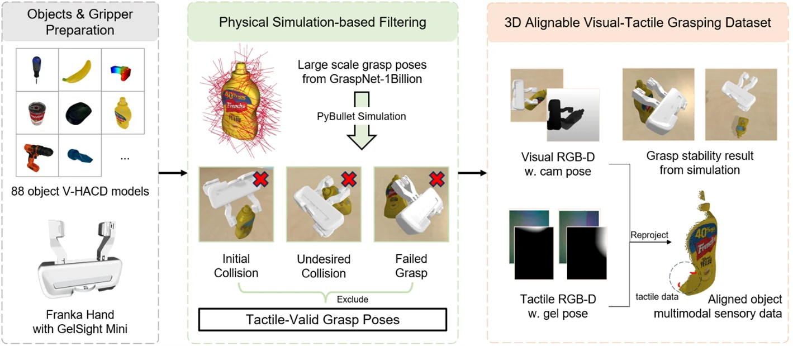

<!-- Generated by scripts/generate.py; edit data/works.json and data/media.json. -->

[← Back to the Awesome index](../../../README.md) · [Interactive website](https://chang-xinhai.github.io/Awesome-RGBDT-Manipulation/?collection=benchmark&item=3da-vtg#library)

# 3DA-VTG

3DA-VTG: An Explicitly Aligned Visuo-Tactile Grasp Dataset and Dual-Branch Fusion Method for Robotic Stable Grasp

**2026-03-30 · Chinese Journal of Mechanical Engineering (2026) · Beihang University; Beijing University of Posts and Telecommunications**

**[Paper](https://doi.org/10.1016/j.cjme.2026.100283)** · [Project](https://github.com/Yiju1213/3DA-VTG) · [Code](https://github.com/Yiju1213/SGA-GSN) · [Data](https://huggingface.co/datasets/robotic-vt-grasp-project/3DA-VTG) · [Weights](https://huggingface.co/robotic-vt-grasp-project/SGA-GSN)

Synthetic, registered RGB-D and tactile grasp observations with binary stability labels.

*Yong Tao and coauthors · [Figure source](https://github.com/Yiju1213/3DA-VTG) · Original rights retained.*

| Field | Reported value and source scope |
| :-- | :-- |
| Record type | Perception benchmark |
| Simulator | PyBullet [1](https://doi.org/10.1016/j.cjme.2026.100283)  |
| Simulator version and scope | Not reported [1](https://doi.org/10.1016/j.cjme.2026.100283)  |
| Task count and scope | 440,000 grasp trials for 88 distinct objects, not 440,000 tasks [1](https://doi.org/10.1016/j.cjme.2026.100283)  |
| Task-list scope | Example recorded grasp labels, not a set of robot tasks [1](https://doi.org/10.1016/j.cjme.2026.100283)  |
| Capability dimensions | Geometric alignment · Shape completion · Grasp stability prediction [1](https://doi.org/10.1016/j.cjme.2026.100283)  |
| Metrics | Binary classification accuracy and stability prediction metrics; point-cloud shape evaluation in a separate model stage. [1](https://doi.org/10.1016/j.cjme.2026.100283)  |
| Robots | Simulated Franka Hand with two optical fingertip pads and an external view. [1](https://doi.org/10.1016/j.cjme.2026.100283)  |
| Sensors and observations | Scene RGB-D, dual synthetic tactile RGB-D images, calibrated extrinsics and unified points. [1](https://doi.org/10.1016/j.cjme.2026.100283)  |
| Data collection method | Scripted simulated handover grasps across object poses; stability labels follow the resulting interactions. [1](https://doi.org/10.1016/j.cjme.2026.100283) [4](https://huggingface.co/datasets/robotic-vt-grasp-project/3DA-VTG/tree/main)  |
| Demonstrations and data | Per-grasp sensory observations and pose/stability annotations; public ZIP shards. [1](https://doi.org/10.1016/j.cjme.2026.100283)  |
| Evaluation protocol | Evaluate the same grasp labels under separated sensing and fusion settings. [1](https://doi.org/10.1016/j.cjme.2026.100283)  |
| Evaluated baselines | Vision-only and tactile-only inputs plus separately released CNN, CNNMCA and DGCNN reference checkpoints. [1](https://doi.org/10.1016/j.cjme.2026.100283)  |
| Observations / modalities | RGB · Depth · Point cloud · Tactile |
| Evaluation domain | Simulation |
| Embodiment | Parallel-jaw gripper |
| Release: code | Public author dataset and model utilities [5](https://github.com/Yiju1213/SGA-GSN#readme)  |
| Release: weights | Not applicable [3](https://huggingface.co/robotic-vt-grasp-project/SGA-GSN/tree/main)  |
| Release: data | Available — numbered dataset archives [4](https://huggingface.co/datasets/robotic-vt-grasp-project/3DA-VTG/tree/main)  |
| Release: license | CC BY-NC-SA 4.0 dataset [3](https://huggingface.co/robotic-vt-grasp-project/SGA-GSN/tree/main)  |
| Release: notes | Paper or official project reviewed. Code, weights and data are tracked independently. |

**Task names — Example recorded grasp labels, not a set of robot tasks:**

- Steady grip during object handover
- Slipped or unstable grasp

**Scope and qualifications**

- The paired streams and grasp outcomes are simulated. Tactile depth is local surface geometry, distinct from external scene RGB-D. This evaluates a grasp scorer, not a closing/regrasping policy.

**Primary evidence**

1. [Original paper and evaluation settings](https://doi.org/10.1016/j.cjme.2026.100283)
2. [Official project with task and method examples](https://github.com/Yiju1213/3DA-VTG)
3. [Actual classifier, baseline and shape-completion checkpoint files](https://huggingface.co/robotic-vt-grasp-project/SGA-GSN/tree/main)
4. [Numbered dataset archives, metadata and license](https://huggingface.co/datasets/robotic-vt-grasp-project/3DA-VTG/tree/main)
5. [Author public release configurations and executable source](https://github.com/Yiju1213/SGA-GSN#readme)
