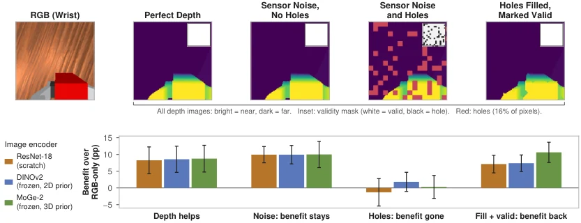

<!-- Generated by scripts/generate.py; edit data/works.json and data/media.json. -->

[← Back to the Awesome index](../../../README.md) · [Interactive website](https://chang-xinhai.github.io/Awesome-RGBDT-Manipulation/?collection=benchmark&item=act-depth-failure#library)

# ACT Sensor-Depth Failure Study

Why Does Sensor Depth Fail Learned Manipulation Policies? Finding the Failure Mode with ACT

**2026-11-24 · Preprint · South Dakota State University**

**[Paper](https://arxiv.org/abs/2611.33352)**

Calibrates a wrist-stereo noise model and isolates missing values, validity masking and measurement noise in simulation RGB-D policy tests.

*Inayat Rasool and coauthors · [Figure source](https://arxiv.org/html/2611.33352v1) · Original rights retained.*

| Field | Reported value and source scope |
| :-- | :-- |
| Record type | evaluation-tool |
| Simulator | ManiSkill [1](https://arxiv.org/html/2611.33352v1)  |
| Simulator version and scope | Not reported [1](https://arxiv.org/html/2611.33352v1)  |
| Task count and scope | Two simulation tasks [1](https://arxiv.org/html/2611.33352v1)  |
| Task-list scope | Paper experiments; representative result shown for PickCube. [1](https://arxiv.org/html/2611.33352v1)  |
| Capability dimensions | RGB-only versus complete, noisy, missing or imputed depth; validity-mask ablations and clean-training-to-corrupt-test shift. [1](https://arxiv.org/html/2611.33352v1)  |
| Metrics | Task success rate and change relative to a matched RGB-only image encoder. [1](https://arxiv.org/html/2611.33352v1)  |
| Robots | Franka in simulation; real Franka wrist capture for sensor calibration [1](https://arxiv.org/html/2611.33352v1)  |
| Sensors and observations | Real wrist-mounted stereo calibrates noise and hole patterns; perturbed simulated RGB-D is used for policy trials. [1](https://arxiv.org/html/2611.33352v1)  |
| Data collection method | Real wrist-camera measurements during teleoperation establish a sensor model; simulation controls the imitation dataset and test conditions. [1](https://arxiv.org/html/2611.33352v1)  |
| Demonstrations and data | Controlled RGB-D ACT study; no benchmark corpus verified. [1](https://arxiv.org/html/2611.33352v1)  |
| Evaluation protocol | Compare three image encoders with matched RGB-only policies while independently varying noise scale and hole masks. [1](https://arxiv.org/html/2611.33352v1)  |
| Evaluated baselines | Action Chunking Transformer with ResNet-18, DINOv2 and MoGe-2 encoders. [1](https://arxiv.org/html/2611.33352v1)  |
| Observations / modalities | RGB · Depth · Proprioception |
| Evaluation domain | Simulation |
| Embodiment | Parallel-jaw gripper |
| Release: code | Not verified |
| Release: weights | Not verified |
| Release: data | Not verified |
| Release: license | Not verified |
| Release: notes | Public paper verified. Code, task weights and data are tracked separately. |

**Task names — Paper experiments; representative result shown for PickCube.:**

- PickCube
- StackCube

**Scope and qualifications**

- The hardware captures characterize the sensor. The policy comparisons and reported success changes are from simulation.
- The reported effect is about coverage and validity mask conditioning in this protocol. It does not establish the same failure profile for other policy designs.

**Primary evidence**

1. [Original author paper with methods, evaluation and scope](https://arxiv.org/html/2611.33352v1)
