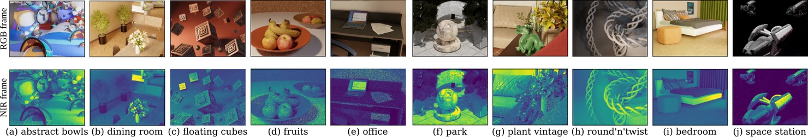

<!-- Generated by scripts/generate.py; edit data/works.json and data/media.json. -->

[← Back to the Awesome index](../../../README.md) · [Interactive website](https://chang-xinhai.github.io/Awesome-RGBDT-Manipulation/?collection=benchmark&item=active-passive-simstereo#library)

# Active-Passive SimStereo

Active-Passive SimStereo — Benchmarking the Cross-Generalization Capabilities of Deep Learning-based Stereo Methods

**2022-02-04 · NeurIPS 2022 Datasets and Benchmarks · University of Western Australia and collaborators**

**[Paper](https://arxiv.org/abs/2209.08305)** · [Project](https://research-repository.uwa.edu.au/en/datasets/active-passive-simstereo/) · [Data](https://ieee-dataport.org/open-access/active-passive-simstereo)

Renders both passive RGB and active-pattern near-infrared stereo for the same simulated scenes to measure cross-sensing generalization.

*Active-Passive SimStereo authors · [Figure source](https://arxiv.org/html/2209.08305v1) · Original rights retained.*

| Field | Reported value and source scope |
| :-- | :-- |
| Record type | dataset |
| Simulator | Blender [1](https://arxiv.org/html/2209.08305v1) [3](https://research-repository.uwa.edu.au/en/datasets/active-passive-simstereo/)  |
| Simulator version and scope | Not reported [1](https://arxiv.org/html/2209.08305v1) [3](https://research-repository.uwa.edu.au/en/datasets/active-passive-simstereo/)  |
| Task count and scope | Supporting dataset or perception evaluation [1](https://arxiv.org/html/2209.08305v1) [3](https://research-repository.uwa.edu.au/en/datasets/active-passive-simstereo/)  |
| Task-list scope | Listed uses of the resource, with no closed-loop robot task count. [1](https://arxiv.org/html/2209.08305v1) [3](https://research-repository.uwa.edu.au/en/datasets/active-passive-simstereo/)  |
| Capability dimensions | Training and evaluation data [1](https://arxiv.org/html/2209.08305v1) [3](https://research-repository.uwa.edu.au/en/datasets/active-passive-simstereo/)  |
| Metrics | Disparity error, separated by sensing modality. [1](https://arxiv.org/html/2209.08305v1) [3](https://research-repository.uwa.edu.au/en/datasets/active-passive-simstereo/)  |
| Robots | Not applicable [1](https://arxiv.org/html/2209.08305v1) [3](https://research-repository.uwa.edu.au/en/datasets/active-passive-simstereo/)  |
| Sensors and observations | Paired RGB and patterned NIR stereo, disparity reference. [1](https://arxiv.org/html/2209.08305v1) [3](https://research-repository.uwa.edu.au/en/datasets/active-passive-simstereo/)  |
| Data collection method | Blender rendering of realistic and abstract scenes with matched passive and active image variants. [1](https://arxiv.org/html/2209.08305v1) [3](https://research-repository.uwa.edu.au/en/datasets/active-passive-simstereo/)  |
| Demonstrations and data | Official UWA entry and linked IEEE DataPort payload. [1](https://arxiv.org/html/2209.08305v1) [3](https://research-repository.uwa.edu.au/en/datasets/active-passive-simstereo/)  |
| Evaluation protocol | Compares passive-to-active generalization by applying matching architectures to corresponding scene variants. [1](https://arxiv.org/html/2209.08305v1) [3](https://research-repository.uwa.edu.au/en/datasets/active-passive-simstereo/)  |
| Evaluated baselines | Not applicable [1](https://arxiv.org/html/2209.08305v1) [3](https://research-repository.uwa.edu.au/en/datasets/active-passive-simstereo/)  |
| Observations / modalities | RGB · Infrared |
| Evaluation domain | Simulation |
| Embodiment |  |
| Release: code | Benchmark documentation available [2](https://research-repository.uwa.edu.au/en/datasets/active-passive-simstereo/) [3](https://research-repository.uwa.edu.au/en/datasets/active-passive-simstereo/)  |
| Release: weights | Not applicable [2](https://research-repository.uwa.edu.au/en/datasets/active-passive-simstereo/) [3](https://research-repository.uwa.edu.au/en/datasets/active-passive-simstereo/)  |
| Release: data | UWA data index links IEEE DataPort download. [2](https://research-repository.uwa.edu.au/en/datasets/active-passive-simstereo/) [3](https://research-repository.uwa.edu.au/en/datasets/active-passive-simstereo/)  |
| Release: license | Not verified [2](https://research-repository.uwa.edu.au/en/datasets/active-passive-simstereo/) [3](https://research-repository.uwa.edu.au/en/datasets/active-passive-simstereo/)  |
| Release: notes | Synthetic paired modalities and disparities. [2](https://research-repository.uwa.edu.au/en/datasets/active-passive-simstereo/) [3](https://research-repository.uwa.edu.au/en/datasets/active-passive-simstereo/)  |

**Task names — Listed uses of the resource, with no closed-loop robot task count.:**

- Passive visible-light matching
- Active patterned near-IR matching
- Cross-sensing transfer

**Scope and qualifications**

- The official data record predates the arXiv paper. Synthetic hardware appearance does not replace physical projector validation.

**Primary evidence**

1. [Original author paper or dataset description](https://arxiv.org/html/2209.08305v1)
2. [Author source and artifact entry points](https://research-repository.uwa.edu.au/en/datasets/active-passive-simstereo/)
3. [Institutional dataset issuance and paired render modalities](https://research-repository.uwa.edu.au/en/datasets/active-passive-simstereo/)
