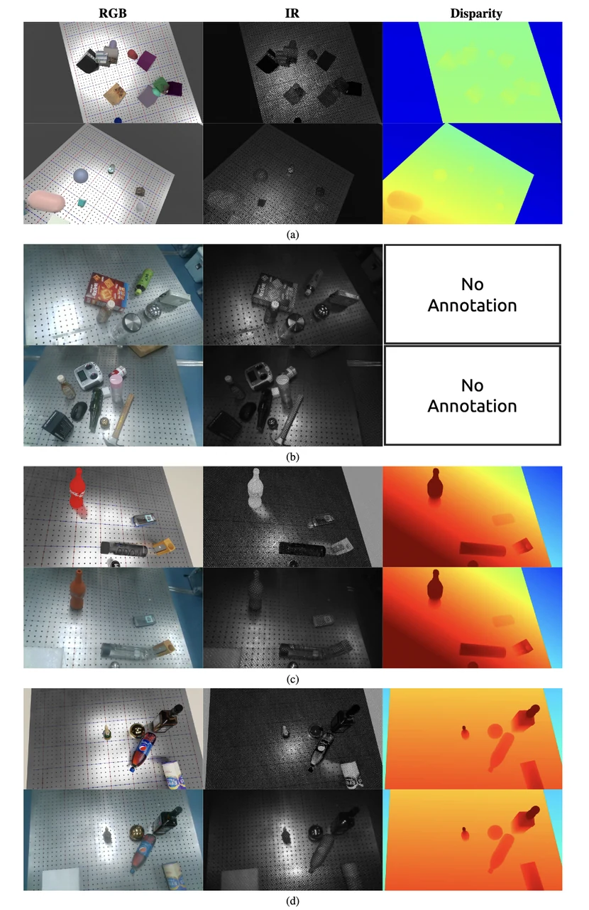

<!-- Generated by scripts/generate.py; edit data/works.json and data/media.json. -->

[← Back to the Awesome index](../../../README.md) · [Interactive website](https://chang-xinhai.github.io/Awesome-RGBDT-Manipulation/?collection=benchmark&item=activezero#library)

# ActiveZero

ActiveZero: Mixed Domain Learning for Active Stereovision with Zero Annotation

**2021-12-06 · CVPR 2022 · University of California, San Diego and collaborators**

**[Paper](https://arxiv.org/abs/2112.02772)** · [Project](https://www.liuisabella.com/ActiveZero/) · [Code](https://github.com/haosulab/ActiveZero)

Pairs simulated active infrared stereo training with a separate physical RealSense domain and aligned test scenes.

*ActiveZero authors · [Figure source](https://www.liuisabella.com/ActiveZero/) · Original rights retained.*

| Field | Reported value and source scope |
| :-- | :-- |
| Record type | dataset |
| Simulator | Physics-based simulation for synthetic and aligned reference scenes. [1](https://arxiv.org/abs/2112.02772) [3](https://openaccess.thecvf.com/content/CVPR2022/papers/Liu_ActiveZero_Mixed_Domain_Learning_for_Active_Stereovision_With_Zero_Annotation_CVPR_2022_paper.pdf)  |
| Simulator version and scope | Not reported [1](https://arxiv.org/abs/2112.02772) [3](https://openaccess.thecvf.com/content/CVPR2022/papers/Liu_ActiveZero_Mixed_Domain_Learning_for_Active_Stereovision_With_Zero_Annotation_CVPR_2022_paper.pdf)  |
| Task count and scope | Supporting dataset or perception evaluation [1](https://arxiv.org/abs/2112.02772) [3](https://openaccess.thecvf.com/content/CVPR2022/papers/Liu_ActiveZero_Mixed_Domain_Learning_for_Active_Stereovision_With_Zero_Annotation_CVPR_2022_paper.pdf)  |
| Task-list scope | Listed uses of the resource, with no closed-loop robot task count. [1](https://arxiv.org/abs/2112.02772) [3](https://openaccess.thecvf.com/content/CVPR2022/papers/Liu_ActiveZero_Mixed_Domain_Learning_for_Active_Stereovision_With_Zero_Annotation_CVPR_2022_paper.pdf)  |
| Capability dimensions | Training and evaluation data [1](https://arxiv.org/abs/2112.02772) [3](https://openaccess.thecvf.com/content/CVPR2022/papers/Liu_ActiveZero_Mixed_Domain_Learning_for_Active_Stereovision_With_Zero_Annotation_CVPR_2022_paper.pdf)  |
| Metrics | Disparity/depth error and completeness reported separately. [1](https://arxiv.org/abs/2112.02772) [3](https://openaccess.thecvf.com/content/CVPR2022/papers/Liu_ActiveZero_Mixed_Domain_Learning_for_Active_Stereovision_With_Zero_Annotation_CVPR_2022_paper.pdf)  |
| Robots | Not applicable [1](https://arxiv.org/abs/2112.02772) [3](https://openaccess.thecvf.com/content/CVPR2022/papers/Liu_ActiveZero_Mixed_Domain_Learning_for_Active_Stereovision_With_Zero_Annotation_CVPR_2022_paper.pdf)  |
| Sensors and observations | Left/right IR with a projected pattern; RealSense D415 in the real setting. [1](https://arxiv.org/abs/2112.02772) [3](https://openaccess.thecvf.com/content/CVPR2022/papers/Liu_ActiveZero_Mixed_Domain_Learning_for_Active_Stereovision_With_Zero_Annotation_CVPR_2022_paper.pdf)  |
| Data collection method | Render projected IR on primitive scenes, collect unlabeled real training pairs and align simulated geometry to separate physical test captures. [1](https://arxiv.org/abs/2112.02772) [3](https://openaccess.thecvf.com/content/CVPR2022/papers/Liu_ActiveZero_Mixed_Domain_Learning_for_Active_Stereovision_With_Zero_Annotation_CVPR_2022_paper.pdf)  |
| Demonstrations and data | Paper describes 20,000 simulated training stereo IR images with reference disparity and a 504-image test set spanning 24 aligned scenes. [1](https://arxiv.org/abs/2112.02772) [3](https://openaccess.thecvf.com/content/CVPR2022/papers/Liu_ActiveZero_Mixed_Domain_Learning_for_Active_Stereovision_With_Zero_Annotation_CVPR_2022_paper.pdf)  |
| Evaluation protocol | Separate synthetic supervised, real self-supervised and sim-aligned test roles; testing includes diffuse, specular, translucent and transparent objects. [1](https://arxiv.org/abs/2112.02772) [3](https://openaccess.thecvf.com/content/CVPR2022/papers/Liu_ActiveZero_Mixed_Domain_Learning_for_Active_Stereovision_With_Zero_Annotation_CVPR_2022_paper.pdf)  |
| Evaluated baselines | Not applicable [1](https://arxiv.org/abs/2112.02772) [3](https://openaccess.thecvf.com/content/CVPR2022/papers/Liu_ActiveZero_Mixed_Domain_Learning_for_Active_Stereovision_With_Zero_Annotation_CVPR_2022_paper.pdf)  |
| Observations / modalities | Infrared · Depth |
| Evaluation domain | Simulation · Real world |
| Embodiment |  |
| Release: code | Available — author repository [2](https://www.liuisabella.com/ActiveZero/)  |
| Release: weights | Not verified [2](https://www.liuisabella.com/ActiveZero/)  |
| Release: data | Paper describes collection and splits; public full corpus download not verified. [2](https://www.liuisabella.com/ActiveZero/)  |
| Release: license | Not verified [2](https://www.liuisabella.com/ActiveZero/)  |
| Release: notes | Use the linked paper and dataset examples as a protocol reference. [2](https://www.liuisabella.com/ActiveZero/)  |

**Task names — Listed uses of the resource, with no closed-loop robot task count.:**

- Active IR matching
- Sim-to-real disparity evaluation

**Scope and qualifications**

- Physical training imagery is unlabeled. Test depth is from an aligned simulation reference.

**Primary evidence**

1. [Original author paper or dataset description](https://arxiv.org/abs/2112.02772)
2. [Author source and artifact entry points](https://www.liuisabella.com/ActiveZero/)
3. [CVPR paper §4, real/sim train and test split](https://openaccess.thecvf.com/content/CVPR2022/papers/Liu_ActiveZero_Mixed_Domain_Learning_for_Active_Stereovision_With_Zero_Annotation_CVPR_2022_paper.pdf)
