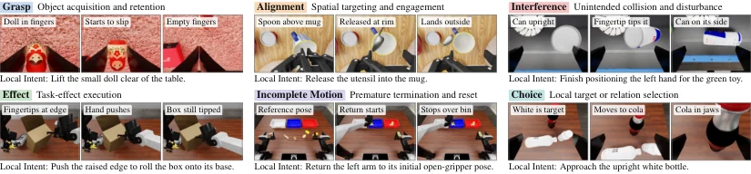

<!-- Generated by scripts/generate.py; edit data/works.json and data/media.json. -->

[← Back to the Awesome index](../../../README.md) · [Interactive website](https://chang-xinhai.github.io/Awesome-RGBDT-Manipulation/?collection=benchmark&item=agentrobocritic#library)

# AgentRoboCritic

AgentRoboCritic: Understanding the Capability of Frontier Agents on Direct Robot Control

**2026-11-19 · Preprint · Carnegie Mellon University and Bosch Research**

**[Paper](https://arxiv.org/abs/2611.26613)** · [Project](https://adu2021.github.io/blog/AgentRoboCritic/) · [Code](https://github.com/cxcscmu/AgentRoboCritic) · [Data](https://huggingface.co/datasets/cx-cmu/AgentRoboCritic-Bench) · [Weights](https://huggingface.co/cx-cmu/AgentRoboCritic-Muse-Glimmer-30B) · [Training Dataset](https://huggingface.co/datasets/cx-cmu/AgentRoboCritic-Dataset)

Audits direct low-level robot control at the action level. A critic compares the resulting scene to the controller’s stated intent and labels execution failures.

*Yiyang Du and coauthors · [Figure source](https://arxiv.org/html/2611.26613v1) · Original rights retained.*

| Field | Reported value and source scope |
| :-- | :-- |
| Record type | evaluation-tool |
| Simulator | Not applicable [1](https://arxiv.org/html/2611.26613v1)  |
| Simulator version and scope | Not applicable [1](https://arxiv.org/html/2611.26613v1)  |
| Task count and scope | Supporting dataset or perception evaluation [1](https://arxiv.org/html/2611.26613v1)  |
| Task-list scope | Listed uses of the resource, with no closed-loop robot task count. [1](https://arxiv.org/html/2611.26613v1)  |
| Capability dimensions | Training and evaluation data [1](https://arxiv.org/html/2611.26613v1)  |
| Metrics | Intent success and failure-mode classification against human annotations. [1](https://arxiv.org/html/2611.26613v1)  |
| Robots | Multi-benchmark robot setups [1](https://arxiv.org/html/2611.26613v1)  |
| Sensors and observations | Multi-view action clips, command, task context and explicit local intent. Controller observations vary by environment. [1](https://arxiv.org/html/2611.26613v1)  |
| Data collection method | Collect agent rollouts on 12 manipulation benchmarks; label achieved/failed actions and causes. Human-rated data are a separate held-out portion. [1](https://arxiv.org/html/2611.26613v1)  |
| Demonstrations and data | 12,844 training and 1,548 validation actions in the public critic corpus; 400 separately human-rated actions in AgentRoboCritic-Bench. [1](https://arxiv.org/html/2611.26613v1) [4](https://huggingface.co/datasets/cx-cmu/AgentRoboCritic-Dataset) [5](https://huggingface.co/datasets/cx-cmu/AgentRoboCritic-Bench)  |
| Evaluation protocol | Given a local intent and observations around the control command, classify intent attainment and failure mode. Original rollout results evaluate agents separately. [1](https://arxiv.org/html/2611.26613v1)  |
| Evaluated baselines | Paper evaluates baseline critic and fine-tuned Muse-Glimmer-30B; controller episode success is a separate result. [1](https://arxiv.org/html/2611.26613v1)  |
| Observations / modalities | RGB · Language · Proprioception |
| Evaluation domain | Simulation · Real world |
| Embodiment |  |
| Release: code | Available — official critic evaluation scripts. [2](https://adu2021.github.io/blog/AgentRoboCritic/) [3](https://github.com/cxcscmu/AgentRoboCritic)  |
| Release: weights | Available — fine-tuned Muse-Glimmer-30B critic; not the acting controller. [2](https://adu2021.github.io/blog/AgentRoboCritic/) [6](https://huggingface.co/cx-cmu/AgentRoboCritic-Muse-Glimmer-30B)  |
| Release: data | Available — human-rated 400-action benchmark and separate critic dataset. [2](https://adu2021.github.io/blog/AgentRoboCritic/) [4](https://huggingface.co/datasets/cx-cmu/AgentRoboCritic-Dataset) [5](https://huggingface.co/datasets/cx-cmu/AgentRoboCritic-Bench)  |
| Release: license | MIT code, CC BY 4.0 datasets, Apache-2.0 model card subject to base-model usage terms. [2](https://adu2021.github.io/blog/AgentRoboCritic/) [6](https://huggingface.co/cx-cmu/AgentRoboCritic-Muse-Glimmer-30B)  |
| Release: notes | Training, validation and human-rated testing are separate and episode-disjoint. [2](https://adu2021.github.io/blog/AgentRoboCritic/)  |

**Task names — Listed uses of the resource, with no closed-loop robot task count.:**

- Local intent attainment
- Action failure classification
- Recovery analysis

**Scope and qualifications**

- Critic score is action-label accuracy and cannot be substituted for policy task success.

**Primary evidence**

1. [Original author paper or dataset description](https://arxiv.org/html/2611.26613v1)
2. [Author source and artifact entry points](https://adu2021.github.io/blog/AgentRoboCritic/)
3. [Author implementation](https://github.com/cxcscmu/AgentRoboCritic)
4. [Train and validation payload and label source](https://huggingface.co/datasets/cx-cmu/AgentRoboCritic-Dataset)
5. [400 human-labeled action test set](https://huggingface.co/datasets/cx-cmu/AgentRoboCritic-Bench)
6. [Critic weights and upstream terms](https://huggingface.co/cx-cmu/AgentRoboCritic-Muse-Glimmer-30B)
