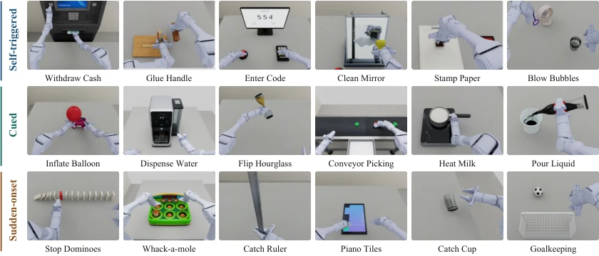

<!-- Generated by scripts/generate.py; edit data/works.json and data/media.json. -->

[← Back to the Awesome index](../../../README.md) · [Interactive website](https://chang-xinhai.github.io/Awesome-RGBDT-Manipulation/?collection=benchmark&item=await-bench#library)

# AWAIT

Action Windows Are Inherently Temporal: A Benchmark for Time-Sensitive Robotic Manipulation

**2026-11-22 · Preprint · University of Science and Technology of China**

**[Paper](https://arxiv.org/abs/2611.29558)** · [Project](https://eyja42.github.io/await-site/)

Evaluates manipulation agents on actions with finite physical windows while charging inference time against scene evolution.

*Haoxiang Zhan and coauthors · [Figure source](https://arxiv.org/html/2611.29558v1) · Original rights retained.*

| Field | Reported value and source scope |
| :-- | :-- |
| Record type | benchmark |
| Simulator | Isaac Sim / PhysX [1](https://arxiv.org/html/2611.29558v1)  |
| Simulator version and scope | Isaac Sim 6.0.1, PhysX 5; paper Appendix A [1](https://arxiv.org/html/2611.29558v1)  |
| Task count and scope | 18 tasks over self-triggered, cued and sudden-onset action windows [1](https://arxiv.org/html/2611.29558v1)  |
| Task-list scope | Example task names from paper; opening-window classes are separate from the task count. [1](https://arxiv.org/html/2611.29558v1)  |
| Capability dimensions | Time-sensitive manipulation · Computation accounting · Control under ongoing physics [1](https://arxiv.org/html/2611.29558v1)  |
| Metrics | Performance, timeliness and process outcomes under measured delay and controlled delay settings. [1](https://arxiv.org/html/2611.29558v1)  |
| Robots | Simulated arm and gripper in photorealistic indoor environments. [1](https://arxiv.org/html/2611.29558v1)  |
| Sensors and observations | RGB-D and robot state in the native agent; CaP-X receives head and wrist RGB-D, other agents have compatible but distinct observation sets. [1](https://arxiv.org/html/2611.29558v1)  |
| Data collection method | Agent assists authoring scene assets and real-time physical processes; automated scripted and agent rollouts are evaluated. Human teleoperation is a separate reference. [1](https://arxiv.org/html/2611.29558v1)  |
| Demonstrations and data | Published tasks and material-process details; standalone downloadable benchmark bundle not verified. [1](https://arxiv.org/html/2611.29558v1)  |
| Evaluation protocol | Run actions against moving state and elapsed-time accounting; evaluate specified opening/closing times per task. [1](https://arxiv.org/html/2611.29558v1)  |
| Evaluated baselines | Native VLM agent, CaP-X, PyRUA-Lean and Q0-Preview, plus distinct human teleoperation reference. [1](https://arxiv.org/html/2611.29558v1)  |
| Observations / modalities | RGB · Depth · Proprioception · Language |
| Evaluation domain | Simulation |
| Embodiment | Parallel-jaw gripper |
| Release: code | Not verified |
| Release: weights | Not applicable |
| Release: data | Not verified |
| Release: license | Not verified |
| Release: notes | Paper or official project reviewed. Code, weights and data are tracked independently. |

**Task names — Example task names from paper; opening-window classes are separate from the task count.:**

- Conveyor picking
- Inflate balloon
- Whack-a-mole
- Enter code

**Scope and qualifications**

- Controller latency accounts for both decision and scene time. Camera sets differ by agent. Contact thresholds and process state are used for grading, not given as a tactile stream.

**Primary evidence**

1. [Original paper and evaluation settings](https://arxiv.org/html/2611.29558v1)
2. [Official project with task and method examples](https://eyja42.github.io/await-site/)
