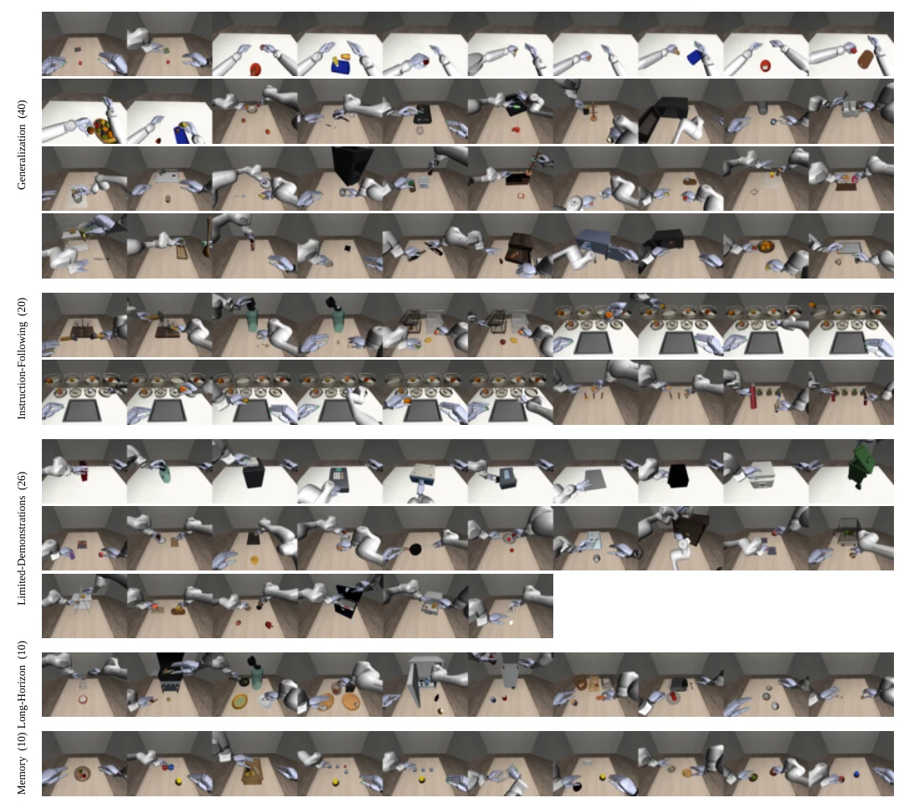

<!-- Generated by scripts/generate.py; edit data/works.json and data/media.json. -->

[← Back to the Awesome index](../../../README.md) · [Interactive website](https://chang-xinhai.github.io/Awesome-RGBDT-Manipulation/?collection=benchmark&item=bidex100#library)

# BiDex-100

BiDex-100: A Comprehensive Benchmark for Bimanual Dexterous Manipulation Across 100+ Simulation Tasks

**2026-10-18 · Preprint · Zhejiang University**

**[Paper](https://arxiv.org/abs/2610.25459)** · [Project](https://BiDex-100.github.io/BiDex-100/) · [Code](https://github.com/robbyant-research/BiDex-100) · [Data](https://huggingface.co/datasets/Robbyant-Research/BiDex-100)

A 106-task bimanual dexterous suite uses matched in-/out-of-domain variants to evaluate five capability axes across two embodiments.

*BiDex-100 authors; original rights retained · [Figure source](https://arxiv.org/abs/2610.25459) · Original rights retained.*

| Field | Reported value and source scope |
| :-- | :-- |
| Record type | benchmark |
| Simulator | MuJoCo [1](https://arxiv.org/html/2610.25459)  |
| Simulator version and scope | Not reported [1](https://arxiv.org/html/2610.25459)  |
| Task count and scope | 106 canonical specifications across five capability axes [1](https://arxiv.org/html/2610.25459)  |
| Task-list scope | Complete 106 released non-OOD YAML stems; matched out-of-domain variants are not counted as additional tasks. [1](https://arxiv.org/html/2610.25459)  |
| Capability dimensions | Generalization · Instruction following · Limited demonstrations · Long horizon · Memory [1](https://arxiv.org/html/2610.25459)  |
| Metrics | Tasksuccess andprogress under matchedID/OOD conditions; capability-specific aggregates. [1](https://arxiv.org/html/2610.25459)  |
| Robots | Dual-Franka and Astribot bimanual configurations; 44 hand and 14 arm degrees of freedom. [1](https://arxiv.org/html/2610.25459)  |
| Sensors and observations | Head and bilateral-wrist RGB-D at 480×360 / 25 Hz; joint positions/velocities and end-effector poses. No skin tactile stream. [1](https://arxiv.org/html/2610.25459)  |
| Data collection method | Success-validated human teleoperation with exoskeleton gloves and Apple Vision Pro wrist/hand tracking. [1](https://arxiv.org/html/2610.25459)  |
| Demonstrations and data | 8,080 demonstrations / 6.25 million frames. LeRobot v2.1 and v3.0 are alternative representations of the same episodes. [1](https://arxiv.org/html/2610.25459)  |
| Evaluation protocol | MuJoCo at 500 Hz, control at 25 Hz. Matched visual/spatial OOD changes and explicit model-specific training/evaluation budgets. [1](https://arxiv.org/html/2610.25459)  |
| Evaluated baselines | Seven VLA families: π0.5, GR00T-N1.7, InternVLA-A1.5, Galaxea G0.5, DM0.5, LingBot-VLA-v2 and Xiaomi XR1. [1](https://arxiv.org/html/2610.25459)  |
| Observations / modalities | RGB · Depth · Proprioception · Language |
| Evaluation domain | Simulation |
| Embodiment | Bimanual · Dexterous hand |
| Release: code | Available [2](https://github.com/robbyant-research/BiDex-100) [3](https://huggingface.co/datasets/Robbyant-Research/BiDex-100)  |
| Release: weights | Not applicable — benchmark; baseline weight inventory separate [2](https://github.com/robbyant-research/BiDex-100) [3](https://huggingface.co/datasets/Robbyant-Research/BiDex-100)  |
| Release: data | Available —8,080 trajectories and assets [2](https://github.com/robbyant-research/BiDex-100) [3](https://huggingface.co/datasets/Robbyant-Research/BiDex-100)  |
| Release: license | MIT original benchmark code; CC BY-NC 4.0 trajectory/metadata and original assets. Third-party assets retain their own terms. [2](https://github.com/robbyant-research/BiDex-100) [3](https://huggingface.co/datasets/Robbyant-Research/BiDex-100)  |
| Release: notes | 106non-OODYAMLtasks and matched variants are public. HF LeRobot v2.1/v3.0 directories are two representations of the same demonstrations, not two datasets. [2](https://github.com/robbyant-research/BiDex-100) [3](https://huggingface.co/datasets/Robbyant-Research/BiDex-100)  |

**Task names — Complete 106 released non-OOD YAML stems; matched out-of-domain variants are not counted as additional tasks.:**

- Cook egg in frypan
- Drop two spoons from tray into two cups
- Grill steak and corn
- Hang mugs on tree
- Heat sandwich bread in microwave
- Insert spatula and rolling pin into glass cup
- Insert two cubes into slot
- Load three canned food onto dish rack
- Make cereal in bowl
- Make espresso
- Measure two paprika shakers on digital scale
- Nest medium box in large box
- Organize items in desk caddy
- Pick up peach
- Pick up pear
- Pick up spoon from tray into cup
- Pick up tangerine
- Place cake tongs and mug on tiered shelf
- Place coffee mug and spoon on tray
- Place condiments on tray
- Prepare salad in bowl
- Prepare tea with cup
- Put apple and orange in bowl
- Put apple in white bowl
- Put hotdog bun on tray
- Put marshmallow and cookie dough ball in bowl
- Put measuring cup and ice into glass
- Put mustard and honey bottle on tray
- Put onion on cutting board
- Put peach in fruit bowl
- Put peeler and pizza cutter in drainer
- Put sweet potato and onion in bowl
- Put three apples into fruit bowl
- Rethread bagel and donut onto middle rod
- Stack three canned food
- Stack yellow book on black book
- Stand two wine bottles upright
- Store condiments in short cabinet
- Store snacks in slide cabinet
- Take milk from microwave
- Hammer one nail each hand
- Hammer two nails each hand
- Open bottle and drop one sugar cube in bottle
- Open bottle and drop two sugar cubes in bottle
- Pack four mangoes into baskets
- Pack two mangoes into two baskets
- Put jam and lemon from tray onto shelf
- Put lemon on shelf then take jam into tray
- Put orange on shelf then take back into tray
- Take jam and lemon from shelf into tray
- Take jam into tray and put milk on shelf
- Take jam into tray then put back on shelf
- Take milk and lemon from shelf into tray
- Take milk and orange from shelf into tray
- Take teapot into tray and put orange on shelf
- Take teapot into tray then put back on shelf
- Thread bagel and donut onto middle and side rods
- Thread bagel and donut onto side rods
- Water one plant each hand
- Water two plants each hand
- Arrange bar on tray and cake on plate
- Arrange three bagels in oven tray
- Assemble arch bridge
- Drain three tomatoes in strainer
- Flip open bottle cap
- Insert items into shelf
- Open bread maker lid
- Open flatbed scanner lid
- Open microwave oven door
- Open rice cooker lid
- Open wheelie bin lid
- Pack three avocados into tiered basket
- Pick up fork from tray into cup
- Pick up whisk
- Place two oranges on shelf tiers
- Pull down slot machine lever
- Pull open cabinet drawer
- Pull open cash register drawer
- Put apple and orange into basket
- Put three eggs into tupperware
- Raise laptop stand platform
- Rotate two cubes around plates
- Serve cheese on two cutting boards
- Sort pepper and onion into two bowls
- Store frozen food in freezer
- Store items in white cabinet
- Fill jar with snacks
- Fill pot and bottle with sugar cubes and veg
- Grill drumsticks fish and squash
- Insert three plates into dish rack
- Nest four bowls
- Place strainer with tomatoes and spoon on dish rack
- Recycle five cans into bin
- Restock fridge with condiments and bottles
- Sort mixed food into boxes
- Stack sugar cubes
- Drop fruits in basket then remove in order
- Drop items into picnic basket then remove in order
- Pour ice between two cups
- Press button then grasp mug
- Press red button then blue button
- Swap candles between bowls
- Swap cup colors with cube
- Swap fruits between bowls
- Uncover cubes in order
- Uncover red cube

**Scope and qualifications**

- RGB-D is a benchmark observation/data interface; each evaluated VLA must retain its actual RGB/depth input choice.
- Rigid-body simulation does not establish real tactile sensing, fluids/deformables or physical policy transfer.
- Datasetcard genericother tag is resolved by actualdatasets/lerobotv30/LICENSE:CC BY-NC 4.0.

**Primary evidence**

1. [Original full paper, methods and evaluation](https://arxiv.org/html/2610.25459) — Publication date is arXiv v1; implementation and deployment observations are distinguished from training supervision, generated geometry and base-model identity.
2. [Official artifact: actual source files, inventory and license](https://github.com/robbyant-research/BiDex-100) — 503 files,106canonicalYAMLstems andactualbenchmarkrunner;HF58421 entries include MP4 / parquet / NPY / assets andseparateCCBYNClicense.
3. [Official artifact inventory / model or dataset card](https://huggingface.co/datasets/Robbyant-Research/BiDex-100) — Actual file inventory and artifact-specific terms checked independently; upstream checkpoints and equivalent dataset layouts are not double-counted.
