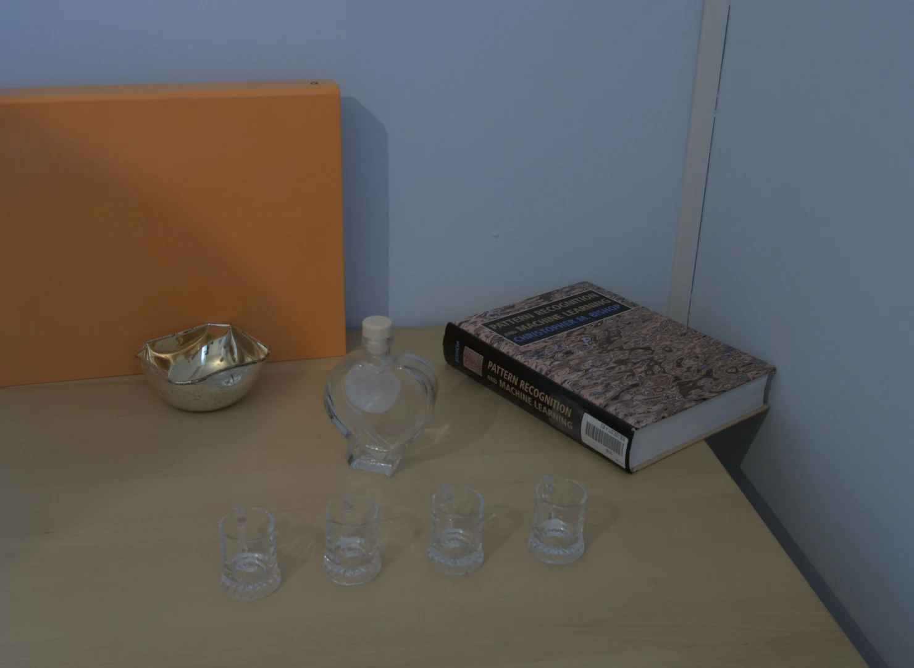

<!-- Generated by scripts/generate.py; edit data/works.json and data/media.json. -->

[← Back to the Awesome index](../../../README.md) · [Interactive website](https://chang-xinhai.github.io/Awesome-RGBDT-Manipulation/?collection=benchmark&item=booster#library)

# Booster

Open Challenges in Deep Stereo: the Booster Dataset

**2022-06-09 · CVPR 2022 / TPAMI 2024 extension · University of Bologna**

**[Paper](https://arxiv.org/abs/2206.04671)** · [Project](https://cvlab.unibo.it/booster-web/) · [Data](https://drive.google.com/drive/folders/1HSamUiWdSDPIas6Coad1lD42csV4EmJR?usp=sharing) · [Extension](https://arxiv.org/abs/2301.08245)

Balanced and mixed-resolution RGB stereo focused on transparent and reflective surfaces with dense reference disparity and material masks.

*Booster authors · [Figure source](https://cvlab.unibo.it/booster-web/) · Original rights retained.*

| Field | Reported value and source scope |
| :-- | :-- |
| Record type | dataset |
| Simulator | Not applicable [1](https://arxiv.org/html/2206.04671v1) [3](https://cvlab.unibo.it/booster-web/)  |
| Simulator version and scope | Not applicable [1](https://arxiv.org/html/2206.04671v1) [3](https://cvlab.unibo.it/booster-web/)  |
| Task count and scope | Supporting dataset or perception evaluation [1](https://arxiv.org/html/2206.04671v1) [3](https://cvlab.unibo.it/booster-web/)  |
| Task-list scope | Listed uses of the resource, with no closed-loop robot task count. [1](https://arxiv.org/html/2206.04671v1) [3](https://cvlab.unibo.it/booster-web/)  |
| Capability dimensions | Training and evaluation data [1](https://arxiv.org/html/2206.04671v1) [3](https://cvlab.unibo.it/booster-web/)  |
| Metrics | Disparity error split by material and resolution. [1](https://arxiv.org/html/2206.04671v1) [3](https://cvlab.unibo.it/booster-web/)  |
| Robots | Not applicable [1](https://arxiv.org/html/2206.04671v1) [3](https://cvlab.unibo.it/booster-web/)  |
| Sensors and observations | Passive visible RGB stereo input; dense disparity derived by the authors’ space-time collection process. [1](https://arxiv.org/html/2206.04671v1) [3](https://cvlab.unibo.it/booster-web/)  |
| Data collection method | Indoor captures under varying lighting with balanced 12 MP stereo and a 12 MP/1.1 MP arrangement. [1](https://arxiv.org/html/2206.04671v1) [3](https://cvlab.unibo.it/booster-web/)  |
| Demonstrations and data | CVPR: 419 annotated samples across 64 scenes. TPAMI extension: 606 across 85 scenes. The additional 15K unlabeled samples are separate. [1](https://arxiv.org/html/2206.04671v1) [3](https://cvlab.unibo.it/booster-web/) [4](https://arxiv.org/abs/2301.08245)  |
| Evaluation protocol | Training and withheld test labels are split by challenge; see separate stereo and monocular tracks. [1](https://arxiv.org/html/2206.04671v1) [3](https://cvlab.unibo.it/booster-web/)  |
| Evaluated baselines | Not applicable [1](https://arxiv.org/html/2206.04671v1) [3](https://cvlab.unibo.it/booster-web/)  |
| Observations / modalities | RGB |
| Evaluation domain | Real world |
| Embodiment |  |
| Release: code | Not applicable [2](https://cvlab.unibo.it/booster-web/) [3](https://cvlab.unibo.it/booster-web/)  |
| Release: weights | Not applicable [2](https://cvlab.unibo.it/booster-web/) [3](https://cvlab.unibo.it/booster-web/)  |
| Release: data | Available — authors document training and separate stereo and monocular test sets [2](https://cvlab.unibo.it/booster-web/) [3](https://cvlab.unibo.it/booster-web/)  |
| Release: license | Not verified [2](https://cvlab.unibo.it/booster-web/) [3](https://cvlab.unibo.it/booster-web/)  |
| Release: notes | The 2022 paper and expanded TPAMI release report different counts. [2](https://cvlab.unibo.it/booster-web/) [3](https://cvlab.unibo.it/booster-web/)  |

**Task names — Listed uses of the resource, with no closed-loop robot task count.:**

- Material-aware disparity
- Mixed-resolution stereo matching

**Scope and qualifications**

- The 419 and 606 counts describe releases of one dataset and should not be summed. Test RGB availability is separate from ground-truth availability.

**Primary evidence**

1. [Original author paper or dataset description](https://arxiv.org/html/2206.04671v1)
2. [Author source and artifact entry points](https://cvlab.unibo.it/booster-web/)
3. [Official data, sample format and original versus extended scope](https://cvlab.unibo.it/booster-web/)
4. [Expanded TPAMI publication](https://arxiv.org/abs/2301.08245)
