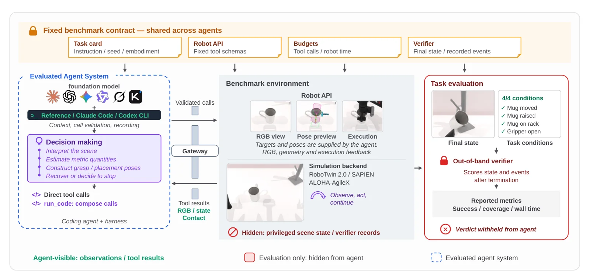

<!-- Generated by scripts/generate.py; edit data/works.json and data/media.json. -->

[← Back to the Awesome index](../../../README.md) · [Interactive website](https://chang-xinhai.github.io/Awesome-RGBDT-Manipulation/?collection=benchmark&item=codeactionbench#library)

# CodeActionBench

CodeActionBench: Evaluating Agentic Code-as-Policy for Embodied Manipulation

**2026-09-27 · Preprint · Nanyang Technological University**

**[Paper](https://arxiv.org/abs/2609.33807)** · [Project](https://codeactionbench.org/benchmark) · [Code](https://github.com/lyhkk/CodeActionBench)

A code-as-policy benchmark measures how multimodal agents turn visual reasoning into executable bimanual manipulation.

*CodeActionBench authors · [Figure source](https://arxiv.org/abs/2609.33807) · Original rights retained.*

| Field | Reported value and source scope |
| :-- | :-- |
| Record type | benchmark |
| Simulator | RoboTwin / SAPIEN [1](https://arxiv.org/abs/2609.33807)  |
| Simulator version and scope | Not verified [1](https://arxiv.org/abs/2609.33807)  |
| Task count and scope | 25 tasks [1](https://arxiv.org/abs/2609.33807)  |
| Task-list scope | Twenty-five fixed benchmark task instances; multiple attempts per instance are evaluation repetitions. [1](https://arxiv.org/abs/2609.33807)  |
| Capability dimensions | Visual grounding, executable code synthesis and iterative physical interaction. [1](https://arxiv.org/abs/2609.33807)  |
| Metrics | Task success, coverage and execution cost. [1](https://arxiv.org/abs/2609.33807)  |
| Robots | Simulated bimanual robot. [1](https://arxiv.org/abs/2609.33807)  |
| Sensors and observations | RGB observations, calibrated geometric operations and robot feedback; no depth images to the agent. [1](https://arxiv.org/abs/2609.33807)  |
| Data collection method | Fixed task instances and simulator-generated interaction logs. [1](https://arxiv.org/abs/2609.33807)  |
| Demonstrations and data | Full trajectory/image/video dataset not yet released per official README. [1](https://arxiv.org/abs/2609.33807)  |
| Evaluation protocol | Bounded task budgets and hidden physical outcome verifier; 675 attempts across nine configurations reported. [1](https://arxiv.org/abs/2609.33807)  |
| Evaluated baselines | General-purpose multimodal models with code-as-policy harnesses. [1](https://arxiv.org/abs/2609.33807)  |
| Observations / modalities | RGB · Proprioception · Language |
| Evaluation domain | Simulation |
| Embodiment | Not reported |
| Release: code | Available — benchmark source and robot API [2](https://github.com/lyhkk/CodeActionBench)  |
| Release: weights | External model APIs; not applicable to benchmark itself [2](https://github.com/lyhkk/CodeActionBench)  |
| Release: data | Not released — full trajectory/image/video dataset [2](https://github.com/lyhkk/CodeActionBench)  |
| Release: license | MIT for repository; dependencies and models separately licensed [2](https://github.com/lyhkk/CodeActionBench)  |
| Release: notes | Official repository contains benchmark implementation; full trajectory and visual dataset remains unreleased. [2](https://github.com/lyhkk/CodeActionBench)  |

**Task names — Twenty-five fixed benchmark task instances; multiple attempts per instance are evaluation repetitions.:**

Task names not reported or not verified in the cited sources.

**Scope and qualifications**

- Agent interface offers RGB and calibrated geometric operations; no depth images, privileged scene state or dedicated grasp module are provided.
- Fixed-task simulation results are not real-world deployments.

**Primary evidence**

1. [Author paper or official project: methods and evaluation scope](https://arxiv.org/abs/2609.33807)
2. [Official repository: release inventory and scope](https://github.com/lyhkk/CodeActionBench) — Release availability, assets and third-party licenses are independently scoped; no end-to-end reproduction is implied.
