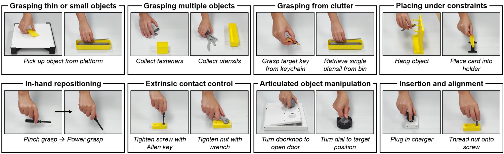

<!-- Generated by scripts/generate.py; edit data/works.json and data/media.json. -->

[← Back to the Awesome index](../../../README.md) · [Interactive website](https://chang-xinhai.github.io/Awesome-RGBDT-Manipulation/?collection=benchmark&item=contactbench#library)

# ContactBench 1.0

ContactBench 1.0: A Benchmark for Everyday Contact-Rich Robotic Manipulation

**2026-10-17 · Preprint · University of Illinois Urbana-Champaign**

**[Paper](https://arxiv.org/abs/2610.24512)** · [Project](https://jingyi-xiang.github.io/contactbench)

A printable 36-task suite instantiates eight everyday contact skills with tunable physical/simulation mechanisms and evaluates learned policies on six physical tasks.

*ContactBench1.0 authors; original rights retained · [Figure source](https://arxiv.org/abs/2610.24512) · Original rights retained.*

| Field | Reported value and source scope |
| :-- | :-- |
| Record type | benchmark |
| Simulator | PyBullet-linked rigid/constraint mechanism suite with custom tactile rendering [1](https://arxiv.org/html/2610.24512)  |
| Simulator version and scope | Not reported [1](https://arxiv.org/html/2610.24512)  |
| Task count and scope | 36 reference tasks; six physical policy-evaluation tasks [1](https://arxiv.org/html/2610.24512)  |
| Task-list scope | Selected named reference/evaluation examples from the paper; not the complete 36-task catalogue. [1](https://arxiv.org/html/2610.24512)  |
| Capability dimensions | Small-object grasping · Multi-object grasping · Clutter grasping · Constrained placement · In-hand repositioning · Extrinsic contact control · Articulated objects · Insertion/alignment [1](https://arxiv.org/html/2610.24512)  |
| Metrics | Task-specific success and contact-failure analysis under reproducible initial-pose randomization. [1](https://arxiv.org/html/2610.24512)  |
| Robots | Single physical arm with GelSight Mini parallel gripper; fixtures stabilize printable task objects. [1](https://arxiv.org/html/2610.24512)  |
| Sensors and observations | Physical wrist RGB and GelSight Mini images/marker displacements. Simulated pressure, indentation, shear and net force are separate outputs. [1](https://arxiv.org/html/2610.24512)  |
| Data collection method | Physical demonstrations: custom handheld UMI gripper. Simulation: keyboard, gamepad and SpaceMouse interfaces with force feedback. [1](https://arxiv.org/html/2610.24512)  |
| Demonstrations and data | Human demonstration training for six single-task policy comparisons. A public complete 36-task corpus is not established. [1](https://arxiv.org/html/2610.24512)  |
| Evaluation protocol | Per-task π0.5 / FTP-1 fine-tuning and reactive diffusion comparisons. Randomized object poses in a 0.15 m × 0.15 m area, Velcro fixtures and rendered reset guidance. [1](https://arxiv.org/html/2610.24512)  |
| Evaluated baselines | Vision π0.5 / diffusion and visual-tactile reactive diffusion / FTP-1 specialists; language capability is not the target comparison. [1](https://arxiv.org/html/2610.24512)  |
| Observations / modalities | RGB · Tactile · Proprioception |
| Evaluation domain | Simulation · Real world |
| Embodiment | Parallel-jaw gripper |
| Release: code | Not released — project simulation-code button says coming soon |
| Release: weights | Not applicable |
| Release: data | Not released — asset-model download says coming soon |
| Release: license | Implementation/dataset/asset license not verified; project figures retain original rights. |
| Release: notes | The paper describes an open benchmark, but inspected project Code and Asset models links are placeholder#buttons explicitly labeled coming soon. |

**Task names — Selected named reference/evaluation examples from the paper; not the complete 36-task catalogue.:**

- Thread nut onto screw
- Tighten screw with Allen key
- Plug in charger
- Turn doorknob to open door
- Retrieve single utensil from bin
- Pick up object from platform

**Scope and qualifications**

- 36reference tasks/&gt;40assets are suitecoverage; policycomparisonis sixphysicaltasks.
- Poor evaluatedVTpolicyperformance on thisprotocol doesnot establishthat tactileinformation is universallyunhelpful.
- Simulation fingertipimages/pressure/shear/netforces andphysicalGelSight channels are distinctsensorconfigurations.

**Primary evidence**

1. [Original full paper, methods and evaluation](https://arxiv.org/html/2610.24512) — Publication date is arXiv v1; implementation and deployment observations are distinguished from training supervision, generated geometry and base-model identity.
