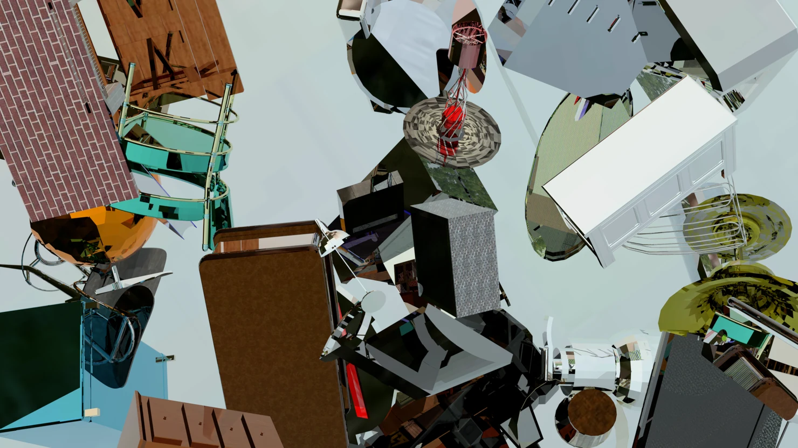

<!-- Generated by scripts/generate.py; edit data/works.json and data/media.json. -->

[← Back to the Awesome index](../../../README.md) · [Interactive website](https://chang-xinhai.github.io/Awesome-RGBDT-Manipulation/?collection=benchmark&item=crestereo-training#library)

# CREStereo Training Data

Practical Stereo Matching via Cascaded Recurrent Network with Adaptive Correlation

**2022-03-22 · CVPR 2022 · Megvii Research and collaborators**

**[Paper](https://arxiv.org/abs/2203.11483)** · [Project](https://github.com/megvii-research/CREStereo) · [Code](https://github.com/megvii-research/CREStereo) · [Data](https://github.com/megvii-research/CREStereo#the-proposed-dataset)

Rendered binocular RGB and disparity target narrow structures, texture-poor regions and reflective appearances.

*CREStereo authors · [Figure source](https://arxiv.org/html/2203.11483v1) · Original rights retained.*

| Field | Reported value and source scope |
| :-- | :-- |
| Record type | dataset |
| Simulator | Blender [1](https://arxiv.org/html/2203.11483v1)  |
| Simulator version and scope | Not reported [1](https://arxiv.org/html/2203.11483v1)  |
| Task count and scope | Supporting dataset or perception evaluation [1](https://arxiv.org/html/2203.11483v1)  |
| Task-list scope | Listed uses of the resource, with no closed-loop robot task count. [1](https://arxiv.org/html/2203.11483v1)  |
| Capability dimensions | Training and evaluation data [1](https://arxiv.org/html/2203.11483v1)  |
| Metrics | Not applicable [1](https://arxiv.org/html/2203.11483v1)  |
| Robots | Not applicable [1](https://arxiv.org/html/2203.11483v1)  |
| Sensors and observations | RGB stereo, rendered disparity encoded as 16-bit PNG. [1](https://arxiv.org/html/2203.11483v1) [3](https://github.com/megvii-research/CREStereo#the-proposed-dataset)  |
| Data collection method | Procedural Blender rendering with foreground thin structures, diverse object appearances, and randomized cameras and lighting. [1](https://arxiv.org/html/2203.11483v1)  |
| Demonstrations and data | Official repository documents an approximately 400 GB standalone archive and disparity encoding. NVIDIA identifies 200K CREStereo examples in its separate model recipe. [1](https://arxiv.org/html/2203.11483v1) [3](https://github.com/megvii-research/CREStereo#the-proposed-dataset) [5](https://huggingface.co/nvidia/c-foundationstereo-s/blob/main/README.md)  |
| Evaluation protocol | Supervised disparity training; external evaluation sets and real-image demos remain separate. [1](https://arxiv.org/html/2203.11483v1)  |
| Evaluated baselines | Not applicable [1](https://arxiv.org/html/2203.11483v1)  |
| Observations / modalities | RGB |
| Evaluation domain | Simulation |
| Embodiment |  |
| Release: code | Available — matching code and data download script [2](https://github.com/megvii-research/CREStereo) [3](https://github.com/megvii-research/CREStereo#the-proposed-dataset)  |
| Release: weights | Not applicable [2](https://github.com/megvii-research/CREStereo) [3](https://github.com/megvii-research/CREStereo#the-proposed-dataset)  |
| Release: data | Official approximately 400 GB archive index and download script [2](https://github.com/megvii-research/CREStereo) [3](https://github.com/megvii-research/CREStereo#the-proposed-dataset)  |
| Release: license | See the author repository; package-specific data terms should be checked independently. [2](https://github.com/megvii-research/CREStereo) [3](https://github.com/megvii-research/CREStereo#the-proposed-dataset)  |
| Release: notes | CREStereo training data is reused by S²M² and is identified separately from the matching implementation. [2](https://github.com/megvii-research/CREStereo) [3](https://github.com/megvii-research/CREStereo#the-proposed-dataset)  |

**Task names — Listed uses of the resource, with no closed-loop robot task count.:**

- Supervised disparity training
- Difficult thin-structure examples

**Primary evidence**

1. [Original author paper or dataset description](https://arxiv.org/html/2203.11483v1)
2. [Author source and artifact entry points](https://github.com/megvii-research/CREStereo)
3. [Author download and disparity format](https://github.com/megvii-research/CREStereo#the-proposed-dataset)
4. [Named constituent of S²M²’s base mixture](https://openaccess.thecvf.com/content/ICCV2025/supplemental/Min_S2M2_Scalable_Stereo_ICCV_2025_supplemental.pdf)
5. [NVIDIA’s independently scoped 200K-example CREStereo recipe](https://huggingface.co/nvidia/c-foundationstereo-s/blob/main/README.md)
