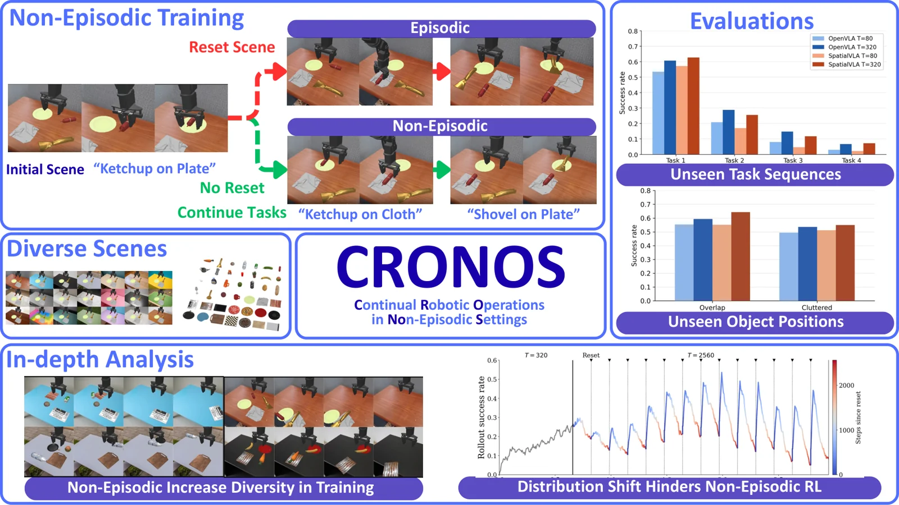

<!-- Generated by scripts/generate.py; edit data/works.json and data/media.json. -->

[← Back to the Awesome index](../../../README.md) · [Interactive website](https://chang-xinhai.github.io/Awesome-RGBDT-Manipulation/?collection=benchmark&item=cronos-bench#library)

# CRONOS

CRONOS: Benchmarking Non-Episodic Reinforcement Learning for Robotic Manipulation

**2026-11-03 · Preprint · National Taiwan University**

**[Paper](https://arxiv.org/abs/2611.05080)**

A simulation benchmark studies VLA fine-tuning with infrequent scene resets and sequential shared-scene tasks.

*CRONOS authors · [Figure source](https://arxiv.org/abs/2611.05080) · Original rights retained.*

| Field | Reported value and source scope |
| :-- | :-- |
| Record type | benchmark |
| Simulator | Physics simulation [1](https://arxiv.org/abs/2611.05080)  |
| Simulator version and scope | Not verified [1](https://arxiv.org/abs/2611.05080)  |
| Task count and scope | Not transcribed [1](https://arxiv.org/abs/2611.05080)  |
| Task-list scope | See the paper for task and scene breakdown. [1](https://arxiv.org/abs/2611.05080)  |
| Capability dimensions | Non-episodic training, reset allocation and distribution drift. [1](https://arxiv.org/abs/2611.05080)  |
| Metrics | Task success and generalization to unseen configurations and sequences. [1](https://arxiv.org/abs/2611.05080)  |
| Robots | Simulated robot manipulator. [1](https://arxiv.org/abs/2611.05080)  |
| Sensors and observations | Visual observations and state; evaluated policy input varies. [1](https://arxiv.org/abs/2611.05080)  |
| Data collection method | Simulated sequential task interaction with infrequent scene reset. [1](https://arxiv.org/abs/2611.05080)  |
| Demonstrations and data | Training rollouts generated during simulation experiments. [1](https://arxiv.org/abs/2611.05080)  |
| Evaluation protocol | Compare reset intervals and targeted reset strategies. [1](https://arxiv.org/abs/2611.05080)  |
| Evaluated baselines | Pretrained VLAs and reset allocation strategies. [1](https://arxiv.org/abs/2611.05080)  |
| Observations / modalities | RGB · Proprioception · Language |
| Evaluation domain | Simulation |
| Embodiment | Not reported |
| Release: code | Not verified |
| Release: weights | Not verified |
| Release: data | Not verified |
| Release: license | Not verified |
| Release: notes | No official public code or dataset link verified in the paper. |

**Task names — See the paper for task and scene breakdown.:**

Task names not reported or not verified in the cited sources.

**Scope and qualifications**

- Non-episodic simulation results do not establish real-world autonomous resetting.

**Primary evidence**

1. [Author paper or official project: methods and evaluation scope](https://arxiv.org/abs/2611.05080)
