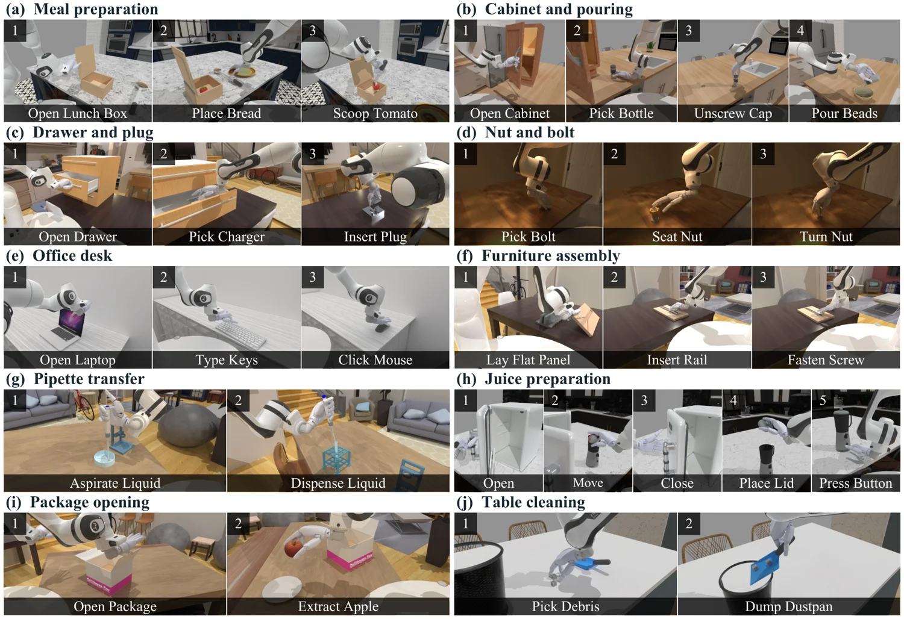

<!-- Generated by scripts/generate.py; edit data/works.json and data/media.json. -->

[← Back to the Awesome index](../../../README.md) · [Interactive website](https://chang-xinhai.github.io/Awesome-RGBDT-Manipulation/?collection=benchmark&item=dexarena#library)

# DexArena

DexArena: A Unified Benchmark for Long-Horizon Dexterous Manipulation

**2026-11-02 · Preprint · Shanghai Jiao Tong University; Shanghai Institute for Physical Artificial Intelligence and Robotics**

**[Paper](https://arxiv.org/abs/2611.02629)** · [Project](https://sipair-elastic.github.io/DexArena-website/) · [Code](https://github.com/SIPAIR-Elastic/DexArena) · [Data](https://huggingface.co/datasets/SIPAIR/DexArena)

A simulation benchmark for staged and long-horizon bimanual dexterous manipulation.

*dexarena authors · [Figure source](https://arxiv.org/abs/2611.02629) · Original rights retained.*

| Field | Reported value and source scope |
| :-- | :-- |
| Record type | benchmark |
| Simulator | Physics simulation; exact simulator not verified [1](https://arxiv.org/html/2611.02629v1)  |
| Simulator version and scope | Not reported [1](https://arxiv.org/html/2611.02629v1)  |
| Task count and scope | 10 long-horizon and 30 stage-level tasks [1](https://arxiv.org/html/2611.02629v1)  |
| Task-list scope | The ten long-horizon task labels in the authors’ Figure 2; their 30 constituent stages are not separately enumerated here. [1](https://arxiv.org/html/2611.02629v1)  |
| Capability dimensions | Long-horizon skill composition, bimanual coordination and scene generalization. [1](https://arxiv.org/html/2611.02629v1)  |
| Metrics | Stage completion and end-to-end success. [1](https://arxiv.org/html/2611.02629v1)  |
| Robots | Single-arm and bimanual dexterous hands. [1](https://arxiv.org/html/2611.02629v1)  |
| Sensors and observations | External and wrist RGB, robot state. [1](https://arxiv.org/html/2611.02629v1)  |
| Data collection method | Human teleoperation demonstrations in simulation with replay validation. [1](https://arxiv.org/html/2611.02629v1)  |
| Demonstrations and data | Teleoperation demonstrations reported by authors; gated official dataset repository includes task assets. [1](https://arxiv.org/html/2611.02629v1)  |
| Evaluation protocol | Standardized simulation, scene randomization and stage/long-horizon evaluation. [1](https://arxiv.org/html/2611.02629v1)  |
| Evaluated baselines | PPO, RLPD, ACT, Diffusion Policy, π0.5 and GR00T N1.7. [1](https://arxiv.org/html/2611.02629v1)  |
| Observations / modalities | RGB · Proprioception · Language |
| Evaluation domain | Simulation |
| Embodiment | Not reported |
| Release: code | Not yet released — repository contains README and license only [2](https://sipair-elastic.github.io/DexArena-website/)  |
| Release: weights | Not verified [2](https://sipair-elastic.github.io/DexArena-website/)  |
| Release: data | Restricted — task asset repository is gated; anonymous file access returned 401 [2](https://sipair-elastic.github.io/DexArena-website/)  |
| Release: license | Apache-2.0 repository; asset licenses may differ. [2](https://sipair-elastic.github.io/DexArena-website/)  |
| Release: notes | The code repository is a README-only placeholder; Hugging Face asset files require access approval. [2](https://sipair-elastic.github.io/DexArena-website/)  |

**Task names — The ten long-horizon task labels in the authors’ Figure 2; their 30 constituent stages are not separately enumerated here.:**

- Meal preparation
- Cabinet and pouring
- Drawer and plug
- Nut and bolt
- Office desk
- Furniture assembly
- Pipette transfer
- Juice preparation
- Package opening
- Table cleaning

**Scope and qualifications**

- Simulation results do not establish real-world performance.
- The code repository is a placeholder despite the public project link.
- Task assets are gated, and anonymous file access returned HTTP 401.

**Primary evidence**

1. [Author paper: methods, scope, and evaluation](https://arxiv.org/html/2611.02629v1)
2. [Official project and linked releases](https://sipair-elastic.github.io/DexArena-website/)
