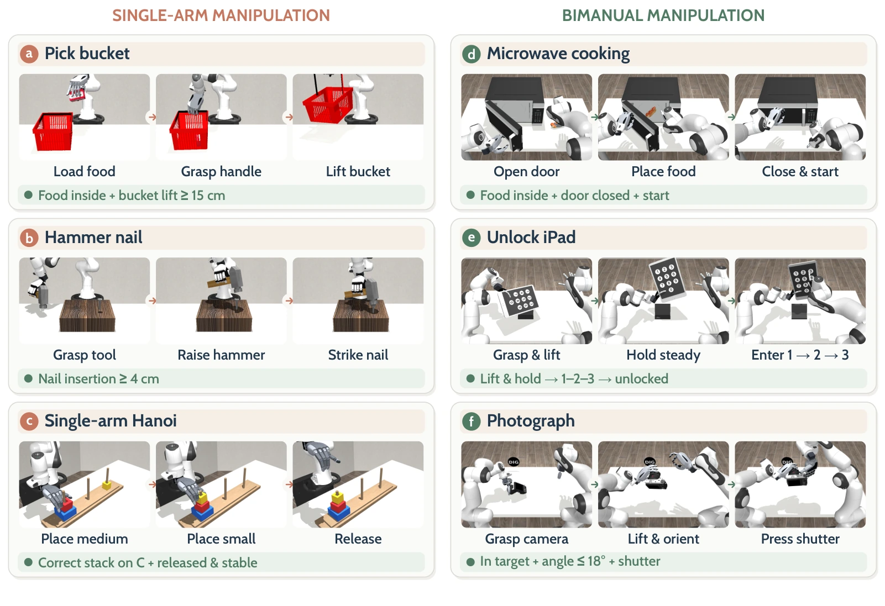

<!-- Generated by scripts/generate.py; edit data/works.json and data/media.json. -->

[← Back to the Awesome index](../../../README.md) · [Interactive website](https://chang-xinhai.github.io/Awesome-RGBDT-Manipulation/?collection=benchmark&item=dexjoco-x#library)

# DexJoCo-X

DexJoCo-X: Benchmarking Action Representations for Multi-Hand Dexterous Manipulation

**2026-10-02 · Preprint · Not reported**

**[Paper](https://arxiv.org/abs/2610.03278)**

Controlled seven-hand comparison of action representations under shared scenes, task criteria and balanced demonstration budgets.

*DexJoCo-X authors · [Figure source](https://arxiv.org/abs/2610.03278) · Original rights retained.*

| Field | Reported value and source scope |
| :-- | :-- |
| Record type | benchmark |
| Simulator | MuJoCo (DexJoCo-based benchmark) [1](https://arxiv.org/abs/2610.03278)  |
| Simulator version and scope | Not reported [1](https://arxiv.org/abs/2610.03278)  |
| Task count and scope | 6 tasks × 7 hands = 42 hand–task pairs [1](https://arxiv.org/abs/2610.03278)  |
| Task-list scope | Complete six paper task labels; first three single-arm, last three bimanual. [1](https://arxiv.org/abs/2610.03278)  |
| Capability dimensions | Cross-embodiment dexterity · Action representation · Functional tool use · Bimanual control [1](https://arxiv.org/abs/2610.03278)  |
| Metrics | Success per hand/task and mean across 42 pairs; three independent 50-rollout evaluations/cell = 6,300 evaluation episodes. [1](https://arxiv.org/abs/2610.03278)  |
| Robots | XHand, Inspire, Wuji, LEAP, Sharpa Wave, LinkerHand, Allegro hands with arm setups. [1](https://arxiv.org/abs/2610.03278)  |
| Sensors and observations | RGB, robot state and action records; no tactile sensing established. [1](https://arxiv.org/abs/2610.03278)  |
| Demonstrations and data | 2,100 balanced demonstrations; 50 per hand–task pair; reviewed demonstrations expanded and verified in randomized scenes. [1](https://arxiv.org/abs/2610.03278)  |
| Evaluation protocol | Seven per-hand multitask π0.5/Ego-Pi policies (300 demos each) vs joint Being-H0.5 (2,100 demos); Native, function-aligned action slots and DexLatent within matched joint architecture. [1](https://arxiv.org/abs/2610.03278)  |
| Evaluated baselines | π0.5, Ego-Pi action-head adaptation; Being-H0.5 with Native, FAAS, DexLatent. [1](https://arxiv.org/abs/2610.03278)  |
| Observations / modalities | RGB · Proprioception |
| Evaluation domain | Simulation |
| Embodiment | Dexterous hand · Bimanual |
| Release: code | Not verified |
| Release: weights | Not verified |
| Release: data | Not verified |
| Release: license | Not reported |
| Release: notes | Paper accessible; independent public code/data release URL not resolved. |

**Task names — Complete six paper task labels; first three single-arm, last three bimanual.:**

- Bucket
- Hammer
- Hanoi
- Microwave
- Unlock iPad
- Photo

**Scope and qualifications**

- Cross-architecture comparisons differ in pretraining and training organization; the clean representation comparison is within Being-H0.5.
- The six tasks are a subset/reformulation of DexJoCo task families.

**Primary evidence**

1. [Paper](https://arxiv.org/abs/2610.03278) — Published paper / arXiv record and manuscript.
