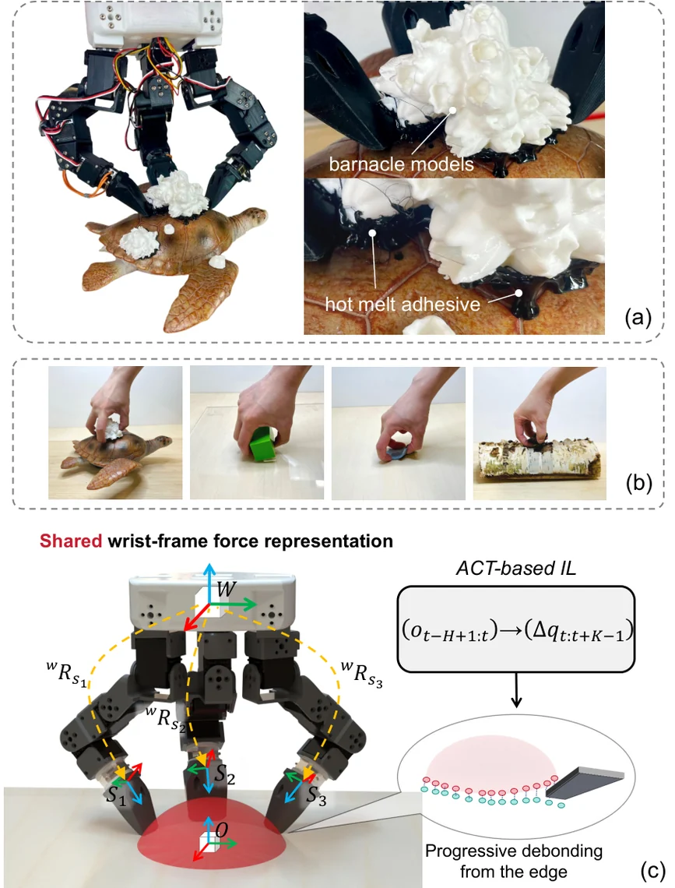

<!-- Generated by scripts/generate.py; edit data/works.json and data/media.json. -->

[← Back to the Awesome index](../../../README.md) · [Interactive website](https://chang-xinhai.github.io/Awesome-RGBDT-Manipulation/?collection=benchmark&item=dexremo#library)

# DexRemo

DexRemo: A Force-Sensing Hand Platform and Task Suite for Contact-Rich Removal Manipulation

**2026-11-11 · Preprint · University of York and collaborators**

**[Paper](https://arxiv.org/abs/2611.15981)** · [Project](https://dexremo.github.io/)

Pairs a three-finger force-sensing hand with a nine-scenario real-robot benchmark and an ACT baseline for removal.

*DexRemo authors · [Figure source](https://arxiv.org/html/2611.15981v1) · Original rights retained.*

| Field | Reported value and source scope |
| :-- | :-- |
| Record type | benchmark |
| Simulator | Not applicable — physical benchmark [1](https://arxiv.org/html/2611.15981)  |
| Simulator version and scope | Not applicable [1](https://arxiv.org/html/2611.15981)  |
| Task count and scope | 9 scenarios (six core + three extension) [1](https://arxiv.org/html/2611.15981)  |
| Task-list scope | Table V lists all nine scenarios. A1–A4, B1 and C1 are the core ablation set; A5, B2 and C2 extend coverage. [1](https://arxiv.org/html/2611.15981)  |
| Capability dimensions | Removal, scraping, peeling and extraction under persistent contact [1](https://arxiv.org/html/2611.15981)  |
| Metrics | Task-defined physical success and held-out robustness checks. [1](https://arxiv.org/html/2611.15981)  |
| Robots | Three-finger DexRemo teleoperated follower [1](https://arxiv.org/html/2611.15981)  |
| Sensors and observations | Tri-axis fingertip load cells, multi-view RGB, finger pose and proprioception. [1](https://arxiv.org/html/2611.15981)  |
| Data collection method | Human demonstrations via a kinematically matched leader–follower hand with view and force feedback. [1](https://arxiv.org/html/2611.15981)  |
| Demonstrations and data | Trial/demonstration data are described in the paper; download not verified. [1](https://arxiv.org/html/2611.15981)  |
| Evaluation protocol | Task-specific training and held-out object, pose or attachment variations. [1](https://arxiv.org/html/2611.15981)  |
| Evaluated baselines | ACT with local-frame or wrist-frame force, fingertip pose and no-force controls. [1](https://arxiv.org/html/2611.15981)  |
| Observations / modalities | RGB · Tactile · Force · Proprioception |
| Evaluation domain | Real world |
| Embodiment | DexRemo three-finger follower hand |
| Release: code | Not verified [2](https://dexremo.github.io/)  |
| Release: weights | Not verified [2](https://dexremo.github.io/)  |
| Release: data | Not verified [2](https://dexremo.github.io/)  |
| Release: license | Not verified [2](https://dexremo.github.io/)  |
| Release: notes | Paper provides the task and hardware procedure. Author site gives a staged hardware-first roadmap; separate downloadable datasets, weights and repository were not verified. [2](https://dexremo.github.io/)  |

**Task names — Table V lists all nine scenarios. A1–A4, B1 and C1 are the core ablation set; A5, B2 and C2 extend coverage.:**

- A1 Barnacle removal from turtle shell
- A2 3D-printed part removal from the build plate
- A3 Blu-Tack removal from acrylic plate
- A4 Wood-ear extraction from tree log
- A5 Fingertip self-cleaning
- B1 Sponge wiping marker stains from the ceramic plate
- B2 Cotton wiping ink marks on silicone skin
- C1 Fossil excavation in sand
- C2 Cat litter clump removal

**Scope and qualifications**

- Six core tasks have controlled force-frame ablations. Three extension scenarios report additional held-out evaluations.
- Force is measured at the fingertips in three axes and transformed to a common wrist frame; it does not denote a wrist force/torque sensor.

**Primary evidence**

1. [Primary paper and evaluated setting](https://arxiv.org/html/2611.15981)
2. [Author project and artifact status](https://dexremo.github.io/)
