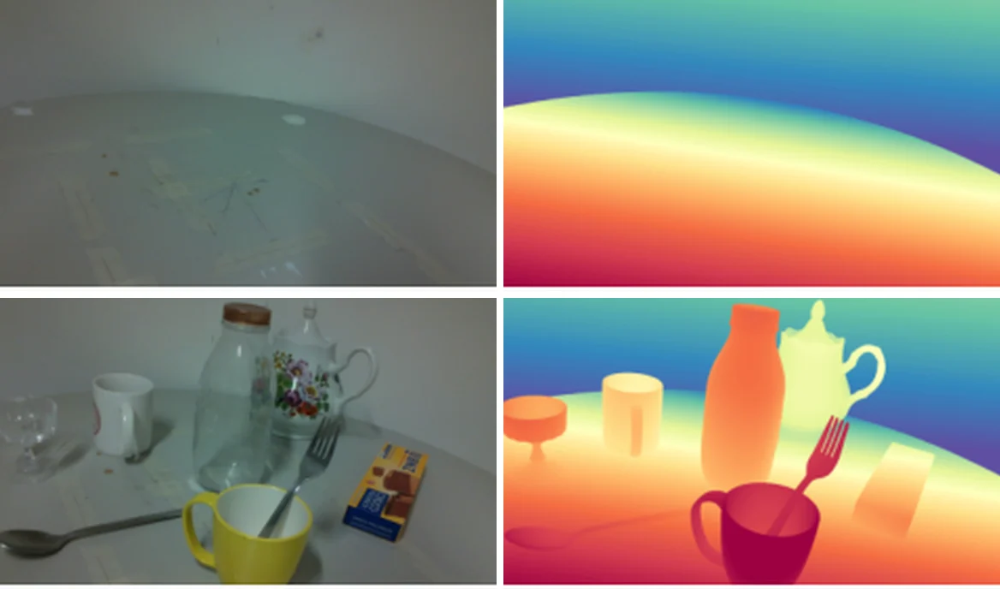

<!-- Generated by scripts/generate.py; edit data/works.json and data/media.json. -->

[← Back to the Awesome index](../../../README.md) · [Interactive website](https://chang-xinhai.github.io/Awesome-RGBDT-Manipulation/?collection=benchmark&item=dimed#library)

# DIMED

What the Averages Hide: Monocular Metric Depth Models Still Fail in Everyday Scenes, Mostly on Scale

**2026-11-16 · Preprint · Antigravity Tech / Insta360 and NTU**

**[Paper](https://arxiv.org/abs/2611.20518)** · [Project](https://antigravity-tech.github.io/DIMED/) · [Code](https://github.com/antigravity-tech/DIMED) · [Data](https://huggingface.co/datasets/hljiang/DIMED)

Diagnoses metric monocular depth failures by separating global scale errors from shape errors on individual images.

*Hualie Jiang and coauthors, Antigravity Tech / Insta360 · [Figure source](https://arxiv.org/html/2611.20518v1#A8.F15) · Original rights retained.*

| Field | Reported value and source scope |
| :-- | :-- |
| Record type | evaluation-tool |
| Simulator | Not applicable [1](https://arxiv.org/html/2611.20518v1)  |
| Simulator version and scope | Not applicable [1](https://arxiv.org/html/2611.20518v1)  |
| Task count and scope | Supporting dataset or perception evaluation [1](https://arxiv.org/html/2611.20518v1)  |
| Task-list scope | Listed uses of the resource, with no closed-loop robot task count. [1](https://arxiv.org/html/2611.20518v1)  |
| Capability dimensions | Training and evaluation data [1](https://arxiv.org/html/2611.20518v1)  |
| Metrics | Per-image metric and aligned δ₁, failure rate, scale bias/dispersion and shared failure. [1](https://arxiv.org/html/2611.20518v1)  |
| Robots | Not applicable [1](https://arxiv.org/html/2611.20518v1)  |
| Sensors and observations | Monocular RGB inference; synchronized sensor depth kept as an evaluation reference. [1](https://arxiv.org/html/2611.20518v1)  |
| Data collection method | Process calibrated TUM RGB-D sequences, with separate HAMMER and six other source benchmarks used in paper analyses. [1](https://arxiv.org/html/2611.20518v1)  |
| Demonstrations and data | Public subset: 514 TUM-Family and 215 TUM-Ref images; also publishes per-image result files. [1](https://arxiv.org/html/2611.20518v1) [5](https://huggingface.co/datasets/hljiang/DIMED)  |
| Evaluation protocol | Paper examines 11 model architectures under intrinsics-known and estimated conditions where supported, with per-image scale alignment and model-shared failures. [1](https://arxiv.org/html/2611.20518v1)  |
| Evaluated baselines | Paper lists 11 architectures including MoGe, DA3Metric, FoundationGeo and UniK3D. [1](https://arxiv.org/html/2611.20518v1)  |
| Observations / modalities | RGB · Depth |
| Evaluation domain | Real world |
| Embodiment |  |
| Release: code | Available — evaluation adapters and per-image recomputation scripts. [2](https://antigravity-tech.github.io/DIMED/) [3](https://github.com/antigravity-tech/DIMED)  |
| Release: weights | Not applicable [2](https://antigravity-tech.github.io/DIMED/)  |
| Release: data | Available — published TUM-Family, TUM-Ref and model evaluation results. [2](https://antigravity-tech.github.io/DIMED/) [5](https://huggingface.co/datasets/hljiang/DIMED)  |
| Release: license | MIT source; CC BY 4.0 listed for published DIMED artifacts. Parent datasets retain their own terms. [2](https://antigravity-tech.github.io/DIMED/) [4](https://github.com/antigravity-tech/DIMED/blob/main/LICENSE) [5](https://huggingface.co/datasets/hljiang/DIMED)  |
| Release: notes | The published TUM release is distinct from the broader benchmark suite and from HAMMER examples. [2](https://antigravity-tech.github.io/DIMED/)  |

**Task names — Listed uses of the resource, with no closed-loop robot task count.:**

- Scale failure diagnosis
- Model comparison with and without known intrinsics
- Matched background and texture analysis

**Scope and qualifications**

- Reference depth is not an input stream for benchmarked monocular models.

**Primary evidence**

1. [Original author paper or dataset description](https://arxiv.org/html/2611.20518v1)
2. [Author source and artifact entry points](https://antigravity-tech.github.io/DIMED/)
3. [Official adapters](https://github.com/antigravity-tech/DIMED)
4. [Repository license](https://github.com/antigravity-tech/DIMED/blob/main/LICENSE)
5. [Public TUM data payload, per-image results and license](https://huggingface.co/datasets/hljiang/DIMED)
