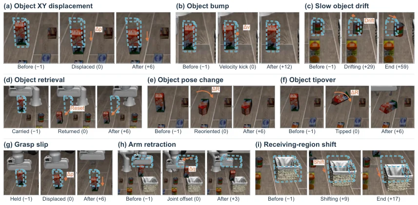

<!-- Generated by scripts/generate.py; edit data/works.json and data/media.json. -->

[← Back to the Awesome index](../../../README.md) · [Interactive website](https://chang-xinhai.github.io/Awesome-RGBDT-Manipulation/?collection=benchmark&item=dimure#library)

# DiMuRe / LIBERO-Disturb

DiMuRe: Diagnosis-Guided Multilevel Recovery for Robotic Task Execution

**2026-11-03 · Preprint · Beijing Institute of Technology**

**[Paper](https://arxiv.org/abs/2611.04226)**

An agent selects program reuse, local recovery skills, or corrective replanning under mid-execution disturbances.

*DiMuRe / LIBERO-Disturb authors · [Figure source](https://arxiv.org/abs/2611.04226) · Original rights retained.*

| Field | Reported value and source scope |
| :-- | :-- |
| Record type | benchmark |
| Simulator | LIBERO / Encore [1](https://arxiv.org/abs/2611.04226)  |
| Simulator version and scope | Not verified [1](https://arxiv.org/abs/2611.04226)  |
| Task count and scope | 9 disturbance types [1](https://arxiv.org/abs/2611.04226)  |
| Task-list scope | Nine perturbation types in author Figure 3; base tasks and 801 development cases are separate counts. [1](https://arxiv.org/abs/2611.04226)  |
| Capability dimensions | Recovery from phase-dependent disturbances during manipulation. [1](https://arxiv.org/abs/2611.04226)  |
| Metrics | Complete-task success, physical steps and recovery time. [1](https://arxiv.org/abs/2611.04226)  |
| Robots | Simulated manipulation arm. [1](https://arxiv.org/abs/2611.04226)  |
| Sensors and observations | RGB-D observations, robot state and program context for diagnosis. [1](https://arxiv.org/abs/2611.04226)  |
| Data collection method | Perturbations inserted during execution of simulated task programs. [1](https://arxiv.org/abs/2611.04226)  |
| Demonstrations and data | 801 scheduled disturbed Encore development cases reported. [1](https://arxiv.org/abs/2611.04226)  |
| Evaluation protocol | Compare local recovery and terminal replanning under their stated separate budgets. [1](https://arxiv.org/abs/2611.04226)  |
| Evaluated baselines | Original program, local recovery and full multilevel recovery. [1](https://arxiv.org/abs/2611.04226)  |
| Observations / modalities | RGB · Depth · Proprioception · Language |
| Evaluation domain | Simulation |
| Embodiment | Not reported |
| Release: code | Not verified |
| Release: weights | Not verified |
| Release: data | Not verified |
| Release: license | Not verified |
| Release: notes | No official public code link verified in the original paper. |

**Task names — Nine perturbation types in author Figure 3; base tasks and 801 development cases are separate counts.:**

- Object XY displacement
- Object bump
- Slow object drift
- Object retrieval
- Object pose change
- Object tipover
- Grasp slip
- Arm retraction
- Receiving-region shift

**Scope and qualifications**

- The benchmark is simulated; full DiMuRe and local-only DiMuRe use different step allowances and handoff protocols.

**Primary evidence**

1. [Author paper or official project: methods and evaluation scope](https://arxiv.org/abs/2611.04226)
