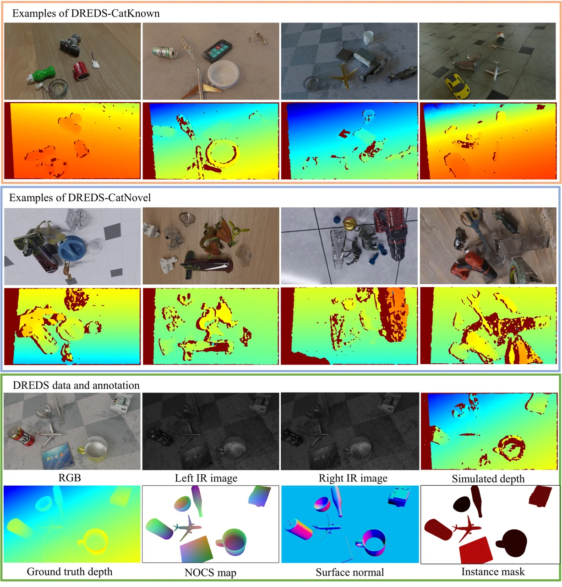

<!-- Generated by scripts/generate.py; edit data/works.json and data/media.json. -->

[← Back to the Awesome index](../../../README.md) · [Interactive website](https://chang-xinhai.github.io/Awesome-RGBDT-Manipulation/?collection=benchmark&item=dreds-std#library)

# DREDS & STD

Domain Randomization-Enhanced Depth Simulation and Restoration for Perceiving and Grasping Specular and Transparent Objects

**2022-08-07 · ECCV 2022 · Peking University and collaborators**

**[Paper](https://arxiv.org/abs/2208.03792)** · [Project](https://pku-epic.github.io/DREDS/) · [Code](https://github.com/PKU-EPIC/DREDS) · [Data](https://github.com/PKU-EPIC/DREDS#dataset)

Simulates active-stereo depth failure modes and provides physical RGB-D restoration tests for transparent, reflective and diffuse objects.

*DREDS authors · [Figure source](https://arxiv.org/html/2208.03792v1) · Original rights retained.*

| Field | Reported value and source scope |
| :-- | :-- |
| Record type | dataset |
| Simulator | Blender with the DREDS depth sensor simulator [1](https://arxiv.org/html/2208.03792v1)  |
| Simulator version and scope | Not reported [1](https://arxiv.org/html/2208.03792v1)  |
| Task count and scope | Supporting dataset or perception evaluation [1](https://arxiv.org/html/2208.03792v1)  |
| Task-list scope | Listed uses of the resource, with no closed-loop robot task count. [1](https://arxiv.org/html/2208.03792v1)  |
| Capability dimensions | Training and evaluation data [1](https://arxiv.org/html/2208.03792v1)  |
| Metrics | Depth error; downstream 6D pose or grasp metric per task. [1](https://arxiv.org/html/2208.03792v1)  |
| Robots | Physical grasp evaluation and RGB-D recordings are separately scoped. [1](https://arxiv.org/html/2208.03792v1)  |
| Sensors and observations | RGB, simulated active-stereo depth, and reference labels; real STD includes RGB-D. [1](https://arxiv.org/html/2208.03792v1)  |
| Data collection method | Render stereo IR projection and sensor-like depth noise with randomized materials. RealSense-based STD acquisition is a separate real domain. [1](https://arxiv.org/html/2208.03792v1)  |
| Demonstrations and data | DREDS-CatKnown: 100,200 training and 19,380 test images. Synthetic CatNovel: 11,520. Real STD: 38,000 RGB-D images across known and novel splits reported by publisher. [1](https://arxiv.org/html/2208.03792v1) [3](https://github.com/PKU-EPIC/DREDS#dataset)  |
| Evaluation protocol | Train on simulation and evaluate sim-to-real, transparent/specular restoration, category-level pose and grasping. [1](https://arxiv.org/html/2208.03792v1)  |
| Evaluated baselines | Not applicable [1](https://arxiv.org/html/2208.03792v1)  |
| Observations / modalities | RGB · Depth |
| Evaluation domain | Simulation · Real world |
| Embodiment |  |
| Release: code | Available — generation simulator and SwinDRNet [2](https://pku-epic.github.io/DREDS/) [3](https://github.com/PKU-EPIC/DREDS#dataset)  |
| Release: weights | Available — SwinDRNet weights documented by authors [2](https://pku-epic.github.io/DREDS/) [3](https://github.com/PKU-EPIC/DREDS#dataset)  |
| Release: data | Available — synthetic DREDS and separate real STD via author mirror [2](https://pku-epic.github.io/DREDS/) [3](https://github.com/PKU-EPIC/DREDS#dataset)  |
| Release: license | CC BY-NC 4.0 for the work and dataset. [2](https://pku-epic.github.io/DREDS/) [3](https://github.com/PKU-EPIC/DREDS#dataset)  |
| Release: notes | Synthetic and physical modality payloads differ. [2](https://pku-epic.github.io/DREDS/) [3](https://github.com/PKU-EPIC/DREDS#dataset)  |

**Task names — Listed uses of the resource, with no closed-loop robot task count.:**

- Transparent depth restoration
- Specular depth restoration
- Downstream object pose and grasping

**Scope and qualifications**

- Active IR describes the simulator, not the payload of every split. The real STD depth-restoration release does not expose the synthetic IR-pair interface.

**Primary evidence**

1. [Original author paper or dataset description](https://arxiv.org/html/2208.03792v1)
2. [Author source and artifact entry points](https://pku-epic.github.io/DREDS/)
3. [Official dataset split counts and download indexes](https://github.com/PKU-EPIC/DREDS#dataset)
4. [Follow-up method notes IR differences between DREDS and real STD](https://arxiv.org/html/2409.14365)
