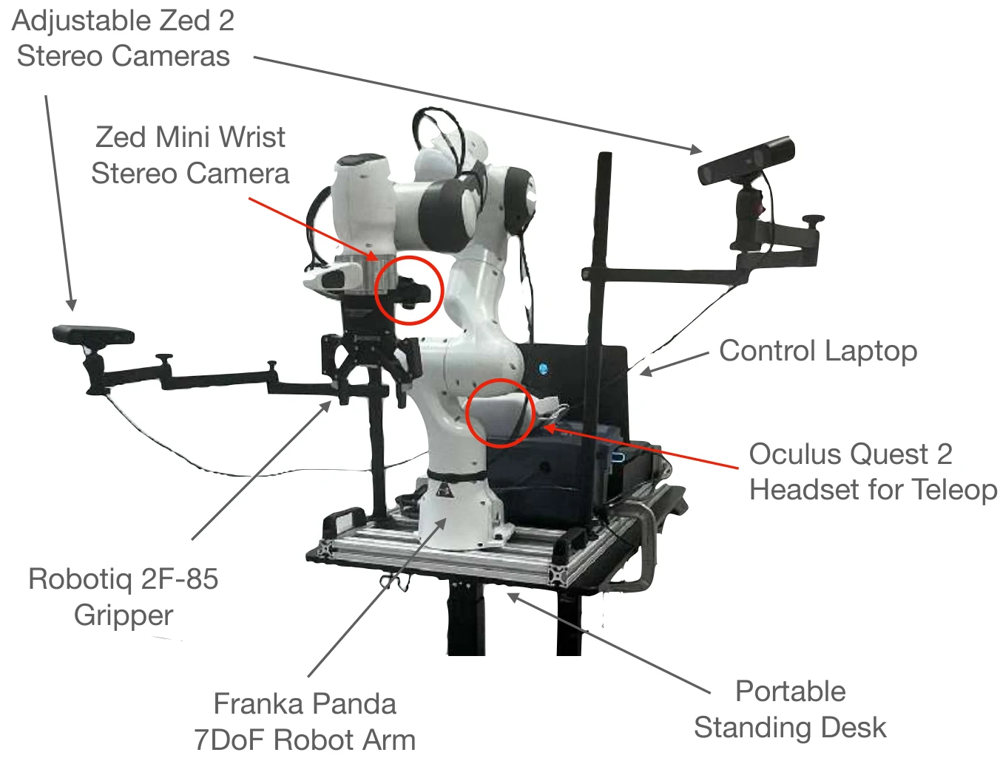

<!-- Generated by scripts/generate.py; edit data/works.json and data/media.json. -->

[← Back to the Awesome index](../../../README.md) · [Interactive website](https://chang-xinhai.github.io/Awesome-RGBDT-Manipulation/?collection=benchmark&item=droid-stereo#library)

# DROID (raw stereo)

DROID: A Large-Scale In-the-Wild Robot Manipulation Dataset

**2024-03-19 · RSS 2024 · DROID multi-institution consortium**

**[Paper](https://arxiv.org/abs/2403.12945)** · [Project](https://droid-dataset.github.io/) · [Code](https://github.com/droid-dataset/droid) · [Data](https://droid-dataset.github.io/droid/the-droid-dataset)

Raw release preserves both eyes from each one of the three ZED cameras in real manipulation recordings.

*DROID Dataset Team · [Figure source](https://arxiv.org/html/2403.12945v1) · Original rights retained.*

| Field | Reported value and source scope |
| :-- | :-- |
| Record type | dataset |
| Simulator | Not applicable [1](https://arxiv.org/html/2403.12945v1)  |
| Simulator version and scope | Not applicable [1](https://arxiv.org/html/2403.12945v1)  |
| Task count and scope | Supporting dataset or perception evaluation [1](https://arxiv.org/html/2403.12945v1)  |
| Task-list scope | Listed uses of the resource, with no closed-loop robot task count. [1](https://arxiv.org/html/2403.12945v1)  |
| Capability dimensions | Training and evaluation data [1](https://arxiv.org/html/2403.12945v1)  |
| Metrics | Not applicable [1](https://arxiv.org/html/2403.12945v1)  |
| Robots | Franka arm and parallel-jaw gripper. [1](https://arxiv.org/html/2403.12945v1)  |
| Sensors and observations | Three ZED stereo units, concatenated same-unit left/right MP4 or raw SVO, plus HDF5 actions and proprioception. [1](https://arxiv.org/html/2403.12945v1) [3](https://droid-dataset.github.io/droid/the-droid-dataset)  |
| Data collection method | Distributed teleoperation on a shared Franka setup across real indoor scenes. [1](https://arxiv.org/html/2403.12945v1)  |
| Demonstrations and data | 76K demonstrations and 350 hours in the original paper across all formats. Authors describe the stereo-enabled raw archive as approximately 8.7 TB. [1](https://arxiv.org/html/2403.12945v1) [3](https://droid-dataset.github.io/droid/the-droid-dataset)  |
| Evaluation protocol | Use same-device stereo MP4/SVO. Per-eye calibration and left/right frames should be checked against the ZED recording. [1](https://arxiv.org/html/2403.12945v1)  |
| Evaluated baselines | Not applicable [1](https://arxiv.org/html/2403.12945v1)  |
| Observations / modalities | RGB · Proprioception |
| Evaluation domain | Real world |
| Embodiment |  |
| Release: code | Available — DROID collection stack and raw conversion [2](https://droid-dataset.github.io/) [3](https://droid-dataset.github.io/droid/the-droid-dataset)  |
| Release: weights | See separate policy learning release. [2](https://droid-dataset.github.io/) [3](https://droid-dataset.github.io/droid/the-droid-dataset)  |
| Release: data | Available — explicit raw HD stereo MP4/SVO variant in author docs [2](https://droid-dataset.github.io/) [3](https://droid-dataset.github.io/droid/the-droid-dataset)  |
| Release: license | CC BY 4.0 for DROID data under the paper’s release. [2](https://droid-dataset.github.io/) [3](https://droid-dataset.github.io/droid/the-droid-dataset) [4](https://autolab.berkeley.edu/assets/publications/media/2024-RSS-DROID.pdf)  |
| Release: notes | RLDS and raw releases have different image payloads and documented completeness. [2](https://droid-dataset.github.io/) [3](https://droid-dataset.github.io/droid/the-droid-dataset)  |

**Task names — Listed uses of the resource, with no closed-loop robot task count.:**

- Robot manipulation imitation learning
- Raw stereo geometry

**Scope and qualifications**

- The raw documentation notes incomplete early uploads; the paper’s 76K demonstrations are not a verified public dual-eye count.
- The two exterior cameras are different devices, not the two eyes of one stereo camera.

**Primary evidence**

1. [Original author paper or dataset description](https://arxiv.org/html/2403.12945v1)
2. [Author source and artifact entry points](https://droid-dataset.github.io/)
3. [Official raw stereo and RLDS file contract](https://droid-dataset.github.io/droid/the-droid-dataset)
4. [RSS paper including data license](https://autolab.berkeley.edu/assets/publications/media/2024-RSS-DROID.pdf)
