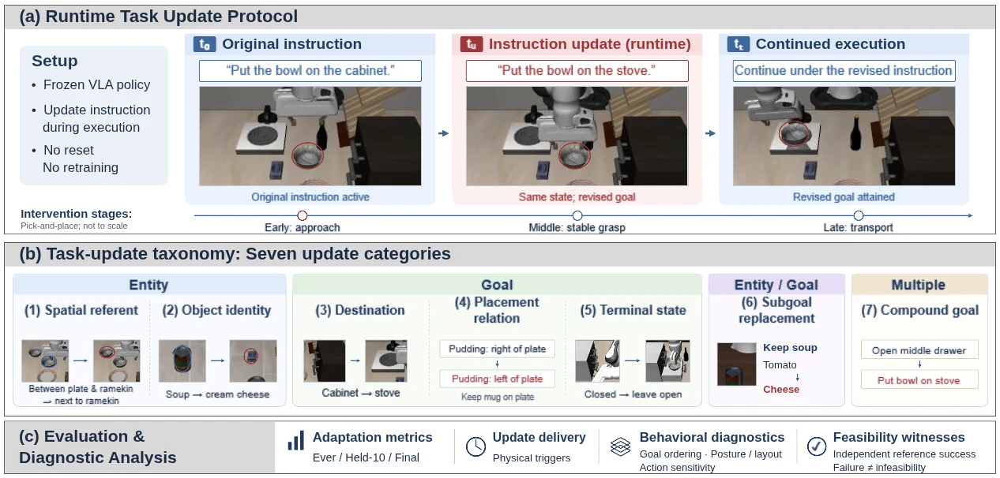

<!-- Generated by scripts/generate.py; edit data/works.json and data/media.json. -->

[← Back to the Awesome index](../../../README.md) · [Interactive website](https://chang-xinhai.github.io/Awesome-RGBDT-Manipulation/?collection=benchmark&item=dtu-bench#library)

# DTU-Bench

Dynamic Task Update Benchmark (DTU-Bench): Evaluating Runtime Task Adaptation in Robotic Manipulation

**2026-11-25 · Preprint · CSIRO Technology, Australia and collaborators**

**[Paper](https://arxiv.org/abs/2611.34538)** · [Project](https://dtu-bench.github.io/)

Tests live VLA task revisions by changing the instruction at a matched execution stage without resetting the robot.

*Yanran Jiang and coauthors · [Figure source](https://arxiv.org/html/2611.34538v1) · Original rights retained.*

| Field | Reported value and source scope |
| :-- | :-- |
| Record type | benchmark |
| Simulator | LIBERO [1](https://arxiv.org/html/2611.34538v1)  |
| Simulator version and scope | Not reported [1](https://arxiv.org/html/2611.34538v1)  |
| Task count and scope | 40 task revisions across 7 change types and 3 intervention stages; 13 released VLA configurations [1](https://arxiv.org/html/2611.34538v1)  |
| Task-list scope | Examples from the instruction-update taxonomy, not the full revision list. [1](https://arxiv.org/html/2611.34538v1)  |
| Capability dimensions | Task switching · Progress compatibility · Delayed update completion [1](https://arxiv.org/html/2611.34538v1)  |
| Metrics | Held-10 and Final success; compare matching updated-from-start and mid-execution cases. [1](https://arxiv.org/html/2611.34538v1)  |
| Robots | LIBERO tabletop robot with gripper. [1](https://arxiv.org/html/2611.34538v1)  |
| Sensors and observations | Each VLA preserves its own native RGB, language and robot-state settings. [1](https://arxiv.org/html/2611.34538v1)  |
| Data collection method | Construct original/updated instruction pairs from LIBERO and record intervention states at controlled execution stages. [1](https://arxiv.org/html/2611.34538v1)  |
| Demonstrations and data | Paper task update definitions and rollout examples; full release not verified. [1](https://arxiv.org/html/2611.34538v1)  |
| Evaluation protocol | Keep same task state for matched interventions, release/retreat helper diagnostics, and no-reset runtime evaluations. [1](https://arxiv.org/html/2611.34538v1)  |
| Evaluated baselines | 13 VLA configurations, including OpenVLA, OpenVLA-OFT, π0.5 and DM0.5; released checkpoints, no new training. [1](https://arxiv.org/html/2611.34538v1)  |
| Observations / modalities | RGB · Proprioception · Language |
| Evaluation domain | Simulation |
| Embodiment | Parallel-jaw gripper |
| Release: code | Announced — paper and project describe a later benchmark/code release |
| Release: weights | Not applicable |
| Release: data | Not verified |
| Release: license | Not verified |
| Release: notes | Paper or official project reviewed. Code, weights and data are tracked independently. |

**Task names — Examples from the instruction-update taxonomy, not the full revision list.:**

- Change target object
- Change destination
- Change spatial referent

**Scope and qualifications**

- From-start competence is measured separately from runtime adaptation. Each evaluated checkpoint retains its native observation interface.

**Primary evidence**

1. [Original paper and evaluation settings](https://arxiv.org/html/2611.34538v1)
2. [Official project with task and method examples](https://dtu-bench.github.io/)
