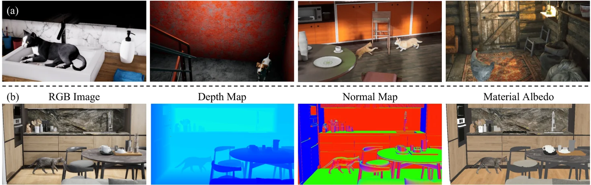

<!-- Generated by scripts/generate.py; edit data/works.json and data/media.json. -->

[← Back to the Awesome index](../../../README.md) · [Interactive website](https://chang-xinhai.github.io/Awesome-RGBDT-Manipulation/?collection=benchmark&item=dydtof#library)

# DyDToF

Consistent Direct Time-of-Flight Video Depth Super-Resolution

**2022-11-16 · CVPR 2023 · Meta Reality Labs**

**[Paper](https://arxiv.org/abs/2211.08658)** · [Project](https://zhsun0357.github.io/consistent_dtof_video/) · [Code](https://github.com/facebookresearch/DVSR) · [Data](https://drive.google.com/drive/folders/19MT7dhJaMkVd6y5QHywWqjZRNN08-XPU) · [Weights](https://github.com/facebookresearch/DVSR/tree/main/chkpts)

Rendered dynamic video with synthetic direct time-of-flight and dense reference depth supports sensor upsampling and temporal depth evaluation.

*Zhanghao Sun and coauthors · [Figure source](https://arxiv.org/html/2211.08658v1) · Original rights retained.*

| Field | Reported value and source scope |
| :-- | :-- |
| Record type | dataset |
| Simulator | Not applicable [1](https://arxiv.org/html/2211.08658v1)  |
| Simulator version and scope | Not applicable [1](https://arxiv.org/html/2211.08658v1)  |
| Task count and scope | Supporting dataset or perception evaluation [1](https://arxiv.org/html/2211.08658v1)  |
| Task-list scope | Listed uses of the resource, with no closed-loop robot task count. [1](https://arxiv.org/html/2211.08658v1)  |
| Capability dimensions | Training and evaluation data [1](https://arxiv.org/html/2211.08658v1)  |
| Metrics | Depth error and temporal consistency, with evaluation windows scoped by paper. [1](https://arxiv.org/html/2211.08658v1)  |
| Robots | Not applicable [1](https://arxiv.org/html/2211.08658v1)  |
| Sensors and observations | Synthetic RGB, rendered dense depth, normal and albedo; calibrated camera trajectories. [1](https://arxiv.org/html/2211.08658v1)  |
| Data collection method | Render dynamic objects and moving cameras with clean geometry; project physically modelled low-resolution dToF measurements for DVSR experiments. [1](https://arxiv.org/html/2211.08658v1)  |
| Demonstrations and data | 100 clips and 45,000 frames, per author repository. RGB, depth, albedo, normals and camera trajectory provided per clip. [1](https://arxiv.org/html/2211.08658v1) [3](https://github.com/facebookresearch/DVSR)  |
| Evaluation protocol | Multi-frame direct-ToF super-resolution in the original work; later monocular methods use RGB-only frames and held-out dense reference depth. [1](https://arxiv.org/html/2211.08658v1)  |
| Evaluated baselines | DVSR and contemporary RGB-guided temporal depth super-resolution baselines. [1](https://arxiv.org/html/2211.08658v1)  |
| Observations / modalities | RGB · Depth |
| Evaluation domain | Simulation |
| Embodiment |  |
| Release: code | Available — author DVSR code and rendering/processing instructions. [2](https://openaccess.thecvf.com/content/CVPR2023/html/Sun_Consistent_Direct_Time-of-Flight_Video_Depth_Super-Resolution_CVPR_2023_paper.html) [3](https://github.com/facebookresearch/DVSR)  |
| Release: weights | Available — official DVSR checkpoint linked in upstream README. [2](https://openaccess.thecvf.com/content/CVPR2023/html/Sun_Consistent_Direct_Time-of-Flight_Video_Depth_Super-Resolution_CVPR_2023_paper.html) [3](https://github.com/facebookresearch/DVSR)  |
| Release: data | Available — DyDToF release folder linked upstream; vendor real dToF raw data is excluded. [2](https://openaccess.thecvf.com/content/CVPR2023/html/Sun_Consistent_Direct_Time-of-Flight_Video_Depth_Super-Resolution_CVPR_2023_paper.html) [3](https://github.com/facebookresearch/DVSR)  |
| Release: license | CC BY-NC 4.0 in DVSR repository LICENSE; inspect individual archive terms separately. [2](https://openaccess.thecvf.com/content/CVPR2023/html/Sun_Consistent_Direct_Time-of-Flight_Video_Depth_Super-Resolution_CVPR_2023_paper.html) [3](https://github.com/facebookresearch/DVSR) [4](https://github.com/facebookresearch/DVSR/blob/main/LICENSE)  |
| Release: notes | Paper’s dToF simulation input and the separately tested RGB-only metric-depth evaluation are different protocols. [2](https://openaccess.thecvf.com/content/CVPR2023/html/Sun_Consistent_Direct_Time-of-Flight_Video_Depth_Super-Resolution_CVPR_2023_paper.html) [3](https://github.com/facebookresearch/DVSR)  |

**Task names — Listed uses of the resource, with no closed-loop robot task count.:**

- Dynamic depth super-resolution
- Temporal depth consistency
- Boundary preservation

**Scope and qualifications**

- The released geometry is rendered, not physical depth capture. The original paper uses some vendor sensor data only in private experiments.

**Primary evidence**

1. [Original author paper or dataset description](https://arxiv.org/html/2211.08658v1)
2. [Author source and artifact entry points](https://openaccess.thecvf.com/content/CVPR2023/html/Sun_Consistent_Direct_Time-of-Flight_Video_Depth_Super-Resolution_CVPR_2023_paper.html)
3. [Author data release and archive contents](https://github.com/facebookresearch/DVSR)
4. [Source licence](https://github.com/facebookresearch/DVSR/blob/main/LICENSE)
