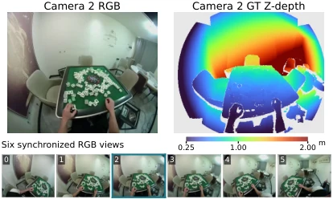

<!-- Generated by scripts/generate.py; edit data/works.json and data/media.json. -->

[← Back to the Awesome index](../../../README.md) · [Interactive website](https://chang-xinhai.github.io/Awesome-RGBDT-Manipulation/?collection=benchmark&item=egodepth-bench#library)

# EgoDepth-Bench

EgoDepth-Bench: Benchmarking Metric Depth for Egocentric Manipulation

**2026-11-23 · Preprint · GenRobot**

**[Paper](https://arxiv.org/abs/2611.30734)** · [Project](https://egodepth-bench.github.io/) · [Code](https://github.com/Chris004869/EgoDepth-Bench) · [Data](https://github.com/Chris004869/EgoDepth-Bench/blob/main/docs/DATA.md) · [Gated Hugging Face Archive](https://huggingface.co/datasets/genrobot2025/EgoDepth-Bench)

Benchmarks metric depth from egocentric cameras with active-IR stereo-derived reference maps and site-held-out manipulation scenes.

*Yuan Gao and coauthors · [Figure source](https://arxiv.org/html/2611.30734v1) · Original rights retained.*

| Field | Reported value and source scope |
| :-- | :-- |
| Record type | evaluation-tool |
| Simulator | Not applicable [1](https://arxiv.org/html/2611.30734v1) [3](https://github.com/Chris004869/EgoDepth-Bench#readme)  |
| Simulator version and scope | Not reported [1](https://arxiv.org/html/2611.30734v1) [3](https://github.com/Chris004869/EgoDepth-Bench#readme)  |
| Task count and scope | 941,233 synchronized samples across 37 physical sites [1](https://arxiv.org/html/2611.30734v1) [3](https://github.com/Chris004869/EgoDepth-Bench#readme)  |
| Task-list scope | Perception benchmark samples and environment splits, not robot tasks. [1](https://arxiv.org/html/2611.30734v1) [3](https://github.com/Chris004869/EgoDepth-Bench#readme)  |
| Capability dimensions | Egocentric metric and relative depth accuracy/coverage on held-out manipulation sites, hands and objects. [1](https://arxiv.org/html/2611.30734v1) [3](https://github.com/Chris004869/EgoDepth-Bench#readme)  |
| Metrics | Metric, scale-aligned and affine-aligned errors, plus visible region coverage metrics. [1](https://arxiv.org/html/2611.30734v1) [3](https://github.com/Chris004869/EgoDepth-Bench#readme)  |
| Robots | Human wearable camera rig; no closed-loop robot execution. [1](https://arxiv.org/html/2611.30734v1) [3](https://github.com/Chris004869/EgoDepth-Bench#readme)  |
| Sensors and observations | Six synchronized fisheye RGB views and five active-IR stereo pairs. The latter supply ground-truth Z-depth for selected native views. [1](https://arxiv.org/html/2611.30734v1) [3](https://github.com/Chris004869/EgoDepth-Bench#readme)  |
| Data collection method | Human egocentric capture with site-held-out splits; calibrated active stereo and cross-view screening construct the reference, validated by ball-bar distance. [1](https://arxiv.org/html/2611.30734v1) [3](https://github.com/Chris004869/EgoDepth-Bench#readme) [4](https://github.com/Chris004869/EgoDepth-Bench/blob/main/docs/DATA.md)  |
| Demonstrations and data | Gated benchmark archives and public RGB/depth previews. [1](https://arxiv.org/html/2611.30734v1) [3](https://github.com/Chris004869/EgoDepth-Bench#readme)  |
| Evaluation protocol | Separate monocular, stereo and multi-view estimates compared under the same reference and held-out environments. [1](https://arxiv.org/html/2611.30734v1) [3](https://github.com/Chris004869/EgoDepth-Bench#readme)  |
| Evaluated baselines | Metric monocular and stereo models and multiview MapAnything, including one fine-tuned split. [1](https://arxiv.org/html/2611.30734v1) [3](https://github.com/Chris004869/EgoDepth-Bench#readme)  |
| Observations / modalities | RGB · Depth · Infrared |
| Evaluation domain | Real world |
| Embodiment | Embodiment-agnostic |
| Release: code | Available — evaluation tools and tables [3](https://github.com/Chris004869/EgoDepth-Bench#readme)  |
| Release: weights | Not applicable |
| Release: data | Restricted — author documents gated train/val/test archives and public visual examples [4](https://github.com/Chris004869/EgoDepth-Bench/blob/main/docs/DATA.md)  |
| Release: license | Apache-2.0 evaluator; data guide states CC BY-SA 4.0 with gated data access. |
| Release: notes | Public paper verified. Code, task weights and data are tracked separately. |

**Task names — Perception benchmark samples and environment splits, not robot tasks.:**

Task names not reported or not verified in the cited sources.

**Scope and qualifications**

- Tool/data resource for perception, not a closed-loop manipulation benchmark.
- Data archive bytes were not independently validated without authorized Hugging Face access.

**Primary evidence**

1. [Original author paper with methods, evaluation and scope](https://arxiv.org/html/2611.30734v1)
2. [Public author project with method and evaluation examples](https://egodepth-bench.github.io/)
3. [Author evaluation tooling and sample protocol](https://github.com/Chris004869/EgoDepth-Bench#readme)
4. [Gated dataset storage, access and terms](https://github.com/Chris004869/EgoDepth-Bench/blob/main/docs/DATA.md)
