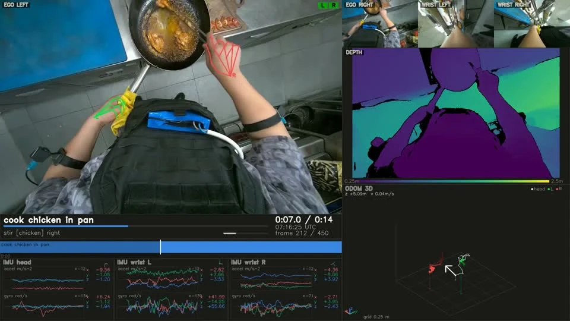

<!-- Generated by scripts/generate.py; edit data/works.json and data/media.json. -->

[← Back to the Awesome index](../../../README.md) · [Interactive website](https://chang-xinhai.github.io/Awesome-RGBDT-Manipulation/?collection=benchmark&item=egoviz-120#library)

# EgoViz-120

EgoViz-120: 120 Hours of Synchronized Real-World Egocentric Data

**2026-08 · Dataset release · Humaid Tech**

**[Project](https://huggingface.co/datasets/humaidtech/EgoViz-120)** · [Data](https://huggingface.co/buckets/humaidtech/EgoViz-120)

Real workplace demonstrations in synchronized MCAP with head-mounted stereo, dual wrist views, depth, IMUs and hand poses.

*Humaid Tech · [Figure source](https://github.com/humaidtech/EgoViz-120) · Original rights retained.*

| Field | Reported value and source scope |
| :-- | :-- |
| Record type | dataset |
| Simulator | Not applicable [1](https://huggingface.co/datasets/humaidtech/EgoViz-120) [2](https://github.com/humaidtech/EgoViz-120)  |
| Simulator version and scope | Not applicable [1](https://huggingface.co/datasets/humaidtech/EgoViz-120) [2](https://github.com/humaidtech/EgoViz-120)  |
| Task count and scope | Supporting dataset or perception evaluation [1](https://huggingface.co/datasets/humaidtech/EgoViz-120) [2](https://github.com/humaidtech/EgoViz-120)  |
| Task-list scope | Listed uses of the resource, with no closed-loop robot task count. [1](https://huggingface.co/datasets/humaidtech/EgoViz-120) [2](https://github.com/humaidtech/EgoViz-120)  |
| Capability dimensions | Training and evaluation data [1](https://huggingface.co/datasets/humaidtech/EgoViz-120) [2](https://github.com/humaidtech/EgoViz-120)  |
| Metrics | Not applicable [1](https://huggingface.co/datasets/humaidtech/EgoViz-120) [2](https://github.com/humaidtech/EgoViz-120)  |
| Robots | Not applicable [1](https://huggingface.co/datasets/humaidtech/EgoViz-120) [2](https://github.com/humaidtech/EgoViz-120)  |
| Sensors and observations | Calibrated ZED head left/right video, 16-bit depth, wrist frames, IMU, TF and inferred hand/action annotations. [1](https://huggingface.co/datasets/humaidtech/EgoViz-120) [2](https://github.com/humaidtech/EgoViz-120)  |
| Data collection method | Operations staff wear the rig during routine work; streams share a clock and each activity clip is stored in one MCAP. [1](https://huggingface.co/datasets/humaidtech/EgoViz-120) [2](https://github.com/humaidtech/EgoViz-120)  |
| Demonstrations and data | 120.4 hours and 5,392 clips across 12 categories, as reported on the card. [1](https://huggingface.co/datasets/humaidtech/EgoViz-120) [2](https://github.com/humaidtech/EgoViz-120)  |
| Evaluation protocol | Browse preview first, use MCAP camera_info/TF for calibrated geometry and split by group_id to separate capture sessions. [1](https://huggingface.co/datasets/humaidtech/EgoViz-120) [2](https://github.com/humaidtech/EgoViz-120)  |
| Evaluated baselines | Not applicable [1](https://huggingface.co/datasets/humaidtech/EgoViz-120) [2](https://github.com/humaidtech/EgoViz-120)  |
| Observations / modalities | RGB · Depth · IMU |
| Evaluation domain | Real world |
| Embodiment |  |
| Release: code | Dataset documentation and loading instructions [2](https://github.com/humaidtech/EgoViz-120)  |
| Release: weights | Not applicable [2](https://github.com/humaidtech/EgoViz-120)  |
| Release: data | Available — publisher’s Hugging Face Storage Bucket, separate from the card repository. [2](https://github.com/humaidtech/EgoViz-120)  |
| Release: license | CC BY 4.0 for the release. [2](https://github.com/humaidtech/EgoViz-120)  |
| Release: notes | The stitched MP4 is a dashboard preview; the raw synchronized streams are in MCAP files. [2](https://github.com/humaidtech/EgoViz-120)  |

**Task names — Listed uses of the resource, with no closed-loop robot task count.:**

- Workplace human demonstrations
- Stereo geometry
- Hand-object activity pretraining

**Scope and qualifications**

- Action labels are model-generated. Use camera-derived depth as depth supplied by the capture stack, not independently measured ground truth.

**Primary evidence**

1. [Original author paper or dataset description](https://huggingface.co/datasets/humaidtech/EgoViz-120)
2. [Publisher’s synchronized stream contract and download help](https://github.com/humaidtech/EgoViz-120)
