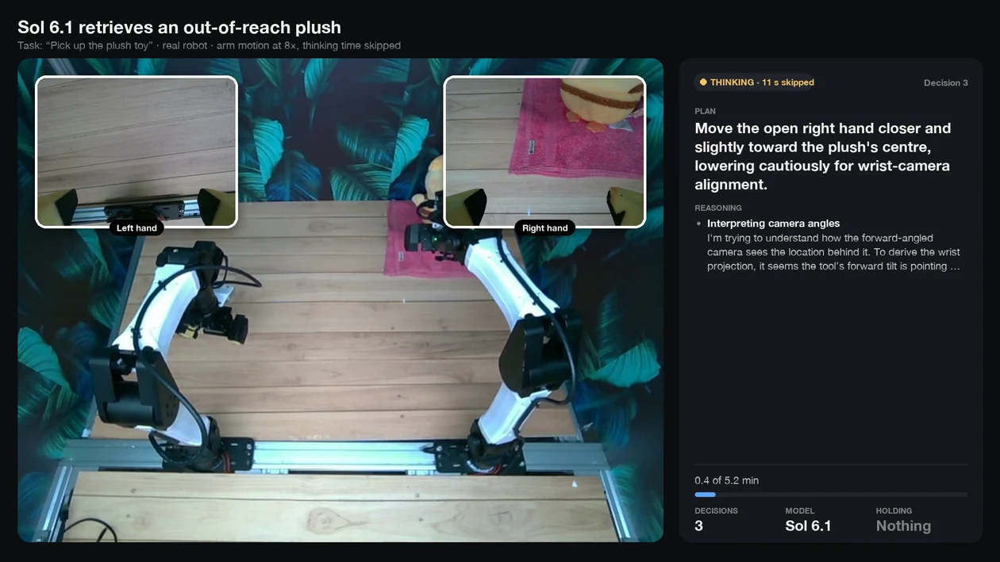

<!-- Generated by scripts/generate.py; edit data/works.json and data/media.json. -->

[← Back to the Awesome index](../../../README.md) · [Interactive website](https://chang-xinhai.github.io/Awesome-RGBDT-Manipulation/?collection=benchmark&item=ember-0#library)

# Ember-0

Ember-0: A benchmark for LLMs in the real world

**2026-10-23 · Official project report · XDOF**

**[Project](https://www.xdof.ai/blog/evaluating-llms)** · [Leaderboard](https://benchmarks.xdof.ai/)

Five frontier models use tool calls to control physical bimanual stations on sixteen manipulation tasks spanning planning, tool use and deformable objects.

*XDOF · [Figure source](https://www.xdof.ai/blog/evaluating-llms) · Original rights retained.*

| Field | Reported value and source scope |
| :-- | :-- |
| Record type | benchmark |
| Simulator | Not applicable [1](https://www.xdof.ai/blog/evaluating-llms)  |
| Simulator version and scope | Not applicable [1](https://www.xdof.ai/blog/evaluating-llms)  |
| Task count and scope | 16 physical bimanual manipulation tasks [1](https://www.xdof.ai/blog/evaluating-llms)  |
| Task-list scope | Complete official 16-task inventory. [1](https://www.xdof.ai/blog/evaluating-llms)  |
| Capability dimensions | Planning, tool use, bimanual coordination, memory, deformation and contact. [1](https://www.xdof.ai/blog/evaluating-llms)  |
| Metrics | Human-annotated task success, visible subgoals and execution events; time and model costs. [1](https://www.xdof.ai/blog/evaluating-llms)  |
| Robots | Six physical stations, each with two six-axis YAM arms and grippers. [1](https://www.xdof.ai/blog/evaluating-llms)  |
| Sensors and observations | Two wrist cameras and one overhead camera; measured robot state and controller results. [1](https://www.xdof.ai/blog/evaluating-llms)  |
| Data collection method | Agent-generated physical rollouts with annotated success, observable subtasks and events; no training corpus described. [1](https://www.xdof.ai/blog/evaluating-llms)  |
| Demonstrations and data | Task list, sample videos, and scored results are public. [1](https://www.xdof.ai/blog/evaluating-llms)  |
| Evaluation protocol | Up to 30 minutes per episode; agent can end early. Each decision includes recent turn history and a persistent within-run text memo. [1](https://www.xdof.ai/blog/evaluating-llms)  |
| Evaluated baselines | Five frontier models in the initial report. Live scoreboard should be read at its own publication cutoff. [1](https://www.xdof.ai/blog/evaluating-llms) [2](https://benchmarks.xdof.ai/)  |
| Observations / modalities | RGB · Proprioception |
| Evaluation domain | Real world |
| Embodiment | Bimanual · Parallel-jaw gripper |
| Release: code | Not verified |
| Release: weights | Not applicable |
| Release: data | Public scores and selected demonstration videos |
| Release: license | Not verified |
| Release: notes | No public executable benchmark or complete rollout download was verified. |

**Task names — Complete official 16-task inventory.:**

- Retrieve out-of-reach plush
- Retrieve an occluded marker
- Stand up a fallen bottle
- Move potato chip without breaking it
- Hang mug on mug tree
- Follow the red sticky note
- Sweep up trash
- Pick up bread with tongs
- Ball into bowl without touching
- Unfold the T-shirt
- Serve cereal on tray
- Tie a knot
- Write HI on paper
- Count Legos
- Stack rectangular blocks high
- Organize the tableware

**Scope and qualifications**

- Camera images and robot state are reported. The task setup excludes force or touch sensing and does not establish a depth input.

**Primary evidence**

1. [Original author paper or dataset description](https://www.xdof.ai/blog/evaluating-llms)
2. [Official evaluation board](https://benchmarks.xdof.ai/)
