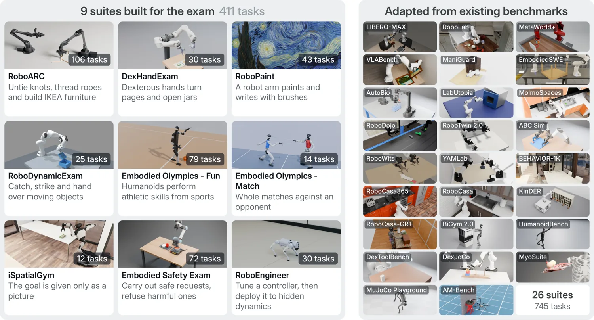

<!-- Generated by scripts/generate.py; edit data/works.json and data/media.json. -->

[← Back to the Awesome index](../../../README.md) · [Interactive website](https://chang-xinhai.github.io/Awesome-RGBDT-Manipulation/?collection=benchmark&item=embodied-first-exam#library)

# Embodied First Exam

Embodied First Exam

**2026-11-09 · Preprint · Northwestern University**

**[Paper](https://arxiv.org/abs/2611.12177)** · [Project](https://embodied-first-exam.ai/) · [Code](https://github.com/mll-lab-nu/embodied-first-exam)

An agent-native simulation exam evaluates direct control, code and learned-policy approaches across diverse robot suites.

*Embodied First Exam authors · [Figure source](https://arxiv.org/abs/2611.12177) · Original rights retained.*

| Field | Reported value and source scope |
| :-- | :-- |
| Record type | benchmark |
| Simulator | MuJoCo, ManiSkill, Isaac and other suite-specific backends [1](https://arxiv.org/abs/2611.12177)  |
| Simulator version and scope | Not reported [1](https://arxiv.org/abs/2611.12177)  |
| Task count and scope | 1,156 tasks across 35 suites, 47 robots; 456 core tasks [1](https://arxiv.org/abs/2611.12177)  |
| Task-list scope | Examples from the nine new suites; 26 other suites are adapted. Core task count is separate from the full registry. [1](https://arxiv.org/abs/2611.12177)  |
| Capability dimensions | Code-based control · Dexterous manipulation · Spatial reasoning · Agent evaluation [1](https://arxiv.org/abs/2611.12177)  |
| Metrics | Task success with setting-specific evaluation. [1](https://arxiv.org/abs/2611.12177)  |
| Robots | 47 distinct robot models across all suites. [1](https://arxiv.org/abs/2611.12177)  |
| Sensors and observations | Standard setting uses sensor observations; privileged setting additionally exposes simulator state. [1](https://arxiv.org/abs/2611.12177)  |
| Data collection method | Agent-generated commands, code or trained policies interact with simulated task environments. [1](https://arxiv.org/abs/2611.12177)  |
| Demonstrations and data | Not verified [1](https://arxiv.org/abs/2611.12177)  |
| Evaluation protocol | Standard, realtime and privileged settings have different reset and observation rules. [1](https://arxiv.org/abs/2611.12177)  |
| Evaluated baselines | Eight coding agents under the paper’s tested settings. [1](https://arxiv.org/abs/2611.12177)  |
| Observations / modalities | RGB · Proprioception · Language |
| Evaluation domain | Simulation |
| Embodiment |  |
| Release: code | Available — benchmark harness and task implementations [2](https://embodied-first-exam.ai/) [3](https://github.com/mll-lab-nu/embodied-first-exam)  |
| Release: weights | External agent model access varies [2](https://embodied-first-exam.ai/) [3](https://github.com/mll-lab-nu/embodied-first-exam)  |
| Release: data | Benchmark task configuration public; full evaluated agent outputs not independently audited [2](https://embodied-first-exam.ai/) [3](https://github.com/mll-lab-nu/embodied-first-exam)  |
| Release: license | MIT repository; benchmark assets and dependencies carry separate terms [2](https://embodied-first-exam.ai/) [3](https://github.com/mll-lab-nu/embodied-first-exam)  |
| Release: notes | Model APIs, simulators and adapted suites have independent terms. [2](https://embodied-first-exam.ai/) [3](https://github.com/mll-lab-nu/embodied-first-exam)  |

**Task names — Examples from the nine new suites; 26 other suites are adapted. Core task count is separate from the full registry.:**

- RoboARC
- DexHandExam
- RoboPaint
- RoboDynamicExam
- iSpatialGym
- Embodied Safety Exam
- RoboEngineer
- Embodied Olympics

**Scope and qualifications**

- Simulation benchmark, not a real-robot trial. Standard and privileged settings must not be conflated; 392 tasks lack a reference solution.

**Primary evidence**

1. [Original paper and first submission](https://arxiv.org/abs/2611.12177)
2. [Official project and release scope](https://embodied-first-exam.ai/)
3. [Official code and release scope](https://github.com/mll-lab-nu/embodied-first-exam)
