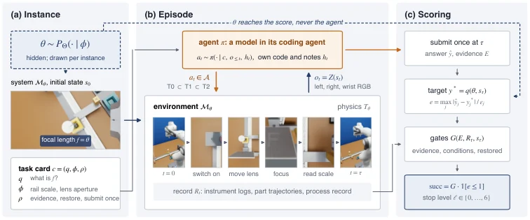

<!-- Generated by scripts/generate.py; edit data/works.json and data/media.json. -->

[← Back to the Awesome index](../../../README.md) · [Interactive website](https://chang-xinhai.github.io/Awesome-RGBDT-Manipulation/?collection=benchmark&item=embodiedlab#library)

# EmbodiedLab

EmbodiedLab: Benchmarking Embodied Agents That Act to Know

**2026-10-26 · Preprint · HexaFuture and collaborators**

**[Paper](https://arxiv.org/abs/2610.35385)** · [Project](https://hexafuture.ai/benchmarks/embodiedlab/) · [Code](https://github.com/HexaFuture/EmbodiedLab)

A simulated laboratory evaluates whether agents use robot interaction and camera feedback to choose and carry out quantitative experiments.

*EmbodiedLab authors · [Figure source](https://arxiv.org/html/2610.35385v1) · Original rights retained.*

| Field | Reported value and source scope |
| :-- | :-- |
| Record type | benchmark |
| Simulator | NVIDIA Isaac Sim [1](https://arxiv.org/html/2610.35385v1)  |
| Simulator version and scope | 6.0.1 in public repository [1](https://arxiv.org/html/2610.35385v1) [3](https://github.com/HexaFuture/EmbodiedLab)  |
| Task count and scope | 30 experiments in the paper; 35 experiments in the current public repository [1](https://arxiv.org/html/2610.35385v1) [3](https://github.com/HexaFuture/EmbodiedLab)  |
| Task-list scope | Examples across five disciplines in the paper; release adds five optimization experiments. [1](https://arxiv.org/html/2610.35385v1)  |
| Capability dimensions | Precise contact, long-horizon procedures, fine instrument reading and multi-point analysis. [1](https://arxiv.org/html/2610.35385v1)  |
| Metrics | Success requires measurement tolerance, evidence grounded in recorded instrument readings and acceptable final bench state. [1](https://arxiv.org/html/2610.35385v1)  |
| Robots | Franka robot with two-finger gripper. [1](https://arxiv.org/html/2610.35385v1)  |
| Sensors and observations | Three camera views and robot state at T0; T1 adds privileged perception and motion planning; T2 adds distilled manipulation skills. [1](https://arxiv.org/html/2610.35385v1)  |
| Data collection method | Task construction uses authored randomized physical scenes and reference runs. Evaluated agents gather their own observations. [1](https://arxiv.org/html/2610.35385v1)  |
| Demonstrations and data | Executable tasks and public experiment definitions in the source repository. [1](https://arxiv.org/html/2610.35385v1)  |
| Evaluation protocol | Each scene samples hidden parameters. The agent chooses an experimental procedure and controls the robot through a level-specific API. [1](https://arxiv.org/html/2610.35385v1)  |
| Evaluated baselines | Six frontier models in paper v1; strongest native-interface setting succeeds on fewer than half across paper experiments. [1](https://arxiv.org/html/2610.35385v1)  |
| Observations / modalities | RGB · Proprioception |
| Evaluation domain | Simulation |
| Embodiment |  |
| Release: code | Available — simulator tasks and harness [2](https://hexafuture.ai/benchmarks/embodiedlab/) [3](https://github.com/HexaFuture/EmbodiedLab)  |
| Release: weights | External agent access varies [2](https://hexafuture.ai/benchmarks/embodiedlab/) [3](https://github.com/HexaFuture/EmbodiedLab)  |
| Release: data | Available — public experiment configuration; external simulator and assets may have separate terms [2](https://hexafuture.ai/benchmarks/embodiedlab/) [3](https://github.com/HexaFuture/EmbodiedLab)  |
| Release: license | Apache-2.0 repository [2](https://hexafuture.ai/benchmarks/embodiedlab/) [3](https://github.com/HexaFuture/EmbodiedLab)  |
| Release: notes | Paper and live code maintain different task inventories. [2](https://hexafuture.ai/benchmarks/embodiedlab/) [3](https://github.com/HexaFuture/EmbodiedLab)  |

**Task names — Examples across five disciplines in the paper; release adds five optimization experiments.:**

- Spring stiffness
- Pendulum gravity
- Friction on an incline
- Resistance in a black box
- Focal length of a converging lens
- Thermistor B constant
- Absorption peak of an unknown dye

**Scope and qualifications**

- The published 30-task results and the extended 35-task release use different inventories.
- T0, T1 and T2 provide different observation/action privileges and can be compared only with explicit interface labels.

**Primary evidence**

1. [Original author paper or dataset description](https://arxiv.org/html/2610.35385v1)
2. [Author source and artifact entry points](https://hexafuture.ai/benchmarks/embodiedlab/)
3. [Official repository and current inventory](https://github.com/HexaFuture/EmbodiedLab)
