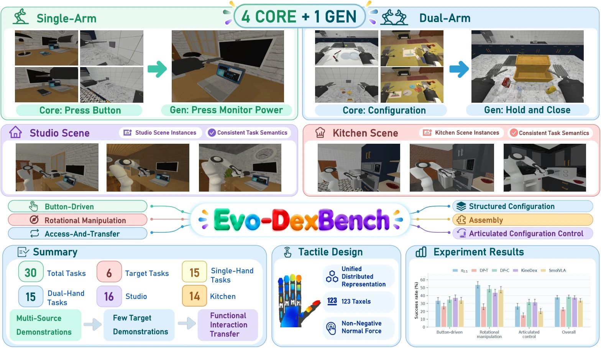

<!-- Generated by scripts/generate.py; edit data/works.json and data/media.json. -->

[← Back to the Awesome index](../../../README.md) · [Interactive website](https://chang-xinhai.github.io/Awesome-RGBDT-Manipulation/?collection=benchmark&item=evo-dexbench#library)

# Evo-DexBench

Evo-DexBench: Benchmarking Generalization across Related Tasks for Dexterous Manipulation

**2026-10-15 · arXiv preprint · Shanghai Jiao Tong University / Nanjing University / Central South University / BUPT / Beijing Normal University**

**[Paper](https://arxiv.org/abs/2610.21180)** · [Code](https://github.com/MINT-SJTU/Evo-DexBench) · [Data](https://huggingface.co/datasets/MINT-SJTU/Evo-DexBench-dataset)

A Core–Gen protocol groups30 dexterous tasks by functional interaction, with limited target demonstrations, variation-controlled rollouts and tactile ablations.

*evo-dexbench authors; original research figure · [Figure source](https://arxiv.org/html/2610.21180#S0.F1) · Original rights retained.*

| Field | Reported value and source scope |
| :-- | :-- |
| Record type | benchmark |
| Simulator | ManiSkill 3 / SAPIEN / PhysX [1](https://arxiv.org/html/2610.21180) [2](https://github.com/MINT-SJTU/Evo-DexBench)  |
| Simulator version and scope | Paper names ManiSkill3 without exact patch. Current pyproject requires mani_skill&gt;=3.0.1,&lt;3.1 and sapien&gt;=3.0; these are release constraints, not a paper lockfile. [1](https://arxiv.org/html/2610.21180) [2](https://github.com/MINT-SJTU/Evo-DexBench) [3](https://github.com/MINT-SJTU/Evo-DexBench/blob/main/pyproject.toml)  |
| Task count and scope | 30 tasks in6 families:24 Core+6 Gen. Standard paper comparison evaluates15 tasks in3 families; six scene layouts are not additional task types. [1](https://arxiv.org/html/2610.21180) [2](https://github.com/MINT-SJTU/Evo-DexBench)  |
| Task-list scope | Complete30 task names from Appendix A, Tables6–11; each family lists4 Core then1 Gen. Main results cover Button-driven, Rotational and Articulated configuration families only. [1](https://arxiv.org/html/2610.21180) [2](https://github.com/MINT-SJTU/Evo-DexBench)  |
| Capability dimensions | Functional Core-to-Gen transfer · Eight-shot target adaptation · Single-hand and bimanual dexterity · Camera/light/physical/spatial variations · Tactile ablation [1](https://arxiv.org/html/2610.21180) [2](https://github.com/MINT-SJTU/Evo-DexBench)  |
| Metrics | Episode SR and normalized StageScore, macro-averaged across fixed tasks. SR uses Wilson/rollout intervals; training-seed variability and missing per-condition StageScores are not fabricated. [1](https://arxiv.org/html/2610.21180) [2](https://github.com/MINT-SJTU/Evo-DexBench)  |
| Robots | Panda arm with Shadow Hand; single-arm and bimanual configurations; Quest3/WebXR demonstration collection. [1](https://arxiv.org/html/2610.21180) [2](https://github.com/MINT-SJTU/Evo-DexBench)  |
| Sensors and observations | Context, interaction and wrist RGB;31-D or62-D state;123 scalar normal-force taxels per hand. PhysX impulses at120Hz are integrated over30Hz observation periods, preserving total impulse. KineDex adaptation uses100 finger taxels with its own padded format, not original KineDex sensor specifications. [1](https://arxiv.org/html/2610.21180) [2](https://github.com/MINT-SJTU/Evo-DexBench)  |
| Demonstrations and data | 1,248 successful trajectories:24 Core×50+6 Gen×8; three layouts per task. Canonical HDF5 and LeRobot-v3 formats. Public HF dataset and asset bundle verified; PartNet assets require separate provider access. [1](https://arxiv.org/html/2610.21180) [2](https://github.com/MINT-SJTU/Evo-DexBench) [4](https://huggingface.co/api/datasets/MINT-SJTU/Evo-DexBench-dataset)  |
| Evaluation protocol | 100 frozen-policy episodes/task:20 nominal and20 each camera,lighting,physical,spatial; layouts34/33/33. Identical reset schedules across models; no test-time weight or normalization updates. Separate single/bimanual checkpoints; train/transfer mixtures and target budgets remain scoped. [1](https://arxiv.org/html/2610.21180) [2](https://github.com/MINT-SJTU/Evo-DexBench)  |
| Evaluated baselines | π0.5, SmolVLA, Diffusion Policy convolutional/transformer variants, and KineDex; matched KineDex No-Touch ablation. Adapters retain different horizons; training settings and transfer protocols appear in Appendix D. [1](https://arxiv.org/html/2610.21180) [2](https://github.com/MINT-SJTU/Evo-DexBench)  |
| Observations / modalities | RGB · Tactile · Proprioception · Language |
| Evaluation domain | Simulation |
| Embodiment | Dexterous hand · Bimanual |
| Release: code | Available [2](https://github.com/MINT-SJTU/Evo-DexBench)  |
| Release: weights | Not verified [2](https://github.com/MINT-SJTU/Evo-DexBench)  |
| Release: data | Available [2](https://github.com/MINT-SJTU/Evo-DexBench) [4](https://huggingface.co/api/datasets/MINT-SJTU/Evo-DexBench-dataset)  |
| Release: license | Apache-2.0 for code/documentation; third-party assets retain separate licenses and access terms [2](https://github.com/MINT-SJTU/Evo-DexBench)  |
| Release: notes | Actual implementation, setup scripts and LICENSE inspected. Public HF files verified. Paper-linked project page is marked coming soon in README and returned404; omitted as a usable Project artifact. Benchmark-trained policy weights not independently identified. [2](https://github.com/MINT-SJTU/Evo-DexBench)  |

**Task names — Complete30 task names from Appendix A, Tables6–11; each family lists4 Core then1 Gen. Main results cover Button-driven, Rotational and Articulated configuration families only.:**

- LampButton
- WallSwitch
- PhoneHomeButton
- ToasterSlider
- DisplayPowerButton
- FaucetHandle
- MouseWheel
- CoffeeKnob
- KettleLidTab
- DishwasherKnob
- CupFromCabinet
- MicrowaveBowl
- TennisBallTransfer
- BananaFromDrawer
- CandleToCabinet
- TablewarePlacement
- HammerBlockAssembly
- SandwichAssembly
- RingTowerAssembly
- BoxPacking
- PenCapping
- CupSleeveFit
- BottleFunnelInsertion
- PlugInsertion
- ScissorsSheathing
- LaptopClosing
- StaplerPaperMark
- ScissorsOpening
- BoxLidOpening
- GlassesFolding

**Scope and qualifications**

- 30-task suite,15-task standard comparison,10-task tactile ablation and separately scoped transfer experiments retain distinct task coverage.
- Eight Gen demonstrations are training data; the protocol measures few-shot adaptation, not zero-shot transfer.
- 123-taxel simulated normal-force observations do not reproduce the original KineDex120 tri-axis taxels/finger.
- RGB camera interfaces do not imply observed depth. Scene layout, task family and policy version counts are separate.
- Evo No-Touch removes tactile inputs, force supervision and deployment force feedback together; it does not isolate tactile sensing alone. Original KineDex input-only ablation retains a different controller pathway.

**Primary evidence**

1. [Original full manuscript and appendices](https://arxiv.org/html/2610.21180) — Method, evaluation and appendix read; observations, training-only labels, rates and task scopes remain distinct.
2. [Official implementation, README and actual Apache license](https://github.com/MINT-SJTU/Evo-DexBench) — Executable benchmark and KineDex adapter code inspected; adapter availability is separate from evaluation of all paper baselines.
3. [Current installation constraints](https://github.com/MINT-SJTU/Evo-DexBench/blob/main/pyproject.toml) — Release requirements do not establish the paper exact patch.
4. [Public dataset inventory](https://huggingface.co/api/datasets/MINT-SJTU/Evo-DexBench-dataset) — Public ungated inventory contains LeRobot data files; asset access conditions remain separate.
