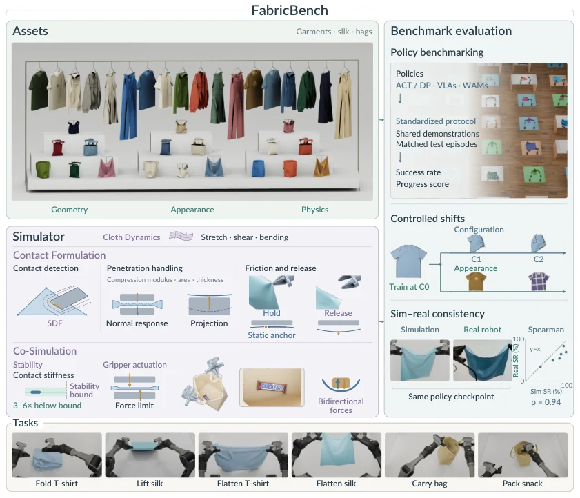

<!-- Generated by scripts/generate.py; edit data/works.json and data/media.json. -->

[← Back to the Awesome index](../../../README.md) · [Interactive website](https://chang-xinhai.github.io/Awesome-RGBDT-Manipulation/?collection=benchmark&item=fabricbench#library)

# FabricBench

FabricBench: A Standardized Policy Benchmark for Bimanual Fabric Manipulation with a Contact-Driven Deformable Simulator

**2026-11-23 · Preprint · Shanghai Jiao Tong University; Horizon Robotics; Style3D Research**

**[Paper](https://arxiv.org/abs/2611.31577)** · [Project](https://fabricbench.github.io/)

Benchmarks fabric manipulation with bidirectional cloth–rigid contact and scope-matched simulated and physical policy trials.

*Wenkang Hu and coauthors · [Figure source](https://arxiv.org/html/2611.31577v1) · Original rights retained.*

| Field | Reported value and source scope |
| :-- | :-- |
| Record type | benchmark |
| Simulator | Newton with modified Style3D solver [1](https://arxiv.org/html/2611.31577v1)  |
| Simulator version and scope | Not reported [1](https://arxiv.org/html/2611.31577v1)  |
| Task count and scope | Six cloth tasks and an author-reported 10,000 deformable assets [1](https://arxiv.org/html/2611.31577v1)  |
| Task-list scope | All six tasks; asset count is a separate quantity. [1](https://arxiv.org/html/2611.31577v1)  |
| Capability dimensions | Cloth contact · Bimanual handling · Configuration and appearance transfer [1](https://arxiv.org/html/2611.31577v1)  |
| Metrics | Task success in held-out simulated and physical trials; contact stability and grasp–hold–release diagnostics. [1](https://arxiv.org/html/2611.31577v1)  |
| Robots | Two-arm gripper setup; author describes distinct virtual and physical robot configurations. [1](https://arxiv.org/html/2611.31577v1)  |
| Sensors and observations | RGB visual observations and robot state read by comparison policies. Contact-force dynamics are internal to the simulator. [1](https://arxiv.org/html/2611.31577v1)  |
| Data collection method | Uses standardized simulated expert demonstrations for training and physical trials for zero-shot comparison; targeted human teleop or geometric trajectories are reported in separate simulator tests. [1](https://arxiv.org/html/2611.31577v1)  |
| Demonstrations and data | Paper reports a large garment, silk and bag asset library plus simulated task demonstrations. [1](https://arxiv.org/html/2611.31577v1)  |
| Evaluation protocol | Compare appearance and configuration randomizations and hold task-level criteria fixed across simulation and real evaluation. [1](https://arxiv.org/html/2611.31577v1)  |
| Evaluated baselines | π0.5, ACT, FastWAM and other benchmark policies under separate settings. [1](https://arxiv.org/html/2611.31577v1)  |
| Observations / modalities | RGB · Proprioception · Language |
| Evaluation domain | Simulation · Real world |
| Embodiment | Bimanual · Parallel-jaw gripper |
| Release: code | Announced — project and paper promise FabricBench-specific artifacts |
| Release: weights | Not verified |
| Release: data | Paper reports a 10,000-asset library; downloadable benchmark material not verified |
| Release: license | Not verified |
| Release: notes | Paper or official project reviewed. Code, weights and data are tracked independently. |

**Task names — All six tasks; asset count is a separate quantity.:**

- Fold T-shirt
- Flatten T-shirt
- Flatten silk
- Lift silk
- Carry bag
- Pack snack

**Scope and qualifications**

- The upstream Newton solver is open source, while release of the modified FabricBench task package is tracked independently. Simulated contact forces and friction govern the dynamics, not tactile observations of the compared policies.

**Primary evidence**

1. [Original paper and evaluation settings](https://arxiv.org/html/2611.31577v1)
2. [Official project with task and method examples](https://fabricbench.github.io/)
