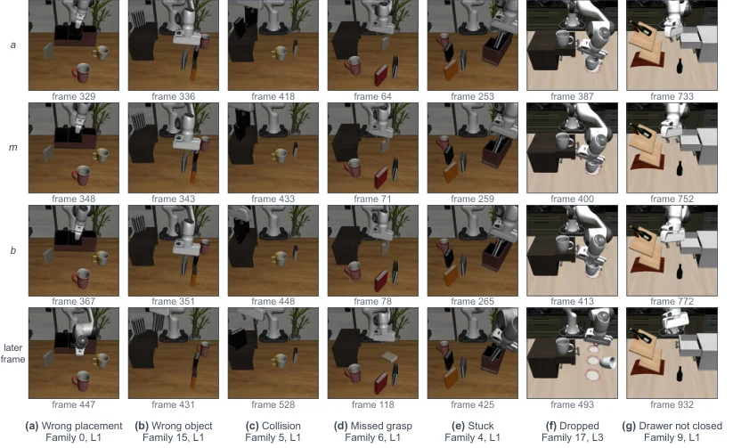

<!-- Generated by scripts/generate.py; edit data/works.json and data/media.json. -->

[← Back to the Awesome index](../../../README.md) · [Interactive website](https://chang-xinhai.github.io/Awesome-RGBDT-Manipulation/?collection=benchmark&item=failpoint-x#library)

# FailPoint-X

FailPoint-X: A Policy-Matched, Failure-Anchored Benchmark for Offline VLA Post-Training from Human Takeovers

**2026-11-25 · Preprint · Nanyang Technological University and collaborators**

**[Paper](https://arxiv.org/abs/2611.33769)** · [Project](https://lzrbit.github.io/FailPoint_X/)

Controls optimization budget and restart state to test whether human interventions improve offline recovery after the policy’s own failures.

*Zirui Li and coauthors · [Figure source](https://arxiv.org/html/2611.33769v1) · Original rights retained.*

| Field | Reported value and source scope |
| :-- | :-- |
| Record type | benchmark |
| Simulator | LIBERO-X / MuJoCo [1](https://arxiv.org/html/2611.33769v1)  |
| Simulator version and scope | Not reported [1](https://arxiv.org/html/2611.33769v1)  |
| Task count and scope | 10 families, up to 5 difficulty levels, 629 released-in-paper natural failure records; 2,400 accepted recovery attempts [1](https://arxiv.org/html/2611.33769v1)  |
| Task-list scope | Example intervention scenarios from the paper; the scoped corpus counts records and attempts. [1](https://arxiv.org/html/2611.33769v1)  |
| Capability dimensions | Offline corrective post-training · Failure recovery · Nominal-start evaluation [1](https://arxiv.org/html/2611.33769v1)  |
| Metrics | Recovery outcomes from the same held-out known failures, nominal-start success, and paired differences at equal update budget. [1](https://arxiv.org/html/2611.33769v1)  |
| Robots | LIBERO-X benchmark robot model. [1](https://arxiv.org/html/2611.33769v1)  |
| Sensors and observations | Two simulated RGB camera streams, robot state, instructions and logged restorable simulator states for benchmark operation. [1](https://arxiv.org/html/2611.33769v1)  |
| Data collection method | A fixed π0.5 checkpoint fails under standard rollouts. Humans annotate failure intervals and take over at randomly sampled restorable states in training intervals. [1](https://arxiv.org/html/2611.33769v1)  |
| Demonstrations and data | 629 failure records, 384 held-out and 245 training side; full collection completed for 240 training failures. Raw and LeRobot forms are specified. [1](https://arxiv.org/html/2611.33769v1)  |
| Evaluation protocol | Match actor updates across trained arms; restart all methods at the same held-out seeds and scored nominal states. [1](https://arxiv.org/html/2611.33769v1)  |
| Evaluated baselines | Base restart, continued demonstration training, takeover behavior cloning, and additional paper ablations. [1](https://arxiv.org/html/2611.33769v1)  |
| Observations / modalities | RGB · Proprioception · Language |
| Evaluation domain | Simulation |
| Embodiment | Parallel-jaw gripper |
| Release: code | Announced — paper links the author repository, but no public source tree was accessible |
| Release: weights | Planned post-training artifacts |
| Release: data | Announced — paper describes Hugging Face distribution without verified downloadable archives |
| Release: license | Planned MIT code and CC BY 4.0 data per manuscript |
| Release: notes | Current project shows the protocol and examples; code and data are not marked available. |

**Task names — Example intervention scenarios from the paper; the scoped corpus counts records and attempts.:**

- Place black book into tray
- Recover after an incorrect grasp
- Recovery from dropped or misplaced objects

**Scope and qualifications**

- All reported outcomes use the same π0.5 family and simulation; this is not evidence of cross-backbone or physical camera performance.

**Primary evidence**

1. [Original paper and evaluation settings](https://arxiv.org/html/2611.33769v1)
2. [Official project with task and method examples](https://lzrbit.github.io/FailPoint_X/)
