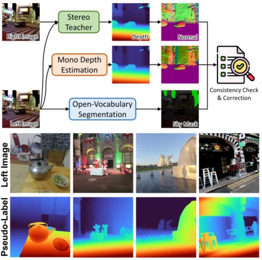

<!-- Generated by scripts/generate.py; edit data/works.json and data/media.json. -->

[← Back to the Awesome index](../../../README.md) · [Interactive website](https://chang-xinhai.github.io/Awesome-RGBDT-Manipulation/?collection=benchmark&item=fast-foundationstereo#library)

# FFS Stereo4D

Fast-FoundationStereo: Real-Time Zero-Shot Stereo Matching

**2025-12-11 · CVPR 2026 · NVIDIA**

**[Paper](https://arxiv.org/abs/2512.11130)** · [Project](https://nvlabs.github.io/Fast-FoundationStereo/) · [Code](https://github.com/NVlabs/Fast-FoundationStereo) · [Data](https://huggingface.co/datasets/nvidia/ffs_stereo4d) · [Weights](https://huggingface.co/nvidia/c-fast-foundationstereo) · [Source Geometry](https://github.com/Stereo4d/stereo4d-code)

Released disparity pseudo-labels and source-video metadata from research Fast-FoundationStereo training. RGB must be reconstructed from upstream videos.

*Fast-FoundationStereo authors · [Figure source](https://arxiv.org/html/2512.11130v1) · Original rights retained.*

| Field | Reported value and source scope |
| :-- | :-- |
| Record type | Perception benchmark |
| Simulator | Not applicable [3](https://huggingface.co/datasets/nvidia/ffs_stereo4d/raw/main/README.md)  |
| Simulator version and scope | Not applicable [3](https://huggingface.co/datasets/nvidia/ffs_stereo4d/raw/main/README.md)  |
| Task count and scope | Supporting dataset or perception evaluation [3](https://huggingface.co/datasets/nvidia/ffs_stereo4d/raw/main/README.md)  |
| Task-list scope | Listed uses of the resource, with no closed-loop robot task count. [3](https://huggingface.co/datasets/nvidia/ffs_stereo4d/raw/main/README.md)  |
| Capability dimensions | Training and evaluation data [3](https://huggingface.co/datasets/nvidia/ffs_stereo4d/raw/main/README.md)  |
| Metrics | Not applicable [3](https://huggingface.co/datasets/nvidia/ffs_stereo4d/raw/main/README.md)  |
| Robots | Not applicable [3](https://huggingface.co/datasets/nvidia/ffs_stereo4d/raw/main/README.md)  |
| Sensors and observations | Released disparity PNGs and timestamp metadata; upstream stereo RGB reconstructed separately. [3](https://huggingface.co/datasets/nvidia/ffs_stereo4d/raw/main/README.md)  |
| Data collection method | Rectify Stereo4D source videos, apply the FoundationStereo teacher, and package accepted disparity pseudo-labels. [3](https://huggingface.co/datasets/nvidia/ffs_stereo4d/raw/main/README.md)  |
| Demonstrations and data | The paper describes roughly 1.4M curated pairs. The public card exposes ZIP shards and per-frame metadata.csv; releases may differ from paper counts. [3](https://huggingface.co/datasets/nvidia/ffs_stereo4d/raw/main/README.md)  |
| Evaluation protocol | Use as pseudo-supervision after re-materializing same-frame left/right imagery with the Stereo4D calibration. Scale assumes a 63 mm baseline. [3](https://huggingface.co/datasets/nvidia/ffs_stereo4d/raw/main/README.md) [4](https://github.com/Stereo4d/stereo4d-code)  |
| Evaluated baselines | Not applicable [3](https://huggingface.co/datasets/nvidia/ffs_stereo4d/raw/main/README.md)  |
| Observations / modalities | RGB |
| Evaluation domain |  |
| Embodiment |  |
| Release: code | Available — upstream Stereo4D rectification toolkit [2](https://github.com/NVlabs/Fast-FoundationStereo) [3](https://huggingface.co/datasets/nvidia/ffs_stereo4d/raw/main/README.md)  |
| Release: weights | Not applicable [2](https://github.com/NVlabs/Fast-FoundationStereo) [3](https://huggingface.co/datasets/nvidia/ffs_stereo4d/raw/main/README.md)  |
| Release: data | Available — disparity with source metadata, no RGB image pairs [2](https://github.com/NVlabs/Fast-FoundationStereo) [3](https://huggingface.co/datasets/nvidia/ffs_stereo4d/raw/main/README.md)  |
| Release: license | CC BY-NC 4.0 for released labels; original source-video terms apply independently. [2](https://github.com/NVlabs/Fast-FoundationStereo) [3](https://huggingface.co/datasets/nvidia/ffs_stereo4d/raw/main/README.md)  |
| Release: notes | Scale depends on the assumed stereo baseline. [2](https://github.com/NVlabs/Fast-FoundationStereo) [3](https://huggingface.co/datasets/nvidia/ffs_stereo4d/raw/main/README.md)  |

**Task names — Listed uses of the resource, with no closed-loop robot task count.:**

- Teacher pseudo-labeling
- Stereo dataset re-materialization

**Scope and qualifications**

- Research and C-Fast commercial variants have different terms; reconstructed depth is predicted rather than an independent measured channel.

**Primary evidence**

1. [Author paper and first submission](https://arxiv.org/html/2512.11130v1)
2. [Official code and license](https://github.com/NVlabs/Fast-FoundationStereo)
3. [Data-card artifact, resolution and geometry contract](https://huggingface.co/datasets/nvidia/ffs_stereo4d/raw/main/README.md)
4. [Author toolkit for upstream stereo calibration and video extraction](https://github.com/Stereo4d/stereo4d-code)
