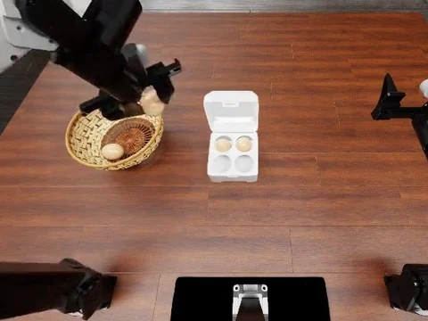

<!-- Generated by scripts/generate.py; edit data/works.json and data/media.json. -->

[← Back to the Awesome index](../../../README.md) · [Interactive website](https://chang-xinhai.github.io/Awesome-RGBDT-Manipulation/?collection=benchmark&item=flex-rsi#library)

# Flex-RSI

Flex-RSI: Benchmarking Recursive Self-Improvement of Frontier Agents

**2026-11-06 · Preprint · Flex-RSI authors**

**[Paper](https://arxiv.org/abs/2611.08946)** · [Project](https://flex-rsi.github.io/) · [Code](https://github.com/flex-rsi/rsi-bench) · [Data](https://huggingface.co/datasets/Flex-RSI/RSI-Dataset)

An RSI evaluation harness measures whether agents improve editable starter solutions under fixed budgets, including robot-control and perception tasks.

*Flex-RSI authors · [Figure source](https://arxiv.org/html/2611.08946v1) · Original rights retained.*

| Field | Reported value and source scope |
| :-- | :-- |
| Record type | evaluation-tool |
| Simulator | Task-dependent; robot adaptations include RoboDojo, RoboCasa and RoboLab [1](https://arxiv.org/html/2611.08946v1)  |
| Simulator version and scope | Not reported [1](https://arxiv.org/html/2611.08946v1)  |
| Task count and scope | 24 mixed-domain evaluation tasks in the paper [1](https://arxiv.org/html/2611.08946v1)  |
| Task-list scope | Selected robot-related and perception tasks. Source code and manuscript have separately scoped inventories. [1](https://arxiv.org/html/2611.08946v1)  |
| Capability dimensions | Iterative solution improvement under fixed budgets across action, reasoning, creation and reconstruction. [1](https://arxiv.org/html/2611.08946v1)  |
| Metrics | Held-out final score and improvement over starter under a fixed budget; underlying metrics vary by task. [1](https://arxiv.org/html/2611.08946v1)  |
| Robots | Simulation embodiment depends on underlying environment. [1](https://arxiv.org/html/2611.08946v1)  |
| Sensors and observations | Source-dependent observations. Authors show RGB feedback in robot examples; the mixed-task harness has no shared deployment sensor. [1](https://arxiv.org/html/2611.08946v1)  |
| Data collection method | Not applicable [1](https://arxiv.org/html/2611.08946v1)  |
| Demonstrations and data | Public task runner and released dataset folders; hosted models and upstream environment assets remain separate. [1](https://arxiv.org/html/2611.08946v1)  |
| Evaluation protocol | Agent proposes changes to an editable starter solution and experiments on development data. The orchestrator decides which revisions to keep on validation and scores the final solution on held-out test. [1](https://arxiv.org/html/2611.08946v1)  |
| Evaluated baselines | Paper v1 evaluates 18 frontier models across its mixed collection. [1](https://arxiv.org/html/2611.08946v1)  |
| Observations / modalities |  |
| Evaluation domain | Simulation |
| Embodiment |  |
| Release: code | Available — task runner and implementation [2](https://flex-rsi.github.io/) [3](https://github.com/flex-rsi/rsi-bench) [4](https://huggingface.co/datasets/Flex-RSI/RSI-Dataset)  |
| Release: weights | External API models [2](https://flex-rsi.github.io/) [3](https://github.com/flex-rsi/rsi-bench) [4](https://huggingface.co/datasets/Flex-RSI/RSI-Dataset)  |
| Release: data | Available — public dataset repository with task data [2](https://flex-rsi.github.io/) [3](https://github.com/flex-rsi/rsi-bench) [4](https://huggingface.co/datasets/Flex-RSI/RSI-Dataset)  |
| Release: license | Not verified [2](https://flex-rsi.github.io/) [3](https://github.com/flex-rsi/rsi-bench) [4](https://huggingface.co/datasets/Flex-RSI/RSI-Dataset)  |
| Release: notes | Release covers the public task runner and data package; exact task inventory is version-dependent. [2](https://flex-rsi.github.io/) [3](https://github.com/flex-rsi/rsi-bench) [4](https://huggingface.co/datasets/Flex-RSI/RSI-Dataset)  |

**Task names — Selected robot-related and perception tasks. Source code and manuscript have separately scoped inventories.:**

- RoboDojo
- RoboCasa
- RoboLab
- LIBERO-MAX
- LIBERO-PRO
- Embodied-SWE
- Ego-Exo Memory
- 3D Tracking
- Scene from Photo
- Scene from Video

**Scope and qualifications**

- The 24 paper tasks span multiple domains. Robot task counts and outputs follow each underlying evaluation.
- Solution code and harness revisions are scored; the shared protocol does not require changes to the executor model weights.

**Primary evidence**

1. [Original author paper or dataset description](https://arxiv.org/html/2611.08946v1)
2. [Author source and artifact entry points](https://flex-rsi.github.io/)
3. [Official code and task-level definitions](https://github.com/flex-rsi/rsi-bench)
4. [Official released dataset tree](https://huggingface.co/datasets/Flex-RSI/RSI-Dataset)
