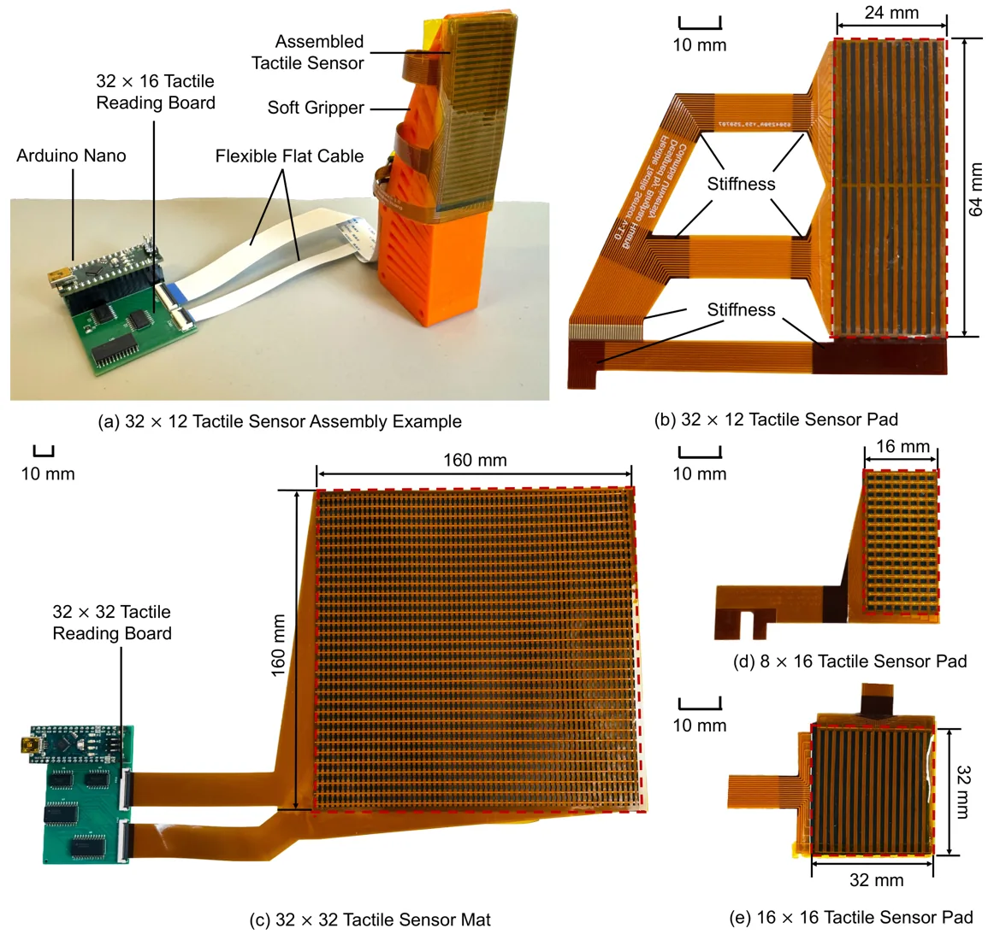

<!-- Generated by scripts/generate.py; edit data/works.json and data/media.json. -->

[← Back to the Awesome index](../../../README.md) · [Interactive website](https://chang-xinhai.github.io/Awesome-RGBDT-Manipulation/?collection=benchmark&item=flexitac#library)

# FlexiTac

FlexiTac: A Low-Cost, Open-Source, Scalable Tactile Sensing Solution for Robotic Systems

**2026-04-30 · Preprint · Columbia University**

**[Paper](https://arxiv.org/abs/2604.28156)** · [Project](https://flexitac.github.io/) · [Code](https://github.com/FlexiTac/FlexiTac)

Flexible piezoresistive tactile pads and readout hardware support contact-rich manipulation research.

*FlexiTac authors · [Figure source](https://arxiv.org/abs/2604.28156) · Original rights retained.*

| Field | Reported value and source scope |
| :-- | :-- |
| Record type | evaluation-tool |
| Simulator | Not applicable [1](https://arxiv.org/abs/2604.28156)  |
| Simulator version and scope | Not reported [1](https://arxiv.org/abs/2604.28156)  |
| Task count and scope | Hardware and sensor platform, not a manipulation benchmark [1](https://arxiv.org/abs/2604.28156)  |
| Task-list scope | Hardware platform, not an evaluated task suite [1](https://arxiv.org/abs/2604.28156)  |
| Capability dimensions | Piezoresistive pressure sensing · Flexible FPC tactile pads · Serial readout [1](https://arxiv.org/abs/2604.28156)  |
| Metrics | Not applicable [1](https://arxiv.org/abs/2604.28156)  |
| Robots | Multiple grippers and wearable collectors; integration-specific [1](https://arxiv.org/abs/2604.28156)  |
| Sensors and observations | FlexiTac V2 flexible pressure array; cited project specifies 32 × 12 and 2 mm grid for one configuration. [1](https://arxiv.org/abs/2604.28156)  |
| Data collection method | Pressure-array readout from physical contacts; no tactile output is scene depth. [1](https://arxiv.org/abs/2604.28156)  |
| Demonstrations and data | Not verified [1](https://arxiv.org/abs/2604.28156)  |
| Evaluation protocol | Hardware integration and representative manipulation applications; not one uniform benchmark. [1](https://arxiv.org/abs/2604.28156)  |
| Evaluated baselines | Not applicable [1](https://arxiv.org/abs/2604.28156)  |
| Observations / modalities | Tactile |
| Evaluation domain | Real world |
| Embodiment |  |
| Release: code | Available — pad design, firmware and acquisition source [2](https://flexitac.github.io/) [3](https://github.com/FlexiTac/FlexiTac)  |
| Release: weights | Not applicable [2](https://flexitac.github.io/) [3](https://github.com/FlexiTac/FlexiTac)  |
| Release: data | Not verified [2](https://flexitac.github.io/) [3](https://github.com/FlexiTac/FlexiTac)  |
| Release: license | Root repository license not verified; FlexiTac-Gen subproject has separate terms [2](https://flexitac.github.io/) [3](https://github.com/FlexiTac/FlexiTac)  |
| Release: notes | Open hardware and software; availability and terms differ across components. [2](https://flexitac.github.io/) [3](https://github.com/FlexiTac/FlexiTac)  |

**Task names — Hardware platform, not an evaluated task suite:**

Task names not reported or not verified in the cited sources.

**Scope and qualifications**

- Sensor readings are pressure-sensitive taxels, not scene depth or direct wrist force/torque. Pad design and firmware do not imply every ecosystem policy is released.

**Primary evidence**

1. [Original paper and first submission](https://arxiv.org/abs/2604.28156)
2. [Official project and release scope](https://flexitac.github.io/)
3. [Official code and release scope](https://github.com/FlexiTac/FlexiTac)
