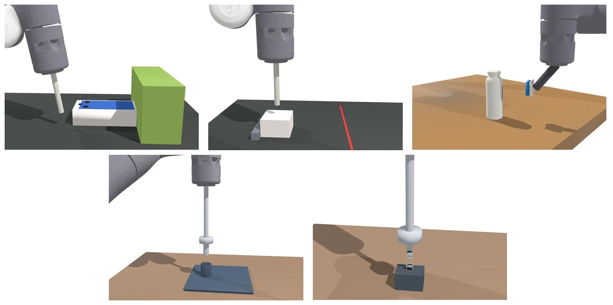

<!-- Generated by scripts/generate.py; edit data/works.json and data/media.json. -->

[← Back to the Awesome index](../../../README.md) · [Interactive website](https://chang-xinhai.github.io/Awesome-RGBDT-Manipulation/?collection=benchmark&item=force2act#library)

# Force2Act-Bench

Force2Act: A Force-Aware Visuomotor Policy for Generalizable Compliant Robot Manipulation

**2026-11-22 · Preprint · National University of Singapore**

**[Paper](https://arxiv.org/abs/2611.29208)** · [Project](https://magiclab-nus.github.io/Force2Act/) · [Code](https://github.com/MAGICLAB-NUS/Force2Act) · [Data](https://huggingface.co/datasets/NUSMAGIC/Force2Act-Bench-Data) · [Weights](https://huggingface.co/NUSMAGIC/Force2Act-Sim)

Five simulated tasks test force-aware wiping, pivoting, pushing and insertion, with downloadable demonstrations.

*Keerthi Vasan Murugan and coauthors · [Figure source](https://github.com/MAGICLAB-NUS/Force2Act#readme) · Original rights retained.*

| Field | Reported value and source scope |
| :-- | :-- |
| Record type | policy |
| Simulator | Genesis [1](https://arxiv.org/html/2611.29208v1)  |
| Simulator version and scope | Not reported [1](https://arxiv.org/html/2611.29208v1)  |
| Task count and scope | 5 tasks [1](https://arxiv.org/html/2611.29208v1)  |
| Task-list scope | Five simulation tasks. Physical demonstrations in original paper are independent. [1](https://arxiv.org/html/2611.29208v1)  |
| Capability dimensions | Force regulation while changing interaction loads and maintaining steady contact. [1](https://arxiv.org/html/2611.29208v1)  |
| Metrics | Physical task success and force tracking in the benchmark. [1](https://arxiv.org/html/2611.29208v1)  |
| Robots | Parallel gripper arm with relative wrench control [1](https://arxiv.org/html/2611.29208v1)  |
| Sensors and observations | RGB, TCP state, and force or wrench feedback. [1](https://arxiv.org/html/2611.29208v1)  |
| Data collection method | Simulation trajectories built with task-specific force and pose baselines; paper reports separately collected physical trials. [1](https://arxiv.org/html/2611.29208v1) [3](https://github.com/MAGICLAB-NUS/Force2Act#readme)  |
| Demonstrations and data | Public source configs, demonstrations and simulation checkpoint files. [1](https://arxiv.org/html/2611.29208v1)  |
| Evaluation protocol | Repeated evaluations under task-specific interaction force, motion and success criteria. [1](https://arxiv.org/html/2611.29208v1)  |
| Evaluated baselines | Force2Act and learned baselines with separate force and reactive-controller ablations. [1](https://arxiv.org/html/2611.29208v1)  |
| Observations / modalities | RGB · Force/Torque · Proprioception · Language |
| Evaluation domain | Simulation · Real world |
| Embodiment | Parallel-jaw gripper |
| Release: code | Available — simulator and five task definitions [3](https://github.com/MAGICLAB-NUS/Force2Act#readme)  |
| Release: weights | Available — simulation policy and compliance checkpoints [3](https://github.com/MAGICLAB-NUS/Force2Act#readme) [4](https://huggingface.co/NUSMAGIC/Force2Act-Sim/tree/main)  |
| Release: data | Available — five-task simulation data [3](https://github.com/MAGICLAB-NUS/Force2Act#readme) [5](https://huggingface.co/datasets/NUSMAGIC/Force2Act-Bench-Data/tree/main)  |
| Release: license | MIT code/data/model releases. [3](https://github.com/MAGICLAB-NUS/Force2Act#readme)  |
| Release: notes | Public paper verified. Code, task weights and data are tracked separately. [3](https://github.com/MAGICLAB-NUS/Force2Act#readme)  |

**Task names — Five simulation tasks. Physical demonstrations in original paper are independent.:**

- Block pivoting
- Press-push box
- Bottle wiping
- Round-plug insertion
- USB insertion

**Scope and qualifications**

- Uses wrench and RGB. Wrench sensing should not be indexed as skin tactile.

**Primary evidence**

1. [Original author paper with methods, evaluation and scope](https://arxiv.org/html/2611.29208v1)
2. [Public author project with method and evaluation examples](https://magiclab-nus.github.io/Force2Act/)
3. [Public policy, simulation and benchmark source](https://github.com/MAGICLAB-NUS/Force2Act#readme)
4. [Simulator policy checkpoint files](https://huggingface.co/NUSMAGIC/Force2Act-Sim/tree/main)
5. [Released simulation demonstrations](https://huggingface.co/datasets/NUSMAGIC/Force2Act-Bench-Data/tree/main)
