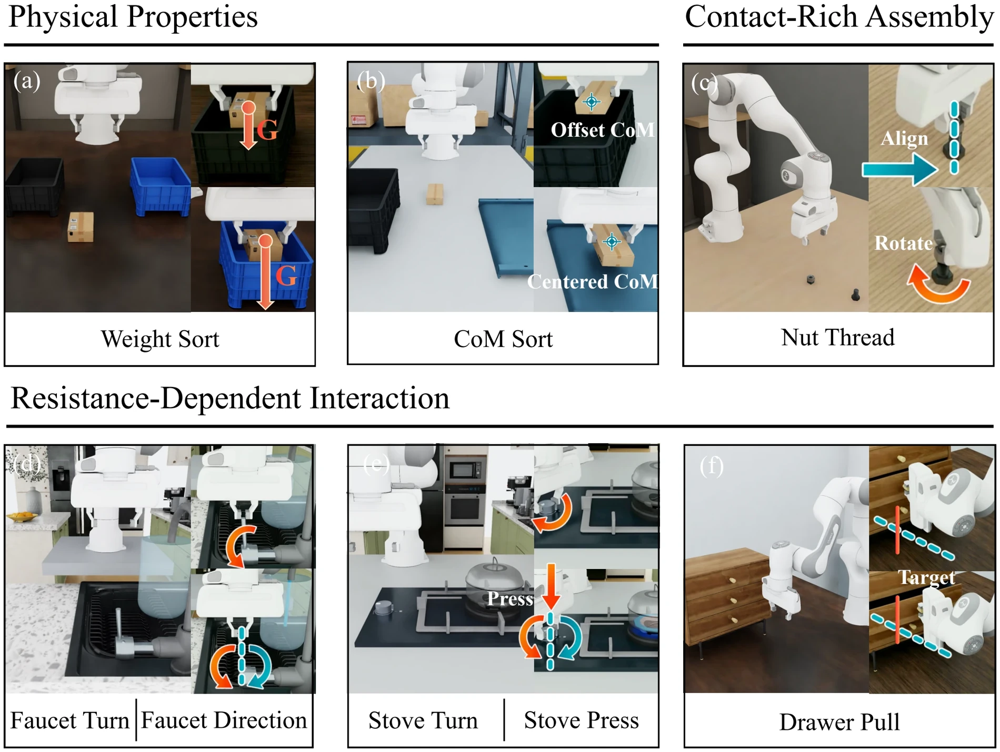

<!-- Generated by scripts/generate.py; edit data/works.json and data/media.json. -->

[← Back to the Awesome index](../../../README.md) · [Interactive website](https://chang-xinhai.github.io/Awesome-RGBDT-Manipulation/?collection=benchmark&item=forcebench#library)

# ForceBench

ForceBench: Benchmarking Force Integration for Robotic Manipulation

**2026-10-14 · arXiv preprint · Peking University / UC Berkeley / National University of Singapore / ePyBot Intelligence**

**[Paper](https://arxiv.org/abs/2610.19604)** · [Project](https://forcebench-platform.github.io/)

Eight simulation tasks and five separate physical tasks compare wrist force integration under a common demonstration, controller and evaluation protocol.

*forcebench authors; original research figure · [Figure source](https://forcebench-platform.github.io/) · Original rights retained.*

| Field | Reported value and source scope |
| :-- | :-- |
| Record type | benchmark |
| Simulator | NVIDIA Isaac Lab / Isaac Sim [1](https://arxiv.org/html/2610.19604) [2](https://forcebench-platform.github.io/)  |
| Simulator version and scope | Not reported in the inspected paper and appendix [1](https://arxiv.org/html/2610.19604) [2](https://forcebench-platform.github.io/)  |
| Task count and scope | 8 simulation tasks; 5 separate real-world tasks. These tracks are not 13 independent task families. [1](https://arxiv.org/html/2610.19604) [2](https://forcebench-platform.github.io/)  |
| Task-list scope | Complete simulation task list (§III-B) and separate hardware study (Appendix C-B). Weight Sort occurs in both tracks. [1](https://arxiv.org/html/2610.19604) [2](https://forcebench-platform.github.io/)  |
| Capability dimensions | Physical-property inference · Resistance-dependent interaction · Contact-rich assembly · Force-interface comparison [1](https://arxiv.org/html/2610.19604) [2](https://forcebench-platform.github.io/)  |
| Metrics | Complete episode success; task/category macro means; destination and mechanism-progress diagnostics do not substitute for success. Nut Thread also checks release and withdrawal. [1](https://arxiv.org/html/2610.19604) [2](https://forcebench-platform.github.io/)  |
| Robots | Simulated Franka with parallel gripper; real Franka Research 3, Robotiq gripper and KWR75B six-axis F/T sensor. [1](https://arxiv.org/html/2610.19604) [2](https://forcebench-platform.github.io/)  |
| Sensors and observations | External/wrist RGB, task language, 7-D TCP/gripper state and six-axis wrist wrench. Sim uses parent-on-child joint reaction without gravity compensation; real examples retain sensor-frame readings. No cutaneous tactile or measured depth input. [1](https://arxiv.org/html/2610.19604) [2](https://forcebench-platform.github.io/)  |
| Demonstrations and data | 1,600 successful scripted simulation demos: 200/task, seeds0–199, synchronized at15Hz. Real study:200 demos/task. Public demonstrations not released at review snapshot. [1](https://arxiv.org/html/2610.19604) [2](https://forcebench-platform.github.io/)  |
| Evaluation protocol | Ten systems ×8 tasks ×200 shared evaluation seeds300–499 =16,000 simulation episodes. Physics60Hz/control15Hz; budget1500 controls/100s. Seven π0.5 variants, π0 and ForceVLA execute50-action chunks; ForceFlow predicts64/executes32. Real:8 systems ×5 tasks ×20 shared starts =800 trials. [1](https://arxiv.org/html/2610.19604) [2](https://forcebench-platform.github.io/)  |
| Evaluated baselines | π0.5 without force; Token Fusion; Prompt Fusion; Cross-Attention; Token Fusion+Pred; Temporal Prompt; Dual-Path Fusion; external π0, ForceVLA and ForceFlow. External architectures/budgets/horizons differ. [1](https://arxiv.org/html/2610.19604) [2](https://forcebench-platform.github.io/)  |
| Observations / modalities | RGB · Force/Torque · Proprioception · Language |
| Evaluation domain | Simulation · Real world |
| Embodiment | Parallel-jaw gripper |
| Release: code | Not released [2](https://forcebench-platform.github.io/)  |
| Release: weights | Not released [2](https://forcebench-platform.github.io/)  |
| Release: data | Not released [2](https://forcebench-platform.github.io/)  |
| Release: license | Not verified; source figures retain original rights [2](https://forcebench-platform.github.io/)  |
| Release: notes | Official Resources section explicitly provides no code, demonstrations or checkpoint downloads. Its stale no-paper-download notice is superseded by the public arXiv manuscript; result tables are available separately. [2](https://forcebench-platform.github.io/)  |

**Task names — Complete simulation task list (§III-B) and separate hardware study (Appendix C-B). Weight Sort occurs in both tracks.:**

- Simulation — Weight Sort
- Simulation — CoM Sort
- Simulation — Faucet Turn
- Simulation — Faucet Direction
- Simulation — Stove Turn
- Simulation — Stove Press
- Simulation — Drawer Pull
- Simulation — Nut Thread
- Real — Weight Sort
- Real — Plate Retrieve
- Real — Stamp Press
- Real — Plug Insert
- Real — Block Insert

**Scope and qualifications**

- Wrist F/T is not skin tactile; force varies through physical properties that may also affect visible motion and proprioception.
- Single simulated embodiment and one assembly task limit scope; 20 real trials/task do not establish a general sim-to-real ranking correlation.
- The best two simulation means differ by three successful episodes out of1600; no significance claim is inferred.

**Primary evidence**

1. [Original full manuscript and appendices](https://arxiv.org/html/2610.19604) — Method, evaluation and appendix read; observations, training-only labels, rates and task scopes remain distinct.
2. [Official benchmark, task/protocol pages and release notice](https://forcebench-platform.github.io/) — Live project inspected; implementation/data/weights are independently distinguished from paper and published result tables.
