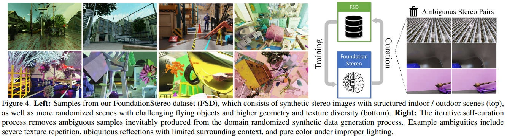

<!-- Generated by scripts/generate.py; edit data/works.json and data/media.json. -->

[← Back to the Awesome index](../../../README.md) · [Interactive website](https://chang-xinhai.github.io/Awesome-RGBDT-Manipulation/?collection=benchmark&item=foundationstereo#library)

# FoundationStereo Dataset (FSD)

FoundationStereo: Zero-Shot Stereo Matching

**2025-01-17 · CVPR 2025 · NVIDIA**

**[Paper](https://arxiv.org/abs/2501.09898)** · [Project](https://nvlabs.github.io/FoundationStereo/) · [Code](https://github.com/NVlabs/FoundationStereo) · [Data](https://github.com/NVlabs/FoundationStereo#fsd-dataset) · [Weights](https://huggingface.co/nvidia/c-foundationstereo-s) · [Dataset Sample](https://drive.google.com/file/d/1dJwK5x8xsaCazz5xPGJ2OKFIWrd9rQT5/view?usp=drive_link)

The paper’s approximately 1M synthetic pairs with dense reference disparity include structured scenes and randomized objects.

*FoundationStereo authors · [Figure source](https://nvlabs.github.io/FoundationStereo/) · Original rights retained.*

| Field | Reported value and source scope |
| :-- | :-- |
| Record type | Perception benchmark |
| Simulator | NVIDIA Omniverse [3](https://github.com/NVlabs/FoundationStereo#fsd-dataset)  |
| Simulator version and scope | Not reported [3](https://github.com/NVlabs/FoundationStereo#fsd-dataset)  |
| Task count and scope | Supporting dataset or perception evaluation [3](https://github.com/NVlabs/FoundationStereo#fsd-dataset)  |
| Task-list scope | Listed uses of the resource, with no closed-loop robot task count. [3](https://github.com/NVlabs/FoundationStereo#fsd-dataset)  |
| Capability dimensions | Training and evaluation data [3](https://github.com/NVlabs/FoundationStereo#fsd-dataset)  |
| Metrics | Not applicable [3](https://github.com/NVlabs/FoundationStereo#fsd-dataset)  |
| Robots | Not applicable [3](https://github.com/NVlabs/FoundationStereo#fsd-dataset)  |
| Sensors and observations | Rendered rectified RGB pairs and ground-truth disparity. [3](https://github.com/NVlabs/FoundationStereo#fsd-dataset)  |
| Data collection method | Omniverse rendering varies baseline, focal length, viewpoints, illumination, materials and object configurations, then filters ambiguous samples. [3](https://github.com/NVlabs/FoundationStereo#fsd-dataset)  |
| Demonstrations and data | Approximately 1M stereo pairs in the research paper; full data folder &gt;1 TB and a 3 GB sample documented by the official repository. [3](https://github.com/NVlabs/FoundationStereo#fsd-dataset)  |
| Evaluation protocol | Use the research FSD instance for training. The commercial model’s separate card documents its synthetic mixture and scope. [3](https://github.com/NVlabs/FoundationStereo#fsd-dataset)  |
| Evaluated baselines | Not applicable [3](https://github.com/NVlabs/FoundationStereo#fsd-dataset)  |
| Observations / modalities | RGB |
| Evaluation domain |  |
| Embodiment |  |
| Release: code | Available — sample visualizer linked in author repository [2](https://github.com/NVlabs/FoundationStereo) [3](https://github.com/NVlabs/FoundationStereo#fsd-dataset)  |
| Release: weights | Not applicable [2](https://github.com/NVlabs/FoundationStereo) [3](https://github.com/NVlabs/FoundationStereo#fsd-dataset)  |
| Release: data | Available — full FSD and 3 GB sample from author repository [2](https://github.com/NVlabs/FoundationStereo) [3](https://github.com/NVlabs/FoundationStereo#fsd-dataset)  |
| Release: license | The repository directs users to its NVIDIA Source Code License for the FSD dataset. [2](https://github.com/NVlabs/FoundationStereo) [3](https://github.com/NVlabs/FoundationStereo#fsd-dataset) [4](https://github.com/NVlabs/FoundationStereo/blob/master/LICENSE)  |
| Release: notes | Official counts and file sizes describe the research release. [2](https://github.com/NVlabs/FoundationStereo) [3](https://github.com/NVlabs/FoundationStereo#fsd-dataset)  |

**Task names — Listed uses of the resource, with no closed-loop robot task count.:**

- Supervised synthetic stereo training
- Specular, texture-poor and occluded scenes

**Scope and qualifications**

- Predicted stereo depth is not a measured depth stream; calibrated camera geometry is necessary for metric conversion.

**Primary evidence**

1. [Author paper and first submission](https://arxiv.org/html/2501.09898v1)
2. [Official code and license](https://github.com/NVlabs/FoundationStereo)
3. [Author dataset announcement, samples and download locations](https://github.com/NVlabs/FoundationStereo#fsd-dataset)
4. [Research license linked by FSD dataset section](https://github.com/NVlabs/FoundationStereo/blob/master/LICENSE)
5. [Separately scoped commercial checkpoint recipe](https://huggingface.co/nvidia/c-foundationstereo-s/blob/main/README.md)
