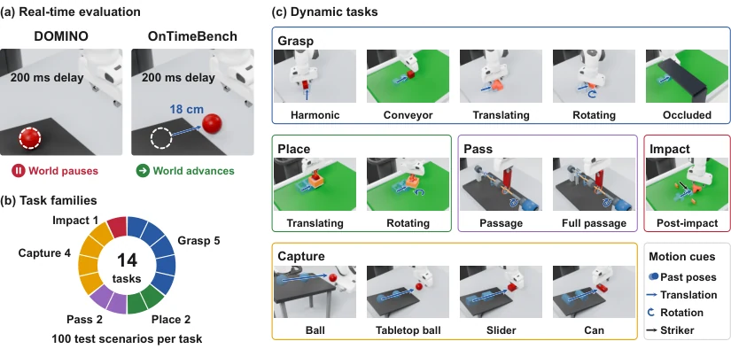

<!-- Generated by scripts/generate.py; edit data/works.json and data/media.json. -->

[← Back to the Awesome index](../../../README.md) · [Interactive website](https://chang-xinhai.github.io/Awesome-RGBDT-Manipulation/?collection=benchmark&item=foveawam#library)

# OnTimeBench

FoveaWAM: Role-Aware 4D World-Action Modeling for Dynamic Manipulation

**2026-11-23 · Preprint · Beijing Zhongguancun Academy; Peking University; Beijing Academy of Artificial Intelligence**

**[Paper](https://arxiv.org/abs/2611.31705)** · [Project](https://foveawam.github.io/) · [Code](https://github.com/ArrebolBlack/FoveaWAM) · [Data](https://huggingface.co/datasets/JiaqiYin/OnTimeBench) · [Weights](https://huggingface.co/JiaqiYin/FoveaWAM) · [Benchmark Harness](https://github.com/ArrebolBlack/OnTimeBench)

Tests fourteen dynamic manipulation tasks at each policy’s real query latency while the simulated scene continues to move.

*Jiaqi Yin and coauthors · [Figure source](https://arxiv.org/html/2611.31705v1) · Original rights retained.*

| Field | Reported value and source scope |
| :-- | :-- |
| Record type | policy |
| Simulator | MuJoCo with robosuite [1](https://arxiv.org/html/2611.31705v1)  |
| Simulator version and scope | Not reported [1](https://arxiv.org/html/2611.31705v1)  |
| Task count and scope | 14 tasks, 1,400 test scenes [1](https://arxiv.org/html/2611.31705v1)  |
| Task-list scope | Example task families. Source has 100 released test scenes per task. [1](https://arxiv.org/html/2611.31705v1)  |
| Capability dimensions | Moving target interaction under native, fixed additional-delay or paused policy execution. [1](https://arxiv.org/html/2611.31705v1)  |
| Metrics | Task success and p95 time-to-action; physics progresses at native steps in the main protocol. [1](https://arxiv.org/html/2611.31705v1)  |
| Robots | Franka Panda with parallel gripper [1](https://arxiv.org/html/2611.31705v1)  |
| Sensors and observations | Calibrated RGB-D and public robot state. Target pose-history input is logged and separately identified. [1](https://arxiv.org/html/2611.31705v1)  |
| Data collection method | Simulation demonstrations are collected with a task-native oracle; exported dataset contains synchronized RGB-D, robot state/actions and labeled dynamics. [1](https://arxiv.org/html/2611.31705v1)  |
| Demonstrations and data | 11,200 demos plus test manifests and task definitions. Demo and test counts are separate. [1](https://arxiv.org/html/2611.31705v1)  |
| Evaluation protocol | Run at native latency without pausing the world, with fixed added latency or with the paused reference. [1](https://arxiv.org/html/2611.31705v1)  |
| Evaluated baselines | FoveaWAM, diffusion policy and benchmark-adapted policy variants. [1](https://arxiv.org/html/2611.31705v1)  |
| Observations / modalities | RGB · Depth · Proprioception |
| Evaluation domain | Simulation · Real world |
| Embodiment | Parallel-jaw gripper |
| Release: code | Available — simulator, tasks, manifests and evaluator [3](https://github.com/ArrebolBlack/FoveaWAM#readme)  |
| Release: weights | FoveaWAM simulation checkpoint linked separately [4](https://huggingface.co/JiaqiYin/FoveaWAM/tree/main)  |
| Release: data | Available — public 11,200 HDF5 demonstrations and test manifests [5](https://huggingface.co/datasets/JiaqiYin/OnTimeBench/tree/main)  |
| Release: license | Apache-2.0 code; data CC BY 4.0. [3](https://github.com/ArrebolBlack/FoveaWAM#readme)  |
| Release: notes | Public paper verified. Code, task weights and data are tracked separately. |

**Task names — Example task families. Source has 100 released test scenes per task.:**

- Harmonic grasp
- Translating place
- Conveyor grasp
- Half passage
- Ball capture
- Post-impact

**Scope and qualifications**

- Physical target pose history comes from online tracking with the calibrated RGB-D scene; simulator-backed pose history is a different regime.
- Render and control rates must not be compared with the policy-only timing estimate.

**Primary evidence**

1. [Original author paper with methods, evaluation and scope](https://arxiv.org/html/2611.31705v1)
2. [Public author project with method and evaluation examples](https://foveawam.github.io/)
3. [Official code, architecture, and commercial-use distinctions](https://github.com/ArrebolBlack/FoveaWAM#readme)
4. [Executable simulator checkpoint files](https://huggingface.co/JiaqiYin/FoveaWAM/tree/main)
5. [Public HDF5 training demos](https://huggingface.co/datasets/JiaqiYin/OnTimeBench/tree/main)
