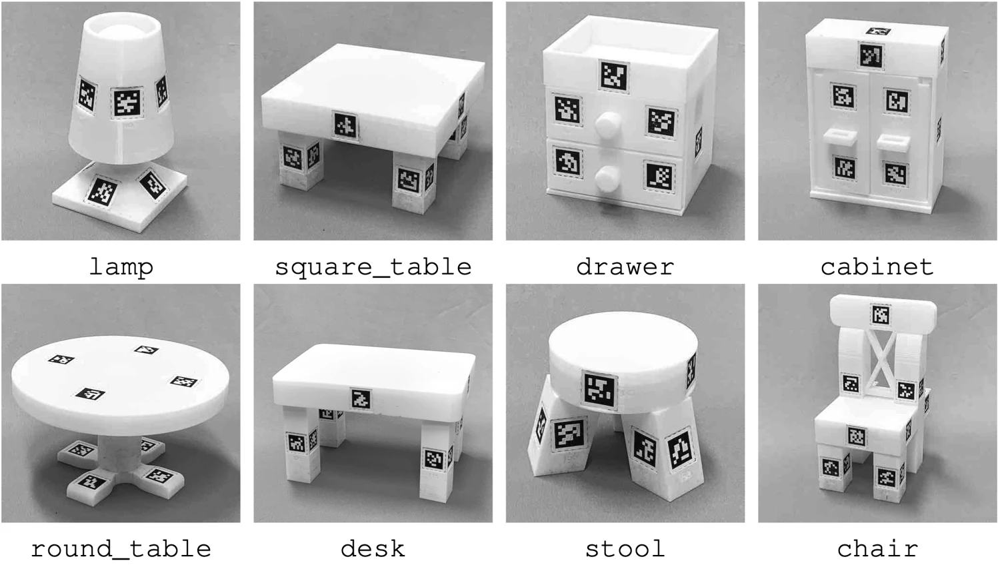

<!-- Generated by scripts/generate.py; edit data/works.json and data/media.json. -->

[← Back to the Awesome index](../../../README.md) · [Interactive website](https://chang-xinhai.github.io/Awesome-RGBDT-Manipulation/?collection=benchmark&item=furniturebench#library)

# FurnitureBench

FurnitureBench: Reproducible Real-World Benchmark for Long-Horizon Complex Manipulation

**2023-05-22 · RSS 2023 · University of Southern California / KAIST**

**[Paper](https://arxiv.org/abs/2305.12821)** · [Project](https://clvrai.github.io/furniture-bench/) · [Code](https://github.com/clvrai/furniture-bench) · [Data](https://clvrai.github.io/furniture-bench/docs/tutorials/dataset.html)

Physical miniature furniture assembly with reproducible initial-state difficulty and a matching Isaac Gym / Factory simulator.

*FurnitureBench authors · [Figure source](https://clvrai.github.io/furniture-bench/) · Original rights retained.*

| Field | Reported value and source scope |
| :-- | :-- |
| Record type | benchmark |
| Simulator | FurnitureSim built on Isaac Gym and Factory [1](https://arxiv.org/abs/2305.12821) [2](https://clvrai.github.io/furniture-bench/)  |
| Simulator version and scope | Isaac Gym Preview 4 in released setup; exact build should be matched to repository. [1](https://arxiv.org/abs/2305.12821) [2](https://clvrai.github.io/furniture-bench/) [3](https://github.com/clvrai/furniture-bench)  |
| Task count and scope | 8 physical furniture assembly tasks; per-skill and complete-assembly evaluations [1](https://arxiv.org/abs/2305.12821) [2](https://clvrai.github.io/furniture-bench/)  |
| Task-list scope | Complete original eight-furniture suite. [1](https://arxiv.org/abs/2305.12821) [2](https://clvrai.github.io/furniture-bench/)  |
| Capability dimensions | Long-horizon assembly · Grasp / place / insertion / screwing · Error accumulation · Reset-level robustness [1](https://arxiv.org/abs/2305.12821) [2](https://clvrai.github.io/furniture-bench/)  |
| Metrics | Assembly / skill success under low, medium and high randomization; evaluation time and human reset reproducibility. [1](https://arxiv.org/abs/2305.12821) [2](https://clvrai.github.io/furniture-bench/)  |
| Robots | Franka Panda arm with parallel-jaw gripper [1](https://arxiv.org/abs/2305.12821) [2](https://clvrai.github.io/furniture-bench/)  |
| Sensors and observations | External and wrist RGB-D cameras; robot proprioception; AprilTag-based part tracking used for reproducible setups and labels. [1](https://arxiv.org/abs/2305.12821) [2](https://clvrai.github.io/furniture-bench/)  |
| Demonstrations and data | 200+ hours, 5,000+ demonstrations; RGB-D, robot states and actions. [1](https://arxiv.org/abs/2305.12821) [2](https://clvrai.github.io/furniture-bench/)  |
| Evaluation protocol | Three standardized initial-state randomization levels; skill and full-assembly evaluation; physical benchmark complemented by FurnitureSim. [1](https://arxiv.org/abs/2305.12821) [2](https://clvrai.github.io/furniture-bench/)  |
| Evaluated baselines | Behavior cloning and offline reinforcement-learning baselines; exact suite settings in manuscript. [1](https://arxiv.org/abs/2305.12821) [2](https://clvrai.github.io/furniture-bench/)  |
| Observations / modalities | RGB · Depth · Proprioception |
| Evaluation domain | Real world · Simulation |
| Embodiment | Parallel-jaw gripper |
| Release: code | Available [3](https://github.com/clvrai/furniture-bench)  |
| Release: weights | Not verified [3](https://github.com/clvrai/furniture-bench)  |
| Release: data | Available [3](https://github.com/clvrai/furniture-bench)  |
| Release: license | MIT code; dataset/third-party terms separate [3](https://github.com/clvrai/furniture-bench) [4](https://github.com/clvrai/furniture-bench/blob/main/LICENSE)  |
| Release: notes | CAD files, data, reset/workspace guides and FurnitureSim environment public. [3](https://github.com/clvrai/furniture-bench)  |

**Task names — Complete original eight-furniture suite.:**

- One Leg
- Square Table
- Desk
- Round Table
- Chair
- Lamp
- Drawer
- Cabinet

**Scope and qualifications**

- Fiducial-based privileged part states and raw image policy observations should be reported separately.
- Furniture assembly does not inherently include tactile sensing.

**Primary evidence**

1. [Paper](https://arxiv.org/abs/2305.12821) — Published paper / arXiv record and manuscript.
2. [Official project](https://clvrai.github.io/furniture-bench/) — Public project page.
3. [Official repository](https://github.com/clvrai/furniture-bench) — Current public repository; implementation scope may differ from paper.
4. [Official source](https://github.com/clvrai/furniture-bench/blob/main/LICENSE) — License text read directly; code license does not automatically cover models, data or simulator.
