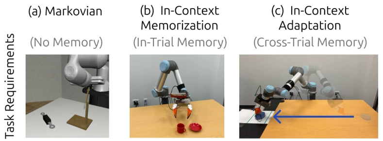

<!-- Generated by scripts/generate.py; edit data/works.json and data/media.json. -->

[← Back to the Awesome index](../../../README.md) · [Interactive website](https://chang-xinhai.github.io/Awesome-RGBDT-Manipulation/?collection=benchmark&item=gated-memory-policy#library)

# MemMimic

Gated Memory Policy: In-Context Memorization and Adaptation

**2026-04-21 · Preprint · Stanford University**

**[Paper](https://arxiv.org/abs/2604.18933)** · [Project](https://gated-memory-policy.github.io/) · [Code](https://github.com/real-stanford/gated-memory-policy) · [Data](https://huggingface.co/datasets/yihuai-gao/gated-memory-policy) · [Weights](https://huggingface.co/yihuai-gao/gated-memory-policy)

A diffusion policy learns when to recall visual/action history and what context matters for within-trial memory and cross-trial adaptation.

*Gated Memory Policy (GMP) authors · [Figure source](https://arxiv.org/abs/2604.18933) · Original rights retained.*

| Field | Reported value and source scope |
| :-- | :-- |
| Record type | policy |
| Simulator | MuJoCo [1](https://arxiv.org/abs/2604.18933)  |
| Simulator version and scope | Not reported [1](https://arxiv.org/abs/2604.18933)  |
| Task count and scope | 6 headline task families (four simulated, two real), plus the appendix-only T3′ Continuous Place Back real setting. [1](https://arxiv.org/abs/2604.18933)  |
| Task-list scope | Six headline T1–T6 families plus the auxiliary appendix T3′ real setting; excludes external RoboMimic / MIKASA-Robo evaluation tasks. [1](https://arxiv.org/abs/2604.18933)  |
| Capability dimensions | Within-trial memorization · Cross-trial adaptation · Dynamics-sensitive manipulation [1](https://arxiv.org/abs/2604.18933)  |
| Metrics | Task success rate; mean and standard deviation over training seeds. [1](https://arxiv.org/abs/2604.18933)  |
| Robots | Simulation grippers; real UR5 with WSG50 / fin-ray fingers and ARX X5 in-the-wild UMI setup. [1](https://arxiv.org/abs/2604.18933)  |
| Sensors and observations | RGB and robot proprioception. [1](https://arxiv.org/abs/2604.18933)  |
| Data collection method | Task-dependent heuristic/scripted collectors for MemMimic, plus PPO-oracle trajectories for MIKASA tasks. The real-world collection interface is Not verified. [1](https://arxiv.org/abs/2604.18933) [5](https://arxiv.org/abs/2604.18933)  |
| Demonstrations and data | Task-specific demonstrations; appendix example Match Color has 300 training episodes. Complete task-specific datasets are released. [1](https://arxiv.org/abs/2604.18933)  |
| Evaluation protocol | For simulation, each checkpoint evaluated on 100 episodes, best-checkpoint mean/std over three training seeds; real protocols are task-specific. [1](https://arxiv.org/abs/2604.18933)  |
| Evaluated baselines | History-free / mid / long-history Diffusion Policy, Past-Token Prediction, history attention variants and GMP. [1](https://arxiv.org/abs/2604.18933)  |
| Observations / modalities | RGB · Proprioception |
| Evaluation domain | Simulation · Real world |
| Embodiment | Parallel-jaw gripper |
| Release: code | Available [2](https://gated-memory-policy.github.io/) [3](https://github.com/real-stanford/gated-memory-policy)  |
| Release: weights | Available [2](https://gated-memory-policy.github.io/) [3](https://github.com/real-stanford/gated-memory-policy)  |
| Release: data | Available [2](https://gated-memory-policy.github.io/) [3](https://github.com/real-stanford/gated-memory-policy)  |
| Release: license | MIT for repository code; external model, dataset and dependency terms remain separate. [2](https://gated-memory-policy.github.io/) [3](https://github.com/real-stanford/gated-memory-policy) [4](https://github.com/real-stanford/gated-memory-policy/blob/HEAD/LICENSE)  |
| Release: notes | Official training/evaluation, task data and in-the-wild deployment checkpoint are public; robot deployment uses the separately linked iPhUMI implementation. [2](https://gated-memory-policy.github.io/) [3](https://github.com/real-stanford/gated-memory-policy)  |

**Task names — Six headline T1–T6 families plus the auxiliary appendix T3′ real setting; excludes external RoboMimic / MIKASA-Robo evaluation tasks.:**

- Match Color
- Discrete Place Back
- In-the-wild Flip and Place Back
- Iterative Pushing
- Iterative Flinging
- Iterative Casting
- Continuous Place Back (appendix T3′)

**Scope and qualifications**

- No tactile or wrist force stream is claimed from RGB/history-based memory.
- The training-cost breakdown is for one challenging task, not the total complete benchmark.

**Primary evidence**

1. [Original paper / author report](https://arxiv.org/abs/2604.18933) — Original full paper and supplementary experimental / implementation details; deployment inputs are separated from supervision and benchmark state.
2. [Official project](https://gated-memory-policy.github.io/) — Author-linked project and current release checked on the catalog cutoff.
3. [Official code / release documentation](https://github.com/real-stanford/gated-memory-policy) — Current repository documentation; paper settings and subsequently released artifacts are distinguished.
4. [Repository LICENSE](https://github.com/real-stanford/gated-memory-policy/blob/HEAD/LICENSE) — Actual license file inspected; code license does not automatically license data or weights.
5. [Data collection method and scope](https://arxiv.org/abs/2604.18933) — Original method/data protocol reviewed for the collection mechanism. Data volume, evaluation rollouts and downstream training remain separate; undisclosed or unresolved interfaces are labeled explicitly.
