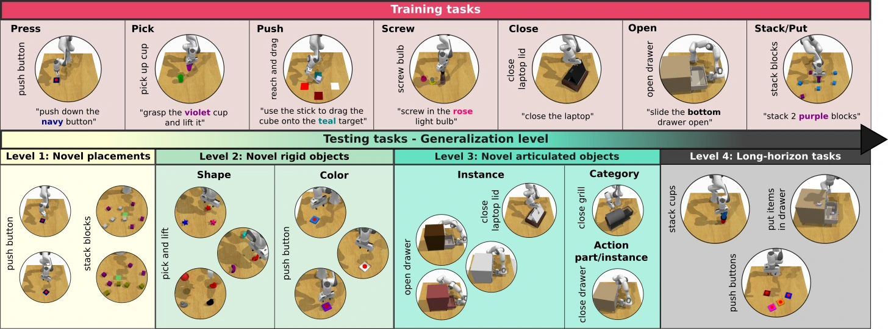

<!-- Generated by scripts/generate.py; edit data/works.json and data/media.json. -->

[← Back to the Awesome index](../../../README.md) · [Interactive website](https://chang-xinhai.github.io/Awesome-RGBDT-Manipulation/?collection=benchmark&item=gembench-3d-lotus#library)

# GemBench

Towards Generalizable Vision-Language Robotic Manipulation: A Benchmark and LLM-guided 3D Policy

**2024-10-02 · ICRA 2025 · Inria; École normale supérieure; CNRS; PSL Research University**

**[Paper](https://arxiv.org/abs/2410.01345)** · [Project](https://www.di.ens.fr/willow/research/gembench/) · [Code](https://github.com/vlc-robot/robot-3dlotus) · [Data](https://huggingface.co/datasets/rjgpinel/GEMBench) · [Weights](https://huggingface.co/rjgpinel/3dlotus)

Generalization suite built on RLBench, with novel placements, rigid objects, articulated objects and long-horizon compositions.

*GemBench / 3D-LOTUS authors · [Figure source](https://www.di.ens.fr/willow/research/gembench/) · Original rights retained.*

| Field | Reported value and source scope |
| :-- | :-- |
| Record type | policy |
| Simulator | RLBench on CoppeliaSim [3](https://arxiv.org/html/2410.01345)  |
| Simulator version and scope | Manuscript does not specify an engine version; current INSTALL.md uses CoppeliaSim Edu 4.1.0 for Ubuntu 20.04 with modified RLBench/PyRep forks. [3](https://arxiv.org/html/2410.01345) [7](https://github.com/vlc-robot/robot-3dlotus/blob/main/INSTALL.md)  |
| Task count and scope | 44 unique released task IDs and 92 test variations; training uses 16 task IDs / 31 variations. Test levels contain 16/15/18/6 task IDs with cross-level overlap. [3](https://arxiv.org/html/2410.01345) [8](https://github.com/vlc-robot/robot-3dlotus/blob/main/assets/taskvars_train.json) [9](https://github.com/vlc-robot/robot-3dlotus/blob/main/assets/taskvars_test_l2.json)  |
| Task-list scope | Complete 44 unique released task IDs, deduplicated from official train/L1, L2, L3 and L4 task-variation registries. These lists have 31/28/21/12 entries. Task IDs retain implementation spelling. [3](https://arxiv.org/html/2410.01345) [8](https://github.com/vlc-robot/robot-3dlotus/blob/main/assets/taskvars_train.json) [9](https://github.com/vlc-robot/robot-3dlotus/blob/main/assets/taskvars_test_l2.json)  |
| Capability dimensions | Novel placements · Novel rigid objects · Novel articulated objects · Novel long-horizon compositions [3](https://arxiv.org/html/2410.01345)  |
| Metrics | Binary episode success; per-variation average and five-seed mean/standard deviation. [3](https://arxiv.org/html/2410.01345)  |
| Robots | Franka Panda in RLBench [3](https://arxiv.org/html/2410.01345)  |
| Sensors and observations | Four 256 × 256 calibrated RGB-D views: front, left shoulder, right shoulder and wrist; robot proprioception. [3](https://arxiv.org/html/2410.01345)  |
| Data collection method | RLBench-style scripted experts generate demonstrations for the training task variations; collection is separate from held-out evaluation rollouts. [3](https://arxiv.org/html/2410.01345) [15](https://arxiv.org/abs/2410.01345)  |
| Demonstrations and data | 100 scripted demonstrations for each of 31 training variations = 3,100 training demonstrations. Validation uses 20 episodes per training variation, separately from testing. [3](https://arxiv.org/html/2410.01345)  |
| Evaluation protocol | Four test levels with 31/28/21/12 variations; 20 episodes × five seeds × 92 variations = 9,200 test episodes; maximum 25 keyframe steps. [3](https://arxiv.org/html/2410.01345)  |
| Evaluated baselines | Hiveformer,PolarNet,3D Diffuser Actor,RVT-2,3D-LOTUS,3D-LOTUS++; external RLBench 18-task comparison table separate. [3](https://arxiv.org/html/2410.01345)  |
| Observations / modalities | RGB · Depth · Point cloud · Proprioception |
| Evaluation domain | Simulation |
| Embodiment | Parallel-jaw gripper |
| Release: code | Available [2](https://www.di.ens.fr/willow/research/gembench/) [4](https://github.com/vlc-robot/robot-3dlotus) [5](https://github.com/vlc-robot/robot-3dlotus/tree/main)  |
| Release: weights | Available [2](https://www.di.ens.fr/willow/research/gembench/) [4](https://github.com/vlc-robot/robot-3dlotus) [12](https://huggingface.co/rjgpinel/3dlotus/tree/main)  |
| Release: data | Available [2](https://www.di.ens.fr/willow/research/gembench/) [4](https://github.com/vlc-robot/robot-3dlotus) [6](https://huggingface.co/datasets/rjgpinel/GEMBench)  |
| Release: license | Not verified [2](https://www.di.ens.fr/willow/research/gembench/) [4](https://github.com/vlc-robot/robot-3dlotus)  |
| Release: notes | Official source code, GemBench dataset, 3D-LOTUS and 3D-LOTUS++ checkpoints are public. Actual Hugging Face inventories contain model checkpoints and training/test dataset files. Repository-wide license not verified; upstream components retain their terms. [2](https://www.di.ens.fr/willow/research/gembench/) [4](https://github.com/vlc-robot/robot-3dlotus)  |

**Task names — Complete 44 unique released task IDs, deduplicated from official train/L1, L2, L3 and L4 task-variation registries. These lists have 31/28/21/12 entries. Task IDs retain implementation spelling.:**

- push_button
- close_fridge
- close_laptop_lid
- close_microwave
- open_door
- open_box
- open_drawer
- pick_and_lift
- pick_up_cup
- stack_blocks
- put_groceries_in_cupboard
- put_money_in_safe
- slide_block_to_color_target_peract
- reach_and_drag_peract
- close_jar_peract
- light_bulb_in_peract
- put_cube_in_safe
- lamp_on
- pick_and_lift_cylinder
- pick_and_lift_star
- pick_and_lift_moon
- pick_and_lift_toy
- open_drawer_long
- close_fridge2
- close_laptop_lid2
- close_microwave2
- open_door2
- open_box2
- open_drawer2
- open_drawer3
- close_door
- close_box
- toilet_seat_up
- open_fridge
- open_laptop_lid
- open_microwave
- close_drawer
- close_grill
- push_buttons4
- take_shoes_out_of_box
- put_items_in_drawer
- tower4
- stack_cups
- put_all_groceries_in_cupboard

**Scope and qualifications**

- LLM/VLM grounding modules and motion-policy training have separate costs.
- Author-reported task counts and per-level counts overlap; task variations are the evaluation units.

**Primary evidence**

1. [Original manuscript and first submission history](https://arxiv.org/abs/2410.01345) — Full author HTML method/evaluation/appendix inspected; depth observations, pseudo-labels and generated outputs retain distinct roles.
2. [Official author project](https://www.di.ens.fr/willow/research/gembench/) — Public author-linked project; figure and downstream scope verified separately.
3. [Original GemBench protocol, SectionIII / V-A and AppendixVI-A TableVIII](https://arxiv.org/html/2410.01345) — Author-reported totals retained; per-level task counts overlap. No new independent task count inferred from names.
4. [Official current implementation linked by author project](https://github.com/vlc-robot/robot-3dlotus) — Actual runnable release and model artifacts checked independently.
5. [Actual repository content inventory](https://github.com/vlc-robot/robot-3dlotus/tree/main) — 139 tracked paths inspected; code release is distinguished from a README/project/figure-only repository.
6. [Official data release destination](https://huggingface.co/datasets/rjgpinel/GEMBench) — Destination linked by the official project/repository; component release scope is retained in release notes.
7. [Released simulator installation recipe](https://github.com/vlc-robot/robot-3dlotus/blob/main/INSTALL.md) — CoppeliaSim 4.1.0 is a current release installation example, not a version claim from the manuscript.
8. [Official train task-variation registry](https://github.com/vlc-robot/robot-3dlotus/blob/main/assets/taskvars_train.json) — The four registries contain 92 variations over 44 unique task function IDs; level task counts overlap.
9. [Official test_l2 task-variation registry](https://github.com/vlc-robot/robot-3dlotus/blob/main/assets/taskvars_test_l2.json) — The four registries contain 92 variations over 44 unique task function IDs; level task counts overlap.
10. [Official test_l3 task-variation registry](https://github.com/vlc-robot/robot-3dlotus/blob/main/assets/taskvars_test_l3.json) — The four registries contain 92 variations over 44 unique task function IDs; level task counts overlap.
11. [Official test_l4 task-variation registry](https://github.com/vlc-robot/robot-3dlotus/blob/main/assets/taskvars_test_l4.json) — The four registries contain 92 variations over 44 unique task function IDs; level task counts overlap.
12. [Actual 3D-LOTUS checkpoint inventory](https://huggingface.co/rjgpinel/3dlotus/tree/main) — Contains GemBench model_step_150000.pt and RLBench model_step_300000.pt checkpoint files.
13. [Actual 3D-LOTUS++ checkpoint inventory](https://huggingface.co/rjgpinel/3dlotusplus/tree/main) — Contains GemBench model_step_140000.pt and RealRobot model_step_50000.pt checkpoint files.
14. [Actual GemBench dataset inventory](https://huggingface.co/datasets/rjgpinel/GEMBench/tree/main) — Contains released LMDB training episodes and the test microsteps archive.
15. [Data collection method and scope](https://arxiv.org/abs/2410.01345) — Original method/data protocol reviewed for the collection mechanism. Data volume, evaluation rollouts and downstream training remain separate; undisclosed or unresolved interfaces are labeled explicitly.
