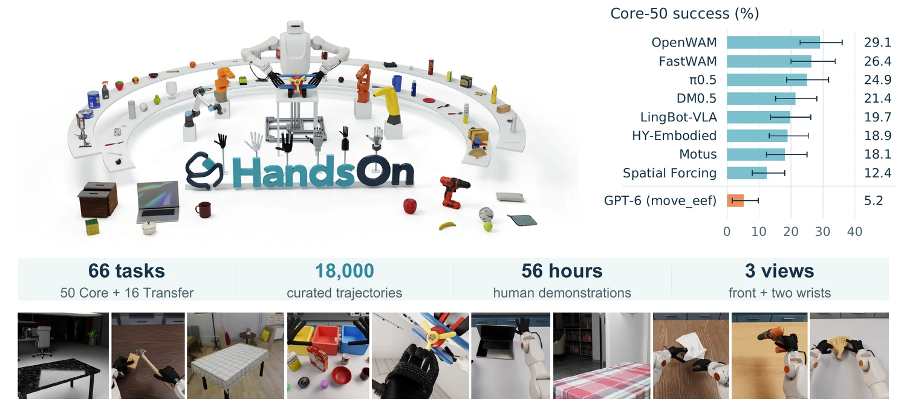

<!-- Generated by scripts/generate.py; edit data/works.json and data/media.json. -->

[← Back to the Awesome index](../../../README.md) · [Interactive website](https://chang-xinhai.github.io/Awesome-RGBDT-Manipulation/?collection=benchmark&item=handson#library)

# HandsOn

HandsOn: A Large-Scale Simulation Benchmark for Generalizable Dexterous Manipulation

**2026-10-19 · Preprint · Tsinghua University**

**[Paper](https://arxiv.org/abs/2610.26765)** · [Project](https://llltttwww.github.io/HandsOn-website/) · [Code](https://github.com/TsinghuaC3I/HandsOn) · [Data](https://huggingface.co/datasets/Cyan666/HandsOn-Datasets)

A dexterous simulation platform pairs 50 demonstrated tasks with 16 demonstration-free transfer tasks and execution diagnostics.

*HandsOn authors; original rights retained · [Figure source](https://arxiv.org/abs/2610.26765) · Original rights retained.*

| Field | Reported value and source scope |
| :-- | :-- |
| Record type | benchmark |
| Simulator | NVIDIA Isaac Sim / Isaac Lab with PhysX. Optional Newton evaluator currently covers two tasks. [1](https://arxiv.org/html/2610.26765)  |
| Simulator version and scope | Default Isaac Sim 5.1.0.0 / Isaac Lab v2.3.2; Newton uses a separate Python 3.12 / Isaac Sim 6 environment. [1](https://arxiv.org/html/2610.26765)  |
| Task count and scope | 66: Core-50 + Transfer-16 [1](https://arxiv.org/html/2610.26765)  |
| Task-list scope | Complete 66 released configurations: 50 demonstrated tasks; 16 transfer tasks (6 compositional, 7 generalization, 3 deformable). [1](https://arxiv.org/html/2610.26765)  |
| Capability dimensions | Dexterous tool use · Bimanual coordination · Numerical/spatial grounding · Transfer · Deformable manipulation [1](https://arxiv.org/html/2610.26765)  |
| Metrics | Task success, ordered progress, contact/action/goal diagnostics and uncertainty; separateCore-50/Transfer-16. [1](https://arxiv.org/html/2610.26765)  |
| Robots | Paper ROKAE–Wuji bimanual platform. Other arm/hand descriptions establish portability support, not all-combination evaluation. [1](https://arxiv.org/html/2610.26765)  |
| Sensors and observations | Three RGB views and measured robot joint/end-effector state; operator/setup camera not a policy input. [1](https://arxiv.org/html/2610.26765)  |
| Data collection method | Curated human teleoperation with dexterous hand retargeting, success/feasibility verification and high-fidelity re-rendering. [1](https://arxiv.org/html/2610.26765)  |
| Demonstrations and data | 18,000 curated PhysX demonstrations / 6,053,555 timesteps at 30 Hz. Newton demonstration data remain planned. [1](https://arxiv.org/html/2610.26765)  |
| Evaluation protocol | Native EEF52 executor at 30 Hz; task-specific 3×P75 physical-time budgets with three deformable exceptions. GPT-6: ten trials per task, 660 total, simulation paused during API inference. [1](https://arxiv.org/html/2610.26765)  |
| Evaluated baselines | Diffusion, VLA, WAM and GPT-6 move_eef. Best trained multi-task OpenWAM: 29.1% Core-50. GPT-6: 5.2% Core-50 / 1.9% Transfer-16. [1](https://arxiv.org/html/2610.26765)  |
| Observations / modalities | RGB · Proprioception · Language |
| Evaluation domain | Simulation |
| Embodiment | Bimanual · Dexterous hand |
| Release: code | Available —66-task PhysX implementation [2](https://github.com/TsinghuaC3I/HandsOn) [3](https://huggingface.co/datasets/Cyan666/HandsOn-Datasets)  |
| Release: weights | Not applicable — benchmark; policy-specific checkpoints retain separate scope [2](https://github.com/TsinghuaC3I/HandsOn) [3](https://huggingface.co/datasets/Cyan666/HandsOn-Datasets)  |
| Release: data | Available —PhysX demonstrations; Newton data not released [2](https://github.com/TsinghuaC3I/HandsOn) [3](https://huggingface.co/datasets/Cyan666/HandsOn-Datasets)  |
| Release: license | MIT original benchmark code and published dataset card; bundled robot/scene/policy assets retain component-specific licenses. [2](https://github.com/TsinghuaC3I/HandsOn) [3](https://huggingface.co/datasets/Cyan666/HandsOn-Datasets)  |
| Release: notes | Actual native simulation/evaluation code,66 configs andHFdata/parquet/video inventories are public. OptionalNewton evaluation currentlycovers2 tasks, not a complete alternate 66-task release. [2](https://github.com/TsinghuaC3I/HandsOn) [3](https://huggingface.co/datasets/Cyan666/HandsOn-Datasets)  |

**Task names — Complete 66 released configurations: 50 demonstrated tasks; 16 transfer tasks (6 compositional, 7 generalization, 3 deformable).:**

- Align blocks in midair
- Connect charger and cable
- Cover box
- Cover pitcher
- Fill cup
- Fit device cover
- Flip sponge
- Hammer nail
- Insert peg
- Lift carton
- Line up blocks
- Load and start microwave
- Load cans
- Move and click mouse
- Open drawers
- Open laptop
- Open latched door
- Open micropipette box
- Orient cup upright
- Pass and orient pen
- Pass block
- Pass screwdriver
- Photograph logo
- Place ball in bowl
- Place cup on plate
- Place fruit in bucket
- Place largest fitting ball
- Place tableware
- Place wine glass
- Pour seasonings
- Prepare coffee
- Press soap pump
- Reposition marker grasp
- Roll ball through gate
- Rotate propeller
- Scoop marbles
- Scrub bottle
- Set dual knobs
- Set timer
- Slide knife blade
- Sort nested cups
- Sort objects
- Squeeze scissors
- Stack blocks
- Stir pot
- Store charger
- Trigger drill on block
- Unfold fan
- Unfold ruler
- Water plant
- Cover pitcher and box
- Open laptop and click mouse
- Pass block and close box
- Place fruit and photograph logo
- Scrub bottle then fill cup
- Season and stir
- Cover lunchbox
- Open trash bin
- Orient bottle upright
- Pass glue stick
- Set mixer knobs
- Spray shoe
- Stack boxes
- Compress sponge into mug
- Fold towel twice
- Pack pillow

**Scope and qualifications**

- Core-50 andTransfer-16 have different demonstration availability. Simulator platform portability across 5 arms / 6 hands is not evidence that every policy was evaluated on every combination.
- Physical rollouts are qualitative transfer illustrations; benchmark scores are simulation results.
- GPT-6 move_eef uses palm/finger targets and kinematic conversion, not a learned grasp primitive or the exact gripper-only RoboProbe interface.
- The source also implements metric-depth capture to float32 NPZ with separate normalized 8-bit video previews; this optional capture feature does not imply that each baseline policy uses measured depth.

**Primary evidence**

1. [Original full paper, methods and evaluation](https://arxiv.org/html/2610.26765) — Publication date is arXiv v1; implementation and deployment observations are distinguished from training supervision, generated geometry and base-model identity.
2. [Official artifact: actual source files, inventory and license](https://github.com/TsinghuaC3I/HandsOn) — 7755real files,66 actual config entries and native runner; not merely a website. HF72058 entries include actual trajectory/video data.
3. [Official artifact inventory / model or dataset card](https://huggingface.co/datasets/Cyan666/HandsOn-Datasets) — Actual file inventory and artifact-specific terms checked independently; upstream checkpoints and equivalent dataset layouts are not double-counted.
