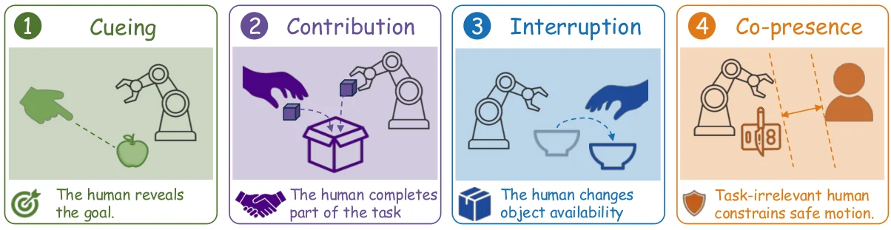

<!-- Generated by scripts/generate.py; edit data/works.json and data/media.json. -->

[← Back to the Awesome index](../../../README.md) · [Interactive website](https://chang-xinhai.github.io/Awesome-RGBDT-Manipulation/?collection=benchmark&item=harp-bench#library)

# HARP-Bench

HARP-Bench: Benchmarking Robot Manipulation Around Active Humans

**2026-11-08 · CoRL 2026 · University of Massachusetts Amherst**

**[Paper](https://arxiv.org/abs/2611.11123)** · [Code](https://github.com/UMass-Embodied-AGI/harp)

An avatar-driven simulation suite evaluates robot manipulation while people cue, contribute, interrupt or share the workspace.

*HARP-Bench authors · [Figure source](https://arxiv.org/html/2611.11123) · Original rights retained.*

| Field | Reported value and source scope |
| :-- | :-- |
| Record type | benchmark |
| Simulator | Genesis [1](https://arxiv.org/abs/2611.11123)  |
| Simulator version and scope | Not reported [1](https://arxiv.org/abs/2611.11123)  |
| Task count and scope | 37 simulated tasks; separate real-world study on one task family [1](https://arxiv.org/abs/2611.11123)  |
| Task-list scope | Examples from the 37-task simulated table; not a complete task list. [1](https://arxiv.org/abs/2611.11123)  |
| Capability dimensions | Human-aware manipulation · Recovery · Safety [1](https://arxiv.org/abs/2611.11123)  |
| Metrics | Task success and collision-free success [1](https://arxiv.org/abs/2611.11123)  |
| Robots | Simulated manipulation embodiments; separate physical setup [1](https://arxiv.org/abs/2611.11123)  |
| Sensors and observations | Visual robot observations, robot state and language; human activity in scene [1](https://arxiv.org/abs/2611.11123)  |
| Data collection method | Scripted simulator experts generate synchronized demonstrations with avatar events. [1](https://arxiv.org/abs/2611.11123)  |
| Demonstrations and data | Recorded demonstrations supported; download scope not verified. [1](https://arxiv.org/abs/2611.11123)  |
| Evaluation protocol | Cueing, contribution, interruption and co-presence conditions; one real-world task family studied separately. [1](https://arxiv.org/abs/2611.11123)  |
| Evaluated baselines | ACT, Diffusion Policy, π0 and SmolVLA; privileged and no-intent experts are separate references. [1](https://arxiv.org/abs/2611.11123)  |
| Observations / modalities | RGB · Proprioception · Language |
| Evaluation domain | Simulation · Real world |
| Embodiment |  |
| Release: code | Available — simulation task and evaluation source [2](https://github.com/UMass-Embodied-AGI/harp)  |
| Release: weights | Not verified [2](https://github.com/UMass-Embodied-AGI/harp)  |
| Release: data | Demonstration generation supported; complete dataset release not verified [2](https://github.com/UMass-Embodied-AGI/harp)  |
| Release: license | Not verified [2](https://github.com/UMass-Embodied-AGI/harp)  |
| Release: notes | Code repository inspected; external assets and learned baselines have separate terms. [2](https://github.com/UMass-Embodied-AGI/harp)  |

**Task names — Examples from the 37-task simulated table; not a complete task list.:**

- Deliver to Human
- Pour Water
- Oil Bottle Recovery
- Open Microwave

**Scope and qualifications**

- Real-world results apply to one task family and must not be extrapolated to all 37 simulated tasks.

**Primary evidence**

1. [Author paper and first submission](https://arxiv.org/abs/2611.11123)
2. [Official code and artifact scope](https://github.com/UMass-Embodied-AGI/harp)
