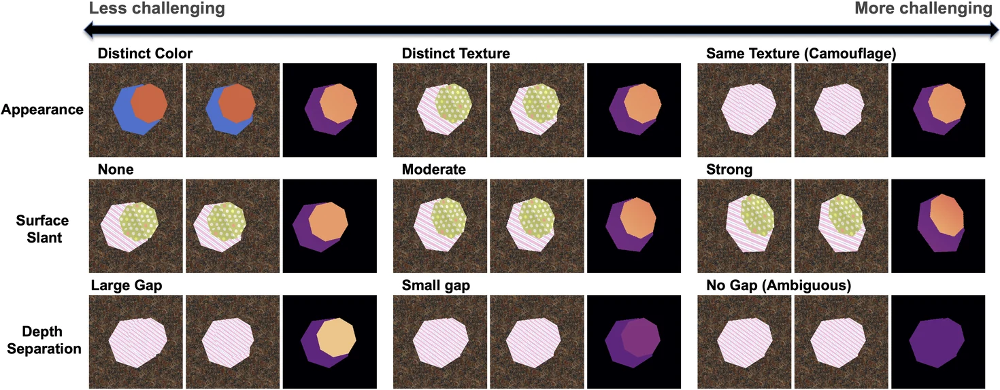

<!-- Generated by scripts/generate.py; edit data/works.json and data/media.json. -->

[← Back to the Awesome index](../../../README.md) · [Interactive website](https://chang-xinhai.github.io/Awesome-RGBDT-Manipulation/?collection=benchmark&item=hdit-stereo#library)

# Stereo Shape Priors · Controlled Polygons

Do Deep Stereo Models Learn Shape Priors?

**2026-11-18 · Preprint · Harvard University**

**[Paper](https://arxiv.org/abs/2611.25113)**

Controlled stereo experiments isolate shape priors and weak boundary evidence. A conditional generator jointly models disparity and object boundaries.

*Linbo Tang, Aneel Damaraju and Todd Zickler · [Figure source](https://arxiv.org/html/2611.25113v1) · Original rights retained.*

| Field | Reported value and source scope |
| :-- | :-- |
| Record type | Perception benchmark |
| Simulator | Not applicable [1](https://arxiv.org/html/2611.25113v1)  |
| Simulator version and scope | Not applicable [1](https://arxiv.org/html/2611.25113v1)  |
| Task count and scope | Supporting dataset or perception evaluation [1](https://arxiv.org/html/2611.25113v1)  |
| Task-list scope | Listed uses of the resource, with no closed-loop robot task count. [1](https://arxiv.org/html/2611.25113v1)  |
| Capability dimensions | Training and evaluation data [1](https://arxiv.org/html/2611.25113v1)  |
| Metrics | Disparity error and boundary localization metrics. [1](https://arxiv.org/html/2611.25113v1)  |
| Robots | Not applicable [1](https://arxiv.org/html/2611.25113v1)  |
| Sensors and observations | Rendered stereo color pairs, disparity, object support and amodal masks. [1](https://arxiv.org/html/2611.25113v1)  |
| Data collection method | Procedurally vary polygon shape, slant, color, texture and cue similarity. [1](https://arxiv.org/html/2611.25113v1)  |
| Demonstrations and data | Dataset described by the paper; download not verified. [1](https://arxiv.org/html/2611.25113v1)  |
| Evaluation protocol | Tests dependence on local image evidence and learned global shape priors under controlled shifts. [1](https://arxiv.org/html/2611.25113v1)  |
| Evaluated baselines | RAFT-Stereo, Selective-IGEV, MonSter and DEFOM-Stereo under zero-shot, fine-tuning and scratch variants. [1](https://arxiv.org/html/2611.25113v1)  |
| Observations / modalities | RGB |
| Evaluation domain | Simulation |
| Embodiment |  |
| Release: code | Not verified |
| Release: weights | Not verified |
| Release: data | Not verified |
| Release: license | Not verified |
| Release: notes | Paper and figures are public. Implementation, weights and downloadable dataset were not verified. |

**Task names — Listed uses of the resource, with no closed-loop robot task count.:**

- Texture similarity stress test
- Depth similarity stress test
- Contour recovery

**Scope and qualifications**

- Synthetic planar shapes isolate a failure mechanism; results do not establish general scene performance.

**Primary evidence**

1. [Original author paper or dataset description](https://arxiv.org/html/2611.25113v1)
