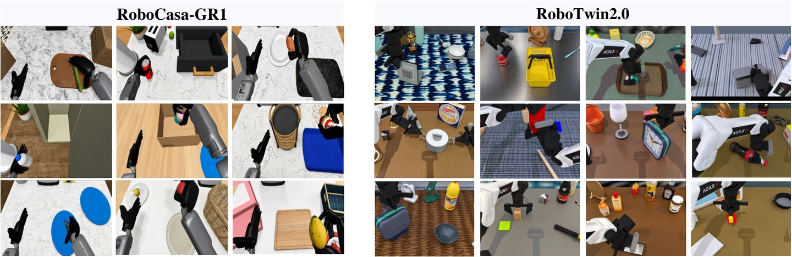

<!-- Generated by scripts/generate.py; edit data/works.json and data/media.json. -->

[← Back to the Awesome index](../../../README.md) · [Interactive website](https://chang-xinhai.github.io/Awesome-RGBDT-Manipulation/?collection=benchmark&item=hive-bench#library)

# HIVE-Bench

HIVE-Bench: Evaluating Patch-Level Visual Representations for Egocentric Robot Manipulation

**2026-11-23 · Preprint · HKUST (Guangzhou) and collaborators**

**[Paper](https://arxiv.org/abs/2611.30813)** · [Code](https://github.com/KolaKivy/HIVE-Bench) · [Data](https://huggingface.co/datasets/zhengtu666/HIVE-Bench-Data) · [Weights](https://huggingface.co/zhengtu666/HIVE-Bench)

Holds a patch-conditioned action head fixed to compare visual encoders across egocentric bimanual robot tasks.

*Qiwei Liang and coauthors · [Figure source](https://arxiv.org/html/2611.30813v1) · Original rights retained.*

| Field | Reported value and source scope |
| :-- | :-- |
| Record type | benchmark |
| Simulator | RoboCasa-GR1 and RoboTwin 2.0 [1](https://arxiv.org/html/2611.30813v1) [2](https://github.com/KolaKivy/HIVE-Bench#readme)  |
| Simulator version and scope | Not reported [1](https://arxiv.org/html/2611.30813v1) [2](https://github.com/KolaKivy/HIVE-Bench#readme)  |
| Task count and scope | 24 egocentric bimanual tasks: 12 per suite; 20 encoders from 7 families [1](https://arxiv.org/html/2611.30813v1) [2](https://github.com/KolaKivy/HIVE-Bench#readme)  |
| Task-list scope | Examples from the two suites. Encoder and ablation counts are not task counts. [1](https://arxiv.org/html/2611.30813v1) [2](https://github.com/KolaKivy/HIVE-Bench#readme)  |
| Capability dimensions | Egocentric patch representation comparison · Data efficiency · Frozen vs adapted encoding [1](https://arxiv.org/html/2611.30813v1) [2](https://github.com/KolaKivy/HIVE-Bench#readme)  |
| Metrics | Task success under fixed action-head/data settings and a separate suite of representation probes. [1](https://arxiv.org/html/2611.30813v1) [2](https://github.com/KolaKivy/HIVE-Bench#readme)  |
| Robots | RoboCasa-GR1 humanoid with 29-D actions; RoboTwin two-arm grippers with 14-D joint actions. [1](https://arxiv.org/html/2611.30813v1) [2](https://github.com/KolaKivy/HIVE-Bench#readme)  |
| Sensors and observations | RoboCasa head RGB; RoboTwin head and two wrist RGB views; state/action interfaces are benchmark specific. [1](https://arxiv.org/html/2611.30813v1) [2](https://github.com/KolaKivy/HIVE-Bench#readme)  |
| Data collection method | Reuse benchmark task demonstrations and train a common flow-matching action head on frozen or fine-tuned encoder patch tokens. [1](https://arxiv.org/html/2611.30813v1) [2](https://github.com/KolaKivy/HIVE-Bench#readme)  |
| Demonstrations and data | Up to 1,000 RoboCasa and 500 RoboTwin demos per applicable task setting, as stated by the repository. [1](https://arxiv.org/html/2611.30813v1) [2](https://github.com/KolaKivy/HIVE-Bench#readme)  |
| Evaluation protocol | Compare frozen/fine-tuned and single/multi-task settings, distinguishing setup-specific run coverage. [1](https://arxiv.org/html/2611.30813v1) [2](https://github.com/KolaKivy/HIVE-Bench#readme)  |
| Evaluated baselines | Twenty image, VLM, robotic, video and 3D-pretrained vision encoders through a fixed action head. [1](https://arxiv.org/html/2611.30813v1) [2](https://github.com/KolaKivy/HIVE-Bench#readme)  |
| Observations / modalities | RGB · Proprioception · Language |
| Evaluation domain | Simulation |
| Embodiment | Dexterous hand · Bimanual · Parallel-jaw gripper |
| Release: code | Available — RoboTwin and RoboCasa training and evaluation guides [2](https://github.com/KolaKivy/HIVE-Bench#readme)  |
| Release: weights | Author model collection; checkpoint scope varies by encoder and benchmark track [2](https://github.com/KolaKivy/HIVE-Bench#readme)  |
| Release: data | Author data collection links and release metadata [2](https://github.com/KolaKivy/HIVE-Bench#readme)  |
| Release: license | Check source and individual third-party components [2](https://github.com/KolaKivy/HIVE-Bench#readme)  |
| Release: notes | Paper or official project reviewed. Code, weights and data are tracked independently. [2](https://github.com/KolaKivy/HIVE-Bench#readme)  |

**Task names — Examples from the two suites. Encoder and ablation counts are not task counts.:**

- Cabinet manipulation
- Object transfer
- Hammer and block
- Laptop manipulation

**Scope and qualifications**

- Depth and pointmap pretraining objectives of some encoders are not measured-depth streams for the shared action policy. Public checks are simulated.

**Primary evidence**

1. [Original paper and evaluation settings](https://arxiv.org/html/2611.30813v1)
2. [Public implementation, evaluation families, data and model bundle links](https://github.com/KolaKivy/HIVE-Bench#readme)
