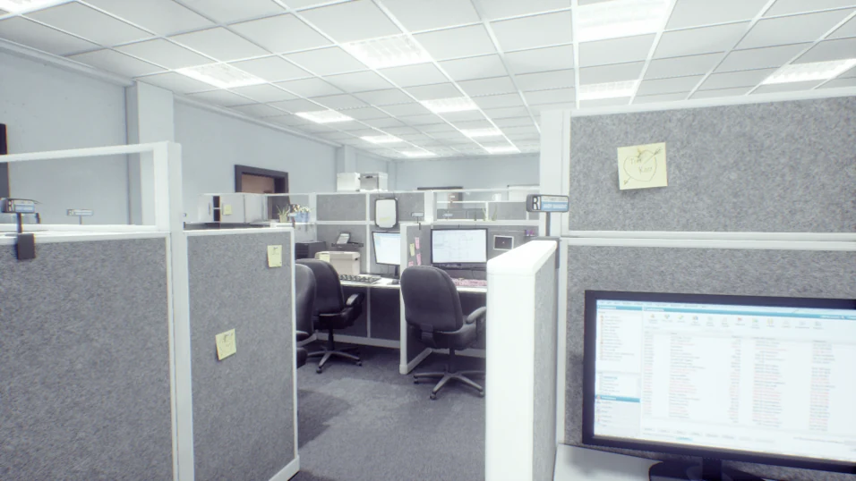

<!-- Generated by scripts/generate.py; edit data/works.json and data/media.json. -->

[← Back to the Awesome index](../../../README.md) · [Interactive website](https://chang-xinhai.github.io/Awesome-RGBDT-Manipulation/?collection=benchmark&item=irs-stereo#library)

# IRS

IRS: A Large Naturalistic Indoor Robotics Stereo Dataset to Train Deep Models for Disparity and Surface Normal Estimation

**2019-12-20 · Preprint and dataset · Hong Kong Baptist University and collaborators**

**[Paper](https://arxiv.org/abs/1912.09678)** · [Project](https://github.com/HKBU-HPML/IRS) · [Code](https://github.com/HKBU-HPML/IRS) · [Data](https://github.com/HKBU-HPML/IRS#download)

Synthetic indoor robotics stereo has RGB, rendered disparity, and normals in homes, offices, stores and restaurants.

*IRS authors · [Figure source](https://github.com/HKBU-HPML/IRS) · Original rights retained.*

| Field | Reported value and source scope |
| :-- | :-- |
| Record type | dataset |
| Simulator | Synthetic scene renderer [1](https://arxiv.org/abs/1912.09678) [3](https://github.com/HKBU-HPML/IRS)  |
| Simulator version and scope | Not reported [1](https://arxiv.org/abs/1912.09678) [3](https://github.com/HKBU-HPML/IRS)  |
| Task count and scope | Supporting dataset or perception evaluation [1](https://arxiv.org/abs/1912.09678) [3](https://github.com/HKBU-HPML/IRS)  |
| Task-list scope | Listed uses of the resource, with no closed-loop robot task count. [1](https://arxiv.org/abs/1912.09678) [3](https://github.com/HKBU-HPML/IRS)  |
| Capability dimensions | Training and evaluation data [1](https://arxiv.org/abs/1912.09678) [3](https://github.com/HKBU-HPML/IRS)  |
| Metrics | Disparity and surface-normal errors measured separately. [1](https://arxiv.org/abs/1912.09678) [3](https://github.com/HKBU-HPML/IRS)  |
| Robots | Not applicable [1](https://arxiv.org/abs/1912.09678) [3](https://github.com/HKBU-HPML/IRS)  |
| Sensors and observations | Synthetic visible RGB, rendered disparity and normals. [1](https://arxiv.org/abs/1912.09678) [3](https://github.com/HKBU-HPML/IRS)  |
| Data collection method | Render naturalistic indoor room scenes with varied illumination and reflective objects. [1](https://arxiv.org/abs/1912.09678) [3](https://github.com/HKBU-HPML/IRS)  |
| Demonstrations and data | Author repository reports 103,316 samples, covering varied indoor room categories. [1](https://arxiv.org/abs/1912.09678) [3](https://github.com/HKBU-HPML/IRS)  |
| Evaluation protocol | Follow the authored train/test lists for disparity and surface-normal estimation. [1](https://arxiv.org/abs/1912.09678) [3](https://github.com/HKBU-HPML/IRS)  |
| Evaluated baselines | Not applicable [1](https://arxiv.org/abs/1912.09678) [3](https://github.com/HKBU-HPML/IRS)  |
| Observations / modalities | RGB |
| Evaluation domain | Simulation |
| Embodiment |  |
| Release: code | Available — author network and data readers [2](https://github.com/HKBU-HPML/IRS) [3](https://github.com/HKBU-HPML/IRS)  |
| Release: weights | Not verified [2](https://github.com/HKBU-HPML/IRS) [3](https://github.com/HKBU-HPML/IRS)  |
| Release: data | Official OneDrive archive and train/test lists [2](https://github.com/HKBU-HPML/IRS) [3](https://github.com/HKBU-HPML/IRS)  |
| Release: license | Not verified [2](https://github.com/HKBU-HPML/IRS) [3](https://github.com/HKBU-HPML/IRS)  |
| Release: notes | The author-documented dataset is a named component of S²M²’s expanded training. [2](https://github.com/HKBU-HPML/IRS) [3](https://github.com/HKBU-HPML/IRS)  |

**Task names — Listed uses of the resource, with no closed-loop robot task count.:**

- Indoor stereo matching
- Surface normal estimation

**Primary evidence**

1. [Original author paper or dataset description](https://arxiv.org/abs/1912.09678)
2. [Author source and artifact entry points](https://github.com/HKBU-HPML/IRS)
3. [Official dataset scope and format](https://github.com/HKBU-HPML/IRS)
4. [ICCV supplementary §1.1 identifies IRS in expanded training](https://openaccess.thecvf.com/content/ICCV2025/supplemental/Min_S2M2_Scalable_Stereo_ICCV_2025_supplemental.pdf)
