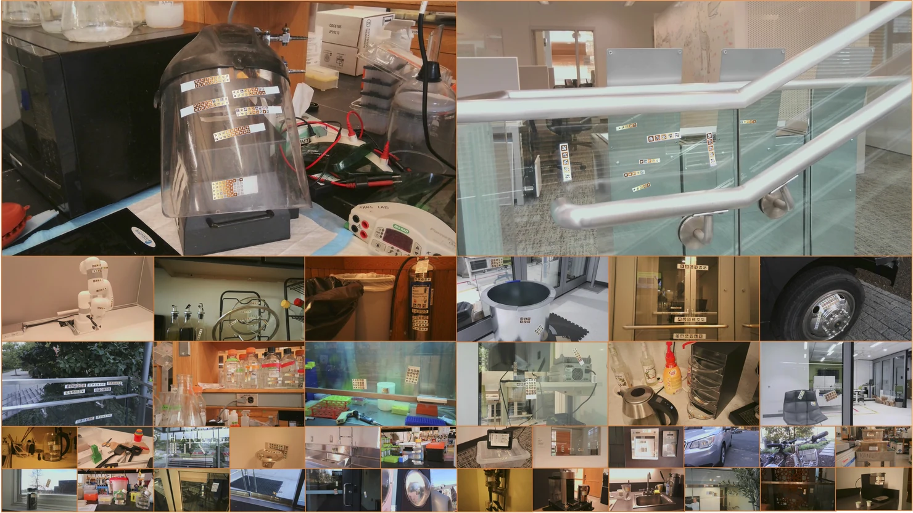

<!-- Generated by scripts/generate.py; edit data/works.json and data/media.json. -->

[← Back to the Awesome index](../../../README.md) · [Interactive website](https://chang-xinhai.github.io/Awesome-RGBDT-Manipulation/?collection=benchmark&item=layeredflow#library)

# LayeredFlow

LayeredFlow: A Real-World Benchmark for Non-Lambertian Multi-Layer Optical Flow

**2024-09-09 · ECCV 2024 · Princeton University**

**[Paper](https://arxiv.org/abs/2409.05688)** · [Project](https://layeredflow.cs.princeton.edu/) · [Code](https://github.com/princeton-vl/LayeredFlow) · [Data](https://github.com/princeton-vl/LayeredFlow#download) · [Synthetic Data](https://huggingface.co/datasets/princeton-vl/LayeredFlow-Syn)

Real stereo and flow captures plus a separate synthetic training resource for transparent and specular objects.

*LayeredFlow authors · [Figure source](https://layeredflow.cs.princeton.edu/) · Original rights retained.*

| Field | Reported value and source scope |
| :-- | :-- |
| Record type | dataset |
| Simulator | Not applicable [1](https://arxiv.org/html/2409.05688v1)  |
| Simulator version and scope | Not applicable [1](https://arxiv.org/html/2409.05688v1)  |
| Task count and scope | Supporting dataset or perception evaluation [1](https://arxiv.org/html/2409.05688v1)  |
| Task-list scope | Listed uses of the resource, with no closed-loop robot task count. [1](https://arxiv.org/html/2409.05688v1)  |
| Capability dimensions | Training and evaluation data [1](https://arxiv.org/html/2409.05688v1)  |
| Metrics | End-point error and bad-τ on the applicable sampled layer. [1](https://arxiv.org/html/2409.05688v1) [4](https://www.ecva.net/papers/eccv_2024/papers_ECCV/papers/00289-supp.pdf)  |
| Robots | Not applicable [1](https://arxiv.org/html/2409.05688v1)  |
| Sensors and observations | Real stereo RGB with sparse, multilayer correspondences and separate synthetic annotations. [1](https://arxiv.org/html/2409.05688v1)  |
| Data collection method | Outdoor and indoor capture of non-Lambertian objects plus procedural simulation in a distinct collection. [1](https://arxiv.org/html/2409.05688v1)  |
| Demonstrations and data | Paper describes 150K optical-flow and stereo pairs across 185 scenes and 360 objects, and 60K synthetic images across 30 scenes. [1](https://arxiv.org/html/2409.05688v1) [3](https://github.com/princeton-vl/LayeredFlow)  |
| Evaluation protocol | Real train/validation/test roles and synthetic generator differ. Supplement evaluates stereo matching on first-layer points. [1](https://arxiv.org/html/2409.05688v1) [4](https://www.ecva.net/papers/eccv_2024/papers_ECCV/papers/00289-supp.pdf)  |
| Evaluated baselines | Not applicable [1](https://arxiv.org/html/2409.05688v1)  |
| Observations / modalities | RGB |
| Evaluation domain | Simulation · Real world |
| Embodiment |  |
| Release: code | Available — benchmark tooling and synthetic generator [2](https://layeredflow.cs.princeton.edu/) [3](https://github.com/princeton-vl/LayeredFlow)  |
| Release: weights | Available — author-linked optical-flow checkpoints [2](https://layeredflow.cs.princeton.edu/) [3](https://github.com/princeton-vl/LayeredFlow)  |
| Release: data | Available — real validation/test archive and separate synthetic data [2](https://layeredflow.cs.princeton.edu/) [3](https://github.com/princeton-vl/LayeredFlow)  |
| Release: license | Not verified [2](https://layeredflow.cs.princeton.edu/) [3](https://github.com/princeton-vl/LayeredFlow)  |
| Release: notes | The real test payload omits hidden ground truth; synthetic training is distributed separately. [2](https://layeredflow.cs.princeton.edu/) [3](https://github.com/princeton-vl/LayeredFlow)  |

**Task names — Listed uses of the resource, with no closed-loop robot task count.:**

- Multilayer optical flow
- First-layer stereo matching

**Scope and qualifications**

- The paper’s combined flow/stereo figure does not specify a count of dense disparity-labeled stereo pairs.

**Primary evidence**

1. [Original author paper or dataset description](https://arxiv.org/html/2409.05688v1)
2. [Author source and artifact entry points](https://layeredflow.cs.princeton.edu/)
3. [Author download and synthetic generation documentation](https://github.com/princeton-vl/LayeredFlow)
4. [ECCV supplement, first-layer stereo evaluation](https://www.ecva.net/papers/eccv_2024/papers_ECCV/papers/00289-supp.pdf)
