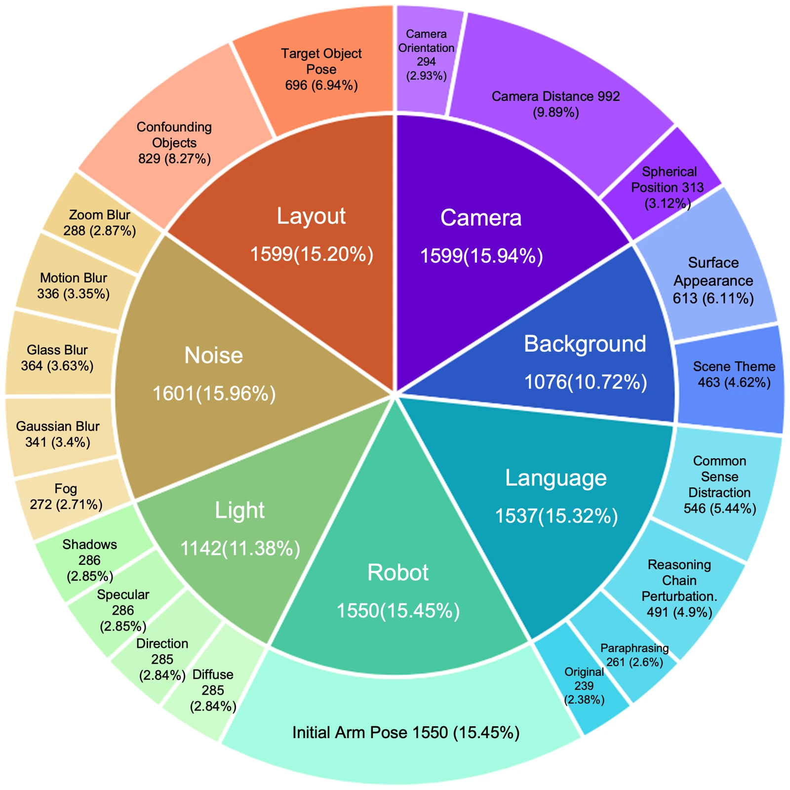

<!-- Generated by scripts/generate.py; edit data/works.json and data/media.json. -->

[← Back to the Awesome index](../../../README.md) · [Interactive website](https://chang-xinhai.github.io/Awesome-RGBDT-Manipulation/?collection=benchmark&item=libero-plus#library)

# LIBERO-Plus

LIBERO-Plus: A Progressive Robustness Benchmark for Visual-Language-Action Models

**2025-10-15 · CVPR 2026 · Fudan University / Tongji University / Shanghai Innovation Institute**

**[Paper](https://arxiv.org/abs/2510.13626)** · [Project](https://sylvestf.github.io/LIBERO-plus/) · [Code](https://github.com/sylvestf/LIBERO-plus) · [Data](https://huggingface.co/collections/Sylvest/libero-plus)

Automated perturbation generation and progressive difficulty for seven robustness axes built on LIBERO manipulation tasks.

*LIBERO-Plus authors · [Figure source](https://arxiv.org/abs/2510.13626) · Original rights retained.*

| Field | Reported value and source scope |
| :-- | :-- |
| Record type | benchmark |
| Simulator | MuJoCo / robosuite / LIBERO fork [1](https://arxiv.org/abs/2510.13626) [2](https://sylvestf.github.io/LIBERO-plus/)  |
| Simulator version and scope | Release version varies; exact MuJoCo pin Not verified from upstream source. Downstream model-repo pins should not be presented as benchmark paper version. [1](https://arxiv.org/abs/2510.13626) [2](https://sylvestf.github.io/LIBERO-plus/) [3](https://github.com/sylvestf/LIBERO-plus)  |
| Task count and scope | 10,030 generated task–perturbation configurations over seven axes / twenty-one components; not 10,030 new semantic skills. [1](https://arxiv.org/abs/2510.13626) [2](https://sylvestf.github.io/LIBERO-plus/)  |
| Task-list scope | Complete seven perturbation axes; semantic tasks inherited from LIBERO and generated configuration manifest defines all 10,030 variants. [1](https://arxiv.org/abs/2510.13626) [2](https://sylvestf.github.io/LIBERO-plus/)  |
| Capability dimensions | Progressive robustness · Language reliance · Camera/layout invariance · Sensor corruption [1](https://arxiv.org/abs/2510.13626) [2](https://sylvestf.github.io/LIBERO-plus/)  |
| Metrics | Success per perturbation/component/difficulty level; robustness degradation; generalization after expanded training. [1](https://arxiv.org/abs/2510.13626) [2](https://sylvestf.github.io/LIBERO-plus/)  |
| Robots | Franka Panda in LIBERO [1](https://arxiv.org/abs/2510.13626) [2](https://sylvestf.github.io/LIBERO-plus/)  |
| Sensors and observations | RGB, proprioception and language; sensor noise corrupts visual inputs rather than introducing tactile streams. [1](https://arxiv.org/abs/2510.13626) [2](https://sylvestf.github.io/LIBERO-plus/)  |
| Data collection method | Original LIBERO human-teleoperated training demonstrations are reused; perturbations generate evaluation instances. The collector for additional reported trajectories is Not verified. [1](https://arxiv.org/abs/2510.13626) [2](https://sylvestf.github.io/LIBERO-plus/) [4](https://arxiv.org/abs/2510.13626)  |
| Demonstrations and data | Original LIBERO training; expanded generalization dataset includes 22,400 successful trajectories in manuscript study. [1](https://arxiv.org/abs/2510.13626) [2](https://sylvestf.github.io/LIBERO-plus/)  |
| Evaluation protocol | Zero-shot perturbation evaluation of LIBERO-trained checkpoints; generated configurations grouped into five difficulty levels; separate retraining experiments on generalized sets. [1](https://arxiv.org/abs/2510.13626) [2](https://sylvestf.github.io/LIBERO-plus/)  |
| Evaluated baselines | Ten models in accepted study; generated suite stratification uses OpenVLA-OFT, π0, π0-fast and UniVLA. [1](https://arxiv.org/abs/2510.13626) [2](https://sylvestf.github.io/LIBERO-plus/)  |
| Observations / modalities | RGB · Proprioception · Language |
| Evaluation domain | Simulation |
| Embodiment | Parallel-jaw gripper |
| Release: code | Available [3](https://github.com/sylvestf/LIBERO-plus)  |
| Release: weights | Not applicable [3](https://github.com/sylvestf/LIBERO-plus)  |
| Release: data | Available [3](https://github.com/sylvestf/LIBERO-plus)  |
| Release: license | Not verified [3](https://github.com/sylvestf/LIBERO-plus)  |
| Release: notes | Perturbation assets/configurations and data released; policies are external checkpoints. [3](https://github.com/sylvestf/LIBERO-plus)  |

**Task names — Complete seven perturbation axes; semantic tasks inherited from LIBERO and generated configuration manifest defines all 10,030 variants.:**

- Object layouts
- Camera viewpoints
- Robot initial states
- Language instructions
- Lighting conditions
- Background textures
- Sensor noise

**Scope and qualifications**

- arXiv title is In-depth Robustness Analysis; accepted CVPR title is A Progressive Robustness Benchmark.
- 10,030 counts perturbation configurations, not distinct everyday manipulation skills.

**Primary evidence**

1. [Paper](https://arxiv.org/abs/2510.13626) — Published paper / arXiv record and manuscript.
2. [Official project](https://sylvestf.github.io/LIBERO-plus/) — Public project page.
3. [Official repository](https://github.com/sylvestf/LIBERO-plus) — Current public repository; implementation scope may differ from paper.
4. [Data collection method and scope](https://arxiv.org/abs/2510.13626) — Original method/data protocol reviewed for the collection mechanism. Data volume, evaluation rollouts and downstream training remain separate; undisclosed or unresolved interfaces are labeled explicitly.
5. [Original LIBERO demonstration capture](https://arxiv.org/abs/2306.03310) — Primary source for the human SpaceMouse demonstrations inherited by this benchmark; new evaluation configurations are not a new capture interface.
