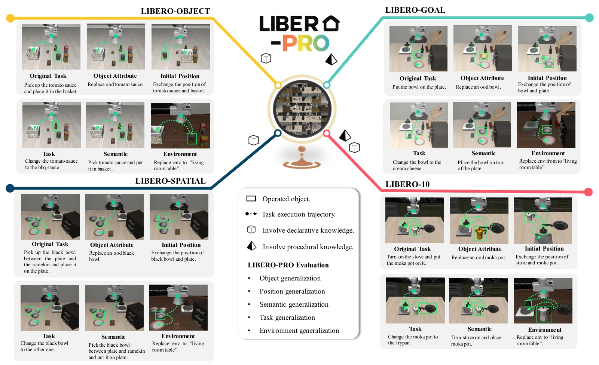

<!-- Generated by scripts/generate.py; edit data/works.json and data/media.json. -->

[← Back to the Awesome index](../../../README.md) · [Interactive website](https://chang-xinhai.github.io/Awesome-RGBDT-Manipulation/?collection=benchmark&item=libero-pro#library)

# LIBERO-PRO

LIBERO-PRO: Towards Robust and Fair Evaluation of Vision-Language-Action Models Beyond Memorization

**2025-10-04 · Preprint · Huazhong University of Science and Technology**

**[Paper](https://arxiv.org/abs/2510.03827)** · [Project](https://zxy-mllab.github.io/LIBERO-PRO-Webpage/) · [Code](https://github.com/Zxy-MLlab/LIBERO-PRO) · [Data](https://huggingface.co/datasets/zhouxueyang/LIBERO-Pro)

LIBERO evaluation extension probing object, position, semantic, task and environment generalization without changing original training data.

*LIBERO-PRO authors · [Figure source](https://arxiv.org/abs/2510.03827) · Original rights retained.*

| Field | Reported value and source scope |
| :-- | :-- |
| Record type | benchmark |
| Simulator | MuJoCo / robosuite / LIBERO fork [1](https://arxiv.org/abs/2510.03827) [2](https://zxy-mllab.github.io/LIBERO-PRO-Webpage/)  |
| Simulator version and scope | Same runtime family as original LIBERO; official README Python 3.8.13. Exact MuJoCo build Not reported here. [1](https://arxiv.org/abs/2510.03827) [2](https://zxy-mllab.github.io/LIBERO-PRO-Webpage/) [3](https://github.com/Zxy-MLlab/LIBERO-PRO)  |
| Task count and scope | Perturbation extensions over four commonly evaluated LIBERO suites; configurable and combinable conditions, not a fixed new semantic task count. [1](https://arxiv.org/abs/2510.03827) [2](https://zxy-mllab.github.io/LIBERO-PRO-Webpage/)  |
| Task-list scope | Complete five current repository axes; paper abstract groups four broader dimensions. Original semantic tasks and generated BDDL/init files define variants. [1](https://arxiv.org/abs/2510.03827) [2](https://zxy-mllab.github.io/LIBERO-PRO-Webpage/)  |
| Capability dimensions | Position robustness · Instruction understanding · Object substitution · Procedural generalization · Environment shift [1](https://arxiv.org/abs/2510.03827) [2](https://zxy-mllab.github.io/LIBERO-PRO-Webpage/)  |
| Metrics | Success under original vs perturbed conditions; instruction/target-dependence diagnostics. [1](https://arxiv.org/abs/2510.03827) [2](https://zxy-mllab.github.io/LIBERO-PRO-Webpage/)  |
| Robots | Franka Panda in LIBERO [1](https://arxiv.org/abs/2510.03827) [2](https://zxy-mllab.github.io/LIBERO-PRO-Webpage/)  |
| Sensors and observations | RGB, proprioception and language; no tactile stream. [1](https://arxiv.org/abs/2510.03827) [2](https://zxy-mllab.github.io/LIBERO-PRO-Webpage/)  |
| Data collection method | Reuses original LIBERO human demonstrations, collected with SpaceMouse teleoperation. New BDDL/initial-state configurations extend evaluation rather than establish a new collection interface. [1](https://arxiv.org/abs/2510.03827) [2](https://zxy-mllab.github.io/LIBERO-PRO-Webpage/) [5](https://arxiv.org/abs/2510.03827)  |
| Demonstrations and data | Original LIBERO demonstrations retained; generated BDDL and initial-state files released for evaluation. [1](https://arxiv.org/abs/2510.03827) [2](https://zxy-mllab.github.io/LIBERO-PRO-Webpage/)  |
| Evaluation protocol | Configure perturbations through YAML; task generalization cannot be combined with other axes in current implementation; compare same trained checkpoint under shifted evaluation. [1](https://arxiv.org/abs/2510.03827) [2](https://zxy-mllab.github.io/LIBERO-PRO-Webpage/)  |
| Evaluated baselines | OpenVLA, π0, π0.5, UniVLA and evolving VLA evaluations. [1](https://arxiv.org/abs/2510.03827) [2](https://zxy-mllab.github.io/LIBERO-PRO-Webpage/)  |
| Observations / modalities | RGB · Proprioception · Language |
| Evaluation domain | Simulation |
| Embodiment | Parallel-jaw gripper |
| Release: code | Available [3](https://github.com/Zxy-MLlab/LIBERO-PRO)  |
| Release: weights | Not applicable [3](https://github.com/Zxy-MLlab/LIBERO-PRO)  |
| Release: data | Available [3](https://github.com/Zxy-MLlab/LIBERO-PRO)  |
| Release: license | MIT code; added assets/data terms separate [3](https://github.com/Zxy-MLlab/LIBERO-PRO) [4](https://github.com/Zxy-MLlab/LIBERO-PRO/blob/master/LICENSE)  |
| Release: notes | Author repository is Zxy-MLlab; RLinf hosts a fork. Official BDDL/init data release linked by README. [3](https://github.com/Zxy-MLlab/LIBERO-PRO)  |

**Task names — Complete five current repository axes; paper abstract groups four broader dimensions. Original semantic tasks and generated BDDL/init files define variants.:**

- Object generalization
- Position generalization
- Semantic generalization
- Task generalization
- Environment generalization

**Scope and qualifications**

- Paper four-dimensional grouping and current repository five axes are different descriptions, not contradictory task totals.
- Use official author source rather than treating a fork as the primary release.

**Primary evidence**

1. [Paper](https://arxiv.org/abs/2510.03827) — Published paper / arXiv record and manuscript.
2. [Official project](https://zxy-mllab.github.io/LIBERO-PRO-Webpage/) — Public project page.
3. [Official repository](https://github.com/Zxy-MLlab/LIBERO-PRO) — Current public repository; implementation scope may differ from paper.
4. [Official source](https://github.com/Zxy-MLlab/LIBERO-PRO/blob/master/LICENSE) — License text read directly; code license does not automatically cover models, data or simulator.
5. [Data collection method and scope](https://arxiv.org/abs/2510.03827) — Original method/data protocol reviewed for the collection mechanism. Data volume, evaluation rollouts and downstream training remain separate; undisclosed or unresolved interfaces are labeled explicitly.
