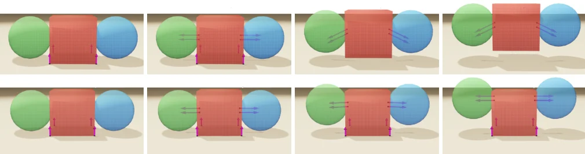

<!-- Generated by scripts/generate.py; edit data/works.json and data/media.json. -->

[← Back to the Awesome index](../../../README.md) · [Interactive website](https://chang-xinhai.github.io/Awesome-RGBDT-Manipulation/?collection=benchmark&item=lodos#library)

# Lodos

Lodos: A Lightweight Simulator Designed for Contact-Rich Interactions with Detailed Meshes

**2026-11-06 · Preprint · University of Tübingen and Max Planck Institute for Intelligent Systems**

**[Paper](https://arxiv.org/abs/2611.08872)** · [Code](https://github.com/martius-lab/lodos)

Uses detailed object meshes for contact dynamics, with accelerator-oriented collision detection and friction handling.

*Lodos authors · [Figure source](https://arxiv.org/html/2611.08872v1) · Original rights retained.*

| Field | Reported value and source scope |
| :-- | :-- |
| Record type | simulator |
| Simulator | Lodos [1](https://arxiv.org/html/2611.08872)  |
| Simulator version and scope | Not reported [1](https://arxiv.org/html/2611.08872)  |
| Task count and scope | Not a fixed manipulation benchmark [1](https://arxiv.org/html/2611.08872)  |
| Task-list scope | Selected examples and simulator comparisons. [1](https://arxiv.org/html/2611.08872)  |
| Capability dimensions | Detailed mesh collision detection, friction and accelerator-oriented dynamics [1](https://arxiv.org/html/2611.08872)  |
| Metrics | Throughput and physical stability across simulator test cases. [1](https://arxiv.org/html/2611.08872)  |
| Robots | Simulated robots and rigid bodies [1](https://arxiv.org/html/2611.08872)  |
| Sensors and observations | Programmatic rigid-body states and contact geometry [1](https://arxiv.org/html/2611.08872)  |
| Data collection method | Not applicable — physics examples rather than imitation trajectories. [1](https://arxiv.org/html/2611.08872)  |
| Demonstrations and data | Executable simulator examples and external assets. [1](https://arxiv.org/html/2611.08872)  |
| Evaluation protocol | Compare runtime and mechanics under different contact and geometry settings. [1](https://arxiv.org/html/2611.08872)  |
| Evaluated baselines | Established rigid-body simulation engines; see source-paper comparisons for settings. [1](https://arxiv.org/html/2611.08872)  |
| Observations / modalities |  |
| Evaluation domain | Simulation |
| Embodiment |  |
| Release: code | Available — simulator, benchmarks and viewer [2](https://github.com/martius-lab/lodos)  |
| Release: weights | Not applicable [2](https://github.com/martius-lab/lodos)  |
| Release: data | Public source examples; external mesh/model assets are separately licensed [2](https://github.com/martius-lab/lodos)  |
| Release: license | MIT original source; other assets have separate terms [2](https://github.com/martius-lab/lodos)  |
| Release: notes | Verified lodos/, bench/ and viewer/ in the official repository. [2](https://github.com/martius-lab/lodos)  |

**Task names — Selected examples and simulator comparisons.:**

- Antipodal pinch and lift
- Dexterous grasp simulation
- Mesh contact scenarios

**Scope and qualifications**

- This is supporting contact simulation infrastructure. Pinching and dexterous-contact examples test simulator behavior, without a manipulation leaderboard.

**Primary evidence**

1. [Primary paper and evaluated setting](https://arxiv.org/html/2611.08872)
2. [Official repository and public artifact inventory](https://github.com/martius-lab/lodos) — Official MIT source, benchmark examples and viewer.
