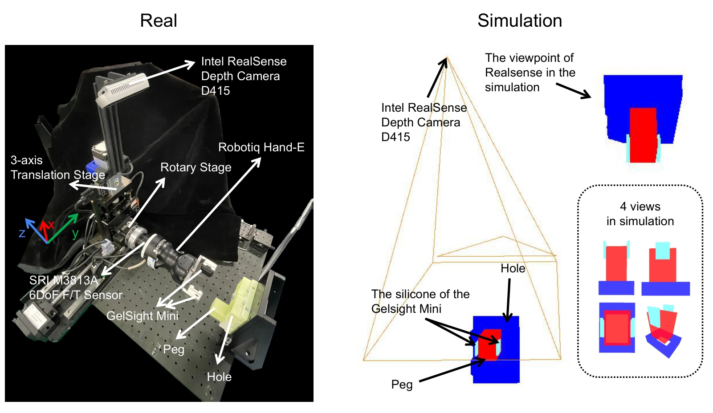

<!-- Generated by scripts/generate.py; edit data/works.json and data/media.json. -->

[← Back to the Awesome index](../../../README.md) · [Interactive website](https://chang-xinhai.github.io/Awesome-RGBDT-Manipulation/?collection=benchmark&item=maniskill-vitac-2025#library)

# ManiSkill-ViTac 2025

ManiSkill-ViTac 2025: Challenge on Manipulation Skill Learning With Vision and Tactile Sensing

**2024-11-19 · ICRA 2025 workshop challenge · Tsinghua University**

**[Paper](https://arxiv.org/abs/2411.12503)** · [Project](https://ai-workshops.github.io/maniskill-vitac-challenge-2025/) · [Code](https://github.com/cyliizyz/ManiSkill-ViTac2025)

Challenge combining tactile-only transfer, tactile-plus-depth fusion and tactile-sensor structure design with physical finalist evaluation.

*ManiSkill-ViTac 2025 authors · [Figure source](https://arxiv.org/abs/2411.12503) · Original rights retained.*

| Field | Reported value and source scope |
| :-- | :-- |
| Record type | benchmark |
| Simulator | SAPIEN / IPC-based high-fidelity tactile simulation (challenge-specific platform) [1](https://arxiv.org/abs/2411.12503) [2](https://ai-workshops.github.io/maniskill-vitac-challenge-2025/)  |
| Simulator version and scope | Official README: install SAPIEN 3.0.0b1 before SapienIPC. [1](https://arxiv.org/abs/2411.12503) [2](https://ai-workshops.github.io/maniskill-vitac-challenge-2025/) [3](https://github.com/cyliizyz/ManiSkill-ViTac2025)  |
| Task count and scope | 3 tracks; tactile-only track has 2 tasks; depth-fusion track has 1 peg-selection/insertion task; sensor-design track evaluates a modified sensor. [1](https://arxiv.org/abs/2411.12503) [2](https://ai-workshops.github.io/maniskill-vitac-challenge-2025/)  |
| Task-list scope | Complete manipulation task families; tracks and object-shape variants are not separate tasks. [1](https://arxiv.org/abs/2411.12503) [2](https://ai-workshops.github.io/maniskill-vitac-challenge-2025/)  |
| Capability dimensions | Unseen peg/key shape generalization · Tactile insertion · Depth-based hole selection and approach · Sensor morphology design [1](https://arxiv.org/abs/2411.12503) [2](https://ai-workshops.github.io/maniskill-vitac-challenge-2025/)  |
| Metrics | Track 1: 50×SR(peg)+50×SR(lock); Track 2: 100×SR; Track 3: 50×SR+50×subjective score. Physical stage determines final ranking for manipulation tracks. [1](https://arxiv.org/abs/2411.12503) [2](https://ai-workshops.github.io/maniskill-vitac-challenge-2025/)  |
| Robots | Matched simulated and physical parallel-gripper manipulation platform. [1](https://arxiv.org/abs/2411.12503) [2](https://ai-workshops.github.io/maniskill-vitac-challenge-2025/)  |
| Sensors and observations | GelSight Mini marker-based tactile sensing; Track 2 adds RealSense D415 depth with semantic segmentation. [1](https://arxiv.org/abs/2411.12503) [2](https://ai-workshops.github.io/maniskill-vitac-challenge-2025/)  |
| Data collection method | Task-specific simulator interaction supports skill learning; a uniform demonstration collector or teleoperation interface is Not reported in the challenge overview. [1](https://arxiv.org/abs/2411.12503) [2](https://ai-workshops.github.io/maniskill-vitac-challenge-2025/) [5](https://arxiv.org/abs/2411.12503)  |
| Demonstrations and data | Simulation training environment and baseline resources; standardized full demonstration corpus count Not reported. [1](https://arxiv.org/abs/2411.12503) [2](https://ai-workshops.github.io/maniskill-vitac-challenge-2025/)  |
| Evaluation protocol | Sim evaluation followed by physical checkpoint submission for advancing teams. Held-out peg/key shapes; Track 2 increases reach distance and requires selecting matching hole. [1](https://arxiv.org/abs/2411.12503) [2](https://ai-workshops.github.io/maniskill-vitac-challenge-2025/)  |
| Evaluated baselines | Provided TD3 tactile policy training / pretrained challenge baseline checkpoints. [1](https://arxiv.org/abs/2411.12503) [2](https://ai-workshops.github.io/maniskill-vitac-challenge-2025/)  |
| Observations / modalities | Depth · Tactile · Proprioception |
| Evaluation domain | Simulation · Real world |
| Embodiment | Parallel-jaw gripper |
| Release: code | Available [3](https://github.com/cyliizyz/ManiSkill-ViTac2025) [4](https://github.com/cyliizyz/ManiSkill-ViTac2025)  |
| Release: weights | Available [3](https://github.com/cyliizyz/ManiSkill-ViTac2025) [4](https://github.com/cyliizyz/ManiSkill-ViTac2025)  |
| Release: data | Not reported [3](https://github.com/cyliizyz/ManiSkill-ViTac2025) [4](https://github.com/cyliizyz/ManiSkill-ViTac2025)  |
| Release: license | Not verified [3](https://github.com/cyliizyz/ManiSkill-ViTac2025) [4](https://github.com/cyliizyz/ManiSkill-ViTac2025)  |
| Release: notes | Official repository and cyliizyz/ManiSkill-ViTac2025_ckpt checkpoint link verified. [3](https://github.com/cyliizyz/ManiSkill-ViTac2025) [4](https://github.com/cyliizyz/ManiSkill-ViTac2025)  |

**Task names — Complete manipulation task families; tracks and object-shape variants are not separate tasks.:**

- Peg insertion
- Lock opening
- Tactile-vision-fusion peg insertion

**Scope and qualifications**

- Input permissions differ by track; depth is permitted in Track 2 but not tactile-only Track 1.
- The 2026 edition changes to real-world bimanual tasks and should not be merged into the same task count.

**Primary evidence**

1. [Paper](https://arxiv.org/abs/2411.12503) — Published paper / arXiv record and manuscript.
2. [Official project](https://ai-workshops.github.io/maniskill-vitac-challenge-2025/) — Public project page.
3. [Official repository](https://github.com/cyliizyz/ManiSkill-ViTac2025) — Current public repository; implementation scope may differ from paper.
4. [Official source](https://github.com/cyliizyz/ManiSkill-ViTac2025) — Official challenge page linked cyliizyz repository, not the earlier provisional guessed owner.
5. [Data collection method and scope](https://arxiv.org/abs/2411.12503) — Original method/data protocol reviewed for the collection mechanism. Data volume, evaluation rollouts and downstream training remain separate; undisclosed or unresolved interfaces are labeled explicitly.
